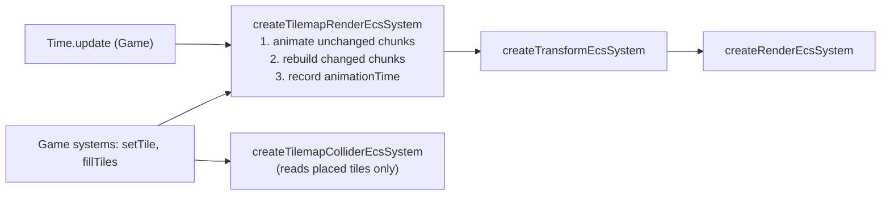

<!-- cspell:words tilemap tilemaps tileset tilesets texel texels tileid -->

# Animated tiles

Issue: [#830](https://github.com/Forge-Game-Engine/Forge/issues/830)
(milestone "Tilemaps"; builds on [tile sets and tilemap layers](./tilesets-and-tilemap-layers.md)
(#805), [tilemap chunk rendering](./tilemap-chunk-rendering.md) (#812),
[tilemap collision](./tilemap-collision.md) (#825) and `Geometry.update`
(#782); the Tiled loader (#836) and y-sorted tile layers (#872) build on it)

| Module or file                                                                                                                                                          | Change   | Notes                                                                                                                                    |
| ----------------------------------------------------------------------------------------------------------------------------------------------------------------------- | -------- | ---------------------------------------------------------------------------------------------------------------------------------------- |
| `src/tilemaps/tile-set/tile-set.ts`                                                                                                                                     | Modified | `TileAnimationFrame`, `TileData.animation`, `TileDataOptions.animation`, validation in `createTileSet`                                   |
| `src/tilemaps/tiles/tile-animation.ts`                                                                                                                                  | New      | `getTileAnimationFrameIndex`, `getDisplayedTile`                                                                                         |
| `src/tilemaps/tiles/tile-animation-timing.ts`                                                                                                                           | New      | Internal, not exported: the shared phase computation and `getNextFrameChangeTime`                                                        |
| `src/tilemaps/tiles/index.ts`                                                                                                                                           | Modified | Exports `tile-animation.ts` only                                                                                                         |
| `src/tilemaps/rendering/write-chunk-vertices.ts`                                                                                                                        | Modified | Writes each animated tile's current frame, lists a mesh's animated quads, and rewrites only those (`writeAnimatedQuads`). Still internal |
| `src/tilemaps/components/tilemap-render-state-component.ts`                                                                                                             | Modified | `TilemapChunkMesh` gains `animatedQuads`, `animatedCells`, `animatedTiles`; the state gains `animationTime` and `nextFrameChangeTime`    |
| `src/tilemaps/systems/tilemap-render-system.ts`                                                                                                                         | Modified | `createTilemapRenderEcsSystem(renderContext, time)`: an animation pass before chunk rebuilds                                             |
| `src/tilemaps/**/*.test.ts`                                                                                                                                             | Modified | Tile set validation, frame lookup, vertex writer, render system, collider system                                                         |
| `e2e/fixtures/scenes/tilemap-animated-tiles.ts`, `e2e/specs/tilemap-animated-tiles.spec.ts`                                                                             | New      | One animated tile whose frames differ in color; the color changes after one frame's duration                                             |
| `e2e/fixtures/scenes/tilemap-layers.ts`, `tilemap-isometric-overlap.ts`, `tilemap-texture-edges.ts`                                                                     | Modified | Pass `time` to `createTilemapRenderEcsSystem`                                                                                            |
| `documentation-site/docs/docs/tilemaps/index.md`                                                                                                                        | Modified | An "Animated tiles" section; the registration snippet passes `time`; the collision section says animation never changes a collider       |
| `documentation-site/src/pages/demos/tilemaps/` (`_create-game.ts`, `_tile-sheets.ts`, `_orthogonal-map.ts`, `_isometric-map.ts`, `_demo-map.ts`, `index.tsx` as needed) | Modified | The demo's water ripples; `time` is passed to the render system                                                                          |
| `AGENTS.md`                                                                                                                                                             | Modified | The `/tilemaps` line in "Repository Structure" mentions animated tiles                                                                   |
| `CHANGELOG.md`                                                                                                                                                          | Modified | `#### Added`: animated tiles. `#### Changed`: `createTilemapRenderEcsSystem` takes a `Time`                                              |
| **Engine version at time of design**                                                                                                                                    |          | `0.26.2`                                                                                                                                 |

## Summary

Water, lava, torches and conveyor belts are animated tiles. Tiled stores
an animation as a per-tile list of `{ tileid, duration }` frames, Godot's
`TileSetAtlasSource` gives a tile animation frames with their own
durations, and Unity has `AnimatedTile`. Forge's tiles are data in a
layer's chunks, not entities (#805), so `SpriteAnimationEcsComponent`
can't animate them.

This design adds animation to the tile type, not to cells. Every cell that
holds the water tile shows the same frame at the same moment, in every
layer, as in Tiled, Godot (by default) and `bevy_ecs_tilemap`:

- **Frames are data on the tile.** `TileData.animation` is `null` or a
  list of `{ tile, durationMilliseconds }` frames, where `tile` is a tile
  index in the same source. `createTileSet` checks that every frame's tile
  exists and every duration is a positive finite number.
- **The frame is a function of game time, with no stored state.** The
  frame a tile shows is found from `Time.timeInMilliseconds` and the frame
  durations: the time modulo the animation's length, then the frame whose
  span holds it. Nothing advances an animation, so nothing has to store
  where it is. Layers sharing a tile set are in sync because they read the
  same clock, a large delta lands on the right frame, and pausing `Time`
  (a `timeScale` of `0`) pauses every tile. `getDisplayedTile(tileSet,
tile, timeInMilliseconds)` exposes the same lookup to game code.
- **The tilemap render system rewrites only the animated quads.** It's the
  only writer of chunk vertex data (#812), so it's the one that draws the
  current frame. Each chunk mesh lists which of its quads hold animated
  tiles. On a tick where an animated tile's frame changes, the system
  rewrites just those quads in the meshes that hold that tile and uploads
  the mesh's geometry with `Geometry.update`. A layer with no animated
  tiles, and every chunk mesh without any, is never touched. Between frame
  changes a layer costs one comparison per tick.
- **The placed tile owns everything but the image.** A cell's
  `textureOrigin`, `ySortOrigin`, `collision` and `properties` come from
  the tile placed in the cell; only the atlas region drawn comes from the
  current frame. Flip and transpose bits apply to every frame. Animation
  never changes a cell, the layer's `version` or a chunk's `changedAt`, so
  colliders (#825) and every other consumer never rebuild for it.

The issue proposes per-tileset animation state advanced by a new
`createTileAnimationEcsSystem(time)`. A `TileSet` is frozen and isn't an
entity, so that state could only live outside components, which breaks
"systems change only component data". Deriving the frame from time needs
no state at all, and #805's design already recommends it ("Notes for
later issues"). Decisions A1 and A2 explain the change, and open question
1 asks whether a separate system is still wanted.

Nothing here bends a core design of the engine: the render system keeps
its fixed query, it stays the only writer of chunk meshes, and the layer's
cells keep their one writer.

## Scope

### In scope

- `TileAnimationFrame` and `TileData.animation`, with validation.
- `getTileAnimationFrameIndex` and `getDisplayedTile`.
- Drawing animated tiles in `createTilemapRenderEcsSystem`, for
  orthogonal and isometric layouts, trimmed regions and all eight
  transform-bit combinations, uploading only meshes that hold a tile whose
  frame changed.
- Unit tests, an e2e scene and spec, the guide's "Animated tiles" section,
  animated water in the tilemaps demo, JSDoc and changelog bullets.

### Out of scope

- **Per-cell phase.** Godot's `ANIMATION_MODE_RANDOM_START_TIMES` and
  Unity's per-tile `animationStartTime` start each cell at its own point in
  the cycle. Here every cell of a tile is in step (open question 4).
- **Per-layer or per-tile speed and pausing.** Godot's
  `animation_speed`, Unity's `Tilemap.animationFrameRate`. Frame durations
  set the speed; `Time.timeScale` pauses everything (open question 4).
- **Animating tiles on the GPU.** A per-source frame lookup texture read by
  the vertex shader, or Godot's time-sliced draws, would avoid vertex
  uploads entirely. `Texture` can't upload typed-array data today, and the
  CPU path's cost is small (see "Performance"). Revisit if profiling shows
  the uploads matter (decision A3).
- **Uploading only the changed vertex range.** `Geometry.update` uploads
  whole attributes; a range update is a general rendering change (open
  question 3).
- **Frames from another source.** A source is one texture, and each chunk
  mesh draws one source (#812), so a frame is always a tile of the same
  source (decision A4).
- **Animated collision.** Collision comes from the placed tile (decision
  A5). A tile whose collision changes over time (spikes that rise) is game
  logic: the game swaps tiles with `setTile` on its own schedule.
- **Tiled loading** (#836) maps Tiled's `animation` arrays onto
  `TileData.animation`; that's #836's work.
- **Y-sorted tile layers** (#872) build row meshes instead of chunk meshes;
  their animated quads use the same bookkeeping (see "Notes for later
  issues").

## Concepts

- **Placed tile**: the packed tile stored in a cell. It names a source, a
  tile in that source, and the transform bits.
- **Animated tile**: a tile whose `TileData.animation` isn't `null`.
- **Frame**: one entry of an animation, a tile index in the same source
  and how long it shows.
- **Displayed tile**: the packed tile whose image a cell shows at a given
  time: the placed tile with its tile index replaced by the current frame's
  tile, transform bits kept. For a tile without animation it's the placed
  tile.
- **Animation key**: an animated tile without its transform bits,
  `packTile({ source, tile })`. Cells holding the same tile with different
  flips share a key, since they show the same frame.

## API design

### Tile data

```ts
/** One frame of a tile's animation. */
export interface TileAnimationFrame {
  /**
   * The index of the tile whose image the frame shows, in the same source
   * as the animated tile. It can be the animated tile itself. Only that
   * tile's image is used: its data, and its own animation, are ignored.
   */
  readonly tile: number;

  /** How long the frame shows, in milliseconds. Positive and finite. */
  readonly durationMilliseconds: number;
}

export interface TileData {
  // ...properties, textureOrigin, ySortOrigin, collision as today

  /**
   * The tile's animation, or `null` if it has none. Every cell holding the
   * tile shows the same frame at the same time, in every layer, chosen
   * from `Time.timeInMilliseconds` (see `getDisplayedTile`). A cell's
   * transform bits apply to every frame. Only the image animates: the
   * tile's `textureOrigin`, `ySortOrigin`, `collision` and `properties`
   * stay the placed tile's.
   */
  readonly animation: readonly TileAnimationFrame[] | null;
}

export interface TileDataOptions {
  // ...as today

  /**
   * See {@link TileData.animation}. Copied and frozen. Defaults to `null`.
   */
  animation?: readonly TileAnimationFrame[] | null;
}
```

Milliseconds match `SpriteAnimationEcsComponent.frameDurationMilliseconds`,
`Time.deltaTimeInMilliseconds` and Tiled's own frame durations, so #836
copies them across unchanged.

`createTileSet` validates each animation while it builds the source, since
frame tiles are checked against the source's tile count. It throws a
descriptive error naming the tile and source when:

- the list is empty (`null` means "no animation"; an empty list is a
  mistake, not a synonym),
- a frame's `tile` isn't a whole number from `0` to the source's tile
  count minus one,
- a frame's `durationMilliseconds` isn't a positive finite number.

```
Unable to create a tile set: tile 4 of source 0 has an animation whose frame 2 shows tile 40, but source 0 has 16 tiles, so its tile indices are whole numbers from 0 to 15.
Unable to create a tile set: tile 4 of source 0 has an animation whose frame 1 lasts 0 ms, which must be a positive finite number.
Unable to create a tile set: tile 4 of source 0 has an empty animation. Leave animation out, or set it to null, for a tile that doesn't animate.
```

A one-frame animation is allowed: it shows another tile's image under the
placed tile's data, which is harmless and is what a Tiled file can hold.
A frame that names another animated tile shows that tile's image only, as
in Tiled; animations don't nest (decision A6).

### Frame lookup

In `src/tilemaps/tiles/tile-animation.ts`, exported:

```ts
/**
 * Finds which frame of an animation shows at a time. Every animation is in
 * step with the clock: frame 0 starts at time 0 and at every multiple of
 * the animation's length (the sum of its durations), and each frame shows
 * from its start for its `durationMilliseconds`.
 * @param animation - The frames, at least one.
 * @param timeInMilliseconds - The time, usually `time.timeInMilliseconds`.
 * Negative times continue the cycle backwards.
 * @returns The index of the frame in `animation`.
 * @throws An error if `animation` is empty or `timeInMilliseconds` isn't
 * finite.
 */
export function getTileAnimationFrameIndex(
  animation: readonly TileAnimationFrame[],
  timeInMilliseconds: number,
): number;

/**
 * Finds the tile whose image a cell holding `tile` shows at a time: `tile`
 * itself if it has no animation, or else `tile` with its tile index
 * replaced by the current frame's, keeping its source and transform bits.
 * The tilemap render system draws exactly this. Use the placed tile, not
 * this one, for the cell's data.
 * @param tileSet - The tile set the tile belongs to.
 * @param tile - The placed tile.
 * @param timeInMilliseconds - The time, usually `time.timeInMilliseconds`.
 * @returns The packed displayed tile.
 * @throws An error if `tile` is `emptyTile` or malformed, names a source or
 * tile index the tile set doesn't have, or `timeInMilliseconds` isn't
 * finite.
 */
export function getDisplayedTile(
  tileSet: TileSet,
  tile: number,
  timeInMilliseconds: number,
): number;
```

Internal, in `src/tilemaps/tiles/tile-animation-timing.ts`, which
`tiles/index.ts` doesn't export (like `packed-tile-bits.ts` and
`tile-transform.ts`). It also holds the phase computation both files
share, so `tile-animation.ts` imports from it and the package exports
only the two public functions:

```ts
/**
 * The first time after `timeInMilliseconds` at which the animation's frame
 * changes. Always greater than `timeInMilliseconds`.
 */
export function getNextFrameChangeTime(
  animation: readonly TileAnimationFrame[],
  timeInMilliseconds: number,
): number;
```

Algorithm, for `n` frames with durations `d[i]` and length `L = sum(d)`:

```
phase = ((t % L) + L) % L          // in [0, L), also for negative t
for i in 0..n-1:
  if phase < d[i]: return i
  phase -= d[i]
return n - 1                        // floating-point remainder at the end
```

The next change is `t - phase + d[i]` for the frame `i` found, computed
from the same remainder. Animations are short (typically 2 to 16 frames),
so the linear scan beats precomputing cumulative arrays, and the tile set
stays a plain frozen object.

### The render system

```ts
export const createTilemapRenderEcsSystem = (
  renderContext: RenderContext,
  time: Time,
): EcsSystem<[TilemapLayerEcsComponent, PositionEcsComponent]>;
```

`time` is a dependency it only reads, the way `createSpriteAnimationEcsSystem`
reads it. The query is unchanged. Every caller (the e2e scenes, the demo,
the guide, the unit tests) passes `time`.

## The render state

`TilemapChunkMesh` gains three fields, written only by the render system:

```ts
export interface TilemapChunkMesh {
  // ...as today

  /**
   * The quad index, in the mesh, of each tile with an animation, in the
   * order the mesh writes them (row-major cell order). Empty for a mesh
   * without animated tiles, which the system never rewrites for animation.
   */
  readonly animatedQuads: Uint16Array;

  /**
   * The index, in the chunk's `tiles`, of the cell each of
   * `animatedQuads` draws, in the same order.
   */
  readonly animatedCells: Uint16Array;

  /**
   * The distinct animation keys among the mesh's tiles: each animated
   * tile, packed without transform bits.
   */
  readonly animatedTiles: readonly number[];
}
```

A chunk holds at most 1,024 cells, so quad and cell indices fit in 16 bits.

`TilemapRenderStateEcsComponent` gains two:

```ts
export interface TilemapRenderStateEcsComponent {
  // ...as today

  /**
   * The time, in `Time.timeInMilliseconds`, whose frames every chunk mesh
   * shows: each animated tile's quads show its frame at this time. `null`
   * before the first build, and after the layer component is replaced.
   */
  readonly animationTime: number | null;

  /**
   * The earliest time after `animationTime` at which a tile the layer
   * holds changes frame, or `Infinity` if the layer holds no animated
   * tiles. Until `time.timeInMilliseconds` reaches it, the system skips
   * the layer's animation pass.
   */
  readonly nextFrameChangeTime: number;
}
```

A new state starts with `animationTime` `null` and `nextFrameChangeTime`
`Infinity`.

Why the state keeps a time, not a frame per tile: frames are a pure
function of time, so "the frame this mesh shows" for every animated tile
is captured by one number, the time it was written at. A tile's frame
changed between two ticks exactly when
`getTileAnimationFrameIndex(animation, animationTime)` and
`getTileAnimationFrameIndex(animation, now)` differ. That also handles a
delta longer than a whole cycle (the right frame, and no upload if it's the
same one) with no extra cases (decision A7).

## The system

Each tick, for each layer (the orphan pass, materials, category and layer
are unchanged from #812):

```
now = time.timeInMilliseconds

updateLayer(layer, state, now):
  if state.builtFrom !== layer:
    release every mesh; reset as today; state.animationTime = null

  // 1. Bring meshes of unchanged chunks to `now`. Changed chunks are
  //    rebuilt in step 2, which writes `now` frames for them, so they're
  //    skipped here: their `animatedCells` may name cells that changed.
  animate = state.animationTime !== null and
    (now >= state.nextFrameChangeTime or now < state.animationTime)
  if animate:
    advanceAnimatedTiles(layer, state, now)

  // 2. Rebuild changed chunks as today. writeChunkVertices writes each
  //    animated tile's frame at `now` and returns the mesh's animated
  //    quads, cells and keys.
  rebuild = layer.version !== state.builtVersion
  if rebuild:
    rebuildChangedChunks(layer, state, now)

  // 3. Every mesh now shows `now`.
  if animate or rebuild:
    state.animationTime = now
    state.nextFrameChangeTime =
      min over the keys of every mesh's animatedTiles of
        getNextFrameChangeTime(animationOf(key), now)
      (Infinity when there are none)

advanceAnimatedTiles(layer, state, now):
  // Only meshes built from the current cells and tile set: their chunk
  // still exists and hasn't changed since the last build. A mesh of a
  // changed chunk (an edit, clearTiles, setTileSet) can list keys the
  // current tile set doesn't animate or doesn't have, so its keys are
  // never looked up here; step 2 rebuilds or releases it.
  current = meshes of state.meshes with animatedTiles not empty, whose
    chunk = layer.chunks.get(chunkKey(mesh)) exists and
    chunk.changedAt <= state.builtVersion
  changed = keys k (from the animatedTiles of `current` only) where
    frameIndex(k, state.animationTime) !== frameIndex(k, now)
    // computed at most once per key per call, in a local map
  for mesh of current:
    if mesh.animatedTiles has no key in changed: continue
    moved = writeAnimatedQuads(layer.tileSet, chunk, mesh, changed, now)
    mesh.geometry.update({
      vertexCount: mesh.tileCount * verticesPerTile,
      attributes: a_texCoord and a_texRect, and a_position only if moved,
    })
```

Notes:

- **Time going backwards.** `Time` never decreases `timeInMilliseconds`
  (deltas are clamped to `0` or more), but a game can drive a world with a
  `Time` of its own, or a test can. `nextFrameChangeTime` only looks
  forward, so step 1 also runs when `now < state.animationTime`.
- **Two system instances on one layer** (the "adopts the state of a layer
  another system built" case in #812's tests): the second finds
  `now === state.animationTime < nextFrameChangeTime`, and does nothing.
- **`setTileSet`** marks every chunk changed (#805), so step 1 finds no
  current mesh and looks up none of the old keys, every mesh is rebuilt
  in step 2 from the new tile set's animations, and step 3 recomputes
  `nextFrameChangeTime`. Step 3 is safe to read every mesh's keys: after
  step 2, each remaining mesh was built from the current cells and tile
  set (meshes of removed chunks and sources were released).
- **Context loss.** `writeAnimatedQuads` writes into the mesh's own arrays,
  which the geometry keeps a reference to, and `Geometry.update` only
  records while the context is lost (#782). A restored context uploads the
  latest frames. No extra code.
- The local `changed` map is per call, created and dropped inside
  `update`, so the system stays stateless.

### Vertex writing

`writeTile` today takes the placed tile and reads both the image rect and
the region from it. It splits the two:

```
writeTile(arrays, quad, tileSet, column, row, tile, frameTileIndex):
  image  = getTileImageRect(tileSet, column, row, tile)        // placed tile
  region = source(tile).atlas.regions[frameTileIndex]           // frame
  bits   = getTileTransformBits(tile)                           // placed tile
  ...the rest as today
```

- `writeChunkVertices(tileSet, chunk, source, arrays, timeInMilliseconds)`
  passes each tile's displayed tile index, and returns, besides the quad
  count, the mesh's `animatedQuads`, `animatedCells` and `animatedTiles`.
  It allocates those three only when the chunk holds animated tiles of
  this source, and shares one frozen empty set otherwise.
- `writeAnimatedQuads(tileSet, chunk, mesh, changed, timeInMilliseconds)`
  rewrites the quads in `mesh.animatedQuads` whose cell's key is in
  `changed`, reading each cell's placed tile from `chunk.tiles` at
  `animatedCells[i]` and its column and row from the chunk and cell index.
  It returns whether any `a_position` value changed.

A frame's region can be trimmed differently from the placed tile's (a
packed atlas trims each frame to its own pixels), and `writeTile` shrinks
the quad to the drawn part of a trimmed region (#812). So a frame change
can move a quad's corners, not only its texture coordinates.
`writeAnimatedQuads` compares each position it writes with the value
already there, and the system uploads `a_position` only when one moved.
Uploading `a_position` clears the geometry's bounds, which the render
system recomputes on its next read; untrimmed frames (every
`createGridTextureAtlas` source) never pay that.

## Data flow and system order



The order is #812's: the render system after the systems that edit tiles
and before the transform system. `Game` updates `Time` before it updates
its worlds, so every system in a tick reads the same `timeInMilliseconds`.
The collider system doesn't read `Time` and doesn't see animation.

## Entity composition

Unchanged from #812: a layer entity, its `TilemapRenderStateEcsComponent`,
and one child entity per (chunk, source) with a `MeshEcsComponent`.
Animation adds no entities, components or systems.

## Performance

- **Between frame changes**: one comparison per layer per tick
  (`now >= nextFrameChangeTime`). No mesh is visited.
- **On a frame change**: the system visits each mesh with animated tiles
  and checks its few `animatedTiles` keys against the changed set. Meshes
  without animated tiles are skipped on an empty-array check. For each
  mesh holding a changed tile, it rewrites only those quads, then uploads
  the mesh's `a_texCoord` and `a_texRect` (and `a_position` if a trim
  moved a corner).
- **Upload size**: `Geometry.update` uploads the first `vertexCount * size`
  floats of each attribute it's given, so a mesh upload is
  `tileCount * 4 vertices * (2 + 4) floats * 4 bytes`, 96 bytes per tile:
  at most 96 KiB for a full 32 x 32 chunk. A screen of water at 32-pixel
  tiles on a 1080p canvas touches about 4 to 6 chunk meshes; at a frame
  every 150 ms that's under 4 MiB/s, small next to what the render system
  streams for sprites every frame. Several animated tiles with unaligned
  frame boundaries upload a mesh once per tick at most, since all changed
  keys are handled in one pass.
- **Rebuilds**: writing a chunk now resolves each tile's displayed tile,
  one `getTileData` read plus, for animated tiles, a frame lookup.
- **Memory**: per mesh, two `Uint16Array`s of the animated tile count and
  a short key list; nothing for static meshes beyond a shared empty
  value.

Open question 3 asks whether to narrow uploads to the changed vertex
range; decision A3 why the GPU-side path waits.

## Testing

Unit tests next to each file (Vitest):

- **`createTileSet`**: `animation` defaults to `null`; a given animation
  is copied and frozen (frames too); a frame may name the tile itself or
  another animated tile; it throws for an empty list, a frame tile out of
  range or not a whole number, and a duration that's `0`, negative,
  `NaN` or infinite, each naming the tile, source and frame.
- **`getTileAnimationFrameIndex`**: frames advance with varying
  durations; boundaries (exactly at a frame's start shows that frame);
  wrap at the animation's length; a time several cycles ahead lands on the
  right frame (a large delta skips frames); negative times; a one-frame
  animation; throws for an empty animation and a non-finite time.
- **`getNextFrameChangeTime`** (internal, in `tile-animation-timing.ts`,
  and absent from the package's exports): always after the given time,
  at the right boundary, including at an exact boundary and across the
  wrap.
- **`getDisplayedTile`**: a static tile returns itself; an animated tile
  returns the frame's tile with the same source and transform bits for
  all eight bit combinations; throws for `emptyTile` and unknown tiles.
- **`writeChunkVertices`**: an animated tile writes its frame's region,
  with flip and transpose applied to the frame; positions come from the
  placed tile's `textureOrigin` and the frame region's trim; the returned
  animated quads, cells and keys are in row-major order, and empty for a
  chunk without animated tiles of the source.
- **`createTilemapRenderEcsSystem`** (mocked GL, spying on
  `Geometry.update`):
  - a layer with no animated tiles never calls `update` after its build,
    however much time passes;
  - stepping past the first frame's duration updates exactly the meshes
    holding the tile, with `a_texCoord` and `a_texRect` and not
    `a_position`, and writes the second frame's UVs into their quads only;
  - a mesh holding only static tiles, in the same layer, is never
    updated;
  - no update on a tick where no frame changes, including a tick whose
    delta is a whole multiple of the animation's length;
  - a large delta lands on the right frame;
  - two layers sharing a tile set show the same frame on every tick, and
    so do two layers added at different times;
  - a chunk edited on the same tick a frame changes is rebuilt once, with
    the current frame, and not updated a second time;
  - painting an animated tile into a static chunk starts animating it,
    and clearing the last one stops the chunk's updates;
  - a frame whose region is trimmed differently uploads `a_position`, and
    the geometry's bounds follow;
  - `setTileSet` with a tile set whose animation differs uses the new one;
  - `setTileSet` to a tile set where a previously animated tile has
    `animation: null`, on a tick where that tile's old frame changes,
    doesn't throw, draws the tile's own image and leaves the layer's
    `nextFrameChangeTime` at `Infinity`; the same for `clearTiles`, and
    for replacing the animated tile with `setTile`, on such a tick;
  - with time standing still (`timeScale` `0`), nothing updates;
  - frames written while the context is lost show after restore.
- **`createTilemapColliderEcsSystem`**: a layer whose animated tile's
  frames have different collision shapes collides with the placed tile's
  shape, and time passing never changes the layer's `version` or rebuilds
  its collider.

E2E (`write-e2e-test` skill), a new scene rather than an extension of
`tilemap-layers` (decision A9):

- `e2e/fixtures/scenes/tilemap-animated-tiles.ts`: an orthogonal layer of
  a static tile, with one animated tile whose two frames are solid,
  differently colored atlas cells of equal duration, and a static landmark
  tile beside it. The handle exposes the frame duration and a `measure()`
  that classifies the pixels of the animated cell and the landmark.
- `e2e/specs/tilemap-animated-tiles.spec.ts`: in one `page.evaluate`, step
  and measure; step by one frame duration and measure again. Assert the
  animated cell's color switched from one frame color to the other and
  the landmark didn't change; step again and assert it switched back.
  Equal durations make the assertion independent of the clock's starting
  phase (the harness's first `Time.update`). This is the relative,
  same-run measurement the skill asks for: it compares the cell against
  itself across steps, not against absolute pixel values.

## Documentation and demo

- **Guide** (`documentation-site/docs/docs/tilemaps/index.md`):
  - "Tile data" lists `animation` with the other fields.
  - A new "Animated tiles" section after "Rendering": declaring frames on
    a source's `tiles` map; that every cell of a tile and every layer is in
    step; that animations follow `time.timeInMilliseconds`, so
    `time.timeScale = 0` pauses them; flips apply to every frame; frames
    are tiles of the same source; only the image animates (data and
    collision come from the placed tile); `getDisplayedTile` for game code
    that needs the shown image; the cost (only meshes holding a tile whose
    frame changed are uploaded, about 96 bytes per tile of the mesh).
  - "Registering the tilemap render system" passes `time`.
  - "Collision" says an animated tile collides with the placed tile's
    shape, and how to change collision over time (swap tiles with
    `setTile`).
- **Demo** (`documentation-site/src/pages/demos/tilemaps/`): the
  orthogonal sheet gains two or three water frames drawn by
  `_tile-sheets.ts`, the water tile gets an `animation`, and the render
  system gets `time`. Add a "How it works" line. Follow the
  `add-feature-demo` skill's checks (build, docs-site typecheck and build,
  load the page).
- **JSDoc** on every new export, and on `TileData.animation`,
  `createTilemapRenderEcsSystem` (the new parameter and the animation
  pass) and the render state's new fields.
- **`AGENTS.md`**: the `/tilemaps` line names animated tiles.
- **Changelog**: under `#### Added`, "Tiles can animate:
  `TileData.animation` lists frames, `createTilemapRenderEcsSystem` draws
  the current one, and `getDisplayedTile` finds it". Under
  `#### Changed`, "`createTilemapRenderEcsSystem` takes the game's `Time`
  as its second argument: pass `time` where you create it."

## Phases

### Phase 1: Animated tiles

Adds animation data, the frame lookup and drawing in the tilemap render
system. Animation data that didn't draw would be misleading on its own, so
data and drawing ship together.

**Definition of done:** a tile with an animation plays its frames on every
cell that holds it, in step across layers, with flips applied to every
frame; static chunks are never re-uploaded; collision ignores the frames;
the `tilemap-animated-tiles` spec passes; the guide has its "Animated
tiles" section; every check in `CLAUDE.md`'s verification list passes.

| Task           | Description                                                                                                                                                                            | Size |
| -------------- | -------------------------------------------------------------------------------------------------------------------------------------------------------------------------------------- | ---- |
| Tile data      | `TileAnimationFrame`, `TileData.animation`, `TileDataOptions.animation`, copying, freezing and validation in `createTileSet`; tests                                                    | S    |
| Frame lookup   | `tile-animation.ts` (exported): `getTileAnimationFrameIndex`, `getDisplayedTile`; `tile-animation-timing.ts` (not exported): the phase computation and `getNextFrameChangeTime`; tests | S    |
| Vertex writer  | Split image and region in `writeTile`; `writeChunkVertices` takes a time and returns animated quads, cells and keys; `writeAnimatedQuads`; tests                                       | M    |
| State fields   | `animatedQuads`, `animatedCells`, `animatedTiles` on `TilemapChunkMesh`; `animationTime`, `nextFrameChangeTime` on the state; JSDoc                                                    | S    |
| System         | `createTilemapRenderEcsSystem(renderContext, time)`: the skip check, animation pass, rebuild at `now`, `nextFrameChangeTime`; update every caller in `/src` and `/e2e`                 | M    |
| System tests   | The render system and collider system tests above                                                                                                                                      | M    |
| E2E            | `tilemap-animated-tiles` scene and spec                                                                                                                                                | M    |
| Docs           | Guide sections, JSDoc, `AGENTS.md` structure line                                                                                                                                      | S    |
| Changelog      | `#### Added` and `#### Changed` bullets                                                                                                                                                | S    |
| Demo signature | Pass `time` to `createTilemapRenderEcsSystem` in the tilemaps demo so the docs site still builds                                                                                       | S    |

### Phase 2: Animated water in the demo

Shows the feature in the tilemaps demo.

**Definition of done:** the tilemaps demo's water animates in the
orthogonal map; the docs site builds (`npm run typecheck`, `npm run
build`); the page has been loaded in a browser.

| Task  | Description                                                                                      | Size |
| ----- | ------------------------------------------------------------------------------------------------ | ---- |
| Sheet | `_tile-sheets.ts` draws the water frames (a shifted ripple pattern), seeded like the other tiles | S    |
| Map   | The water tile's `animation` in the orthogonal tile set; a "How it works" line in `index.tsx`    | S    |

The `claude` label run can ship both phases in one pull request.

## Decision log

### A1. Where an animation's progress lives

- **Options:** (a) nowhere: the frame is a function of
  `Time.timeInMilliseconds`; (b) per-tileset state (frame index and
  elapsed time per animated tile) advanced by delta time, as the issue
  proposes; (c) a clock component per layer, advanced by a system; (d) a
  per-cell start time.
- **Chosen:** (a).
- **Rationale:** a `TileSet` is frozen and isn't an entity, so (b) would
  mutate an object outside the ECS from a system (breaking "systems change
  only component data") or need tile sets to become entities. "Each
  tileset advances once per tick even if many layers use it" would also
  need cross-layer bookkeeping. With (a) there's nothing to advance: layers
  sharing a tile set are in step by construction, large deltas land on the
  right frame, and `timeScale` pauses it. Godot (animation slices against
  the rendering server's clock) and `bevy_ecs_tilemap` (a shader frame
  computed from elapsed time) work the same way. (c) puts layers added at different times out of
  step. (d) is per-cell data no cell format has room for.
  #805's design recommends (a).
- **Tradeoff:** every animation's phase is fixed to the game clock: a
  game can't restart one tile's animation, or start a tile on frame 0 when
  it's placed.
- **Assumptions:** tile animations are ambient loops, which is what Tiled,
  Godot and Unity tile animations are; one-shot effects on a cell are game
  logic or sprites.

### A2. Which system draws the current frame

- **Options:** (a) `createTilemapRenderEcsSystem` reads `Time`; (b) a
  separate `createTileAnimationEcsSystem(time)` writes per-layer current
  frames to a component that the render system reads.
- **Chosen:** (a).
- **Rationale:** with A1 there's no animation state to write. (b) would
  add a component whose only content is a function of time, a second
  system, and an ordering rule between them. The render system is already
  the only writer of chunk vertices, so it writes the frame too. Game code
  that needs the frame calls `getDisplayedTile`.
- **Tradeoff:** the render system gains a `Time` dependency, which breaks
  every caller (one line each).
- **Assumptions:** nothing but drawing needs the current frame every tick.

### A3. How a frame change reaches the GPU

- **Options:** (a) rewrite animated quads on the CPU and upload with
  `Geometry.update`; (b) a per-source frame lookup texture the vertex
  shader reads; (c) a time uniform and per-vertex animation data, frames
  chosen in the shader (`bevy_ecs_tilemap`), or every frame drawn and
  hidden by time (Godot); (d) animated tiles in meshes of their own.
- **Chosen:** (a).
- **Rationale:** it uses only what exists (#782), keeps the tilemap
  shaders unchanged, and handles variable durations, arbitrary frame
  tiles and trimmed regions, which (c)'s contiguous-frames shader can't.
  (b) needs typed-array texture uploads, which `Texture` lacks. (d)
  breaks row-major draw order inside a chunk, which isometric overlap
  relies on (#812).
- **Tradeoff:** a frame change uploads the whole texture-coordinate
  attributes of each mesh holding the tile, up to 96 KiB per chunk.
- **Assumptions:** frame changes are every 100 ms or more and few chunks
  on screen hold animated tiles.

### A4. Frames come from the same source

- **Options:** (a) a frame is a tile index in the animated tile's source;
  (b) a frame is any packed tile.
- **Chosen:** (a), as the issue asks.
- **Rationale:** each chunk mesh draws one source's texture (#812); a frame
  from another source would move the quad to another mesh on every frame
  change. Tiled's frames are tile ids in the same tileset, and Godot's are
  cells of the same atlas source.
- **Tradeoff:** frames have to be packed into the same atlas as the tile.

### A5. What the placed tile keeps

- **Options:** (a) only the atlas region comes from the frame; data,
  placement and collision stay the placed tile's; (b) everything comes
  from the frame tile.
- **Chosen:** (a).
- **Rationale:** cells, colliders, y-sort and game properties stay
  constant, so animation never changes the layer's `version` and no
  consumer rebuilds for it (the issue's collision requirement). Tiled
  draws the frame's image with the tileset's offset; Godot's frames are
  images of one tile with one set of data.
- **Tradeoff:** frames can't have their own `textureOrigin`.

### A6. Frames that name animated tiles

- **Options:** (a) use the frame tile's image only; (b) reject them; (c)
  follow the frame tile's animation.
- **Chosen:** (a).
- **Rationale:** the first frame of a Tiled animation is often the tile
  itself, which is animated by definition, so (b) would reject ordinary
  files. (c) has no use and can cycle. Tiled does (a).

### A7. How the system detects a frame change

- **Options:** (a) one time per layer, `animationTime`, compared with the
  frame at `now`; (b) a map from animation key to the frame shown; (c)
  rewrite every animated quad every tick.
- **Chosen:** (a), with `nextFrameChangeTime` to skip whole layers.
- **Rationale:** frames are a function of time, so one number records
  what every mesh shows. (b) duplicates that in a map that must be pruned
  as tiles come and go. (c) uploads every tick. `nextFrameChangeTime`
  makes a tick between frame changes cost one comparison per layer.
- **Tradeoff:** a frame change recomputes the minimum over the layer's
  animation keys.

### A8. Uploading positions

- **Options:** (a) upload `a_position` only when a rewritten corner moved;
  (b) always upload it; (c) never, and forbid frames with different trims.
- **Chosen:** (a).
- **Rationale:** grid atlases never trim, so their tiles never pay for
  positions or bounds; packed atlases still draw correctly. (c) would
  reject valid packed atlases.

### A9. A new e2e scene

- **Options:** (a) a new `tilemap-animated-tiles` scene; (b) extend
  `tilemap-layers`, as the issue says.
- **Chosen:** (a).
- **Rationale:** `AGENTS.md` gives each scenario its own minimal scene.
  An animated tile in `tilemap-layers` would change its pixel
  classification and couple two unrelated specs.

### A10. Validation of empty animations

- **Options:** (a) throw for `[]`; (b) treat `[]` as `null`.
- **Chosen:** (a).
- **Rationale:** one way to say "no animation". #836 maps a Tiled tile
  without frames to `null`.

## Open questions

All are non-blocking: each has a default the implementation follows, and a
different answer changes details, not the approach.

1. **Non-blocking. A separate `createTileAnimationEcsSystem`.** The issue
   lists one, advancing per-tileset state.
   - The render system reads `Time` (the default, decisions A1, A2): no
     state, no new component, no ordering rule, layers in step by
     construction.
   - A separate system writing current frames into a per-layer component:
     makes "which frame shows" visible as component data to other
     systems, at the cost of a component that only mirrors time and a
     system order to keep. `getDisplayedTile` already gives game code the
     same answer.

2. **Non-blocking. Which clock.**
   - `time.timeInMilliseconds` (the default): scaled game time, so slow
     motion slows the water and `timeScale = 0` (a pause menu) freezes it,
     matching sprite animations.
   - `time.rawTimeInMilliseconds`: the water keeps moving while the game
     is paused, as some games want for ambience. A game that wants that
     everywhere can drive its world with a `Time` of its own.

3. **Non-blocking. Upload only the changed vertex range.**
   `Geometry.update` uploads whole attributes.
   - Keep it (the default): at most 96 KiB per chunk per frame change, and
     no rendering API change.
   - Add a vertex range to `GeometryUpdate` (`gl.bufferSubData` with an
     offset), a general addition trails could use too: uploads shrink to
     the animated quads. Worth it if the demo or a benchmark shows uploads
     in a profile.

4. **Non-blocking. Per-cell phase and per-layer speed.** Godot's random
   start times and Unity's per-tile start time and per-tilemap frame rate.
   - Leave them out (the default): every cell in step, as Tiled does.
   - Add a per-layer time offset and speed to `TilemapLayerEcsComponent`,
     or a per-cell phase from a hash of the cell's coordinates. Either
     changes A7's single `animationTime` into a per-layer clock, and a
     per-cell phase breaks "one frame per tile per tick".

## Notes for later issues

- **#836 (Tiled)**: a tile's `animation` array maps to
  `TileData.animation` one to one: `tileid` to `tile`, `duration` to
  `durationMilliseconds`. A tile without frames gets `null`; never pass an
  empty array.
- **#872 (y-sorted layers)**: row meshes carry the same `animatedQuads`,
  `animatedCells` and `animatedTiles` fields, with cells identified by
  column and row rather than a chunk index if a row spans chunks. The
  animation pass and `nextFrameChangeTime` work unchanged over whatever
  meshes the state lists. A row mesh's geometry covers a whole layer, so
  open question 3's range upload matters more there.
