<!-- cspell:words aseprite pixijs spritesheet -->

# Animation Clips from Texture Atlases

Issue: https://github.com/Forge-Game-Engine/Forge/issues/811 (the Sprite
Atlases milestone; builds on #793's [texture regions](./texture-regions.md),
#796's [texture atlases](./texture-atlases.md) and #804's
[TexturePacker atlases](./texture-packer-atlases.md); #816's guide and demo
build on it)

| Module or file                                                                                                                    | Change   | Notes                                                                                                         |
| --------------------------------------------------------------------------------------------------------------------------------- | -------- | ------------------------------------------------------------------------------------------------------------- |
| `src/animations/types/AnimationClip.ts` (and test)                                                                                | Modified | Constructor is `(texture, frames)`; readonly `texture`; frames copied and frozen                              |
| `src/animations/utilities/create-atlas-animation-clip.ts` (and test), `src/animations/utilities/index.ts`                         | New      | `createAtlasAnimationClip(atlas, frames)`. The `utilities` folder was emptied by #796 and comes back for this |
| `src/animations/index.ts`                                                                                                         | Modified | Exports `utilities`                                                                                           |
| `src/animations/systems/sprite-animation-system.ts` (and test)                                                                    | Modified | Throws when the sprite's texture isn't the clip's                                                             |
| `src/rendering/texture-atlas/get-atlas-region-names.ts` (and test)                                                                | New      | `getAtlasRegionNames(atlas, prefix)`                                                                          |
| `src/rendering/texture-atlas/compare-names-naturally.ts` (and test)                                                               | New      | Internal: natural name order (`run_2` before `run_10`). Not exported from the package                         |
| `src/rendering/texture-atlas/texture-atlas.ts` (and test)                                                                         | Modified | `sequences`, `getSequence(name)`; `CreateTextureAtlasOptions.sequences`                                       |
| `src/rendering/texture-atlas/parse-texture-packer-atlas.ts` (and test)                                                            | Modified | Reads the optional top-level `animations` object into `TexturePackerAtlasData.sequences`                      |
| `src/rendering/texture-atlas/create-texture-packer-atlas.ts` (and test)                                                           | Modified | Passes `sequences` to `createTextureAtlas`                                                                    |
| `src/rendering/texture-atlas/index.ts`                                                                                            | Modified | Exports `getAtlasRegionNames`                                                                                 |
| `e2e/fixtures/scenes/trimmed-sprite-animation.ts`, `e2e/specs/trimmed-sprite-animation.spec.ts`                                   | Modified | The clip comes from TexturePacker-shaped JSON through `getAtlasRegionNames` and `getSequence`                 |
| `documentation-site/src/pages/demos/space-shooter/_create-explosions.ts`                                                          | Modified | `createAtlasAnimationClip(atlas, indices)`                                                                    |
| `documentation-site/src/pages/demos/texture-atlases/_create-ships.ts`                                                             | Modified | `createAtlasAnimationClip(atlas, getAtlasRegionNames(atlas, kind))`                                           |
| `documentation-site/docs/docs/animations/sprite-animations.md`, `rendering/texture-atlases.md`, `asset-loading/asset-registry.md` | Modified | Clips from an atlas, by name, by index and from a sequence                                                    |
| `CHANGELOG.md`                                                                                                                    | Modified | `#### Added` and `#### Changed` bullets; the unreleased `#### Removed` sprite sheet bullet's migration line   |
| **Engine version at time of design**                                                                                              |          | `0.26.2`                                                                                                      |

## Summary

After #793 and #796, a clip's frames are `TextureRegion`s and an atlas's
regions can be passed straight to a clip:
`new AnimationClip(atlas.regions.slice(2, 8))`
(`src/animations/types/AnimationClip.ts`). Two problems are left:

- **Nothing ties a clip to its texture.** A region is UVs and trim, not an
  image. `createSpriteAnimationEcsSystem`
  (`src/animations/systems/sprite-animation-system.ts`) assigns each frame
  to `sprite.region` whatever the sprite's `texture` is, so a clip played
  on a sprite of another texture silently samples the wrong art.
- **Packed atlases have no frame order.** A TexturePacker export names its
  frames (`run_0.png` ... `run_7.png`), and the "JSON (Hash)" form loses
  their order (`parseTexturePackerAtlas` documents that index-like names
  come first, then the rest in file order). Building a clip means picking
  regions out by hand, as the texture atlases demo does with
  `atlas.regions.filter((region) => region.name.startsWith(kind))`
  (`documentation-site/src/pages/demos/texture-atlases/_create-ships.ts`).

This design:

- gives `AnimationClip` a readonly `texture`, passed first to its
  constructor;
- has `createSpriteAnimationEcsSystem` throw a descriptive error when it
  would assign a frame to a sprite whose `texture` isn't the clip's. It
  still writes only `sprite.region`;
- adds `createAtlasAnimationClip(atlas, frames)`, which builds a clip from
  region names or indices, lists every missing name, and rejects frames
  whose untrimmed size or pivot differ (the sprite draws every frame inside
  one size and pivot, so such frames would stretch or jump);
- adds `getAtlasRegionNames(atlas, prefix)`, the names starting with a
  prefix in natural order (`run_2` before `run_10`);
- adds atlas sequences: `TextureAtlas.sequences` and `getSequence(name)`,
  filled from TexturePacker's optional top-level `animations` object.

The grid helpers the issue also asks to delete (`createSpriteSheet`,
`SpriteSheet`, `selectAnimationFrames`) were already deleted by #796
(Phase 3 of its design), with their callers moved to
`createGridTextureAtlas` and `atlas.regions.slice`. This design moves
those callers on to `createAtlasAnimationClip`.

How other engines do it: Godot's `SpriteFrames` holds named animations
whose frames are textures (usually `AtlasTexture`s of one atlas), and
`AnimatedSprite2D` switches its texture per frame. Unity keyframes
`SpriteRenderer.sprite` with sprites that each carry a texture, rect and
pivot. Phaser builds frame lists with
`generateFrameNames(key, { prefix, start, end })`, and PixiJS reads
TexturePacker's `animations` into `spritesheet.animations`. Bevy keeps the
image on the sprite and animates `TextureAtlas.index` into one layout,
which is the closest to Forge: a Forge clip is one texture's regions, the
sprite keeps its texture, and the system only changes the region. Forge
adds what Bevy leaves out, the check that the two agree.

The change bends no core design. `sprite.region` keeps one writer (the
sprite animation system, for an animated sprite), `sprite.texture` keeps
its writer (game code), the system stays stateless and its query fixed,
and atlases stay immutable load-time data.

## Scope

### In scope

- `AnimationClip(texture, frames)` and `AnimationClip.texture`.
- The texture check in `createSpriteAnimationEcsSystem`.
- `createAtlasAnimationClip(atlas, frames)` with names, indices, the
  missing-name error and the frame shape check.
- `getAtlasRegionNames(atlas, prefix)` and its natural order.
- `TextureAtlas.sequences`, `getSequence`, `CreateTextureAtlasOptions.sequences`,
  `TexturePackerAtlasData.sequences`, and reading `animations` in
  `parseTexturePackerAtlas`.
- Every caller of `new AnimationClip` in `/src`, `/e2e` and
  `documentation-site` (there are none in `/demo`).
- Unit tests, the converted e2e scene, docs and changelog.

### Out of scope

- **Deleting `createSpriteSheet`, `SpriteSheet` and `selectAnimationFrames`.**
  Done by #796; see its changelog bullet under `[Unreleased]`.
- **The sprite atlas guide and demo**: #816, which uses
  `createAtlasAnimationClip` and `getAtlasRegionNames` for its animated
  character. This design updates only the docs pages and demos that use
  the API it changes.
- **Per-frame durations** (TexturePacker and Aseprite's `duration`,
  Godot's frame `duration`). A clip still plays every frame for the
  component's `frameDurationMilliseconds`.
- **Aseprite's `meta.frameTags`** as sequences (open question 4).
- **Clips that switch textures**, such as frames spread over a multi-page
  atlas. A clip is one texture's regions (D1).
- **Per-frame size and pivot.** The sprite keeps the untrimmed size and
  pivot it was created with (#793's D4); this design only rejects clips
  that would need them (D4, open question 1).
- **`AnimationClip`'s events never being raised**, and renaming
  `AnimationClip.ts` to kebab-case. Both predate this change and are
  unrelated to it.
- **Playing a clip once, ping-pong or in reverse.** The system loops; a
  reversed clip is a reversed name list.

## Phases

Each phase passes the full verification checklist on its own and can ship
in its own release, or all three land in #811's one pull request.

### Phase 1: Clips know their texture

Gives `AnimationClip` its texture, has the system check it, and adds
`createAtlasAnimationClip`. Every caller moves to the new constructor or to
`createAtlasAnimationClip`.

**Done when** no `new AnimationClip(frames)` with one argument is left in
`/src`, `/e2e` or `documentation-site`; playing a clip on a sprite of
another texture throws an error naming the entity and the clip; and the
space shooter's explosions and the texture atlases demo's ships animate as
before.

| Task                       | Description                                                                                                                                                                                                                                                                         | Size |
| -------------------------- | ----------------------------------------------------------------------------------------------------------------------------------------------------------------------------------------------------------------------------------------------------------------------------------- | ---- |
| `AnimationClip`            | Constructor `(texture: Texture, frames: readonly TextureRegion[])`; readonly `texture`; `frames` is a frozen copy typed `readonly TextureRegion[]`; keep the empty-frames error; JSDoc says a clip is regions of one texture                                                        | S    |
| Sprite animation system    | Before assigning a frame, throw if `sprite.texture !== clip.texture`, naming the entity and the clip handle (see "Sprite animation system"); import `AnimationClip` from `../types/index.js`; JSDoc says the system writes only `region` and throws on a texture mismatch           | S    |
| `createAtlasAnimationClip` | New `src/animations/utilities/create-atlas-animation-clip.ts`: names and indices, every missing name listed with suggestions, the untrimmed size and pivot check, `new AnimationClip(atlas.texture, regions)`; `utilities/index.ts`; export from `src/animations/index.ts`          | M    |
| Unit tests                 | Clip: keeps `texture`, copies `frames`. `createAtlasAnimationClip`: names, indices, mixed, all missing names in one error, bad index, empty list, differing size, differing pivot, frames are the atlas's region objects. System: mismatch throws; matching texture plays as before | M    |
| Callers                    | `_create-explosions.ts` and `_create-ships.ts` use `createAtlasAnimationClip`; the e2e scene uses `new AnimationClip(texture, frames)` (Phase 2 converts it); `npm run build`, docs-site `typecheck`/`build`, load `/Forge/demos/space-shooter` and `/Forge/demos/texture-atlases`  | S    |
| Docs and changelog         | `sprite-animations.md` "Animation clips" and "Playing a clip on an entity"; `asset-registry.md`'s example; `#### Added` and `#### Changed` bullets; the `[Unreleased]` `#### Removed` sprite sheet bullet's replacement becomes `createAtlasAnimationClip`                          | S    |

### Phase 2: Frames found by name

Adds `getAtlasRegionNames` and moves the e2e scene to TexturePacker data,
which is the issue's acceptance test.

**Done when** a TexturePacker-shaped atlas with trimmed `run_0` ...
`run_N` frames, listed out of order in a hash, animates through
`createAtlasAnimationClip(atlas, getAtlasRegionNames(atlas, 'run_'))` with
its marker in the same place on every frame (the e2e spec), in one
instanced draw.

| Task                  | Description                                                                                                                                                                                                                                      | Size |
| --------------------- | ------------------------------------------------------------------------------------------------------------------------------------------------------------------------------------------------------------------------------------------------ | ---- |
| Natural name order    | Internal `compareNamesNaturally(a, b)` (see "Natural order"), not exported                                                                                                                                                                       | S    |
| `getAtlasRegionNames` | New `src/rendering/texture-atlas/get-atlas-region-names.ts`; throws when no name starts with `prefix`, with suggestions; export from the folder's `index.ts`                                                                                     | S    |
| Unit tests            | `run_2` before `run_10`; `run_9.png` before `run_10.png`; `ship (2)` before `ship (10)`; zero padding; several numbers in a name; names that differ only in case; `''` returns every name; no match throws; `atlas.regions` is left in its order | S    |
| E2E scene and spec    | `trimmed-sprite-animation`: build the atlas with `createTexturePackerAtlas(texture, parseTexturePackerAtlas(json))` from a hash listing `run_2`, `run_0`, `run_1`, and the clip with `getAtlasRegionNames(atlas, 'run_')` (see "Testing")        | M    |
| Demo                  | `_create-ships.ts`: `stylesOf(kind)` becomes `getAtlasRegionNames(atlas, kind)`; reload `/Forge/demos/texture-atlases`                                                                                                                           | S    |
| Docs and changelog    | `texture-atlases.md` "Finding numbered regions"; `sprite-animations.md` "Clips from a packed atlas"; `#### Added` bullet                                                                                                                         | S    |

### Phase 3: Atlas sequences

Adds named frame lists to the atlas and reads TexturePacker's
`animations` into them.

**Done when** a TexturePacker file with an `animations` object loads into
an atlas whose `getSequence(name)` returns each list in file order; a file
whose list names a missing frame throws naming the list, the position and
the name; and the e2e scene's second animated sprite plays
`createAtlasAnimationClip(atlas, atlas.getSequence('run'))` in step with
the first.

| Task                       | Description                                                                                                                                                                                                                                        | Size |
| -------------------------- | -------------------------------------------------------------------------------------------------------------------------------------------------------------------------------------------------------------------------------------------------- | ---- |
| Atlas sequences            | `CreateTextureAtlasOptions.sequences`; validation (non-empty names and lists, every entry a region, with suggestions); `TextureAtlas.sequences` (a copied map of frozen arrays, empty by default) and `getSequence(name)`                          | M    |
| Parser                     | `parseTexturePackerAtlas` reads `animations` into `TexturePackerAtlasData.sequences` (see "Reading `animations`"); its JSDoc stops listing `animations` as ignored                                                                                 | M    |
| `createTexturePackerAtlas` | Passes `{ scale, sequences }` to `createTextureAtlas`                                                                                                                                                                                              | S    |
| Unit tests                 | Atlas: default empty; lookup; missing sequence with and without sequences; each validation error; the input map changed after creation leaves the atlas alone. Parser: each rule in "Reading `animations`". `createTexturePackerAtlas` passes them | M    |
| E2E                        | The scene's JSON gains `"animations": { "run": [...] }`; the second animated sprite plays the sequence clip                                                                                                                                        | S    |
| Docs and changelog         | `texture-atlases.md` "Sequences" (with TexturePacker's "Auto-detect animations"); `sprite-animations.md` example from a sequence; `#### Added` bullet                                                                                              | S    |

## API

### Animation clip

```ts
/**
 * The frames one sprite animation plays, in order, all regions of one
 * texture. A sprite plays the clip only if its `texture` is `texture`.
 */
export class AnimationClip {
  public readonly texture: Texture;
  public readonly frames: readonly TextureRegion[]; // frozen copy
  public readonly frameCount: number;
  // events unchanged

  /** @throws if `frames` is empty. */
  constructor(texture: Texture, frames: readonly TextureRegion[]);

  public getFrame(index: number): TextureRegion; // unchanged
}
```

The constructor stays public: it builds a clip from regions that don't
come from an atlas, such as hand-made `createTextureRegion`s. It can't
check that the regions belong to `texture`, since a `TextureRegion` is only
UVs and trim; `createAtlasAnimationClip` is the path that guarantees it.

### Building a clip from an atlas

```ts
/**
 * Creates an animation clip from regions of one atlas, in the order given.
 * The clip's texture is the atlas's texture.
 * @param atlas - The atlas the frames are regions of.
 * @param frames - Each frame's region name, or its index in
 * `atlas.regions`. A region may appear more than once, to hold a frame.
 * @throws if `frames` is empty; if any name isn't a region (listing every
 * missing name, each with close names); if an index isn't one of
 * `atlas.regions`; or if the frames' untrimmed sizes or pivots differ.
 */
export function createAtlasAnimationClip(
  atlas: TextureAtlas,
  frames: readonly (string | number)[],
): AnimationClip;
```

Names and indices follow `createAtlasSprite`'s `region: string | number`,
so a grid atlas is addressed by index and a packed one by name. Usage:

```ts
// A grid sheet: frames 1 to 26.
const explosionClip = createAtlasAnimationClip(
  sheetAtlas,
  Array.from({ length: 26 }, (_, index) => index + 1),
);

// A packed atlas without an animations list.
const runClip = createAtlasAnimationClip(
  heroAtlas,
  getAtlasRegionNames(heroAtlas, 'run_'),
);

// A packed atlas with TexturePacker's animations list.
const jumpClip = createAtlasAnimationClip(
  heroAtlas,
  heroAtlas.getSequence('jump'),
);
```

Pseudocode:

```
createAtlasAnimationClip(atlas, frames):
  if frames is empty: throw "must have at least one frame"
  missing = names in frames for which !atlas.hasRegion(name), deduplicated
  if missing is not empty:
    throw "Unable to create an animation clip: the atlas has no region named
           "a" (did you mean ...?), "b" (...)."   // suggestNames per name
  regions = frames.map(f => typeof f === 'number' ? atlas.getRegionAt(f)
                                                  : atlas.getRegion(f))
  first = regions[0]
  for region in regions[1..]:
    if region.sourceSize != first.sourceSize:
      throw `... frames "${first.name}" (32 x 32 texels) and "${region.name}"
             (48 x 32 texels) have different untrimmed sizes. A sprite draws
             every frame of its clip inside one size; export the animation's
             frames from canvases of one size.`
    if region.pivot != first.pivot:
      throw `... frames "${first.name}" and "${region.name}" have different
             pivots ((0.5, 1) and (0.5, 0.5)). A sprite draws every frame of
             its clip around one pivot; give the frames one pivot.`
  return new AnimationClip(atlas.texture, regions)
```

The suggestions come from `suggestNames`
(`src/rendering/texture-atlas/suggest-names.ts`), imported by relative
path the way the sprite animation system already imports
`../../asset-loading/asset-registry.js`. It stays out of the package's
exports. The animations module already depends on rendering, so this adds
no new direction of dependency.

### Finding numbered regions

```ts
/**
 * The names of an atlas's regions that start with `prefix`, in natural
 * order: runs of digits compare as numbers, so `run_2` comes before
 * `run_10` and `run_9.png` before `run_10.png`. For atlases exported
 * without an animations list, and for hash-form TexturePacker files, whose
 * region order isn't the frame order.
 * @param atlas - The atlas to search.
 * @param prefix - The start every returned name has. `''` returns every
 * name.
 * @returns A new array of names.
 * @throws if no region name starts with `prefix`, naming close names.
 */
export function getAtlasRegionNames(
  atlas: TextureAtlas,
  prefix: string,
): string[];
```

It lives in the rendering module beside the atlas, since it's a question
about an atlas's names, useful outside animation too (numbered tile or prop
variants). The prefix is matched as written: `'run'` also matches
`runner_0`, so name the separator (`'run_'`), as Phaser's
`generateFrameNames` prefix does.

### Natural order

```
compareNamesNaturally(a, b):
  split a and b into tokens: maximal runs of ASCII digits, and maximal runs
  of anything else
  for each pair of tokens (ta, tb) at the same position:
    if both are digit runs:
      compare their values: strip leading zeros, then the longer run is
      larger, then compare code units (no Number(), so long runs don't lose
      precision)
      if equal values: continue
    else if ta !== tb: return ta < tb ? -1 : 1   // UTF-16 code units
  if one name has tokens left, the shorter name comes first
  return a < b ? -1 : a > b ? 1 : 0   // e.g. "run_01" vs "run_1"
```

It is deterministic and locale-independent, unlike
`Intl.Collator(undefined, { numeric: true })`, whose order depends on the
browser's locale and treats case and punctuation differently between
locales. It's case-sensitive, like region lookup.

### Atlas sequences

```ts
export interface TextureAtlas {
  // ...existing members

  /**
   * Named frame lists, such as the animations an atlas packer detected,
   * each a list of region names in play order. Empty unless the atlas was
   * created with `sequences` (TexturePacker's `animations`).
   */
  readonly sequences: ReadonlyMap<string, readonly string[]>;

  /**
   * Looks up a sequence by name.
   * @throws if there is no such sequence, naming close ones, or saying the
   * atlas has none.
   */
  getSequence(name: string): readonly string[];
}

export interface CreateTextureAtlasOptions {
  scale?: number;
  /**
   * Named lists of region names. Defaults to none.
   */
  sequences?: ReadonlyMap<string, readonly string[]>;
}
```

`createTextureAtlas` validates sequences after the regions:

- a sequence's name isn't empty;
- its list isn't empty;
- every entry is a region's name. One error lists every missing entry of
  the first bad sequence, with suggestions.

It copies the map and freezes each list, so changing the map or arrays it
was given later doesn't change the atlas. A `Map` isn't frozen by
`Object.freeze`; `ReadonlyMap` keeps callers from writing to it at compile
time, as `readonly` does for `regions`.

Sequences hold names, not regions, as the issue specifies: they print
well, compose with `getAtlasRegionNames` (both return names, both feed
`createAtlasAnimationClip`), and a sequence can't hold a region of another
atlas.

`createGridTextureAtlas` takes no sequences (open question 7).

### Reading `animations`

TexturePacker writes an optional top-level `animations` object when
animations are defined or "Auto-detect animations" is on (the PixiJS
exporter, and the JSON exporters that include it):

```json
{
  "frames": { "run_0.png": { ... }, "run_1.png": { ... } },
  "animations": { "run": ["run_0.png", "run_1.png"] },
  "meta": { ... }
}
```

`TexturePackerAtlasData` gains
`readonly sequences: ReadonlyMap<string, readonly string[]>` (empty when
`animations` is absent), and `createTexturePackerAtlas` passes it to
`createTextureAtlas` with `scale`, so the file-to-atlas mapping stays in
one place (#804's D2). Rules, each failing with the parser's
`Invalid TexturePacker atlas JSON:` prefix and a path:

| Input                                           | Result                                                                                                           |
| ----------------------------------------------- | ---------------------------------------------------------------------------------------------------------------- |
| `animations` absent                             | No sequences                                                                                                     |
| `animations` not an object                      | `animations must be an object, got ...`                                                                          |
| A key that's empty                              | `animations has an animation with an empty name.`                                                                |
| A value that isn't an array                     | `animations["run"] must be an array of frame names, got ...`                                                     |
| An empty array                                  | `animations["run"] is empty. An animation must list at least one frame.` (open question 8)                       |
| An entry that isn't a non-empty string          | `animations["run"][2] must be a frame name, got ...`                                                             |
| An entry that isn't a frame                     | `animations["run"][2] ("run_2.png") isn't a frame. Did you mean "run_2"?`                                        |
| More than 100 000 entries across all animations | `animations lists N frames, more than the 100000 a file may have.` (the same bound as frames, for hostile files) |

The map keeps the file's key order. Sequence names aren't index-like in
practice, and the lists themselves are arrays, so frame order is exact.
`createTextureAtlas`'s own checks repeat the frame-name rule, as its region
checks repeat the parser's: the parser's error names the file path, and
`createTextureAtlas` covers sequences built by hand.

## Sprite animation system

```
update(world, { entities, components: [animations, sprites] }):
  for i in entities:
    ...unchanged duration check; continue if the frame hasn't finished...
    clip = registry.getDirect(animation.animationClipHandle)
    if sprites[i].texture !== clip.texture:
      throw `Unable to play animation clip ${handle} on entity ${entities[i]}:
             the clip's frames are regions of another texture than the
             sprite's. Create the sprite from the clip's atlas
             (createAtlasSprite), or play a clip built from the sprite's
             texture.`
    frame = clip.getFrame(animation.animationFrameIndex)
    ...unchanged index advance...
    sprites[i].region = frame
```

The check runs only when the system is about to assign a frame, which is
the only time a wrong texture would show the wrong art; it's one reference
comparison per frame change. The system doesn't write `sprite.texture`
(D2).

```mermaid
flowchart LR
  JSON[TexturePacker JSON] -->|parseTexturePackerAtlas| Data[TexturePackerAtlasData: regions, scale, sequences]
  Data -->|createTexturePackerAtlas| Atlas[TextureAtlas: texture, regions, sequences]
  Grid[createGridTextureAtlas] --> Atlas
  Atlas -->|getAtlasRegionNames / getSequence / indices| Names[frame names or indices]
  Names -->|createAtlasAnimationClip| Clip[AnimationClip: texture, frames]
  Atlas -->|createAtlasSprite| Sprite[SpriteEcsComponent: texture, region]
  Clip --> Registry[AssetRegistry of AnimationClip]
  Registry --> System[createSpriteAnimationEcsSystem]
  System -->|checks texture, writes region| Sprite
```



Ownership is unchanged: game code writes `sprite.texture` (through
`createAtlasSprite` or by hand), the sprite animation system writes
`sprite.region` and the component's `animationFrameIndex` and
`lastFrameChangeTimeInSeconds`, and the render system reads both.

## Testing

Unit tests are listed per phase. The e2e scene
`e2e/fixtures/scenes/trimmed-sprite-animation.ts` already proves trimmed
frames of one clip keep their marker in place and draw in one batch; it
builds its regions by hand with `createTextureRegion`. Phase 2 changes only
how the clip is built (the `write-e2e-test` skill applies):

- The scene builds a TexturePacker "JSON (Hash)" object in code from
  `packedFrames` (`frame`, `trimmed`, `spriteSourceSize`, `sourceSize` and
  the scene's off-center `pivot` on every frame, `meta.size` of the drawn
  canvas), with keys `run_2`, `run_0`, `run_1` in that order, so the
  hash's order isn't the frame order.
- `createTexturePackerAtlas(texture, parseTexturePackerAtlas(json))` makes
  the atlas, `createAtlasSprite(atlas, 'run_0', { pixelsPerUnit })` each
  sprite, and `createAtlasAnimationClip(atlas, getAtlasRegionNames(atlas,
'run_'))` the clip. The marker assertions stay as they are: every frame's
  marker matches the reference sprite's, shifted by the sprite spacing, in
  one instanced draw.
- Every frame draws its marker in the same place, so the pixels can't show
  frame order. The handle gains `animatedRegionNames`, the `name` of the
  `AtlasRegion` each animated sprite shows (the entry of `atlas.regions`
  that is `sprite.region`),
  and the spec checks it steps `run_0`, `run_1`, `run_2`, `run_0` frame by
  frame. Listing the hash keys out of order makes this fail if the clip
  followed the atlas's order instead of the natural one.
- Phase 3 adds `"animations": { "run": ["run_0", "run_1", "run_2"] }` to the
  JSON and plays `createAtlasAnimationClip(atlas, atlas.getSequence('run'))`
  on the second animated sprite. The two sprites keep showing frames one
  apart and in one batch.

No pixel assertion changes: the measurement stays relative to the
reference sprite in the same frame.

## Documentation

- `animations/sprite-animations.md`: "Animation clips" says a clip is one
  texture's regions and shows `createAtlasAnimationClip` with indices for a
  grid sheet; a new "Clips from a packed atlas" section shows
  `getAtlasRegionNames` and `getSequence`; "Playing a clip on an entity"
  creates the sprite from the same atlas and says the system throws when
  the sprite's texture isn't the clip's; a caution lists the frame shape
  errors.
- `rendering/texture-atlases.md`: "Finding numbered regions"
  (`getAtlasRegionNames`, natural order, why hash files need it) and
  "Sequences" (`sequences`, `getSequence`, TexturePacker's "Auto-detect
  animations", hand-built sequences through `createTextureAtlas`'s
  options), linked from the TexturePacker section.
- `asset-loading/asset-registry.md`: the registered clip is
  `createAtlasAnimationClip(runSheetAtlas, [0, 1, 2, 3, 4, 5])`.
- #816 writes the full atlas guide and demo on top of these sections.

Changelog (`[Unreleased]`):

- `#### Added` (**animations, rendering**): `createAtlasAnimationClip`,
  `getAtlasRegionNames` and atlas sequences (`TextureAtlas.sequences`,
  `getSequence`, `createTextureAtlas`'s `sequences` option, TexturePacker's
  `animations`).
- `#### Changed` (**animations**): `new AnimationClip(frames)` is now
  `new AnimationClip(texture, frames)` and has a `texture`;
  `createSpriteAnimationEcsSystem` throws when a sprite's texture isn't its
  clip's. Migration: pass the atlas's texture, or use
  `createAtlasAnimationClip`.
- The existing unreleased `#### Removed` bullet for `createSpriteSheet`,
  `SpriteSheet` and `selectAnimationFrames` names
  `createAtlasAnimationClip(atlas, indices)` as the replacement instead of
  `atlas.regions.slice(...)` passed to the old constructor, which no longer
  compiles. That bullet is unreleased, so editing it is allowed.

## Decision log

### D1. A clip is regions of one texture

- **Options**: (a) the clip holds one `texture` and regions of it; (b) each
  frame holds its own texture (Godot's `SpriteFrames`, Unity's sprites,
  Phaser), and the system switches the sprite's texture; (c) no texture on
  the clip (today).
- **Chosen**: (a), as the issue decides.
- **Rationale**: Forge separates texture and region on the sprite (#793's
  D1) and an atlas holds one texture (#796's D1), so a clip of one atlas's
  frames has exactly one texture. (b) would give `sprite.texture` a second
  writer and split batches mid-clip. (c) is the defect the issue reports.
  It's Bevy's model (an index into one layout, the image on the sprite)
  with the missing consistency check added.
- **Tradeoff**: frames on different textures (a multi-page atlas) can't be
  one clip; repack them onto one page.
- **Assumptions**: one animation's frames fit on one texture, which is
  what packers aim for.

### D2. The system checks the texture and doesn't write it

- **Options**: (a) throw when `sprite.texture !== clip.texture`; (b) write
  `sprite.texture = clip.texture`; (c) don't check.
- **Chosen**: (a).
- **Rationale**: the issue's decision, and it keeps one writer per value:
  game code owns `sprite.texture`. (b) would make switching to a clip of
  another atlas work silently, but `sprite.texture` would then have two
  writers (game code sets it, the animation system overrides it), and a
  sprite whose texture changes mid-clip moves between batches. A thrown
  error points at the mistake the first time it happens.
- **Tradeoff**: changing to a clip of another atlas takes two writes (the
  sprite's texture and the clip handle), in that order before the next
  frame change.
- **Assumptions**: none.

### D3. `createAtlasAnimationClip` takes names or indices

- **Options**: (a) `readonly (string | number)[]`; (b) names only; (c)
  `AtlasRegion` objects; (d) a `{ start, count }` range form too.
- **Chosen**: (a).
- **Rationale**: the issue's choice, and the same addressing
  `createAtlasSprite` uses: grid atlases are read by index, packed ones by
  name. (c) would need to check each region belongs to the atlas (an
  identity lookup) and lets callers skip the name errors. (d) adds an API
  for what `Array.from` writes in one line (open question 6).
- **Tradeoff**: a grid run is written as an index array, not a slice.
- **Assumptions**: none.

### D4. Frames of one clip must share an untrimmed size and pivot

- **Options**: (a) `createAtlasAnimationClip` throws when they differ; (b)
  check only the size; (c) check nothing, as today; (d) have the system
  write each frame's size and pivot to the sprite.
- **Chosen**: (a).
- **Rationale**: the sprite keeps the size and pivot `createAtlasSprite`
  gave it from one region (#793's D4), so a frame of another untrimmed
  size is stretched and one with another pivot is drawn around the wrong
  point, silently. #793's open question 1 left "#811 can check it" for
  exactly this. Packers write the same pivot for every frame unless the
  artist set one, so a differing pivot is a deliberate per-frame pivot
  Forge would otherwise ignore. (d) gives `width`, `height` and `pivot` a
  second writer next to UI layout.
- **Tradeoff**: an atlas with per-frame pivots (a lunge drawn by moving the
  pivot) can't be a clip until the frames are exported on a shared canvas
  and pivot. `new AnimationClip(texture, regions)` skips the check for
  callers who really want it.
- **Assumptions**: an animation's frames come from canvases of one size,
  which animation tools and packers keep (open question 1).

### D5. `getAtlasRegionNames` sorts naturally and lives in rendering

- **Options for order**: (a) natural order over the whole name; (b) by the
  number at the end of the name, as the issue words it; (c) the atlas's
  order.
- **Options for place**: (i) the rendering module beside the atlas; (ii)
  the animations module.
- **Chosen**: (a) and (i).
- **Rationale**: TexturePacker keeps extensions by default (`run_10.png`),
  so the number isn't at the end; Kenney names (`ship (10)`) end in `)`.
  Natural order gives the issue's `run_2` before `run_10` for every one of
  these, and for names with one number it's the same order as (b). (c) is
  wrong for hash files. The function answers a question about an atlas and
  is useful for tiles and props too; animations already depends on
  rendering, not the reverse.
- **Tradeoff**: names with several numbers sort on each in turn
  (`a2_b10` after `a2_b9`), which is what a reader expects.
- **Assumptions**: frame numbers are ASCII digits.

### D6. A missing prefix throws

- **Options**: (a) throw, with close names; (b) return `[]`.
- **Chosen**: (a).
- **Rationale**: the result is almost always passed to
  `createAtlasAnimationClip`, which would then fail with "must have at
  least one frame" and no hint that the prefix was misspelled. Every other
  atlas lookup (`getRegion`, `getSequence`) throws with suggestions.
  Code that wants to test for names uses `atlas.regions.some(...)`.
- **Tradeoff**: no cheap "are there any" query on this function.
- **Assumptions**: none.

### D7. Sequences are names on the atlas, given through `createTextureAtlas`'s options

- **Options**: (a) `TextureAtlas.sequences` of names, set through
  `CreateTextureAtlasOptions.sequences`; (b) sequences of `AtlasRegion`s;
  (c) a separate type returned beside the atlas, as Godot keeps
  `SpriteFrames` apart from the texture.
- **Chosen**: (a), as the issue specifies and #796's D2 assumed.
- **Rationale**: the data comes from the atlas file, so it belongs to the
  atlas the way `spritesheet.animations` belongs to a PixiJS sheet; one
  load gives one object. Names compose with `getAtlasRegionNames` and
  can't point outside the atlas. The options argument keeps one way to
  build an atlas.
- **Tradeoff**: frame durations and play modes, which a separate type
  could carry, aren't there (out of scope).
- **Assumptions**: none.

### D8. `ReadonlyMap` from parser to atlas

- **Options**: (a) `ReadonlyMap<string, readonly string[]>` in the parser
  output, the atlas option and the atlas; (b) a `Record` for input and a
  map on the atlas.
- **Chosen**: (a).
- **Rationale**: one type end to end, no conversion in
  `createTexturePackerAtlas`, and a map has no prototype keys to trip on
  for names read from a file (`"__proto__"`, `"constructor"`).
- **Tradeoff**: a hand-written sequence is `new Map([['run', [...]]])`
  rather than an object literal.
- **Assumptions**: none.

### D9. The parser rejects bad `animations`

- **Options**: (a) throw for any malformed or dangling entry; (b) skip
  names that aren't frames, as PixiJS's loader leaves them out.
- **Chosen**: (a), as the issue asks.
- **Rationale**: every other field of the file fails loudly with its path
  (#804's design), and a dangling name means the JSON and the art were
  exported apart; skipping it would play a shorter animation with no
  error.
- **Tradeoff**: a file with one stale animation fails as a whole.
- **Assumptions**: none.

## Open questions

1. **Reject frames with different untrimmed sizes or pivots**
   (non-blocking). Default: reject both (D4).
   - _Both_ (default): the sprite can't show either per frame, so either
     difference draws wrong art silently.
   - _Size only_: an atlas whose artist set per-frame pivots still builds a
     clip, and the pivots are ignored. Changes one check.
   - _Neither_: today's behavior; differences are a documented limitation.
   - _Support them_ by having the system write size and pivot (Unity,
     Godot): a different design, since UI layout also writes those fields.
2. **Natural order or trailing number** (non-blocking). Default: natural
   order (D5). The issue's wording says "by their trailing number"; the two
   agree on every name with one number and no suffix.
3. **`getAtlasRegionNames` with no match** (non-blocking). Default: throw
   (D6). Returning `[]` suits code that probes for optional animations.
4. **Read Aseprite's `meta.frameTags` as sequences** (non-blocking).
   Default: no, a follow-up issue. Aseprite's export is already read by
   `parseTexturePackerAtlas`, and a tag (`name`, `from`, `to`, `direction`)
   maps to a name list: forward, reversed, or forward then back for
   ping-pong. It needs a rule for files that have both `animations` and
   `frameTags`, and tags index frames by file order, which the hash form
   doesn't keep for index-like names.
5. **Where `getAtlasRegionNames` lives** (non-blocking). Default: rendering
   (D5). In animations it would sit next to its main caller, but tiles and
   props use it too.
6. **A range form for grid clips** (non-blocking). Default: no; write
   `Array.from({ length }, (_, i) => start + i)`. A
   `{ start, count }` argument or a `getAtlasRegionRange` helper would read
   better in grid-sheet code and docs.
7. **Sequences on grid atlases** (non-blocking). Default: no.
   `createGridTextureAtlas` could take the same `sequences` option, so a
   sheet with one animation per row names its rows once. Games keep index
   arrays meanwhile.
8. **An empty list in `animations`** (non-blocking). Default: throw, like
   an empty `frames`. TexturePacker shouldn't write one; skipping it would
   load files from other tools that do.
