<!-- cspell:words aseprite pixijs spritesheet -->

# Animation Clips from Texture Atlases

Issue: https://github.com/Forge-Game-Engine/Forge/issues/811 (the Sprite
Atlases milestone; builds on #793's [texture regions](./texture-regions.md),
#796's [texture atlases](./texture-atlases.md) and #804's
[TexturePacker atlases](./texture-packer-atlases.md); #816's guide and demo
build on it)

| Module or file                                                                                                                                            | Change   | Notes                                                                                                                          |
| --------------------------------------------------------------------------------------------------------------------------------------------------------- | -------- | ------------------------------------------------------------------------------------------------------------------------------ |
| `src/animations/types/AnimationClip.ts` (and test)                                                                                                        | Modified | Constructor is `(texture, frames)`; readonly `texture`; frames copied and frozen                                               |
| `src/animations/utilities/create-atlas-animation-clip.ts` (and test), `src/animations/utilities/index.ts`                                                 | New      | `createAtlasAnimationClip(atlas, frames)`. The `utilities` folder was emptied by #796 and comes back for this                  |
| `src/animations/index.ts`                                                                                                                                 | Modified | Exports `utilities`                                                                                                            |
| `src/animations/systems/sprite-animation-system.ts` (and test)                                                                                            | Modified | Writes the clip's `texture` to `sprite.texture` together with each frame's `sprite.region`                                     |
| `src/animations/components/sprite-animation-component.ts`                                                                                                 | Modified | JSDoc: changing the clip, and resetting `lastFrameChangeTimeInSeconds` to show the new clip at once                            |
| `src/rendering/components/sprite-component.ts`, `src/rendering/texture-atlas/atlas-region.ts`                                                             | Modified | JSDoc only: an animated sprite's `texture` and `region` are written by the sprite animation system                             |
| `src/rendering/texture-atlas/suggest-names.ts` (and test)                                                                                                 | Modified | Takes `describeMissingName` (and `describeNames`) from `texture-atlas.ts`, so other modules can use it. Not exported           |
| `src/rendering/texture-atlas/get-atlas-region-names.ts` (and test)                                                                                        | New      | `getAtlasRegionNames(atlas, prefix)`                                                                                           |
| `src/rendering/texture-atlas/compare-names-naturally.ts` (and test)                                                                                       | New      | Internal: natural name order (`run_2` before `run_10`). Not exported from the package                                          |
| `src/rendering/texture-atlas/texture-atlas.ts` (and test)                                                                                                 | Modified | `sequences`, `getSequence(name)`; `CreateTextureAtlasOptions.sequences`; imports `describeMissingName` from `suggest-names.ts` |
| `src/rendering/texture-atlas/parse-texture-packer-atlas.ts` (and test)                                                                                    | Modified | Reads the optional top-level `animations` object into `TexturePackerAtlasData.sequences`                                       |
| `src/rendering/texture-atlas/create-texture-packer-atlas.ts` (and test)                                                                                   | Modified | Passes `sequences` to `createTextureAtlas`                                                                                     |
| `src/rendering/texture-atlas/index.ts`                                                                                                                    | Modified | Exports `getAtlasRegionNames`                                                                                                  |
| `e2e/fixtures/scenes/trimmed-sprite-animation.ts`, `e2e/specs/trimmed-sprite-animation.spec.ts`                                                           | Modified | The clip comes from TexturePacker-shaped JSON through `getAtlasRegionNames` and `getSequence`                                  |
| `documentation-site/src/pages/demos/space-shooter/_create-explosions.ts`                                                                                  | Modified | `createAtlasAnimationClip(atlas, indices)`                                                                                     |
| `documentation-site/src/pages/demos/texture-atlases/_create-ships.ts`                                                                                     | Modified | `createAtlasAnimationClip(atlas, getAtlasRegionNames(atlas, kind))`                                                            |
| `documentation-site/docs/docs/animations/sprite-animations.md`, `rendering/texture-atlases.md`, `rendering/sprites.md`, `asset-loading/asset-registry.md` | Modified | Clips from an atlas, by name, by index and from a sequence; changing the clip; an animated sprite's image comes from its clip  |
| `CHANGELOG.md`                                                                                                                                            | Modified | `#### Added` and `#### Changed` bullets; the unreleased `#### Removed` sprite sheet bullet's migration line                    |
| **Engine version at time of design**                                                                                                                      |          | `0.26.2`                                                                                                                       |

## Summary

After #793 and #796, a clip's frames are `TextureRegion`s and an atlas's
regions can be passed straight to a clip:
`new AnimationClip(atlas.regions.slice(2, 8))`
(`src/animations/types/AnimationClip.ts`). Two problems are left:

- **Nothing ties a clip to its texture.** A region is UVs and trim, not an
  image. `createSpriteAnimationEcsSystem`
  (`src/animations/systems/sprite-animation-system.ts`) assigns each frame
  to `sprite.region` whatever the sprite's `texture` is, so a clip played
  on a sprite of another texture silently samples the wrong art.
- **Packed atlases have no frame order.** A TexturePacker export names its
  frames (`run_0.png` ... `run_7.png`), and the "JSON (Hash)" form loses
  their order (`parseTexturePackerAtlas` documents that index-like names
  come first, then the rest in file order). Building a clip means picking
  regions out by hand, as the texture atlases demo does with
  `atlas.regions.filter((region) => region.name.startsWith(kind))`
  (`documentation-site/src/pages/demos/texture-atlases/_create-ships.ts`).

This design:

- gives `AnimationClip` a readonly `texture`, passed first to its
  constructor;
- has `createSpriteAnimationEcsSystem` write the clip's `texture` to
  `sprite.texture` in the same step as each frame's `sprite.region`, so a
  sprite always draws a region with the texture it belongs to. Playing a
  clip of another atlas switches the sprite to that atlas on the clip's
  first frame. The system owns `texture` the way it already owns `region`:
  the sprite's factory (`createAtlasSprite`) sets the first value, and the
  system writes it while a `SpriteAnimationEcsComponent` is attached;
- adds `createAtlasAnimationClip(atlas, frames)`, which builds a clip from
  region names or indices, lists every missing name, and rejects frames
  whose untrimmed size or pivot differ (the sprite draws every frame inside
  one size and pivot, so such frames would stretch or jump);
- adds `getAtlasRegionNames(atlas, prefix)`, the names starting with a
  prefix in natural order (`run_2` before `run_10`);
- adds atlas sequences: `TextureAtlas.sequences` and `getSequence(name)`,
  filled from TexturePacker's optional top-level `animations` object.

The issue asked for the system to throw when `sprite.texture !==
clip.texture` and not to write `sprite.texture`. The design review found
that this leaves a window of wrong art when game code switches texture
first, and the maintainer chose on the issue to have the system write the
texture instead (D2).

The grid helpers the issue also asks to delete (`createSpriteSheet`,
`SpriteSheet`, `selectAnimationFrames`) were already deleted by #796
(Phase 3 of its design), with their callers moved to
`createGridTextureAtlas` and `atlas.regions.slice`. This design moves
those callers on to `createAtlasAnimationClip`.

How other engines do it: Godot's `SpriteFrames` holds named animations
whose frames are textures (usually `AtlasTexture`s of one atlas), and
`AnimatedSprite2D` draws the current frame's texture, so changing the
animation changes the image. Unity's Animator keyframes
`SpriteRenderer.sprite`, and each sprite carries its texture, rect and
pivot. Phaser's animation frames carry a `textureKey` that the sprite
switches to, and builds frame lists with
`generateFrameNames(key, { prefix, start, end })`. PixiJS's
`AnimatedSprite` plays a list of `Texture`s, and PixiJS reads
TexturePacker's `animations` into `spritesheet.animations`. In all four,
the animation decides the image as well as the rect. Forge does the same
with one texture per clip, so the texture never changes mid-clip and a
clip's frames always batch together. Bevy is the exception: the image
stays on the sprite and only `TextureAtlas.index` animates, which is the
approach the issue first described.

The change bends no core design. The sprite animation system becomes the
writer of `sprite.texture` for an animated sprite, the same rule that
already makes it the writer of `sprite.region` (see "Ownership"). The
system stays stateless and its query fixed, and atlases stay immutable
load-time data.

## Scope

### In scope

- `AnimationClip(texture, frames)` and `AnimationClip.texture`.
- `createSpriteAnimationEcsSystem` writing the clip's texture with each
  frame's region, and the JSDoc of the fields it writes.
- `createAtlasAnimationClip(atlas, frames)` with names, indices, the
  missing-name error and the frame shape check.
- Moving `describeMissingName` into `suggest-names.ts` so the animations
  module and the new atlas functions share one "did you mean" message.
- `getAtlasRegionNames(atlas, prefix)` and its natural order.
- `TextureAtlas.sequences`, `getSequence`, `CreateTextureAtlasOptions.sequences`,
  `TexturePackerAtlasData.sequences`, and reading `animations` in
  `parseTexturePackerAtlas`.
- Every caller of `new AnimationClip` in `/src`, `/e2e` and
  `documentation-site` (there are none in `/demo`).
- Unit tests, the converted e2e scene, docs (including "Changing the clip")
  and changelog.

### Out of scope

- **Deleting `createSpriteSheet`, `SpriteSheet` and `selectAnimationFrames`.**
  Done by #796; see its changelog bullet under `[Unreleased]`.
- **The sprite atlas guide and demo**: #816, which uses
  `createAtlasAnimationClip` and `getAtlasRegionNames` for its animated
  character. This design updates only the docs pages and demos that use
  the API it changes.
- **Per-frame durations** (TexturePacker and Aseprite's `duration`,
  Godot's frame `duration`). A clip still plays every frame for the
  component's `frameDurationMilliseconds`.
- **Aseprite's `meta.frameTags`** as sequences (open question 4).
- **Clips that switch textures mid-clip**, such as frames spread over a
  multi-page atlas. A clip is one texture's regions (D1).
- **Per-frame size and pivot.** The sprite keeps the untrimmed size and
  pivot it was created with (#793's D4); this design only rejects clips
  that would need them (D4, open question 1).
- **Emissive maps on animated sprites.** The system doesn't write
  `sprite.emissive`. A sprite whose emissive map matches its atlas's layout
  keeps that map when it changes to a clip of another atlas (open question
  10).
- **A new way to start a clip at once**, such as a `play` helper or the
  system noticing a changed `animationClipHandle`. The docs show how to do
  it with today's fields (D10, open question 9).
- **`AnimationClip`'s events never being raised**, and renaming
  `AnimationClip.ts` to kebab-case. Both predate this change and are
  unrelated to it.
- **Playing a clip once, ping-pong or in reverse.** The system loops; a
  reversed clip is a reversed name list.

## Phases

Each phase passes the full verification checklist on its own and can ship
in its own release, or all three land in #811's one pull request.

### Phase 1: Clips own their texture

Gives `AnimationClip` its texture, has the system write it to the sprite
with each frame, and adds `createAtlasAnimationClip`. Every caller moves to
the new constructor or to `createAtlasAnimationClip`.

**Done when** no `new AnimationClip(frames)` with one argument is left in
`/src`, `/e2e` or `documentation-site`; every frame change sets the
sprite's `texture` to the clip's and its `region` to the frame in the same
update; a sprite created from one atlas and given a clip of another draws
the other atlas from that clip's first frame on, never one atlas's region
on the other's texture; and the space shooter's explosions and the texture
atlases demo's ships animate as before.

| Task                       | Description                                                                                                                                                                                                                                                                                                                                                                                                                                     | Size |
| -------------------------- | ----------------------------------------------------------------------------------------------------------------------------------------------------------------------------------------------------------------------------------------------------------------------------------------------------------------------------------------------------------------------------------------------------------------------------------------------- | ---- |
| `AnimationClip`            | Constructor `(texture: Texture, frames: readonly TextureRegion[])`; readonly `texture`; `frames` is a frozen copy typed `readonly TextureRegion[]`; keep the empty-frames error; JSDoc says a clip is regions of one texture, which a sprite playing it draws                                                                                                                                                                                   | S    |
| Sprite animation system    | On each frame change, write `sprite.texture = clip.texture` next to `sprite.region = frame` (see "Sprite animation system"); import `AnimationClip` from `../types/index.js` instead of `../index.js`; JSDoc says the system writes both                                                                                                                                                                                                        | S    |
| Field JSDoc                | `SpriteRequiredOptions.texture` and `SpriteDefaultedOptions.region` (`sprite-component.ts`) say the sprite animation system writes them on each frame change while a `SpriteAnimationEcsComponent` is attached; `AtlasRegion`'s comment (`atlas-region.ts`) says the system assigns the region and the clip's texture; `animationClipHandle` and `lastFrameChangeTimeInSeconds` (`sprite-animation-component.ts`) cover changing the clip (D10) | S    |
| Shared missing-name text   | Move `describeNames` and `describeMissingName` from `texture-atlas.ts` to `suggest-names.ts`, exported from that file only (the folder's `index.ts` doesn't export it); give `describeMissingName` the word for what's missing (`'region'` by default) so `getSequence` can say "sequences" (see "Missing names")                                                                                                                               | S    |
| `createAtlasAnimationClip` | New `src/animations/utilities/create-atlas-animation-clip.ts`: names and indices, every missing name listed through `describeMissingName`, the untrimmed size and pivot check, `new AnimationClip(atlas.texture, regions)`; `utilities/index.ts`; export from `src/animations/index.ts`                                                                                                                                                         | M    |
| Unit tests                 | See "Testing": the clip, `createAtlasAnimationClip`, `describeMissingName` after the move, and the system writing texture and region together, switching atlases on a clip change and starting at once after the timer reset                                                                                                                                                                                                                    | M    |
| Callers                    | `_create-explosions.ts` and `_create-ships.ts` use `createAtlasAnimationClip`; the e2e scene uses `new AnimationClip(texture, frames)` (Phase 2 converts it); `npm run build`, docs-site `typecheck`/`build`, load `/Forge/demos/space-shooter` and `/Forge/demos/texture-atlases`                                                                                                                                                              | S    |
| Docs and changelog         | `sprite-animations.md` "Animation clips", "Playing a clip on an entity" and "Changing the clip" (see "Documentation"); `sprites.md`'s note on animated sprites; `asset-registry.md`'s example; `#### Added` and `#### Changed` bullets; the `[Unreleased]` `#### Removed` sprite sheet bullet's replacement becomes `createAtlasAnimationClip`                                                                                                  | S    |

### Phase 2: Frames found by name

Adds `getAtlasRegionNames` and moves the e2e scene to TexturePacker data,
which is the issue's acceptance test.

**Done when** a TexturePacker-shaped atlas with trimmed `run_0` ...
`run_N` frames, listed out of order in a hash, animates through
`createAtlasAnimationClip(atlas, getAtlasRegionNames(atlas, 'run_'))` with
its marker in the same place on every frame (the e2e spec), in one
instanced draw.

| Task                  | Description                                                                                                                                                                                                                                      | Size |
| --------------------- | ------------------------------------------------------------------------------------------------------------------------------------------------------------------------------------------------------------------------------------------------ | ---- |
| Natural name order    | Internal `compareNamesNaturally(a, b)` (see "Natural order"), not exported                                                                                                                                                                       | S    |
| `getAtlasRegionNames` | New `src/rendering/texture-atlas/get-atlas-region-names.ts`; throws when no name starts with `prefix`, through `describeMissingName`; export from the folder's `index.ts`                                                                        | S    |
| Unit tests            | `run_2` before `run_10`; `run_9.png` before `run_10.png`; `ship (2)` before `ship (10)`; zero padding; several numbers in a name; names that differ only in case; `''` returns every name; no match throws; `atlas.regions` is left in its order | S    |
| E2E scene and spec    | `trimmed-sprite-animation`: build the atlas with `createTexturePackerAtlas(texture, parseTexturePackerAtlas(json))` from a hash listing `run_2`, `run_0`, `run_1`, and the clip with `getAtlasRegionNames(atlas, 'run_')` (see "Testing")        | M    |
| Demo                  | `_create-ships.ts`: `stylesOf(kind)` becomes `getAtlasRegionNames(atlas, kind)`, and each sprite is created from `names[firstStyle]`; reload `/Forge/demos/texture-atlases`                                                                      | S    |
| Docs and changelog    | `texture-atlases.md` "Finding numbered regions"; `sprite-animations.md` "Clips from a packed atlas"; `#### Added` bullet                                                                                                                         | S    |

### Phase 3: Atlas sequences

Adds named frame lists to the atlas and reads TexturePacker's
`animations` into them.

**Done when** a TexturePacker file with an `animations` object loads into
an atlas whose `getSequence(name)` returns each list in file order; a file
whose list names a missing frame throws naming the list, the position and
the name; and the e2e scene's second animated sprite plays
`createAtlasAnimationClip(atlas, atlas.getSequence('run'))` in step with
the first.

| Task                       | Description                                                                                                                                                                                                                                        | Size |
| -------------------------- | -------------------------------------------------------------------------------------------------------------------------------------------------------------------------------------------------------------------------------------------------- | ---- |
| Atlas sequences            | `CreateTextureAtlasOptions.sequences`; validation (non-empty names and lists, every entry a region, through `describeMissingName`); `TextureAtlas.sequences` (a copied map of frozen arrays, empty by default) and `getSequence(name)`             | M    |
| Parser                     | `parseTexturePackerAtlas` reads `animations` into `TexturePackerAtlasData.sequences` (see "Reading `animations`"); its JSDoc stops listing `animations` as ignored                                                                                 | M    |
| `createTexturePackerAtlas` | Passes `{ scale, sequences }` to `createTextureAtlas`                                                                                                                                                                                              | S    |
| Unit tests                 | Atlas: default empty; lookup; missing sequence with and without sequences; each validation error; the input map changed after creation leaves the atlas alone. Parser: each rule in "Reading `animations`". `createTexturePackerAtlas` passes them | M    |
| E2E                        | The scene's JSON gains `"animations": { "run": [...] }`; the second animated sprite plays the sequence clip                                                                                                                                        | S    |
| Docs and changelog         | `texture-atlases.md` "Sequences" (with TexturePacker's "Auto-detect animations"); `sprite-animations.md` example from a sequence; `#### Added` bullet                                                                                              | S    |

## API

### Animation clip

```ts
/**
 * The frames one sprite animation plays, in order, all regions of one
 * texture. A sprite playing the clip draws `texture`: the sprite animation
 * system writes it to the sprite's `texture` with each frame's `region`.
 */
export class AnimationClip {
  /** The texture every frame is a region of. */
  public readonly texture: Texture;
  public readonly frames: readonly TextureRegion[]; // frozen copy
  public readonly frameCount: number;
  // events unchanged

  /**
   * @param texture - The texture the frames are regions of.
   * @param frames - The frames, in play order. Copied.
   * @throws if `frames` is empty.
   */
  constructor(texture: Texture, frames: readonly TextureRegion[]);

  public getFrame(index: number): TextureRegion; // unchanged
}
```

The constructor stays public: it builds a clip from regions that don't
come from an atlas, such as hand-made `createTextureRegion`s. It can't
check that the regions belong to `texture`, since a `TextureRegion` is only
UVs and trim, and it doesn't check the frames' shape, since a plain
`TextureRegion` has no untrimmed size or pivot. `createAtlasAnimationClip`
is the path that guarantees both.

### Building a clip from an atlas

```ts
/**
 * Creates an animation clip from regions of one atlas, in the order given.
 * The clip's texture is the atlas's texture.
 * @param atlas - The atlas the frames are regions of.
 * @param frames - Each frame's region name, or its index in
 * `atlas.regions`. A region may appear more than once, to hold a frame.
 * @throws if `frames` is empty; if any name isn't a region (listing every
 * missing name, each with close names); if an index isn't one of
 * `atlas.regions`; or if the frames' untrimmed sizes or pivots differ.
 */
export function createAtlasAnimationClip(
  atlas: TextureAtlas,
  frames: readonly (string | number)[],
): AnimationClip;
```

Names and indices follow `createAtlasSprite`'s `region: string | number`,
so a grid atlas is addressed by index and a packed one by name. Usage:

```ts
// A grid sheet: frames 1 to 26.
const explosionClip = createAtlasAnimationClip(
  sheetAtlas,
  Array.from({ length: 26 }, (_, index) => index + 1),
);

// A packed atlas without an animations list.
const runClip = createAtlasAnimationClip(
  heroAtlas,
  getAtlasRegionNames(heroAtlas, 'run_'),
);

// A packed atlas with TexturePacker's animations list.
const jumpClip = createAtlasAnimationClip(
  heroAtlas,
  heroAtlas.getSequence('jump'),
);
```

Pseudocode:

```
createAtlasAnimationClip(atlas, frames):
  if frames is empty:
    throw "Unable to create an animation clip: it must have at least one frame."
  names = atlas.regions.map(region => region.name)
  missing = names in frames for which !atlas.hasRegion(name), deduplicated,
            in the order given
  if missing has one name:
    throw `Unable to create an animation clip: the atlas has no region named
           "${name}". ${describeMissingName(name, names)}`
  if missing has more:
    throw `Unable to create an animation clip: the atlas has no regions named
           ${missing as "a", "b"}.` + one line per name:
           `"${name}": ${describeMissingName(name, names)}`
  regions = frames.map(f => typeof f === 'number' ? atlas.getRegionAt(f)
                                                  : atlas.getRegion(f))
  first = regions[0]
  for region in regions[1..]:
    if region.sourceSize != first.sourceSize:
      throw `... frames "${first.name}" (32 x 32 texels) and "${region.name}"
             (48 x 32 texels) have different untrimmed sizes. A sprite draws
             every frame of its clip inside one size; export the animation's
             frames from canvases of one size.`
    if region.pivot != first.pivot:
      throw `... frames "${first.name}" and "${region.name}" have different
             pivots ((0.5, 1) and (0.5, 0.5)). A sprite draws every frame of
             its clip around one pivot; give the frames one pivot.`
  return new AnimationClip(atlas.texture, regions)
```

A bad index fails through `atlas.getRegionAt`, whose error already names
the index and the valid range.

### Missing names

`describeMissingName(name, names)` is a module-private function of
`src/rendering/texture-atlas/texture-atlas.ts` today, used by
`getRegion`'s error. It returns `Did you mean "a", "b"?` when
`suggestNames` finds close names, and otherwise
`The atlas has 9 regions, named "a", "b", "c", ....` It moves, with the
`describeNames` helper it calls, into
`src/rendering/texture-atlas/suggest-names.ts` beside `suggestNames`, and
is exported from that file. The folder's `index.ts` doesn't export
`suggest-names.ts`, so it stays out of the package's public API.
`texture-atlas.ts` imports it from there, and `getRegion`'s message is
unchanged.

The fallback sentence names what's missing, so a sequence lookup can't
reuse it as written ("The atlas has 2 regions" would describe the wrong
list). It gains a third parameter, the word for one item, defaulting to
`'region'`:

```ts
/**
 * Describes what a missing name might have meant, for an error message:
 * the close names, or else how many names there are and the first three.
 * @param name - The name that wasn't found.
 * @param names - The names that exist.
 * @param itemWord - What one name names, such as `'region'` or
 * `'sequence'`. Defaults to `'region'`; an `s` is added for more than one.
 * @returns A sentence to follow the "not found" sentence.
 */
export function describeMissingName(
  name: string,
  names: readonly string[],
  itemWord: string = 'region',
): string;
```

Every "no such name" error this design adds goes through it:
`createAtlasAnimationClip`, `getAtlasRegionNames` (with the prefix as the
name), `getSequence` and the sequences validation (`'sequence'`, or
`'region'` for an entry that isn't a region), and the parser's "isn't a
frame" rule. `createAtlasAnimationClip` and `getAtlasRegionNames` import
it by relative path, the way the sprite animation system already imports
`../../asset-loading/asset-registry.js`. The animations module already
depends on rendering, so this adds no new direction of dependency.

### What the frame shape check doesn't cover

`createAtlasAnimationClip` compares a clip's frames with each other. It
can't compare them with the sprite that plays them, and some clips never
pass through it:

- **A sprite created from a region of another size or pivot.** The sprite
  keeps the `width`, `height` and `pivot` it was created with, and the
  system writes only `texture` and `region`. A sprite made with
  `createAtlasSprite(atlas, 'idle_0')` (32 x 32 texels, pivot at the feet)
  that plays a clip of 48 x 32 frames centered on `(0.5, 0.5)` stretches
  each frame into 32 x 32 and places it around the feet. The same happens
  when a sprite changes between clips of different frame shapes. The
  system can't check this: the sprite's size is in world units
  (`sourceSize / atlas.scale / pixelsPerUnit`, and UI layout may resize
  it), so nothing on the sprite records the texel size it came from.
  Create the sprite from one of the clip's frames, and keep the clips one
  sprite changes between at one frame size and pivot.
- **`new AnimationClip(texture, frames)` called directly.** It checks only
  that there's at least one frame. Frames of different untrimmed sizes,
  regions of another texture, or regions of no atlas at all are taken as
  given.

The docs say both (see "Documentation"). Open question 1 covers whether
per-frame size and pivot should be supported instead.

### Finding numbered regions

```ts
/**
 * The names of an atlas's regions that start with `prefix`, in natural
 * order: runs of digits compare as numbers, so `run_2` comes before
 * `run_10` and `run_9.png` before `run_10.png`. For atlases exported
 * without an animations list, and for hash-form TexturePacker files, whose
 * region order isn't the frame order.
 * @param atlas - The atlas to search.
 * @param prefix - The start every returned name has. `''` returns every
 * name.
 * @returns A new array of names.
 * @throws if no region name starts with `prefix`, naming close names.
 */
export function getAtlasRegionNames(
  atlas: TextureAtlas,
  prefix: string,
): string[];
```

It lives in the rendering module beside the atlas, since it's a question
about an atlas's names, useful outside animation too (numbered tile or prop
variants). The prefix is matched as written: `'run'` also matches
`runner_0`, so name the separator (`'run_'`), as Phaser's
`generateFrameNames` prefix does. Its error is
`Unable to find regions starting with "${prefix}" in the texture atlas. ${describeMissingName(prefix, names)}`.

### Natural order

```
compareNamesNaturally(a, b):
  split a and b into tokens: maximal runs of ASCII digits, and maximal runs
  of anything else
  for each pair of tokens (ta, tb) at the same position:
    if both are digit runs:
      compare their values: strip leading zeros, then the longer run is
      larger, then compare code units (no Number(), so long runs don't lose
      precision)
      if equal values: continue
    else if ta !== tb: return ta < tb ? -1 : 1   // UTF-16 code units
  if one name has tokens left, the shorter name comes first
  return a < b ? -1 : a > b ? 1 : 0   // e.g. "run_01" vs "run_1"
```

It is deterministic and locale-independent, unlike
`Intl.Collator(undefined, { numeric: true })`, whose order depends on the
browser's locale and treats case and punctuation differently between
locales. It's case-sensitive, like region lookup.

### Atlas sequences

```ts
export interface TextureAtlas {
  // ...existing members

  /**
   * Named frame lists, such as the animations an atlas packer detected,
   * each a list of region names in play order. Empty unless the atlas was
   * created with `sequences` (TexturePacker's `animations`).
   */
  readonly sequences: ReadonlyMap<string, readonly string[]>;

  /**
   * Looks up a sequence by name.
   * @throws if there is no such sequence, naming close ones, or saying the
   * atlas has none.
   */
  getSequence(name: string): readonly string[];
}

export interface CreateTextureAtlasOptions {
  scale?: number;
  /**
   * Named lists of region names. Defaults to none.
   */
  sequences?: ReadonlyMap<string, readonly string[]>;
}
```

`createTextureAtlas` validates sequences after the regions:

- a sequence's name isn't empty;
- its list isn't empty;
- every entry is a region's name. One error lists every missing entry of
  the first bad sequence, each through `describeMissingName`.

It copies the map and freezes each list, so changing the map or arrays it
was given later doesn't change the atlas. A `Map` isn't frozen by
`Object.freeze`; `ReadonlyMap` keeps callers from writing to it at compile
time, as `readonly` does for `regions`.

`getSequence` on an atlas with no sequences throws
`Unable to find sequence "${name}" in the texture atlas: it has no sequences.`
and otherwise
`Unable to find sequence "${name}" in the texture atlas. ${describeMissingName(name, sequenceNames, 'sequence')}`.

Sequences hold names, not regions, as the issue specifies: they print
well, compose with `getAtlasRegionNames` (both return names, both feed
`createAtlasAnimationClip`), and a sequence can't hold a region of another
atlas.

`createGridTextureAtlas` takes no sequences (open question 7).

### Reading `animations`

TexturePacker writes an optional top-level `animations` object when
animations are defined or "Auto-detect animations" is on (the PixiJS
exporter, and the JSON exporters that include it):

```json
{
  "frames": { "run_0.png": { ... }, "run_1.png": { ... } },
  "animations": { "run": ["run_0.png", "run_1.png"] },
  "meta": { ... }
}
```

`TexturePackerAtlasData` gains
`readonly sequences: ReadonlyMap<string, readonly string[]>` (empty when
`animations` is absent), and `createTexturePackerAtlas` passes it to
`createTextureAtlas` with `scale`, so the file-to-atlas mapping stays in
one place (#804's D2). Rules, each failing with the parser's
`Invalid TexturePacker atlas JSON:` prefix and a path:

| Input                                           | Result                                                                                                           |
| ----------------------------------------------- | ---------------------------------------------------------------------------------------------------------------- |
| `animations` absent                             | No sequences                                                                                                     |
| `animations` not an object                      | `animations must be an object, got ...`                                                                          |
| A key that's empty                              | `animations has an animation with an empty name.`                                                                |
| A value that isn't an array                     | `animations["run"] must be an array of frame names, got ...`                                                     |
| An empty array                                  | `animations["run"] is empty. An animation must list at least one frame.` (open question 8)                       |
| An entry that isn't a non-empty string          | `animations["run"][2] must be a frame name, got ...`                                                             |
| An entry that isn't a frame                     | `animations["run"][2] ("run_2.png") isn't a frame. Did you mean "run_2"?` (`describeMissingName`)                |
| More than 100 000 entries across all animations | `animations lists N frames, more than the 100000 a file may have.` (the same bound as frames, for hostile files) |

The map keeps the file's key order. Sequence names aren't index-like in
practice, and the lists themselves are arrays, so frame order is exact.
`createTextureAtlas`'s own checks repeat the frame-name rule, as its region
checks repeat the parser's: the parser's error names the file path, and
`createTextureAtlas` covers sequences built by hand.

## Sprite animation system

```
update(world, { entities, components: [animations, sprites] }):
  for i in entities:
    ...unchanged duration check; continue if the frame hasn't finished...
    clip = registry.getDirect(animation.animationClipHandle)
    frame = clip.getFrame(animation.animationFrameIndex)
    ...unchanged index advance...
    sprites[i].texture = clip.texture
    sprites[i].region = frame
    animation.lastFrameChangeTimeInSeconds = time.timeInSeconds
```

The two writes sit together, after every check that can throw, so a
sprite never ends an update with one clip's region on another texture.
Writing `texture` on every frame change, not only when it differs, keeps
the system free of any record of what it wrote last; it's one reference
assignment. A clip has one texture, so the sprite's texture changes only
on the first frame of a clip of another texture, and the frames of one
clip keep batching together. The render system reads `sprite.texture` and
`sprite.region` fresh each frame (`render-system.ts` builds each quad's
draw command from the component), so nothing caches the old texture.

The system doesn't write `width`, `height`, `pivot` or `emissive` (see
"What the frame shape check doesn't cover" and open question 10).

```mermaid
flowchart LR
  JSON[TexturePacker JSON] -->|parseTexturePackerAtlas| Data[TexturePackerAtlasData: regions, scale, sequences]
  Data -->|createTexturePackerAtlas| Atlas[TextureAtlas: texture, regions, sequences]
  Grid[createGridTextureAtlas] --> Atlas
  Atlas -->|getAtlasRegionNames / getSequence / indices| Names[frame names or indices]
  Names -->|createAtlasAnimationClip| Clip[AnimationClip: texture, frames]
  Atlas -->|createAtlasSprite: first texture and region| Sprite[SpriteEcsComponent: texture, region]
  Clip --> Registry[AssetRegistry of AnimationClip]
  Registry --> System[createSpriteAnimationEcsSystem]
  System -->|writes texture and region on each frame change| Sprite
```



### Ownership

- **`sprite.texture` and `sprite.region`**: the sprite's factory
  (`createAtlasSprite`, or game code building the options) sets the first
  values. While the entity has a `SpriteAnimationEcsComponent`, the sprite
  animation system writes both on each frame change, and game code writing
  either is overwritten at the next one. Once the component is removed,
  the sprite keeps the last texture and region and game code owns them
  again. This is the rule `region` already follows today
  (`SpriteDefaultedOptions.region`'s JSDoc says the system assigns it for
  an animated sprite); `texture` now follows it too.
- **`animationClipHandle`**: game code, to choose the clip. The system only
  reads it.
- **`animationFrameIndex`**: the system advances it; game code sets it to
  `0` when it changes the clip, as the component's JSDoc already says.
- **`lastFrameChangeTimeInSeconds`**: the system sets it on each frame
  change; game code may set it when it adds the component (the space
  shooter's explosions pass the spawn time) or when it changes the clip,
  to show the new clip at once (D10).
- The render system reads `texture` and `region`.

### Changing the clip

Game code changes the clip by writing the component, as the docs already
show:

```ts
const spriteAnimation = world.getComponentRequired(entity, spriteAnimationId);

spriteAnimation.animationClipHandle = jumpClipHandle;
spriteAnimation.animationFrameIndex = 0;
```

It never writes `sprite.texture` or `sprite.region`, even when the new
clip is from another atlas. The new clip's first frame (its texture and
its region) shows at the next frame change: the system's first update at
which `frameDurationMilliseconds / playbackSpeed` has passed since
`lastFrameChangeTimeInSeconds`, so up to one frame's duration later. Until
then the sprite keeps the old clip's current frame on the old clip's
texture, which is correct art, only late.

To show the new clip at once, game code also sets
`spriteAnimation.lastFrameChangeTimeInSeconds = Number.NEGATIVE_INFINITY`.
The current frame then counts as finished, so the system's next update
shows frame `0` of the new clip and sets the timer to the current time.
That's this tick when the change is made before the sprite animation
system runs, and the next tick otherwise. Setting it to `0` doesn't do
the same early in a game, while `time.timeInSeconds` is still less than one
frame's duration. Nothing needs this for correctness: it's for responses
that should show at once, such as a jump. Open question 9 asks whether to
replace it with a helper or a system rule.

## Testing

Unit tests, by phase:

- **`AnimationClip`** (Phase 1): keeps `texture`; copies `frames` (changing
  the array passed in doesn't change the clip) and freezes the copy; the
  empty-frames error stays.
- **`describeMissingName`** (Phase 1): the existing `getRegion` error tests
  in `texture-atlas.test.ts` pass unchanged after the move;
  `suggest-names.test.ts` covers suggestions, the fallback with one and
  several names, more than three names, and `itemWord`.
- **`createAtlasAnimationClip`** (Phase 1): names; indices; mixed; a
  repeated name; one missing name gives `getRegion`'s suggestion text;
  several missing names are all listed in one error; a bad index; an empty
  list; differing untrimmed sizes; differing pivots; the clip's `texture`
  is `atlas.texture` and its frames are the atlas's region objects.
- **Sprite animation system** (Phase 1), with textures as distinct objects:
  - each frame change sets `sprite.texture` to the clip's texture and
    `sprite.region` to the frame, in the same update, for every frame;
  - before the first frame change, the sprite keeps the texture and region
    it was created with;
  - a sprite created with texture A and given a clip of texture B shows
    texture B and the clip's frame `0` from the clip's first frame change;
  - changing a playing sprite's `animationClipHandle` to a clip of another
    texture (and `animationFrameIndex` to `0`) leaves texture A and clip
    A's region until the frame's duration passes, then shows texture B and
    clip B's frame `0` in one update: no update ends with A's region on
    B's texture or B's region on A's texture;
  - with `lastFrameChangeTimeInSeconds = Number.NEGATIVE_INFINITY` too, the
    next update shows texture B and clip B's frame `0`;
  - the existing tests (frames in order and looping, size and pivot left
    alone, nothing before the duration) keep passing.
- **`getAtlasRegionNames` and natural order** (Phase 2) and **sequences
  and the parser** (Phase 3): listed in their phases' tables.

The e2e scene `e2e/fixtures/scenes/trimmed-sprite-animation.ts` already
proves trimmed frames of one clip keep their marker in place and draw in
one batch; it builds its regions by hand with `createTextureRegion`.
Phase 2 changes only how the clip is built (the `write-e2e-test` skill
applies):

- The scene builds a TexturePacker "JSON (Hash)" object in code from
  `packedFrames` (`frame`, `trimmed`, `spriteSourceSize`, `sourceSize` and
  the scene's off-center `pivot` on every frame, `meta.size` of the drawn
  canvas), with keys `run_2`, `run_0`, `run_1` in that order, so the
  hash's order isn't the frame order.
- `createTexturePackerAtlas(texture, parseTexturePackerAtlas(json))` makes
  the atlas, `createAtlasSprite(atlas, 'run_0', { pixelsPerUnit })` each
  sprite, and `createAtlasAnimationClip(atlas, getAtlasRegionNames(atlas,
'run_'))` the clip. The marker assertions stay as they are: every frame's
  marker matches the reference sprite's, shifted by the sprite spacing, in
  one instanced draw.
- Every frame draws its marker in the same place, so the pixels can't show
  frame order. The handle's `animatedFrameIndices` (indices into
  `clip.frames`, which step `0`, `1`, `2` whatever order the clip was built
  in) is replaced by `animatedRegionNames`, the `name` of the
  `AtlasRegion` each animated sprite shows (the entry of `atlas.regions`
  that is `sprite.region`), and the spec checks it steps `run_0`, `run_1`,
  `run_2`, `run_0` frame by frame. Listing the hash keys out of order makes
  this fail if the clip followed the atlas's order instead of the natural
  one.
- Phase 3 adds `"animations": { "run": ["run_0", "run_1", "run_2"] }` to the
  JSON and plays `createAtlasAnimationClip(atlas, atlas.getSequence('run'))`
  on the second animated sprite. The two sprites keep showing frames one
  apart and in one batch.

No pixel assertion changes: the measurement stays relative to the
reference sprite in the same frame. Switching atlases is covered by the
unit tests, since the render system draws whatever `sprite.texture` holds
and already has e2e coverage for that.

## Documentation

- `animations/sprite-animations.md`:
  - "Animation clips" says a clip is one texture's regions and shows
    `createAtlasAnimationClip` with indices for a grid sheet. A caution
    lists the frame shape errors, and says what they don't cover: a sprite
    created from a region of another size or pivot, and clips built with
    `new AnimationClip` directly (see "What the frame shape check doesn't
    cover").
  - A new "Clips from a packed atlas" section (Phase 2) shows
    `getAtlasRegionNames`, and in Phase 3 `getSequence`.
  - "Playing a clip on an entity" creates the sprite from one of the clip's
    frames with `createAtlasSprite`, and says the system writes the
    sprite's `texture` as well as its `region` on each frame change, so the
    sprite draws the clip's atlas and game code doesn't set either while
    the animation plays.
  - "Changing the clip" keeps its example (set `animationClipHandle`, reset
    `animationFrameIndex`) and adds: that's all game code does, even for a
    clip of another atlas, since the system switches the texture with the
    region; the new clip's first frame shows at the next frame change, up
    to one `frameDurationMilliseconds / playbackSpeed` later, and until
    then the sprite shows the old clip's frame intact; to show it at once,
    also set `lastFrameChangeTimeInSeconds` to `Number.NEGATIVE_INFINITY`;
    and both clips' frames should share one untrimmed size and pivot with
    the sprite. A sprite with an emissive map laid out like its atlas sets
    `emissive` for the new atlas in the same place, together with the
    timer reset, so the map switches in the same tick as the texture. The
    existing caution about `animationFrameIndex` stays.
  - "Stopping an animation" says the sprite keeps its last texture as well
    as its last region.
- `rendering/texture-atlases.md`: "Finding numbered regions"
  (`getAtlasRegionNames`, natural order, why hash files need it) and
  "Sequences" (`sequences`, `getSequence`, TexturePacker's "Auto-detect
  animations", hand-built sequences through `createTextureAtlas`'s
  options), linked from "Loading a TexturePacker atlas".
- `rendering/sprites.md`: "Changing a sprite's image" adds that a sprite
  with a `SpriteAnimationEcsComponent` gets its texture from its clip, so
  its image is changed by changing the clip, linking to "Changing the
  clip".
- `asset-loading/asset-registry.md`: the registered clip is
  `createAtlasAnimationClip(runSheetAtlas, [0, 1, 2, 3, 4, 5])`.
- #816 writes the full atlas guide and demo on top of these sections.

Changelog (`[Unreleased]`):

- `#### Added` (**animations, rendering**): `createAtlasAnimationClip`,
  `getAtlasRegionNames` and atlas sequences (`TextureAtlas.sequences`,
  `getSequence`, `createTextureAtlas`'s `sequences` option, TexturePacker's
  `animations`).
- `#### Changed` (**animations**): `new AnimationClip(frames)` is now
  `new AnimationClip(texture, frames)` and has a `texture`.
  `createSpriteAnimationEcsSystem` now writes the clip's texture to
  `sprite.texture` as well as each frame to `sprite.region`, so a sprite
  given a clip of another atlas draws that atlas from the clip's first
  frame. Migration: pass the frames' texture first, or use
  `createAtlasAnimationClip`; remove any code that sets an animated
  sprite's `texture` when it changes the clip, since the system now
  overwrites it.
- The existing unreleased `#### Removed` bullet for `createSpriteSheet`,
  `SpriteSheet` and `selectAnimationFrames` names
  `createAtlasAnimationClip(atlas, indices)` as the replacement instead of
  `atlas.regions.slice(...)` passed to the old constructor, which no longer
  compiles. That bullet is unreleased, so editing it is allowed.

## Decision log

### D1. A clip is regions of one texture

- **Options**: (a) the clip holds one `texture` and regions of it; (b) each
  frame holds its own texture (Godot's `SpriteFrames`, Unity's sprites,
  Phaser's frames); (c) no texture on the clip (today).
- **Chosen**: (a), as the issue decides.
- **Rationale**: Forge separates texture and region on the sprite (#793's
  D1) and an atlas holds one texture (#796's D1), so a clip of one atlas's
  frames has exactly one texture. With the system writing that texture
  (D2), (a) behaves like the other engines' per-frame textures for every
  clip built from one atlas, without (b)'s cost: a texture per frame could
  change mid-clip and split the clip's draws into several batches, and
  every frame would repeat the same reference. (c) is the defect the issue
  reports.
- **Tradeoff**: frames on different textures (a multi-page atlas) can't be
  one clip; repack them onto one page.
- **Assumptions**: one animation's frames fit on one texture, which is
  what packers aim for.

### D2. The system writes the clip's texture with each frame

Decided by the maintainer on the issue ("I pick option a"), overriding the
issue body's "throw if `sprite.texture !== clip.texture`" and "does not
write `sprite.texture`".

- **Options**: (a) the system writes `sprite.texture = clip.texture` with
  `sprite.region` on each frame change; (b) the system throws when
  `sprite.texture !== clip.texture` and game code owns the texture; (c)
  don't check.
- **Chosen**: (a).
- **Rationale**: a region means nothing without its texture, so the
  texture and the region have to change in the same write. Under (b), game
  code switching to a clip of another atlas writes `sprite.texture` and
  `animationClipHandle`, and the texture write draws on the next render,
  while the system replaces `sprite.region` only when the current frame's
  duration runs out (`sprite-animation-system.ts` skips the entity until
  then). For up to one frame's duration the sprite draws the old atlas's
  UVs on the new texture, the wrong art the issue set out to prevent. The
  throw catches only the other order (the clip changed first). Closing the
  window under (b) would take game code writing `sprite.region` too, a
  second writer of it, or resetting the frame timer and relying on system
  order. Under (a) game code writes only the clip handle, and the sprite
  shows the old clip's frame until the new clip's first frame replaces
  texture and region together. It's how Godot, Unity, Phaser and PixiJS
  work: the animation decides the image. Ownership follows the rule
  `region` already has (see "Ownership"), so it adds no new kind of
  writer.
- **Tradeoff**: game code can't keep an animated sprite on a texture of its
  own choosing, such as a recolored copy of the atlas's texture with the
  same layout; a write is overwritten at the next frame change. A palette
  swap is done with a clip built from the recolored texture's atlas
  (`createAtlasAnimationClip` on a second atlas over the same rects), or
  with a material. Bevy's model (the sprite keeps its image, only the
  index animates) allows the swap directly, and Forge gives that up.
- **Assumptions**: games don't rely on setting an animated sprite's
  texture by hand; nothing in `/src`, `/demo`, `/e2e` or
  `documentation-site` does (`rendering/sprites.md`'s "Changing a sprite's
  image" sets the texture of a sprite that isn't animated).

### D3. `createAtlasAnimationClip` takes names or indices

- **Options**: (a) `readonly (string | number)[]`; (b) names only; (c)
  `AtlasRegion` objects; (d) a `{ start, count }` range form too.
- **Chosen**: (a).
- **Rationale**: the issue's choice, and the same addressing
  `createAtlasSprite` uses: grid atlases are read by index, packed ones by
  name. (c) would need to check each region belongs to the atlas (an
  identity lookup) and lets callers skip the name errors. (d) adds an API
  for what `Array.from` writes in one line (open question 6).
- **Tradeoff**: a grid run is written as an index array, not a slice.
- **Assumptions**: none.

### D4. Frames of one clip must share an untrimmed size and pivot

- **Options**: (a) `createAtlasAnimationClip` throws when they differ; (b)
  check only the size; (c) check nothing, as today; (d) have the system
  write each frame's size and pivot to the sprite.
- **Chosen**: (a).
- **Rationale**: the sprite keeps the size and pivot `createAtlasSprite`
  gave it from one region (#793's D4), so a frame of another untrimmed
  size is stretched and one with another pivot is drawn around the wrong
  point, silently. #793's open question 1 left "#811 can check it" for
  exactly this. Packers write the same pivot for every frame unless the
  artist set one, so a differing pivot is a deliberate per-frame pivot
  Forge would otherwise ignore. (d) gives `width`, `height` and `pivot` a
  second writer next to UI layout.
- **Tradeoff**: an atlas with per-frame pivots (a lunge drawn by moving the
  pivot) can't be a clip until the frames are exported on a shared canvas
  and pivot. `new AnimationClip(texture, regions)` skips the check for
  callers who really want it. The check doesn't compare the clip with the
  sprite playing it, and doesn't run for clips built with
  `new AnimationClip` (see "What the frame shape check doesn't cover"); the
  docs say so.
- **Assumptions**: an animation's frames come from canvases of one size,
  which animation tools and packers keep (open question 1).

### D5. `getAtlasRegionNames` sorts naturally and lives in rendering

- **Options for order**: (a) natural order over the whole name; (b) by the
  number at the end of the name, as the issue words it; (c) the atlas's
  order.
- **Options for place**: (i) the rendering module beside the atlas; (ii)
  the animations module.
- **Chosen**: (a) and (i).
- **Rationale**: TexturePacker keeps extensions by default (`run_10.png`),
  so the number isn't at the end; Kenney names (`ship (10)`) end in `)`.
  Natural order gives the issue's `run_2` before `run_10` for every one of
  these, and for names with one number it's the same order as (b). (c) is
  wrong for hash files. The function answers a question about an atlas and
  is useful for tiles and props too; animations already depends on
  rendering, not the reverse.
- **Tradeoff**: names with several numbers sort on each in turn
  (`a2_b10` after `a2_b9`), which is what a reader expects.
- **Assumptions**: frame numbers are ASCII digits.

### D6. A missing prefix throws

- **Options**: (a) throw, with close names; (b) return `[]`.
- **Chosen**: (a).
- **Rationale**: the result is almost always passed to
  `createAtlasAnimationClip`, which would then fail with "must have at
  least one frame" and no hint that the prefix was misspelled. Every other
  atlas lookup (`getRegion`, `getSequence`) throws with suggestions.
  Code that wants to test for names uses `atlas.regions.some(...)`.
- **Tradeoff**: no cheap "are there any" query on this function.
- **Assumptions**: none.

### D7. Sequences are names on the atlas, given through `createTextureAtlas`'s options

- **Options**: (a) `TextureAtlas.sequences` of names, set through
  `CreateTextureAtlasOptions.sequences`; (b) sequences of `AtlasRegion`s;
  (c) a separate type returned beside the atlas, as Godot keeps
  `SpriteFrames` apart from the texture.
- **Chosen**: (a), as the issue specifies and #796's D2 assumed.
- **Rationale**: the data comes from the atlas file, so it belongs to the
  atlas the way `spritesheet.animations` belongs to a PixiJS sheet; one
  load gives one object. Names compose with `getAtlasRegionNames` and
  can't point outside the atlas. The options argument keeps one way to
  build an atlas.
- **Tradeoff**: frame durations and play modes, which a separate type
  could carry, aren't there (out of scope).
- **Assumptions**: none.

### D8. `ReadonlyMap` from parser to atlas

- **Options**: (a) `ReadonlyMap<string, readonly string[]>` in the parser
  output, the atlas option and the atlas; (b) a `Record` for input and a
  map on the atlas.
- **Chosen**: (a).
- **Rationale**: one type end to end, no conversion in
  `createTexturePackerAtlas`, and a map has no prototype keys to trip on
  for names read from a file (`"__proto__"`, `"constructor"`).
- **Tradeoff**: a hand-written sequence is `new Map([['run', [...]]])`
  rather than an object literal.
- **Assumptions**: none.

### D9. The parser rejects bad `animations`

- **Options**: (a) throw for any malformed or dangling entry; (b) skip
  names that aren't frames, as PixiJS's loader leaves them out.
- **Chosen**: (a), as the issue asks.
- **Rationale**: every other field of the file fails loudly with its path
  (#804's design), and a dangling name means the JSON and the art were
  exported apart; skipping it would play a shorter animation with no
  error.
- **Tradeoff**: a file with one stale animation fails as a whole.
- **Assumptions**: none.

### D10. Changing the clip shows it at the next frame change

- **Options**: (a) keep today's timing: the new clip shows at the next
  frame change, and game code that wants it at once also sets
  `lastFrameChangeTimeInSeconds` to `Number.NEGATIVE_INFINITY`; (b) a
  `playSpriteAnimationClip(component, handle)` helper that sets the
  handle, the index and the timer; (c) the component records the handle of
  the clip it last showed, and the system changes frame at once when
  `animationClipHandle` differs, as Godot's `AnimatedSprite2D` shows the
  new animation's first frame as soon as `animation` is set.
- **Chosen**: (a) for this design.
- **Rationale**: with D2, a late switch shows the old clip's frame intact,
  so the delay is a matter of responsiveness, not wrong art, and today's
  fields already give an immediate switch. The component already takes
  `lastFrameChangeTimeInSeconds` from game code when it's added (the space
  shooter's explosions pass their spawn time), so setting it on a clip
  change is the same kind of write as resetting `animationFrameIndex`,
  which the docs already ask for. (b) and (c) change how every game starts
  a clip, which is beyond this issue (open question 9).
- **Tradeoff**: an immediate switch takes three writes, one of them with a
  sentinel value, and the switch lands on the next tick when game code
  runs after the sprite animation system.
- **Assumptions**: up to one frame's duration of delay is acceptable as the
  default.

### D11. One missing-name message, moved beside `suggestNames`

- **Options**: (a) move `describeMissingName` from `texture-atlas.ts` into
  `suggest-names.ts` and export it from that file; (b) export it from
  `texture-atlas.ts`; (c) word each new error on its own around
  `suggestNames`.
- **Chosen**: (a), with an `itemWord` parameter for sequences.
- **Rationale**: every "no such name" error then reads the same way as
  `getRegion`'s. `suggest-names.ts` already holds the internal suggestion
  code and isn't exported from the folder's `index.ts`, so the function
  stays out of the package's API; exporting it from `texture-atlas.ts`,
  which `index.ts` re-exports with `export *`, would make it public. (c)
  is what the earlier draft did, and it drifts from `getRegion`'s text.
- **Tradeoff**: an internal helper is imported across modules by relative
  path (animations to rendering).
- **Assumptions**: none.

## Open questions

1. **Reject frames with different untrimmed sizes or pivots**
   (non-blocking). Default: reject both (D4).
   - _Both_ (default): the sprite can't show either per frame, so either
     difference draws wrong art silently.
   - _Size only_: an atlas whose artist set per-frame pivots still builds a
     clip, and the pivots are ignored. Changes one check.
   - _Neither_: today's behavior; differences are a documented limitation.
   - _Support them_ by having the system write size and pivot (Unity,
     Godot): a different design, since UI layout also writes those fields.
2. **Natural order or trailing number** (non-blocking). Default: natural
   order (D5). The issue's wording says "by their trailing number"; the two
   agree on every name with one number and no suffix.
3. **`getAtlasRegionNames` with no match** (non-blocking). Default: throw
   (D6). Returning `[]` suits code that probes for optional animations.
4. **Read Aseprite's `meta.frameTags` as sequences** (non-blocking).
   Default: no, a follow-up issue. Aseprite's export is already read by
   `parseTexturePackerAtlas`, and a tag (`name`, `from`, `to`, `direction`)
   maps to a name list: forward, reversed, or forward then back for
   ping-pong. It needs a rule for files that have both `animations` and
   `frameTags`, and tags index frames by file order, which the hash form
   doesn't keep for index-like names.
5. **Where `getAtlasRegionNames` lives** (non-blocking). Default: rendering
   (D5). In animations it would sit next to its main caller, but tiles and
   props use it too.
6. **A range form for grid clips** (non-blocking). Default: no; write
   `Array.from({ length }, (_, i) => start + i)`. A
   `{ start, count }` argument or a `getAtlasRegionRange` helper would read
   better in grid-sheet code and docs.
7. **Sequences on grid atlases** (non-blocking). Default: no.
   `createGridTextureAtlas` could take the same `sequences` option, so a
   sheet with one animation per row names its rows once. Games keep index
   arrays meanwhile.
8. **An empty list in `animations`** (non-blocking). Default: throw, like
   an empty `frames`. TexturePacker shouldn't write one; skipping it would
   load files from other tools that do.
9. **How a game starts a new clip at once** (non-blocking). Default: as
   today, documented: set the handle, reset `animationFrameIndex`, and set
   `lastFrameChangeTimeInSeconds` to `Number.NEGATIVE_INFINITY` (D10). A
   different answer is a follow-up issue and doesn't change this design's
   API.
   - _Documented reset_ (default): no new API; three writes, one a
     sentinel.
   - _A helper_ (`playSpriteAnimationClip`): one call that can't forget a
     field, still plain component writes.
   - _The system notices a changed handle_: the component gains the handle
     of the clip it last showed, and the system shows frame `0` of a new
     clip on its next update, like Godot. Game code writes only the handle,
     but the index reset becomes automatic, which changes the meaning of
     setting `animationFrameIndex` with the handle.
10. **Emissive maps for animated sprites** (non-blocking). Default: out of
    scope; the system leaves `sprite.emissive` alone. A sprite whose
    emissive map is laid out like its atlas keeps it when it changes to a
    clip of another atlas, and samples it at the new atlas's UVs.
    - _Leave it_ (default): no game in the repository animates an emissive
      sprite; game code sets `emissive` when it changes the clip. Setting
      `emissive` together with `lastFrameChangeTimeInSeconds =
Number.NEGATIVE_INFINITY`, before the sprite animation system runs,
      switches the map, the texture and the region in the same tick, with
      no mismatch.
    - _Attach the map to the texture or atlas_ (follow-up issue): the
      emissive map belongs to a texture's layout, not to a clip, so the
      well-understood answer is to keep it with the texture, as Unity's
      sprite secondary textures and Godot's `CanvasTexture` do, and have it
      follow the texture wherever it goes, animated or not. That's a
      separate rendering design, not a choice for this change. (A clip
      field would also be needed for atlas sprites that aren't animated,
      and would have the system write `emissive.texture` while game code
      writes `emissive.color`.)
