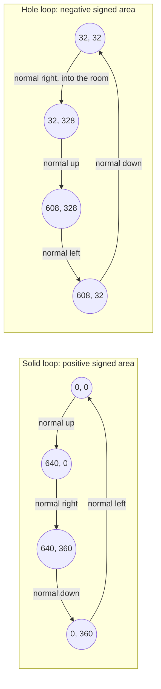
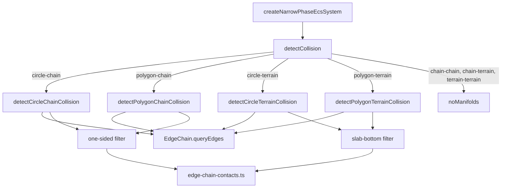

# Chain colliders

Issue: [#820](https://github.com/Forge-Game-Engine/Forge/issues/820)
(the tile maps milestone: the physics groundwork that the milestone's
tile-to-collider generation builds on)

| Module or file                                                                                                                         | Change        | Notes                                                                                                                                                                                                 |
| -------------------------------------------------------------------------------------------------------------------------------------- | ------------- | ----------------------------------------------------------------------------------------------------------------------------------------------------------------------------------------------------- |
| `src/physics/colliders/edge-chain.ts`                                                                                                  | New           | The exported `ChainEdge` and `EdgeChain` types (edges, local bounds, edge queries), so callers can read `terrain.surface` and `chain.outline`                                                         |
| `src/physics/colliders/build-edge-chain.ts`                                                                                            | New           | `createOpenEdgeChain`, `createClosedEdgeChain` and the implementation behind `EdgeChain`. Not exported                                                                                                |
| `src/physics/colliders/edge-tree.ts`                                                                                                   | New           | `EdgeTree`: a static bounding-volume tree over an edge chain's edges, built once. Not exported                                                                                                        |
| `src/physics/colliders/chain-collider.ts`                                                                                              | New           | `ChainCollider`: one or more closed loops, validated, with outward normals that point away from solid                                                                                                 |
| `src/physics/colliders/collider.ts`                                                                                                    | Modified      | `type` gains `'chain'`; new abstract `supportsDynamicBodies`; `ColliderType` alias; the mass data's doc says shapes that can't be dynamic have zero mass data                                         |
| `src/physics/colliders/terrain-collider.ts`                                                                                            | Modified      | `surface` becomes an open `EdgeChain`; `TerrainSurfaceEdge` is removed (replaced by `ChainEdge`); zero mass data, its area, centroid and inertia code deleted; `computeAabb` from cached local bounds |
| `src/physics/colliders/circle-collider.ts`, `polygon-collider.ts`                                                                      | Modified      | `supportsDynamicBodies = true`                                                                                                                                                                        |
| `src/physics/collision/edge-chain-contacts.ts`                                                                                         | New           | The per-edge logic both chain shapes share: circle contacts with ghost vertices, polygon manifolds, the normal-range test, the one-sided test, feature-id striding. Not exported                      |
| `src/physics/collision/detect-circle-chain-collision.ts`, `detect-polygon-chain-collision.ts`                                          | New           | The chain detectors                                                                                                                                                                                   |
| `src/physics/collision/detect-circle-terrain-collision.ts`, `detect-polygon-terrain-collision.ts`                                      | Modified      | Thin wrappers over `edge-chain-contacts.ts`; behavior unchanged                                                                                                                                       |
| `src/physics/collision/detect-collision.ts`                                                                                            | Modified      | The detector table is typed over every collider pair; chain entries; static-only pairs return no manifolds; the "no detector registered" error is deleted                                             |
| `src/physics/rigid-body-mass-data.ts`                                                                                                  | Modified      | Throws for a `'dynamic'` body whose collider doesn't support dynamic bodies                                                                                                                           |
| `src/physics/raycast/raycast-chain.ts`                                                                                                 | New           | One-sided ray test against the edges the ray's path reaches                                                                                                                                           |
| `src/physics/raycast/raycast.ts`, `raycast-terrain.ts`                                                                                 | Modified      | Raycast table typed over `ColliderType` with a `'chain'` entry; terrain finds its columns through the edge tree                                                                                       |
| `src/physics/ccd/circle-sweep-hits.ts`, `sweep-circle-chain.ts`                                                                        | Modified, New | One edge-chain sweep shared by terrain and chain; `findCircleChainSweepHits`, `sweepCircleChain`                                                                                                      |
| `src/physics/colliders/index.ts`, `collision/index.ts`, `raycast/index.ts`, `ccd/index.ts`                                             | Modified      | Export the new public API                                                                                                                                                                             |
| `src/physics/**/*.test.ts`                                                                                                             | New, Modified | See "Testing"                                                                                                                                                                                         |
| `documentation-site/docs/docs/physics/chain-colliders.md`                                                                              | New           | Guide: loops, winding, holes, one-sided collision, body types, raycasts                                                                                                                               |
| `documentation-site/docs/docs/physics/terrain.md`, `rigid-bodies.md`, `index.md`, `raycasting.md`, `continuous-collision-detection.md` | Modified      | Fourth shape; the terrain-terrain caution is removed; dynamic-body restriction                                                                                                                        |
| `documentation-site/src/pages/demos/chain-collider/`, `documentation-site/src/data/demos.ts`                                           | New, Modified | A room with a floor, walls, a ceiling and platforms in one `ChainCollider`                                                                                                                            |
| `documentation-site/src/pages/demos/car/`, `documentation-site/src/pages/demos/rolling-ball/`                                          | Checked       | Both build a `TerrainCollider` (`_create-terrain.ts`) and read none of what Phase 1 changes; rebuilt and loaded in a browser in Phase 1 (CLAUDE.md step 9)                                            |
| `CHANGELOG.md`                                                                                                                         | Modified      | `Added`, `Changed` and `Fixed` bullets                                                                                                                                                                |
| **Engine version at time of design**                                                                                                   |               | `0.26.2`                                                                                                                                                                                              |

## Summary

Tile-based levels need large, non-convex, static collision outlines.
Forge has no shape for them: `PolygonCollider` must be convex, each entity
has one `ColliderEcsComponent`, and `createBroadPhaseEcsSystem` tests all
pairs, so a level made of one box per tile costs thousands of entities
and still snags bodies on the corners where boxes meet ("ghost
collisions"). `TerrainCollider` already avoids ghost collisions with a
chain of surface edges whose neighbors act as ghost geometry, but only
for a heightmap with a slab beneath it.

This design adds `ChainCollider`: one or more closed loops of points in
the entity's local space. A loop around solid has positive signed area
(as `calculateSignedArea` computes it: turning from `+X` towards `+Y`,
clockwise on screen) and a loop around a hole has negative signed area, so
every edge's outward normal points away from solid. Collision is
one-sided, against edges only, with each edge's neighbors in its loop as
its ghost edges. A whole tile layer's collision is one collider on one
entity.

```ts
const level = world.createEntity();

addPositionComponent(world, level);
addColliderComponent(world, level, {
  collider: new ChainCollider([
    // The room's outer wall, around solid: positive signed area.
    [
      { x: 0, y: 0 },
      { x: 640, y: 0 },
      { x: 640, y: 360 },
      { x: 0, y: 360 },
    ],
    // The room's inside, a hole in that solid: negative signed area.
    [
      { x: 32, y: 32 },
      { x: 32, y: 328 },
      { x: 608, y: 328 },
      { x: 608, y: 32 },
    ],
    // A platform floating in the room: positive signed area.
    [
      { x: 200, y: 200 },
      { x: 360, y: 200 },
      { x: 360, y: 216 },
      { x: 200, y: 216 },
    ],
  ]),
});
```

The design has four parts:

- **A shared edge chain.** `EdgeChain` holds a chain shape's edges, each
  with its outward normal and the indices of its ghost neighbors, plus a
  static bounding-volume tree over the edges, so a detector visits only
  the edges near the other body instead of all of them. `TerrainCollider`
  moves onto it as an open chain, and its per-edge collision code moves
  into one module both shapes call, so nothing is copied.
- **`ChainCollider`.** Closed loops, validated in the constructor, built
  into a closed `EdgeChain`. Circle and polygon detectors, a one-sided
  raycast and a circle sweep, all through the shared module.
- **Static-only shapes.** Chain and terrain colliders can't be on a
  `'dynamic'` body: reading mass data for one throws. A pair of two such
  shapes can never need resolving, so `detectCollision` returns no
  manifolds for it instead of throwing, which also fixes two overlapping
  `TerrainCollider`s throwing today.
- **Completeness by type.** The detector and raycast tables are typed over
  every collider type, so adding a collider type without its detectors is
  a compile error rather than a runtime throw.

The design follows Box2D's chain shape (one-sided segments, ghost
vertices, loops wound so normals point away from solid, chains only on
static bodies) and Rapier's polyline (segments under a bounding-volume
tree, with per-segment normal constraints). It doesn't bend any core part
of the engine: there are no new systems or components, and every value
keeps its one writer.

## Scope

### In scope

- `ChainCollider`, with `'chain'` in `Collider.type`, validation, and the
  edge tree.
- `EdgeChain` and `ChainEdge`, shared by `ChainCollider` and
  `TerrainCollider`; `TerrainSurfaceEdge` removed.
- Circle-chain and polygon-chain narrow phase (plus flipped entries), with
  ghost-edge normal ranges and per-edge feature-id ranges.
- No manifolds for pairs of shapes that can't be dynamic (chain-chain,
  chain-terrain, terrain-chain, terrain-terrain).
- `supportsDynamicBodies` on `Collider`; `getRigidBodyMassData` throws for
  a dynamic chain or terrain.
- `raycastChain`, one-sided.
- Circle sweeps against chains in continuous collision.
- Terrain detectors, terrain raycasts and terrain sweeps on the shared
  module and the edge tree, with unchanged behavior.
- Typed detector and raycast tables.
- Unit tests, a documentation page, a docs-site demo, changelog bullets.

### Out of scope

- **Generating chains from tiles.** Tracing a tile layer's solid cells
  into loops (merging collinear edges, finding holes) belongs to the
  milestone's tile-to-collider issue, which builds `ChainCollider`s.
- **Open chains.** A chain that doesn't close (Box2D's non-loop chain, a
  one-sided line in the air) isn't added; see open question 6.
- **One-way platforms.** Edges that let bodies through from one side
  depend on the body's approach, which is contact filtering, not shape.
- **Per-edge friction, restitution or category.** The collider's
  `ColliderEcsComponent` values apply to every edge, as for every shape
  today.
- **Polygon continuous collision.** Only circles are swept, as today. A
  fast polygon can pass a thin chain wall in one tick, as it can pass a
  thin `PolygonCollider` wall today (see "One-sided collision").
- **Broad-phase trees and the "a contact pair needs a dynamic body" rule.**
  `/design/3d/14-physics-3d.md` replaces the all-pairs broad phase with
  dynamic trees and stops reporting contacts between two non-dynamic
  bodies. This design keeps the broad phase as it is and only decides
  pairs of two shapes that can never be dynamic.
- **Debug drawing** of chain outlines. The demo draws its own.
- **Mutable chains.** Loops are fixed at construction; destructible
  terrain replaces the collider.

## Phases

### Phase 1: The shared edge chain, with terrain on it

Builds `EdgeChain`, `ChainEdge` and the edge tree, moves `TerrainCollider`
and its detectors, raycast and sweep onto them and onto one shared
per-edge module, and fixes the two terrain defects the chain work needs
fixed anyway: overlapping terrains throw, and a terrain on a dynamic body
is simulated as a solid slab. Released on its own, terrain behaves the
same with its edges culled by the tree instead of a linear scan.

**Definition of done:** every existing terrain test passes unchanged
(including `terrain-contact-stability.test.ts`); two overlapping
`TerrainCollider`s produce no manifolds and don't throw; a `'dynamic'`
body with a `TerrainCollider` throws a descriptive error on its first
tick; the edge tree returns the same edges as a brute-force scan on
seeded random chains and queries; `detectCollision` has no runtime
"no detector" path; `TerrainCollider` has zero mass data and its area,
centroid and inertia code is deleted; terrain docs and changelog updated.
The car and rolling-ball demos use the terrain module, so CLAUDE.md's
step 9 checks pass: `npm run build` at the root; `npm run typecheck` and
`npm run build` in `documentation-site/`; and, with `npm run start`, the
car and rolling-ball demo pages load with a full page reload and behave
as before (the car drives over the hills, the ball rolls along them).

| Task                        | Description                                                                                                                                                                                                                                      | Size |
| --------------------------- | ------------------------------------------------------------------------------------------------------------------------------------------------------------------------------------------------------------------------------------------------ | ---- |
| Edge tree                   | `EdgeTree` in `colliders/edge-tree.ts`: median-split build over edge bounds into flat typed arrays; `queryBounds` and `querySegment`, both returning ascending edge indices                                                                      | M    |
| `EdgeChain` and `ChainEdge` | `colliders/edge-chain.ts`: the exported `ChainEdge` and `EdgeChain` types; `colliders/build-edge-chain.ts` (not exported): open and closed builders (normals, neighbor indices, vertex ids), local bounds, `queryEdges`/`queryEdgesAlongSegment` | M    |
| Shared per-edge module      | `collision/edge-chain-contacts.ts`: circle contacts and ghost vertices, polygon manifolds with the normal-range test and its fallback, `featureIdEdgeStride`, extracted from the terrain detectors                                               | L    |
| Terrain on the edge chain   | `TerrainCollider.surface` becomes an open `EdgeChain`; delete `TerrainSurfaceEdge`; `buildTerrainEdgeSlab` takes a `ChainEdge`; terrain detectors, `raycastTerrain` and the terrain sweep query the tree                                         | M    |
| Shared edge-chain sweep     | `findEdgeChainSweepHits` in `circle-sweep-hits.ts`, used by `findCircleTerrainSweepHits`                                                                                                                                                         | S    |
| Dynamic-body restriction    | `Collider.supportsDynamicBodies`; `getRigidBodyMassData` throws for a dynamic body whose collider returns `false`                                                                                                                                | S    |
| Zero terrain mass           | `TerrainCollider` passes zero mass data to `super` and deletes its area, centroid and inertia code (DL-7); `Collider.mass`'s doc gains the one exception for shapes that can't be dynamic                                                        | S    |
| Typed tables, static pairs  | `ColliderType`, detector table as `Record<ColliderPairKey, ManifoldDetector>`, `noManifolds` for terrain-terrain; raycast table as `Record<ColliderType, …>`; delete the unreachable throws                                                      | S    |
| Cached bounds               | `TerrainCollider.computeAabb` transforms its cached local bounds' corners instead of every silhouette vertex                                                                                                                                     | S    |
| Tests                       | Tree equivalence, overlapping terrains, dynamic terrain throws, zero terrain mass, open-chain builder, type-only exports                                                                                                                         | M    |
| Docs and changelog          | `terrain.md` (remove the overlap caution, add the dynamic restriction), `rigid-bodies.md`; `Changed` and `Fixed` bullets                                                                                                                         | S    |
| Demo checks                 | Build `/dist`, typecheck and build the docs site, and load the car and rolling-ball demos in a browser (CLAUDE.md step 9); update their `_create-terrain.ts` only if they read `surface` or `TerrainSurfaceEdge`                                 | S    |

### Phase 2: `ChainCollider`

Adds the collider, its validation, its detectors, its raycast and its
sweep, all through Phase 1's shared code, and documents it.

**Definition of done:** a static entity with one `ChainCollider`
describing a room with a floor, walls and a platform collides correctly
with circles and polygons, and a box sliding across the floor's edge
joints never snags (the system-level test in "Testing"); every
constructor error in "Validation" is tested; raycasts and sweeps against
chains are tested from both sides; `chain-colliders.md` is written and
linked; `Added` bullet in the changelog; `npm run check-exports` passes.

| Task                   | Description                                                                                                                                                    | Size |
| ---------------------- | -------------------------------------------------------------------------------------------------------------------------------------------------------------- | ---- |
| `ChainCollider`        | `colliders/chain-collider.ts`: clone loops, validate, build the closed `EdgeChain`, zero mass data, `supportsDynamicBodies = false`, `computeAabb`             | M    |
| Crossing validation    | Throw for two edges that cross or overlap anywhere but at a point that's a vertex of both, using the edge tree                                                 | M    |
| Circle-chain detector  | `detectCircleChainCollision`: query, one-sided filter, shared circle contacts, world manifolds                                                                 | S    |
| Polygon-chain detector | `detectPolygonChainCollision`: query, one-sided centroid filter with convex neighbors, shared polygon manifolds                                                | M    |
| Detector table entries | `circle-chain`, `chain-circle`, `polygon-chain`, `chain-polygon`; `noManifolds` for chain-chain, chain-terrain, terrain-chain                                  | S    |
| Raycast                | `raycastChain`: segment query, one-sided segment intersection, closest hit                                                                                     | S    |
| Sweep                  | `findCircleChainSweepHits`, `sweepCircleChain`, the `chain` entry of `circleSweepHitFinders`                                                                   | S    |
| Tests                  | Detector, raycast, sweep, validation and system-level tests in "Testing"                                                                                       | L    |
| Docs                   | `chain-colliders.md`; shape list in `rigid-bodies.md` and `index.md`; chains in `raycasting.md` and `continuous-collision-detection.md`; JSDoc on every export | M    |
| Changelog              | `Added` bullet                                                                                                                                                 | S    |

### Phase 3: Demo

A docs-site demo of a room built from one `ChainCollider`, so the
milestone's later tile map demo has a physics reference and a human can
check the feature in a browser.

**Definition of done:** `documentation-site/src/pages/demos/chain-collider/`
renders a room (outer solid with a hole, platforms, a slope) drawn from
the same loops its collider uses; clicking spawns boxes and balls that
rest in corners and slide across edge joints without snagging; a key
fires a fast ball that doesn't pass through a wall; the demo is listed in
`demos.ts` under `physics`; `npm run build` at the root and `npm run
typecheck` and `npm run build` in `documentation-site/` pass.

| Task       | Description                                                                                                                       | Size |
| ---------- | --------------------------------------------------------------------------------------------------------------------------------- | ---- |
| Demo scene | `_create-game.ts`, `_create-level.ts` (the loops, solid drawn as sprites per tile, outlines as ribbon meshes), `_spawn-bodies.ts` | M    |
| Demo page  | `index.tsx` through `DemoPage`, with "How it works" bullets; entry in `demos.ts` (`physics`)                                      | S    |
| Docs link  | Link the demo from `chain-colliders.md`                                                                                           | S    |

## Decision log

### DL-1: One collider with many loops, not one entity per edge or per tile

- **Options:** (a) a `ChainCollider` holding every loop, with its own edge
  index; (b) one entity per edge, each a two-point shape, the way Box2D
  puts each chain segment in its broad phase as its own shape; (c) one
  `PolygonCollider` entity per tile or per merged rectangle.
- **Chosen:** (a).
- **Rationale:** Forge keeps one collider per entity and its broad phase
  is all pairs, so (b) and (c) cost `O(n²)` pair tests for `n` edges or
  tiles, every tick. (c) also snags at box joints. (a) is one broad-phase
  entry and gets its edge culling from a tree inside the collider, which
  is what Rapier's polyline and Godot's concave polygon shape do.
- **Tradeoff:** the chain's world AABB covers the whole level, so every
  body in the level pairs with it in the broad phase and the narrow phase
  pays a tree query per body per tick (`O(log n)`), instead of the broad
  phase rejecting far bodies.
- **Assumptions:** levels have tens to thousands of edges, and the number
  of bodies is small enough that the all-pairs broad phase is acceptable
  for them already.

### DL-2: A static bounding-volume tree over edges, not a uniform grid

- **Options:** (a) a static tree of edge bounds, built once by median
  split; (b) a uniform grid over the chain's bounds, as the issue
  suggests; (c) edges sorted into bins along one axis.
- **Chosen:** (a).
- **Rationale:** a grid needs a cell size, and no one size suits both a
  tile layer (short, axis-aligned edges) and a hand-drawn cave or merged
  floor (a few very long edges plus dense curves). A long edge sits in
  many cells, so a query either deduplicates with mutable scratch state on
  the collider or with a reference-point rule. A tree has no tuning
  parameter, puts every edge in exactly one leaf, answers both box and
  segment queries, and is what Rapier (`Polyline::bvh`), Godot and
  Box2D's dynamic tree use. Bins along one axis degrade on tall levels.
- **Tradeoff:** `O(log n + k)` per query instead of a grid's `O(1 + k)`,
  and more build code (about the size of a grid with deduplication).
- **Assumptions:** the tree is built once; chains don't change after
  construction.

### DL-3: Share an `EdgeChain` with `TerrainCollider`, keep `TerrainCollider`

- **Options:** (a) both shapes hold an `EdgeChain` and call one per-edge
  module, each keeping its own filter (the terrain's slab bottom, the
  chain's one-sided rule) and its own raycast; (b) delete
  `TerrainCollider` and make terrain a `ChainCollider` loop of surface,
  sides and bottom; (c) copy the terrain code into chain detectors.
- **Chosen:** (a).
- **Rationale:** the issue asks to delete the duplicate if terrain can be
  expressed as a chain without changing its behavior. It can't be
  fully: as a closed loop, the slab's sides and bottom would collide, a
  body pushed below the surface would fall into the slab instead of being
  pushed back up (the documented terrain behavior, which keeps a polygon
  car body landing hard from falling through the ground), and a ray
  starting inside the slab wouldn't hit it. (a) removes every copied line:
  terrain keeps only its slab filter, its slab raycast and its
  constructor. (c) is what the issue forbids.
- **Tradeoff:** two collider classes for related geometry; terrain's
  `surface` field and `TerrainSurfaceEdge` change shape (a breaking change
  the changelog lists).
- **Assumptions:** the push-back-up rule is wanted for terrain. Open
  question 2 asks whether to drop it and fold terrain into chains.

### DL-4: One-sided collision follows Box2D: skip an edge the body's center is behind

- **Options:** (a) a circle skips an edge whose line its center is
  behind; a polygon skips an edge when its centroid is behind it and
  behind each neighbor that meets it at a convex corner (Box2D v3's
  `b2CollideChainSegmentAndCircle` and `b2CollideChainSegmentAndPolygon`);
  (b) the terrain rule: push a body out of any edge it overlaps, however
  far behind it its center is.
- **Chosen:** (a) for `ChainCollider`; terrain keeps (b).
- **Rationale:** chains describe walls a tile thick. Under (b), a body
  that gets past the middle of a thin wall is pushed both ways at once,
  by the front face and the back face, and the solver fights itself. Under
  (a) only the faces it is in front of push, so the contacts never
  contradict each other. The terrain's slab is deep by construction, so
  (b) is safe there.
- **Tradeoff:** a polygon moving more than half its size in one tick into
  a chain falls through the edge (circles are swept). This matches
  Box2D without its polygon sweeps, and matches thin `PolygonCollider`
  walls today, which also push a deep body out the far side.
- **Assumptions:** games keep fast bodies round or walls thick, until
  polygon sweeps exist. Open question 1.

### DL-5: Pairs of two static-only shapes produce no manifolds

- **Options:** (a) register a `noManifolds` detector for chain-chain,
  chain-terrain, terrain-chain and terrain-terrain; (b) skip every pair
  without a dynamic body in the narrow phase (Box2D's and Unity's rule);
  (c) write real detectors for them; (d) leave the throw and document
  category masks as the workaround (today's terrain docs).
- **Chosen:** (a).
- **Rationale:** neither shape can be on a dynamic body (DL-6), so no
  contact between them can ever be resolved; a detector would compute
  work the solver discards (its effective mass is zero). (b) is right but
  wider: it also stops reporting static and kinematic polygons touching in
  `ContactsEcsComponent`, which `/design/3d/14-physics-3d.md` (§6.20)
  plans as part of the physics-2d migration, with its own sensor pass. (a)
  is the subset of that rule the shapes themselves decide, and stays
  correct after it. (d) makes every game with two terrains discover a
  throw.
- **Tradeoff:** a kinematic chain touching a static terrain or chain is
  not listed in either entity's `ContactsEcsComponent`. Polygon pairs
  between non-dynamic bodies are still detected and reported, as today.
- **Assumptions:** nothing needs contacts between two pieces of level
  geometry; a game that does uses a sensor polygon.

### DL-6: Chains and terrains can't be dynamic; the check lives where mass is read

- **Options:** (a) `Collider.supportsDynamicBodies`, and
  `getRigidBodyMassData` throws for a dynamic body whose collider returns
  `false`; (b) check `collider.type` against a list in
  `getRigidBodyMassData`; (c) check in `addColliderComponent` and
  `addRigidBodyComponent`.
- **Chosen:** (a).
- **Rationale:** the issue places the check where mass data is read, and
  `createEulerIntegrationEcsSystem` reads it for every non-static body
  every tick, so the error comes on the first tick. A property each class
  declares is polymorphic dispatch; a type list in the mass code would
  need editing for every new shape. (c) misses runtime changes to
  `RigidBodyEcsComponent.type` and depends on component order. Godot and
  Box2D both treat these shapes as static geometry; Godot documents that
  they misbehave on rigid bodies, Forge throws instead.
- **Tradeoff:** a terrain on a dynamic body, which "worked" as a moving
  slab, now throws. That's a behavior change in Phase 1.
- **Assumptions:** kinematic chains (moving rooms, elevators made of
  outlines) stay allowed; their velocity is read at the origin, like any
  kinematic body.

### DL-7: Chains and terrains have zero mass data

- **Options:** (a) `mass` and `momentOfInertia` of `0`, center of mass at
  the origin, for both shapes that can't be dynamic; (b) the enclosed
  area, from the signed sum of the loops, as the issue suggests (and the
  slab's area for terrain, as today); (c) `Infinity`.
- **Chosen:** (a), for `ChainCollider` in Phase 2 and for
  `TerrainCollider` in Phase 1.
- **Rationale:** `getRigidBodyMassData` is the only reader of a
  collider's `mass`, `momentOfInertia` and `localCenterOfMass`, and for a
  static or kinematic body it returns zero inverse mass and the origin
  without reading them (`rigid-body-mass-data.ts`, the early return). Once
  DL-6 stops either shape from being dynamic, their mass data is never
  read, so terrain's area, centroid and inertia code
  (`terrain-collider.ts`, the constructor's `silhouette` to `super` lines)
  is dead and is deleted. For chains, the enclosed area isn't even well
  defined without containment tests: a hole loop with no loop around it
  (a room carved out of unbounded solid, which Box2D's inward-wound loops
  are commonly used for) makes the solid infinite, and a hole beside, not
  inside, a solid loop still gives a positive sum. Box2D chain segments
  and Rapier polylines carry no mass either.
- **Tradeoff:** `Collider.mass`'s doc ("area times density") gains one
  exception covering both: a collider whose `supportsDynamicBodies` is
  `false` has zero mass data, since no body ever simulates it.
- **Assumptions:** nothing reads a non-dynamic collider's mass; no test
  asserts terrain mass today. Open question 3.

### DL-8: Winding marks solid and holes, and is validated, not normalized

- **Options:** (a) positive signed area around solid, negative around a
  hole, the loop's points kept in their order; (b) normalize every loop to
  positive and pass holes separately; (c) infer holes from nesting.
- **Chosen:** (a).
- **Rationale:** the issue's convention, and Box2D's (counter-clockwise in
  its Y-up world is positive signed area in Forge's Y-down one). It needs
  no nesting analysis and lets a lone hole loop describe a room in
  unbounded solid. `calculateNormals` already gives outward normals for
  this winding, the same function `PolygonCollider` uses.
- **Tradeoff:** a loop authored backwards turns solid into hole without an
  error. The guide shows how to check with `calculateSignedArea`.
- **Assumptions:** tile tracing produces consistent winding.

### DL-9: Typed detector tables replace the runtime "no detector" errors

- **Options:** (a) ``Record<`${ColliderType}-${ColliderType}`, …>`` and
  `Record<ColliderType, …>` tables; (b) keep `Map<string, …>` with a
  runtime throw.
- **Chosen:** (a).
- **Rationale:** with the static-only pairs registered, every pair has a
  detector. A typed table makes a missing pair a compile error, as
  `circleSweepHitFinders` already does, and deletes two unreachable throws.
- **Tradeoff:** sixteen entries in `detectCollision`'s table.
- **Assumptions:** none.

### DL-10: The broad-phase AABB comes from cached local bounds

- **Options:** (a) store the chain's local bounds at construction and
  transform their four corners in `computeAabb`; (b) transform every
  point every tick, as `PolygonCollider` and `TerrainCollider` do.
- **Chosen:** (a), for both chain shapes.
- **Rationale:** `createBroadPhaseEcsSystem` calls `computeAabb` for every
  collider every tick; for a level of thousands of points (b) is
  thousands of rotations a tick for a box that never changes. (a) is exact
  for an unrotated chain and slightly larger than the tightest box for a
  rotated one, which only adds candidate pairs.
- **Tradeoff:** a rotated chain's AABB is loose.
- **Assumptions:** level chains are mostly unrotated.

## Open questions

All are non-blocking: each has a default the implementation follows, and
the phases are ordered so that a different answer changes only the code
it names.

1. **Non-blocking. Should a chain push a body out of an edge its center
   has passed?** The default is Box2D's one-sided rule (DL-4).
   - _One-sided (default):_ no contradictory contacts in walls a tile
     thick; matches Box2D. A polygon moving more than half its size per
     tick into a chain can fall through.
   - _Push out, like terrain:_ a polygon landing hard on a thick floor is
     pushed back up. Walls thinner than the bodies hitting them get
     contacts from both faces and push unpredictably. A different answer
     replaces one filter function in `detectCircleChainCollision` and
     `detectPolygonChainCollision`.
2. **Non-blocking. Should `TerrainCollider` become a `ChainCollider`?**
   The default keeps both on one `EdgeChain` (DL-3).
   - _Keep both (default):_ terrain keeps its documented behavior (pushed
     back up, collides only with its surface, rays hit its inside).
   - _Fold terrain into chains:_ terrain becomes a helper that builds a
     loop of surface, sides and bottom, and the terrain detectors, raycast
     and sweep are deleted. The ends of the terrain become walls, and
     terrain gets chain's one-sided rule. Phase 1's shared module is
     needed either way, so the answer only decides whether Phase 2 deletes
     the terrain wrappers.
3. **Non-blocking. Should a chain (and a terrain) report the enclosed
   area as its mass?** The default is zero mass data for both (DL-7).
   - _Zero (default):_ honest for shapes no body ever simulates; matches
     Box2D and Rapier; deletes terrain's dead area, centroid and inertia
     code.
   - _Enclosed area:_ what the issue asked; `mass` then means "area"
     consistently across shapes, but it's wrong for unbounded solid and
     needs containment tests to be right, and it's never read. Changes
     only each constructor's `super` call.
4. **Non-blocking. Should the constructor reject crossing edges?** The
   default rejects them (see "Validation").
   - _Reject (default):_ Box2D documents self-intersecting chains as
     unsupported and fails silently; Forge validates constructor input and
     throws early. Costs `O(n log n)` at construction with the tree.
   - _Don't check:_ faster construction for very large generated levels,
     where the generator guarantees valid loops. Removing the check is one
     function call.
5. **Non-blocking. Can a chain be a sensor?** The default allows it.
   - _Allow (default):_ a sensor chain reports bodies touching its outline
     from the outside, the same rule as its contacts. Nothing to build.
   - _Throw:_ a sensor chain doesn't report a body wholly inside its
     solid, which Godot warns surprises users of its hollow shapes. A
     throw would sit in the narrow phase or `addColliderComponent`, since
     `sensor` can change at runtime.
6. **Non-blocking. Should `ChainCollider` take open chains too?** The
   default is closed loops only.
   - _Closed only (default):_ every edge has two ghost neighbors and
     solid is well defined.
   - _Open chains as well:_ Box2D supports them (its first and last
     points are ghost vertices only) for one-sided lines in the air.
     The internal `createOpenEdgeChain` already exists for terrain, so
     this adds a constructor shape, not detection code.

## Geometry and vocabulary

- **Loop:** an array of at least three points in the entity's local space,
  closed implicitly from the last point back to the first. Don't repeat
  the first point at the end.
- **Solid loop and hole loop:** a loop with positive signed area surrounds
  solid; one with negative signed area surrounds empty space inside solid
  (or a room in unbounded solid, when no loop encloses it).
- **Edge:** the segment from a loop's point `i` to point `i + 1` (wrapping).
  Its **outward normal** is `normalize(perpendicular(end - start))`, the
  same as `calculateNormals`, and points away from solid for both kinds of
  loop.
- **Ghost edges:** an edge's previous and next edges in its loop. They
  decide which edge owns a contact near a shared vertex and which
  directions a contact normal may take there.
- **Convex vertex:** a vertex where solid bulges out,
  `cross(previous.normal, edge.normal) > 0` (as terrain's
  `isWithinEdgeNormalRange` computes it). **Concave vertex:** where solid
  folds in. The chain's one-sided test uses a tolerance instead of `0`
  (see "Polygon against chain").
- **Front and behind:** a point `p` is in front of an edge when
  `dot(edge.normal, p - edge.start) >= 0`.

The loops of the example in "Summary", with each edge's outward normal:



## API

### `Collider`

```ts
export type ColliderType = 'circle' | 'polygon' | 'terrain' | 'chain';

export abstract class Collider {
  public abstract readonly type: ColliderType;

  /**
   * Whether a `'dynamic'` rigid body can use this collider. Outline and
   * heightmap shapes describe level geometry, have no meaningful mass
   * distribution, and are only collided against from outside, so
   * `getRigidBodyMassData` throws for a dynamic body that has one.
   */
  public abstract readonly supportsDynamicBodies: boolean;

  /**
   * The shape's mass: its area times its density. A collider whose
   * `supportsDynamicBodies` is `false` has a mass and moment of inertia of
   * `0` and its center of mass at the origin, since no body simulates it.
   */
  public readonly mass: number;
  // momentOfInertia, localCenterOfMass: unchanged, their docs point to
  // `mass` for the same exception. computeAabb: unchanged.
}
```

`CircleCollider` and `PolygonCollider` declare `true`; `TerrainCollider`
and `ChainCollider` declare `false`.

### `ChainEdge` and `EdgeChain`

```ts
/**
 * One edge of a chain shape's outline, in the shape's local space.
 */
export interface ChainEdge {
  /** Aliases the owning collider's point; never mutate it. */
  readonly start: Vector2;
  /** Aliases the owning collider's point; never mutate it. */
  readonly end: Vector2;
  /** Unit outward normal, pointing away from solid. */
  readonly normal: Vector2;
  /** The ghost edge before this one, or `null` at an open chain's start. */
  readonly previous: number | null;
  /** The ghost edge after this one, or `null` at an open chain's end. */
  readonly next: number | null;
  /** Index of `start` among the chain's distinct vertices. */
  readonly startVertex: number;
  /** Index of `end` among the chain's distinct vertices. */
  readonly endVertex: number;
}

/**
 * A chain shape's edges and the queries that find the ones near a box or
 * segment, all in the shape's local space. Read it from
 * `TerrainCollider.surface` or `ChainCollider.outline`; the colliders
 * build it.
 */
export interface EdgeChain {
  readonly edges: readonly ChainEdge[];
  readonly vertexCount: number;
  readonly bounds: Aabb;

  /** Edges whose bounds overlap `bounds`, ascending. */
  queryEdges(bounds: Aabb): number[];

  /** Edges whose bounds the segment from `start` to `end` reaches, ascending. */
  queryEdgesAlongSegment(start: Vector2, end: Vector2): number[];
}
```

Only these two types are exported (from `colliders/edge-chain.ts`). The
builders live in `colliders/build-edge-chain.ts`, which
`colliders/index.ts` doesn't re-export:

```ts
/** An open chain through `points`, as `TerrainCollider` uses. */
export function createOpenEdgeChain(points: readonly Vector2[]): EdgeChain;

/** One closed chain per loop, numbered loop after loop. */
export function createClosedEdgeChain(
  loops: readonly (readonly Vector2[])[],
): EdgeChain;
```

They return an object built over the edges and an `EdgeTree` (also not
exported). Nothing outside the physics module can construct an
`EdgeChain`, so every chain's `previous`, `next`, `startVertex` and
`endVertex` come from one of these two builders and always agree with its
edges. A public constructor taking raw edges would let callers build
chains whose indices don't match their geometry, which the detectors
can't check cheaply.

### `ChainCollider`

```ts
/**
 * A static outline collider: one or more closed loops of points in the
 * entity's local space. A loop with positive signed area surrounds solid,
 * one with negative signed area surrounds a hole, so every edge's outward
 * normal points away from solid. Bodies collide with the edges from the
 * side their normals face, with each edge's neighbors in its loop as
 * ghost edges, so nothing catches where two edges meet.
 */
export class ChainCollider extends Collider {
  public readonly type = 'chain';
  public readonly supportsDynamicBodies = false;

  /** The loops, cloned from the constructor's argument. */
  public readonly loops: readonly (readonly Vector2[])[];

  /** The loops' edges, loop after loop, with their tree. */
  public readonly outline: EdgeChain;

  /**
   * @param loops - The closed loops, in the entity's local space. Don't
   * repeat a loop's first point at its end.
   * @throws See "Validation".
   */
  constructor(loops: readonly (readonly Vector2[])[]);

  public computeAabb(position: Vector2, rotation: number): Aabb;
}
```

The constructor takes no density: the mass data is zero (DL-7). It takes
no options at all: winding carries solid and hole.

### `TerrainCollider`

`points`, `depth`, `bottomY` and the constructor are unchanged.
`surface` becomes an `EdgeChain` (built internally with
`createOpenEdgeChain(points)`), so a caller
reading `terrain.surface[i]` reads `terrain.surface.edges[i]`.
`TerrainSurfaceEdge` is deleted; `ChainEdge` has its three fields plus
neighbor and vertex indices. `buildTerrainEdgeSlab(edge: ChainEdge, …)`
keeps its behavior. The constructor passes zero mass data to `super`
(DL-7) and no longer computes the silhouette's area, centroid and
inertia; the silhouette is still built once for the cached local bounds
`computeAabb` uses (DL-10).

### New exported functions

| Function                      | Module      | Mirrors                         |
| ----------------------------- | ----------- | ------------------------------- |
| `detectCircleChainCollision`  | `collision` | `detectCircleTerrainCollision`  |
| `detectPolygonChainCollision` | `collision` | `detectPolygonTerrainCollision` |
| `raycastChain`                | `raycast`   | `raycastTerrain`                |
| `findCircleChainSweepHits`    | `ccd`       | `findCircleTerrainSweepHits`    |
| `sweepCircleChain`            | `ccd`       | `sweepCircleTerrain`            |

## Validation

The constructor throws a descriptive error, naming the loop and point
index, for:

1. no loops;
2. a loop with fewer than 3 points;
3. two consecutive points of a loop closer than `1e-9`, including the
   last and the first (so a loop that repeats its first point at the end
   gets an error that says so);
4. a loop whose `|calculateSignedArea|` is below `1e-9` (collinear or
   degenerate);
5. two edges that cross or overlap at any point that isn't a vertex of
   both (open question 4).

Rule 5 allows loops that touch at a shared vertex, which tile outlines
produce where two solid tiles meet only at a corner, and a loop that
pinches to touch itself at a vertex. It rejects proper crossings,
T-junctions (a vertex on another edge's interior) and collinear
overlaps. It runs after the tree is built:

```text
for each edge e:
  for each f in tree.query(bounds(e)) with f > e:
    if f is e.previous or e.next: continue      // share a vertex by construction
    hit = segmentIntersection(e, f)             // none, point, or overlap
    if hit is overlap: throw
    if hit is point and not (hit is an endpoint of e and an endpoint of f): throw
```

Winding isn't normalized (DL-8), and loops aren't checked for nesting: a
hole loop with no solid loop around it is valid and describes a room in
unbounded solid.

## Edge numbering and feature ids

Edges are numbered loop after loop: loop `k`'s edge `i` (from point `i` to
point `i + 1`, wrapping) is edge `offset[k] + i`. In a closed chain each
edge's `startVertex` is its own index, its `endVertex` is its `next`
edge's `startVertex`, and `vertexCount` equals the edge count. In an open
chain of `m` points (terrain), edge `i` runs from vertex `i` to `i + 1`,
and `vertexCount` is `m`.

Feature ids keep the terrain detectors' scheme, so terrain's warm
starting doesn't change:

- Circle: a face contact's id is its edge index; a vertex contact's id is
  `edgeCount + vertexIndex`, the same whichever of the vertex's two edges
  finds it, and the second is dropped.
- Polygon: each edge's ids from `detectPolygonFacesCollision` (always
  below `2^21`) are offset by `edgeIndex * featureIdEdgeStride`
  (`2^21`), so every edge has its own range. Ids stay exact integers for
  up to `2^32` edges.

## Edge tree

A static tree over the edges' bounds, built once in `EdgeChain`'s
constructor and stored in flat typed arrays (four bounds per node, a
child or first-item index, an item count, and the edge order), so a
query allocates only its result array.

```text
build(items):                       // items: edge indices with their bounds
  node.bounds = union of item bounds
  if items.length <= 4: make a leaf; return
  axis = longer axis of the items' centers' bounds
  partition items at the median center along axis
  build(left half); build(right half)  // depth-first: left child is node + 1

queryEdges(box):
  stack = [root]; result = []
  while stack: node = pop
    if !overlaps(node.bounds, box): continue
    if leaf: push each item whose own bounds overlap box
    else: push both children
  return result sorted ascending

queryEdgesAlongSegment(a, b):
  same walk, with a segment-versus-box slab test instead of overlaps
```

Results come back ascending so that manifolds are in a stable order
every tick (terrain's are left to right today, and stay so, since an open
chain's indices increase with `x`).

Query bounds are in the chain's local space. A detector transforms the
other shape into it first: the circle's center (`± radius`), the
polygon's vertices (their bounds), or the swept circle's start and end
(`± radius`).

## Narrow phase

Both chain shapes reach the same per-edge code in
`collision/edge-chain-contacts.ts`. The two detectors of each shape differ
only in which edges they ask for and which they keep.



### Shared per-edge module

Moved from the terrain detectors, generalized from "index ± 1, null at
the ends" to `edge.previous`/`edge.next`, and from `edgeIndex + 1` to
`edge.endVertex`:

- `isWithinEdgeNormalRange(chain, edgeIndex, outwardNormal)`: today's
  test, with the neighbors from `previous`/`next`. A closed loop has both
  neighbors everywhere, so its convex corners always open a fan and its
  concave corners never do.
- `findCircleEdgeContacts(chain, edgeIndices, localCenter, radius)`:
  today's `findSurfaceContacts` and `contactAgainstEdge`/`vertexContact`,
  over the given edges, with the ghost's far point taken from the
  neighbor edge.
- `findPolygonEdgeManifolds(chain, edgeIndices, polygonFaces, chainBody)`:
  today's loop in `detectPolygonTerrainCollision` (each edge as a
  one-sided two-vertex `PolygonFaces`, `detectPolygonFacesCollision`, the
  range test, the fallback to `clipAgainstReferenceFace` against the edge,
  ids offset by edge).
- `featureIdEdgeStride`.

### Terrain detectors

Unchanged behavior. The x-range scan becomes a tree query whose `y` range
is unbounded (`-Infinity` to `Infinity`), so an edge far above a body that
has sunk below the surface is still found and pushes it back up, as now.
The slab-bottom check (`localCenter.y - radius > bottomY`, `minY >
bottomY`) stays in front of it.

### Circle against chain

```text
detectCircleChainCollision(circleBody, chainBody):
  c = circle's world center, in chain local space; r = radius
  edges = outline.queryEdges({ c - r, c + r })
  edges = edges.filter(i => dot(edge[i].normal, c - edge[i].start) >= 0)  // one-sided
  contacts = findCircleEdgeContacts(outline, edges, c, r)
  return contacts to world manifolds (normal negated: from circle to chain)
```

A vertex contact is only ever reported in front of both of its edges,
since at a convex corner the vertex's region lies in front of both edge
lines; at a concave corner there is no vertex region, and the two faces
report one contact each ("a body resting in a concave corner gets
contacts from both walls").

### Polygon against chain

```text
detectPolygonChainCollision(polygonBody, chainBody):
  faces = polygon's world vertices and normals
  g = polygon's world center of mass, in chain local space
  edges = outline.queryEdges(local bounds of faces.vertices)
  edges = edges.filter(i => !isBehind(i, g))
  return findPolygonEdgeManifolds(outline, edges, faces, chainBody)

convexTolerance = 0.01   // sine of about 0.57 degrees, Box2D's convexTol

isConvexJoint(first, second):   // first's end is second's start
  return cross(edge[first].normal, edge[second].normal) >= convexTolerance

isBehind(i, g):
  e = edge[i]
  if dot(e.normal, g - e.start) >= 0: return false
  if e.previous !== null and isConvexJoint(e.previous, i)
     and dot(edge[e.previous].normal, g - edge[e.previous].start) >= 0:
    return false
  if e.next !== null and isConvexJoint(i, e.next)
     and dot(edge[e.next].normal, g - edge[e.next].start) >= 0:
    return false
  return true
```

The convex-neighbor clause keeps a box balanced on a platform's corner,
with its centroid past the top edge's line but still in front of the side
edge, colliding with the top edge; this is Box2D's rule. The cross product
of two unit normals is the sine of the turn between them, and a joint
only counts as convex when that turn is at least `convexTolerance`, as
Box2D's `convexTol` does in `b2CollideChainSegmentAndPolygon`. A chain
traced from a curve or a noisy outline has many joints that are straight
to within rounding; with a strict `> 0` those would count as convex at
random, and whether a body sunk below a nearly flat floor kept colliding
with it would flip from one edge to the next. With the tolerance, nearly
straight joints count as straight, and the one-sided test treats a run of
them like one long edge.

The tolerance is a constant in `edge-chain-contacts.ts`, used only by the
chain's one-sided test. Terrain's normal-range test keeps its strict
`> 0`, so terrain's behavior doesn't change.

### Flat floors split into many edges

The issue's main case: a box sliding along collinear edges. Each edge's
neighbors are collinear, so the normal range is the edge's own normal
only. When the separating-axis search picks one of the box's side faces
at a joint (the box's corner just past the next edge's start), the range
test rejects that sideways normal and the contact is clipped against the
edge itself, which pushes straight up. No contact at a joint has a
horizontal component, so friction alone changes the box's horizontal
velocity. This is the terrain's existing mechanism, which
`terrain-contact-stability.test.ts` covers for a wobbling heightmap.

## Static-only pairs

`detectCollision`'s table is typed over every pair of `ColliderType`:

```ts
type ColliderPairKey = `${ColliderType}-${ColliderType}`;

const noManifolds: ManifoldDetector = () => [];

const collisionDetectors: Record<ColliderPairKey, ManifoldDetector> = {
  'circle-circle': asManifolds(detectCircleCircleCollision),
  // ... existing entries ...
  'circle-chain': detectCircleChainCollision,
  'chain-circle': flipped(detectCircleChainCollision),
  'polygon-chain': detectPolygonChainCollision,
  'chain-polygon': flipped(detectPolygonChainCollision),
  // Neither shape can be on a dynamic body, so no contact between them
  // could ever be resolved.
  'terrain-terrain': noManifolds,
  'chain-chain': noManifolds,
  'chain-terrain': noManifolds,
  'terrain-chain': noManifolds,
};
```

A chain against a polygon or circle on a static or kinematic body is
still detected, reported in `ContactsEcsComponent` and handed to the
solver, which skips it (`effectiveMass < 1e-6` in `solveNormal`), the
same as two static polygons today.

## Body types and mass data

```ts
// rigid-body-mass-data.ts, after finding the dynamic body's collider:
if (!collider.collider.supportsDynamicBodies) {
  throw new Error(
    `Dynamic rigid body entity ${formatEntity(entity)} has a "${collider.collider.type}" collider, which only static and kinematic bodies can use. Use circle or polygon colliders for a dynamic body.`,
  );
}
```

`createEulerIntegrationEcsSystem` reads mass data for every non-static
rigid body every tick, so the error comes on the first tick, and again
after a runtime change of `type` to `'dynamic'`.

## Raycasts

```text
raycastChain(chainBody, start, end):
  a, b = start, end in chain local space
  best = null
  for i in outline.queryEdgesAlongSegment(a, b):
    e = edge[i]
    if dot(e.normal, a - e.start) < 0: continue     // starts behind: one-sided
    t, u = segment-segment parameters of (a, b) and (e.start, e.end)
    if t in [0, 1] and u in [0, 1] and t < best.t: best = { t, e.normal }
  return best in world space (point, rotated normal, distance)
```

A ray that starts inside a chain's solid leaves it without a hit, and a
ray entering solid hits the edge it enters through, with that edge's
normal. This differs from `PolygonCollider` and `TerrainCollider`, which a
ray starting inside also hits; the guide says so. It's Box2D's chain rule,
and what "an outline" means.

`raycastTerrain` keeps testing slab columns, now found with `queryEdges`
over the ray's local `x` range and an unbounded `y` range, as the terrain
detectors query, so it still finds the column beneath an edge a ray passes
under.

## Continuous collision

`findCircleTerrainSweepHits`' loop becomes `findEdgeChainSweepHits(chain,
edgeIndices, swept)`: `sweepFace` per edge (already one-sided: it ignores
a circle approaching from behind or starting inside), and `sweepRound` at
each edge's start vertex when it's convex or the chain's open start, and
at the end vertex when the chain ends there. A closed loop has no open
ends, so only its convex corners are rounds. Terrain queries with an
unbounded `y` range, chain with the swept circle's bounds.

`circleSweepHitFinders` gains `chain: findCircleChainSweepHits`, so
`createContinuousCollisionEcsSystem` sweeps dynamic circles against
static chains with no change to the system. A chain on a kinematic body
isn't swept against, as no kinematic target is today.

## System order and data flow

No system is added or reordered, and no component gains a field. The
collider is immutable data; `createBroadPhaseEcsSystem` still writes its
`aabb`, `createNarrowPhaseEcsSystem` still writes the manifolds and
`ContactsEcsComponent`, and so on, each value with its one writer.

## Performance

- **Construction:** `O(n log n)` for the tree and the crossing check,
  for `n` edges. A 200 by 100 tile layer traced into loops has a few
  thousand edges.
- **Broad phase:** one entry per chain; its AABB is four transformed
  corners (DL-10).
- **Narrow phase:** per overlapping body, a tree query (`O(log n + k)`)
  and work for the `k` nearby edges only, against `O(n)` per body today
  for terrain.
- **Raycast and sweep:** the same per query.
- **Memory:** one `ChainEdge` per edge (points aliased, one normal
  allocated), and about `n / 2` tree nodes (leaves of up to four edges) in
  typed arrays.
- **Allocation:** queries allocate their result array, and the detectors
  allocate as the terrain detectors do today. Removing per-tick
  allocations from the physics module is design 14's work.

## Testing

Unit tests (Vitest), next to the code:

- **`edge-tree.test.ts`:** on seeded random edge sets (`Random`), every
  `queryEdges` and `queryEdgesAlongSegment` result equals a brute-force
  scan, for boxes and segments inside, crossing and outside the bounds;
  long edges spanning the whole set; one edge; collinear edges.
- **`edge-chain.test.ts`:** open and closed builders give the right
  normals, neighbors, vertex ids and `vertexCount`; numbering across
  several loops.
- **`chain-collider.test.ts`:** each validation error (no loops, fewer
  than 3 points, consecutive duplicates including last-to-first, zero
  area, crossing, T-junction, collinear overlap); loops touching at a
  shared vertex accepted; a lone hole loop accepted; zero mass data;
  `computeAabb` exact unrotated and enclosing when rotated.
- **`detect-circle-chain-collision.test.ts`:** face, convex-vertex and
  concave-corner contacts; a circle behind an edge gets nothing from it;
  a circle inside a hole loop collides with its walls; ids at a shared
  vertex agree; the tree-culled result equals testing every edge.
- **`detect-polygon-chain-collision.test.ts`:** a box on collinear split
  edges gets only up normals at every joint position; a box in a concave
  corner gets one manifold per wall; a box balanced on a convex corner;
  centroid behind an edge but in front of a convex neighbor still
  collides; a joint that turns by less than the convex tolerance counts as
  straight (centroid behind both edges of a nearly flat joint gets no
  contact from either), one that turns by more counts as convex; a box
  inside a hole loop; the tree-culled result equals testing every edge.
- **`detect-collision.test.ts`:** chain-chain, chain-terrain,
  terrain-chain and terrain-terrain return `[]` and don't throw; flipped
  chain entries negate normals.
- **`rigid-body-mass-data.test.ts`:** a dynamic body with a chain or
  terrain collider throws; kinematic and static don't.
- **`terrain-collider.test.ts`:** a terrain's mass, moment of inertia and
  center of mass are zero (no existing test asserts terrain mass).
- **Exports:** `colliders/index.ts` exports `EdgeChain` and `ChainEdge`
  as types only; `createOpenEdgeChain` and `createClosedEdgeChain` aren't
  reachable from `@forge-game-engine/forge/physics`
  (`npm run check-exports` and a type-only import in a test).
- **`raycast-chain.test.ts`:** hits from in front with the edge's normal;
  misses from behind; a ray from inside solid that leaves and enters
  another solid hits the second; closest of several; rotated and
  translated chain; `raycast` finds a chain entity.
- **`sweep-circle-chain.test.ts`:** a fast circle against a wall one unit
  thick stops at the near face; no hit from behind; convex-corner round
  hits; concave corners give face hits only.
- **`chain-contact-stability.test.ts`** (system level, modeled on
  `terrain-contact-stability.test.ts`): the "room" from "Summary" with
  the floor split into many collinear edges; a box and a circle with
  zero friction slide across it and keep their horizontal velocity, and
  no manifold normal has a horizontal component; a box comes to rest in
  a corner; a ball fired at a wall with continuous collision stays in the
  room.
- **Terrain regression:** every existing terrain test passes without
  edits other than `surface` becoming `surface.edges`.

No e2e test: nothing here touches rendering, input or the game loop. The
demos are checked by hand: the car and rolling-ball demos in Phase 1,
since they use the terrain module, and the chain demo in Phase 3.

## Documentation and demo

- **`physics/chain-colliders.md` (new):** what a chain is for (level
  outlines, tile layers); loops and winding, with a diagram of a solid
  loop and a hole; checking winding with `calculateSignedArea`; the
  validation rules; one-sided collision and what that means for bodies
  inside solid, thin walls and fast polygons; static and kinematic only;
  no contacts against other chains or terrains; raycasts are one-sided;
  continuous collision for circles; a link to the demo.
- **`physics/terrain.md`:** remove the "Two `TerrainCollider`s whose
  bounds overlap throw" caution; add that a terrain can't be on a dynamic
  body; link to chains for ceilings and overhangs instead of polygons.
- **`physics/rigid-bodies.md`, `physics/index.md`:** four shapes; chains
  and terrains are for static and kinematic bodies.
- **`physics/raycasting.md`, `physics/continuous-collision-detection.md`:**
  chain behavior.
- **Demo (`demos/chain-collider/`):** the room from "Summary" plus a
  slope and a platform, its solid drawn as tile sprites and its loops as
  thin ribbon meshes (`buildRibbonMesh`) from the same points the
  collider uses; click to drop boxes and balls; a key fires a fast ball.
  Listed under `physics` in `demos.ts`.
- **`CHANGELOG.md`:** `Added` (`ChainCollider`, `EdgeChain`, `ChainEdge`,
  the chain detectors, raycast and sweep); `Changed`
  (`TerrainCollider.surface` is an `EdgeChain`, `TerrainSurfaceEdge`
  replaced by `ChainEdge`, `buildTerrainEdgeSlab` takes a `ChainEdge`; a
  terrain on a dynamic body throws; a terrain's mass data is zero);
  `Fixed` (overlapping terrains no longer throw in the narrow phase).

## Relationship to other designs

- **`/design/3d/14-physics-3d.md`:** its Phase 1 renames the 2D shapes
  (`TerrainCollider` to `TerrainShape`, decision PH38); `ChainCollider`
  becomes `ChainShape` in the same rename. Its dynamic-tree broad phase
  (PH8) and "a contact pair needs a dynamic body" rule (§6.20) supersede
  DL-5's narrower rule without contradicting it. The edge tree here is
  static and lives inside a collider; design 14's trees are dynamic and
  hold whole colliders, so they don't merge, though both could share the
  segment-versus-box test.
- **The tile maps milestone:** its tile-to-collider issue traces a tile
  layer into loops wound as "Geometry and vocabulary" describes and builds
  one `ChainCollider` per layer.
