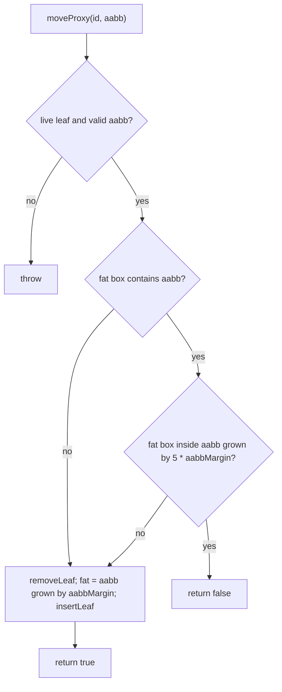

# Dynamic AABB tree

Issue: [#792](https://github.com/Forge-Game-Engine/Forge/issues/792)
(Physics Broad Phase Spatial Partitioning milestone; [#798](https://github.com/Forge-Game-Engine/Forge/issues/798)'s
persistent `BroadPhase` builds on it, and [#789](https://github.com/Forge-Game-Engine/Forge/issues/789)
adds the benchmark setup its bench case needs)

| Module or file                                              | Change   | Notes                                                                                                                           |
| ----------------------------------------------------------- | -------- | ------------------------------------------------------------------------------------------------------------------------------- |
| `src/physics/broad-phase/dynamic-aabb-tree.ts`              | New      | `DynamicAabbTree<T>` and `aabbMargin`                                                                                           |
| `src/physics/collision/flat-bounds.ts`                      | New      | `boxesOverlap` and an allocation-free `segmentReachesBox` over boxes stored four numbers each in a `Float64Array`. Not exported |
| `src/physics/broad-phase/index.ts`                          | New      | Exports `dynamic-aabb-tree.js` only                                                                                             |
| `src/physics/index.ts`                                      | Modified | `export * from './broad-phase/index.js'`                                                                                        |
| `src/physics/colliders/edge-tree.ts`                        | Modified | Uses `flat-bounds.ts`; its own `boxesOverlap`, `segmentReachesBox` and `clipToSlab` are deleted                                 |
| `src/physics/broad-phase/dynamic-aabb-tree.test.ts`         | New      | See "Testing"                                                                                                                   |
| `src/physics/collision/flat-bounds.test.ts`                 | New      | See "Testing"                                                                                                                   |
| `src/physics/broad-phase/dynamic-aabb-tree.bench.ts`        | New      | Phase 2, after #789 lands                                                                                                       |
| `documentation-site/docs/docs/physics/dynamic-aabb-tree.md` | New      | A short guide for games that keep their own spatial index                                                                       |
| `documentation-site/docs/docs/physics/index.md`             | Modified | One bullet linking the guide                                                                                                    |
| `CHANGELOG.md`                                              | Modified | One `#### Added` bullet (physics)                                                                                               |
| **Engine version at time of design**                        |          | `0.26.2`                                                                                                                        |

## Summary

`createBroadPhaseEcsSystem` (`src/physics/systems/broad-phase-system.ts`)
tests every collider against every other one, `raycast`
(`src/physics/raycast/raycast.ts`) tests every collider's `aabb` against
the ray's box, and `createContinuousCollisionEcsSystem`
(`src/physics/systems/continuous-collision-system.ts`) tests every swept
circle against every static collider. Each of these is a linear or
quadratic scan, and the physics module has no structure that could answer
"which boxes overlap this box" or "which boxes does this segment cross"
faster.

This design adds that structure: a **dynamic AABB tree**, a binary
bounding-volume hierarchy whose leaves are boxes that can be added, moved
and removed one at a time. It's the structure Box2D (`b2DynamicTree`),
Godot (its 2D BVH broad phase) and Rapier (its BVH broad phase and scene
queries) all use. Each leaf stores a box grown by a small margin, so a
shape that moves a little doesn't touch the tree. A new leaf goes where it
grows the tree's total perimeter the least, and rotations on the way back
up keep the tree from degrading into a list. Box queries and segment casts
walk the same tree.

`DynamicAabbTree<T>` is a plain data structure with no ECS knowledge: each
leaf (a **proxy**) holds a box and a value of the caller's type `T`, and
the caller decides what goes in. #798's `BroadPhase` puts one proxy per
collider entity in it and finds pairs incrementally. This design builds
and tests the tree on its own, exported from
`@forge-game-engine/forge/physics` for games that want their own spatial
index (units in a selection box, pickups near the player), and leaves
every physics system unchanged.

Nothing here bends a core design of the engine: the tree is a value a
caller owns, like `EdgeTree` or `NavigationGrid`, and no system gains state.

## Scope

### In scope

- `DynamicAabbTree<T>`: `createProxy`, `destroyProxy`, `moveProxy` (with
  the fat-box shrink rule), `getFatAabb`, `getValue`, `query`, `raycast`,
  `clear`, `proxyCount`, `height` and `validate`.
- A pooled node store in typed arrays with a free list, so creating and
  destroying proxies allocates nothing once the pool has grown.
- `aabbMargin`, the fixed margin, as an exported constant.
- Input validation with descriptive errors, and a guard against changing
  the tree from inside its own query callbacks.
- `flat-bounds.ts`, the box and segment tests over packed bounds, shared
  with `EdgeTree`, which loses its private copies.
- Unit tests, including seeded randomized comparisons with a brute-force
  scan, a degenerate-insertion height test and node reuse.
- Exports, a short guide and a changelog bullet.
- A bench file for the tree on its own (Phase 2), once #789's benchmark
  setup exists.

### Out of scope

- **Using the tree in the physics systems.** The `BroadPhase`, the pair
  cache, the move buffer and the new `createBroadPhaseEcsSystem` signature
  are #798's. Moving `raycast` and continuous collision onto the tree are
  follow-ups to #798. Until then the engine behaves exactly as today.
- **The benchmark setup** (`bench` script, `benchmark.include`, build and
  coverage exclusions) and the collision pipeline bench. Those are #789's.
- **Bulk building and rebuilding.** Box2D v3 rebuilds the subtrees of
  enlarged leaves each step with a binned surface-area build, and builds a
  static tree in one pass when a level loads. Neither is needed to replace
  an `O(n²)` scan; both can be added later behind the same API if the
  bench shows a need (see DL-2).
- **Displacement prediction** (growing the fat box in the direction of
  motion, as Box2D v2.4 does). See DL-3.
- **A per-tree or per-game margin.** See DL-10 and open question 2.
- **A demo.** The tree draws nothing. #789's physics stress test demo shows
  the effect once #798 uses the tree.
- **3D.** `/design/3d/14-physics-3d.md` §6.8 plans four dynamic trees per
  physics world and an internal `src/physics-shared/` home for "the dynamic
  AABB tree" used by both the 2D and 3D engines. That design decides
  whether this class moves there and becomes dimension-generic when its
  Phase 1 lands; nothing here depends on it (see "Relationship to other
  designs").
- **Sleeping.** A sleeping body's proxy just doesn't move; #798 already
  covers how the Physics Sleeping Bodies milestone should treat it.

## Relationship to other designs and issues

- **#798 (persistent `BroadPhase`).** Depends on this issue. It keeps two
  trees (static and non-static), uses `moveProxy`'s return value to fill
  its move buffer, queries with each moved proxy's fat box and drops cached
  pairs whose fat boxes separate. This design gives it what that needs:
  `getFatAabb(proxyId, out)` so the per-pair check allocates nothing,
  `clear()` for the system's `cleanup`, and deterministic tree shapes. Two
  things it has to know (listed again in "Handoff to #798"): the method is
  named `raycast`, not `rayCast` (DL-8), and an empty `ChainCollider`'s
  box (`min` at `+Infinity`, `max` at `-Infinity`,
  `src/physics/colliders/chain-collider.ts`) is rejected, so the broad
  phase keeps such colliders out of the tree.
- **#789 (benchmarks).** Still open, so the repository has no `bench`
  script, no `benchmark.include` and no
  `src/physics/systems/collision-pipeline.bench.ts` today. The issue asks
  for "a bench case for the tree on its own" in #789's file. This design
  puts it in its own file next to the tree (DL-11), which #789's
  `src/**/*.bench.ts` include picks up with no further setup, and makes it
  Phase 2, which can only start once #789 has merged (open question 1).
- **`/design/chain-collider.md` (DL-2 there).** Chose a static, median-split
  `EdgeTree` over a chain's edges. That stays: a fixed set of many small
  items built once is better served by a top-down build with packed leaves
  than by incremental insertion (DL-12). The two trees now share their box
  and segment tests.
- **`/design/3d/14-physics-3d.md` §6.8.** Describes Forge's eventual 3D and
  2D broad phases: typed-array trees, branch-and-bound sibling choice,
  per-step partial rebuilds, a 0.1 m margin on moving proxies and none on
  static ones, and the tree kept internal in `physics-shared`. This design
  differs in three places, each recorded in the decision log: a greedy
  sibling choice with height rotations (DL-2), the margin on every proxy
  (DL-10), and a public export (DL-14, open question 3). When design 14's
  Phase 1 replaces the 2D broad phase, it can extend this class rather
  than write a second one.
- **`/design/3d/01-testing-and-benchmarks.md`.** Puts microbenchmarks in
  `src/**/*.bench.ts` next to the code they measure, which Phase 2 follows.

## How other engines do it

- **Box2D v2.4** (`b2_dynamic_tree.cpp`): nodes in a pooled array with a
  free list; a proxy id is its leaf's node index. `InsertLeaf` walks down
  from the root choosing, at each node, between making a new parent there
  and descending into the child whose box grows least, using perimeter as
  the 2D surface area; `Balance` rotates a node's taller child up when the
  heights of its children differ by more than one, on the way up after
  inserting and removing. `MoveProxy` grows the tight box by
  `b2_aabbExtension` (0.1 m) and by four times the frame's displacement,
  does nothing while the stored box still contains the tight one and isn't
  larger than the new fat box grown by four more margins, and otherwise
  removes and reinserts the leaf. `RayCast` culls nodes with a separating
  axis test and lets the callback return `0` to stop, a positive fraction
  to clip the ray, or a negative value to skip the shape.
- **Box2D v3** (`dynamic_tree.c`): the same tree with a greedy
  surface-area sibling search with lower-bound pruning, rotations chosen to
  reduce surface area rather than height, no displacement prediction (the
  fat box is the tight box grown by the margin), proxies that only grow
  (`EnlargeProxy`) during the step, and a partial binned rebuild each step.
- **Godot** replaced `BroadPhase2DHashGrid` with a BVH broad phase. Its BVH
  grows each item's pairing box by an expansion margin and only re-checks
  an item's pairs when its new box leaves the expanded one.
- **Rapier** moved from a hierarchical sweep-and-prune to a BVH for both
  its broad phase and its scene queries.
- **Matter.js** dropped its `Grid` broad phase for a sort-and-sweep on x.

The issue explains why a tree fits Forge better than a grid (no cell size
to tune; a `TerrainCollider` as wide as the level next to small circles;
unbounded worlds) or sweep-and-prune (poor for large static shapes and
ray casts). DL-1 records that choice.

## API

```ts
/**
 * How far, in world units, each side of a proxy's box is grown when it's
 * stored in a DynamicAabbTree. A shape that moves less than this from where
 * its box was last stored doesn't touch the tree. ...
 */
export const aabbMargin = 0.1;

export class DynamicAabbTree<T> {
  constructor();

  /** The number of live proxies. */
  get proxyCount(): number;

  /** The number of edges from the root to the deepest leaf; 0 when empty or with one proxy. */
  get height(): number;

  createProxy(aabb: Aabb, value: T): number;
  destroyProxy(proxyId: number): void;
  moveProxy(proxyId: number, aabb: Aabb): boolean;

  getFatAabb(proxyId: number, out: Aabb): Aabb;
  getValue(proxyId: number): T;

  query(aabb: Aabb, callback: (proxyId: number, value: T) => boolean): void;
  raycast(
    start: Vector2,
    end: Vector2,
    callback: (proxyId: number, maxFraction: number, value: T) => number,
  ): void;

  clear(): void;
  validate(): void;
}
```

`Aabb` is the existing `{ min: Vector2; max: Vector2 }`
(`src/physics/types/aabb.ts`), Y-down like every Forge box, so `min` is
the top-left corner.

| Member                          | Behavior                                                                                                                                                                                                                                                                                                                                                                                 |
| ------------------------------- | ---------------------------------------------------------------------------------------------------------------------------------------------------------------------------------------------------------------------------------------------------------------------------------------------------------------------------------------------------------------------------------------- |
| `createProxy(aabb, value)`      | Stores a leaf whose fat box is `aabb` grown by `aabbMargin` on every side, and returns its proxy id (an integer `>= 0`). Throws when `aabb` isn't finite with `min <= max` on both axes (a point box is allowed).                                                                                                                                                                        |
| `destroyProxy(proxyId)`         | Removes the leaf and frees its node (and its parent node) for reuse. Throws for an id that isn't a live proxy.                                                                                                                                                                                                                                                                           |
| `moveProxy(proxyId, aabb)`      | `aabb` is the shape's new tight box. Returns `false`, changing nothing, while the stored fat box contains `aabb` and no side of the fat box is more than `5 * aabbMargin` beyond `aabb`'s. Otherwise reinserts the leaf with a fresh fat box (`aabb` grown by `aabbMargin`) and returns `true`. So `true` means "the fat box changed". Same validation as `createProxy`, plus a live id. |
| `getFatAabb(proxyId, out)`      | Writes the leaf's stored fat box into `out`'s `min` and `max` and returns `out`, so a per-tick check allocates nothing. Throws for a dead id.                                                                                                                                                                                                                                            |
| `getValue(proxyId)`             | The value given to `createProxy`. Throws for a dead id.                                                                                                                                                                                                                                                                                                                                  |
| `query(aabb, callback)`         | Calls `callback` once for each leaf whose fat box overlaps `aabb` (touching counts, as in `aabbsOverlap`), in tree order. Returning `false` stops the query. `aabb` may be infinite but must have `min <= max` on both axes.                                                                                                                                                             |
| `raycast(start, end, callback)` | Walks the leaves whose fat box the segment from `start` to `end` reaches (touching counts), in tree order, not distance order. `callback` gets the current `maxFraction` (starting at `1`) and returns `0` to stop, a fraction in `(0, maxFraction)` to clip the segment there for the rest of the walk, or `maxFraction` to go on unchanged. Any other return value throws.             |
| `clear()`                       | Removes every proxy and keeps the pool's capacity. Proxy ids from before are dead afterwards (until reused).                                                                                                                                                                                                                                                                             |
| `validate()`                    | Walks every node and throws, naming the node and the broken rule, if the tree's structure is inconsistent (see "Validation"). Linear in the node count; meant for tests and debugging.                                                                                                                                                                                                   |

A destroyed proxy's id is reused by a later `createProxy`, as entity slots
and Box2D proxy ids are. A caller that keeps an id after destroying it gets
whichever proxy reuses the slot; the tree only throws for ids that aren't a
live leaf at all. #798 maps entities to proxy ids and destroys the proxy
before forgetting the entity, so this never comes up there.

Callbacks get the leaf's `value` as well as its id, so the common case
(`query(box, (id, entity) => ...)`) needs no `getValue` call. A callback
that only takes `proxyId` still type-checks.

### Example

```ts
import { DynamicAabbTree } from '@forge-game-engine/forge/physics';

const units = new DynamicAabbTree<number>(); // values are entity ids
const unitProxy = units.createProxy(unitBounds, unit);

// Each frame, after the unit moved:
units.moveProxy(unitProxy, unitBounds);

// Selection box: every unit whose (slightly grown) bounds it touches.
units.query(selectionBox, (_proxyId, entity) => {
  selected.push(entity);
  return true;
});

// Closest unit along a line: clip the ray to each hit.
let closest: number | null = null;
units.raycast(from, to, (proxyId, maxFraction, entity) => {
  const fraction = intersectUnit(entity, from, to); // the game's exact test
  if (fraction === null || fraction >= maxFraction) {
    return maxFraction;
  }
  closest = entity;
  return fraction;
});
```

## Data layout

Struct-of-arrays in typed arrays, the same approach as `EdgeTree`
(`src/physics/colliders/edge-tree.ts`):

| Field         | Storage                  | Meaning                                                                                                          |
| ------------- | ------------------------ | ---------------------------------------------------------------------------------------------------------------- |
| `_bounds`     | `Float64Array`, 4 a node | `minX`, `minY`, `maxX`, `maxY`. A leaf's fat box; an internal node's union of its children's boxes               |
| `_parent`     | `Int32Array`             | The parent node, or `nullNode` (`-1`) for the root. On a free node, the next free node                           |
| `_child1`     | `Int32Array`             | The first child, or `nullNode` on a leaf                                                                         |
| `_child2`     | `Int32Array`             | The second child, or `nullNode` on a leaf                                                                        |
| `_height`     | `Int32Array`             | `0` on a leaf, `1 + max(children)` on an internal node, `-1` on a free node, which is how "live leaf" is checked |
| `_values`     | `(T \| undefined)[]`     | The leaf's value; `undefined` on internal and free nodes                                                         |
| `_root`       | `number`                 | The root node, or `nullNode`                                                                                     |
| `_freeList`   | `number`                 | The first free node, or `nullNode`                                                                               |
| `_proxyCount` | `number`                 |                                                                                                                  |
| `_stacks`     | `number[][]`             | One reusable walk stack per nesting depth (see "Walking the tree")                                               |
| `_walkDepth`  | `number`                 | How many `query`/`raycast` walks are running                                                                     |

- The pool starts at 16 nodes and doubles when the free list is empty:
  each typed array is copied into one twice its size and the new nodes are
  chained onto the free list. A tree of `n` proxies uses `2n - 1` nodes,
  so it allocates `O(log n)` times while growing to `n` and never again.
- A proxy id is its leaf's node index. Rotations and removals only move
  internal nodes and re-parent subtrees; a leaf keeps its index for life,
  so ids are stable.
- `Float64Array` rather than `Float32Array`: Forge's positions are doubles,
  and rounding a stored box to 32 bits could leave it not containing the
  tight box it was grown from, which would make `moveProxy` reinsert a
  resting shape every tick.
- Memory: 4 × 8 bytes of bounds plus 4 × 4 bytes of links and height plus
  a value slot, about 56 bytes a node, so about 112 bytes a proxy: 5,000
  proxies take about 560 KB.

## Algorithms

Perimeter, `2 * (width + height)`, is the 2D surface-area measure
throughout, as in Box2D.

### Inserting a leaf

```text
insertLeaf(leaf):
  if root is null: root = leaf; parent[leaf] = null; return

  # Find the best sibling (Box2D v2.4's greedy descent).
  box = bounds[leaf]
  index = root
  while index is internal:
    area      = perimeter(bounds[index])
    combined  = perimeter(union(bounds[index], box))
    cost      = 2 * combined                    # new parent at index
    inherited = 2 * (combined - area)           # growth every deeper choice adds above
    cost1 = descendCost(child1[index], box) + inherited
    cost2 = descendCost(child2[index], box) + inherited
    if cost < cost1 and cost < cost2: break
    index = cost1 < cost2 ? child1[index] : child2[index]

  descendCost(child, box) =
    leaf(child) ? perimeter(union(box, bounds[child]))
                : perimeter(union(box, bounds[child])) - perimeter(bounds[child])

  # Make a new parent for the sibling and the leaf.
  sibling = index
  newParent = allocateNode()
  replace sibling with newParent under sibling's old parent (or as root)
  child1[newParent] = sibling; child2[newParent] = leaf
  bounds[newParent] = union(box, bounds[sibling])
  height[newParent] = height[sibling] + 1

  # Walk up, rebalancing and refitting.
  index = parent[leaf]
  while index is not null:
    index = balance(index)
    bounds[index] = union(bounds[child1], bounds[child2])
    height[index] = 1 + max(height[child1], height[child2])
    index = parent[index]
```

Ties go to `child2`, and nothing depends on iteration order of a `Map` or
on randomness, so the same sequence of calls always builds the same tree.
#798 sorts its pair output anyway, but deterministic trees make test
failures reproducible.

### Removing a leaf

```text
removeLeaf(leaf):
  if leaf is root: root = null; return
  parentNode  = parent[leaf]
  grandparent = parent[parentNode]
  sibling     = the other child of parentNode
  if grandparent is null:
    root = sibling; parent[sibling] = null
  else:
    replace parentNode with sibling under grandparent
  freeNode(parentNode)
  walk up from grandparent as in insertLeaf (balance, refit, height)
```

`destroyProxy` is `removeLeaf` then `freeNode(leaf)`.

### Balancing

Box2D v2.4's `Balance`: at node `A` with children `B` and `C`, when
`height[C] - height[B] > 1`, `C` takes `A`'s place, `A` becomes `C`'s first
child, and of `C`'s children the taller stays with `C` while the shorter
moves under `A`; the mirror case rotates `B` up. Boxes and heights of the
two moved internal nodes are recomputed, and `balance` returns the node
now in `A`'s place so the walk continues from it.

This keeps the tree shallow in practice but doesn't guarantee that every
node's children differ in height by at most one. The sibling search can
pick an internal node of height 3 as a leaf's sibling, which puts a height
3 subtree and a height 0 leaf under one new parent; one rotation reduces
that difference but can't always bring it to one. So `validate` checks
that heights are correct, not that the tree is AVL-balanced, and the tests
bound the tree's overall height instead (see "Testing" and DL-9).

### Moving a leaf



The second check is Box2D v2.4's "huge box" rule. Without displacement
prediction a fresh fat box is always the tight box plus one margin, so a
stored box only ends up much larger than its shape's tight box when the
tight box shrinks inside it: a long, thin shape turning from diagonal to
level, or a collider replaced by a smaller one. Reinserting it then stops
it from producing pairs it no longer overlaps. DL-4 explains why this is an
absolute rule and not the issue's "more than 4x the tight box's area".

### Walking the tree

`query` and `raycast` walk the tree with an explicit stack, never with
recursion:

```text
query(aabb, callback):
  validateQueryBox(aabb)
  stack = takeStack()              # _stacks[_walkDepth++], created on first use
  try:
    top = 0; if root is not null: stack[top++] = root
    while top > 0:
      node = stack[--top]
      if not boxesOverlap(bounds, 4 * node, aabb): continue
      if height[node] == 0:
        if callback(node, values[node]) == false: return
      else:
        stack[top++] = child1[node]; stack[top++] = child2[node]
  finally:
    _walkDepth--
```

`raycast` is the same walk with `segmentReachesBox(bounds, 4 * node,
startX, startY, deltaX, deltaY, maxFraction)` as the node test, where the
segment is `start + t * (end - start)` for `t` in `[0, maxFraction]`. A
callback's return value updates `maxFraction`, so later nodes are culled
against the clipped segment. A zero-length segment (`start` equal to
`end`) reaches exactly the boxes that contain `start`.

- **No allocation.** Each nesting depth has its own stack, kept for the
  tree's life and grown only when a deeper tree needs more room, so a
  steady-state query allocates nothing.
- **Nested walks are allowed.** A callback may query or cast against the
  same tree; the inner walk takes the next depth's stack.
- **Changing the tree during a walk throws.** `createProxy`,
  `destroyProxy`, `moveProxy` and `clear` throw while `_walkDepth > 0`:
  a rotation in the middle of a walk would leave the stack pointing at
  nodes that have moved. The `try`/`finally` resets the depth when a
  callback throws, so the tree stays usable. This matches how
  `findPath` guards its shared arrays against being re-entered from a
  graph's methods.

### `flat-bounds.ts`

Both trees store boxes as four numbers in a `Float64Array`, so the two
tests live in one internal module that `EdgeTree` also imports. It sits in
`src/physics/collision/`, next to `aabb-overlap.ts`, rather than in
`broad-phase/`, so `colliders/` doesn't depend on the broad phase folder
(which #798 makes depend on colliders):

```ts
/** Whether the box at `offset` overlaps the given box (touching counts). */
export function boxesOverlap(
  bounds: Float64Array,
  offset: number,
  minX: number,
  minY: number,
  maxX: number,
  maxY: number,
): boolean;

/**
 * Whether the segment `start + t * delta`, `t` in `[0, maxFraction]`,
 * reaches the box at `offset` (touching counts), by clipping `t` against
 * the box's x and y slabs. Allocates nothing.
 */
export function segmentReachesBox(
  bounds: Float64Array,
  offset: number,
  startX: number,
  startY: number,
  deltaX: number,
  deltaY: number,
  maxFraction: number,
): boolean;
```

`segmentReachesBox` keeps `tMin` and `tMax` in locals instead of returning
`{ tMin, tMax }` objects as `EdgeTree`'s `clipToSlab` does today, so
`EdgeTree.querySegment` stops allocating two objects per node test too.
`EdgeTree` calls it with `maxFraction` `1`. With a zero `delta` on an
axis, the segment reaches the slab only when `start` lies inside it, as
today. That needs care for `(min - start) / 0`, which the zero check
avoids.

## Validation and errors

| Call                                                  | Throws when                                                                                                             |
| ----------------------------------------------------- | ----------------------------------------------------------------------------------------------------------------------- |
| `createProxy`, `moveProxy`                            | A box coordinate isn't finite, or `min > max` on an axis                                                                |
| `destroyProxy`, `moveProxy`, `getFatAabb`, `getValue` | `proxyId` isn't an integer in the pool whose node is a live leaf                                                        |
| `query`                                               | `min > max` on an axis, or a coordinate is `NaN` (infinite boxes are allowed)                                           |
| `raycast`                                             | `start` or `end` isn't finite; the callback returns anything but `0`, a fraction in `(0, maxFraction)` or `maxFraction` |
| `createProxy`, `destroyProxy`, `moveProxy`, `clear`   | Called from inside this tree's `query` or `raycast` callback                                                            |

Messages name the class, the proxy id or the offending box, for example
`DynamicAabbTree.moveProxy: proxy 12 isn't a live proxy.` and
`DynamicAabbTree.createProxy: box min (3, NaN) max (4, 5) must be finite with min <= max.`

Rejecting non-finite boxes matters: a perimeter of an infinite box is
`Infinity`, and the sibling search's `combined - area` becomes `NaN`, which
silently builds a bad tree. An empty `ChainCollider` returns exactly such a
box (`min` at `+Infinity`, `max` at `-Infinity`), so #798 has to keep it
out of the tree; it can't pair with anything anyway.

### Validation

`validate()` checks, and throws naming the node on the first failure:

- the root's parent is `nullNode`, and every other reachable node's
  parent links back to it;
- every internal node has two children, its height is
  `1 + max(children's heights)` and its box equals the union of its
  children's boxes exactly (refits use `min`/`max`, never arithmetic, so
  equality holds);
- every leaf has height `0` and a value, and the number of reachable
  leaves is `proxyCount`;
- every node is either reachable from the root or on the free list, never
  both and never twice, and every free node has height `-1`.

It doesn't check AVL balance (see "Balancing"). It's a public method
rather than a test-only helper because it needs the private node arrays,
the same reason `b2DynamicTree::Validate` is public (DL-9).

## Choosing the margin

`aabbMargin` is `0.1` world units, Box2D's 0.1 m. That suits Forge's
meter-scaled defaults: gravity is `(0, 9.81)`
(`src/physics/components/gravity-component.ts`), a default camera is 10
world units tall (`verticalWorldUnits: 10`,
`src/rendering/components/camera-component.ts`), and the collision
resolution `slop` is `0.002`. A body that rests or jitters by less than a
margin costs nothing; a body that moves further than a margin in a tick is
reinserted, `O(log n)`, which is still far cheaper than today's scan.

The documentation site's demos use about 600 world units per screen
(`DEMO_VERTICAL_WORLD_UNITS`, `documentation-site/src/utils/demo-camera.ts`)
and gravity around `300`, so there a margin of `0.1` is nearly zero:
every moving body reinserts every tick, and only resting bodies benefit.
That's correct, just less than the best case. Open question 2 lists the
alternatives (a larger constant, a margin relative to the shape's size,
or a per-tree value); none of them changes anything else in this design.

The margin applies to every proxy, including the static ones #798 puts in
its static tree, where Box2D v3 and design 14 use none. A static proxy
never moves, so the margin only makes its box 0.1 larger on each side,
which costs at most a few extra candidate pairs that #798's tight-box
check drops (DL-10).

## Performance

| Operation                      | Cost                                                                                      |
| ------------------------------ | ----------------------------------------------------------------------------------------- |
| `createProxy`, `destroyProxy`  | `O(depth)`: one descent, one walk up; amortized `O(1)` allocation while the pool grows    |
| `moveProxy` inside the margin  | `O(1)`: two box comparisons                                                               |
| `moveProxy` outside the margin | A remove and an insert                                                                    |
| `query`                        | `O(log n + k)` typically, for `k` overlapping leaves                                      |
| `raycast`                      | Proportional to the nodes the segment reaches; clipping prunes more for closest-hit casts |
| `validate`                     | `O(n)`                                                                                    |

Nothing in `query`, `raycast`, `moveProxy` (without reinsertion) or
`getFatAabb(id, out)` allocates. Callbacks are the caller's: a closure
created per query allocates, so #798 should create its callbacks once.

## Handoff to #798

What the `BroadPhase` design needs to know about this tree:

1. The cast method is `raycast(start, end, callback)`, Forge's spelling
   (`raycast`, `raycastCircle`, `RaycastHit`), and its callback also gets
   the leaf's value: `(proxyId, maxFraction, value) => number`.
2. `getFatAabb(proxyId, out)` writes into `out`, for the per-tick "do these
   cached pairs' fat boxes still overlap" check.
3. `clear()` empties a tree for `createBroadPhaseEcsSystem`'s `cleanup`.
4. `createProxy`/`moveProxy` throw for empty or non-finite boxes; keep an
   empty `ChainCollider` out of the tree.
5. Don't change a tree from inside its own `query` callback: collect the
   pairs first.
6. `moveProxy` returns `true` whenever the fat box changed, including when
   it shrank, so a shrunk proxy also enters the move buffer. That's
   harmless: re-querying finds no pairs the cache doesn't already have.

## Testing

`dynamic-aabb-tree.test.ts`, calling `validate()` after every step of every
test:

- **Create, destroy, move.** Ids are distinct; `getValue` and
  `getFatAabb` return the value and the box grown by `aabbMargin`;
  `proxyCount` follows; `getFatAabb` with `out` writes into it and returns
  it.
- **The margin.** `moveProxy` returns `false` for a move within the margin
  and leaves the fat box alone; `true` for a move just past it, with a
  fresh fat box; `true` when a tight box shrinks by more than
  `4 * aabbMargin` inside its fat box (the shrink rule), and `false` when
  it shrinks by less.
- **Query.** Hits, misses, touching edges, an infinite query box, and early
  exit after the first callback returns `false`.
- **Raycast.** Hits and misses; a horizontal, a vertical and a
  zero-length segment; segments touching a box's edge; returning `0` stops
  after one callback; clipping: a callback that returns each leaf's entry
  fraction ends with the smallest entry fraction a brute-force scan finds,
  and never sees a leaf whose box the clipped segment can't reach.
- **Errors.** Every row of the validation table, including a `moveProxy`
  from inside a `query` callback, and a nested `query` from inside a
  `query` callback that works.
- **Node reuse.** After destroying proxies, creating as many again hands
  out only ids that were freed, so the pool didn't grow, and a destroyed
  id throws until it's reused.
- **`clear`.** Empties the tree, invalidates ids and reuses the nodes.
- **Randomized comparison.** A seeded `Random` (`src/math/random.ts`)
  drives a few thousand mixed operations over up to a few hundred proxies:
  create with random sizes (including very wide and very thin boxes),
  small moves, large moves, shrinks and destroys. After each step,
  `validate()` passes, every fat box contains its latest tight box and is
  within `5 * aabbMargin` of it, and random `query` boxes and `raycast`
  segments return exactly the set of ids a brute-force scan over every
  `getFatAabb` finds (`segmentReachesBox` against each box, and inclusive
  overlap). Run with several seeds.
- **Height.** After the randomized run, and after inserting 1,000 equal
  boxes along a line in sorted order (the classic way to turn an
  unbalanced tree into a list), `height` is at most
  `4 * Math.ceil(Math.log2(proxyCount + 1))`. An AVL tree stays under
  `1.44 log2 n`; the bound leaves room for the imbalance the sibling search
  allows, and a tree that degraded into a list (height near `n`) fails it.
- **Determinism.** Two trees fed the same calls produce the same `query`
  callback order.

`flat-bounds.test.ts` covers both helpers on their own: inclusive edges,
zero `delta` on either axis inside and outside a slab, `maxFraction`
cutting a segment short of a box, and agreement with a sampled-points
check on seeded random segments. `edge-tree.test.ts` stays as it is and
must still pass.

No e2e test: nothing renders or reads input.

## Documentation

- `documentation-site/docs/docs/physics/dynamic-aabb-tree.md` (new,
  `sidebar_position: 8`): what the tree is for (a spatial index a game
  keeps for its own objects), creating, moving and destroying proxies,
  what the margin means and what a `false` from `moveProxy` tells the
  caller, query and raycast callbacks (early exit, clipping, tree order),
  id reuse, and that the tree can't be changed from inside its own
  callbacks. It describes only what ships: until #798 lands, the physics
  systems don't use the tree, and the page doesn't say they do.
- `documentation-site/docs/docs/physics/index.md`: one bullet in the list
  of parts linking the page.
- Full JSDoc on every public member and on `aabbMargin` (the issue asks for
  it, since the class is exported for advanced use).
- `CHANGELOG.md`, `#### Added`: "**physics:** `DynamicAabbTree<T>`, a
  bounding-box tree for spatial queries: `createProxy(aabb, value)`,
  `moveProxy` (which does nothing while the box stays within `aabbMargin`,
  0.1 world units, of where it was stored), `destroyProxy`, `query(aabb,
callback)` and `raycast(start, end, callback)` with early exit and
  clipping. It allocates nothing per query and throws for invalid boxes and
  ids. See the new Dynamic AABB Tree guide."

## Bench (Phase 2)

`src/physics/broad-phase/dynamic-aabb-tree.bench.ts`, with Vitest's
`bench` and a seeded `Random`, over 500, 2,000 and 5,000 boxes spread at
constant density, so per-box work should stay flat as the count grows:

- **Build:** `createProxy` for every box into a new tree.
- **Settled moves:** move every box by less than the margin (every
  `moveProxy` returns `false`).
- **Moving:** move every box by more than the margin (every one
  reinserts).
- **Pair finding:** query the tree with each box's fat box, counting
  overlaps, beside a brute-force all-pairs count over the same boxes, so
  the speed-up is read off one run.
- **Rays:** 1,000 random segments through the tree beside a brute-force
  scan.

The numbers go in the pull request that adds the file, and on #798 as the
tree-only part of its before and after.

## Phases

### Phase 1: The tree

Builds, tests, exports and documents `DynamicAabbTree`, and moves the box
and segment tests `EdgeTree` uses into the shared module. Nothing in the
engine uses the tree yet, so no behavior changes.

**Definition of done:** the randomized tests pass, comparing `query` and
`raycast` with a brute-force scan over several seeds with `validate()`
after every step; `DynamicAabbTree` and `aabbMargin` are exported from
`@forge-game-engine/forge/physics`; `EdgeTree` uses `flat-bounds.ts`;
`npm run check-types`, `npm test`, `npm run lint`, `npm run cspell` and
`npm run check-exports` pass; the guide and changelog bullet are in.

| #    | Task              | Description                                                                                                                                                     | Size |
| ---- | ----------------- | --------------------------------------------------------------------------------------------------------------------------------------------------------------- | ---- |
| 1.1  | Shared box tests  | `flat-bounds.ts` with `boxesOverlap` and an allocation-free `segmentReachesBox`; `EdgeTree` uses them and its copies (and `clipToSlab`) are deleted; tests      | S    |
| 1.2  | Node pool         | Typed-array node store, free list, doubling growth, `proxyCount`, `height`, `getValue`, `getFatAabb(id, out)`, `clear`, live-leaf checks                        | M    |
| 1.3  | Insert and remove | `createProxy` and `destroyProxy`: sibling search by perimeter cost, new parent, removal, `balance` rotations, refit and heights on the way up; input validation | L    |
| 1.4  | Move              | `moveProxy` with the containment check and the shrink rule; returns whether the fat box changed                                                                 | S    |
| 1.5  | Query and raycast | Stack walks with per-depth reusable stacks, early exit, clipping, the return-value checks, and the guard against changing the tree during a walk                | M    |
| 1.6  | Validate          | `validate()` with the checks in "Validation"                                                                                                                    | S    |
| 1.7  | Unit tests        | Everything in "Testing"                                                                                                                                         | L    |
| 1.8  | Exports           | `src/physics/broad-phase/index.ts` exporting `dynamic-aabb-tree.js` only; `src/physics/index.ts`; JSDoc on every public member and `aabbMargin`                 | S    |
| 1.9  | Guide             | `physics/dynamic-aabb-tree.md` and the bullet in `physics/index.md` (`document-feature` skill)                                                                  | M    |
| 1.10 | Changelog         | The `#### Added` bullet                                                                                                                                         | S    |

### Phase 2: Bench case

Adds the tree's own microbenchmark. It needs #789's `bench` script and
`benchmark.include`, so it starts only after #789 has merged into `dev`
(open question 1 says what happens when that isn't so when Phase 1 ships).

**Definition of done:** `npm run bench` runs
`dynamic-aabb-tree.bench.ts` next to #789's collision pipeline bench and
prints per-case timings for the tree and the brute-force baselines at 500,
2,000 and 5,000 boxes; the numbers are posted on the pull request.

| #   | Task           | Description                                                                                          | Size |
| --- | -------------- | ---------------------------------------------------------------------------------------------------- | ---- |
| 2.1 | Bench file     | `dynamic-aabb-tree.bench.ts` with the cases in "Bench (Phase 2)", seeded scenes built outside timing | M    |
| 2.2 | Record numbers | Run it and post the results (with the machine used) on the pull request and on #798                  | S    |

## Decision log

### DL-1: A dynamic AABB tree, not a grid or sweep-and-prune

- **Options:** (a) a dynamic AABB tree; (b) a uniform or hashed grid; (c)
  sweep-and-prune; (d) a quadtree.
- **Chosen:** (a).
- **Rationale:** The issue's analysis holds: a grid needs a cell size that
  every game would tune, and a level-wide `TerrainCollider` next to small
  circles fills thousands of cells; sweep-and-prune is poor for large
  static shapes and for ray casts, which this milestone also needs; a
  quadtree has the same mixed-size problem as a grid (large boxes stick at
  the top) and needs world bounds. A tree has no tuning, handles any size
  mix and extent, costs nothing for shapes that don't move, and answers
  box and ray queries with one structure. It's what Box2D, Godot and
  Rapier converged on.
- **Tradeoff:** More code than a grid; a move past the margin costs a
  remove and an insert.
- **Assumptions:** Most scenes have many shapes that move little per tick
  and some large static ones.

### DL-2: Box2D v2.4's greedy sibling search and height rotations

- **Options:** (a) v2.4: greedy descent by perimeter cost, rotations by
  height; (b) v3: greedy descent with lower-bound pruning, rotations that
  reduce perimeter, plus a partial rebuild each step; (c) branch-and-bound
  sibling search (Catto, GDC 2019), as design 14 §6.8.1 plans; (d) no
  rotations, periodic full rebuild.
- **Chosen:** (a).
- **Rationale:** It's what the issue asks for, it's been Box2D's tree for
  a decade, and height rotations bound the tree's depth even under
  adversarial insertion orders (sorted lines of boxes), which (b)'s
  area rotations don't. (b) and (c) give somewhat better trees for more
  code and a per-step rebuild pass that needs the broad phase's
  cooperation. (d) makes every frame that rebuilds a spike.
- **Tradeoff:** Query quality a little below v3's. The bench (Phase 2)
  will show whether it matters; (b) and (c) can replace the insertion
  internals later without changing the API.
- **Assumptions:** Query cost is dominated by depth and overlap, which (a)
  keeps reasonable.

### DL-3: No displacement prediction

- **Options:** (a) the fat box is the tight box plus the margin; (b) also
  stretch it along the shape's displacement, as v2.4 does with four times
  the frame's motion.
- **Chosen:** (a).
- **Rationale:** The issue's `moveProxy(proxyId, aabb)` has no
  displacement, Box2D v3 dropped prediction, and a stretched box makes a
  fast body pair with everything ahead of it for several ticks. Without
  it, a body moving more than a margin a tick reinserts every tick, which
  is `O(log n)`.
- **Tradeoff:** Fast bodies reinsert every tick instead of every few.
- **Assumptions:** Reinsertion stays cheap enough; the bench checks it.

### DL-4: The shrink rule is absolute, not an area ratio

- **Options:** (a) reinsert when the fat box reaches more than
  `5 * aabbMargin` beyond the tight box on any side (Box2D v2.4's "huge
  box": the fresh fat box grown by four more margins); (b) the issue's
  rule, reinsert when the fat box's area is more than 4x the tight box's.
- **Chosen:** (a).
- **Rationale:** (b) breaks for thin shapes: a resting 10 × 0.05 rod has a
  tight area of 0.5 and a fresh fat box of 10.2 × 0.25 = 2.55, more than
  4x, so it would reinsert every tick without moving, and a zero-height box
  divides by zero. (a) depends only on how far each side has drifted. The
  issue attributes (b) to Box2D v3, but v3's step only ever grows a fat
  box (`b2FinalizeBodiesTask` regrows it when the tight box leaves it);
  the shrink rule Box2D has is v2.4's (a).
- **Tradeoff:** For very large shapes, a box can stay up to four margins
  too large on a side; that's a few extra candidate pairs at most.
- **Assumptions:** The case the shrink exists for is a tight box shrinking
  inside its fat box (rotation, a smaller collider), since without
  prediction a fat box never starts out large.

### DL-5: Proxy ids are leaf node indices, reused after destroy

- **Options:** (a) the leaf's node index, reused; (b) a separate,
  generation-checked handle.
- **Chosen:** (a).
- **Rationale:** Box2D v2.4 does this; leaves never move, so the id is
  stable; it needs no indirection. Callers that own a proxy destroy it
  before forgetting it, as #798 does.
- **Tradeoff:** A stale id after reuse names another proxy instead of
  throwing.
- **Assumptions:** The tree's callers keep their own entity-to-proxy maps
  in step, as #798's reconciliation does.

### DL-6: Typed arrays in double precision, doubling growth

- **Options:** (a) struct-of-arrays in `Float64Array`/`Int32Array`; (b)
  one object per node; (c) `Float32Array` bounds.
- **Chosen:** (a).
- **Rationale:** No per-node objects for the garbage collector, compact
  and cache-friendly, and the same layout `EdgeTree` uses, so the box
  tests can be shared. Doubles match Forge's coordinates, so a stored box
  always contains the box it was grown from.
- **Tradeoff:** Growing copies every array, `O(log n)` times in total.

### DL-7: Callback walks with per-depth stacks; no changes during a walk

- **Options:** (a) callbacks with early exit, stacks reused per nesting
  depth, changes during a walk throw; (b) return arrays of ids, as
  `EdgeTree` does; (c) one shared stack, with nested walks throwing.
- **Chosen:** (a).
- **Rationale:** The issue asks for callbacks with early exit, which also
  serve closest-hit casts and "any overlap?" checks. Arrays allocate per
  query, which #798 runs for every moved proxy every tick. Per-depth
  stacks allocate nothing and still let a callback query the same tree.
  Changing the tree mid-walk would corrupt the walk, so it throws instead
  of misbehaving.
- **Tradeoff:** Callers needing a list build it themselves.

### DL-8: The method is `raycast`, and callbacks also get the value

- **Options:** (a) `raycast`, Forge's spelling; (b) `rayCast`, as the
  issue and #798 write it.
- **Chosen:** (a).
- **Rationale:** Forge already spells it as one word in every public name
  (`raycast`, `raycastCircle`, `RaycastHit`, `RaycastOptions`), and
  `rayCast` is Box2D's spelling. Callbacks get the leaf's value as a last
  argument so the usual case needs no `getValue` call; a callback with
  fewer parameters still fits.
- **Tradeoff:** #798's text says `rayCast`; its implementation must use
  `raycast` (open question 4).

### DL-9: `validate()` is a public method, and balance is a height bound

- **Options:** (a) a public `validate()` that checks structure, with the
  tests bounding `height`; (b) a test helper in `test-helpers/` that reads
  private arrays through bracket access; (c) (a) plus an AVL check
  (children's heights differ by at most one).
- **Chosen:** (a).
- **Rationale:** Validation needs the private node arrays, which only the
  class can read cleanly; Box2D exposes `Validate` for the same reason,
  and it lets a game check a tree it suspects. (c) is wrong for this tree:
  the perimeter-driven sibling search can create a node whose children
  differ in height by more than one that a single rotation can't fix (see
  "Balancing"), so the check would fail on a correct tree. The issue's
  "height balance" check becomes the test's height bound.
- **Tradeoff:** A debugging method in the shipped class.

### DL-10: One fixed margin for every proxy

- **Options:** (a) `aabbMargin = 0.1` world units for every proxy, as the
  issue says; (b) a constructor argument; (c) a margin relative to each
  shape's size; (d) no margin on static proxies, as Box2D v3 and design 14
  do.
- **Chosen:** (a), with open question 2 asking whether to revisit it.
- **Rationale:** The issue asks for a constant, not an option, and Forge's
  defaults are meter-scaled. The tree can't tell static proxies from
  moving ones, and a margin on a box that never moves costs at most a few
  extra candidate pairs.
- **Tradeoff:** In worlds scaled like the docs-site demos (about 600 units
  a screen) the margin is close to zero, so moving bodies reinsert every
  tick.
- **Assumptions:** The common Forge game is near the default scale, or the
  remaining reinsertion cost is acceptable.

### DL-11: The bench case is its own file, after #789

- **Options:** (a) `dynamic-aabb-tree.bench.ts` next to the tree, added
  once #789 has merged; (b) a case in #789's
  `collision-pipeline.bench.ts`, as the issue says; (c) this issue sets up
  the bench infrastructure itself; (d) drop the bench.
- **Chosen:** (a).
- **Rationale:** #789 is open, so neither its file nor the `bench` script
  exists. (c) would duplicate #789's `package.json`, Vitest, `tsconfig`
  and coverage changes and conflict with them. #789's
  `src/**/*.bench.ts` include picks up any file next to the code it
  measures, as design 01 lays out, and the collision pipeline file stays
  about the ECS pipeline, while the tree's file measures the tree alone.
  The tree doesn't need a baseline to be correct, so Phase 1 needn't wait.
- **Tradeoff:** The issue's bench task can land after the issue's pull
  request (open question 1).

### DL-12: Keep `EdgeTree`; share its box tests

- **Options:** (a) keep `EdgeTree` for chain edges and share the box and
  segment tests; (b) replace `EdgeTree` with `DynamicAabbTree`; (c) leave
  both untouched, each with its own copy of the tests.
- **Chosen:** (a).
- **Rationale:** `EdgeTree` indexes a fixed set of edges built once, where
  a top-down median build with four items a leaf gives better queries and
  less memory than incremental insertion (`/design/chain-collider.md`
  DL-2). Sharing the tests removes the duplicate and makes `EdgeTree`'s
  segment test allocation-free too.
- **Tradeoff:** A small change to a working module.

### DL-13: Reject empty and non-finite boxes

- **Options:** (a) throw; (b) accept them and leave them out of the tree
  silently; (c) accept them as-is.
- **Chosen:** (a).
- **Rationale:** (c) breaks the perimeter arithmetic (`Infinity -
Infinity` is `NaN`) and builds a bad tree without an error. (b) hides a
  caller's mistake and makes `proxyCount` disagree with the tree. The
  caller knows why its box is empty (an empty chain) and can keep it out.
- **Tradeoff:** #798 needs a check for empty colliders.

### DL-14: Exported from `@forge-game-engine/forge/physics`

- **Options:** (a) export it, as the issue asks; (b) keep it internal, as
  design 14 plans for its shared tree.
- **Chosen:** (a), with open question 3.
- **Rationale:** The issue's "Done when" requires the export, and a
  spatial index is useful to games outside physics. Keeping it in the
  public API pins its shape, but Forge is pre-1.0 and changes it outright
  if design 14 needs another.
- **Tradeoff:** One more public class to document and keep stable enough.

### DL-15: `getFatAabb` takes a required `out`, and `clear()` exists

- **Options:** (a) `getFatAabb(id, out)` and `clear()`; (b) the issue's
  `getFatAabb(id)` returning a new box, and no `clear`; (c) an optional
  `out`.
- **Chosen:** (a).
- **Rationale:** #798 checks every cached pair's fat boxes every tick;
  three objects per call per pair is garbage it doesn't need to make. The
  `out` form follows `tile-transform.ts`'s `out: Vector2`, which is
  required there too: an optional `out` would give one method two
  allocation behaviors, and a caller that wants a fresh box creates one in
  one line (the solution review's suggestion). #798's system `cleanup`
  clears its `BroadPhase`, which needs `clear()` on the trees.
- **Tradeoff:** Two members beyond the issue's list.

## Open questions

1. **What happens to the bench case if #789 hasn't merged when Phase 1
   ships?** _Non-blocking._ Default (a).
   - (a) Ship Phase 1 and close #792; the pull request says the bench case
     moved, and the same run comments on #798 to add Phase 2's
     `dynamic-aabb-tree.bench.ts` to its task list, since #798 already has
     to run `npm run bench` for its before and after numbers. A human
     should also add `Depends on #789` to #798, which only says it depends
     on #792 today. Case: nothing waits on benchmarking a structure whose
     correctness the tests already prove.
   - (b) Add `Depends on #789` to #792, so the label run waits and does
     both phases in one pull request. Case: the issue's checklist closes
     complete; cost: #798 waits on #789 through this issue.
   - (c) Open a small follow-up issue for Phase 2 that depends on #789.
     Case: keeps #798's scope as written.
2. **Should the margin follow the world's scale?** _Non-blocking._ Default
   (a).
   - (a) Keep `aabbMargin = 0.1` (the issue's choice, Box2D's, matching
     Forge's meter-scaled defaults).
   - (b) A larger constant, such as `1`, closer to the demos' pixel-like
     scale; worse for meter-scaled games, whose boxes would grow by a
     body's width.
   - (c) Relative to the shape: each side grows by a fraction of the box's
     larger extent (with a small floor), so a 30-unit crate in a demo and
     a 0.5-unit crate in a meter-scaled game behave alike. No engine
     surveyed does this, and the fraction is another number to choose.
   - (d) A constructor argument, set by #798 from a physics-wide setting,
     like Box2D v3's `b2_lengthUnitsPerMeter`. Correct for any scale, but
     it's an option the issue rules out, and it belongs to a "world units
     per meter" decision the whole physics module would share (the
     resolution `slop` is the same kind of number).

   Whichever is chosen changes one constant or one constructor and
   nothing else in this design.

3. **Export the tree, or keep it internal?** _Non-blocking._ Default (a).
   (a) Export it, as the issue's "Done when" says. (b) Keep it internal,
   as design 14 plans for its shared tree, and expose spatial queries only
   through the physics API (#798's `BroadPhase.queryAabb`). Case for (b):
   a smaller public surface while design 14 may still reshape the tree.
   Case for (a): games get a general spatial index now.
4. **`raycast` or `rayCast`?** _Non-blocking._ Default (a). (a) `raycast`,
   matching every existing public name in the physics module. (b)
   `rayCast`, as the issue and #798 write it. Only the name changes.
