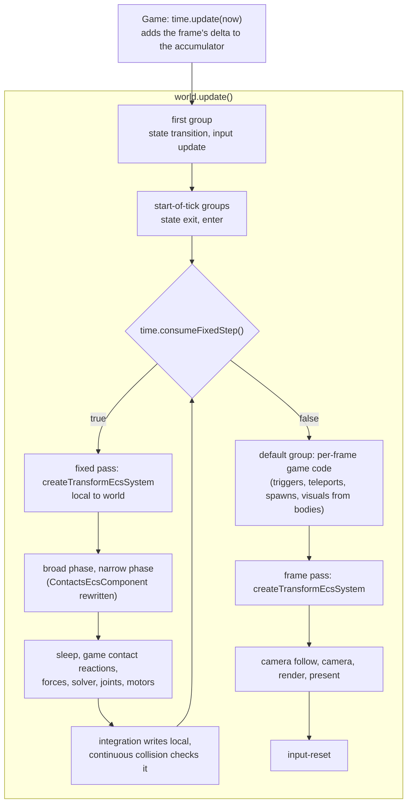

# Fixed-step physics

Issue: [#815](https://github.com/Forge-Game-Engine/Forge/issues/815)
(Physics Fixed Timestep milestone. It builds on #795, which added the
fixed-step clock to `Time`, and #801, which added `registerFixedUpdate`
(see [`fixed-update-group.md`](./fixed-update-group.md)). #829, which
replaces `Time`'s `1000 / 15` delta clamp, depends on it.)

| Module or file                                                                                                                                                                                        | Change   | Phase | Notes                                                                                                                           |
| ----------------------------------------------------------------------------------------------------------------------------------------------------------------------------------------------------- | -------- | ----- | ------------------------------------------------------------------------------------------------------------------------------- |
| `src/physics/systems/*.ts` (not tests)                                                                                                                                                                | Modified | 1     | JSDoc only: registration in the fixed-update group, "step" for one run of the pipeline, where a move reaches `world`            |
| `src/physics/components/contacts-component.ts`                                                                                                                                                        | Modified | 1     | JSDoc: `touching`/`started`/`ended` describe the latest fixed step; reactions to `started`/`ended` go in the fixed-update group |
| `src/physics/components/*.ts`, `src/physics/rigid-body-mass-data.ts`, `src/physics/is-body-awake.ts`, `src/physics/apply-*.ts`                                                                        | Modified | 1     | JSDoc wording where "tick" means one physics step                                                                               |
| `src/physics/systems/narrow-phase-contacts.test.ts`                                                                                                                                                   | Modified | 1     | Contacts across two fixed steps in one frame                                                                                    |
| `src/physics/systems/fixed-step-pipeline.test.ts`                                                                                                                                                     | New      | 1     | The same fall at three frame patterns gives the same steps and pose                                                             |
| `src/navigation/systems/navigation-agent-system.ts`, `follow-agent-path.ts`                                                                                                                           | Modified | 1     | JSDoc: register the agent in the group of the system that applies `desiredVelocity` (the fixed-update group for rigid bodies)   |
| `src/tilemaps/systems/tilemap-collider-system.ts`                                                                                                                                                     | Modified | 1     | JSDoc: an edit collides from the next fixed step                                                                                |
| `documentation-site/docs/docs/physics/*.md`                                                                                                                                                           | Modified | 1     | "Registering the physics systems" rewritten; every page that registers physics systems                                          |
| `documentation-site/docs/docs/common/transforms.md`, `common/time.md`                                                                                                                                 | Modified | 1     | Two transform passes; contact reactions in the fixed-update group                                                               |
| `documentation-site/docs/docs/navigation/agents.md`, `tilemaps/collision.md`, `tilemaps/index.md`                                                                                                     | Modified | 1     | Registration order with the fixed-update group                                                                                  |
| `AGENTS.md`                                                                                                                                                                                           | Modified | 1     | "Transforms" and "Sleeping Bodies": the transform system runs at the start of each fixed step and once per frame                |
| `demo/src/game.ts`                                                                                                                                                                                    | Modified | 1     | Physics in the fixed-update group                                                                                               |
| `e2e/fixtures/scenes/fixed-timestep-physics.ts`, `e2e/specs/fixed-timestep-physics.spec.ts`                                                                                                           | New      | 1     | A ball dropped onto a floor at three frame patterns                                                                             |
| `CHANGELOG.md`                                                                                                                                                                                        | Modified | 1     | `#### Changed`                                                                                                                  |
| `documentation-site/src/pages/demos/{physics,physics-stress-test,newtons-cradle,wrecking-ball,revolute-joint,prismatic-joint,linear-spring-damper,torque,moving-platform,chain-collider,raycasting}/` | Modified | 2     | `_create-game.ts`, comments, "How it works" text                                                                                |
| `documentation-site/src/pages/demos/{brick-breaker,car,rolling-ball,sensors,space-shooter,tiled-maps,path-finding,isometric-tilemap,isometric-path-finding}/`                                         | Modified | 3     | `_create-game.ts`, the demos' own systems' JSDoc, "How it works" text; `tiled-maps` gains a jump-request component and system   |
| `documentation-site/src/pages/demos/tiled-maps/_camera-follow.system.ts`, `path-finding/_path-lines.system.ts`, `isometric-path-finding/_find-path.system.ts`                                         | Modified | 3     | Read the body's `local` instead of `world` (see "Reading a body's pose outside the fixed steps")                                |
| **Engine version at time of design**                                                                                                                                                                  |          |       | `0.27.0`                                                                                                                        |

## Summary

Every physics setup registers its systems in the default group, so the
pipeline runs once per rendered frame with the variable
`time.deltaTimeInSeconds`. The simulation therefore depends on the
display's refresh rate (a 144 Hz display and a 30 Hz one integrate the
same scene differently), and its stability after a hitch depends on
`Time`'s `1000 / 15` clamp. #801 added the `fixed-update` group; this
design moves the physics systems into it and works out everything that
move changes.

Unity, Godot and Bevy (Avian) all run the whole physics pipeline (forces,
broad phase, narrow phase, solver, integration) once per fixed step, and
run the game code that applies continuous forces or reacts to collisions
in that same fixed loop: Unity's `FixedUpdate` and `OnCollisionEnter`,
Godot's `_physics_process` and `body_entered`, Avian's schedule in Bevy's
`FixedPostUpdate`. Forge does the same:

- **The physics systems keep their relative order and move into the
  group `registerFixedUpdate` returns.** Their factories keep their
  `time: Time` parameter: inside a fixed step, `time.deltaTimeInSeconds`
  is the fixed delta (#795). Nothing in `/src` changes behavior; the change
  is in how the engine documents, tests and demonstrates registration.
- **A transform system runs first in each fixed step.** The physics
  systems read `position.world`/`rotation.world`, which only
  `createTransformEcsSystem` writes. With several fixed steps in a frame,
  step 2's broad phase would otherwise read the poses from before step 1's
  integration moved `local`, and continuous collision detection would sweep
  from a pose two steps old. Unity syncs transforms into the physics scene
  just before each simulation step for the same reason. A second transform
  system stays in the default group, before rendering, so a frame draws the
  latest step's poses and anything variable-rate code moved. That's still
  one writer of `world` (the transform system); there are two passes of it.
  `transforms.md`'s "Register one transform system per world" changes
  accordingly.
- **Contacts describe the latest fixed step.** `ContactsEcsComponent`'s
  `started` and `ended` were "this tick". After the move they describe one
  fixed step: a default-group system misses a contact that started in step
  1 of 2 and sees the same `started` twice on a frame with no step. Systems
  that react to `started`/`ended` go in the fixed-update group, as Unity's
  collision callbacks run in its fixed step. `touching` is a state, not an
  event, so it can be read anywhere.
- **"Pressed this frame" input stays in the default group.** A
  `TriggerAction` press is seen by zero fixed steps on a short frame and by
  two on a long one. A default-group system that reads a press and has to
  change the simulation in the middle of a step writes a request field that
  a fixed-step system consumes, the `wakeRequested` pattern the sleep
  system already uses.

Nothing here bends a core design of the engine: system queries stay fixed,
systems stay stateless, and every value keeps one owning system. There is
no `registerPhysics` helper: game systems have to sit between engine
physics systems inside a step (a car's ground-contact system between the
narrow phase and the solver), which a helper would hide (FP5).

## Scope

### In scope

- JSDoc of every physics system and component that talks about
  registration or timing, and of the navigation agent and tilemap collider
  systems, which document their order against the physics systems.
- `ContactsEcsComponent` and `createNarrowPhaseEcsSystem`: per-step
  contacts, and where reactions belong.
- Unit tests: contacts across two fixed steps in one frame, and a
  frame-rate independence test of the whole pipeline.
- Docs: "Registering the physics systems" in `physics/index.md`, every
  other page that registers physics systems (`forces.md`, `joints.md`,
  `collisions.md`, `continuous-collision-detection.md`, `raycasting.md`,
  `terrain.md`, `rigid-bodies.md`, `sleeping.md`, `chain-colliders.md`),
  `common/transforms.md`, `common/time.md`, `navigation/agents.md`,
  `tilemaps/collision.md`, `tilemaps/index.md`.
- `AGENTS.md`'s "Transforms" and "Sleeping Bodies" sections.
- Migrating every caller: `demo/src/game.ts` and all 20 docs-site demos
  that register physics systems. The issue lists 14; six more register
  physics systems too (`physics-stress-test`, `chain-collider`,
  `tiled-maps`, `path-finding`, `isometric-tilemap`,
  `isometric-path-finding`), and the "Done when" covers every physics demo.
- Splitting `tiled-maps`' player system, which reads a trigger press in
  the middle of the physics pipeline, into a default-group jump-request
  system and a fixed-step move system.
- Making every default-group demo system that reads a rigid body's pose
  read its `local` (three systems change: `tiled-maps/_camera-follow`,
  `path-finding/_path-lines`, `isometric-path-finding/_find-path`).
- An e2e scene and spec: the same fall at three frame patterns ends in the
  same pose after the same number of steps, and the canvas shows the
  latest step's pose.
- A `#### Changed` changelog bullet.

### Out of scope

- **Interpolating rendered poses between fixed steps.** `Time` exposes
  `fixedOverstepFraction`; components and a system that use it are a later
  design. Until then, a 60 Hz simulation on a 120 or 144 Hz display moves
  bodies on only some frames. See open question 1.
- **Replacing `Time`'s `1000 / 15` clamp.** That's #829. Until it lands, a
  frame adds at most `1000 / 15` ms, so at most 4 steps at 60 Hz.
- **A `registerPhysics` helper** (FP5).
- **Checking that physics systems run inside a fixed step** (FP6, open
  question 3).
- **Per-step triggers** (Godot's physics-frame `is_action_just_pressed`).
  #801 kept `TriggerAction.isTriggered` per frame; this design follows it.
- **Per-frame contact lists or contact events with reader cursors**
  (FP3).
- **A transform pass limited to physics entities** (open question 6).
- **Fixing the transform system's closure state** (`frozen`, the static
  entity cache in `transform-system.ts`). Two instances each keep their
  own cache, which is correct; moving it into a component is its own
  change.
- **Moving the physics pipeline unit tests in `src/physics/systems`**
  (`sleep-stacking.test.ts`, `chain-contact-stability.test.ts` and the
  others) into a fixed-update group. They step one pipeline run per `world.update()` with a constant
  delta, which is a fixed step already (FP7).
- **Splitting `createNavigationAgentEcsSystem`'s planning from its
  following** so the budget is spent once per frame (open question 4).
  The pull request's review round renamed `maxExpandedPerFrame` to
  `maxExpandedPerUpdate`, which fixes the name but not the cost.

## Concepts

- **Fixed step.** One run of the `fixed-update` group: one `true` from
  `time.consumeFixedStep()`. Inside it `time.isInFixedStep` is `true` and
  `time.deltaTimeInSeconds` is the fixed delta (`1 / 60` s by default).
- **Physics step.** One run of the physics pipeline, from the transform
  pass to continuous collision detection. After this change, one physics
  step per fixed step. Physics JSDoc and docs say "step" for this, where
  they said "tick" (FP13).
- **Transform pass.** One `update` of a `createTransformEcsSystem`
  instance. A physics game has two: the fixed pass, first in the
  fixed-update group, and the frame pass, in the default group before
  rendering.
- **Request field.** A component field that a default-group system sets to
  ask for something and a fixed-step system clears when it acts on it
  (`RigidBodyEcsComponent.wakeRequested`, the new `jumpRequested` in
  `tiled-maps`).

## Registration

The canonical setup, as `physics/index.md` will show it:

```ts
import {
  createTransformEcsSystem,
  registerFixedUpdate,
} from '@forge-game-engine/forge/common';
import {
  type CollisionManifold,
  type CollisionPair,
  type ContactConstraint,
  createAngularVelocityMotorEcsSystem,
  createBroadPhaseEcsSystem,
  createCollisionResolutionEcsSystem,
  createContinuousCollisionEcsSystem,
  createEulerIntegrationEcsSystem,
  createGravityEcsSystem,
  createLinearDamperEcsSystem,
  createLinearSpringEcsSystem,
  createNarrowPhaseEcsSystem,
  createPrismaticJointEcsSystem,
  createRevoluteJointEcsSystem,
  createSleepEcsSystem,
} from '@forge-game-engine/forge/physics';
import {
  createCameraEcsSystem,
  createRenderEcsSystem,
} from '@forge-game-engine/forge/rendering';

const collisionPairs: CollisionPair[] = [];
const collisionManifolds: CollisionManifold[] = [];
const contactConstraints: ContactConstraint[] = [];

const fixedUpdate = registerFixedUpdate(world, time);
const physics = { group: fixedUpdate };

// Once per fixed step.
world.addSystem(createTransformEcsSystem(), physics);
world.addSystem(createBroadPhaseEcsSystem(collisionPairs), physics);
world.addSystem(
  createNarrowPhaseEcsSystem(collisionPairs, collisionManifolds),
  physics,
);
world.addSystem(createSleepEcsSystem(collisionManifolds, time), physics);
world.addSystem(createGravityEcsSystem(time), physics);
world.addSystem(createLinearSpringEcsSystem(time), physics);
world.addSystem(createLinearDamperEcsSystem(time), physics);
world.addSystem(
  createCollisionResolutionEcsSystem(
    collisionManifolds,
    contactConstraints,
    time,
  ),
  physics,
);
world.addSystem(createRevoluteJointEcsSystem(time), physics);
world.addSystem(createPrismaticJointEcsSystem(time), physics);
world.addSystem(createAngularVelocityMotorEcsSystem(time), physics);
world.addSystem(createEulerIntegrationEcsSystem(time), physics);
world.addSystem(createContinuousCollisionEcsSystem(), physics);

// Once per frame, after the fixed steps.
world.addSystem(createTransformEcsSystem());
world.addSystem(createCameraEcsSystem(time));
world.addSystem(createRenderEcsSystem(renderContext));
```

The numbered list under it keeps today's reasons for the order and gains
two points:

1. The fixed pass writes every entity's world pose at the start of the
   step, so each step's broad phase, narrow phase, joints and continuous
   collision detection read the poses the previous step's integration (or
   the previous frame's game code) left in `local`.
2. The frame pass runs after the fixed steps, so rendering, camera follow
   and UI read the latest step's poses. Without it, a frame draws each
   body where it was at the start of the last step, one step behind.

The `physics` object holding `{ group: fixedUpdate }` is a docs
convenience, not engine API; the demos use it too. A game system that must
run between two physics systems is added with the same option at the
right place in registration order, or with `before`/`after` against a
physics system (both systems must be in the same group, as `addSystem`
already requires).

## Frame data flow



What a system reads depending on where it runs:

| Where                                | `position.world` of a body                                        | `ContactsEcsComponent`                                               | `collisionManifolds` | `TriggerAction.isTriggered`   |
| ------------------------------------ | ----------------------------------------------------------------- | -------------------------------------------------------------------- | -------------------- | ----------------------------- |
| Fixed step, after the fixed pass     | the step's start pose                                             | `touching`, `started`, `ended` of this step (after the narrow phase) | this step's          | per frame: seen by 0..n steps |
| Default group, before the frame pass | the start pose of the frame's last step (one step behind `local`) | the frame's last step's                                              | the last step's      | correct                       |
| Default group, after the frame pass  | the latest pose                                                   | the frame's last step's                                              | the last step's      | correct                       |

On a frame with no fixed step, the default group sees the same contact
lists as on the previous frame. That's why reactions to `started`/`ended`
can't live there.

### Moves made outside the fixed steps

A teleport, a spawn or a velocity written by default-group code reaches
the simulation at the next fixed step, whose fixed pass copies `local`
into `world` before any physics system reads it. This makes the
continuous collision rule ("a body moved directly must be moved before
`createTransformEcsSystem` runs, or the sweep treats the jump as motion")
hold for every default-group teleport, where today it depends on
registration order. Inside the fixed-update group, the rule still applies:
a teleport goes before the fixed pass.

### Reading a body's pose outside the fixed steps

A default-group system that runs before the frame pass and reads a rigid
body's `world` reads the pose from the start of the frame's last fixed
step: one step behind `local`, which the step's integration moved. On a
frame with two steps it's one step behind too, never more, since each fixed
pass rewrites `world`. The three demo systems below that read `world` are
registered before the transform system today, so they already read a pose
a frame old; moving them to `local` removes that lag as well as the
step-behind read the fixed steps would give them.

The rule: **a default-group system that reads a dynamic or kinematic
body's pose reads `local`.** Those bodies are always root entities
(`createEulerIntegrationEcsSystem` throws for one with a
`ParentEcsComponent`), so `local` is their world pose and is current
whenever the system runs. That's the advice `transforms.md`'s "Reading
another entity's transform" already gives for a target with no parent;
this design makes it the rule for bodies, and the page says why it matters
more with fixed steps.

Every default-group demo system that reads a body's pose, checked against
the rule:

| System                                      | Reads today                                                              | After this change                                                                                                                                                                                          |
| ------------------------------------------- | ------------------------------------------------------------------------ | ---------------------------------------------------------------------------------------------------------------------------------------------------------------------------------------------------------- |
| `tiled-maps/_camera-follow`                 | `targetPosition.world.x` (line 42)                                       | `targetPosition.local.x`. Its JSDoc says it reads the player's `local` because the player is a root body                                                                                                   |
| `path-finding/_path-lines`                  | `position.world` of the unit (line 171)                                  | `position.local`, so the smoothed line starts at the unit as drawn this frame. The JSDoc's "planned on the previous tick, from where the units were then" becomes "planned in the frame's last fixed step" |
| `isometric-path-finding/_find-path`         | `agentPosition.world` of the player (line 59)                            | `agentPosition.local`, so the hover path starts from the player's latest step                                                                                                                              |
| `car/_camera-follow`                        | `targetPosition.local`                                                   | unchanged                                                                                                                                                                                                  |
| `rolling-ball/_camera-follow`               | `targetPosition.local`                                                   | unchanged; its JSDoc's "registered after the physics systems" becomes "in the default group, after the fixed steps"                                                                                        |
| `newtons-cradle/_arm`, `wrecking-ball/_arm` | the ball's `local`                                                       | unchanged; "before `createTransformEcsSystem`" becomes "before the frame pass"                                                                                                                             |
| `linear-spring-damper/_spring-line`         | the body's `local`                                                       | unchanged; same JSDoc rewording                                                                                                                                                                            |
| `rolling-ball/_jump`                        | `position.local` (fall check), `position.world` (impulse point, line 64) | the fall check is unchanged; the impulse point stays `position.world` (below)                                                                                                                              |
| `demo/src/game.ts` despawn                  | `positions[i].local.y`                                                   | unchanged                                                                                                                                                                                                  |

The default-group systems not listed read no body pose: `car/_car-reset`,
`chain-collider/_spawn-bodies`, `sensors/_ball-spawner` and
`physics-stress-test/_body-spawner` only write `local`;
`brick-breaker/_paddle` moves an entity without a rigid body by `local`;
`space-shooter` has no rigid bodies. Fixed-update systems that read
`world` (`revolute-joint/_push`,
`prismatic-joint/_pump`, `car/_chassis-stabilizer`) run after the fixed
pass, where `world` is the step's pose, and stay as they are.

Two reads of `world` in the default group are correct and stay:

- **A point passed to `applyImpulse`.** `applyImpulse` measures the lever
  arm from the body's center of mass, which it finds from
  `position.world` (`src/physics/apply-impluse.ts`). `rolling-ball/_jump`
  passes the ball's own `position.world`, so the point and the center of
  mass come from the same pose and the lever arm is zero, as the comment
  there intends. Passing `local` would put the point one step of motion
  away from the center of mass the helper uses and spin the ball. The
  jump's JSDoc says so. Whether the helpers should read a body's `local`
  is open question 5. (Resolved in review: the helpers now read `local`,
  so this exception is gone. See open question 5.)
- **Static colliders.** `markGridFromColliders` (both bake-grid systems)
  reads the `world` of colliders without a moving body, which can be
  parented (tile layers) and which no step moves. In `path-finding` the
  dragged walls have no rigid body; `_pointer` moves their `local` and the
  bake runs after the frame pass, so it reads them current. `_pointer`'s
  JSDoc says "before the frame pass" where it says "before
  `createTransformEcsSystem`".

Event handlers run between frames, after the previous frame's frame pass,
so they read every `world` current (the `physics` demo's
`applyExplosiveForce` on a click).

### Raycasts and other queries

`raycast` reads each collider's `aabb`, which the broad phase writes once
per step. A raycast from the default group or an event handler sees the
colliders as of the last fixed step, as Unity's and Godot's queries see
the last simulation step. `raycasting.md` says so; the raycasting demo's
targets are static, so nothing visible changes. On the frames before the
first fixed step, no `aabb` has been written; the docs note it.

The same holds for default-group demo code that reads a moving body's
collider `aabb` (`path-finding/_pointer`'s hit test and the isometric
demos' `_cell-cursor` `overlapsCell`): the broad phase writes `aabb`
before integration, so these reads are one step behind the body's
`local`, the same lag they have today, and they stay as they are.

### Pausing

At `timeScale = 0` no fixed steps run, so no physics system runs at all.
The sleep system's "while the delta time is `0`, rest times don't change
but disturbed islands still wake" applies only to a sleep system run
outside a fixed step. `sleeping.md` and `createSleepEcsSystem`'s JSDoc
say that a paused game runs no steps, so nothing wakes or falls asleep
until it resumes; the code stays as it is, since a game can still run the
pipeline outside the group (FP6).

## Contacts per fixed step

`ContactsEcsComponent`'s JSDoc becomes:

```ts
/**
 * The entities a collider entity is touching, and which of those contacts
 * started or ended in the latest physics step. Output only:
 * `createNarrowPhaseEcsSystem` writes all three lists every step,
 * replacing each with a new array, so holding on to one of them keeps
 * that step's contents. Contacts are opt-in: only collider entities with
 * this component have theirs recorded.
 *
 * Register the physics systems in the fixed-update group
 * (`registerFixedUpdate`), and a system that reacts to `started` or
 * `ended` in the same group, after `createNarrowPhaseEcsSystem`. A frame
 * can run several steps or none, so a system that runs once per frame
 * misses a contact that started in an earlier step of the frame and sees
 * the same `started` again on a frame with no step. `touching` is the
 * state after the latest step and can be read from any group.
 *
 * Every overlap counts, ...
 */
```

and each field's "this tick"/"last tick" becomes "this step"/"the
previous step". `createNarrowPhaseEcsSystem`'s "each tick, rewrites their
`touching`, `started` and `ended` lists from this tick's overlaps"
becomes "each step", with the same pointer to the fixed-update group.

A contact that starts in step 1 and ends in step 2 of one frame is seen
by a fixed-step reader as a `started` in step 1 and an `ended` in step 2,
which is what the new unit test checks.

## Where game systems go

`physics/index.md` gains a "Where game systems go" section, and
`time.md`'s "Running systems at a fixed rate" adds contact reactions to
its list of fixed-rate work:

| Kind of system                                                                                        | Group                                                      | Examples in the demos                                                                                               |
| ----------------------------------------------------------------------------------------------------- | ---------------------------------------------------------- | ------------------------------------------------------------------------------------------------------------------- |
| Applies a force, torque or velocity change scaled by the delta, every step                            | fixed-update                                               | `torque/_thruster`, `torque/_gust`, `car/_air-control`, `car/_chassis-stabilizer`                                   |
| Sets a velocity or motor target from held input or state, which the solver must see in the same step  | fixed-update, before the solver                            | `moving-platform/_platform-mover`, `car/_wheel-drive`, `rolling-ball/_roll`, `isometric-*/_player-move`             |
| Reads `ContactsEcsComponent.started`/`ended` or `collisionManifolds`                                  | fixed-update, after the narrow phase                       | `sensors/_trigger-zone`, `sensors/_drain`, `car/_ground-contact`, `tiled-maps/_player-move`                         |
| Drives the simulation on a timer (periodic impulses, resets)                                          | fixed-update                                               | `revolute-joint/_push`, `prismatic-joint/_pump`, `linear-spring-damper/_reset`                                      |
| Plans movement whose output physics integrates                                                        | fixed-update, after the fixed pass                         | `createNavigationAgentEcsSystem` + `path-finding/_apply-velocity`                                                   |
| Reads `TriggerAction.isTriggered`                                                                     | default                                                    | `rolling-ball/_jump`, `car/_car-reset`, `chain-collider/_spawn-bodies`, `space-shooter/_game-over`                  |
| Reads a press that has to change the simulation inside a step                                         | default, writing a request field                           | `tiled-maps/_jump-input` (new) setting `jumpRequested`                                                              |
| Moves an entity without a rigid body by writing `local` (input-driven or kinematic-by-code movement)  | default                                                    | `brick-breaker/_paddle`, `space-shooter/_movement`, `_bullet`, `_asteroid`                                          |
| Draws, positions or plans from a body's pose (arm sprites, spring lines, path markers, camera follow) | default, before the frame pass, reading the body's `local` | `newtons-cradle/_arm`, `linear-spring-damper/_spring-line`, `path-finding/_path-lines`, `tiled-maps/_camera-follow` |
| Edits tiles, colliders or navigation grids in response to input                                       | default                                                    | `tiled-maps/_tile-toggle`, `createTilemapColliderEcsSystem`, `path-finding/_bake-grid`                              |
| Camera follow, camera, rendering, post-processing, UI, audio                                          | default                                                    | every demo                                                                                                          |
| Spawns entities on a timer or input                                                                   | default                                                    | `sensors/_ball-spawner`, `physics-stress-test/_body-spawner`, `demo/src/game.ts`'s fountain                         |

Two rules sit behind the table:

1. If the system's effect on the simulation depends on how often it runs
   (it scales by the delta, counts steps, or must sit between two physics
   systems), it runs once per step.
2. If it reads something that's true for exactly one frame (a trigger
   press) or draws, it runs once per frame.

A system that needs both, like `tiled-maps`' player, is split in two at a
request field. A once-per-frame system that reads a moving body's pose
reads its `local` (see "Reading a body's pose outside the fixed steps").

`touching` is a state, so a default-group system can read it (the rolling
ball's jump checks it, `demo/src/game.ts`'s tint shows it). A system that
removes entities can run in either group; `ended` reports the removal on
the next step.

Spawning from the default group puts the new bodies into the next frame's
fixed steps. On a frame shorter than the fixed delta, nothing simulates
them until a later frame, which is invisible at 60 Hz.

### The request field pattern

`tiled-maps/_player-move.system.ts` today reads `collisionManifolds`
(between the narrow phase and the solver, to tell whether the player
stands on ground) and `jumpInput.isTriggered` in one system. In the
fixed-update group the press would be read by zero or several steps; in
the default group the manifold read and the velocity write would miss the
solver. It becomes two systems and a field:

```ts
// _player.component.ts
export interface PlayerEcsComponent {
  // ...existing fields
  /**
   * Set by the jump-input system when the jump action is pressed; the
   * player-move system clears it on its next step, jumping if the player
   * stands on the ground.
   */
  jumpRequested: boolean;
}

// _jump-input.system.ts, default group
export const createJumpInputEcsSystem = (
  jumpInput: TriggerAction,
): EcsSystem<[PlayerEcsComponent]> => ({
  query: [playerId],
  update: (_world, { components: [players] }) => {
    if (!jumpInput.isTriggered) {
      return;
    }

    for (const player of players) {
      player.jumpRequested = true;
    }
  },
});

// _player-move.system.ts, fixed-update group, after the narrow phase
if (isGrounded && player.jumpRequested) {
  rigidBody.velocity.y = -player.jumpSpeed;
}

player.jumpRequested = false;
```

The default-group system only sets the field to `true` and the fixed-step
system only clears it, as game code only sets
`RigidBodyEcsComponent.wakeRequested` and the sleep system clears it. A
press on a frame with no step waits for the next step; a press on a frame
with two steps jumps once. Clearing it whether or not the player jumped
keeps a press made in mid-air from firing on landing; jump buffering is
the game's choice, not the demo's.

The press reaches the simulation on the next frame's first step, one
frame later than if it were read in the same frame's steps. That's the
latency Unity has with input read in `Update` and applied in
`FixedUpdate`. Open question 2 asks whether demos should use a group
ordered before the fixed-update group instead.

## Demo migration

Each demo keeps its physics systems' relative order. "Fixed" lists the
fixed-update group in order, "default" the default group in order. Every
demo gets a frame pass in the default group if it doesn't have one where
it needs it.

| Demo                     | Fixed                                                                                                                                                                     | Default                                                                                                                                                                                                 | Notes                                                                                                                                                                                                                            |
| ------------------------ | ------------------------------------------------------------------------------------------------------------------------------------------------------------------------- | ------------------------------------------------------------------------------------------------------------------------------------------------------------------------------------------------------- | -------------------------------------------------------------------------------------------------------------------------------------------------------------------------------------------------------------------------------- |
| `physics`                | transform, gravity, broad, narrow, resolution, integration, CCD                                                                                                           | transform, camera, render                                                                                                                                                                               | "How it works": the pipeline runs once per fixed step                                                                                                                                                                            |
| `physics-stress-test`    | transform, gravity, spring, damper, broad, narrow, resolution, revolute, prismatic, motor, integration, CCD                                                               | body spawner, transform, camera, text shaping, render, present, FPS monitor                                                                                                                             | The FPS thresholds now measure a 60 Hz simulation: physics cost per frame no longer scales with the display rate, and below 60 FPS a frame runs several steps. "How it works" says so                                            |
| `newtons-cradle`         | transform, gravity, broad, narrow, resolution, revolute, integration, CCD                                                                                                 | arm, transform, camera, render                                                                                                                                                                          | The arm reads the ball's `local` after the steps, so arms and balls draw in step                                                                                                                                                 |
| `wrecking-ball`          | same as `newtons-cradle`                                                                                                                                                  | arm, transform, camera, render                                                                                                                                                                          |                                                                                                                                                                                                                                  |
| `revolute-joint`         | transform, gravity, push, broad, narrow, resolution, revolute, integration, CCD                                                                                           | transform, camera, render                                                                                                                                                                               | `_push` counts `elapsedSeconds` in fixed deltas                                                                                                                                                                                  |
| `prismatic-joint`        | transform, gravity, pump, broad, narrow, resolution, prismatic, integration, CCD                                                                                          | transform, camera, render                                                                                                                                                                               | "How it works": the joint has the last word "each step"                                                                                                                                                                          |
| `linear-spring-damper`   | reset, transform, gravity, spring, damper, integration, CCD                                                                                                               | spring line, transform, camera, render                                                                                                                                                                  | `_reset` teleports, so it runs before the fixed pass                                                                                                                                                                             |
| `torque`                 | transform, thruster, gust, motor, integration, CCD                                                                                                                        | transform, camera, render                                                                                                                                                                               | The thruster reads a held action, which every step of a frame reads the same                                                                                                                                                     |
| `moving-platform`        | transform, gravity, platform mover, broad, narrow, resolution, integration, CCD                                                                                           | transform, camera, render                                                                                                                                                                               |                                                                                                                                                                                                                                  |
| `chain-collider`         | transform, gravity, broad, narrow, resolution, integration, CCD                                                                                                           | spawn bodies, transform, camera, render                                                                                                                                                                 | Spawns on trigger presses                                                                                                                                                                                                        |
| `raycasting`             | transform, broad                                                                                                                                                          | transform, camera, render                                                                                                                                                                               | The comment above the broad phase and "How it works" say the broad phase keeps `aabb` current once per step                                                                                                                      |
| `brick-breaker`          | transform, broad, narrow, resolution, ball, integration, CCD                                                                                                              | camera, background, paddle, brick, transform, render                                                                                                                                                    | The paddle moves per frame by `local`; the next step sees it. The long comment about the transform pass is rewritten                                                                                                             |
| `car`                    | transform, gravity, broad, narrow, ground contact, wheel drive, spring, damper, resolution, prismatic, revolute, motor, chassis stabilizer, air control, integration, CCD | car reset, transform, camera follow, camera, render                                                                                                                                                     | The order comment's point 1 ("reset, then transforms, so a restart shows up this tick") becomes "reset in the default group, before the frame pass"                                                                              |
| `rolling-ball`           | roll, transform, motor, gravity, broad, narrow, resolution, integration, CCD                                                                                              | jump, transform, camera follow, render                                                                                                                                                                  | `_jump` reads a trigger and `touching` and teleports on a fall, all per frame; its impulse point stays `position.world`, the pose `applyImpulse` measures from                                                                   |
| `sensors`                | transform, gravity, broad, narrow, trigger zone, drain, resolution, integration, CCD                                                                                      | ball spawner, transform, camera, render                                                                                                                                                                 | "How it works": each band reads its contacts every step                                                                                                                                                                          |
| `space-shooter`          | transform, broad, narrow, asteroid collision                                                                                                                              | camera, camera shake, movement, background, sound, lifetime, remove-from-world, gun, bullet, asteroid spawner, asteroid, sprite animation, transform, render, bloom, blur, tone map, present, game over | No rigid bodies: overlap detection only. Movement stays per frame (no interpolation needed); detection runs at 60 Hz                                                                                                             |
| `tiled-maps`             | player respawn, transform, gravity, broad, narrow, player move, resolution, integration                                                                                   | camera follow, tile toggle, tilemap collider, collider outline, tilemap render, jump input, transform, render                                                                                           | The player system splits (see "The request field pattern"). `_camera-follow` reads the player's `local.x`. "How it works": a clicked tile draws on the frame and collides from the next step                                     |
| `path-finding`           | transform, navigation agent, apply velocity, broad, narrow, resolution, integration                                                                                       | pointer, grid overlay, path lines, transform, bake grid, render                                                                                                                                         | The agent's arrival speed uses the fixed delta physics integrates with. `_path-lines` draws from the unit's `local`; `_pointer`'s JSDoc names the frame pass. "How it works": agents re-plan on the next step after a wall moves |
| `isometric-tilemap`      | transform, player move, broad, narrow, resolution, integration                                                                                                            | cell cursor, tilemap collider, tilemap render, transform, render                                                                                                                                        | "How it works": a clicked wall draws and sorts on the frame and collides from the next step                                                                                                                                      |
| `isometric-path-finding` | transform, player move, broad, narrow, resolution, integration                                                                                                            | cell cursor, tilemap collider, bake grid, find path, tilemap render, transform, render                                                                                                                  | `_find-path` plans from the player's `local`. The set-up `world.update()` before the game runs still writes the floor's `world` through the frame pass; the fixed group takes no step then                                       |
| `demo/src/game.ts`       | transform, gravity, broad, narrow, resolution, integration, CCD                                                                                                           | fountain spawn, despawn, collision tint, transform, render                                                                                                                                              | The tint reads `touching`                                                                                                                                                                                                        |

The demos' own systems' JSDoc ("this tick", "must run after
`createNarrowPhaseEcsSystem`") is updated where it describes the timing,
and comments that explain behavior this change removes (the
`brick-breaker` and `space-shooter` paragraphs about the integrated
movement reaching `world` "on the next frame's transform pass") are
deleted or rewritten.

The review round split `brick-breaker`'s ball system in two. Its reset
after a miss is a teleport, so it runs first in the fixed-update group,
before the transform pass, the way `linear-spring-damper/_reset` does.
After the transform pass, continuous collision would sweep the ball from
below the paddle up to its start position. The brick breaking stays
after the narrow phase. A later round did the same for `tiled-maps`: its
respawn moved out of `_player-move` into `_player-respawn`, first in the
fixed-update group. It reads the previous step's `touching` and the
player's `local`, so the step that follows finds the player's contacts at
the spawn point, where before that step's resolution and integration
worked from contacts found where the player fell. The `rolling-ball` row's impulse point is now
`position.local` (open question 5).

## JSDoc changes in `/src`

- `createEulerIntegrationEcsSystem`: the paragraph "Register the transform
  system before the physics systems ... reaches `world` on the next
  tick's transform pass" becomes: register the physics systems in the
  fixed-update group with a transform system first, so each step reads
  every entity's current pose; a body's integrated movement reaches
  `world` on the next step's fixed pass, and the frame pass in the default
  group shows it on screen. "Scale velocity by the frame's duration"
  becomes "by the step's duration".
- `createContinuousCollisionEcsSystem`: "between two ticks" and "this
  tick's collision detection" become steps; the teleport rule names the
  fixed pass.
- `createSleepEcsSystem`: "Game code that changes physics input runs before
  `createTransformEcsSystem`" becomes "in the default group, or in the
  fixed-update group before its transform system"; the paused paragraph
  as in "Pausing".
- `createNarrowPhaseEcsSystem`, `ContactsEcsComponent`: as in "Contacts
  per fixed step".
- `createBroadPhaseEcsSystem`, `createGravityEcsSystem`,
  `createCollisionResolutionEcsSystem`, the joint, spring, damper and
  motor systems, `GravityDefaultedOptions.amount`, `getRigidBodyMassData`,
  `isBodyAwake`, `applyTorque`: "tick" becomes "step" where it means one
  run of the pipeline, and `@param time` descriptions say "the step's
  duration". Internal comments that would read wrong are reworded in the
  same pass; ones that are still correct stay (FP13).
- `createNavigationAgentEcsSystem`: "Register it after
  `createTransformEcsSystem` ... then the physics systems" becomes:
  register it in the same group as the system that applies
  `desiredVelocity`, after that group's transform system. For a rigid body,
  that's the fixed-update group, so the last-step speed limit in
  `followAgentPath` uses the delta physics integrates with.
  `followAgentPath`'s `@param deltaSeconds` becomes "the duration the
  velocity will be applied for". `maxExpandedPerFrame`'s JSDoc ("every
  path search in one tick") says the budget is shared by the searches of
  one update of the system: once per fixed step in the fixed-update group.
  A frame that runs several steps runs several updates, so it can expand
  up to that many budgets of nodes (4 at 60 Hz with today's `1000 / 15`
  clamp, more after #829), and the extra searching lands on frames that
  are already long. A game with many agents planning at once picks a
  smaller budget for the fixed-update group. The name stays (open
  question 4).
- `createTilemapColliderEcsSystem`: "so an edit collides on the tick it's
  made" becomes "so an edit collides from the next physics step"; it stays
  a default-group system.

## Testing

### `src/physics/systems/narrow-phase-contacts.test.ts` (phase 1)

A new `describe('in the fixed-update group')` with a real `Time` and
`registerFixedUpdate`:

- Seed `time.update(0)`. Register in the fixed-update group a transform
  system, broad phase, narrow phase, and a probe system that records a
  copy of a contacts component's `started` and `touching` on each run. A
  circle with contacts sits at `x = 0`; a second circle starts at
  `x = 3` (radius 1, apart). A test system in the fixed-update group,
  registered before the transform system, moves the second circle's
  `local` to `x = 1` on the first step only.
- `time.update(1000 / 30)` and `world.update()` run two steps. Expect the
  probe's step 1 record to have `started: [other]`, step 2 to have
  `started: []` and `touching: [other]`.
- A default-group probe registered after the steps reads `started` as
  `[]` on that frame: the documented miss.
- `time.update(1000 / 30 + 5)` (no step) and `world.update()`: the
  default-group probe sees the same lists as before and the fixed probe
  doesn't run.
- A contact that starts in step 1 and ends in step 2 (the mover moves it
  back on step 2) is `started` in step 1 and `ended` in step 2.

### `src/physics/systems/fixed-step-pipeline.test.ts` (phase 1)

The unit counterpart of the e2e spec, without rendering: one function
builds a world with the full registration from "Registration" (minus
camera and render), a static floor and a dynamic circle with gravity
`(0, 2000)`, and `time.fixedDeltaTimeInMilliseconds = 1000 / 64`. It runs
1000 ms of frames in a given pattern and returns the step count and the
ball's `position.local`, `rotation.local` and `velocity`. The patterns are
the e2e spec's (32 frames of 31.25 ms, 128 frames of 7.8125 ms, and the
mixed pattern), with the ball bouncing as in the e2e scene. Expect 32
steps at 500 ms and 64 at 1000 ms in each, and `toEqual` results across
the three at both times. Also expect `position.world` to equal `position.local` after each
frame (the frame pass ran).

### Existing tests

Pipeline tests that register physics in the default group and step
`time.update(raw + fixedDelta)` + `world.update()` stay as they are
(FP7). `npm test` must pass unchanged; no engine behavior changes.

### End-to-end (phase 1)

`e2e/fixtures/scenes/fixed-timestep-physics.ts`, built with the
`write-e2e-test` skill against `/src`:

- `Time` with `fixedDeltaTimeInMilliseconds = 1000 / 64`, seeded with
  `time.update(0)`. A camera with `verticalWorldUnits: canvas.height`
  (1 world unit is 1 CSS pixel, as in `fixed-update.ts`).
- Fixed-update group: the transform system, gravity, broad phase, narrow
  phase, collision resolution, integration, continuous collision, and a
  step counter.
- Default group: the transform system, camera, render, present.
- A white-texture square sprite (static floor, a polygon collider) near
  the bottom, and a ball (a circle collider with `restitution: 0.5` and a
  square sprite tinted a scene color) 200 px above it with gravity
  `(0, 2000)`: it first lands after about 0.45 s and is still bouncing at
  0.5 s.
- The handle exposes `step(delta)`, `fixedSteps` (total), the ball's
  `local` and `world` position, and `measureBallBounds()` (the
  `scanPixelBounds` helper `fixed-update.ts` uses).

`e2e/specs/fixed-timestep-physics.spec.ts` loads the scene once per run:

1. **Same result at any frame rate.** Three runs, each 1000 ms of frames:
   32 frames of 31.25 ms, 128 frames of 7.8125 ms, and eight repeats of
   `[7.8125, 46.875, 15.625, 31.25, 23.4375]`. Every value is a multiple
   of `1/128` ms, so the accumulator and clock arithmetic is exact and
   each run takes exactly 64 steps (FP8). Every pattern has a frame
   boundary at 500 ms. Assert 32 steps and the same ball position at
   500 ms, and 64 steps and the same position at 1000 ms, across the
   three runs (`toBe` on each coordinate: the same steps run the same
   arithmetic). A missing fixed pass makes the 31.25 ms run differ: its
   second step per frame would detect collisions at poses from before the
   first, which changes the bounce. Free fall alone wouldn't show it,
   since gravity and integration read only velocity and `local`; that's
   why the scene bounces and the spec compares just after the landing.
2. **The canvas shows the latest step.** In the 31.25 ms run, measure the
   ball's on-screen center before the first frame and after frame 8
   (0.25 s, mid-fall, about 8 px per step), in the same `page.evaluate` as
   that frame's `step()`. Assert the on-screen drop matches the change in
   `position.local.y` within 2 px. A missing frame pass draws the ball one
   step higher and fails it. This is the relative, same-run measurement
   the `write-e2e-test` skill asks for.

## Documentation

Use the `document-feature` skill.

- `physics/index.md`: the intro's "each run one step of the simulation
  every tick" becomes "every fixed step"; "Registering the physics
  systems" as in "Registration", with a link to
  [Running systems at a fixed rate](../common/time.md#running-systems-at-a-fixed-rate);
  a new "Where game systems go" section with the table's rules and a
  short version of the request-field example.
- `collisions.md`: "Every tick" becomes "every fixed step"; the contacts
  section explains per-step lists, that reactions to `started`/`ended` go
  in the fixed-update group after the narrow phase (its `contactLogSystem`
  example registers with `{ group: fixedUpdate }`), and that `touching`
  can be read anywhere.
- `forces.md`, `joints.md`, `continuous-collision-detection.md`,
  `terrain.md`, `rigid-bodies.md`, `sleeping.md`, `chain-colliders.md`:
  every registration snippet uses the fixed-update group; game force
  systems in examples register there; "tick" becomes "step" where it
  means one physics step. `sleeping.md`'s pause paragraph as in
  "Pausing". `continuous-collision-detection.md`'s teleport rule names the
  fixed pass.
- `raycasting.md`: raycasts see the colliders as of the last fixed step.
- `common/transforms.md`: "Registering the transform system" says a world
  with physics has two transform systems, the first in the fixed-update
  group and the second in the default group before rendering, both the
  only writers of `world`; the ordering list gains the fixed steps; "That
  movement reaches `world` on the next frame's transform update" becomes
  the frame pass. "Reading another entity's transform" says a default-group
  system before the frame pass reads a body's `world` from the start of
  the frame's last fixed step, so it reads a moving body's `local` (bodies
  are root entities), and names the `applyImpulse` exception.
- `common/time.md`: "Running systems at a fixed rate" lists contact
  reactions among the fixed-rate work and links to the physics
  registration.
- `navigation/agents.md`: "Registering the system" shows the agent and
  the velocity system in the fixed-update group after its transform system
  for rigid bodies, and in the default group for entities moved by
  `local`. "The planning budget" says the budget is per update of the
  system, so in the fixed-update group it's spent once per fixed step:
  per second it's 60 budgets at the default rate whatever the display's
  refresh rate, and a long frame that catches up with several steps can
  search several budgets' worth of nodes, which makes that frame longer
  still. Its example picks a budget for the fixed-update group with that
  in mind.
- `tilemaps/collision.md`, `tilemaps/index.md`: the tilemap collider
  system stays in the default group, and an edit collides from the next
  step.

`AGENTS.md`: "Transforms" ("The transform system runs once per frame,
after the systems that write `local` and before physics and rendering")
says it runs at the start of each fixed step, before the physics systems,
and once per frame before rendering, and that a once-per-frame system
reading a moving body's pose reads `local`. "Sleeping Bodies" says "every step"
where it says "every tick". No skill or agent file describes physics
registration, so none changes.

### Changelog

Under `## [Unreleased]` / `#### Changed`:

> **physics:** The physics systems are documented, tested and
> demonstrated running in the `fixed-update` group, so a simulation gives
> the same result at any frame rate. Register them with
> `{ group: registerFixedUpdate(world, time) }`, in the same order as
> before, after a `createTransformEcsSystem()` in that group; keep a second
> `createTransformEcsSystem()` in the default group before rendering.
> Register your own systems that apply forces or read
> `ContactsEcsComponent.started`/`ended` in the same group: `started` and
> `ended` now describe one fixed step, which a once-per-frame system can
> miss or see twice. A once-per-frame system that follows or draws from a
> moving body reads its `position.local`: before the default group's
> transform system, its `world` is a step old. A navigation agent system
> in the fixed-update group spends `maxExpandedPerFrame` once per step.

## Performance

- At 60 steps per second on a 60 Hz display, the physics pipeline costs
  what it does today, plus one more transform pass per frame (the fixed
  pass). On a 120 or 144 Hz display, physics runs on about half or 40 % of
  frames, so its average cost per frame drops.
- Below 60 FPS a frame runs several steps, so physics cost per frame
  rises with frame time (up to 4 steps with today's clamp, 15 after #829).
  `physics-stress-test` shows where that tips over; its "How it works"
  text says so.
- The same holds for a navigation agent system in the fixed-update group:
  `maxExpandedPerFrame` caps one update, so a frame of n steps can spend n
  budgets on path searches (about 1 ms each at the default 2048 nodes).
  Physics and path planning both cost more on the frames that already ran
  long, which is the feedback #829's step cap has to bound.
  `path-finding`'s grid is 42 x 26 cells (1092), so one full search fits
  in a single default budget and the demo shows no difference.
- The fixed pass visits every entity with a `PositionEcsComponent`, not
  only physics entities. Static entities (`isStatic`) are frozen after
  their first pass in each transform system instance, so static level
  geometry and cameras cost one check per pass. Open question 6 covers a
  narrower pass.

## Phases

The three phases are the order of work inside **one pull request**, not
three releases. "Update every caller in `/src`, `/demo`, `/e2e` and
`documentation-site` in the same change" (`AGENTS.md`, "Change
Philosophy") means the docs-site demos move to the fixed-update group in
the same change that documents it as the way to register physics;
shipping phase 1 alone would leave 20 demos teaching the registration the
docs just replaced (FP14). Each phase still ends with the repository
building, its tests passing and every demo working, since registering
physics in the default group keeps working, so the pull request can be
reviewed and bisected phase by phase.

### Phase 1: physics runs in fixed steps

Updates the engine's contract: JSDoc, tests, docs, `AGENTS.md`,
`demo/src/game.ts`, the e2e scene and the changelog. When it's done, a
game following the docs gets frame-rate independent physics; the docs-site
demos still register physics in the default group, which keeps working
until phases 2 and 3 move them.

**Done when** the two new unit test groups and the e2e spec pass, the
JSDoc and docs pages above describe fixed-step registration,
`demo/src/game.ts` runs its physics in the fixed-update group, the
changelog bullet is in, and the verification checklist passes.

| Task          | Description                                                                                                   | Size |
| ------------- | ------------------------------------------------------------------------------------------------------------- | ---- |
| Physics JSDoc | Systems, components and helpers in `src/physics`: registration, "step", contacts per step, pausing            | M    |
| Other JSDoc   | Navigation agent and `followAgentPath`; tilemap collider system                                               | S    |
| Contacts test | `narrow-phase-contacts.test.ts`: two steps in one frame, a step-less frame, start and end within one frame    | S    |
| Pipeline test | `fixed-step-pipeline.test.ts`: three frame patterns, same steps and pose                                      | M    |
| Physics docs  | `physics/index.md` rewrite with "Where game systems go"; every other physics page                             | L    |
| Other docs    | `transforms.md`, `time.md`, `navigation/agents.md`, `tilemaps/collision.md`, `tilemaps/index.md`, `AGENTS.md` | M    |
| Dev demo      | `demo/src/game.ts`                                                                                            | S    |
| e2e           | `fixed-timestep-physics.ts` scene and spec                                                                    | M    |
| Changelog     | `#### Changed` bullet                                                                                         | S    |

### Phase 2: simple physics demos

Migrates the demos whose own systems need no split: `physics`,
`physics-stress-test`, `newtons-cradle`, `wrecking-ball`,
`revolute-joint`, `prismatic-joint`, `linear-spring-damper`, `torque`,
`moving-platform`, `chain-collider`, `raycasting`. When it's done, those
demos show fixed-step registration in their code explorers.

**Done when** each demo registers as in "Demo migration", its comments
and "How it works" text describe the new timing, `npm run build`, the
docs site's `npm run typecheck` and `npm run build` pass, and each page
renders and behaves as before in a browser after a full reload, on a 60 Hz
and (if available) a high-refresh display.

| Task             | Description                                                                                                                                                               | Size |
| ---------------- | ------------------------------------------------------------------------------------------------------------------------------------------------------------------------- | ---- |
| Registration     | The 11 `_create-game.ts` files: `registerFixedUpdate`, the fixed and frame transform passes                                                                               | M    |
| Systems and text | JSDoc of `_push`, `_pump`, `_reset`, `_thruster`, `_gust`, `_platform-mover`, `_arm`, `_spring-line` (they read the body's `local` before the frame pass); "How it works" | S    |
| Verification     | Builds and a browser check of each page                                                                                                                                   | M    |

### Phase 3: composite demos

Migrates the demos with game systems inside the physics pipeline or
split across groups: `brick-breaker`, `car`, `rolling-ball`, `sensors`,
`space-shooter`, `tiled-maps`, `path-finding`, `isometric-tilemap`,
`isometric-path-finding`. When it's done, every physics demo runs
fixed-step physics, which is the issue's "Done when", and the pull request
is ready for review.

**Done when** each demo registers as in "Demo migration", `tiled-maps`
jumps once per press at any frame rate, no default-group demo system reads
a moving body's `world` except `rolling-ball/_jump`'s impulse point, the
builds pass, and each page
renders and behaves as before in a browser after a full reload (the car
drives and resets, the rolling ball jumps, sensors tint and drain, the
space shooter's shots destroy asteroids, the path-finding units arrive
and stop on their targets).

| Task            | Description                                                                                                                                      | Size |
| --------------- | ------------------------------------------------------------------------------------------------------------------------------------------------ | ---- |
| `car`           | Fixed-step pipeline with five game systems; reset and camera follow per frame; order comment                                                     | M    |
| `tiled-maps`    | `jumpRequested` on the player component, `_jump-input.system.ts`, split `_player-move.system.ts`; `_camera-follow` reads `local.x`; registration | M    |
| `path-finding`  | Agent and apply-velocity in the fixed-update group; `_path-lines` reads `local`; `_pointer` JSDoc; "How it works"                                | S    |
| `isometric-*`   | Two demos: player move in the fixed-update group; `_find-path` reads `local`; "How it works"                                                     | S    |
| Body pose reads | JSDoc of `car/_camera-follow` and `rolling-ball/_camera-follow` (left on `local`) and of `rolling-ball/_jump`'s `world` impulse point            | S    |
| `sensors`       | Trigger zone and drain in the fixed-update group                                                                                                 | S    |
| `brick-breaker` | Ball system in the fixed-update group; paddle per frame; comments                                                                                | S    |
| `rolling-ball`  | Roll in the fixed-update group, jump per frame                                                                                                   | S    |
| `space-shooter` | Detection and asteroid collision in the fixed-update group; comments                                                                             | S    |
| Verification    | Builds and a browser check of each page                                                                                                          | M    |

## Decision log

| #    | Decision                                               | Options                                                                                                                                                                                                                                                                                 | Chosen | Rationale                                                                                                                                                                                                                                                                                                                                                                                                           | Tradeoff                                                                                                                                                                                                                                                       | Assumptions                                                                                                                        |
| ---- | ------------------------------------------------------ | --------------------------------------------------------------------------------------------------------------------------------------------------------------------------------------------------------------------------------------------------------------------------------------- | ------ | ------------------------------------------------------------------------------------------------------------------------------------------------------------------------------------------------------------------------------------------------------------------------------------------------------------------------------------------------------------------------------------------------------------------- | -------------------------------------------------------------------------------------------------------------------------------------------------------------------------------------------------------------------------------------------------------------- | ---------------------------------------------------------------------------------------------------------------------------------- |
| FP1  | How physics runs at a fixed rate                       | (a) The physics systems in the fixed-update group, unchanged; (b) one "physics step" system that loops the pipeline internally; (c) each physics system substeps on its own; (d) a separate physics world                                                                               | (a)    | The issue's choice and every reference engine's model. (b) hides systems from the world's order and runs systems from a system. (c) can't keep the pipeline's order across systems: gravity would run all its substeps before the broad phase runs any. (d) contradicts "there is no separate physics world".                                                                                                       | Every game registers physics with a group option.                                                                                                                                                                                                              | #801's `registerFixedUpdate` is in place (it is, `src/common/time/register-fixed-update.ts`).                                      |
| FP2  | How each step reads current poses                      | (a) A transform system first in the fixed-update group, and one in the default group before rendering; (b) only in the fixed-update group; (c) physics reads `local` for bodies; (d) integration also writes `world`; (e) a transform pass at the end of each step instead of the start | (a)    | (b) leaves frames with no step drawing stale `world` for everything, including non-physics entities. (c) breaks for parented static colliders and splits what "pose" means between systems. (d) is two writers of `world`. (e) misses moves made after the frame pass and is the same count of passes. (a) is Unity's sync before each simulation step plus its per-frame transform update, with one owning system. | Two transform passes per frame at 60 Hz; "one transform system per world" changes in the docs.                                                                                                                                                                 | The transform system is correct when run twice per frame: its only cross-run state is the per-instance static cache.               |
| FP3  | What `started`/`ended` mean                            | (a) Per fixed step; reactions go in the fixed-update group; (b) the narrow phase merges lists across the steps of one frame (keyed by `time.frames`); (c) both per-step and per-frame lists; (d) a contact event queue with per-reader cursors                                          | (a)    | Unity's collision callbacks and Godot's body signals fire in the physics step. (b) is wrong for the fixed-step readers that most need it (a step-2 reader would see step 1's starts) and makes the narrow phase depend on frame bookkeeping. (c) doubles the component and its writer's work. (d) is a new subsystem, like Bevy's event readers; it isn't needed once reactions run per step.                       | A system that reacts to a contact and also reads a trigger press must be split.                                                                                                                                                                                |                                                                                                                                    |
| FP4  | Input pressed this frame                               | (a) Read in the default group; a request field carries it into a step when it must act inside the pipeline; (b) read in the fixed-update group; (c) per-step triggers                                                                                                                   | (a)    | (b) misses presses on short frames and repeats them on long ones. (c) is out of scope (#801). The request field follows `wakeRequested`: one side only sets it, the other only clears it.                                                                                                                                                                                                                           | One frame of latency for presses that act inside a step; open question 2.                                                                                                                                                                                      |                                                                                                                                    |
| FP5  | A `registerPhysics` helper                             | (a) None; document the order; (b) a helper that registers the whole pipeline; (c) a helper with hooks for game systems                                                                                                                                                                  | (a)    | The issue's choice. Games insert systems between engine systems (car, tiled-maps, sensors) and register only what they use; (b) can't express either, (c) is an ordering API on top of `addSystem`'s `before`/`after`.                                                                                                                                                                                              | Every game repeats the registration block.                                                                                                                                                                                                                     |                                                                                                                                    |
| FP6  | Whether physics systems check they run in a fixed step | (a) No check; docs only; (b) systems that take `time` throw when `time.isInFixedStep` is `false`                                                                                                                                                                                        | (a)    | Pipeline tests, benchmarks and a game that steps physics by hand (a trajectory preview, a replay) run the pipeline outside the group. The broad and narrow phase don't take `time`, so (b) would be partial anyway.                                                                                                                                                                                                 | A game can still register physics in the default group and get frame-dependent results.                                                                                                                                                                        | Open question 3.                                                                                                                   |
| FP7  | Existing pipeline unit tests                           | (a) Leave them in the default group with a constant delta; (b) move them all into `registerFixedUpdate`                                                                                                                                                                                 | (a)    | A constant `fixedDelta` per `world.update()` is one fixed step per tick already; moving them adds accumulator set-up to 20 files and tests nothing new. The new tests cover the group.                                                                                                                                                                                                                              | The tests don't show the recommended registration.                                                                                                                                                                                                             |                                                                                                                                    |
| FP8  | e2e frame lengths (departs from the issue)             | (a) 1000 / 64 ms steps with frames of 31.25, 7.8125 ms and a mixed pattern, all multiples of 1/128 ms; (b) the issue's 30 frames of 1000 / 30 ms and 120 frames of 1000 / 120 ms at 60 Hz steps, with a tolerance                                                                       | (a)    | With (b), summed thirds and sixtieths of a millisecond round differently, so a run can take 59 or 61 steps and the poses differ by a step; the spec would need tolerances that also hide real bugs. (a) is exact, so the spec can assert equal step counts and equal poses. The mixed run adds a hitch-like pattern.                                                                                                | The scene sets a non-default fixed delta.                                                                                                                                                                                                                      | `fixedDeltaTimeInMilliseconds` is settable (it is, `Time.ts`).                                                                     |
| FP9  | Which demos migrate (departs from the issue's list)    | (a) All 20 that register physics systems, plus `demo/src/game.ts`; (b) the issue's 14                                                                                                                                                                                                   | (a)    | The "Done when" says every physics demo, and "update every caller in the same change". The six extra (`physics-stress-test`, `chain-collider`, `tiled-maps`, `path-finding`, `isometric-tilemap`, `isometric-path-finding`) all register the pipeline.                                                                                                                                                              | `tiled-maps` needs a split the issue didn't plan.                                                                                                                                                                                                              |                                                                                                                                    |
| FP10 | Movement without rigid bodies and visuals from bodies  | (a) Default group; (b) fixed-update group                                                                                                                                                                                                                                               | (a)    | Without interpolation, moving them in fixed steps would make smooth per-frame movement (the paddle, the space shooter) step at 60 Hz on high-refresh displays. Detection sees their latest `local` at the next step, like Unity's transforms moved in `Update`. Visuals read the bodies after the steps, so they're drawn in step with them.                                                                        | Overlap detection on per-frame movers runs at 60 Hz, as it does today on a 60 Hz display.                                                                                                                                                                      |                                                                                                                                    |
| FP11 | Navigation agents steering rigid bodies                | (a) The agent and the velocity system in the fixed-update group; (b) both in the default group                                                                                                                                                                                          | (a)    | `followAgentPath` limits the last step's speed to `distance / deltaSeconds`; with (b) the frame delta and the integration delta differ, so an agent overshoots or stalls on its target. Godot recommends driving `NavigationAgent2D` from `_physics_process` for the same reason.                                                                                                                                   | `maxExpandedPerFrame` caps one update, so it's spent once per step: a long frame that runs n steps can search n budgets (4 with today's clamp, more after #829), adding planning work to the frames already behind, and the name reads wrong; open question 4. | The default budget (about 1 ms per update) is small enough that several per frame are acceptable until #829 bounds the step count. |
| FP12 | Tile and grid edits                                    | (a) Default group; the edit collides from the next step; (b) a game group ordered before the fixed-update group                                                                                                                                                                         | (a)    | The edits come from trigger presses, which belong in the default group, and the tilemap collider system rebuilds once per change. Collision one step later is invisible. (b) is open question 2.                                                                                                                                                                                                                    | "Collides on the frame it's clicked" in three demos' text becomes "from the next step".                                                                                                                                                                        |                                                                                                                                    |
| FP13 | "Tick" in physics JSDoc and docs                       | (a) "Step" where it means one run of the physics pipeline, in public JSDoc, docs and comments that would read wrong; (b) leave "tick"; (c) rename every occurrence                                                                                                                      | (a)    | A tick is one `world.update()`, which can now run several physics steps or none, so "this tick's contacts" is wrong. (c) churns internal comments that are still right (solver warm-start notes).                                                                                                                                                                                                                   | A larger JSDoc pass than the issue lists.                                                                                                                                                                                                                      |                                                                                                                                    |
| FP14 | How the phases land                                    | (a) One pull request, the phases an order of work inside it; (b) one release per phase                                                                                                                                                                                                  | (a)    | `AGENTS.md`'s "update every caller in the same change": phase 1 makes fixed-step registration the documented way, so the demos that show the old registration change with it. Each phase still leaves everything building and working, so the pull request can be reviewed in order.                                                                                                                                | A larger pull request to review.                                                                                                                                                                                                                               | Default-group registration keeps working between phases, so no phase breaks a demo.                                                |
| FP15 | How default-group code reads a moving body's pose      | (a) Read `local`; the `applyImpulse` point is measured from `world`, as the helper does; (b) register such systems after the frame pass and read `world`; (c) a third transform pass before them                                                                                        | (a)    | Dynamic and kinematic bodies are root entities (`createEulerIntegrationEcsSystem` throws otherwise), so `local` is their world pose and current wherever the reader sits; `transforms.md` already advises it. (b) puts their writes to `local` after the frame pass, so the frame draws them a frame late. (c) is a third pass for three demo systems.                                                              | Two names for the same pose in default-group code: `local` for reads, `world` for a point handed to `applyImpulse`.                                                                                                                                            | Open question 5 may move the helpers to `local` and remove the exception.                                                          |

## Open questions

None is blocking: each has a default the implementation follows, and a
different answer changes details or adds later work, not the approach.

1. **Interpolation before the demos migrate** (non-blocking). At 60 steps
   per second, a 120 or 144 Hz display draws bodies that move on only
   some frames, which reads as judder in the demos. Default: ship without
   interpolation, as Unity (interpolation off by default), Godot (physics
   interpolation off by default) and Avian (an opt-in plugin) do, and
   design interpolation separately on `fixedOverstepFraction`.
   - Keep the default: frame-rate independence is the bigger correctness
     win, and interpolation needs its own component and system design
     (previous and current pose, which systems read which).
   - Hold the whole change until interpolation lands, so the demos never
     judder on high-refresh displays. Shipping phase 1 without the demos
     isn't an option, since every caller changes in the same change
     (FP14).
   - Raise the demos' fixed rate (`fixedDeltaTimeInMilliseconds =
1000 / 120`): less judder at twice the physics cost, and the demos
     stop showing the default.

2. **Per-frame work that feeds the simulation** (non-blocking). Default:
   it runs in the default group, so it reaches the next frame's steps (one
   frame of latency), like input read in Unity's `Update` and applied in
   `FixedUpdate`.
   - Keep the default: one group for per-frame work, the simplest model to
     teach.
   - Teach a game group ordered `before: [fixedUpdate]` for trigger reads,
     teleports, spawns and tile edits that the frame's steps should see
     (Bevy's `RunFixedMainLoop` before-set): no latency, at the cost of a
     second per-frame group in every demo that has such systems and a
     rule about which per-frame systems go where.

3. **Check that physics runs in a fixed step** (non-blocking). Default: no
   check (FP6).
   - Throw from the systems that take `time` when `time.isInFixedStep` is
     `false`: catches the wrong registration this design is about, but blocks
     hand-stepped pipelines and needs every pipeline test to enter a fixed
     step.
   - Warn once: the engine has no logging convention for this.

4. **The navigation search budget in the fixed-update group**
   (non-blocking). In the fixed-update group, `maxExpandedPerFrame` applies
   once per step, not once per frame. Two things follow: the name is
   wrong, and a long frame that catches up with n steps can expand n
   budgets of nodes, so the frames already behind get more planning work
   (up to 4 budgets with today's clamp, more after #829). Default: keep the
   name and the single system, and have the JSDoc and `agents.md` say both
   (FP11).
   - Keep the default: no API change in this design; the cost is bounded
     by the step cap, and a game with many agents sets a smaller budget.
   - Rename it (`maxExpandedPerUpdate`) in this change or its own: a
     breaking rename with one caller in the docs and none in the demos,
     which fixes the name but not the per-frame cost.
   - Split planning from following: a planning system in the default
     group spends the budget once per frame, and a following system in the
     fixed-update group writes `desiredVelocity` with the fixed delta. It
     fixes both the name and the cost, at the price of a second system and
     a component boundary between them; it's its own design in
     `/src/navigation`.

   **Resolved in review:** renamed in this change. Forge fixes a wrong
   name outright rather than documenting around it, and
   `maxExpandedPerUpdate` stays accurate after a later split, since a
   default-group planning system updates once per frame. The split, and
   with it the per-frame cost, is still open.

5. **Physics helpers that read `position.world`** (non-blocking).
   `applyImpulse` and `applyExplosiveForce` find a body's center of mass
   from its `position.world`. Called from
   the default group before the frame pass, that's the start pose of the
   last step, which is why `rolling-ball/_jump` passes `world` as its
   impulse point (FP15). Default: leave the helpers as they are; a point
   derived from the body comes from `world`, and event handlers see `world`
   current.
   - Keep the default: no `/src` behavior change in this design, and
     inside a step, after the fixed pass, `world` and `local` agree for
     bodies anyway.
   - Make the helpers read a moving body's `local` (it's always a root
     entity), so every default-group caller reads `local` with no
     exception. Within a step it changes only calls made after
     integration; it's a `/src` change with its own tests.

   **Resolved in review:** the helpers read `local`. Keeping `world` made
   every default-group caller compensate for one helper, the kind of
   exception Forge fixes at the layer that causes it. A dynamic body's
   `local` pose is its own simulation pose, which is what Box2D
   (`b2Body_ApplyLinearImpulse`, using the body's sweep) and Unity
   (`Rigidbody.AddForceAtPosition`, using `Rigidbody.position`) measure
   from. `rolling-ball/_jump`, `prismatic-joint/_pump`,
   `revolute-joint/_push` and `forces.md` pass points from `local`, and
   `transforms.md` no longer lists an exception.

6. **A narrower fixed pass** (non-blocking). Default: the full
   `createTransformEcsSystem` in the fixed-update group.
   - Keep it: one system, one writer, correct for parented static
     colliders and joint anchors.
   - Later, if `physics-stress-test` shows the second pass matters, limit
     the fixed pass to entities with a collider or rigid body and their
     ancestors. That's a second transform system with a different query
     (a different system, not an option on this one), so it needs its own
     design for who owns `world` of an entity both passes visit.

7. **Moving the pipeline unit tests** (non-blocking). Default: leave them
   (FP7).
   - Move them into `registerFixedUpdate` so every test shows the
     recommended setup, at the cost of accumulator set-up in 20 files.
