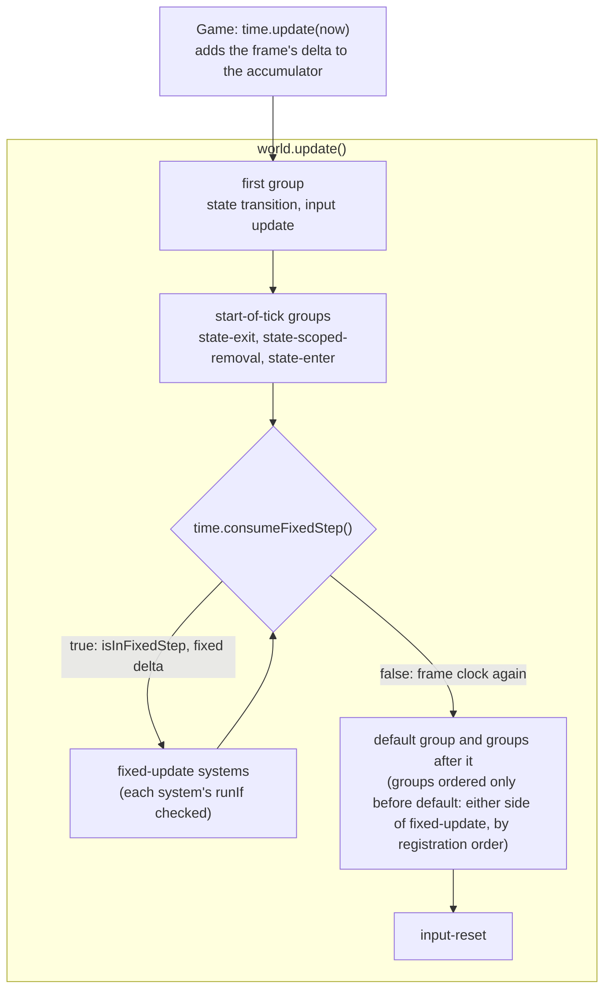

# Fixed-update group

Issue: [#801](https://github.com/Forge-Game-Engine/Forge/issues/801)
(Physics Fixed Timestep milestone. It builds on #795, which added the
fixed-step clock to `Time`, and comes before #815, which moves the physics
systems into the group this design adds, and #829, which replaces `Time`'s
`1000 / 15` delta clamp.)

| Module or file                                                       | Change   | Phase   | Notes                                                                                                                                                       |
| -------------------------------------------------------------------- | -------- | ------- | ----------------------------------------------------------------------------------------------------------------------------------------------------------- |
| `src/ecs/ecs-world.ts`                                               | Modified | 1       | `AddSystemGroupOptions.runWhile`; `addSystemGroup` rejects a group with both `runIf` and `runWhile`; `update` runs a repeating group's systems once per run |
| `src/ecs/run-condition.ts`                                           | Modified | 1       | JSDoc: what a `runWhile` condition may change, and that it's called once more than the group runs                                                           |
| `src/ecs/ecs-system.ts`                                              | Modified | 1       | `update`'s JSDoc: once per run of its group, which is once per tick unless the group repeats                                                                |
| `src/ecs/ecs-world.test.ts`                                          | Modified | 1       | `runWhile` tests (see "Testing")                                                                                                                            |
| `src/input/register-inputs.ts`                                       | Modified | 2       | The input update system moves into `world.firstSystemGroup`; the `input-update` group goes away; `input-reset` stays after the default group                |
| `src/input/register-inputs.test.ts`                                  | Modified | 2       | Order tests                                                                                                                                                 |
| `src/common/time/register-fixed-update.ts`                           | New      | 3       | `registerFixedUpdate(world, time): EcsSystemGroup`                                                                                                          |
| `src/common/time/register-fixed-update.test.ts`                      | New      | 3       | Tests with a real `Time`, including the issue's "Done when"                                                                                                 |
| `src/common/time/index.ts`                                           | Modified | 3       | Export `registerFixedUpdate`                                                                                                                                |
| `documentation-site/docs/docs/ecs/world.md`, `system.md`, `index.md` | Modified | 1, 3    | Repeating groups; "once per tick" wording; phase 3 replaces `world.md`'s `physicsGroup` example and notes ordering against `fixed-update`                   |
| `documentation-site/docs/docs/input/index.md`, `actions.md`          | Modified | 2       | Where the input update runs; why "pressed this frame" reads stay at the frame rate                                                                          |
| `documentation-site/docs/docs/common/time.md`                        | Modified | 3       | New "Running systems at a fixed rate" section; the manual-loop text points at it                                                                            |
| `AGENTS.md`, `.claude/skills/create-system/SKILL.md`                 | Modified | 1       | "`update` runs exactly once per tick" becomes "once per run of its group"                                                                                   |
| `CHANGELOG.md`                                                       | Modified | 1, 2, 3 | `#### Added` (`runWhile`, `registerFixedUpdate`), `#### Changed` (where the input update runs)                                                              |
| **Engine version at time of design**                                 |          |         | `0.27.0`                                                                                                                                                    |

## Summary

`EcsWorld.update` (`src/ecs/ecs-world.ts`) runs every registered system
group at most once per tick. A group's `runIf` can skip it, but nothing can
run it several times. A fixed-timestep simulation needs exactly that: after
a 40 ms frame at 60 steps per second, the simulation systems run twice, in
order, before the rest of the frame; after a 7 ms frame they don't run.
#795 gave `Time` the clock for this (`consumeFixedStep`, `isInFixedStep`,
the fixed delta), but its own docs (`time.md`, "Running fixed steps") tell
callers to write the `while (time.consumeFixedStep())` loop by hand, outside
the world, which can't put the steps at the right place in the world's
group order.

Unity, Godot and Bevy all run fixed steps in the same frame as the
variable-rate update, before it: Unity's `FixedUpdate` runs before
`Update`, Godot's physics frames run before `_process`, and Bevy's
`RunFixedMainLoop` runs the `FixedMain` schedule zero or more times
between `PreUpdate`/`StateTransition` and `Update`, while `Time<Fixed>`
has a step left. Forge already orders a tick's work with system groups,
so the fixed schedule is a group that repeats.

This design adds:

- a `runWhile` option on `addSystemGroup`, the repeating counterpart of
  `runIf`. The world calls it before each run of the group and runs the
  group's systems again while it returns `true`, zero or more times. It's
  general ECS machinery with no dependency on `Time`: any group can repeat
  while a condition holds (draining a queue, a fixed number of passes).
- `registerFixedUpdate(world, time)`, shaped like `registerInputs`, which
  registers and returns a `fixed-update` group ordered before the default
  group with `runWhile: () => time.consumeFixedStep()`. Systems in it read
  the fixed delta from `time.deltaTimeInSeconds`, because #795 makes `Time`
  report the fixed clock while a step runs.
- a fix to where `registerInputs` updates input: its update system moves
  into `world.firstSystemGroup`, so every fixed step, every game-state
  enter and exit system and every other group of the tick reads this
  frame's input, whatever order the game registered things in.

```ts
import { registerFixedUpdate } from '@forge-game-engine/forge/common';
import { registerInputs } from '@forge-game-engine/forge/input';
import { createGame } from '@forge-game-engine/forge/utilities';

const { world, time } = createGame('game');

registerInputs(world, time, { triggerActions: [jump] });

const fixedUpdate = registerFixedUpdate(world, time);

world.addSystem(createThrusterEcsSystem(time), { group: fixedUpdate });
world.addSystem(createCameraFollowEcsSystem()); // default group, once per frame
```

On a frame of a tick, the world runs:

1. the first group (state transition, input update),
2. the start-of-tick groups (game-state exit, scoped removal, enter),
3. `fixed-update`, once per fixed step the frame's time paid for,
4. the default group and the other groups around it,
5. `input-reset`.

A game's own group ordered only `before: [world.defaultSystemGroup]` has
no constraint against `fixed-update`, so it runs before or after the fixed
steps in registration order. Ordering it against the returned group
(`before: [fixedUpdate]` or `after: [fixedUpdate]`) pins it (FU9).

Nothing here bends a core design of the engine: system queries stay fixed,
systems stay stateless, and every value keeps one writer. The repeating
condition is the one place a condition changes state (it takes a step from
`Time`); the decision log (FU3) explains why that belongs to the condition
and not a system.

## Scope

### In scope

- `runWhile?: RunCondition` on `AddSystemGroupOptions`, its checks in
  `addSystemGroup`, and the loop in `EcsWorld.update`.
- `registerFixedUpdate(world, time)` in `src/common/time`, exported from
  `@forge-game-engine/forge/common`.
- Moving `registerInputs`' update system into `world.firstSystemGroup`.
- Unit tests for all three, including the issue's "Done when" with a real
  `Time`.
- Docs: `ecs/world.md`, `ecs/system.md`, `ecs/index.md`, `common/time.md`,
  `input/index.md`, `input/actions.md`; JSDoc; the `AGENTS.md` and
  `create-system` skill wording about how often `update` runs; changelog
  bullets.

### Out of scope

- **Moving the physics systems into the fixed group.** That's #815: the
  physics docs, the 14 physics demos, `demo/src/game.ts`, the transform pass
  at the start of each step, and `ContactsEcsComponent`'s per-step
  `started`/`ended`.
- **Changing `Time`'s delta clamp.** That's #829 (one 250 ms cap).
- **Interpolating rendered poses between fixed steps.** `Time` already
  exposes `fixedOverstepFraction`; components and systems that use it are a
  later design.
- **Nested groups or sub-phases inside a fixed step** (Bevy's
  `FixedFirst`/`FixedPreUpdate`/.../`FixedLast`). Systems inside
  `fixed-update` are ordered with `addSystem`'s `before`/`after`, as #815
  does. See FU6.
- **`runWhile` on a single system.** A system that needs to loop loops
  inside its own `update`.
- **Making "pressed this frame" input correct inside fixed steps.** Godot
  tracks the physics frame a press happened in so `is_action_just_pressed`
  works in `_physics_process`; Forge's `TriggerAction.isTriggered` stays
  per frame. The docs say where such reads belong (the default group). A
  per-step trigger is its own design.
- **Several fixed clocks** (a 60 Hz physics group and a 10 Hz AI group in
  one world, or fixed steps in more than one world of a `Game`, which
  updates a single `Time` for all its worlds). Only one world per `Game`
  runs fixed steps, as Unity and Godot have one global fixed clock. See
  open question 1.
- **Changes to `Game`.** It keeps calling `time.update` and then
  `world.update()` for each world; the loop lives in the world.

## Concepts

- **Run of a group.** One pass over a group's systems, in order. A group
  without conditions has one run per tick; with `runIf`, zero or one; with
  `runWhile`, zero or more.
- **Repeating group.** A group registered with `runWhile`. Its runs follow
  each other directly, before the next group in the tick's order starts.
- **Fixed step.** One `true` from `time.consumeFixedStep()`: the step's
  delta is subtracted from `Time`'s accumulator and, until the next call,
  `isInFixedStep` is `true` and the delta and time getters report the
  fixed clock (#795).
- **The fixed-update group.** The repeating group `registerFixedUpdate`
  registers, with one run per fixed step.

## API design

### `AddSystemGroupOptions.runWhile`

```ts
export interface AddSystemGroupOptions {
  before?: EcsSystemGroup[];
  after?: EcsSystemGroup[];

  /**
   * Runs the group's systems only on ticks where this returns `true`.
   * Checked each tick just before the group would run. A group can't have
   * both `runIf` and `runWhile`.
   */
  runIf?: RunCondition;

  /**
   * Runs the group's systems again and again while this returns `true`:
   * the world calls it just before each run, and the group's turn in the
   * tick ends the first time it returns `false`. So the group runs zero or
   * more times per tick, and the condition is called once more than that.
   * Every system's own `runIf` is checked on every run.
   *
   * Unlike `runIf`, the condition may change the state it reads, which is
   * what ends the loop: `() => time.consumeFixedStep()` takes a fixed step
   * each time it returns `true`. A condition that never returns `false`
   * never lets `update` return.
   *
   * A group can't have both `runIf` and `runWhile`.
   */
  runWhile?: RunCondition;
}
```

`addSystemGroup` throws when the group would end up with both conditions:
both passed in one call, or one passed for a group that already has the
other from an earlier call (`addSystemGroup` can be called again for a
registered group, which keeps its place in the tick). Passing the same
kind again replaces it, as `runIf` does today. The error names the group:

```text
Unable to add system group "fixed-update" with both "runIf" and "runWhile", a group either runs at most once per tick or repeats. Put "runIf" on the group's systems instead.
```

Why both together is rejected rather than combined, see FU2.

### `EcsWorld.update`

```ts
/**
 * Runs one tick: every group in order, and every system of each group in
 * order. A group with `runIf` runs once if it returns `true`; a group with
 * `runWhile` runs again while it returns `true`; any other group runs
 * once. A system whose `runIf` returns `false` is skipped for that run
 * without being queried. Conditions are checked just before the group or
 * system would run, so they see what earlier systems did. The tick's list
 * of groups and systems is taken once, before the first group runs.
 */
public update(): void
```

Pseudocode:

```ts
public update(): void {
  for (const { group, systems } of this._getOrderedGroups()) {
    const runWhile = this._groupRepeatConditions.get(group);

    if (runWhile) {
      while (runWhile(this)) {
        this._runSystems(systems);
      }

      continue;
    }

    if (!this._shouldRun(this._groupRunConditions.get(group))) {
      continue;
    }

    this._runSystems(systems);
  }
}

private _runSystems(systems: readonly EcsSystem<readonly unknown[]>[]): void {
  for (const system of systems) {
    if (!this._shouldRun(this._systemRunConditions.get(system))) {
      continue;
    }

    system.update(this, this.query(system.query, system.tags));
  }
}
```

- **The condition runs even when the group has no systems.** A
  `fixed-update` group nobody has added systems to still takes every step
  `Time` holds, so the accumulator never builds up and later releases a
  burst of steps.
- **Each run queries again.** Entities created or removed in one fixed
  step are seen by the next one, the way `query` already sees changes
  made by earlier systems in a tick.
- **One snapshot per tick.** `_getOrderedGroups()` is already taken once
  per tick, before the first group runs. A system or group added during a
  run first runs on the next tick, as the issue asks and as
  `addSystem`'s JSDoc already says. A system removed during a run keeps
  running for the rest of the tick, which now includes the remaining runs
  of a repeating group, after its `cleanup` has run. `removeSystem`'s
  JSDoc says so. Open question 3 asks whether later runs should skip it.
- **No run limit in the world.** The loop ends when the condition says
  so. For fixed steps, `Time` bounds it: each frame adds at most
  `1000 / 15` ms today, and 250 ms after #829, to the accumulator. See
  open question 4.
- **Errors propagate.** A condition or system that throws ends the tick,
  as today. If it throws inside a fixed step, `Time` stays in the step and
  the next `time.update` throws its "fixed step is running" error, which
  #795 already documents.

### `RunCondition`

The type stays `(world: EcsWorld) => boolean`. Its JSDoc changes from "A
run condition only reads state" to: a `runIf` condition only reads state;
a `runWhile` condition may also advance the state it loops over (taking a
fixed step, popping a queue), since that's what ends the loop. Neither
changes which entities a system matches. See FU3 for why it isn't a new
type.

### `registerFixedUpdate`

```ts
/**
 * Registers a system group that runs once per fixed step of `time`, and
 * returns it. Register fixed-rate systems in it with `addSystem`'s
 * `group` option. Systems in it read the fixed clock from `time`:
 * `deltaTimeInSeconds` is the fixed delta and `isInFixedStep` is `true`.
 *
 * The group, named `fixed-update`, runs after the world's start-of-tick
 * groups (game-state transitions, `registerInputs`' input update) and
 * before `world.defaultSystemGroup`, so the default group's systems run
 * once the frame's fixed steps are done and read the variable delta and
 * `fixedOverstepFraction`. It repeats while `time.consumeFixedStep()`
 * returns `true`: zero times on a frame shorter than the fixed delta, and
 * several times on a longer one.
 *
 * Another group ordered only `before: [world.defaultSystemGroup]` isn't
 * ordered against this one, so it runs before or after the fixed steps
 * depending on which was registered first. Order it against the returned
 * group (`before` or `after`) to fix its place.
 *
 * Call it once per `Time`: each fixed step `time` holds is taken by one
 * group, so only one world of a `Game` (which updates one `Time` for all
 * its worlds) can run fixed steps.
 * @param world - The world to register the group in.
 * @param time - The time whose fixed steps the group runs. It must be
 * updated before `world` is (as `Game` does).
 * @returns The fixed-update group.
 * @throws An error if a fixed-update group was already registered with
 * `time`, in this world or another.
 */
export const registerFixedUpdate = (
  world: EcsWorld,
  time: Time,
): EcsSystemGroup => { ... };
```

Body:

```ts
const fixedUpdateGroup = createSystemGroup('fixed-update');

world.addSystemGroup(fixedUpdateGroup, {
  before: [world.defaultSystemGroup],
  runWhile: () => time.consumeFixedStep(),
});

return fixedUpdateGroup;
```

plus one registration check, held in a module-level
`timesWithFixedUpdate: WeakSet<Time>` that the package doesn't export. The
invariant is one consumer per `Time`: calling it twice for one world with
the same `Time` and calling it for a second world of the same `Game` both
trip it. It's a `WeakSet` so a finished `Time` is collected as usual, the
way `gpu-resource-registry.ts` keys its `WeakMap` by render context. The
check runs before anything is registered, and the `Time` is added only
after `addSystemGroup` succeeds, so a call that throws leaves the world
and the set unchanged. The error:

```text
Unable to register a fixed-update group with this Time, a fixed-update group registered with it already takes its fixed steps. Only one fixed-update group per Time (one world per Game) can run fixed steps: register fixed-rate systems in the group the first registerFixedUpdate call returned.
```

Why the guard is keyed by `Time`, and why it's a `WeakSet` and not a
singleton entity, see FU4 and open question 1.

The group is a rest-of-tick group (ordered only `before` the default
group), so the world's existing rule puts every start-of-tick group before
it, and with phase 2 the input update too. Other rest-of-tick groups a
game orders only `before: [world.defaultSystemGroup]` have no constraint
against it: `DirectedAcyclicGraph.topologicalSort` keeps insertion order
for unconstrained nodes, so such a group runs before the fixed steps if it
was registered first and after them otherwise (FU9). A game orders its own
groups against the returned group to fix that: `after: [fixedUpdate]` for
a group that must see the steps' results before the default group,
`before: [fixedUpdate]` for one whose output the steps read.

There's no options parameter: the step size is `time.fixedDeltaTimeInMilliseconds`,
and gating the steps by game state goes on the group's systems (FU2).

### `registerInputs`

The update system is added to the world's first group instead of a new
`input-update` group:

```ts
world.addSystem(createUpdateInputEcsSystem(time), {
  group: world.firstSystemGroup,
});

const resetInputSystemGroup = createSystemGroup('input-reset');

world.addSystemGroup(resetInputSystemGroup, {
  after: [world.defaultSystemGroup],
});
world.addSystem(createResetInputsEcsSystem(), {
  group: resetInputSystemGroup,
});
```

The first group runs before every other group, so input is updated before
the start-of-tick groups (game-state exit and enter systems), before
`fixed-update`, and before any group a game orders before the default
group, whichever was registered first. Within the first group the input
update and `createGameState`'s transition system run in registration
order, which doesn't matter: neither reads what the other writes (the
transition applies the `set` of the previous tick; the input update reads
the devices and `time.deltaTimeInMilliseconds`, which is the frame's delta
because no fixed step is running yet).

`firstSystemGroup`'s JSDoc changes from "Game state transitions run in it"
to "Game state transitions and `registerInputs`' input update run in it".

See FU5 for the issue's alternative (a start-of-tick `input-update` group).

## System order and data flow



What each part of the tick reads from `Time`:

| Where                              | `deltaTimeInSeconds` | `timeInSeconds`              | `isInFixedStep` | `fixedOverstepFraction`                                                    |
| ---------------------------------- | -------------------- | ---------------------------- | --------------- | -------------------------------------------------------------------------- |
| First and start-of-tick groups     | frame delta          | frame time                   | `false`         | last frame's leftover plus this frame's delta, not yet stepped; can be ≥ 1 |
| `fixed-update`, each run           | fixed delta          | fixed time at the step's end | `true`          | what's left after this step is taken; can still be ≥ 1                     |
| Default group and the groups after | frame delta          | frame time                   | `false`         | this frame's leftover, in `[0, 1)`                                         |

`Time.update` adds the frame's delta to the accumulator before
`world.update` runs (`Time.ts`, the `_fixedAccumulatorInMilliseconds +=`
line in `update`), so `fixedOverstepFraction` is only the interpolation
factor once the fixed-update group has finished: in the default group and
the groups after it. The `time.md` section says to read it there and not
in start-of-tick groups.

Input across one frame: the first group updates the `InputManager` once.
Every fixed step of the frame reads the same action state; `input-reset`
clears triggers after the default group. So held keys and axes read the
same in every step (correct for a thruster that pushes while a key is
held), while a `TriggerAction` pressed this frame is seen by zero fixed
steps on a short frame and by two on a long one. The time and input docs
say to read triggers in the default group and, if the press must change
the simulation, write it to a component the next fixed step consumes
(e.g. `jumpRequested`), the dirty-flag pattern the `create-system` skill
describes.

### Worked example (the issue's "Done when")

`time.update(0)` seeds the clock (the first update adds nothing to the
accumulator). Fixed delta `1000 / 60` ≈ 16.67 ms.

| Frame | `time.update` | Accumulator before | Fixed-update runs | Accumulator after |
| ----- | ------------- | ------------------ | ----------------- | ----------------- |
| 1     | `40`          | 40                 | 2                 | 6.67              |
| 2     | `47`          | 13.67              | 0                 | 13.67             |

On frame 1 the counting system in the group runs twice, both before any
default-group system; on frame 2 it doesn't run, and the default group
still does.

## Performance

- A tick builds the same snapshot as today; a repeating group reuses it
  for every run.
- Each run queries each of its systems again (one `query` per system per
  step). That's the cost of the fixed step, the same as registering those
  systems in a group that runs once, times the step count. At 60 Hz on a
  60 Hz display it's one run per frame on average; on a 144 Hz display,
  most frames run zero steps and the simulation's per-frame cost drops.
- The loop adds one condition call per run plus one, and a `Map` lookup
  per group per tick.

## Testing

### `src/ecs/ecs-world.test.ts` (phase 1)

A new `describe('repeating groups')`, using the file's `trackingSystem`
helper and a counter-driven condition (`let runsLeft = n; runWhile: () =>
runsLeft-- > 0`):

- runs a group 0, 1 and 3 times when the condition returns `true` that
  many times, and the systems inside it in order on each run
  (`['a', 'b', 'a', 'b', 'a', 'b']`);
- calls the condition once more than the group runs, with the world as its
  argument;
- calls the condition even when the group has no systems;
- checks each system's `runIf` on every run (a `runIf` that's `true` on
  the second run only gives one call);
- queries on every run: an entity a system in run 1 creates is in run 2's
  batch;
- keeps the tick's order around a repeating group: a group before it, the
  repeating group's runs, then the default group and a group after it
  (`['before', 'r', 'r', 'default', 'after']`);
- a repeating group ordered after the first group (start-of-tick) repeats
  in that place;
- a system added to the repeating group during run 1 doesn't run in runs 2
  and 3, and runs next tick;
- throws for `runIf` and `runWhile` in one call, and for one added to a
  group already registered with the other; re-registering with a new
  `runWhile` replaces the old one;
- a group with `runWhile` returning `false` immediately runs nothing and
  the rest of the tick still runs.

### `src/input/register-inputs.test.ts` (phase 2)

- the input update runs in the first group: a system in a start-of-tick
  group registered before `registerInputs` runs after the input update (an
  updatable added with `inputManager.addUpdatable` that logs its `update`
  call shows up first in the order log);
- the input update runs before a group ordered before the default group,
  whether that group is registered before or after `registerInputs`;
- the reset still runs after the default group (the existing test).

### `src/common/time/register-fixed-update.test.ts` (phase 3)

With a real `Time` and a real `EcsWorld`:

- **Done when**: seeded with `time.update(0)`, a counting system in the
  returned group runs 2 times on `time.update(40)` + `world.update()` and
  0 times on `time.update(47)` + `world.update()`, and on frame 1 both
  runs come before a default-group system (an order log);
- systems in the group see `time.isInFixedStep === true`,
  `time.deltaTimeInSeconds === time.fixedDeltaTimeInSeconds` and a
  `timeInSeconds` that advances by one fixed delta per run; a default-group
  system sees `isInFixedStep === false`, the frame delta, and
  `fixedOverstepFraction` in `[0, 1)`;
- after `world.update()`, `time.update` doesn't throw (the loop ran to
  completion);
- `timeScale = 0` runs no steps; `fixedDeltaTimeInMilliseconds = 1000 / 30`
  halves the runs;
- the group runs after a game state's enter group and after
  `registerInputs`' input update, in both registration orders;
- a group ordered only `before: [world.defaultSystemGroup]` runs before
  the fixed steps when registered first and after them when registered
  second, and `after: [fixedUpdate]` puts it after them in both orders
  (pins the documented behavior, FU9);
- throws when called a second time with the same `Time`, both for the same
  world and for a second world, and the failed call registers nothing (the
  second world's tick is unchanged);
- `fixedOverstepFraction` read in a start-of-tick group after a 40 ms
  frame is above `1`, and read in the default group is below `1`.

### End-to-end

No new e2e spec: `Game` doesn't change, and these phases change no
rendering. #815 adds the end-to-end scene (the same fall at 30 and 120
frames per second). Phase 2 changes input ordering, so `npm run test:e2e`
must still pass for the keyboard, mouse and gamepad specs, whose consumer
systems run in the default group between the input update and reset.

## Documentation

- `ecs/world.md`: in "Grouping systems", a "Repeating a group" subsection
  with a small `runWhile` example (a group that runs while a queue has
  items), the rule that a group has either `runIf` or `runWhile`, that each
  system's `runIf` is checked on every run, and the snapshot rule. "Running
  a world tick": systems run once per run of their group. A pointer to
  `registerFixedUpdate` for fixed rates. The "Grouping systems" example
  today registers a `physicsGroup` with `before: [world.defaultSystemGroup]`
  holding gravity and integration; it becomes a non-physics example (an
  `ai` group) so the page doesn't teach a variable-rate physics group, and
  a sentence after it says physics and other fixed-rate work goes in the
  group `registerFixedUpdate` returns, and that two groups ordered only
  `before` the default group run in registration order relative to each
  other (including `fixed-update`), so order one against the other when it
  matters.
- `ecs/system.md` ("Run conditions" and line 35's "`update` is called
  once per tick"), `ecs/index.md` (lines 15 and 21): the same wording
  change, and that `runWhile` conditions may change what they loop over.
- `common/time.md`: a "Running systems at a fixed rate" section, before
  "Running fixed steps", showing `registerFixedUpdate`, the tick order, the
  table of what `Time` reads where, which work belongs in the group
  (simulation, forces and torques scaled by delta, reactions to contacts
  once #815 lands) and which doesn't (reading "pressed this frame"
  triggers, rendering, camera follow, UI), how other groups ordered before
  the default group fall relative to it (registration order unless ordered
  against the returned group), and the rule that one `Time` feeds one
  fixed-update group, so only one world of a `Game` runs fixed steps.
  "Running fixed steps" keeps the manual loop as what the group does, and
  its "not inside a system" paragraph says to use `registerFixedUpdate`
  with a world. "Interpolating between fixed steps" says to read
  `fixedOverstepFraction` in the default group or later: before the fixed
  steps run it still includes this frame's delta and can be `1` or more.
- `input/index.md` and `input/actions.md` ("registerInputs adds a
  system..."): the update runs first in the tick, before game-state and
  fixed-update systems; the reset after the default group; triggers are
  per frame.
- JSDoc on `runWhile`, `RunCondition`, `update`, `removeSystem`,
  `firstSystemGroup`, `EcsSystem.update`, `registerFixedUpdate` and
  `registerInputs`.
- `AGENTS.md` "Architecture" points 2 and 4 and the `create-system` skill's
  first paragraph: `update` runs once per run of its group.

Use the `document-feature` skill for the docs pages. No demo: the first
user-visible use is #815's physics demos.

## Phases

### Phase 1: repeating groups

Adds `runWhile` to `addSystemGroup` and the loop in `EcsWorld.update`.
Released on its own, it lets any game repeat a group while a condition
holds, including a hand-written fixed-step group.

**Done when** the phase 1 tests pass; `runWhile` and the changed JSDoc are
in place; `world.md`, `system.md`, `index.md`, `AGENTS.md` and the
`create-system` skill say how often a system runs; a `#### Added`
changelog bullet describes `runWhile`; and the verification checklist
passes.

| Task              | Description                                                                                                      | Size |
| ----------------- | ---------------------------------------------------------------------------------------------------------------- | ---- |
| Option and checks | `runWhile` on `AddSystemGroupOptions`; the both-conditions check across calls in `addSystemGroup`; JSDoc         | S    |
| Loop              | `update` with `_runSystems`; JSDoc on `update`, `removeSystem`, `RunCondition`, `EcsSystem.update`               | S    |
| Tests             | The `ecs-world.test.ts` list                                                                                     | M    |
| Docs              | `ecs/world.md`, `ecs/system.md`, `ecs/index.md`, `AGENTS.md`, `create-system` skill, `CHANGELOG.md` `#### Added` | S    |

### Phase 2: input updates first in the tick

Moves `registerInputs`' update system into the first group. Released on
its own, it makes game-state enter and exit systems, and any group a game
orders before the default group, read this frame's input regardless of
registration order.

**Done when** the phase 2 tests pass, the e2e input specs pass, the input
docs say where the update runs, a `#### Changed` changelog bullet says
that start-of-tick systems now see this frame's input (and that a
start-of-tick group that fed input into the `InputManager` before its
update now runs after it), every docs-site demo that calls
`registerInputs` still responds to input after `npm run build` (spot-check
`game-states`, `ui-main-menu`, `rolling-ball` and `space-shooter`), and
the verification checklist passes.

| Task  | Description                                                                                                | Size |
| ----- | ---------------------------------------------------------------------------------------------------------- | ---- |
| Move  | `register-inputs.ts`: the update system in `world.firstSystemGroup`; JSDoc on it and on `firstSystemGroup` | S    |
| Tests | The `register-inputs.test.ts` list; `npm run test:e2e`                                                     | S    |
| Docs  | `input/index.md`, `input/actions.md`, `CHANGELOG.md` `#### Changed`; demo spot-check                       | S    |

### Phase 3: `registerFixedUpdate`

Adds the helper. Released on its own (after phases 1 and 2), a game can
run its own fixed-rate systems; #815 then moves the engine's physics
systems into the group.

**Done when** the phase 3 tests pass, including the "Done when" counting
test; `registerFixedUpdate` is exported from
`@forge-game-engine/forge/common` (`npm run check-exports`); `time.md` has
the "Running systems at a fixed rate" section; a `#### Added` changelog
bullet describes it; and the verification checklist passes.

| Task   | Description                                                                                                                                          | Size |
| ------ | ---------------------------------------------------------------------------------------------------------------------------------------------------- | ---- |
| Helper | `register-fixed-update.ts` with the `WeakSet<Time>` check, JSDoc, export from `src/common/time/index.ts`                                             | S    |
| Tests  | `register-fixed-update.test.ts`                                                                                                                      | M    |
| Docs   | `common/time.md` section, manual-loop and interpolation paragraphs; `ecs/world.md`'s grouping example and ordering note; `CHANGELOG.md` `#### Added` | M    |

## Decision log

| #   | Decision                                                                  | Options                                                                                                                                                                                                                                                                                                                                 | Chosen | Rationale                                                                                                                                                                                                                                                                                                                                                                                                                                                                                                                                                                    | Tradeoff                                                                                                                                                                                           | Assumptions                                                                             |
| --- | ------------------------------------------------------------------------- | --------------------------------------------------------------------------------------------------------------------------------------------------------------------------------------------------------------------------------------------------------------------------------------------------------------------------------------- | ------ | ---------------------------------------------------------------------------------------------------------------------------------------------------------------------------------------------------------------------------------------------------------------------------------------------------------------------------------------------------------------------------------------------------------------------------------------------------------------------------------------------------------------------------------------------------------------------------- | -------------------------------------------------------------------------------------------------------------------------------------------------------------------------------------------------- | --------------------------------------------------------------------------------------- |
| FU1 | How a world runs fixed steps                                              | (a) `runWhile` on a group; (b) `Game` loops `consumeFixedStep` and calls a "run this group" method on each world; (c) a built-in fixed group on `EcsWorld` that takes a `Time`; (d) a system that runs other systems; (e) a run count computed once before the group (`runTimes`)                                                       | (a)    | It's Bevy's model (a schedule run while `Time<Fixed>` has a step) in Forge's own unit, the group, and it keeps `src/ecs` free of `Time`. (b) can't place the steps between the start-of-tick groups and the default group, and makes `Game` know group order. (c) couples the ECS to the clock. (d) breaks "a system changes only component data" and hides systems from the world's order. (e) can't put `Time` in the fixed state step by step, which #795's API needs.                                                                                                    | One more option on `addSystemGroup`.                                                                                                                                                               |                                                                                         |
| FU2 | `runIf` and `runWhile` on one group                                       | (a) Throw; (b) check `runIf` once, then loop; (c) check `runIf` before each run                                                                                                                                                                                                                                                         | (a)    | The issue's choice. (b) and (c) let a game state gate the whole fixed group, and while it's gated nothing takes `Time`'s steps, so the accumulator grows and the game releases a burst of steps on resume. Gating each system with `runIf: inState(...)` keeps the steps draining, as Bevy's `FixedMain` always runs and its systems carry their own conditions.                                                                                                                                                                                                             | A game puts `inState` on each fixed system instead of once on the group.                                                                                                                           |                                                                                         |
| FU3 | The type of a `runWhile` condition                                        | (a) `RunCondition`, with its JSDoc saying a `runWhile` condition may advance what it loops over; (b) a new `RepeatCondition` type                                                                                                                                                                                                       | (a)    | Same signature and same caller; a second name for one function type would need its own docs and imports. The side effect is the loop's exit, which is why it can't be a system's job.                                                                                                                                                                                                                                                                                                                                                                                        | `RunCondition`'s "only reads state" becomes "a `runIf` condition only reads state".                                                                                                                |                                                                                         |
| FU4 | How `registerFixedUpdate` refuses a second group (departs from the issue) | (a) One module-level `WeakSet<Time>`; (b) `WeakSet`s of both worlds and `Time`s; (c) a singleton entity with a fixed-update component, as `registerInputs` stores its manager; (d) only the per-world check the issue asks for; (e) no check                                                                                            | (a)    | The invariant is one consumer per `Time`: a second group on one `Time` always finds the steps already taken and runs zero times, silently. Keying by `Time` catches the issue's case (one world called twice, with its one `Time`) and two worlds of one `Game`, which share its `Time` (`Game` takes one and `createGame` builds one). A per-world set (b, d) adds nothing a `Game` can reach. (c) can be removed by game code (a state-scoped removal, a world reset) and then lets a second group through. `gpu-resource-registry.ts` already keeps a `WeakMap` by owner. | Hidden module state; tests use a new `Time` each (they already do in `beforeEach`). A world given a second, hand-updated `Time` isn't refused, which no `Game` can do.                             | Open question 1 decides whether one `Time` should ever feed two worlds.                 |
| FU5 | Where the input update runs (departs from the issue)                      | (a) In `world.firstSystemGroup`; (b) the issue's example: an `input-update` group ordered after the first group (a start-of-tick group); (c) `registerFixedUpdate` orders itself after the input group                                                                                                                                  | (a)    | (b) puts input before `fixed-update`, but among the start-of-tick groups its place depends on registration: `registerInputs` before `createGameState` updates input before enter systems, after it updates it after them. (a) puts it before all of them every time, matching Bevy (input in `PreUpdate`, before `StateTransition`). (c) couples the time helper to input. The transition system and input update in the first group don't read each other's data.                                                                                                           | The first group now holds two engine systems, not one. A start-of-tick group that pushed input into the `InputManager` before its update now runs after it; the changelog says so.                 | Nothing in `/src`, `/demo` or the docs site depends on running before the input update. |
| FU6 | Sub-phases in a fixed step                                                | (a) One group, systems ordered with `before`/`after`; (b) nested groups (Bevy's `FixedFirst`..`FixedLast`)                                                                                                                                                                                                                              | (a)    | Forge's groups don't nest, and #815 needs only system-level ordering (transform pass, physics, game force and contact systems). Nesting is a change to the world's model with no caller yet.                                                                                                                                                                                                                                                                                                                                                                                 | A game that wants "before all physics" orders against the first physics system, not a phase.                                                                                                       |                                                                                         |
| FU7 | Where `registerFixedUpdate` lives                                         | (a) `src/common/time`; (b) `src/ecs`; (c) `src/physics`                                                                                                                                                                                                                                                                                 | (a)    | The issue's choice. It's the bridge between `Time` and the world, as `registerInputs` is for input. (b) would make the ECS depend on `Time`; (c) would make non-physics fixed work depend on physics.                                                                                                                                                                                                                                                                                                                                                                        |                                                                                                                                                                                                    |                                                                                         |
| FU8 | Systems added or removed during a repeating group                         | (a) One snapshot per tick, as `update` takes today; (b) rebuild between runs                                                                                                                                                                                                                                                            | (a)    | The issue's rule, and the existing contract for adding (`addSystem`'s JSDoc) and removing (`removeSystem`'s). Rebuilding per run makes a step's systems depend on what an earlier step registered.                                                                                                                                                                                                                                                                                                                                                                           | A system removed in step 1 still runs in steps 2..n after its `cleanup`. Open question 3.                                                                                                          |                                                                                         |
| FU9 | Groups ordered only before the default group                              | (a) Accept that they fall on either side of `fixed-update` by registration order, document it in the JSDoc and `world.md`, and let games order against the returned group; (b) make `fixed-update` run after every such group; (c) new built-in world groups around the fixed steps (Bevy's `BeforeFixedMainLoop`/`AfterFixedMainLoop`) | (a)    | It's the world's existing rule for any two unconstrained groups (`DirectedAcyclicGraph` keeps insertion order), and `registerInputs`' groups live with it today. (b) can't be expressed: `registerFixedUpdate` can't see groups registered after it, and adding edges to every group is a special case in the world. (c) is a change to the world's built-in groups with no caller yet.                                                                                                                                                                                      | A game with its own pre-default group must order it against `fixed-update` if the relative order matters; `world.md`'s `physicsGroup` example is replaced so it doesn't teach the ambiguous setup. | Few games add pre-default groups besides the engine's.                                  |

## Open questions

None is blocking: each has a default the implementation follows, and a
different answer changes details, not the approach.

1. **One `Time`, fixed steps in several worlds** (non-blocking). `Game`
   takes one `Time` and updates it for all its worlds (`createGame` builds
   one), and the accumulator lives in `Time`, so only one world per `Game`
   can take its fixed steps. Default: the second `registerFixedUpdate`
   with the same `Time` throws (FU4), and the docs say only one world of a
   `Game` runs fixed steps, as Unity and Godot each have one global fixed
   clock.
   - Keep the default: the common split (a gameplay world plus a UI world)
     needs fixed steps in one world only, and the error is loud.
   - Give each world its own fixed accumulator (move it out of `Time` into
     something per consumer that `Time` feeds): two gameplay worlds both
     get steps, at the cost of reworking #795's API, where
     `isInFixedStep` and the fixed time are properties of the one `Time`.
   - Drop the `Time` check and only document it: no hidden state for
     times, but the mistake runs zero steps silently.

2. **Where the input update runs** (non-blocking). Default: in
   `world.firstSystemGroup` (FU5).
   - The issue's start-of-tick `input-update` group keeps a separate,
     named group, but its order against game-state groups follows
     registration order.
   - Keep it a rest-of-tick group and have `registerFixedUpdate` order
     after it: no change to `registerInputs`, but the time helper has to
     find the input group, and state groups still run before input.

3. **A system removed during a repeating group** (non-blocking). Default:
   it keeps running for the tick's remaining runs (FU8), as a removed
   system already does for the rest of a tick.
   - Skip systems that are no longer registered before each run. A removed
     system would then never run after its `cleanup`, but that changes
     the documented removal rule for every group, not just repeating ones,
     which is wider than this issue.

4. **A limit on runs per tick** (non-blocking). Default: none in the world;
   the condition ends the loop, and `Time` bounds fixed steps (about 4 per
   frame with today's `1000 / 15` clamp, 15 at 60 Hz after #829).
   - Throw after a large number of runs (say 10 000) to turn a condition
     that never returns `false` into an error instead of a frozen tab. It
     catches bugs in hand-written conditions, at the cost of a number no
     game should reach and that some batch job might.
