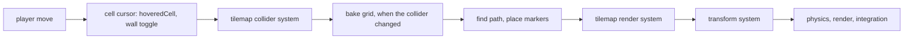

# Isometric navigation grids

<!-- cspell:ignore walkability octile rasterize rasterizer scanline scanlines -->

Issue: [#871](https://github.com/Forge-Game-Engine/Forge/issues/871)
(Tilemaps milestone; builds on [#776's navigation grids](./navigation-grids.md),
[#777's collider marking](./navigation-grid-from-colliders.md) and
[#869's grid layouts](./grid-layouts.md); #839 depends on it)

| Module or file                                                     | Change   | Notes                                                                                                                                  |
| ------------------------------------------------------------------ | -------- | -------------------------------------------------------------------------------------------------------------------------------------- |
| `src/navigation/grid/navigation-grid.ts`                           | Modified | `NavigationGridOptions.cells: GridCellRange` replaces `columns` and `rows`; `NavigationGrid.cells`; node ids count from the first cell |
| `src/navigation/grid/create-navigation-grid.ts`                    | Modified | Validates `cells`                                                                                                                      |
| `src/navigation/grid/dense-navigation-grid.ts`                     | Modified | Bounds checks, node ids and fills over `cells`                                                                                         |
| `src/navigation/grid/snap-to-walkable-cell.ts`                     | Modified | The grid's outline and edge-cell clamp use `cells`                                                                                     |
| `src/navigation/grid/baking/cell-distance.ts`                      | Modified | `createCellFrame` measures from the first cell's corner, so the rasterizer keeps working in 0-based indices                            |
| `src/navigation/grid/mark-grid-from-colliders.ts`                  | Modified | Seeds the blocked mask by node id                                                                                                      |
| `src/navigation/grid/*.test.ts`, `baking/*.test.ts`                | Modified | Every grid built with `cells`; new region, isometric detour and tile-layer tests (see "Testing")                                       |
| `src/navigation/grid/tile-layer-alignment.test.ts`                 | New      | A grid over an isometric (and an orthogonal) tile layer has the layer's cell numbers and positions, negative cells too                 |
| `documentation-site/docs/docs/navigation/grids.md`                 | Modified | `cells` in every sample; "Isometric grids" and "Laying a grid over a tile layer" sections; "Path costs" covers every layout            |
| `documentation-site/docs/docs/navigation/colliders.md`             | Modified | Its sample uses `cells`                                                                                                                |
| `documentation-site/docs/docs/tilemaps/isometric-maps.md`          | Modified | A short "Finding paths" section linking the navigation guides                                                                          |
| `documentation-site/docs/docs/math/grid-layouts.md`                | Modified | Links "navigation grid" to its guide                                                                                                   |
| `documentation-site/src/pages/demos/isometric-path-finding/`       | New      | A demo: paths across the isometric courtyard, baked from its tile colliders, re-baked when a wall is toggled                           |
| `documentation-site/src/data/demos.ts`, `demo-categories.ts`       | Modified | The demo's entry, and a `navigation` category (the `navigation` icon already exists in `ModuleIcon.tsx`)                               |
| `documentation-site/src/pages/demos/category/navigation/index.tsx` | New      | The category's listing page                                                                                                            |
| `CHANGELOG.md`                                                     | Modified | The unreleased navigation-grid bullet describes `cells`; a new `#### Added` bullet for grids over any block of cells                   |
| **Engine version at time of design**                               |          | `0.26.2`                                                                                                                               |

## Summary

#871 asks for navigation grids that use a `GridLayout`, so an isometric
game can path-find over the same diamond cells as its tile layers, and a
grid and a tile layer built from the same layout agree on every cell.
Most of that has shipped. #776's design moved the layout into the grid's
first release (navigation-grids.md NG2), and #777's design built collider
marking for every layout at once (navigation-grid-from-colliders.md MC7).
Today `createNavigationGrid` takes `layout: GridLayout`
(`src/navigation/grid/navigation-grid.ts`). Conversions go through
`layout.localToCell` and `layout.getCellCenter` offset by `origin`
(`DenseNavigationGrid.worldToCell`, `cellToWorld`). Each step costs the
cell's cost times the world distance between centres (`createGridMetric`
in `grid-metric.ts`). The heuristic is the exact empty-grid distance on
the layout (`getGridDistance`). `markGridFromColliders` fills shapes in
cell space and measures distances in world space against each cell's
quad (`baking/mark-region.ts`). No `cellSize` caller is left anywhere in
the repository.

One part of "agree on every cell" is still missing. A tile layer is
unbounded and numbers its cells from wherever its tiles are, often below
`(0, 0)` (an infinite Tiled map, or a level edited around its origin). A
navigation grid always numbers its cells from `(0, 0)`. A grid can sit on
the same cells as the layer by shifting its `origin`, but then its cell
`(c, r)` is the layer's `(c + minColumn, r + minRow)`. Every game that
edits both, such as opening a door tile and its grid cell, would convert
each cell through the world. Godot avoids this with
`AStarGrid2D.region`: set it to `TileMapLayer.get_used_rect()` and the grid
uses the layer's cell ids.

This design makes the same change. The grid takes `cells: GridCellRange`,
the block of cells it covers, in place of `columns` and `rows`. `origin`
and `layout` place the same unbounded lattice a tile layer uses, and
`cells` says which part of it the grid has. A grid built with a layer's
layout, `origin` at the layer's world position and
`cells: getUsedRect(layer)` has the layer's cell numbers and cell
positions. Node ids still count from `0` (`NavigationGraph` requires it),
from the grid's first cell. Navigation is unreleased, so this is the
cheapest time to change the options.

The rest of the design finishes #871 without redesigning what shipped. It
audits the issue's tasks against the code. It adds the tests the issue
lists that don't exist yet, documents isometric grids and grids over tile
layers and Tiled maps, and adds the navigation module's first demo, a
path across the isometric courtyard the tilemap demo already loads.

The design differs from #871's text in two places, both decided by the
earlier designs and kept here (decisions IN2 and IN3). The heuristic is
the exact grid distance, which is tighter than Euclidean distance. Shapes
aren't grown and then moved into cell space. They're filled in cell space,
and their distance to each cell is measured in world space. It differs
from navigation-grids.md in one place: `cells` replaces `columns` and
`rows` (decision IN4). Nothing here bends a core design of the engine.

## Scope

### In scope

- `cells: GridCellRange` in place of `columns`/`rows`, through the grid,
  path search, snapping and collider marking, and every caller.
- An audit of every #871 task against the shipped code and tests (see
  "What exists").
- The unit tests #871 lists that are missing: a hand-checked isometric
  path around a blocked cell, a grid over a tile layer with the layer's
  cell numbers (negative cells and an offset layer position included),
  and paths through a grid baked from that layer's collider.
- Documentation of isometric grids, path costs on any layout, and how to
  lay a grid over a tile layer or a spawned Tiled map.
- The `isometric-path-finding` docs-site demo and a `navigation` demo
  category.

### Out of scope

- Any other change to `findGridPath`, `markGridFromColliders`, step
  costs or the heuristic. They already do what #871 asks.
- A tilemaps helper that builds a grid for a layer. With `cells`, the
  setup is three options read straight from the layer (open question 1).
  #839 owns the tilemap-to-navigation bake (per-tile costs).
- Grids that follow a rotated or scaled tile layer. A grid has an `origin`
  and no transform (decision IN8).
- Grids that grow or move after they're created. `cells` is fixed, as
  `columns` and `rows` are today.
- Staggered and hexagonal layouts. `GridLayout` has no such layouts yet
  (grid-layouts.md), and the Tiled loader rejects those maps.
- Navigation agents that walk a path (#780) and path smoothing (#779). The
  demo draws the path. Nothing follows it.

## What exists

Each task in #871, and where the code or a test already covers it:

| #871 task                                                                       | Status  | Where                                                                                                                                                                                                                           |
| ------------------------------------------------------------------------------- | ------- | ------------------------------------------------------------------------------------------------------------------------------------------------------------------------------------------------------------------------------- |
| `createNavigationGrid({ columns, rows, layout, origin })` replaces `cellSize`   | Done    | `NavigationGridOptions.layout`; no `cellSize` caller remains in `/src`, `/demo`, `/e2e` or `documentation-site`                                                                                                                 |
| `worldToCell`/`cellToWorld` through the layout                                  | Done    | `DenseNavigationGrid.worldToCell` (`layout.localToCell(position - origin)`), `cellToWorld` (`layout.getCellCenter + origin`)                                                                                                    |
| Step cost is the cell cost times the world distance between centres             | Done    | `createGridMetric`, `DenseNavigationGrid.forEachNeighbor`; test "uses the layout to measure steps"                                                                                                                              |
| Admissible heuristic on any layout                                              | Done    | `getGridDistance` (exact empty-grid distance, NG4); tests "equals the cheapest cost on an empty grid" and "is consistent and gives the cheapest paths on random grids" for square, rectangular and isometric layouts            |
| Topology in column/row space                                                    | Done    | `orthogonalOffsets`, `diagonalOffsets` and `_isDiagonalOpen` in cell space (NG15)                                                                                                                                               |
| Y-down rows                                                                     | Done    | NG1; test "puts cell (0, 0) at the origin, with rows increasing down the screen"                                                                                                                                                |
| `markGridFromColliders` against the cell's layout shape, one rasterization path | Done    | `createCellFrame`, `fillLoops` (cell space scanlines), `markSegment` and `markDisc` (world-space distance to `writeInsetQuad`) (MC7)                                                                                            |
| Test: isometric conversions round-trip, offset `origin`, positions outside      | Done    | "round-trips every cell through the world with origin %o" and "returns null for positions just outside the grid", per layout                                                                                                    |
| Test: conversions with negative cells                                           | Missing | A grid can't have negative cells today. `cells` adds them (Phase 1)                                                                                                                                                             |
| Test: isometric path around a blocked cell is the world-space shortest          | Partial | The random-grid test proves it against Dijkstra on isometric layouts. A readable example is missing (Phase 2)                                                                                                                   |
| Test: heuristic never overestimates on a 2:1 layout                             | Done    | The heuristic tests above, on `64 x 32`                                                                                                                                                                                         |
| Test: the diamond cells a rotated box overlaps, with and without `agentRadius`  | Done    | "blocks the cells a rotated box overlaps on a isometric grid, with an agent radius of %s" (`0` and `9`)                                                                                                                         |
| Test: orthogonal results match #776's                                           | Done    | Every orthogonal test runs the same code                                                                                                                                                                                        |
| Done when: paths match an isometric tile layer with the same layout             | Partial | "blocks exactly a tile layer's solid cells on a isometric grid" checks blocking, with the layer at the origin. Cell numbers and centres over an offset layer with negative cells, and paths through it, aren't tested (Phase 2) |
| JSDoc and navigation guide                                                      | Partial | JSDoc covers layouts. `grids.md` explains path costs only for square cells and doesn't show an isometric grid or a grid over a tile layer (Phase 3)                                                                             |

## API design: the grid's cells

```ts
/** Options for {@link createNavigationGrid}. */
export interface NavigationGridOptions {
  /**
   * The cells the grid has, an inclusive range of integer columns and
   * rows. Any integers, negative ones too, so a grid can cover exactly
   * the cells of a tile layer: pass `getUsedRect(layer)`.
   */
  cells: GridCellRange;

  /** Where the cells are, such as an orthogonal or isometric layout. */
  layout: GridLayout;

  /**
   * The world position of the corner of cell `(0, 0)` at the layout's
   * origin, whether or not `cells` holds `(0, 0)`: the top-left corner of
   * an orthogonal cell, the top corner of an isometric one. A tile layer's
   * world position, for a grid over that layer. Defaults to `(0, 0)`.
   */
  origin?: Vector2;

  /** Which diagonal steps are allowed. Defaults to `'noCornerCutting'`. */
  diagonals?: NavigationGridDiagonals;
}
```

`NavigationGrid` gains `readonly cells: GridCellRange` (a copy, like
`origin`). `columns` and `rows` stay as read-only counts
(`maxColumn - minColumn + 1`, `maxRow - minRow + 1`), since `nodeCount`
and callers sizing their own arrays use them. Everything that takes a
column and row takes the layer's numbers:

- `hasCell(column, row)` is `true` for integers inside `cells`.
- `cellToNode(column, row)` is
  `(row - minRow) * columns + (column - minColumn)`. `nodeToCell` is its
  inverse. Node ids still run from `0` to `nodeCount - 1`, which
  `NavigationGraph` and `findPath`'s 32-bit arrays need, and
  `fillWalkableMask`'s byte `i` is still node `i`.
- `worldToCell` returns `layout.localToCell(position - origin)`, or `null`
  outside `cells`. `cellToWorld` is unchanged.
- `fillWalkable` and `fillCost` clip a range to `cells`.

`createNavigationGrid` throws when a bound of `cells` isn't an integer,
when `minColumn > maxColumn` or `minRow > maxRow`, or when the grid has
more than `2^31 - 1` cells, as it does today for `columns * rows`. A
bound outside the tile layer's `-2^30` to `2^30 - 1` isn't rejected: the
grid doesn't depend on tilemaps, and `Number.isSafeInteger` bounds plus
the cell-count limit are enough for exact node ids.

Inside the module, the bake and the snap work relative to the first cell:

- `createCellFrame` sets its `origin` to
  `grid.origin + layout.cellSpaceToLocal({ x: minColumn, y: minRow })`.
  `fillLoops`, `markSegment` and `markDisc` keep their 0-based indices
  and `row * columns + column` mask indices, which are node ids. The
  shift is exact for integer cell sizes and integer bounds, so a wall on
  cell boundaries still blocks only its own cells.
- `markGridFromColliders` seeds its mask by node id
  (`nodeToCell`/`isWalkable`) instead of looping `0..rows` and
  `0..columns`.
- `snapToWalkableCell`'s `findNearestEdgeCell` takes the grid's outline
  from the cell-space corners `(minColumn, minRow)` to
  `(maxColumn + 1, maxRow + 1)` and clamps to `cells`. The ring search
  already asks `hasCell`.

A plain grid writes its range from `(0, 0)`:

```ts
const grid = createNavigationGrid({
  cells: { minColumn: 0, minRow: 0, maxColumn: 39, maxRow: 29 },
  layout: createOrthogonalGridLayout({ cellWidth: 32, cellHeight: 32 }),
  origin: { x: -640, y: -480 },
});
```

## Laying a grid over a tile layer

The cells a grid needs are the cells units can walk on. They're the
ground's cells, not the walls': walls are what `markGridFromColliders`
blocks, and a grid sized to the walls layer would leave out open floor
past its last wall.

**A layer, or a hand-built level.** Use the layout, world position and
used rect of the layer that holds the ground. When several layers make up
the ground and share a position, cover the union of their used rects.

```ts
import { positionId } from '@forge-game-engine/forge/common';
import { createNavigationGrid } from '@forge-game-engine/forge/navigation';
import { getUsedRect, tilemapLayerId } from '@forge-game-engine/forge/tilemaps';

const layer = world.getComponent(floor, tilemapLayerId);
const position = world.getComponent(floor, positionId);

if (!layer || !position) {
  throw new Error('The floor must be a tile layer with a position.');
}

const cells = getUsedRect(layer);

if (!cells) {
  throw new Error('The floor has no tiles.');
}

const grid = createNavigationGrid({
  cells,
  layout: layer.tileSet.layout,
  // After one world.update(), so it includes every parent's position.
  origin: position.world,
});
```

Grid cell `(c, r)` is then layer cell `(c, r)`, so a game that opens a
door tile opens the same cell in the grid.

**A finite Tiled map.** Its cells are `(0, 0)` to
`(map.size.columns - 1, map.size.rows - 1)` on every layer, so the grid
covers that block, with the map's `tileSet.layout`, and `origin` at the
world position of the layer whose cells it matches (the root's position
when the layers have no offsets in Tiled):

```ts
const { columns, rows } = map.size;
const grid = createNavigationGrid({
  cells: { minColumn: 0, minRow: 0, maxColumn: columns - 1, maxRow: rows - 1 },
  layout: map.tileSet.layout,
  origin: floorPosition.world,
});
```

**An infinite Tiled map.** It has no `size`, and its chunks may start at
negative cells. Use the used-rect recipe above on its ground layers.

A layer with its own offset in Tiled is at a different world position, so
its cells aren't another layer's cells. The guide also states the limits:
the layer's entity and its ancestors must be unrotated and unscaled, and
the grid doesn't follow the layer when it moves.

## Testing

All unit tests, next to the code. No e2e test: nothing in `/src` that
renders, reads input or runs the game loop changes (decision IN5).

### The grid's cells

In `create-navigation-grid.test.ts`, for the square, rectangular and
isometric layouts it already loops over:

- Every existing test builds its grid with `cells` from `(0, 0)` and
  keeps its expectations.
- A grid with `cells` from `(-3, -2)` to `(2, 1)` round-trips every cell
  through `cellToWorld`/`worldToCell` and `cellToNode`/`nodeToCell`, with
  each origin the tests already use. Node `0` is `(-3, -2)` and node
  `nodeCount - 1` is `(2, 1)`.
- A negative-cell grid's `cellToWorld(c, r)` equals a `(0, 0)` grid's,
  with the same layout and origin, for every cell both have: `cells` picks
  cells out of the same lattice.
- `worldToCell` is `null` just outside each side of the range, `hasCell`
  is `false` for `(minColumn - 1, minRow)`, and `fillWalkable` clips to
  the range.
- `createNavigationGrid` throws for non-integer bounds, a min greater than
  its max, and more than `2^31 - 1` cells.
- The heuristic and random-grid path tests also run on a negative-cell
  grid.

In `mark-grid-from-colliders.test.ts`, the layout cases also run on a
grid whose `cells` start at `(-4, -5)`, comparing against the same
reference shapes. In `find-grid-path.test.ts`, a start outside a
negative-cell isometric grid snaps to its nearest edge cell.

### `find-grid-path.test.ts`: an isometric detour

On a `64 x 32` isometric layout (`createIsometricGridLayout`), a grid of
cells `(0, 0)` to `(2, 2)`, with the centre cell `(1, 1)` blocked:

- With `'noCornerCutting'`, `findGridPath` from the centre of `(0, 1)` to
  the centre of `(2, 1)` is `'found'`. The rule forbids both diagonal
  steps out of `(0, 1)`, since each passes `(1, 1)`, so the path takes
  four orthogonal steps, along the top or the bottom row. The two tie, so
  the test doesn't assert which. It asserts the `cost` is
  `4 * Math.hypot(32, 16)` (`64√5 ≈ 143.1`), equal to the sum of world
  distances between consecutive `points`; that there are five points,
  each `origin + layout.getCellCenter(column, row)` of a walkable cell;
  and that consecutive cells are orthogonal neighbors.
- With `'always'`, the cost is `96`: one `(1, 1)` step, 32 units straight
  down the screen, and one `(1, -1)` step, 64 units straight across it,
  in either order. The test asserts the cost, three points, and that the
  middle point is the centre of `(1, 0)` or `(1, 2)`.

Cell-step costs (`1` and `√2`) would choose the same routes here. Where
the two disagree, the random-grid heuristic tests already compare every
layout against a Dijkstra search over world-length steps.

### `tile-layer-alignment.test.ts`: a grid over a tile layer

For an isometric `64 x 32` and an orthogonal `32 x 16` tile set (the
`createCollisionTestTileSet` test helper), a layer entity at
`(130.5, -70)` with tiles from `(-3, -2)` to `(4, 3)`, a hole at `(0, 0)`
and a few solid tiles. The grid is built as in "Laying a grid over a tile
layer", with `cells: getUsedRect(layer)`.

- **Cell numbers.** `grid.cells` equals the used rect, and for every grid
  cell, `grid.cellToWorld(c, r)` equals the tilemaps
  `cellToWorld(world, layer, c, r)`.
- **Points.** For seeded `Random` world points inside the layer's used
  rect, `grid.worldToCell(p)` equals the tilemaps
  `worldToCell(world, layer, p)`. Corners and edge midpoints of each
  cell's polygon map to the same owning cell in both. The layer entity has
  no rotation or scale component and its position is a sum of powers of
  two, so both paths subtract exactly and an edge point lands on an
  integer in cell space in both.
- **Outside.** A point in a layer cell outside the used rect is `null` in
  the grid.
- **Paths.** The tilemap collider system builds the layer's collider and
  `markGridFromColliders` bakes it. The grid's blocked cells are exactly
  the solid tiles, by the same cell numbers. A `findGridPath` between two
  open cells on either side of a wall is `'found'`, and every one of its
  `points` is the world centre of an open layer cell.

## Documentation

Following the `document-feature` skill:

- **`navigation/grids.md`**
  - **Creating a grid** and every sample: `cells` in place of `columns`
    and `rows`. What `cells` and `origin` each mean, and that cell
    numbers can be negative.
  - **Isometric grids** (new section, after "Cells and world positions"):
    a grid made with `createIsometricGridLayout`; what `origin` is (the
    top corner of cell `(0, 0)`'s diamond); what the four orthogonal and
    four diagonal steps are on screen on a 2:1 layout (orthogonal steps
    run along the diamonds' edges, `(1, 1)` straight down, `(1, -1)`
    straight across), with their lengths `√(w² + h²) / 2`, `h` and `w`
    for a `w x h` diamond; and so what `'never'` means there.
  - **Path costs** (rewritten): the step-cost rule for any layout, with
    the square case as the example and the isometric lengths above. The
    heuristic is the cheapest path on an empty grid at the lowest cost,
    which is Manhattan or octile distance on square cells and the same
    formula over the layout's step lengths elsewhere. It never
    overestimates.
  - **Laying a grid over a tile layer** (new section): the recipes and
    limits from "Laying a grid over a tile layer" above, for a layer, a
    finite Tiled map and an infinite one. It links
    [Blocking cells from colliders](../navigation/colliders.md) for the
    walls.
  - **Searching a grid with findPath**: node ids count from the first
    cell, `(row - minRow) * columns + (column - minColumn)`.
- **`navigation/colliders.md`**: its sample uses `cells`.
- **`tilemaps/isometric-maps.md`**: a short "Finding paths" section
  saying a navigation grid takes the tile set's layout and the layer's
  cells, linking the two navigation sections above and the demo.
- **`math/grid-layouts.md`**: "navigation grid" in the opening paragraph
  links `../navigation/grids.md`.

The docs never cite this design or a decision number.

## Demo: isometric path finding

The navigation module has no demo. Paths through diamond cells that line
up with the tiles are the visible proof that #871 is done.
`documentation-site/src/pages/demos/isometric-path-finding/` loads the
courtyard map the isometric tilemap demo already serves
(`/tilemaps/isometric-tilemap/courtyard.tmj`, a finite `10 x 10` isometric
map with base-shaped collision on its walls, crates and trees, and a
water edge). The map files aren't copied.

**Controls.** WASD and the arrow keys walk the player, as in the isometric
tilemap demo. Moving the mouse picks a goal cell, and the path from the
player to it is drawn. A left click toggles a stone wall in the hovered
cell, and the path updates on that frame.

**The grid.** `createNavigationGrid` with `map.tileSet.layout`, `cells`
from `(0, 0)` to `(9, 9)` (`map.size`), and `origin` at the floor layer's
world position, which is `(0, 0)`: the map root is at the origin and the
courtyard's layers have no offsets.

**Files** (each a code-explorer tab, per the `add-feature-demo` skill),
with the one writer of each value:

| File                             | What it does                                                                                                                                                                                                                                                                                                                                                                                                                                               |
| -------------------------------- | ---------------------------------------------------------------------------------------------------------------------------------------------------------------------------------------------------------------------------------------------------------------------------------------------------------------------------------------------------------------------------------------------------------------------------------------------------------- |
| `_create-game.ts`                | Loads and spawns the map, creates the camera, the player and the grid, and registers the systems in the order below                                                                                                                                                                                                                                                                                                                                        |
| `_cell-cursor.component.ts`      | `CellCursorEcsComponent`: the camera, the walls layer, and `hoveredCell` (`GridCell \| null`), the goal                                                                                                                                                                                                                                                                                                                                                    |
| `_cell-cursor.system.ts`, inputs | The only writer of `hoveredCell`: mouse to world through the camera view, then `worldToCell` on the walls layer (`null` off the map). Also toggles the clicked cell's wall. A trimmed copy of the isometric tilemap demo's, so this page stands alone                                                                                                                                                                                                      |
| `_navigation.component.ts`       | `NavigationDemoEcsComponent`: the grid, `bakedVersion` (the walls collider's `bakedVersion` it last baked from, `null` before the first bake), and the path marker entities, created up front, one per cell                                                                                                                                                                                                                                                |
| `_bake-grid.system.ts`           | The only writer of the grid and of `bakedVersion`. When the walls layer's `TilemapColliderEcsComponent.bakedVersion` differs from `bakedVersion`, opens every cell (`fillWalkable(grid.cells, true)`), runs `markGridFromColliders` with no `agentRadius` (any radius blocks every cell beside a wall, since a cell's whole diamond must clear it; a diamond's centre is about 14 units from its edges, more than the 9-unit feet), and stores the version |
| `_find-path.system.ts`           | Reads `hoveredCell`, the grid and the player's `position.world`, and never writes them. Runs `findGridPath` from the player to the hovered cell's centre, then writes the markers' `position.local` and `VisibilityEcsComponent.visible`: one marker (the terrain tileset's cursor diamond) on each path point, the rest hidden                                                                                                                            |
| `index.tsx`                      | `DemoPage` with the controls, "How it works" highlights (same layout and cells as the tiles, baked from tile colliders, re-baked when the collider changes, world-length costs) and doc links to the two navigation guides and "Isometric maps"                                                                                                                                                                                                            |

The systems keep no state of their own, as AGENTS.md's "System Pattern"
requires: the goal, the baked version and the markers live in
components.



Bake and path search run after the tilemap collider system, so a wall
clicked this tick is in the collider, and before the transform system, so
the markers' `position.local` reaches `position.world` before rendering
on the same tick. The goal follows the mouse, so markers move often, and
a system after the transform system would draw them a frame late. The
isometric tilemap demo's cursor system runs before the transform system
for the same reason (`_cell-cursor.system.ts`). Running the bake before
the transform system is safe: `markGridFromColliders` reads the walls
layer's `position.world`, which is correct from the first tick, since the
root is at the origin, the layers have no offsets, and
`addPositionComponent` starts `world` as a copy of `local`. The path
starts from the player's `position.world` of the last tick, which is a
fraction of a cell behind at walking speed and doesn't change which cell
the player is in.

`demos.ts` gets the entry: slug `isometric-path-finding`, title
"Isometric Path Finding", categories `['navigation']`. There's no
tilemaps category, and the isometric tilemap demo is listed under
rendering and physics. `demo-categories.ts` gets a `navigation` category
with the existing `navigation` icon, plus its
`category/navigation/index.tsx` wrapper.

## Changelog

Navigation is under `## [Unreleased]`. The existing navigation-grid
`#### Added` bullet is edited in place to say
`createNavigationGrid({ cells, layout, origin, diagonals })`, since no
release ever had `columns` and `rows`. The change is a `feat`, so it also
gets a new `#### Added` bullet, which the changelog check needs:
navigation grids cover any inclusive block of cells, negative ones
included, so a grid with a tile layer's layout, `origin` at the layer's
world position and `cells: getUsedRect(layer)` uses the layer's cell
numbers, and `NavigationGrid.cells` returns the block.

## Phases

### Phase 1: the grid's cells

Replaces `columns` and `rows` with `cells`, so a grid can use a tile
layer's cell numbers.

**Done when:** `createNavigationGrid` takes `cells`, every caller in
`/src`, tests and `documentation-site/docs` uses it, the region tests in
"The grid's cells" pass, the changelog is updated, and the verification
checklist passes.

| Task                  | Description                                                                                                                     | Size |
| --------------------- | ------------------------------------------------------------------------------------------------------------------------------- | ---- |
| Options and interface | `NavigationGridOptions.cells`, `NavigationGrid.cells`, JSDoc for `cells`, `origin` and node ids                                 | S    |
| Validation            | `createNavigationGrid` checks the bounds and the cell count                                                                     | S    |
| Grid internals        | `DenseNavigationGrid`: `hasCell`, `cellToNode`, `nodeToCell`, `worldToCell`, `_fill` clipping and neighbor bounds over `cells`  | M    |
| Snap and bake         | `findNearestEdgeCell` outline and clamp, `createCellFrame` origin at the first cell, `markGridFromColliders` seeding by node id | S    |
| Callers and tests     | Update every `createNavigationGrid` call in tests and docs samples; add the negative-cell tests                                 | M    |
| Changelog             | Edit the unreleased grid bullet; add the `cells` bullet                                                                         | S    |

### Phase 2: isometric and tile-layer tests

Adds the tests #871 lists that are still missing, so every claim in its
"Done when" is checked.

**Done when:** the detour test and `tile-layer-alignment.test.ts` pass
under `npm test`, with no further `/src` runtime change.

| Task                      | Description                                                                                                                     | Size |
| ------------------------- | ------------------------------------------------------------------------------------------------------------------------------- | ---- |
| Isometric detour test     | `find-grid-path.test.ts`: the detour with `'noCornerCutting'` and `'always'`, asserting costs and allowing either tied route    | S    |
| Tile-layer alignment      | `tile-layer-alignment.test.ts`: cell numbers, centres, seeded points, edges and corners, outside cells, on both layouts         | M    |
| Baked paths through tiles | In the same file: bake the layer's collider, check the blocked cells, and check every path point is an open layer cell's centre | S    |

### Phase 3: documentation

Documents isometric grids and grids over tile layers and Tiled maps.

**Done when:** the four pages describe the current behavior, the code
samples type-check against the published package, and
`documentation-site`'s `npm run build` passes (`onBrokenLinks: 'throw'`
catches broken anchors).

| Task                              | Description                                                                                                               | Size |
| --------------------------------- | ------------------------------------------------------------------------------------------------------------------------- | ---- |
| "Isometric grids"                 | New `grids.md` section: origin, the on-screen steps and their lengths, what `'never'` means                               | S    |
| "Path costs" for any layout       | Rewrite the section so the step-cost rule and the heuristic are stated for every layout, with square cells as the example | S    |
| "Laying a grid over a tile layer" | The layer, finite map and infinite map recipes, choosing the ground layer, offsets and limits                             | M    |
| Cross-links                       | `isometric-maps.md` "Finding paths", `grid-layouts.md` link                                                               | S    |

### Phase 4: the isometric path finding demo

Gives navigation its first demo: grid paths over isometric tiles, baked
from tile colliders.

**Done when:** after `npm run build` at the root, the demo builds and
type-checks in `documentation-site`, the `/demos/isometric-path-finding`
page loads with a full reload, the drawn path follows the diamond cells,
keeps up with the mouse, and goes round walls, crates and trees with room
for the player, and a toggled wall reroutes it on the same frame. The
demo is listed under the new navigation category and found by the
catalogue search.

| Task               | Description                                                                                                     | Size |
| ------------------ | --------------------------------------------------------------------------------------------------------------- | ---- |
| Game and grid      | `_create-game.ts`: map, camera, player, the grid from `map.size` and the floor's position, system order         | M    |
| Bake system        | `_navigation.component.ts` and `_bake-grid.system.ts`: re-bake when the walls collider's `bakedVersion` changes | S    |
| Path system        | `_find-path.system.ts`: `findGridPath` from the player to `hoveredCell`, markers on the path                    | M    |
| Cursor and inputs  | `hoveredCell` and the wall toggle, trimmed from the isometric tilemap demo                                      | S    |
| Page and catalogue | `index.tsx`, `demos.ts`, the `navigation` category and its listing page                                         | S    |

## Decision log

| #   | Decision                                                    | Options considered                                                                                                                                                                                                                         | Chosen | Rationale                                                                                                                                                                                                                                                                                                                                                                                                                                                                                                                                                                                                                | Tradeoff                                                                                                                        | Assumptions                                                                           |
| --- | ----------------------------------------------------------- | ------------------------------------------------------------------------------------------------------------------------------------------------------------------------------------------------------------------------------------------ | ------ | ------------------------------------------------------------------------------------------------------------------------------------------------------------------------------------------------------------------------------------------------------------------------------------------------------------------------------------------------------------------------------------------------------------------------------------------------------------------------------------------------------------------------------------------------------------------------------------------------------------------------ | ------------------------------------------------------------------------------------------------------------------------------- | ------------------------------------------------------------------------------------- |
| IN1 | What #871 still does                                        | (a) Finish it: cell numbers that match a layer, missing tests, docs, demo; (b) redesign to the issue's text; (c) close with no work                                                                                                        | (a)    | #776 and #777 built most of #871 on purpose (NG2, MC7). A redesign would undo shipped, tested decisions. (c) leaves "agree on every cell" false for layers whose cells start below `(0, 0)`, and the "Done when" untested over a real tile layer.                                                                                                                                                                                                                                                                                                                                                                        | A medium issue: one `/src` change plus tests, docs and a demo                                                                   | The maintainers want #871 closed by work, not by a comment (open question 3)          |
| IN2 | Heuristic                                                   | (a) Keep the exact empty-grid distance (NG4); (b) the issue's Euclidean distance times the lowest cost, with Manhattan/octile on square cells                                                                                              | (a)    | Kept from NG4. It's admissible and consistent on every layout, Manhattan or octile on square cells, and tighter than Euclidean, so searches expand fewer cells. Tests already prove it on a 2:1 layout.                                                                                                                                                                                                                                                                                                                                                                                                                  | A formula users won't know by name; the guide explains it                                                                       | Layouts stay linear maps (grid-layouts.md G4)                                         |
| IN3 | How colliders meet isometric cells                          | (a) Keep MC7: fill in cell space, distance to each cell's inset quad in world space; (b) the issue's: grow shapes by `agentRadius` in world space, then move them into cell space                                                          | (a)    | Kept from MC7. A shape grown by a radius has round corners, and an isometric map turns a circle into an ellipse in cell space, which a polygon scanline can't fill. (a) gets the same cells exactly, with the radius still a world distance, as the issue wants.                                                                                                                                                                                                                                                                                                                                                         | Two passes (fill, then edges) instead of one                                                                                    |                                                                                       |
| IN4 | How a grid matches a layer whose cells start below `(0, 0)` | (a) `cells: GridCellRange` replaces `columns`/`rows`, like Godot's `AStarGrid2D.region`; (b) keep 0-based cells and document shifting `origin` by `layout.cellSpaceToLocal(firstCell)`; (c) a tilemaps helper that builds the shifted grid | (a)    | #871's goal is that a grid and a layer from the same layout agree on every cell, and cell numbers are part of a cell. Under (b), every game that edits tiles and the grid converts each cell through the world, the same workaround in every caller. (c) hides the shift but leaves the numbers different. With (a), `origin` and `layout` give the grid the layer's lattice, and `cells` picks the part it has, so `getUsedRect(layer)` passes straight in. That's Godot's answer, `GridCellRange` is already the type of `fillWalkable` and `getUsedRect`, and navigation is unreleased, so no consumer has to change. | A plain grid writes a range instead of two counts. A grid can be described by two different `origin`/`cells` pairs, as in Godot | Node ids stay 0-based from the first cell, so `findPath` and #779/#780 are unaffected |
| IN5 | Test level                                                  | (a) Unit tests; (b) an e2e scene                                                                                                                                                                                                           | (a)    | Grid, layout and tilemap conversions are pure math with no rendering, input or game-loop code. The `write-e2e-test` skill is for those. The demo is where a person checks the picture.                                                                                                                                                                                                                                                                                                                                                                                                                                   | No automated pixel check of the demo                                                                                            |                                                                                       |
| IN6 | Where the demo goes                                         | (a) A new `isometric-path-finding` demo in a new `navigation` category; (b) add the path to the isometric tilemap demo; (c) leave demos to #780                                                                                            | (a)    | The feature shown is navigation, so the catalogue should list it under navigation. The `navigation` icon exists already. Adding to the tilemap demo would hide a module's only demo inside another feature's page. #780 can add agents to this page later.                                                                                                                                                                                                                                                                                                                                                               | Some cursor code repeats the tilemap demo's, so each page stands alone                                                          | Open question 2                                                                       |
| IN7 | Changelog                                                   | (a) Edit the unreleased grid bullet and add one for `cells`; (b) a `#### Changed` bullet replacing `columns`/`rows`                                                                                                                        | (a)    | No release had `columns` and `rows`, so consumers have nothing to migrate, and a `Changed` bullet would describe a change nobody saw. The new bullet satisfies the changelog check for a `feat`.                                                                                                                                                                                                                                                                                                                                                                                                                         | Editing an unreleased bullet in place                                                                                           | Navigation is still unreleased when this lands                                        |
| IN8 | Rotated or scaled tile layers                               | (a) Document that the grid needs an unrotated, unscaled layer; (b) give the grid a transform                                                                                                                                               | (a)    | Godot's `AStarGrid2D` has an offset and no transform either. A transform would touch every conversion for a rare case.                                                                                                                                                                                                                                                                                                                                                                                                                                                                                                   | A rotated layer needs its own handling                                                                                          |                                                                                       |
| IN9 | Demo system order                                           | (a) Bake and path search after the tilemap collider system and before the transform system; (b) after the transform system                                                                                                                 | (a)    | The path system writes markers' `position.local`, and the goal follows the mouse, so after the transform system they'd draw a frame late. The walls layer's `position.world` is right from the first tick, so the bake can run early too.                                                                                                                                                                                                                                                                                                                                                                                | The path starts from the player's last-tick position                                                                            | The courtyard's root is at the origin and its layers have no offsets                  |

## Open questions

1. **A tilemaps helper that builds a grid for a layer** (non-blocking).
   With `cells`, a grid over a layer is three options read from the layer.
   - _No helper (default)._ The recipe is a few lines, and choosing which
     layers are the ground is the game's call.
   - _`createNavigationGridForLayer(world, layerEntity, options)`_ in
     tilemaps, which reads the used rect, layout and world position and
     throws for a rotated or scaled layer. It may fit #839 better, which
     already adds tilemaps-side navigation code.

   A different answer adds a function. Nothing in these phases changes.

2. **Where navigation's first demo goes** (non-blocking).
   - _A new `isometric-path-finding` demo and `navigation` category
     (default)._ Discoverable, and focused on the feature this issue
     finishes.
   - _Draw the path in the existing isometric tilemap demo._ Less code and
     no new category. The hover cell already exists. But it makes one
     page cover two modules.
   - _Wait for #780._ Agents walking paths make a fuller demo, and #871
     drops Phase 4.

3. **Closing #871 and #839's dependency** (non-blocking). This design
   assumes #871 closes when its phases merge, which unblocks #839
   (`Depends on #871`). #839's `applyTilemapNavigationCosts` can then read
   the tile at each grid cell's own column and row when the grid and the
   layer share a layout, origin and cells, and through the world
   otherwise. This design doesn't edit issues.
