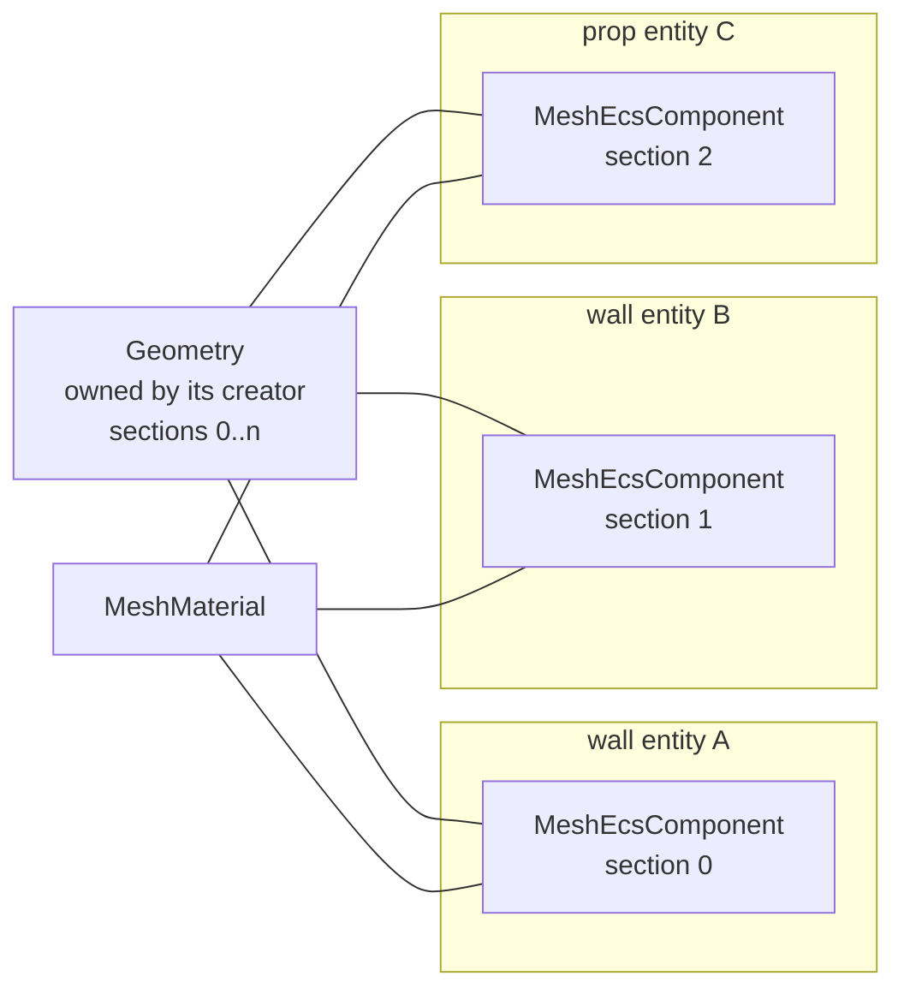
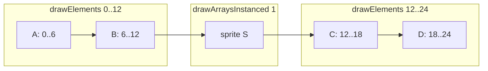
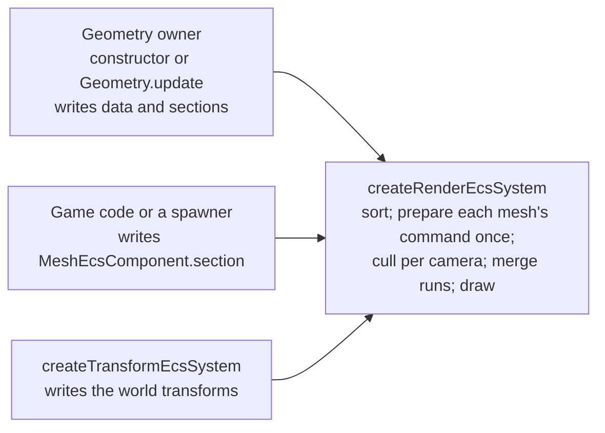

# Geometry Sections and Batched Mesh Draws

Issue: https://github.com/Forge-Game-Engine/Forge/issues/874 (the tile map
milestone; #872 builds y-sorted tile layers on it)

| Module or file                                                                                                                              | Change   | Notes                                                                                                                                                    |
| ------------------------------------------------------------------------------------------------------------------------------------------- | -------- | -------------------------------------------------------------------------------------------------------------------------------------------------------- |
| `src/rendering/geometry/geometry.ts`                                                                                                        | Modified | `GeometrySectionOptions`, `GeometrySection`, `sections` on `GeometryOptions`, `GeometryUpdate` and `Geometry`; `elementCount`; `drawRange(start, count)` |
| `src/rendering/components/mesh-component.ts`                                                                                                | Modified | `section: number \| null` (default `null`), validated in `addMeshComponent`                                                                              |
| `src/rendering/render-command.ts`                                                                                                           | Modified | `MeshRenderCommand` carries the range it draws (`start`, `count`); `model` and `bounds` are reused across frames. Not exported                           |
| `src/rendering/systems/render-system.ts`                                                                                                    | Modified | Resolves each mesh's range and bounds once per frame into a reused command, culls with section bounds, merges neighboring mesh commands into one draw    |
| `src/rendering/geometry/geometry.test.ts`, `src/rendering/components/mesh-component.test.ts`, `src/rendering/systems/render-system.test.ts` | Modified | Sections, `drawRange`, the `section` field, culling and merging                                                                                          |
| `e2e/fixtures/scenes/mesh-sections.ts`, `e2e/specs/mesh-sections.spec.ts`                                                                   | New      | Wall entities drawing sections of one geometry, with a character sprite sorted between them                                                              |
| `documentation-site/docs/docs/rendering/meshes.md`, `.../rendering/geometry.md`                                                             | Modified | Sections, how meshes share a draw call, a baked prop geometry shared by several entities; `drawRange`                                                    |
| `CHANGELOG.md`                                                                                                                              | Modified | One `#### Added` bullet                                                                                                                                  |
| **Engine version at time of design**                                                                                                        |          | `0.26.2`                                                                                                                                                 |

## Summary

A mesh always draws its whole geometry, and every mesh is a draw call of
its own:

- `Geometry.draw()` (`src/rendering/geometry/geometry.ts`) draws every
  index, or the first `vertexCount` vertices, and `MeshEcsComponent`
  (`src/rendering/components/mesh-component.ts`) can't name a part of it.
- `drawCommands` (`src/rendering/systems/render-system.ts`) sends every
  `MeshRenderCommand` to `drawMesh`, which binds and draws it alone. Quads
  batch through `isSameBatch`; meshes have nothing like it.

So a game that wants many separately sorted, culled or hidden objects to
share one vertex buffer (a level's walls and props baked together, the
rows of a y-sorted tile layer in #872) has to give each object its own
geometry and pay a draw call for each, even when they're neighbors in the
draw order.

This design adds the two missing pieces:

- **Geometry sections.** A `Geometry` holds a list of sections, each a
  range of its elements (indices, or vertices when it has none) with its
  own local bounds. Sections are written with the data they index, in the
  constructor or `Geometry.update`, and validated there.
- **A mesh draws one section.** `MeshEcsComponent.section` names a section
  by index, or is `null` for the whole geometry as it is this frame. The
  render system draws and culls the mesh with that range and its bounds.
- **Neighboring mesh draws merge.** After sorting and culling, a run of
  mesh commands that share a geometry, material, model matrix and mask,
  whose ranges follow on from one another, on a list topology, draws as
  one `drawElements`/`drawArrays` call over the combined range. It's an
  exact key, like `isSameBatch` for quads: the merged call draws the same
  primitives in the same order, so the picture can't change.

Sorting doesn't change. Each mesh entity is still one sort item. Entities
that need to sort apart are separate entities, and this design only makes
them cheap to draw together. That's how Unity's static batching works
(renderers draw sub-meshes of a combined mesh, are culled one by one, and
consecutive visible ranges draw in one call), and how Godot's 2D renderer
and Bevy's sorted phases merge neighboring items whose batch keys match.
three.js models the same ranges as `BufferGeometry.groups`.

The design also removes the render system's per-frame allocation for
meshes (a `Matrix3x3` and a `Rect` per mesh per camera), since sections
are meant to multiply the number of mesh entities.

Nothing here bends a core design of the engine. Sections belong to the
geometry's owner, `section` to whoever adds the mesh, and the render
system only reads both. Its queries stay fixed. The per-frame working
memory it reuses already exists (see "Per-frame memory" and open question
3).

## Scope

### In scope

- `GeometrySectionOptions` and `GeometrySection`, and `sections` on
  `GeometryOptions`, `GeometryUpdate` and `Geometry`, validated when
  they're written.
- Section bounds, computed from the section's vertices when first read
  after a change, like `Geometry.bounds`.
- `Geometry.elementCount` and `Geometry.drawRange(start, count)`.
- `MeshEcsComponent.section`, validated in `addMeshComponent` and when the
  mesh is drawn.
- `MeshRenderCommand` carrying its range and world bounds, resolved once
  per mesh per frame into objects reused across frames.
- Culling with a section's bounds.
- Merging neighboring mesh commands in `drawCommands`.
- Unit tests, an e2e scene and spec, the meshes and geometry guides, JSDoc
  and a changelog bullet.
- Checking every existing mesh user still draws as before: trails, terrain,
  the `mesh-draw-order` e2e scene, and the `meshes`, `car` and
  `rolling-ball` demos.

### Out of scope

- **Anything tile map-specific.** #812 and #872 build tile layers on these
  pieces. Nothing in this design knows about tiles.
- **Sort points and per-child y-sorting.** Entities that share one
  transform but sort at different heights need `ySortOrigin` and
  `ySortChildren`, which #870 adds. This design works with today's sort
  keys and with #870's.
- **Instancing.** Drawing many copies of one range with different
  transforms in one call is design 08's automatic instancing
  (`/design/3d/08-meshes-materials-and-shaders.md`).
- **Multi-draw.** Merging ranges that don't touch, or that use different
  transforms, needs `WEBGL_multi_draw` and per-draw data. Design 06 §6.6.3
  plans it for the new renderer.
- **Merging strips.** `'triangleStrip'` and `'lineStrip'` ranges never
  merge (decision S8).
- **A base vertex per section.** WebGL2 has no base vertex for
  `drawElements`, so a section's indices index the whole vertex buffer, as
  design 08's mesh pool also accepts.
- **Several sections per mesh, or a material per section.** A mesh draws
  one section with its one material. An object that needs two materials is
  two entities.
- **Drawing statistics.** There's no public draw-call counter. Tests count
  GL calls.
- **A new demo.** See open question 5.

## Phases

The issue's pull request implements all three phases, with one changelog
bullet. Each phase still builds, tests and releases on its own: phase 1
adds geometry API that nothing in the engine uses yet, phase 2 lets a mesh
draw a section at one draw call per mesh, and phase 3 merges draws.

### Phase 1: Geometry sections and range draws

Gives `Geometry` its sections and a way to draw a range, so a custom
system can already draw part of a geometry.

**Definition of done:** a geometry can be created and updated with
sections; invalid, unaligned and out-of-range sections throw when written,
including a shrinking update that leaves an existing section out of range;
section bounds are right for indexed and non-indexed geometry and follow
updates; `drawRange` issues the right GL call and byte offset for 16- and
32-bit indices and non-indexed geometry, and nothing while the context is
lost; sections survive a context loss and restore. Trails and terrain are
unchanged. The geometry guide covers sections and `drawRange`.

| #   | Task                        | Description                                                                                                                                                                                                                                        | Size |
| --- | --------------------------- | -------------------------------------------------------------------------------------------------------------------------------------------------------------------------------------------------------------------------------------------------- | ---- |
| 1.1 | Section types and storage   | "Geometry API" below: `GeometrySectionOptions`, `GeometrySection`, `sections` on `GeometryOptions` (default none), `GeometryUpdate` (left out keeps the current ones) and `Geometry`; the geometry copies the options into its own section objects | S    |
| 1.2 | Section validation          | "Validation" below: non-negative integers, inside the element count being written, aligned to whole primitives; run before the update changes anything, so a throwing update leaves the geometry as it was                                         | M    |
| 1.3 | Section bounds              | "Section bounds" below: computed from the section's vertices when first read after a write that changed positions, indices, `vertexCount` or sections; throws for an index past `vertexCount`                                                      | S    |
| 1.4 | `elementCount`, `drawRange` | "Drawing a range" below; `draw()` becomes `drawRange(0, elementCount)`                                                                                                                                                                             | S    |
| 1.5 | Unit tests                  | `geometry.test.ts`: the Phase 1 rows of "Testing" below                                                                                                                                                                                            | M    |
| 1.6 | Geometry guide              | `rendering/geometry.md`: a "Sections" section and `drawRange` under "Drawing a geometry", following the `document-feature` skill                                                                                                                   | S    |

### Phase 2: Meshes that draw a section

A mesh picks a section, and the render system draws and culls it with that
section's range and bounds, still one draw call per mesh. Mesh commands
stop allocating per frame.

**Definition of done:** a mesh with `section: null` draws exactly as
before, including a geometry that grows after the mesh is added (trails);
a mesh with a section draws only that range and is culled by that
section's bounds under its entity's transform; a missing section throws
naming the entity, when the mesh is added and when it's drawn; the render
system allocates no `Matrix3x3`, `Rect` or command object per mesh per
frame once its draw items have grown to the scene. The meshes guide
explains sections.

| #   | Task                       | Description                                                                                                                                                                                        | Size |
| --- | -------------------------- | -------------------------------------------------------------------------------------------------------------------------------------------------------------------------------------------------- | ---- |
| 2.1 | `section` on the component | "Mesh component" below: the field, its `null` default, the check in `addMeshComponent`, JSDoc                                                                                                      | S    |
| 2.2 | Reused mesh commands       | "Per-frame memory" below: each mesh draw item owns one `MeshRenderCommand` with its own `Matrix3x3` and `Rect`, prepared once per frame and pushed into every camera that draws it                 | M    |
| 2.3 | Range and bounds           | "Resolving a mesh's range" below: `null` reads the geometry live, a number reads the section (throwing when it's missing); world bounds written into the command's rect; zero-count ranges skipped | S    |
| 2.4 | Draw the range             | `drawMesh` draws `command.start`/`command.count` with `drawRange`                                                                                                                                  | S    |
| 2.5 | Unit tests                 | `mesh-component.test.ts` and `render-system.test.ts`: the Phase 2 rows of "Testing" below; the test geometry mock gains `elementCount`, `sections` and `drawRange`                                 | M    |
| 2.6 | Meshes guide               | `rendering/meshes.md`: "Drawing a section of a geometry", and section bounds under "Culling meshes outside the view"                                                                               | S    |

### Phase 3: Merging neighboring mesh draws

Consecutive mesh commands that meet the batch key draw as one call.

**Definition of done:** three entities drawing neighboring sections of one
geometry, consecutive in the draw order, draw in one call; a sprite sorted
between them splits it in two; different model matrices or masks, a culled
middle section, ranges that don't touch, and strip topologies don't merge.
The e2e spec shows a character sprite sorted between merged walls drawn
correctly on a real canvas. The render system's JSDoc, the meshes guide and
the changelog describe merging. `npm run test:e2e` passes, and the
`meshes`, `car` and `rolling-ball` demos draw as before (CLAUDE.md step 9).

| #   | Task                    | Description                                                                                                                                                                                 | Size |
| --- | ----------------------- | ------------------------------------------------------------------------------------------------------------------------------------------------------------------------------------------- | ---- |
| 3.1 | Merge in `drawCommands` | "Merging neighboring mesh draws" below: `canMergeMeshCommand`, the run loop, `drawMeshRun`                                                                                                  | M    |
| 3.2 | Unit tests              | `render-system.test.ts`: the Phase 3 rows of "Testing" below                                                                                                                                | M    |
| 3.3 | E2E scene and spec      | "End to end" below, following the `write-e2e-test` skill                                                                                                                                    | M    |
| 3.4 | JSDoc                   | `createRenderEcsSystem`'s comment (today: "each mesh ... is a draw call of its own"), `MeshRenderCommand`'s, `drawCommands`'                                                                | S    |
| 3.5 | Meshes guide            | Replace "Each mesh is a draw call of its own" with how meshes share a draw call, and add the baked prop example ("Documentation" below)                                                     | S    |
| 3.6 | Changelog               | One `#### Added` bullet for the three phases ("Documentation" below)                                                                                                                        | S    |
| 3.7 | Regression check        | `npm run test:e2e` (including `mesh-draw-order` and both trail specs); `npm run build`, then the docs site's `typecheck` and `build`, and load the `meshes`, `car` and `rolling-ball` demos | S    |

## Decision log

| #   | Decision                             | Options                                                                                                                                                                                                | Chosen | Rationale, trade-off, assumptions                                                                                                                                                                                                                                                                                                                                                                                                                                                                                                                                                                       |
| --- | ------------------------------------ | ------------------------------------------------------------------------------------------------------------------------------------------------------------------------------------------------------ | ------ | ------------------------------------------------------------------------------------------------------------------------------------------------------------------------------------------------------------------------------------------------------------------------------------------------------------------------------------------------------------------------------------------------------------------------------------------------------------------------------------------------------------------------------------------------------------------------------------------------------- |
| S1  | Where ranges live                    | (a) Sections on the geometry, picked by the mesh; (b) `start`/`count` on `MeshEcsComponent`; (c) a "geometry view" object per range that a mesh holds instead of the geometry                          | (a)    | A range is only right or wrong against the data it indexes, so it's written and checked in the same call as that data, as Unity's `Mesh.SetSubMesh` does. (b) would check ranges only at draw time, against data another owner may have changed since, and gives no place for per-range bounds. (c) is (a) with an extra object per range for callers to keep and dispose. Trade-off: changing which objects a buffer holds means a `Geometry.update` with new sections. Assumption: the geometry's owner knows its ranges when it writes its data (true for baked levels and #872's rows).             |
| S2  | How a mesh names its section         | (a) An index into `geometry.sections`; (b) a reference to a `GeometrySection` object; (c) a string name                                                                                                | (a)    | An index survives an update that rewrites the sections in place, which a stored object reference wouldn't (it'd point at the old section). It's what Unity's `subMeshIndex` and Godot's surface index use. (c) adds a lookup and a naming scheme nobody needs. Trade-off: an update that reorders sections silently changes what an index draws; the owner of the geometry and the meshes keeps them consistent.                                                                                                                                                                                        |
| S3  | What a mesh without a section draws  | (a) `section: null` reads the whole geometry live each frame: its current element count and `bounds`; (b) the geometry always has an implicit section 0 covering everything; (c) `section` required    | (a)    | Trails start with an empty geometry and change `vertexCount` every frame (`trail-system.ts`); a stored range would go stale. (b) needs that implicit section kept in step with every update, and shifts the indices of real sections. (c) breaks every existing mesh for no gain. Trade-off: two cases in range resolution.                                                                                                                                                                                                                                                                             |
| S4  | Section bounds                       | (a) Computed by the geometry from the section's vertices, when first read after a change; (b) supplied by the caller with each section; (c) none: cull with the whole geometry's bounds                | (a)    | Meshes-in-the-draw-order decision M7 chose computed bounds for the same reason: a caller-kept rectangle that's wrong makes a mesh vanish with no error. Unity's `SetSubMesh` computes sub-mesh bounds unless told not to. (c) defeats culling the rows of a map-wide layer (#872). Trade-off: a pass over the section's elements after each change, which a geometry that's never drawn by section never pays. Assumption: no mesh shader moves vertices outside their positions (as M7 assumed). Open question 1.                                                                                      |
| S5  | When sections are checked            | (a) When written, plus a check of the mesh's index when it's added and drawn; (b) only at draw time; (c) never, clamping bad ranges                                                                    | (a)    | Errors show up at the line that caused them. The draw-time index check stays because a later update can remove a section a mesh still names, and the geometry doesn't know which meshes name it. (c) hides bugs as missing geometry. Trade-off: an index check per mesh per frame, which is two comparisons.                                                                                                                                                                                                                                                                                            |
| S6  | The batch key for merging            | (a) Same geometry and material, equal model matrices, same mask object, touching ranges, list topology; (b) instancing consecutive meshes with per-instance transforms; (c) multi-draw; (d) no merging | (a)    | (a) is exact: one call over the combined range draws the same primitives in the same order, and GL blends a call's primitives in order, so nothing on screen can change. It's what Unity's static batching does for consecutive visible ranges of a combined mesh. (b) suits copies of one shape, not different pieces of one buffer, and is design 08's. (c) needs `WEBGL_multi_draw` and per-draw data in the shader, design 06's plan. (d) leaves #872's layers at a draw call per row. Trade-off: pieces only merge when they share a transform, so a baked buffer is authored in one shared space. |
| S7  | Comparing transforms                 | (a) Model matrices compared value by value; (b) only merge entities that share a parent and have identity local transforms; (c) compare the transform components                                       | (a)    | `createModelMatrix` is deterministic, so entities with the same world position, rotation and scale get bit-identical matrices, however they got there (roots at the same position, or children at the origin of one parent). (b) is a rule about hierarchy for what is a question about matrices. (c) compares more values than the six that matter. Trade-off: nine float comparisons per neighboring pair.                                                                                                                                                                                            |
| S8  | Strip topologies                     | (a) Never merge; (b) merge with primitive restart or degenerate primitives                                                                                                                             | (a)    | Joining two strip ranges draws primitives across the join. (b) needs restart indices or extra vertices baked into the data, which the geometry's owner would have to write. List topologies cover the use cases (baked levels, tile rows). Trade-off: strip sections draw one call each.                                                                                                                                                                                                                                                                                                                |
| S9  | Sorting                              | (a) Unchanged: one sort item per mesh entity; (b) each section a sort item of its own within one entity                                                                                                | (a)    | Forge sorts entities, as Unity and Bevy do; that's the engine's one sort concept. (b) adds a second kind of sort unit inside an entity, with its own keys. Trade-off: objects that sort apart are separate entities, which #870 and #872 already rely on.                                                                                                                                                                                                                                                                                                                                               |
| S10 | Per-frame memory for mesh commands   | (a) Each mesh draw item owns one reused `MeshRenderCommand`, prepared once per frame and shared by every camera; (b) a separate pool of commands indexed per push; (c) allocate per frame, as now      | (a)    | The model matrix, range, bounds and mask of a mesh don't depend on the camera, so one command per mesh per frame is enough, and it lives in the draw item pool the render system already keeps (`drawItems`). (b) adds a second module-level pool and recomputes per camera. (c) is what meshes-in-the-draw-order decision M13 accepted for one mesh per object; sections are meant to multiply meshes, so that stops being acceptable. Trade-off: the render system's existing working memory grows by one object per mesh item. Open question 3.                                                      |
| S11 | Whether `drawRange` checks its range | (a) Throw for a range outside `elementCount` or not of non-negative integers; (b) trust the caller                                                                                                     | (a)    | WebGL rejects an out-of-range draw with `INVALID_OPERATION` and draws nothing, which surfaces as a missing mesh. The check is four comparisons per call. Trade-off: the render system's ranges are already valid, so it pays for a check it doesn't need. Open question 2.                                                                                                                                                                                                                                                                                                                              |
| S12 | `draw()` beside `drawRange`          | (a) Keep `draw()` as `drawRange(0, elementCount)`; (b) remove `draw()`                                                                                                                                 | (a)    | `fullscreen-pass.ts` and custom systems draw whole geometries; making each of them read `elementCount` adds noise for no gain. Trade-off: two draw methods, one defined by the other.                                                                                                                                                                                                                                                                                                                                                                                                                   |
| S13 | Exposing the element count           | (a) A public `elementCount` getter (index count, or `vertexCount` without indices); (b) keep it private and give the render system another way in                                                      | (a)    | Callers building sections, and the render system resolving `section: null`, need the same number `drawRange` checks against. Trade-off: one more getter.                                                                                                                                                                                                                                                                                                                                                                                                                                                |
| S14 | Overlapping and unordered sections   | (a) Allowed; (b) required to be sorted and disjoint                                                                                                                                                    | (a)    | Merging looks at the ranges as drawn, so overlap can't cause a wrong merge: two draws of one range don't touch, so they stay two draws. Unity allows overlapping sub-meshes. (b) forbids sharing primitives between a "whole object" section and its parts for no benefit.                                                                                                                                                                                                                                                                                                                              |
| S15 | Masks in the batch key               | (a) The same `InstanceMask` object; (b) masks equal by value                                                                                                                                           | (a)    | `createInstanceMaskResolver` hands an entity without a mask of its own its parent's resolved object, so siblings under one mask, and unmasked entities (`null`), compare equal by identity. Entities with masks of their own get distinct objects even when the values match; comparing every mask field to merge them isn't worth it yet. Trade-off: two entities with identical masks of their own don't merge.                                                                                                                                                                                       |

## Open questions

Blocking: no. Every question has a default the implementation follows.

1. **Non-blocking. Who writes a section's bounds.** Options: (a) the
   geometry computes them from the section's vertices when first read after
   a change (decision S4); (b) the caller passes `bounds` with each
   section, as the issue's wording can be read; (c) both, computed unless
   given. For (a): bounds can't go stale or be wrong, matching how
   `Geometry.bounds` already works, and tall tile art that overhangs its
   cell (#872) is in the vertices, so it's covered. For (b): no pass over
   the elements, and a vertex shader that displaces vertices can widen its
   bounds. For (c): both, at the cost of an option whose only purpose is
   overriding a default. Default: (a). A different answer adds a field to
   `GeometrySectionOptions` and drops the computation.
2. **Non-blocking. Whether `drawRange` validates its range.** Options: (a)
   throw for a range that isn't non-negative integers inside
   `elementCount` (decision S11); (b) leave it to WebGL. For (a): a
   descriptive error instead of a GL error and a missing draw. For (b):
   nothing extra on a path the render system calls with ranges it already
   knows are valid. Default: (a).
3. **Non-blocking. Where the reused mesh commands live.** Options: (a) on
   the render system's existing module-level draw items (decision S10);
   (b) on the render context, as design 07 plans for all of the render
   system's per-frame buffers; (c) allocated inside `update` each frame.
   For (a): no new module-level variable; the draw items are already
   reused this way, and every field is written before it's read each
   frame, so nothing carries over between ticks. The `create-system` skill
   forbids module-level mutable variables, and the render system's
   existing buffers are a known exception this extends rather than adds
   to. For (b): moves the exception to a dependency in one go, but that's
   design 07's change for every buffer, not just meshes. For (c): follows
   the skill to the letter and allocates per mesh per frame, which the
   issue rules out. Default: (a).
4. **Non-blocking. The name `section`.** Options: (a) `section`, as the
   issue names it; (b) `part`, the word design 08 uses for a mesh's index
   ranges; (c) `sub-mesh`. For (a): it says what it is, a section of one
   geometry, and design 08's parts are a different idea (one per material
   slot, all drawn by one component). For (b): one word across the 2D and
   3D designs. For (c): familiar from Unity, but another engine's term.
   Default: (a). Design 08 can reconcile the two when it replaces
   `MeshEcsComponent`.
5. **Non-blocking. A demo.** Options: (a) none: the guide's example and
   the e2e spec cover it, and the tile map demos (#841, #873) show it in a
   game; (b) extend the `meshes` demo with entities drawing sections of a
   shared geometry and a character to sort between them. For (a): the
   change is invisible on screen by design (it only saves draw calls), so
   a demo of it looks like the existing one. For (b): readers see sections
   in use before tile maps land. Default: (a).

## Design

### Entity composition

Nothing changes in how a mesh entity is built. Several entities can hold
the same `Geometry` and `MeshMaterial` and pick different sections:



The entities are ordinary sort items: each has a position (the same world
transform if they're to merge), and optionally a `DrawOrderEcsComponent`,
visibility, masks and, after #870, `ySortOrigin`. A character sprite that
sorts between B and C splits their draw.

**Ownership.** Whoever creates the geometry owns it and its sections,
updates both with `Geometry.update`, and disposes the geometry after
removing every mesh that draws it. `MeshEcsComponent` has no remove hook,
so removing one of the entities never disposes the shared geometry.
Whoever adds a mesh writes its `section`. The render system only reads
both (one writer per value).

### Geometry API

```ts
/** A range of a geometry's elements to write with `GeometryOptions` or `GeometryUpdate`. */
export interface GeometrySectionOptions {
  /** The first element: an index position if the geometry has indices, else a vertex. */
  start: number;

  /** The number of elements. `0` is allowed and draws nothing. */
  count: number;
}

/**
 * A range of a geometry's elements that a mesh can draw on its own (see
 * `MeshEcsComponent.section`), with its own bounds for culling.
 */
export interface GeometrySection {
  readonly start: number;
  readonly count: number;

  /**
   * The axis-aligned rectangle around the x and y of the `a_position` of
   * the vertices the section draws, in the geometry's space. Computed when
   * first read after a write that changed them, and kept until then. A
   * zero-size rectangle at the origin when `count` is `0`.
   * @throws An error if the geometry has no `a_position` of size 2 or more,
   * or an index in the section points at or past `vertexCount`.
   */
  readonly bounds: Rect;
}

export interface GeometryOptions {
  attributes: readonly GeometryAttribute[];
  indices?: GeometryIndices;
  topology?: GeometryTopology;

  /** The geometry's sections. Defaults to none. */
  sections?: readonly GeometrySectionOptions[];
}

export interface GeometryUpdate {
  vertexCount: number;
  attributes?: Readonly<Record<string, Float32Array>>;
  indices?: GeometryIndices;

  /**
   * Replaces every section. Leave out to keep the current sections, which
   * are checked against the new element count.
   */
  sections?: readonly GeometrySectionOptions[];
}

export class Geometry {
  /** The geometry's sections, in the order they were written. */
  get sections(): readonly GeometrySection[];

  /** The number of elements drawn: the index count if the geometry has indices, else `vertexCount`. */
  get elementCount(): number;

  /**
   * Draws `count` elements from `start`, as the geometry's topology. Bind
   * it with the material first. Draws nothing while the context is lost.
   * @throws An error if `start` and `count` aren't non-negative integers
   * with `start + count <= elementCount`.
   */
  public drawRange(start: number, count: number): void;

  /** Draws every element: `drawRange(0, elementCount)`. */
  public draw(): void;
}
```

- `defaultGeometryOptions` gains `sections: []`. `defaultGeometryUpdate`
  doesn't: a missing `sections` means "keep", and `withDefaults` treats an
  explicit `undefined` the same way.
- The geometry copies each `GeometrySectionOptions` into a section object
  of its own, so a caller changing its array afterwards can't bypass the
  checks. `bounds` is a getter on that object that fills a cached rect.
- `sections` is CPU-side data. A lost and restored context rebuilds only
  buffers and vertex arrays (`_rebuild`), so sections are untouched.
- Changing the index type between updates (`Uint16Array` to `Uint32Array`,
  which #872 does past 65,535 vertices) keeps working: `drawRange` reads
  the type and byte size from the current index data on every call, as
  `draw()` does today.

### Validation

Written sections are checked in the constructor and in `update`, before
anything changes, so a throwing call leaves the geometry as it was. In
`update`, the check joins `_validateUpdate`.

The element count a section is checked against is the one being written:

| Geometry      | `update` gives `indices` | Element count                       |
| ------------- | ------------------------ | ----------------------------------- |
| Indexed       | yes                      | the new `indices.length`            |
| Indexed       | no                       | the current index count             |
| Not indexed   | (can't)                  | the update's `vertexCount`          |
| (constructor) |                          | `indices.length`, else vertex count |

Each section, written or kept, must have:

- `start` and `count` that are non-negative integers;
- `start + count` no more than the element count;
- for `'triangles'`, `start` and `count` that are multiples of 3; for
  `'lines'`, multiples of 2. Strips and points have no alignment rule.

A violation throws, naming the section's index and the numbers, e.g.
`Unable to update geometry: section 2 (start 30, count 6) ends past its 24 vertices.`
An update that leaves `sections` out checks the current sections the same
way, so a shrinking update that leaves one out of range throws rather than
leaving it dangling. Trails never give sections and have none, so their
updates are unaffected.

### Section bounds

```text
section bounds (cached until positions, indices, vertexCount or sections change):
  if count is 0: zero-size rect at the origin
  for each element e in [start, start + count):
    vertex = indexed ? indices[e] : e
    if vertex >= vertexCount: throw (names the section and the index)
    grow min/max by a_position.x/y of vertex
```

Any `update` that would clear `Geometry.bounds` (a new `vertexCount` or
`a_position`), or that gives `indices` or `sections`, clears every
section's cached bounds. The pass reads the CPU-side data the geometry
already keeps for context loss. A geometry with sections that's updated
every frame pays one pass over each section it draws, per changed frame,
the same order of work as uploading it.

### Drawing a range

```text
drawRange(start, count):
  validate start, count against elementCount
  if context lost: return
  mode = gl[glTopologyNames[topology]]
  if no indices: gl.drawArrays(mode, start, count)
  else:          gl.drawElements(mode, count, indexType, start * indices.data.BYTES_PER_ELEMENT)
```

The byte offset is a multiple of the index size, as WebGL requires.

### Mesh component

```ts
export interface MeshDefaultedOptions {
  category: number;
  layer: number;

  /**
   * Which of the geometry's `sections` to draw, by index, or `null` to
   * draw the whole geometry as it is each frame (every index, or the first
   * `vertexCount` vertices). The mesh is culled with the section's bounds,
   * or the geometry's for `null`. Defaults to `null`.
   */
  section: number | null;
}
```

`addMeshComponent` keeps its `a_position` check and adds one: a `section`
that isn't `null` must be an integer from `0` to
`geometry.sections.length - 1`, or it throws
`Unable to add a mesh to entity 12: its geometry has no section 4 (it has 3 sections).`

### Render commands

```ts
interface MeshRenderCommand {
  kind: 'mesh';
  mesh: MeshEcsComponent;
  /** The entity's world transform. Reused across frames. */
  readonly model: Matrix3x3;
  /** The first element to draw: the section's start, or 0 for the whole geometry. */
  start: number;
  /** The number of elements to draw. */
  count: number;
  /** World-space bounds of what's drawn. Reused across frames. */
  readonly bounds: Rect;
  mask: InstanceMask | null;
}
```

### Per-frame memory

Each `DrawItem` gains two fields:

- `meshCommand: MeshRenderCommand | null`: created the first time the item
  holds a mesh and kept across frames, with its own `Matrix3x3` and `Rect`.
- `meshCommandReady: boolean`: cleared by `setDrawItem`.

The first camera that pushes a mesh item in a frame prepares its command;
later cameras push the same object. A command is read-only once pushed,
and culling compacts arrays of references, so sharing one object between
cameras' lists is safe. Every field is written before it's read in each
frame, so nothing carries over between ticks; the draw items stay working
memory (open question 3). `createModelMatrix` and `transformBounds` write
into the command's matrix (`resetToIdentity`, then `translate`, `rotate`,
`scale`) and rect, instead of returning new ones.

### Resolving a mesh's range

```text
prepareMeshCommand(item, entity, position, rotation, scale, mask):
  command = item.meshCommand ??= new command with its own matrix and rect
  command.mesh = item.mesh; command.mask = mask
  write the model matrix into command.model
  geometry = mesh.geometry
  if mesh.section is null:
    command.start = 0
    command.count = geometry.vertexCount === 0 ? 0 : geometry.elementCount
    localBounds = geometry.bounds      (only read when count > 0)
  else:
    section = geometry.sections[mesh.section]
    if !section: throw "Unable to draw the mesh of entity <e>: its geometry has no section <n> (it has <k> sections)."
    command.start = section.start; command.count = section.count
    localBounds = section.bounds       (only read when count > 0)
  if command.count > 0: transformBounds(command.model, localBounds, command.bounds)
  item.meshCommandReady = true

push (per camera): if !ready, prepare; if command.count is 0, push nothing; else push command
```

- `null` reads the geometry live, so a trail's geometry that grows after
  its mesh was added draws all of its current vertices, exactly as today.
- Today's skip for `vertexCount === 0` stays, and a zero-count section is
  skipped the same way. Neither reads bounds.
- `cullCommandsOutsideView` is unchanged: it reads `command.bounds`, which
  now holds the section's bounds for a section.
- The draw-time throw happens while commands are built, so it fires even
  while the context is lost, and in the frame the bad index first draws.

### Merging neighboring mesh draws

```text
mergeableTopologies: Record<GeometryTopology, boolean> =
  { triangles: true, lines: true, points: true, triangleStrip: false, lineStrip: false }

canMergeMeshCommand(next, first, end):
  next.kind === 'mesh'
  && next.mesh.geometry === first.mesh.geometry
  && next.mesh.material === first.mesh.material
  && mergeableTopologies[first.mesh.geometry.topology]
  && next.start === end                       // follows on from the run so far
  && next.mask === first.mask
  && matricesEqual(next.model, first.model)   // all nine values

drawCommands:
  while i < commands.length:
    if commands[i] is a mesh:
      first = commands[i]; end = first.start + first.count; j = i + 1
      while j < commands.length && canMergeMeshCommand(commands[j], first, end):
        end += commands[j].count; j++
      drawMeshRun(first, first.start, end - first.start)
      i = j
    else: quad batch, unchanged

drawMeshRun(first, start, count):
  material.bindMesh(gl, first.model, projection, first.mask)
  geometry.bind(material)
  enable straight-alpha blending
  geometry.drawRange(start, count)
```

- Runs form after culling, so a culled middle section leaves a gap and
  splits the run, as a culled object does in Unity's static batches.
- Two whole-geometry (`null`) meshes of one geometry never merge: the
  second starts at `0`, not where the first ended. Two entities drawing the
  same section don't merge either. Both are right: merging would draw the
  shape once instead of twice, which changes blending.
- Ranges merge only in ascending order. Sections that touch but come in the
  draw order the other way round stay separate, since merging them would
  change the order primitives draw in.
- Everything a `MeshMaterial` uploads besides the reserved uniforms is the
  material's own, so the same material object means the same uniforms and
  textures for the whole run.

An example draw order, with walls A to D drawing sections 0 to 3 of one
geometry from one transform, and sprite S between B and C:



### Data flow and system order



System order doesn't change. A system that rebuilds a geometry and its
sections (#872's tile map render system) runs before the render system, as
the trail system does.

### Performance

- **Draw calls.** A run of `n` neighboring sections costs one draw call
  instead of `n`, plus one bind of the material and vertex array.
- **CPU per frame.** One command preparation per visible mesh entity per
  frame (not per camera), nine float comparisons per neighboring pair of
  mesh commands, and no allocation once the draw items have grown.
- **Section bounds.** Computed only after a change, and only for sections
  that are read.
- **Culling.** Per section, so a map-wide geometry only draws the sections
  in view; a visible section draws all of its elements, and the GPU clips
  the rest.

### Testing

Unit tests (Vitest, a mocked WebGL context behind a real `RenderContext`
for `Geometry`, as `AGENTS.md` describes; the render system tests keep
mocking geometry and material objects, which gain `elementCount`,
`sections` and `drawRange`):

| Phase | File                     | Tests                                                                                                                                                                                                                                                                                                                                                                                                                                                                                                                                                                                                                                                                                                                                                                                                                                                              |
| ----- | ------------------------ | ------------------------------------------------------------------------------------------------------------------------------------------------------------------------------------------------------------------------------------------------------------------------------------------------------------------------------------------------------------------------------------------------------------------------------------------------------------------------------------------------------------------------------------------------------------------------------------------------------------------------------------------------------------------------------------------------------------------------------------------------------------------------------------------------------------------------------------------------------------------ |
| 1     | `geometry.test.ts`       | A geometry without sections has none; sections from the constructor and from `update`; negative, fractional, unaligned (`'triangles'`, `'lines'`) and out-of-range sections throw, naming the section; strips and points accept any alignment; an update without `sections` keeps them; a shrinking update that leaves one out of range throws and leaves the geometry unchanged; section bounds for indexed and non-indexed geometry, after an update of positions, indices or sections, for a zero-count section, and an index past `vertexCount` throwing; `drawRange` calls `drawElements` with byte offsets `start * 2` and `start * 4` and `drawArrays` with `first = start`; `drawRange` throws outside `elementCount`; an index type change between updates; nothing draws while the context is lost; sections and their bounds survive a loss and restore |
| 2     | `mesh-component.test.ts` | `section` defaults to `null`; a valid index is kept; a missing, negative or fractional index throws naming the entity                                                                                                                                                                                                                                                                                                                                                                                                                                                                                                                                                                                                                                                                                                                                              |
| 2     | `render-system.test.ts`  | `section: null` draws `drawRange(0, elementCount)`, including a geometry whose count grows after the mesh is added; a section draws its range; a section outside the view is culled while the geometry's bounds overlap it, and the reverse; a rotated and scaled section just inside the view draws; a section removed by a later update throws when drawn, naming the entity; a zero-count section draws nothing; two cameras draw the same prepared command; the command, matrix and rect are the same objects across frames                                                                                                                                                                                                                                                                                                                                    |
| 3     | `render-system.test.ts`  | Three entities drawing neighboring sections, consecutive in draw order, draw in one call over the combined range; a sprite sorted between them splits it in two; different model matrices or masks don't merge; children of one parent without masks of their own merge; a culled middle section splits the run; ranges in descending order or with a gap don't merge; two `null` meshes of one geometry don't merge; `'triangleStrip'` and `'lineStrip'` never merge; `'points'` and `'lines'` do; different materials don't merge                                                                                                                                                                                                                                                                                                                                |

The existing mesh, trail and terrain tests stay as they are, apart from the
geometry mock's new members.

#### End to end

`e2e/fixtures/scenes/mesh-sections.ts` (following the `write-e2e-test`
skill), built from `/src` only:

- One `Geometry` with an `a_position` and an `a_color` attribute, indexed,
  `'triangles'`, holding four overlapping, horizontally offset wall
  rectangles in distinct colors, one section each.
- Four root wall entities at the same position, each with a mesh drawing
  its section with one `MeshMaterial`, and `DrawOrderEcsComponent.order`
  `0`, `1`, `3` and `4`.
- A character sprite of another color at order `2`, overlapping walls 1
  and 2.
- The scene wraps its own context's `gl.drawElements` to count non-instanced
  mesh draws per step, exposed on the handle.

The spec, stepping and measuring in the same `page.evaluate` call each
frame:

1. With the character hidden (`VisibilityEcsComponent`), measure each
   wall color's horizontal extent along one row, and the mesh draw count
   (`1`: all four walls merge).
2. With the character visible, measure again: the character covers the
   part of wall 1 it overlaps (wall 1's extent ends where the character
   starts), wall 2 covers the character where they overlap, and the mesh
   draw count is `2`. Every assertion compares against the first
   measurement in the same run, not absolute pixels.

`mesh-draw-order` and the trail specs run unchanged and must still pass.

### Documentation

- `rendering/geometry.md`: a "Sections" section (writing sections in the
  constructor and `update`, the rules they're checked against, their
  computed bounds, that `update` keeps them when left out), and
  `drawRange` and `elementCount` under "Drawing a geometry".
- `rendering/meshes.md`:
  - "Drawing a section of a geometry": `section`, `null` for the whole
    geometry.
  - "Culling meshes outside the view": a section is culled with its own
    bounds.
  - Replace "Each mesh is a draw call of its own" with "Sharing a draw
    call": the batch key in plain words, that a sprite or anything else
    sorted between meshes splits their call, and why strips don't merge.
  - An example: a prop geometry baked once (a crate, a barrel and a lamp
    post as three sections), shared by three root entities at the level's
    origin, each drawing one section, so they sort as separate entities
    and draw in one call when nothing sorts between them. The geometry's
    creator disposes it after removing the three meshes.
- JSDoc on every new public member, and the `createRenderEcsSystem`,
  `MeshRenderCommand` and `drawCommands` comments.
- `CHANGELOG.md`, `#### Added`: "**rendering:** Geometry sections: a
  `Geometry` takes `sections` (ranges of its indices or vertices, each with
  computed `bounds`) in its constructor and `update`, checked against the
  data they index, and draws a range with `drawRange(start, count)`.
  `MeshEcsComponent.section` makes a mesh draw and cull one section, and
  neighboring meshes in the draw order that share a geometry, material,
  transform and mask and draw touching ranges of a list topology now draw
  in one call. See the Meshes guide." No breaking change: existing meshes
  default to `section: null`.

### Relationship to other designs

- **`/design/meshes-in-the-draw-order.md`.** This design builds on it and
  revises two of its decisions. M12 (one draw call per mesh) held while
  terrain and trails were one mesh each; sections make many meshes share a
  buffer, so neighboring draws merge (S6). M13 (allocate mesh commands
  per frame until design 07 pools every kind) is revised for meshes only
  (S10), since sections multiply them; quad commands stay as they are.
  M7's reasoning for computed bounds carries over to sections (S4).
- **`/design/3d/08-meshes-materials-and-shaders.md`.** Its mesh parts are
  index or vertex ranges with their own bounds, which is what a section
  is, but a part belongs to a material slot and every part draws for one
  component. Design 08 replaces `MeshEcsComponent` when it lands and
  should carry `section` over or reconcile it with parts (open question
  4).
- **`/design/3d/06-render-pipeline.md`.** Its multi-draw merges batches
  over meshes in a shared buffer without needing touching ranges or equal
  transforms. This design's merge is the exact, extension-free subset of
  that on today's render system.
- **#870 and #872.** #870 gives entities that share a transform different
  y-sort heights (`ySortOrigin`) and lets a parent's children sort
  separately (`ySortChildren`); #872 builds a y-sorted tile layer as one
  geometry per tile set source, one section and one entity per row, which
  this design draws and merges.
