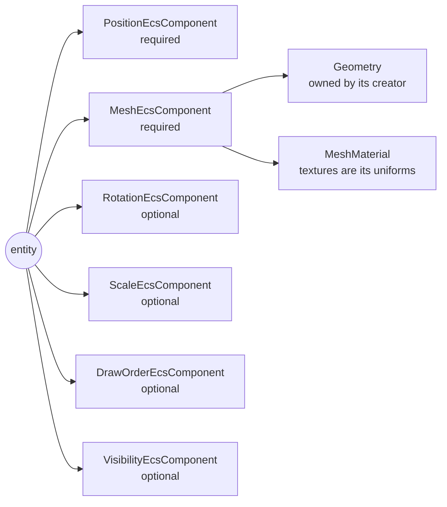
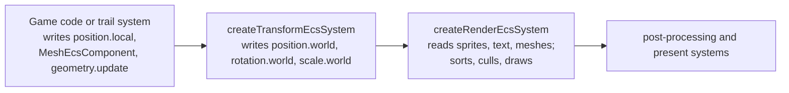

# Meshes in the Render System's Draw Order

Issue: https://github.com/Forge-Game-Engine/Forge/issues/783 (milestone
"Trail rendering", with #782, #784, #785 and #786)

| Module or file                                                                                                            | Change   | Notes                                                                                                                                                              |
| ------------------------------------------------------------------------------------------------------------------------- | -------- | ------------------------------------------------------------------------------------------------------------------------------------------------------------------ |
| `src/rendering/components/mesh-component.ts`                                                                              | New      | `MeshEcsComponent`, `meshId`, `addMeshComponent`                                                                                                                   |
| `src/rendering/materials/mesh-material.ts`                                                                                | New      | `MeshMaterial`, `createMeshMaterial`: the shader contract every mesh is drawn with                                                                                 |
| `src/rendering/shaders/mesh/mesh-vertex.vert.glsl`                                                                        | New      | The `meshVertex` include: model and view-projection uniforms, mask uniforms, `meshWorldPosition`, `meshClipPosition`, `forwardMeshMask`                            |
| `src/rendering/shaders/mask/*`                                                                                            | Modified | The fragment include `spriteMask` becomes `mask`, and `spriteMaskCoverage()` becomes `maskCoverage()`, since sprites, text and meshes all use it (open question 3) |
| `src/rendering/geometry/geometry.ts`                                                                                      | Modified | `bounds`: the rectangle around the drawn vertices' `a_position`, computed when first read after a change                                                           |
| `src/rendering/render-command.ts`, `src/rendering/renderable.ts`                                                          | Modified | `RenderCommand` becomes a union of `QuadRenderCommand` (today's command) and `MeshRenderCommand`. Neither file is exported                                         |
| `src/rendering/systems/render-system.ts`                                                                                  | Modified | Collects, sorts, culls and draws meshes with sprites and text                                                                                                      |
| `src/rendering/utilities/mask-instance-data-segment.ts`                                                                   | Modified | The mask data writer is shared with `MeshMaterial`, which writes it Y-up into uniforms                                                                             |
| `src/rendering/utilities/create-shader-cache.ts`                                                                          | Modified | Registers `meshVertex` and the renamed `mask` include                                                                                                              |
| `src/text/rendering/*`                                                                                                    | Modified | Pushes `QuadRenderCommand`s; the MSDF shaders include `mask`                                                                                                       |
| `src/rendering/terrain/create-terrain-mesh.ts`, `src/rendering/terrain/shaders/*`                                         | Modified | Terrain is built in its entity's local space and drawn with a `MeshMaterial`; `position` and `angle` options removed                                               |
| `src/rendering/terrain/create-terrain-render-ecs-system.ts`, `src/rendering/terrain/components/terrain-mesh-component.ts` | Removed  | Terrain draws through `MeshEcsComponent` and the render system                                                                                                     |
| `src/rendering/systems/present-system.ts`                                                                                 | Modified | A comment that names `createTerrainRenderEcsSystem`                                                                                                                |
| `e2e/fixtures/scenes/mesh-draw-order.ts`, `e2e/specs/mesh-draw-order.spec.ts`                                             | New      | A mesh between two overlapping sprites, measured on the canvas                                                                                                     |
| `e2e/fixtures/scenes/webgl-context-loss.ts`                                                                               | Modified | The `mask` include rename                                                                                                                                          |
| `documentation-site/src/pages/demos/{car,rolling-ball}`                                                                   | Modified | Terrain through `addMeshComponent`; no terrain render system                                                                                                       |
| `documentation-site/src/pages/demos/{space-shooter,erosion-burn,brick-breaker}`                                           | Modified | Custom sprite shaders include `mask`                                                                                                                               |
| `documentation-site/src/pages/demos/meshes`                                                                               | New      | A mesh drawn between sprites, with controls for its draw order (open question 5)                                                                                   |
| `documentation-site/docs/docs/rendering/*`, `documentation-site/docs/docs/physics/terrain.md`                             | Modified | New `meshes.md`; `draw-order.md`, `masks.md`, `geometry.md`, `sprites.md`, `material-uniforms.md`, `terrain.md` updated                                            |
| `AGENTS.md`                                                                                                               | Modified | "Alpha Blending" and "GPU Resources and Context Loss" name the terrain render system, which is removed                                                             |
| **Engine version at time of design**                                                                                      |          | `0.26.2`                                                                                                                                                           |

## Summary

The render system only draws quads. Every `RenderCommand`
(`src/rendering/render-command.ts`) is a sprite, a nine-slice region or a
glyph, and runs of them are drawn as instanced batches of
`renderContext.quadGeometry`. Anything of another shape draws in a system
of its own, so it can only ever be drawn entirely before or after every
sprite. Terrain works this way today (`createTerrainRenderEcsSystem`), and
a trail (#785), which has to go behind a ship and in front of the
background, can't be built at all.

This design adds meshes to the render system's single draw order:

- A **`MeshEcsComponent`** puts a `Geometry` and a `MeshMaterial` on an
  entity, with a `layer` and a `category` like a sprite's. The render
  system queries it alongside sprites and text, so it has one more fixed
  query and knows nothing about what produced the mesh (a trail, terrain,
  a game's own shapes).
- Each mesh becomes one item in the same sort as sprites and text (layer,
  world order, optional y-sort, hierarchy order), and one
  `MeshRenderCommand` in the camera's command list. When the draw loop
  reaches a mesh command, it ends the current instanced batch, draws the
  mesh with one draw call, and starts a new batch after it.
- Meshes follow the rules sprites do: the camera's `cullingMask`,
  visibility in the hierarchy, the camera's view bounds, masks, the
  straight-alpha blend state, and drawing nothing while the WebGL context
  is lost.
- A mesh's vertices are in its entity's local space and are drawn through
  the entity's world position, rotation and scale, like every other
  renderable.
- **Terrain moves onto this path.** `createTerrainMesh` builds a mesh in
  local space that's added with `addMeshComponent`, and
  `createTerrainRenderEcsSystem`, `TerrainMeshEcsComponent` and the
  system's `clearStrategy` takeover are deleted. Terrain sorts with sprites
  and follows its entity.

This is the well-understood shape: Unity's renderers (`SpriteRenderer`,
`MeshRenderer`, `LineRenderer`, `TrailRenderer`) share one sorting order of
sorting layer and order in layer, Godot's canvas items (`Sprite2D`,
`MeshInstance2D`, `Polygon2D`, `Line2D`) share one draw order and break
batches where the state changes, and Bevy puts sprites and 2D meshes into
the same sorted transparent phase. None of it bends a core design of the
engine: the render system keeps fixed queries and one writer per value,
and reads only component data.

## Scope

### In scope

- `MeshEcsComponent` and `addMeshComponent`.
- `MeshMaterial` and `createMeshMaterial`, with the `meshVertex` shader
  include and the shared `mask` fragment include.
- `Geometry.bounds`, for culling.
- Mesh items in the render system's collection, sort, culling and draw
  loop, with the batch split around each mesh.
- Masks, visibility, categories, view culling, blending and context loss
  for meshes.
- Terrain on the mesh path, in local space; deleting the terrain render
  system, its component and its `clearStrategy` write.
- Unit tests, an e2e spec, a demo, docs, `AGENTS.md` and changelog bullets.

### Out of scope

- **Trails**, the ribbon builder and the trail shader. They're #784 and
  #785, which build on this design.
- **Changing a geometry's vertex data.** `Geometry.update` already exists
  (#782).
- **Batching or instancing meshes.** Each mesh is one draw call. Drawing
  many copies of one mesh in one call is design 08's automatic instancing
  (`/design/3d/08-meshes-materials-and-shaders.md`).
- **A built-in mesh material.** Unlike sprites, a mesh's textures are
  material uniforms, so a shared default material can't serve meshes with
  different textures. The trail shader (#785) is the first candidate to
  become an engine-provided unlit mesh shader once a second user needs it.
- **Several meshes or materials on one entity.** An entity has at most one
  `MeshEcsComponent`; more meshes go on child entities, which sort in
  hierarchy order.
- **Fading meshes with a UI canvas group.** `createUiCanvasGroupEcsSystem`
  writes `opacityMultiplier` on sprites and text only (open question 6).
- **Turning off culling for meshes whose vertex shader moves vertices**
  (Unity's custom bounds, Bevy's `NoFrustumCulling`). Nothing in the
  engine needs it yet.
- **Removing the internal Y-down space** of the sprite instance data,
  `createProjectionMatrix` and the mask instance data. Meshes get a Y-up
  view-projection of their own (decision M6); design 07 Phase 3 replaces
  the sprite layout and deletes `createProjectionMatrix`.
- **Flipping meshes.** `FlipEcsComponent` mirrors sprites; a mesh is
  mirrored with a negative scale.

## Phases

The issue's pull request implements both phases, so the engine is never
released with two ways to draw a mesh. Each phase still builds, tests and
releases on its own.

### Phase 1: Meshes in the draw order

Adds the mesh component, the mesh material contract and mesh commands to
the render system, so a mesh sorts and draws with sprites and text.

**Definition of done:** a mesh whose world order is between two sprites'
draws between them on screen (the e2e spec), and splits their batch when
they share a texture (a unit test). Category, visibility, view bounds,
masks and context loss apply to meshes. Docs, the demo and the changelog
describe meshes. Every check in `CLAUDE.md`'s verification list passes.

| #    | Task                 | Description                                                                                                                                                                                                                                                                        | Size |
| ---- | -------------------- | ---------------------------------------------------------------------------------------------------------------------------------------------------------------------------------------------------------------------------------------------------------------------------------- | ---- |
| 1.1  | Geometry bounds      | `Geometry.bounds` (see "Geometry bounds" below): computed from the first `vertexCount` vertices of `a_position` when read after construction or an `update` that changed `a_position` or `vertexCount`; throws without `a_position`. Unit tests, including updates and no vertices | S    |
| 1.2  | Mask include rename  | `spriteMask` becomes `mask`, `spriteMaskCoverage()` becomes `maskCoverage()`; `SpriteMaterial`'s check, the sprite and MSDF shaders, the context-loss e2e scene and the three demo shaders follow                                                                                  | S    |
| 1.3  | `meshVertex` include | "Shader contract" below: `u_model`, `u_viewProjection`, the mask uniforms and the three functions; the mask data writer shared with `maskInstanceDataSegment`, Y-up for meshes                                                                                                     | M    |
| 1.4  | `MeshMaterial`       | "Mesh material" below: checks both includes, reserves the uniforms the render system sets, `bindMesh`; `createMeshMaterial`. Unit tests against the mocked WebGL context                                                                                                           | S    |
| 1.5  | `MeshEcsComponent`   | "Mesh component" below, following the `create-component` skill; `addMeshComponent` throws for a geometry without a two- or three-component `a_position`                                                                                                                            | S    |
| 1.6  | Render commands      | `QuadRenderCommand` (today's fields plus `kind: 'quad'`) and `MeshRenderCommand`; the text module and `Renderable` use `QuadRenderCommand`                                                                                                                                         | S    |
| 1.7  | Render system        | "Render system" below: the mesh query, draw items with a precomputed layer and kind, the kind sub-key, per-kind push, bounds and draw strategies, the batch split, the blend state and the early return while the context is lost                                                  | L    |
| 1.8  | Unit tests           | "Testing" below: interleaving, the batch split, category, visibility, view bounds, masks, transform, blend state, context loss, the order of an entity's own mesh, sprite and text                                                                                                 | M    |
| 1.9  | E2E spec             | `mesh-draw-order`: a mesh between two overlapping sprites of one texture, measured relative to a frame with the mesh hidden                                                                                                                                                        | M    |
| 1.10 | Docs                 | New `rendering/meshes.md`; `draw-order.md`, `masks.md`, `geometry.md`, `sprites.md` and `material-uniforms.md` updated, following the `document-feature` skill                                                                                                                     | M    |
| 1.11 | Demo                 | `demos/meshes`: a mesh with controls for its world order and layer between a background, a ship sprite and a foreground sprite; an entry in `demos.ts` under `rendering`, following the `add-feature-demo` skill                                                                   | M    |
| 1.12 | Changelog            | `#### Added`: meshes sort and draw with sprites and text. `#### Changed` (breaking): the `spriteMask` include is now `mask`, and `spriteMaskCoverage()` is `maskCoverage()`                                                                                                        | S    |

### Phase 2: Terrain on the mesh path

Moves terrain onto `MeshEcsComponent` and deletes its separate draw path,
so the engine has one way to draw a mesh and terrain sorts with sprites.

**Definition of done:** `createTerrainRenderEcsSystem`,
`TerrainMeshEcsComponent`, `addTerrainMeshComponent` and `terrainMeshId`
no longer exist; `createTerrainMesh` builds a local-space mesh that
follows its entity; the car and rolling-ball demos look as they did, with
the terrain under the car and the ball; nothing in the engine writes
`renderContext.clearStrategy`.

| #   | Task                 | Description                                                                                                                                                                                                                                                                                                                           | Size |
| --- | -------------------- | ------------------------------------------------------------------------------------------------------------------------------------------------------------------------------------------------------------------------------------------------------------------------------------------------------------------------------------- | ---- |
| 2.1 | Terrain shaders      | `terrain.vert` includes `meshVertex` and calls its functions; `terrain.frag` includes `mask` and multiplies its alpha by `maskCoverage()`                                                                                                                                                                                             | S    |
| 2.2 | Local-space mesh     | `createTerrainMesh` drops `position`, `angle` and the Y negation, builds vertices from the curve points as they are, and returns `{ geometry, material }` with a `MeshMaterial`, ready for `addMeshComponent`                                                                                                                         | S    |
| 2.3 | Delete the old path  | `create-terrain-render-ecs-system.ts`, `terrain-mesh-component.ts` and their tests; their exports from `terrain/index.ts`; the stale comment in `present-system.ts`                                                                                                                                                                   | S    |
| 2.4 | Tests                | `createTerrainMesh`'s vertices are its curve points in local space; a terrain mesh on an entity with a position and rotation draws through them; a sprite with a lower world order draws under terrain                                                                                                                                | S    |
| 2.5 | Demos                | Car and rolling-ball: `addMeshComponent(world, terrainEntity, mesh)`, no terrain render system, no `position` or `angle`; terrain created before the sprites that go over it, or given a lower `layer` where it isn't                                                                                                                 | S    |
| 2.6 | Docs and `AGENTS.md` | `physics/terrain.md` ("Drawing the mesh": `addMeshComponent`, draw order, follows the entity); `AGENTS.md`'s two references to the terrain render system                                                                                                                                                                              | S    |
| 2.7 | Changelog            | `#### Changed` (breaking): terrain is drawn with `addMeshComponent` and sorts with sprites, follows its entity, blends, and defaults to category `1`. `#### Removed`: `createTerrainRenderEcsSystem`, `TerrainMeshEcsComponent`, `addTerrainMeshComponent`, `terrainMeshId`, and `createTerrainMesh`'s `position` and `angle` options | S    |

## Decision log

| #   | Decision                                       | Options                                                                                                                                                                                                                                                 | Chosen | Rationale, trade-offs, assumptions                                                                                                                                                                                                                                                                                                                                                                                                                                                                                                   |
| --- | ---------------------------------------------- | ------------------------------------------------------------------------------------------------------------------------------------------------------------------------------------------------------------------------------------------------------- | ------ | ------------------------------------------------------------------------------------------------------------------------------------------------------------------------------------------------------------------------------------------------------------------------------------------------------------------------------------------------------------------------------------------------------------------------------------------------------------------------------------------------------------------------------------ |
| M1  | How a mesh reaches the render system           | (a) A `MeshEcsComponent` the render system queries; (b) mesh-provider callbacks passed to `createRenderEcsSystem`; (c) a per-frame singleton list of mesh draws that producer systems append to; (d) a separate mesh render system that shares the sort | (a)    | A component holding a mesh and a material is how Unity (`MeshRenderer`), Godot (`MeshInstance2D`) and Bevy (`Mesh2d`) do it, and it keeps the render system's queries fixed. (b) makes the render system run arbitrary code and its behavior configurable. (c) needs producers to know draw-order keys, and adds a singleton and an ordering contract for what a component already says. (d) can't interleave draws: two systems can't share one sequence of draw calls. Trade-off: the render system knows one more component type. |
| M2  | Where mesh draws go                            | (a) One sorted command list with a command kind, a mesh ending the current batch; (b) separate quad and mesh lists merged at draw time                                                                                                                  | (a)    | The sort already produces one order; a kind on each command keeps it. (b) needs a merge by the same keys for nothing. Trade-off: batches split around meshes, as draw order requires.                                                                                                                                                                                                                                                                                                                                                |
| M3  | Mesh vertex space                              | (a) The entity's local space, drawn through its world transform; (b) world space, drawn as is; (c) a per-mesh choice                                                                                                                                    | (a)    | Every other renderable follows its entity, design 07 already decides it for terrain, and it removes terrain's `position` and `angle`, which had to repeat the entity's transform. A producer that records world points (a trail) maps them into the entity's frame when it rebuilds the mesh, which it does every frame anyway. (c) is an option that only exists to avoid that mapping. Assumption: trails can do the mapping (open question 1).                                                                                    |
| M4  | Where a mesh's textures live                   | (a) Material uniforms; (b) a texture field on the component, bound like a sprite's                                                                                                                                                                      | (a)    | A sprite's texture is per instance because sprites batch by texture; a mesh is one draw call, so there's no batch to share. Terrain already sets its textures on its material, and Unity and Godot do the same. Trade-off: meshes with different textures need a material each, which share one program.                                                                                                                                                                                                                             |
| M5  | The shader contract                            | (a) A `MeshMaterial` that checks for the `meshVertex` and `mask` includes and owns the uniforms the render system sets; (b) any `Material`, by convention                                                                                               | (a)    | Mirrors `SpriteMaterial`. A mesh shader that forgot the include would draw in the wrong place or ignore masks with no error; the check fails when the material is created instead. Reserving the uniforms keeps one writer for them.                                                                                                                                                                                                                                                                                                 |
| M6  | Projection for mesh shaders                    | (a) A Y-up `u_viewProjection`, distinct from sprites' `u_projection`; (b) the sprite `u_projection`, with Y negated in every mesh's data; (c) remove the Y-down sprite space everywhere now                                                             | (a)    | (b) spreads an internal convention into every mesh shader and its vertex data, which is the wart terrain carries today. (c) rewrites the sprite, glyph and mask instance layouts and every custom sprite shader, which design 07 Phase 3 already plans to replace. Trade-off: until then, the sprite and mesh paths have differently named projection uniforms.                                                                                                                                                                      |
| M7  | Culling bounds                                 | (a) `Geometry.bounds`, computed from `a_position`; (b) a `bounds` field on the component that producers keep right; (c) no view culling for meshes                                                                                                      | (a)    | Matches Unity and Bevy, which derive bounds from the position data, and can't go stale. (b) puts a silent failure (a mesh that vanishes) on every producer. (c) uploads and draws terrain far off screen. Trade-off: `a_position` becomes the name mesh geometry must use for positions, which the docs and every engine shader already use. Assumption: no mesh shader moves vertices outside their bounds yet.                                                                                                                     |
| M8  | Masks on meshes                                | (a) Mask data as per-draw uniforms, with the same fragment include as sprites; (b) meshes ignore masks; (c) scissor rectangles                                                                                                                          | (a)    | A mesh under a scroll view has to be clipped like everything else in it. (c) only covers axis-aligned rect masks, not linear and radial ones. (a) reuses the existing coverage code unchanged. Trade-off: every mesh fragment shader includes `mask`, as every sprite fragment shader does.                                                                                                                                                                                                                                          |
| M9  | Order of an entity's own mesh, sprite and text | (a) Mesh, sprite, text; (b) sprite, text, mesh; (c) sprite, mesh, text                                                                                                                                                                                  | (a)    | A trail on a ship belongs behind the ship, and design 07 already orders terrain first. The order only decides between components of the same entity; anything else uses `DrawOrderEcsComponent` or a child entity. Open question 2.                                                                                                                                                                                                                                                                                                  |
| M10 | Blending for meshes and terrain                | (a) The same straight-alpha blend state as sprites; (b) blending off, as terrain draws today                                                                                                                                                            | (a)    | Every destination holds premultiplied alpha and every shader outputs straight alpha (`AGENTS.md`); terrain only looked right with blending off because its textures are opaque. Design 07 makes the same change.                                                                                                                                                                                                                                                                                                                     |
| M11 | Terrain's component                            | (a) Terrain uses `MeshEcsComponent`; (b) keep `TerrainMeshEcsComponent` and have the render system query it as a fourth kind                                                                                                                            | (a)    | Terrain is a mesh with a particular material. (b) keeps two ways to draw a mesh, which the issue rules out, and grows the render system with every kind of mesh.                                                                                                                                                                                                                                                                                                                                                                     |
| M12 | Batching or instancing of meshes               | (a) One draw call per mesh; (b) instance consecutive meshes with the same geometry and material                                                                                                                                                         | (a)    | Terrain and trails are one mesh each, with their own geometry. Automatic instancing is design 08's.                                                                                                                                                                                                                                                                                                                                                                                                                                  |
| M13 | Pooling of mesh commands                       | (a) Allocate per frame, like quad commands; (b) pool mesh commands now                                                                                                                                                                                  | (a)    | One pooling scheme for every command kind belongs with design 07's move of the render system's buffers onto the render context. Trade-off: a `Matrix3x3` and a `Rect` per visible mesh per frame until then.                                                                                                                                                                                                                                                                                                                         |

## Open questions

All are non-blocking: each has a default the implementation follows.

1. **Non-blocking. The vertex space of meshes built from world positions
   (trails, #785).** Options: (a) local space always; the trail system
   maps its world-space points through the inverse of the entity's world
   transform when it rebuilds the ribbon; (b) a per-mesh
   `space: 'local' | 'world'`, as Unity's `LineRenderer.useWorldSpace`.
   For (a): one rule, no option, and the mapping costs a few operations
   per vertex in a pass the trail makes anyway. For (b): no inverse, so an
   entity scaled to `0` still draws its trail. Default: (a). Changing to
   (b) adds one field and sets `u_model` to identity for world-space
   meshes.
2. **Non-blocking. Where an entity's mesh draws relative to its own sprite
   and text.** Options: (a) mesh, sprite, text (behind); (b) sprite, text,
   mesh (in front); (c) between sprite and text. For (a): exhaust and
   wakes go behind the thing that leaves them, and terrain is first in
   design 07. For (b): a mesh decoration on a sprite (an outline, a glow)
   goes in front. Default: (a). A different answer changes one constant
   and its test.
3. **Non-blocking. Renaming the `spriteMask` include.** Options: (a)
   rename it `mask`, with `maskCoverage()`, a breaking change to custom
   sprite shaders; (b) keep `spriteMask` and have mesh shaders include it.
   For (a): the include already serves text, and now meshes, so the name
   should say what it is. For (b): no change for existing custom shaders.
   Default: (a), in Phase 1, with the three demo shaders updated.
4. **Non-blocking. Terrain's default category.** Options: (a) `1`, like
   every mesh, sprite and text; (b) keep `0xffffffff`, so terrain shows in
   every camera, UI cameras included. For (a): one default for all
   renderables, and terrain no longer appears in UI cameras by accident.
   For (b): no change for games that relied on it. Default: (a), in the
   breaking changelog bullet.
5. **Non-blocking. A standalone meshes demo.** Options: (a) add
   `demos/meshes` in Phase 1; (b) let the trails demo (#786) be the first
   mesh demo. For (a): meshes are public API with their own guide, and the
   demo shows draw order before trails exist. For (b): one less demo to
   keep up. Default: (a).
6. **Non-blocking. Fading meshes with UI canvas groups.** Options: (a)
   leave meshes out, as now; (b) add `opacityMultiplier` to
   `MeshEcsComponent`, written by the canvas group system and passed to
   mesh shaders as a uniform. For (a): no mesh in UI needs it yet. For
   (b): a mesh inside a fading panel fades with it. Default: (a); (b) can
   follow without changing this design.

## Design

### Entity composition

A mesh entity has a position and a mesh, like a sprite entity has a
position and a sprite. Rotation, scale, draw order, visibility and masks
above it are optional and mean what they mean for sprites:



An entity can have a sprite, text and a mesh together. A ship with a
trail is one entity: the ship's sprite and the trail's mesh (written by the
trail system) sort as the same entity, and the mesh draws first, behind
the sprite (decision M9).

### Mesh component

```ts
/** Fields of MeshEcsComponent with no sensible default. */
export interface MeshRequiredOptions {
  /**
   * The vertices to draw, in the entity's local space. Must have an
   * `a_position` attribute of size 2 or 3 (x and y are used). Whoever
   * created the geometry owns it, and disposes it after removing every
   * component that draws it.
   */
  geometry: Geometry;

  /** The material to draw with, from `createMeshMaterial`. */
  material: MeshMaterial;
}

/** Fields of MeshEcsComponent with a sensible default. */
export interface MeshDefaultedOptions {
  /** Matched against each camera's `cullingMask`. Defaults to `1`, as for sprites and text. */
  category: number;

  /** The draw-order layer, shared with sprites and text. Defaults to `0`. */
  layer: number;
}

export interface MeshEcsComponent
  extends MeshRequiredOptions, MeshDefaultedOptions {}

export const meshId = createComponentId<MeshEcsComponent>('mesh');

export function addMeshComponent(
  world: EcsWorld,
  entity: number,
  options: MeshRequiredOptions & Partial<MeshDefaultedOptions>,
): MeshEcsComponent;
```

- **One writer per field.** Game code, or the one system that produces the
  mesh (the trail system for a trail), writes the component's fields and
  the geometry's vertex data. The render system only reads them.
- The fields are plain and mutable, like `SpriteEcsComponent`'s. Design 08
  later makes them read-only and adds a change list, because its GPU scene
  keeps derived state per mesh; this design keeps nothing per mesh, so
  there's nothing to invalidate.
- Textures aren't on the component. They're uniforms of the material
  (decision M4), as terrain's are today.

### Shader contract

Mesh shaders get the transform and mask data from the render system
through one vertex include, `meshVertex`:

```glsl
#pragma forge name(meshVertex)

// Set by the render system for each mesh; a MeshMaterial can't set them.
uniform mat3 u_model;          // local -> world (the entity's world position, rotation, scale)
uniform mat3 u_viewProjection; // world (Y-up) -> clip space, for the camera being drawn
uniform vec4 u_maskClip;       // clip rect: min.xy, max.xy (world, Y-up)
uniform vec4 u_maskAxes;       // world offset -> mask coordinates, by row
uniform vec2 u_maskOrigin;     // the shape mask's center (world)
uniform vec4 u_maskShape;      // mode (0 none, 1 linear, 2 radial; +3 when clipped), parameters

out vec4 v_maskClipDistance;
out vec2 v_maskCoord;
flat out vec4 v_maskShape;

vec2 meshWorldPosition(vec2 localPosition);  // u_model applied
vec4 meshClipPosition(vec2 worldPosition);   // u_viewProjection applied, z 0, w 1
void forwardMeshMask(vec2 worldPosition);    // writes the three mask varyings
```

The mask varyings have the same names as the ones `spriteMaskVertex`
writes, so the fragment side is the one shared `mask` include (today's
`spriteMask`, renamed in task 1.2). Mask coverage only depends on
distances and mask coordinates, which come out the same whether the world
and the mask data are both Y-up (meshes) or both Y-down (sprites), so the
fragment code doesn't change.

A minimal mesh shader pair:

```glsl
#version 300 es
#pragma forge name(flatMesh.vert)
#pragma forge include(meshVertex)

in vec2 a_position;
in vec2 a_texCoord;
out vec2 v_texCoord;

void main() {
  vec2 world = meshWorldPosition(a_position);
  gl_Position = meshClipPosition(world);
  forwardMeshMask(world);
  v_texCoord = a_texCoord;
}
```

```glsl
#version 300 es
#pragma forge name(flatMesh.frag)
precision mediump float;
#pragma forge include(mask)

uniform sampler2D u_texture;
uniform vec4 u_tint;
in vec2 v_texCoord;
out vec4 fragColor;

void main() {
  vec4 color = texture(u_texture, v_texCoord) * u_tint;
  fragColor = vec4(color.rgb, color.a * maskCoverage()); // straight alpha
}
```

Fragment shaders output straight alpha, as sprite shaders do; the render
system's blend state premultiplies (see "Alpha Blending" in `AGENTS.md`).

### Mesh material

```ts
export class MeshMaterial extends Material {
  /**
   * @throws if the vertex shader doesn't include `meshVertex`, the fragment
   * shader doesn't include `mask`, or under Material's conditions.
   */
  constructor(
    renderContext: RenderContext,
    vertexShaderName: string,
    fragmentShaderName: string,
  );

  /** Throws for the uniforms the render system sets (u_model, u_viewProjection, u_mask*). */
  public override setUniform(name: string, value: UniformValue): void;

  /**
   * Stores the transform, view-projection and mask for one mesh and binds
   * the material. Called by the render system for each mesh it draws.
   * @returns The first texture unit the material left free.
   */
  public bindMesh(
    gl: WebGL2RenderingContext,
    model: Matrix3x3,
    viewProjection: Matrix3x3,
    mask: InstanceMask | null,
  ): number;
}

export function createMeshMaterial(
  renderContext: RenderContext,
  vertexShaderName: string,
  fragmentShaderName: string,
): MeshMaterial;
```

It mirrors `SpriteMaterial` (`src/rendering/materials/sprite-material.ts`):
a check that the shaders include what the render system relies on,
uniforms the render system owns that callers can't set, and one bind
method the render system calls. Shader names are looked up in
`renderContext.shaderCache`. Materials made from the same shaders share
one program, so a trail per entity with its own texture costs a material
each, not a program each.

`bindMesh` writes an unmasked mask (an unbounded clip rect and mode `0`)
for `null`, the way `maskInstanceDataSegment` does, and writes mask data
without the Y negation `bindShapeMask` applies for the Y-down sprite space.
The two share one writer that takes the Y sign.

### Geometry bounds

```ts
class Geometry {
  /**
   * The axis-aligned rectangle around the x and y of the first
   * `vertexCount` vertices of `a_position`, in the space the vertices are
   * in. Computed when read after the geometry is created or `update`
   * changes `a_position` or `vertexCount`, and kept until then. An empty
   * rectangle at the origin for no vertices.
   * @throws An error if the geometry has no `a_position` attribute.
   */
  get bounds(): Rect;
}
```

The render system culls meshes outside the camera's view the way it culls
quads, which needs each mesh's extent. Unity recalculates a mesh's bounds
when its vertices are set and Bevy computes an entity's bounds from its
mesh's position attribute; computing them in `Geometry` from the attribute
every mesh shader reads gives the same result without asking every mesh
producer to keep a bounds field right (decision M7). A geometry that's
never drawn as a mesh never pays for it; a trail's geometry pays one pass
over its vertices per changed frame, which it just wrote anyway.

### Render commands

```ts
/** One quad: a sprite, nine-slice region or glyph. Today's RenderCommand. */
interface QuadRenderCommand {
  kind: 'quad';
  renderable: Renderable;
  texture: Texture;
  emissiveTexture: Texture | null;
  fontAtlas?: FontAtlas;
  components: InstanceComponents;
}

/** One mesh, drawn with one non-instanced draw call. */
interface MeshRenderCommand {
  kind: 'mesh';
  mesh: MeshEcsComponent;
  /** The entity's world transform: translate, rotate, scale. */
  model: Matrix3x3;
  /** The mesh's world-space bounds, `model` applied to `geometry.bounds`. */
  bounds: Rect;
  mask: InstanceMask | null;
}

type RenderCommand = QuadRenderCommand | MeshRenderCommand;
```

The render system dispatches on `kind` through records of strategy
functions (`pushCommandsByKind`, `commandBoundsByKind`), since the
codebase has no `switch` statements. The text module pushes
`QuadRenderCommand`s; neither type is exported.

### Render system

`createRenderEcsSystem` keeps its `query` (`[cameraId, positionId]`) and
its ad-hoc queries for sprites and text, and adds a third,
`[meshId, positionId]`. Per frame:

```text
resolve draw order and visibility for sprite, text and mesh entities (one resolver pass)
collect draw items: one per visible sprite, text and mesh, each with
  entity, category, layer, kind (mesh 0, sprite 1, text 2) and its component
write sort keys: layer, world order, root sequence,
  hierarchy = hierarchyIndex * 3 + kind
radix sort (and the y-sorted order for cameras with ySort, as today)

for each camera:
  viewProjection = createProjectionMatrix(view.bounds) with Y flipped back to up
  commands = []
  for each item in sorted order whose category matches cullingMask:
    mask = mask of the entity; skip if mask is hidden
    pushCommandsByKind[item.kind](commands, item, ...)
      quad: as today
      mesh: skip if vertexCount is 0;
            model from position/rotation/scale.world;
            bounds = model applied to geometry.bounds
  cull commands whose bounds miss view.bounds or mask.bounds (bounds per kind)
  bind the camera's destination; clear it once per frame, as today
  if the context is lost: stop
  walk commands, splitting batches where isSameBatch is false
    (a mesh command is never in the same batch as anything):
      quad batch -> includeBatch (unchanged)
      mesh       -> material.bindMesh(gl, model, viewProjection, mask)
                    geometry.bind(material)
                    enable BLEND
                    blendFuncSeparate(SRC_ALPHA, ONE_MINUS_SRC_ALPHA, ONE, ONE_MINUS_SRC_ALPHA)
                    geometry.draw()
disable BLEND
```

- **Ordering within one entity.** Today's hierarchy key is
  `hierarchyIndex * 2 + (sprite ? 0 : 1)`. It becomes
  `hierarchyIndex * 3 + kind` with mesh `0`, sprite `1` and text `2`, so
  an entity's mesh draws behind its own sprite, which draws behind its own
  text (decision M9). Different entities keep exactly today's order.
- **The model matrix** is translate, then rotate, then scale:
  `T · R · S` from the entity's `position.world`, `rotation.world` and
  `scale.world`, built with `Matrix3x3`'s right-multiplying `translate`,
  `rotate` and `scale`. Missing rotation and scale count as `0` and
  `(1, 1)`, as for sprites. A unit test pins that a positive rotation turns
  `+X` towards `+Y`.
- **The view-projection** for meshes is the sprite projection with the Y
  flip folded back in (`createProjectionMatrix(bounds).scale(1, -1)`),
  computed once per camera, so mesh shaders work in the engine's Y-up
  world and never see the sprite path's internal Y-down space
  (decision M6).
- **World bounds** are the axis-aligned rectangle around the four corners
  of `geometry.bounds` transformed by `model`.
- **Batching.** Two quads with the same renderable and textures on either
  side of a mesh now draw in two batches. That's what draw order requires;
  Godot and Unity break batches the same way.
- **State.** After a mesh draw, the next quad batch binds
  `quadGeometry`'s vertex array and sets up its instance attributes, as
  every batch already does. Blending is enabled with the same factors
  before each draw and disabled when the system finishes, as today.
- **Allocation.** Quad commands are allocated per frame today; mesh
  commands are too, plus a `Matrix3x3` and a `Rect` each. Design 07 moves
  the render system's per-frame buffers onto the render context and
  removes those allocations for every kind together; this design doesn't
  add a second pooling scheme for one kind (decision M13).

### Data flow and system order



A system that writes mesh vertex data from world positions (the trail
system) runs after the transform system and before the render system. The
order is the same as today's for everything else; nothing has to run
before the render system to draw terrain any more.

### Terrain

Terrain becomes an ordinary mesh:

```ts
const mesh = createTerrainMesh(renderContext, {
  curvePoints,
  depth,
  border,
  fill,
  borderWidth,
}); // { geometry, material: MeshMaterial }

addMeshComponent(world, terrainEntity, mesh); // optional layer, category
```

- The vertices are the curve points as they are, in the terrain entity's
  local space, the same space as its `TerrainCollider`'s points. The mesh
  follows the entity, so `position` and `angle`, which had to repeat the
  entity's transform (`terrain-mesh-component.ts`), go, with the Y
  negation in `buildTerrainMeshData`.
- `terrain.vert` and `terrain.frag` follow the mesh shader contract, so
  terrain can also be masked.
- Terrain sorts with sprites by layer, world order and hierarchy order. In
  the car and rolling-ball demos the terrain entity is created before the
  car and the ball, so it still draws under them with no `layer` set.
  Games that created sprites before their terrain and want them on top
  give the terrain a lower `layer`.
- Terrain now draws with the straight-alpha blend state. Opaque terrain
  textures look the same; translucent texels now blend instead of
  overwriting what's underneath.
- `createTerrainRenderEcsSystem` set `renderContext.clearStrategy` to
  `none` and cleared each destination itself, so the render system
  wouldn't erase the terrain. With one system drawing everything, that
  takeover goes. `clearStrategy` itself stays: games set it for their own
  reasons.

### Testing

Unit tests (Vitest, mocked WebGL context behind a real `RenderContext`, as
`AGENTS.md` describes):

- A sprite, a mesh and a sprite with the same texture and increasing world
  orders: the GL calls are an instanced draw of 1, a `drawArrays` (or
  `drawElements`) for the mesh, then an instanced draw of 1. With the
  mesh's order moved last, the two sprites draw in one instanced draw of 2
  before the mesh.
- The mesh's layer decides before world order; with `ySort`, root Y
  decides before hierarchy order, as for sprites.
- One entity with a mesh, a sprite and text: mesh, then sprite, then text.
- A mesh whose category doesn't match the camera's `cullingMask`, under a
  hidden ancestor, outside the view bounds, under a hidden mask, or outside
  a mask's bounds isn't drawn; a rotated and scaled mesh just inside the
  view is drawn.
- `u_model` holds the entity's world transform and `u_viewProjection` maps
  a Y-up world point to the expected clip position.
- Blending is enabled with the straight-alpha factors before a mesh draw
  and disabled when the system finishes.
- Nothing is drawn while the context is lost, and meshes draw again after
  it's restored.
- A mesh with `vertexCount` 0 issues no draw.
- `MeshMaterial` throws without either include and for reserved uniforms.
- `Geometry.bounds` before and after `update`, for indexed geometry, and
  with no `a_position`.
- Terrain (Phase 2): `createTerrainMesh`'s positions are its curve points
  and bottom corners in local space.

E2E (`write-e2e-test` skill): `e2e/fixtures/scenes/mesh-draw-order.ts`
draws three overlapping, horizontally offset rectangles with one camera:
sprite A (red, world order 0), a mesh (green, world order 1) and sprite B
(blue, world order 2). A and B use the same texture, so without the mesh
they'd be one batch. The spec, stepping and measuring in one
`page.evaluate` per frame:

1. Steps with the mesh hidden (`VisibilityEcsComponent`) and measures the
   red and blue regions' horizontal extents on the canvas.
2. Steps with the mesh visible and measures again: red now ends where the
   mesh starts (the mesh covers A), and the green region ends where blue
   starts (B covers the mesh). Both compare against the first measurement
   in the same run, not against absolute pixels.
3. Sets the mesh's world order to 3, steps, and asserts green now covers
   blue's overlap, which catches a mesh that always draws last.

### Documentation and demos

- `rendering/meshes.md` (new): what a mesh is, the component, writing a
  mesh shader pair with `meshVertex` and `mask`, textures as material
  uniforms, draw order and culling, owning and disposing the geometry,
  vertex data that changes every frame.
- `rendering/draw-order.md`: meshes among the sorted items; the order of
  an entity's own mesh, sprite and text.
- `rendering/masks.md`: masks clip meshes; the `mask` include.
- `rendering/geometry.md`: "Drawing a geometry" points to meshes for
  drawing in the draw order.
- `rendering/sprites.md`, `rendering/material-uniforms.md`: the include
  rename.
- `physics/terrain.md`: `addMeshComponent`, draw order, local space.
- The `meshes` demo (task 1.11) and the car and rolling-ball demos (task
  2.5). The three demos with custom sprite shaders change their include.

### Relationship to `/design/3d`

Designs 07 and 08 rebuild rendering on a new renderer later. This design
works on today's render system and agrees with them where they've
decided:

- Design 07 (§6.3.3) already moves terrain into the sorted 2D order with a
  `layer`, the straight-alpha blend state and, in its Phase 3, local-space
  vertices drawn through the entity's transform with `position` and
  `angle` deleted. This design does all of that now, because moving
  terrain onto the mesh path needs a transform anyway.
- Design 07's hierarchy sub-key orders an entity's terrain `0`, sprite
  `1`, text `2` and other kinds (meshes, emitters) `3`. Here terrain is a
  mesh, so every mesh is `0` (decision M9). Design 07 should take that
  order when it's next revised.
- Design 08's `MeshEcsComponent` holds a `Mesh` asset and a material per
  part, with read-only fields and a change list. This design's component
  is its 2D precursor, with the same name, `category` and `layer`; design
  08 replaces `geometry` and `material` with its own fields when it lands.
