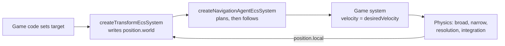
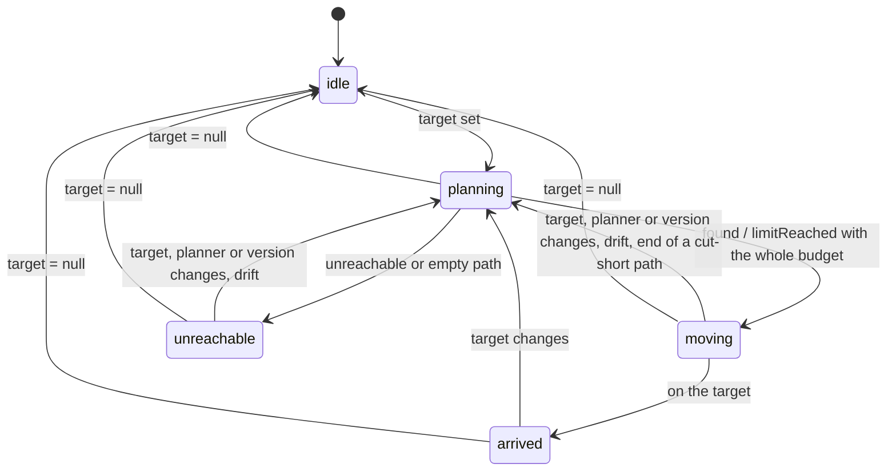

# Navigation agents

<!-- cspell:ignore pathfinding -->

Issue: [#780](https://github.com/Forge-Game-Engine/Forge/issues/780)
(Path Finding milestone; builds on [#775's search](./navigation-path-search.md),
[#776's grids](./navigation-grids.md), [#778's waypoint graphs](./waypoint-graphs.md)
and #779's smoothing; #781's guide and demo build on it)

| Module or file                                                   | Change   | Notes                                                                                                      |
| ---------------------------------------------------------------- | -------- | ---------------------------------------------------------------------------------------------------------- |
| `src/navigation/path-planner.ts`                                 | New      | The `PathPlanner` interface, `PlanPathOptions` and `PlannedPath`                                           |
| `src/navigation/agent-path.ts`                                   | New      | `buildAgentPath`, the one rule for a path's two end legs. Not exported                                     |
| `src/navigation/grid/create-grid-path-planner.ts`                | New      | `createGridPathPlanner(grid, options?)`, `GridPathPlannerOptions`                                          |
| `src/navigation/waypoints/create-waypoint-path-planner.ts`       | New      | `createWaypointPathPlanner(graph, options?)`, `WaypointPathPlannerOptions`                                 |
| `src/navigation/components/navigation-agent-component.ts`        | New      | `NavigationAgentEcsComponent`, `navigationAgentId`, `addNavigationAgentComponent`, `NavigationAgentStatus` |
| `src/navigation/systems/navigation-agent-system.ts`              | New      | `createNavigationAgentEcsSystem(time, options?)`                                                           |
| `src/navigation/systems/plan-agent-paths.ts`                     | New      | The system's planning step: requests, ordering, the shared budget. Not exported                            |
| `src/navigation/systems/follow-agent-path.ts`                    | New      | The system's following step: waypoints, desired velocity, arrival. Not exported                            |
| `src/navigation/components/index.ts`, `systems/index.ts`         | New      | The folders' public API                                                                                    |
| `src/navigation/grid/index.ts`, `waypoints/index.ts`, `index.ts` | Modified | Export the planners, `path-planner.js`, `components/index.js` and `systems/index.js`                       |
| `src/navigation/**/*.test.ts`                                    | New      | See "Testing"                                                                                              |
| `documentation-site/docs/docs/navigation/agents.md`              | New      | The "Navigation agents" guide                                                                              |
| `documentation-site/docs/docs/navigation/index.md`               | Modified | A paragraph linking the new guide                                                                          |
| `AGENTS.md`                                                      | Modified | `/navigation`'s line in "Repository Structure" mentions path planners and navigation agents                |
| `CHANGELOG.md`                                                   | Modified | `#### Added` bullets (navigation)                                                                          |
| **Engine version at time of design**                             |          | `0.26.2`                                                                                                   |

## Summary

The navigation module can find a path (`findGridPath`, `findWaypointPath`)
and straighten one (`smoothGridPath`), but a game that wants a unit to walk
somewhere still wires the rest by hand for every unit: plan when the target
changes, plan again when a wall moves or the unit is shoved off its route,
walk from waypoint to waypoint, slow down and stop on the target, and keep
a crowd that re-plans at once from stalling a frame. The
`isometric-path-finding` demo's `_find-path.system.ts` is the first of
those steps written by hand.

This design adds a **navigation agent**: a component that says "go there",
and one system that plans the path and tells the entity which way to move.

```ts
import { createTransformEcsSystem } from '@forge-game-engine/forge/common';
import {
  addNavigationAgentComponent,
  createGridPathPlanner,
  createNavigationAgentEcsSystem,
} from '@forge-game-engine/forge/navigation';

const planner = createGridPathPlanner(grid); // smoothed paths by default

const agent = addNavigationAgentComponent(world, unit, {
  planner,
  speed: 120,
  arrivalRadius: 16,
});

agent.target = { x: 640, y: 380 }; // game code, e.g. on a click

world.addSystem(createTransformEcsSystem());
world.addSystem(createNavigationAgentEcsSystem(time));
world.addSystem(createUnitVelocityEcsSystem()); // the game's: velocity = desiredVelocity
// ...then the physics systems
```

The agent outputs a **desired velocity** and doesn't move the entity, as
the issue asks and as Godot's `NavigationAgent2D` does: the parent node
moves itself from `get_next_path_position()`. That keeps Forge's one-writer
rule. A rigid body's position is written by physics integration and any
other entity's by game code, so the agent writes neither; the game copies
`desiredVelocity` into `rigidBody.velocity`, or adds `desiredVelocity * dt`
to `position.local`, in one line of its own system.

The design keeps the issue's goal and component, and differs from its
text in four places, each in the decision log and the open questions:

- **One system, not two.** The issue lists a planning system and a
  following system, and both would write `status` (planning writes
  `'planning'`, `'moving'` and `'unreachable'`, following writes
  `'arrived'`) and `waypointIndex` (planning resets it, following advances
  it). Two writers of one field is what Forge's ground rules forbid.
  `createNavigationAgentEcsSystem` plans and then follows in one `update`,
  with the two steps in their own files and tests (decision NA1, open
  question 1).
- **The agent plans through a `PathPlanner`, not a grid or graph.** The
  issue's `navigation` field takes "the grid or waypoint graph", and its
  `smooth` field only applies to grids. A small `PathPlanner` interface
  (`planPath(from, to, { maxExpanded, keepPartialPath })`, `version` and
  `maxPathDistance`) puts that
  difference where it belongs: `createGridPathPlanner(grid, { smooth })`
  and `createWaypointPathPlanner(graph)` each wrap one graph, and the
  agent's system calls `planPath` without knowing which it has. A game's
  own graph, or a later navigation mesh, plugs in the same way (decision
  NA2, open question 2).
- **The system runs after the transform system.** The issue puts the agent
  before the transform system and physics. Forge's physics integration
  writes `position.local` after the transform pass, so `position.world`
  lags it by a tick before the transform system runs (see
  `createEulerIntegrationEcsSystem`'s JSDoc). An agent that read it there
  would steer from last tick's position, and its "stop exactly on the
  target this tick" velocity would overshoot. After the transform system
  and before the physics systems is where `createGravityEcsSystem` and the
  springs change velocities too (decision NA5).
- **The drift distance belongs to the planner.** The issue re-plans when
  the unit has drifted "more than a cell" from its path, and a waypoint
  graph has no cells. A planner has a `maxPathDistance` (Godot's
  `path_max_distance`): one cell for a grid planner, set by the game for a
  waypoint planner. The agent allows at least its own `arrivalRadius`, so
  turning a corner early never counts as drifting (decision NA8).

Nothing in it bends a core design of the engine: the component is plain
data, the system is stateless (everything it remembers is on the
component, and its request order comes from `time.frames` and
`world.getCreationSequence`), its query is fixed, and every output field
has one writer.

## Scope

### In scope

- `PathPlanner` and `PlannedPath`: plan a world-space path between two
  world positions with a node limit, and report a `version` that changes
  when the plan might.
- `createGridPathPlanner(grid, { smooth, snapRadius, maxPathDistance })`:
  `findGridPath`, the legs from the unit and to the target, then
  `smoothGridPath` when `smooth` is `true` (the default).
- `createWaypointPathPlanner(graph, { maxPathDistance })`:
  `findWaypointPath` and the same legs.
- `NavigationAgentEcsComponent` and `addNavigationAgentComponent`:
  - inputs, written by game code: `planner`, `target`, `speed`,
    `arrivalRadius`;
  - outputs, written only by the agent system: `status`, `path`,
    `waypointIndex`, `desiredVelocity`, and the record of what the path was
    planned for (`pathStatus`, `plannedTarget`, `plannedPlanner`,
    `plannedVersion`, `requestedFrame`).
- `createNavigationAgentEcsSystem(time, { maxExpandedPerFrame })`:
  - plans when an agent's target changes, its planner or the planner's
    `version` changes, it drifts more than `maxPathDistance` (or its
    `arrivalRadius`, when that's larger) from its path, or it reaches the
    end of a path cut short by the node limit;
  - shares one node budget per frame between every agent waiting for a
    plan, in the order they started waiting, so a crowd re-planning at
    once spreads over frames and no request is dropped;
  - advances `waypointIndex` once the entity is within `arrivalRadius` of
    its waypoint or has passed it, sets `desiredVelocity` towards it at
    `speed`, slows over the last `arrivalRadius` of the path so it stops on
    the target, and sets `'arrived'` and a zero velocity there.
- Unit tests, including the issue's "Done when" scenario run through the
  real transform and physics systems.
- A "Navigation agents" guide page with the system order and how to apply
  `desiredVelocity` with and without a rigid body; `AGENTS.md`'s module
  line; changelog bullets.

### Out of scope

- **The docs-site demo.** #781 builds the milestone's path finding demo
  with agents, rigid bodies and draggable walls. This design ships the
  guide page with code samples (decision NA16).
- **Local avoidance and crowds.** Agents don't steer around each other
  (Godot's RVO avoidance, Unity's obstacle avoidance). Rigid bodies push
  each other apart, which is enough for #781's group of units. Several
  agents sent to one point jostle there (open question 3).
- **Moving the entity.** No engine system copies `desiredVelocity` into a
  rigid body or a position (decision NA14, open question 7).
- **Acceleration and turning.** `desiredVelocity` changes direction at
  once at a waypoint. A game that wants inertia or a turning rate smooths
  the velocity it applies (Unity's `acceleration` and `angularSpeed` are
  the agent's job there; here they're the game's).
- **Agent size.** A unit's radius is baked into the grid with
  `markGridFromColliders`' `agentRadius`, one grid per size of unit
  (`design/navigation-grid-from-colliders.md`).
- **Searches that resume over several frames.** A search finishes in one
  `findPath` call, as #775's design decided (its open question 2). The
  budget decides which searches run this frame, not how far each gets
  (decision NA6).
- **Jump links and other special connections** that need the unit to do
  something other than walk (Godot's navigation links, Unity's off-mesh
  links).
- **Navigation meshes.** A later graph type plugs in through `PathPlanner`.
- **Changing `findGridPath` or `findWaypointPath`.** Their `points` stay
  the nodes' positions; the legs to the exact positions are added by the
  planners, as #776's and #778's designs planned for #780.

## Concepts

- A **path planner** turns two world positions into a path: a polyline of
  world positions from the first towards the second, with a status. It
  wraps one grid or one waypoint graph and decides how a path over it
  starts and ends (the legs) and whether it's smoothed.
- An **agent** is an entity with a `NavigationAgentEcsComponent` and a
  `PositionEcsComponent`. The game gives it a planner, a `target`, a
  `speed` and an `arrivalRadius`; the agent system gives back a `path`, the
  waypoint it's walking to, a `status` and a `desiredVelocity`.
- A **plan request** is an agent waiting for a path. It starts when the
  system first sees one of the re-plan conditions and holds its place in
  line until a search completes for it.
- The **budget** is the number of nodes every search in one tick may
  expand between them, `maxExpandedPerFrame`.

## API design

### `PathPlanner`

```ts
/** A path between two world positions, from {@link PathPlanner.planPath}. */
export interface PlannedPath {
  /** How the search ended, as {@link findPath} reports it. */
  readonly status: PathStatus;

  /**
   * The world positions to walk through, starting at `fromWorld`. For
   * `'found'` it ends at `toWorld` when a unit can walk to it, and at the
   * nearest place it can reach otherwise (a snapped goal's cell centre).
   * For `'unreachable'` and `'limitReached'` it ends where the search got
   * closest. Empty when there's nothing to walk at all, such as a waypoint
   * graph with no enabled point, and for `'limitReached'` when
   * `keepPartialPath` was `false`. Every position is a new object.
   */
  readonly points: Vector2[];

  /** How many nodes the search expanded, counted against a budget. */
  readonly expanded: number;
}

/** Options for {@link PathPlanner.planPath}. */
export interface PlanPathOptions extends FindPathOptions {
  /**
   * Whether a search that stops at `maxExpanded` still builds the path
   * it got to. `false` returns `'limitReached'` with empty `points`
   * without building the path's ends or smoothing it, for a caller that
   * will plan again instead of walking a partial path. Defaults to `true`.
   */
  keepPartialPath?: boolean;
}

/**
 * Plans paths between world positions over one navigation graph, for a
 * navigation agent or for game code. Create one with
 * {@link createGridPathPlanner} or {@link createWaypointPathPlanner}, or
 * implement it for a graph of your own.
 */
export interface PathPlanner {
  /**
   * Changes whenever a path planned before might differ from one planned
   * now: the wrapped graph's `version`.
   */
  readonly version: number;

  /**
   * How far a unit may be from the segment of its path it's walking
   * before its path is planned again, in world units: `Infinity` never
   * re-plans for that. A navigation agent allows at least its own
   * `arrivalRadius`, since it turns onto the next segment that far from
   * a corner.
   */
  readonly maxPathDistance: number;

  /**
   * Plans a path.
   * @param fromWorld - Where the unit is.
   * @param toWorld - Where it's going.
   * @param options - The most nodes the search may expand, and whether a
   * path cut short by that limit is built.
   * @returns The path and how the search ended.
   * @throws An error if either position isn't finite, or for any reason
   * the wrapped search throws.
   */
  planPath(
    fromWorld: Vector2,
    toWorld: Vector2,
    options?: PlanPathOptions,
  ): PlannedPath;
}
```

`keepPartialPath` exists for the agent system, which throws away a search
the shared budget cut short (see "Planning within the budget") and
shouldn't pay to build and smooth it first. A planner of the game's own
that ignores it is still correct; it only does work that's thrown away.

### `createGridPathPlanner`

```ts
export interface GridPathPlannerOptions {
  /**
   * Whether paths are smoothed with {@link smoothGridPath} into straight
   * segments between the corners they turn at. `false` walks from cell
   * centre to cell centre, as a game whose units move cell by cell wants.
   * Defaults to `true`.
   */
  smooth?: boolean;

  /** Passed to {@link findGridPath}. Defaults to `2`. */
  snapRadius?: number;

  /**
   * See {@link PathPlanner.maxPathDistance}. Defaults to one cell: the
   * longer of the world lengths of a step of one column and of one row.
   */
  maxPathDistance?: number;
}

export function createGridPathPlanner(
  grid: NavigationGrid,
  options?: GridPathPlannerOptions,
): PathPlanner;
```

### `createWaypointPathPlanner`

```ts
export interface WaypointPathPlannerOptions {
  /**
   * See {@link PathPlanner.maxPathDistance}. A waypoint graph doesn't know
   * how wide its connections are, so it defaults to `Infinity`: an agent
   * pushed off a road walks straight back to its next point. Set it to
   * about a road's width to re-plan instead.
   */
  maxPathDistance?: number;
}

export function createWaypointPathPlanner(
  graph: WaypointGraph,
  options?: WaypointPathPlannerOptions,
): PathPlanner;
```

Both validate their options when they're created (`maxPathDistance` more
than `0`, or `Infinity`; `snapRadius` as `findGridPath` does) and throw a
descriptive error. A planner holds its graph and its resolved options and
nothing else, so one planner is shared by every agent that walks the same
graph the same way.

### `NavigationAgentEcsComponent`

```ts
/**
 * What a navigation agent is doing:
 * - `'idle'`: it has no `target`.
 * - `'planning'`: it's waiting for a path. It keeps walking the path it
 *   has, if any.
 * - `'moving'`: it's walking its path.
 * - `'arrived'`: it reached the end of a path that was found, and stays
 *   arrived until `target` changes. That's the target itself, unless the
 *   target is somewhere a unit can't stand (inside a wall, or off a
 *   grid) and the planner moved the goal to the nearest place it can: a
 *   grid planner's snapped goal, where the agent arrives at the centre of
 *   the walkable cell nearest the target. A game that needs the exact
 *   target compares the agent's position with it.
 * - `'unreachable'`: no path reaches the target. It walks to the place
 *   nearest it the path reaches, then stops.
 */
export type NavigationAgentStatus =
  'idle' | 'planning' | 'moving' | 'arrived' | 'unreachable';

export interface NavigationAgentRequiredOptions {
  /** Plans the agent's paths. */
  planner: PathPlanner;

  /** The agent's top speed, in world units a second, `0` or more. */
  speed: number;
}

export interface NavigationAgentDefaultedOptions {
  /**
   * Where the agent is going, in world space, or `null` to stand still.
   * Compared by value each tick, so changing it in place
   * (`target.x = 10`) and assigning a new object both re-plan. Defaults to
   * `null`.
   */
  target: Vector2 | null;

  /**
   * How close counts as reaching a waypoint on the way, and how far
   * before the target the agent starts slowing down, in world units, `0`
   * or more. `0` turns at each waypoint and stops from full speed. The
   * agent re-plans only once it's further than this, or the planner's
   * `maxPathDistance` if that's larger, from its path. Defaults to `0`.
   */
  arrivalRadius: number;
}

/**
 * A unit that walks to a target. `createNavigationAgentEcsSystem` plans
 * its path and writes every output field; nothing else writes them.
 */
export interface NavigationAgentEcsComponent
  extends NavigationAgentRequiredOptions, NavigationAgentDefaultedOptions {
  /** Output: what the agent is doing. */
  status: NavigationAgentStatus;

  /**
   * Output: the path being walked, in world space, starting where the
   * agent was when it was planned. A new array each time a path is
   * planned; empty when there is none.
   */
  path: readonly Vector2[];

  /** Output: the index in `path` of the point being walked to. */
  waypointIndex: number;

  /**
   * Output: the world-space velocity that walks the path this tick,
   * changed in place. Zero when the agent isn't moving.
   */
  readonly desiredVelocity: Vector2;

  /** Output: how the search for `path` ended, or `null` before the first. */
  pathStatus: PathStatus | null;

  /** Output: a copy of the target `path` was planned for, or `null`. */
  plannedTarget: Vector2 | null;

  /** Output: the planner `path` was planned with, or `null`. */
  plannedPlanner: PathPlanner | null;

  /** Output: that planner's `version` when it planned `path`. */
  plannedVersion: number;

  /**
   * Output: `time.frames` when the agent started waiting for a path, or
   * `null` when it isn't waiting. Agents waiting longest plan first.
   */
  requestedFrame: number | null;
}

export const navigationAgentId =
  createComponentId<NavigationAgentEcsComponent>('navigationAgent');

export function addNavigationAgentComponent(
  world: EcsWorld,
  entity: number,
  options: NavigationAgentRequiredOptions &
    Partial<NavigationAgentDefaultedOptions>,
): NavigationAgentEcsComponent;
```

The factory follows the `create-component` skill's "output field a system
writes" case (`sound-component.ts`): outputs aren't in `options`, and start
as `'idle'`, `[]`, `0`, `(0, 0)`, `null`, `null`, `null`, `-1` and `null`.
It throws for a negative or non-finite `speed` or `arrivalRadius`.

### `createNavigationAgentEcsSystem`

```ts
export interface NavigationAgentSystemOptions {
  /**
   * The most nodes every path search in one tick may expand between them,
   * a positive integer or `Infinity`. Agents that don't get a search this
   * tick keep their place in line for the next. Defaults to `4096`.
   */
  maxExpandedPerFrame?: number;
}

export const createNavigationAgentEcsSystem = (
  time: Time,
  options?: NavigationAgentSystemOptions,
): EcsSystem<[NavigationAgentEcsComponent, PositionEcsComponent]>;
```

- **Query:** `[navigationAgentId, positionId]`, fixed.
- **Reads:** the agent's inputs, `position.world`, the planner,
  `time.frames`, `time.deltaTimeInSeconds`, `world.getCreationSequence`.
- **Writes:** the agent's output fields only.
- **Throws:** for a non-finite `target`, a negative or non-finite `speed`
  or `arrivalRadius` set after the component was added, naming the entity
  (`formatEntity`), as `createEulerIntegrationEcsSystem` names a bad body.
- The factory resolves `maxExpandedPerFrame` once with `withDefaults` and
  validates it; it keeps nothing else.

## Path ends

`findGridPath` returns cell centres and `findWaypointPath` returns point
positions; neither includes the unit's own position or the exact target
(#776's and #778's designs, decision W9 and grids open question 2, left
those legs to this issue). One module-level function, `buildAgentPath`,
adds them for every planner:

```text
buildAgentPath(from, nodePoints, to, reachesTarget):
  if nodePoints is empty: return []          # nothing to walk
  points = [copy(from), ...nodePoints]
  if reachesTarget: points.push(copy(to))
  return points
```

- **Grid planner:** `reachesTarget` is `status === 'found' && !goalSnapped`:
  the target's own cell is walkable and is the path's last cell, so the
  straight step from that cell's centre to the target stays inside it. A
  target in a wall (snapped) ends at the walkable centre nearest it, never
  inside the wall. Then, when `smooth`, `smoothGridPath(grid, points)`:
  it keeps the first and last points and drops the unit's own cell centre
  and the goal cell's centre whenever the unit can walk straight past
  them, so a smoothed path runs from the unit's exact position to the
  exact target. Without smoothing, the unit walks to its cell's centre
  first and finishes with the short step from the goal cell's centre,
  which is what a game moving cell by cell wants. The unit's position is
  prepended rather than replacing the start cell's centre: on a raw (not
  smoothed) path, a straight line from a cell's corner to a diagonal
  neighbor's centre crosses a third cell, which `'always'` diagonals don't
  check.
- **Waypoint planner:** `reachesTarget` is `status === 'found'`. The unit
  walks from where it is to the nearest point, along the route, and from
  the goal point to the target, as #778's design planned. An empty route
  (no enabled point) stays empty: the agent has nothing to walk.

A path from `buildAgentPath` has at least two points or none. A zero-length
first segment (the unit already on its cell's centre) is skipped on the
first tick, since the unit is within `arrivalRadius` (even `0`) of it.

## The agent system



`update` runs three steps over the tick's batch, each a module-level
function in its own file:

### 1. Requests (`plan-agent-paths.ts`)

For each agent:

```text
if target is null:
  status = 'idle', path = [], waypointIndex = 0, desiredVelocity = (0, 0)
  pathStatus = plannedTarget = plannedPlanner = requestedFrame = null
  continue

check target is finite                      # throws, naming the entity
if requestedFrame is null and needsPlan(agent, position.world):
  requestedFrame = time.frames
if requestedFrame is not null:
  status = 'planning'
  add the agent's batch index to this tick's pending list
```

`needsPlan` is true when any of these hold, checked in this order:

1. `plannedTarget` is `null` or differs from `target` by value.
2. `status` is `'arrived'`: false, stop here. An arrived agent stays put
   until it's sent somewhere else (decision NA10).
3. `plannedPlanner !== planner` (the game swapped planners) or
   `plannedVersion !== planner.version` (a wall moved, a door closed).
4. `path` isn't empty and the agent is more than
   `max(planner.maxPathDistance, arrivalRadius)` from the segment
   `path[waypointIndex - 1]` to `path[waypointIndex]` (pushed off its
   path).
5. `path` isn't empty, `pathStatus` is `'limitReached'` and the agent is
   at the end of its path (it walked as far as the cut-short search went).

Conditions 4 and 5 are skipped for an empty `path`: an `'unreachable'`
result with nothing to walk (a waypoint graph with no enabled point) has
no segment to measure, and `path[waypointIndex - 1]` doesn't exist. Such
an agent waits for its target, planner or `version` to change. Every
non-empty path from `buildAgentPath` has at least two points, and the
planning step sets `waypointIndex` to `1` for it (the following step only
raises it), so `path[waypointIndex - 1]` exists whenever condition 4 runs.

**Why the drift distance is at least `arrivalRadius`.** The following
step moves on to the next waypoint once the agent is within
`arrivalRadius` of the corner, so on the next tick the agent can be up to
`arrivalRadius` from the new segment, which starts at that corner. A grid
planner's `maxPathDistance` is one cell, so an agent with a radius larger
than a cell would count that as drift and re-plan at every corner,
spending the shared budget on paths it already has. Taking the larger of
the two keeps a corner turned early from counting. Godot avoids the same
clash through its defaults (`path_desired_distance` 20 against
`path_max_distance` 100); Forge's defaults are a cell and `0`, so the
system takes the larger instead of leaving it to each game's tuning
(decision NA8).

A target that changes while the agent waits keeps the agent's place in
line; it's planned for the newest target.

### 2. Planning within the budget (`plan-agent-paths.ts`)

```text
sort pending by (requestedFrame, world.getCreationSequence(entity))
budget = maxExpandedPerFrame
for each pending agent:
  if budget is 0: break                     # the rest wait a tick
  given = budget
  whole = given is maxExpandedPerFrame
  result = planner.planPath(position.world, target,
                            { maxExpanded: given, keepPartialPath: whole })
  budget -= result.expanded
  if result.status is 'limitReached' and not whole:
    continue                                # cut short by the shared budget
  path = result.points
  waypointIndex = path.length > 1 ? 1 : 0
  pathStatus = result.status
  status = result.status is 'unreachable' or path is empty
           ? 'unreachable' : 'moving'
  plannedTarget = copy(target)
  plannedPlanner = planner, plannedVersion = planner.version
  requestedFrame = null
```

- **Order.** Waiting longest first, then the entity created first. Both
  live outside the system (`requestedFrame` on the component, the
  creation sequence on the world), so the system keeps no queue and a
  fresh system instance plans in the same order. The query's entity order
  isn't used: it's a sparse set's dense order, which removals reshuffle.
- **A search cut short by the shared budget is thrown away.** It got less
  than a whole frame's budget only because searches ahead of it used the
  rest, and its partial path heads wherever the search had got to. The
  agent keeps its place, so next tick it's first in line and gets the
  whole budget. At most one search a tick is thrown away, so the waste is
  at most `maxExpandedPerFrame` nodes a tick. The system asks for it with
  `keepPartialPath: false`, so the planner returns as soon as the search
  stops and never builds or smooths a path that's about to be thrown
  away.
- **A search that hits the whole budget is kept.** It would never finish
  within the budget, so its partial path (#775's: towards the node
  nearest the goal) is the best the agent gets. The agent walks it with
  `status` `'moving'` and `pathStatus` `'limitReached'`, and requests a
  new plan from the end of it (condition 5), the way Unity walks a
  partial path.
- **Starvation.** A request thrown away this tick is at the front next
  tick, and a new request goes behind every older one, so each tick plans
  at least the request at the front and a request is planned within as
  many ticks as there are requests ahead of it, plus one. The issue's test sends 50 requests in one tick and
  checks they're all planned, in order, with no tick over the budget.
- **What the budget doesn't count.** Snapping, building the legs and
  smoothing aren't node expansions. Smoothing is up to `n²/2` line-of-sight
  checks on a winding path of `n` cells (see `smoothGridPath`'s JSDoc), so
  a crowd planning long winding paths in one tick costs more than its
  budget suggests (see "Performance"). Only kept paths are smoothed.

### 3. Following (`follow-agent-path.ts`)

For each agent with a target, after every plan of the tick:

```text
v = desiredVelocity
if path is empty or status is 'arrived': v = (0, 0); continue

last = path.length - 1
i = waypointIndex
while i < last and (distance(p, path[i]) <= arrivalRadius
                    or hasPassed(path[i - 1], path[i], p)):
  i += 1
waypointIndex = i

offset = path[i] - p, d = |offset|
if i is last and d <= arrivalTolerance(path[last]):
  v = (0, 0)
  if status is 'moving' and pathStatus is 'found': status = 'arrived'
  continue

remaining = d + length of path after i, summed until it passes arrivalRadius
speedNow = speed
if arrivalRadius > 0 and remaining < arrivalRadius:
  speedNow = speed * sqrt(remaining / arrivalRadius)
if i is last and deltaSeconds > 0:
  speedNow = min(speedNow, d / deltaSeconds)
v = offset / d * speedNow
```

- **`hasPassed(a, b, p)`** is `dot(p - b, b - a) >= 0`: the agent is past
  the line through `b` square to the segment, as when it overshot a corner
  or was pushed past it. A zero-length segment counts as passed.
- **Slowing down.** Over the last `arrivalRadius` of the path the speed
  follows `speed * sqrt(remaining / arrivalRadius)`, which is a constant
  deceleration of `speed² / (2 * arrivalRadius)`: the agent stops on the
  target in a finite time. A linear ramp (`speed * remaining /
arrivalRadius`, the textbook "arrive" steering behavior) only ever
  halves the distance and never gets there (decision NA9).
- **Stopping exactly.** On the last segment the speed is at most
  `d / deltaSeconds`, so the tick that would overshoot lands on the target
  instead, whether the game applies the velocity through a rigid body
  (`createEulerIntegrationEcsSystem` moves by `velocity * deltaSeconds`)
  or to `position.local` with the same `time`. With `arrivalRadius` `0`
  that's the only slowing.
- **`arrivalTolerance(point)`** is a fixed relative float tolerance,
  `1e-6 * max(1, |point.x|, |point.y|)`, not an option: it only absorbs
  rounding in the last tick's movement. A unit held short of the target
  (by another unit standing on it) keeps pushing gently, which is open
  question 3.
- **While `'planning'`** the agent keeps walking the path it has, and stops
  at its end without arriving (decision NA11). With no path yet, the
  velocity is zero.
- **`'unreachable'`** walks the partial path to the place nearest the
  target and stops there, still `'unreachable'` (decision NA12). A
  `version` change re-plans it, so a wall that opens sends it on.

### State



### One writer per value

| Field                                         | Written by                                          |
| --------------------------------------------- | --------------------------------------------------- |
| `planner`, `target`, `speed`, `arrivalRadius` | Game code (and `addNavigationAgentComponent`)       |
| Every output field                            | `createNavigationAgentEcsSystem` only               |
| `position.local`, `rigidBody.velocity`        | The game's own system, from `desiredVelocity`       |
| `position.world`                              | `createTransformEcsSystem` only; the agent reads it |
| The grid or waypoint graph (`version`)        | The game, or a bake system such as #777's           |

## Applying the velocity

The guide shows both, from the issue:

```ts
// A rigid body: physics integrates the velocity and resolves collisions.
const createUnitVelocityEcsSystem = (): EcsSystem<
  [NavigationAgentEcsComponent, RigidBodyEcsComponent]
> => ({
  query: [navigationAgentId, rigidBodyId],
  update: (_world, { components: [agents, bodies] }) => {
    for (let i = 0; i < agents.length; i++) {
      bodies[i].velocity.x = agents[i].desiredVelocity.x;
      bodies[i].velocity.y = agents[i].desiredVelocity.y;
    }
  },
});

// No rigid body: the game moves the position itself.
position.local.x += agent.desiredVelocity.x * time.deltaTimeInSeconds;
position.local.y += agent.desiredVelocity.y * time.deltaTimeInSeconds;
```

`desiredVelocity` is in world space, so it applies to a root entity, which
every moving rigid body is already (`createEulerIntegrationEcsSystem`
throws otherwise). A unit with no rigid body and a parent converts it
itself.

Systems in order:

1. Game code that sets targets (input, AI, orders).
2. Anything that changes the grid or graph, such as a bake from colliders,
   so agents re-plan on the tick a wall moves.
3. `createTransformEcsSystem()`.
4. `createNavigationAgentEcsSystem(time)`.
5. The game's system that applies `desiredVelocity`.
6. The physics systems, from gravity to integration
   (`documentation-site/docs/docs/physics/index.md`), then rendering.

A top-down unit has no `GravityEcsComponent`, so the velocity the game
sets is the one collision resolution starts from.

## Performance

- **Every tick, per agent:** the request checks (a value comparison, two
  reads of the planner, one point-to-segment distance) and the following
  step (usually one waypoint distance and one `hasPassed`, plus the
  remaining-length sum near the end). No allocation.
- **Per tick:** one pending array of batch indices and its sort, `O(k log
k)` for `k` waiting agents, with a `getCreationSequence` lookup per
  comparison (array reads).
- **Per plan:** one `findPath` within the budget (#775: no allocation per
  node), `findGridPath`'s or `findWaypointPath`'s point arrays, the
  agent's new `path`, and for a smoothed grid path `smoothGridPath`'s
  line-of-sight checks.
- **The default budget.** `4096` expansions is a full search of a 64 x 64
  grid, or an open-ground path across a grid hundreds of cells wide. An
  expansion on an 8-way grid is eight neighbor checks; Phase 2 measures
  the time per expansion on the test machine and sets the default so a
  full budget costs about a millisecond (open question 8). Measured during
  implementation: a 4096-node search on a 256 x 256 grid took about
  2.2 ms (0.54 µs a node), so the default is `2048`. Unity's
  equivalent, `NavMesh.pathfindingIterationsPerFrame`, defaults to `100`,
  but its nodes are navigation mesh polygons, each standing for many
  cells.
- **Smoothing outside the budget.** A crowd of `k` agents planning winding
  `n`-cell paths in one tick costs up to `k * n² / 2` line-of-sight checks.
  On open levels smoothing stops at the first long shortcut, so this is
  rare; the guide says to set `smooth: false` (or a smaller budget) when it
  shows up in a profile.
- **No smoothing for a thrown-away search.** The search the shared budget
  cuts short each tick is thrown away (decision NA6). Without
  `keepPartialPath: false` the grid planner would still build its legs and
  smooth it first: a path up to as many cells as the search expanded,
  smoothed at up to `n²/2` line-of-sight checks, every tick a crowd is
  waiting, for nothing. The system passes `keepPartialPath: false` to every
  search that got less than the whole budget, so the planner stops after
  `findGridPath` (or `findWaypointPath`) and that search costs only its
  expansions, which the budget already counts (decision NA17).

## Testing

Unit tests drive the system through an `EcsWorld` with `world.update()`,
as the `create-system` skill describes, with a `Time` stepped by hand.

### Planners (`create-grid-path-planner.test.ts`, `create-waypoint-path-planner.test.ts`)

- A grid path starts at `fromWorld` and ends at `toWorld` when found;
  smoothed across an open room it's exactly `[from, to]`.
- A target in a wall ends at the snapped cell's centre, not the target.
- `smooth: false` gives `[from, ...cell centres, to]`.
- `'unreachable'` and `'limitReached'` paths start at `from` and end at a
  cell centre; `expanded` matches `findGridPath`'s.
- `keepPartialPath: false` on a search that stops at `maxExpanded`
  returns `'limitReached'`, the same `expanded` and empty `points`; it
  doesn't change a `'found'` or `'unreachable'` result. The same for the
  waypoint planner.
- A waypoint path is `[from, ...point positions, to]` when found, ends at
  the reached point nearest the goal otherwise, and is empty with no
  enabled point.
- `version` follows the wrapped graph's.
- `maxPathDistance` defaults (a grid's cell, on orthogonal and isometric
  layouts; `Infinity` for a waypoint graph), and invalid options throw.

### The component (`navigation-agent-component.test.ts`)

- Defaults, required options, outputs' starting values, the returned
  component is the stored one, invalid `speed` and `arrivalRadius` throw.

### The system (`navigation-agent-system.test.ts`)

The issue's list, plus the cases above:

- **Plans and arrives:** an agent moved by `desiredVelocity * dt` each tick
  walks around a wall to the target, `status` goes `'planning'` →
  `'moving'` → `'arrived'`, and ends exactly on the target with a zero
  velocity.
- **Arrives at a snapped goal:** a target inside a wall within
  `snapRadius` of open ground gives `'arrived'` at the centre of the
  walkable cell nearest it, not at the target, and doesn't re-plan once
  there.
- **Re-plans after the grid changes:** blocking a cell on its path raises
  `version`; the next tick's path avoids it. A change that doesn't raise
  `version` doesn't re-plan.
- **Re-plans after drift:** moving the agent more than `maxPathDistance`
  sideways re-plans; less doesn't. With an `arrivalRadius` larger than
  `maxPathDistance`, a move between the two doesn't re-plan and a move
  past `arrivalRadius` does.
- **Turns corners without re-planning:** an agent with an `arrivalRadius`
  of two and a half cells on a grid planner (whose `maxPathDistance` is
  one cell) walks a smoothed path around an L-shaped wall with at least
  two corners; `requestedFrame` stays `null` and `path` stays the same
  array from the first plan to `'arrived'`, and the shared budget is used
  only on the first tick.
- **Nothing to walk:** a waypoint planner over a graph with no enabled
  point gives `'unreachable'` with an empty `path` and a zero velocity;
  later ticks, and pushing the agent around, neither throw nor re-plan;
  enabling a point (which raises `version`) re-plans.
- **Reports unreachable:** a walled-in target gives `'unreachable'`, the
  agent walks to the nearest reachable cell and stops; opening the wall
  sends it on.
- **Slows down on arrival:** over the last `arrivalRadius` the speed
  follows `speed * sqrt(remaining / arrivalRadius)`; with `arrivalRadius`
  `0` it's full speed until the last tick, which lands on the target.
- **Waypoints:** advances within `arrivalRadius` and when passed; doesn't
  skip a waypoint it hasn't reached or passed.
- **The budget:** 50 agents given targets in one tick are all planned over
  the following ticks, in order of request then creation, with no tick's
  `expanded` total over the budget beyond one thrown-away search, and
  none dropped. A search larger than the whole budget is kept as
  `'limitReached'`, and the agent re-plans from its end. A planner spy
  shows every search given less than the whole budget is asked for
  `keepPartialPath: false`, and every search given the whole budget for
  `true`.
- **Target changes:** in place (`target.x = ...`) and by a new object both
  re-plan; `target = null` goes `'idle'` with a zero velocity; changing it
  while waiting keeps the agent's place in line.
- **Arrived stays arrived** when pushed or when `version` changes, and
  re-plans when `target` changes.
- **Waypoint graphs:** an agent on a road network walks to the nearest
  point, along the route, and to the target; closing a point on its route
  re-plans around it.
- **Statelessness:** a fresh system instance on a world mid-walk produces
  the same output as the one that has been running; removing an agent and
  adding another reuses nothing.
- **Fields it doesn't own:** `position.local`, `position.world` and the
  inputs are unchanged by the system.
- **Done when, with physics:** a unit with a dynamic rigid body, a circle
  collider and no gravity, a grid baked with `markGridFromColliders`
  around box walls, and a test system copying `desiredVelocity` into its
  velocity, registered in the documented order with the real transform
  and physics systems, walks around the walls to the target and stops
  there.

No e2e test: nothing here renders, reads input or depends on the game
loop beyond `Time`, which the unit tests step. #781's demo is the
runtime check.

## Documentation

- **`navigation/agents.md`** (new): what an agent is and isn't (it
  doesn't move the entity); planners and when to turn smoothing off;
  setting and clearing `target`; statuses; applying `desiredVelocity`
  with and without a rigid body; the system order and why it's after the
  transform system; re-planning (`version`, drift, `maxPathDistance` and
  why a larger `arrivalRadius` widens it); the planning budget;
  `arrivalRadius`; arriving at a snapped goal's cell centre rather than a
  target inside a wall.
- **`navigation/index.md`**: a paragraph linking it.
- **`AGENTS.md`**: `/navigation`'s line adds path planners and navigation
  agents (the component and the system that plans and follows paths).
- **`CHANGELOG.md`**, `#### Added`:
  - **navigation:** `createGridPathPlanner` and `createWaypointPathPlanner`
    plan world-space paths from a unit's position to its target, smoothed
    on grids by default.
  - **navigation:** navigation agents: `addNavigationAgentComponent` and
    `createNavigationAgentEcsSystem` plan, re-plan and follow a path to a
    target and output a `desiredVelocity` for the game to apply, sharing a
    per-frame planning budget between agents.

#781 folds the page into its guide and builds the demo.

## Phases

### Phase 1: path planners

Adds `PathPlanner`, `PlannedPath`, `buildAgentPath` and the two planners,
with tests and a guide section. A game can call `planner.planPath` itself
and walk the result, so this ships on its own.

**Done when** every test under "Planners" passes, the planners are
exported from `@forge-game-engine/forge/navigation`, `navigation/grids.md`
and `navigation/waypoint-graphs.md` each have a short "Planning a unit's
path" section, the changelog has the planners' bullet, and the
verification checklist passes.

| Task             | Description                                                                                                          | Size |
| ---------------- | -------------------------------------------------------------------------------------------------------------------- | ---- |
| `PathPlanner`    | `path-planner.ts`: the interface, `PlanPathOptions` and `PlannedPath`, with JSDoc                                    | S    |
| Path ends        | `agent-path.ts`: `buildAgentPath`, copies of both ends                                                               | S    |
| Grid planner     | `create-grid-path-planner.ts`: options and validation, `findGridPath`, legs, smoothing, `version`, `keepPartialPath` | M    |
| Waypoint planner | `create-waypoint-path-planner.ts`: options and validation, `findWaypointPath`, legs, `version`, `keepPartialPath`    | S    |
| Tests            | The planner tests above                                                                                              | M    |
| Exports and docs | Index files; guide sections; changelog bullet                                                                        | S    |

### Phase 2: navigation agents

Adds the component and the system, with tests, the guide page and the
`AGENTS.md` line.

**Done when** every test under "The component" and "The system" passes,
including the physics "Done when" test, `navigation/agents.md` covers
everything listed under "Documentation", the default budget is set from a
measurement, and the verification checklist passes.

| Task                | Description                                                                                                                                                                                                                        | Size |
| ------------------- | ---------------------------------------------------------------------------------------------------------------------------------------------------------------------------------------------------------------------------------- | ---- |
| Component           | `navigation-agent-component.ts`: types, id, factory with output starting values and validation; its test                                                                                                                           | S    |
| Requests and budget | `plan-agent-paths.ts`: `needsPlan` (drift against `max(maxPathDistance, arrivalRadius)`, skipped for an empty path), `requestedFrame`, ordering, the shared budget, `keepPartialPath`, keeping or throwing away a cut-short search | L    |
| Following           | `follow-agent-path.ts`: waypoint advance, `hasPassed`, slowing, the exact stop, arrival, `'planning'` and `'unreachable'`                                                                                                          | M    |
| System              | `navigation-agent-system.ts`: options, validation, the three steps, JSDoc with the system order                                                                                                                                    | S    |
| System tests        | The system tests above, including the 50-agent budget test                                                                                                                                                                         | L    |
| Physics test        | The "Done when" test with a baked grid, a rigid body and the real transform and physics systems                                                                                                                                    | M    |
| Budget measurement  | Time a full budget on a large open grid and an unreachable goal; set the default                                                                                                                                                   | S    |
| Docs                | `navigation/agents.md`, `navigation/index.md`, `AGENTS.md` line, changelog bullet                                                                                                                                                  | M    |

## Decision log

| #    | Decision                              | Options                                                                                                                                                                                                                                                                                                                                             | Chosen | Rationale                                                                                                                                                                                                                                                                                                                                                                                                                                                      | Tradeoff                                                                                                                                       | Assumptions                                                               |
| ---- | ------------------------------------- | --------------------------------------------------------------------------------------------------------------------------------------------------------------------------------------------------------------------------------------------------------------------------------------------------------------------------------------------------- | ------ | -------------------------------------------------------------------------------------------------------------------------------------------------------------------------------------------------------------------------------------------------------------------------------------------------------------------------------------------------------------------------------------------------------------------------------------------------------------- | ---------------------------------------------------------------------------------------------------------------------------------------------- | ------------------------------------------------------------------------- |
| NA1  | How many systems (departs from issue) | (a) One system that plans then follows; (b) the issue's two systems, both writing `status` and `waypointIndex`; (c) two systems with the fields split further                                                                                                                                                                                       | (a)    | (b) has two writers for two fields, which CLAUDE.md forbids. (c) needs the follower to detect a new path (a path counter it compares with one of its own), more fields for nothing a game can use. Godot's agent and Unity's `NavMeshAgent` are one unit each. The two steps stay in separate files and tests.                                                                                                                                                 | A game can't register planning without following; it can ignore `desiredVelocity` instead.                                                     | No game needs the steps at different points in the tick. Open question 1. |
| NA2  | What the agent plans with             | (a) A `PathPlanner` interface with grid and waypoint factories; (b) a `NavigationGrid \| WaypointGraph` field, told apart by a type check; (c) `version` and a world-path method added to `NavigationGraph`                                                                                                                                         | (a)    | Polymorphic dispatch, as AGENTS.md asks, instead of a type switch. Options that only mean something for one graph (`smooth`, `snapRadius`) live on that graph's planner. A game's own graph or a navigation mesh plugs in. (c) would make every bare graph know world positions, which #775 kept out of `NavigationGraph`.                                                                                                                                     | One more call (`createGridPathPlanner(grid)`) than passing the grid.                                                                           | Open question 2.                                                          |
| NA3  | Where `version` lives                 | (a) On the planner, read through from its graph; (b) on `NavigationGraph`                                                                                                                                                                                                                                                                           | (a)    | The agent only ever sees a planner. `NavigationGraph` stays the three members #775 gave it, as #776's and #778's designs left open for this one.                                                                                                                                                                                                                                                                                                               | None.                                                                                                                                          |                                                                           |
| NA4  | Path ends                             | (a) Prepend the unit's position; append the target when the path reaches its cell (grid) or the goal point (waypoints); (b) replace the end cells' centres; (c) no legs                                                                                                                                                                             | (a)    | One rule for both graphs, as #776's and #778's designs planned. Prepending keeps raw (not smoothed) paths inside the cells the search checked; smoothing removes the extra centres when it can. (b) can cut through a third cell on a diagonal. (c) walks units back to their cell's centre and stops them off the target.                                                                                                                                     | A raw (not smoothed) path walks to the unit's cell centre first.                                                                               | A target outside a snapped goal is never walked into.                     |
| NA5  | System order (departs from issue)     | (a) After the transform system, before physics; (b) the issue's: before the transform system                                                                                                                                                                                                                                                        | (a)    | Physics integration writes `local` after the transform pass, so `world` is a tick stale before it; the exact-stop velocity would overshoot and oscillate. Gravity and springs change velocities in the same place.                                                                                                                                                                                                                                             | A unit moved without a rigid body reaches `world` on the next tick's transform pass, like everything else.                                     |                                                                           |
| NA6  | Budget for a cut-short search         | (a) Throw away a search cut short by the shared budget, keep one that had the whole budget; (b) keep every result; (c) resumable searches                                                                                                                                                                                                           | (a)    | (b) walks units along half-finished paths that point wherever the search had got to. At most one search a tick is wasted. (c) is #775's open question 2, declined there: each paused search would hold arrays the size of the graph in a component.                                                                                                                                                                                                            | Up to a budget's worth of wasted expansions a tick under load.                                                                                 |                                                                           |
| NA7  | Request order                         | (a) `requestedFrame`, then creation sequence; (b) query order; (c) a queue in the system                                                                                                                                                                                                                                                            | (a)    | The issue asks for the order they asked in. (b) changes when entities are removed. (c) is system state. (a) is all on the component and the world.                                                                                                                                                                                                                                                                                                             | Two fields of bookkeeping on the component.                                                                                                    | `time.frames` increases once per tick.                                    |
| NA8  | Drift distance                        | (a) `maxPathDistance` on the planner, one cell for grids, `Infinity` for waypoint graphs by default, and the agent compares against `max(maxPathDistance, arrivalRadius)`; (b) a field on the agent; (c) the issue's "a cell" only; (d) (a) without the `max`, leaving games to keep `arrivalRadius` under `maxPathDistance` as Godot's defaults do | (a)    | How far off is "off" depends on the graph's resolution, which the planner knows. (c) has no meaning on a waypoint graph. (b) needs a world-unit default per agent, which Forge has no unit scale for. The agent turns onto the next segment up to `arrivalRadius` from the corner it starts at, so (d) re-plans at every corner once a radius is larger than a cell, a setting the guide recommends; the `max` makes that impossible instead of a tuning rule. | Units of different sizes on one planner share it. A large `arrivalRadius` also tolerates being pushed further off the path before re-planning. | Open question 9.                                                          |
| NA9  | Slowing profile                       | (a) Constant deceleration (`sqrt`) plus a last-tick clamp; (b) linear ramp; (c) no slowing, stop when within the radius                                                                                                                                                                                                                             | (a)    | (b) never arrives. (c) stops short of the target, which the issue rules out. (a) is what a braking vehicle does and lands exactly.                                                                                                                                                                                                                                                                                                                             | Needs `Time`, so the system takes it.                                                                                                          |                                                                           |
| NA10 | After arriving                        | (a) Stay arrived until `target` changes; (b) walk back when pushed off the target                                                                                                                                                                                                                                                                   | (a)    | Godot ends navigation on arrival. (b) makes units sent to one spot shove each other forever.                                                                                                                                                                                                                                                                                                                                                                   | A unit knocked off its spot stays where it lands.                                                                                              | Open question 3.                                                          |
| NA11 | While waiting for a plan              | (a) Keep walking the current path; (b) stop                                                                                                                                                                                                                                                                                                         | (a)    | Re-plans for a moved wall or drift keep the unit moving smoothly; waits are a tick or two. Unity keeps walking while `pathPending`.                                                                                                                                                                                                                                                                                                                            | A unit given a new target can take a step towards the old one.                                                                                 | Open question 6.                                                          |
| NA12 | Unreachable target                    | (a) Walk to the nearest reachable place, status `'unreachable'`; (b) stand still                                                                                                                                                                                                                                                                    | (a)    | #775 returns partial paths for this; Unity and Godot walk them.                                                                                                                                                                                                                                                                                                                                                                                                | A game wanting (b) clears `target` on `'unreachable'`.                                                                                         | Open question 5.                                                          |
| NA13 | Agent defaults                        | (a) `speed` required, `arrivalRadius` default `0`; (b) world-unit defaults (Godot's 10 and 20, Unity's 3.5)                                                                                                                                                                                                                                         | (a)    | Forge has no world unit scale (cells are 32 units in the docs, gravity assumes meters), so any non-zero distance default is wrong for most games. `0` is well-defined at every scale.                                                                                                                                                                                                                                                                          | Units turn sharply until a game sets a radius; the guide recommends one.                                                                       |                                                                           |
| NA14 | Who applies the velocity              | (a) The game; (b) an engine system copying it into rigid bodies                                                                                                                                                                                                                                                                                     | (a)    | The issue's design. (b) would own `rigidBody.velocity` for every agent and override knock-backs and other velocity changes the game makes.                                                                                                                                                                                                                                                                                                                     | One small system per game.                                                                                                                     | Open question 7.                                                          |
| NA15 | Bookkeeping fields                    | (a) Outputs on the agent component; (b) a separate component the system adds                                                                                                                                                                                                                                                                        | (a)    | One component to read and remove; the fields are useful to a game (`pathStatus`, `plannedTarget`). Adding components inside `update` complicates a hot loop for nothing.                                                                                                                                                                                                                                                                                       | A longer component.                                                                                                                            |                                                                           |
| NA16 | Demo now or in #781                   | (a) #781; (b) here                                                                                                                                                                                                                                                                                                                                  | (a)    | #781 is the milestone's demo and depends on this issue.                                                                                                                                                                                                                                                                                                                                                                                                        | Runtime behavior is first seen in a browser with #781.                                                                                         | The physics unit test stands in until then.                               |
| NA17 | Work on a search that's thrown away   | (a) A `keepPartialPath` call option: `false` returns a cut-short search without building or smoothing its path; (b) build and smooth it anyway and bound the cost; (c) a lazy `points()` on `PlannedPath`; (d) never smooth `'limitReached'` paths                                                                                                  | (a)    | (b) smooths a path up to the budget's length every tick a crowd waits, all of it thrown away and none of it counted in the budget. (c) changes every caller's code to call a function for the common case. (d) leaves the kept whole-budget partial path walking cell centre to cell centre. (a) is a per-call argument (the system and game code want different things on the same planner), not a behavior switch, and defaults to what game code wants.     | One more option on `planPath`; a custom planner that ignores it wastes work but stays correct.                                                 |                                                                           |

## Open questions

All are non-blocking: each has a default the implementation follows, and a
different answer changes details, not the approach.

1. **One system or two** (non-blocking). The issue asks for
   `createNavigationPlanningEcsSystem` and
   `createNavigationFollowingEcsSystem`.
   - One system (default, NA1): every output has one writer, and nothing
     has to tell the follower that a new path arrived.
   - Two systems: the issue's API. It needs `status` split into a planning
     status and a following status, and a path counter so the follower
     knows to restart `waypointIndex`.

   Default: one. The other answer moves the two step functions into two
   factories and adds those fields.

2. **Planners, or graphs on the component** (non-blocking).
   - `PathPlanner` (default, NA2): no grid-only fields on the agent, custom
     graphs plug in.
   - The issue's `navigation: NavigationGrid | WaypointGraph` with
     `smooth` on the agent: one call fewer, but a type check inside the
     system and a field that waypoint agents ignore.

   Default: planners. The other answer keeps the planners' code as
   internal functions and changes the component's fields.

3. **Arriving when something stands on the target** (non-blocking). Units
   sent to one point, or held short by a wall a collider sticks out of,
   never get within the rounding tolerance and keep pushing gently with
   `'moving'`.
   - Leave it (default): the issue asks to stop on the target, and #781's
     demo can spread a group's targets. Crowd arrival belongs with
     avoidance.
   - A stopping distance (Unity's `stoppingDistance`, Godot's
     `target_desired_distance`): arrive within it. One more field.
   - Arrive when the agent made no progress for some time: no tuning, but
     needs a timer field.

4. **One radius or two** (non-blocking). `arrivalRadius` is both how early
   the agent turns at a waypoint and how far before the target it slows
   down, as the issue says. Godot has `path_desired_distance` and
   `target_desired_distance`. A large braking radius also cuts corners
   wide, which can rub a rigid body along walls.
   - One (default): the issue's field.
   - Two: `waypointRadius` and `arrivalRadius`. The drift check would then
     allow at least `waypointRadius`, the one that decides how far from a
     corner the agent turns.

5. **Walking towards an unreachable target** (non-blocking). Default: walk
   to the nearest reachable place (NA12). Alternative: stand still, which
   a game gets by clearing `target`.

6. **Moving while waiting for a new target's path** (non-blocking).
   Default: keep walking the current path (NA11). Alternative: stop when
   the target changed, keep walking for other re-plans; costs a stutter
   under load, avoids a step the wrong way.

7. **An engine system that applies `desiredVelocity`** (non-blocking).
   Default: none (NA14). Alternative: `createNavigationAgentVelocityEcsSystem`
   for `[navigationAgentId, rigidBodyId]`, which every entity with both
   would get, overriding other velocity changes.

8. **The default `maxExpandedPerFrame`** (non-blocking). Default: `4096`,
   adjusted by Phase 2's measurement to about a millisecond per full
   budget. Lower keeps frames steadier and plans crowds more slowly.

9. **`maxPathDistance` for waypoint planners** (non-blocking). Default:
   `Infinity`, since a graph doesn't know its roads' widths.
   Alternative: the shortest connection's length, which re-plans a
   vehicle pushed off a dense road network but means nothing on a sparse
   one.

10. **Sending an arrived agent to the same target again** (non-blocking).
    Targets compare by value, so after arriving and being pushed away,
    setting the same target does nothing. Default: the game sets
    `target = null` for a tick, or the agent re-plans only on a different
    target. Alternative: compare `target` by identity too, so assigning
    a new object always re-plans; in-place changes would still compare by
    value.
