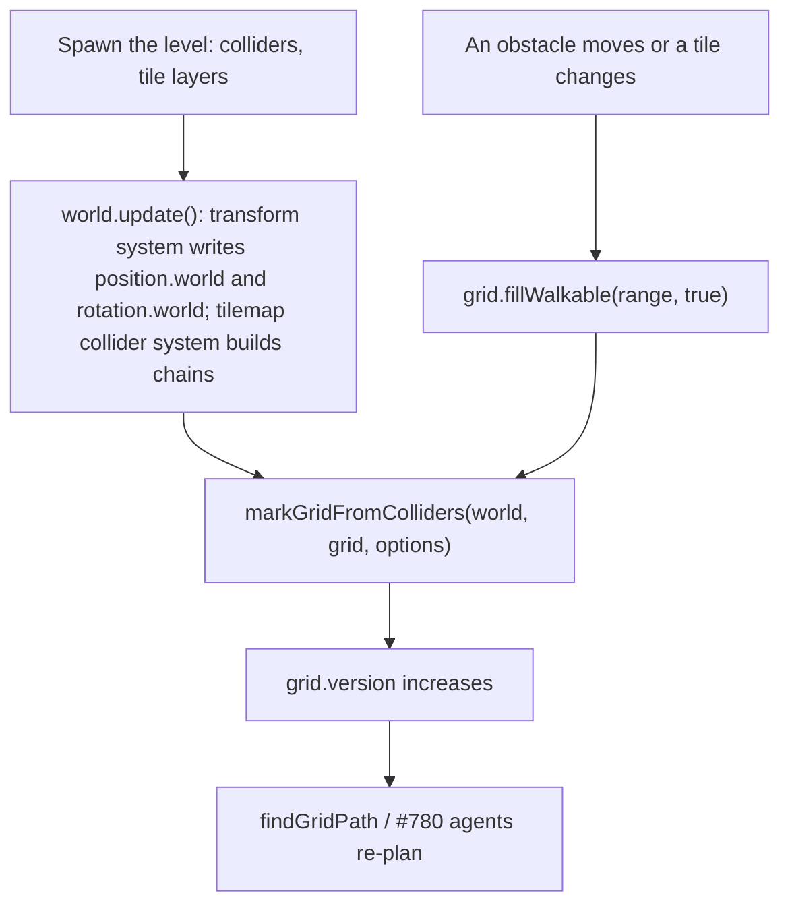

# Marking navigation grid cells from colliders

<!-- cspell:ignore walkability rasterize rasterizes rasterized rasterizer scanline scanlines Minkowski -->

Issue: [#777](https://github.com/Forge-Game-Engine/Forge/issues/777)
(Path Finding milestone; builds on [#776's navigation grids](./navigation-grids.md),
[#869's grid layouts](./grid-layouts.md) and [the chain collider](./chain-collider.md);
#839 and #871 build on it)

| Module or file                                         | Change   | Notes                                                                                                                   |
| ------------------------------------------------------ | -------- | ----------------------------------------------------------------------------------------------------------------------- |
| `src/navigation/grid/navigation-grid.ts`               | Modified | `NavigationGrid.fillWalkableMask(mask, walkable)`                                                                       |
| `src/navigation/grid/dense-navigation-grid.ts`         | Modified | Implements `fillWalkableMask`                                                                                           |
| `src/navigation/grid/mark-grid-from-colliders.ts`      | New      | `markGridFromColliders(world, grid, options?)` and `MarkGridFromCollidersOptions`                                       |
| `src/navigation/grid/baking/collider-regions.ts`       | New      | One function per `ColliderType` turning a collider into the world-space region it fills. Not exported                   |
| `src/navigation/grid/baking/mark-region.ts`            | New      | Marks the cells a region, grown by a radius, overlaps: the scanline fill, the edge pass and the disc pass. Not exported |
| `src/navigation/grid/baking/cell-distance.ts`          | New      | Distances from a point and a segment to a cell's inset quad. Not exported                                               |
| `src/navigation/grid/*.test.ts`, `baking/*.test.ts`    | New      | See "Testing"                                                                                                           |
| `src/navigation/grid/index.ts`                         | Modified | Exports `mark-grid-from-colliders.js`                                                                                   |
| `documentation-site/docs/docs/navigation/colliders.md` | New      | The "Marking cells from colliders" guide                                                                                |
| `documentation-site/docs/docs/navigation/grids.md`     | Modified | "Blocking cells" links the new guide and documents `fillWalkableMask`                                                   |
| `AGENTS.md`                                            | Modified | `/navigation`'s line in "Repository Structure" mentions baking grids from colliders                                     |
| `CHANGELOG.md`                                         | Modified | `#### Added` bullets (navigation)                                                                                       |
| **Engine version at time of design**                   |          | `0.26.2`                                                                                                                |

## Summary

Games already describe their walls and obstacles as static physics
colliders. This design adds `markGridFromColliders`, a bake step that blocks
every navigation grid cell a static collider overlaps, grown by an agent
radius, so a level is authored once for physics and navigation. Godot
(`NavigationPolygon` with `parsed_geometry_type` set to static colliders,
`parsed_collision_mask` and `agent_radius`) and Unity (a `NavMeshSurface`
collecting physics colliders with a layer mask and the agent's radius) both
bake navigation from collision geometry the same way.

```ts
import { createOrthogonalGridLayout } from '@forge-game-engine/forge/math';
import {
  createNavigationGrid,
  markGridFromColliders,
} from '@forge-game-engine/forge/navigation';

const grid = createNavigationGrid({
  columns: 64,
  rows: 48,
  layout: createOrthogonalGridLayout({ cellWidth: 16, cellHeight: 16 }),
  origin: { x: -512, y: -384 },
});

// After the level's entities exist and one world.update() has placed them:
markGridFromColliders(world, grid, { agentRadius: 12 });
```

The function reads every entity with a `PositionEcsComponent` and a
`ColliderEcsComponent` whose rigid body is `'static'` (or that has none),
skips sensors, and blocks each cell whose area comes within `agentRadius`
of the collider's world-space shape. It handles every collider shape
`src/physics/colliders` has (circle, convex polygon, terrain and chain) and
every `GridLayout`, orthogonal or isometric, through one rasterizer that
works in the grid's cell space. It only blocks cells; it never makes one
walkable, so a game that moves an obstacle clears the cells and bakes
again. It's a step to run when the level loads or changes, not every
frame, so it's a function like `raycast`, not a system.

The design differs from the issue's text in four places, each in the
decision log:

- **Scale isn't read.** The issue says the bake reads `scale.world`.
  Physics doesn't: the broad phase, narrow phase and `raycast` place a
  collider by `position.world` and `rotation.world` only
  (`raycast.ts`, `collider-rotation.ts`, every `computeAabb`), so a scaled
  entity's collider has its authored size. A grid that scaled it would
  block cells bodies can walk through, or leave open cells they can't. The
  bake reads exactly what physics reads (decision MC2, open question 1).
- **Chain colliders are in.** The issue lists "circle, convex polygon,
  polygon, terrain". The engine's shapes are `'circle' | 'polygon' |
'terrain' | 'chain'` (`ColliderType`); `PolygonCollider` is the convex
  polygon and `ChainCollider` is the non-convex outline, which is what a
  tile layer's collider is (#839 asks for chain support to land here).
  Chains need a rule for which side of their loops is solid far from any
  loop, which physics never had to decide (decision MC6).
- **A `mask` option.** Not in the issue. It picks which collision
  categories block the grid, as Godot's `parsed_collision_mask` and
  Unity's `NavMeshSurface.layerMask` do, so a game with walkers and boats
  bakes two grids from one level (decision MC8, open question 2).
- **`NavigationGrid.fillWalkableMask`.** A bake changes thousands of cells
  in one call. #776 promises `version` increases once per call that
  changes cells (navigation-grids.md NG14), so the grid gains a bulk write
  that takes a per-cell mask (decision MC9).

Every layout works from the start, since the grid already takes a
`GridLayout` (navigation-grids.md NG2), so the isometric collider tests
#871 planned belong here, as navigation-grids.md's open question 1 said.

Nothing here bends a core design of the engine. The bake reads components
and writes only the grid, which is plain data, not a component.

## Scope

### In scope

- `markGridFromColliders(world, grid, { agentRadius, mask })`.
- Which entities count: a position and a collider, no rigid body or a
  `'static'` one, not a sensor, a `category` sharing a bit with `mask`.
- Every collider shape: circle, polygon, terrain (its whole slab) and
  chain (the solid its loops enclose, holes left open).
- Overlap tested against each cell's area (its layout polygon), not its
  centre, so walls thinner than a cell still block it.
- `agentRadius`: each shape grown by a disc of that radius (its Minkowski
  sum with the disc) before marking.
- Every `GridLayout`, through one rasterizer in cell space with distances
  measured in world space.
- `NavigationGrid.fillWalkableMask(mask, walkable)`.
- Unit tests, JSDoc, a guide page, `AGENTS.md`'s module line and
  changelog bullets.

### Out of scope

- **Making cells walkable, or clearing what an earlier bake blocked.** The
  bake only blocks. Re-baking after an obstacle moves is
  `fillWalkable(range, true)` then another bake (see "Re-baking"). A
  region-limited bake is open question 4.
- **Running every frame, or watching colliders for changes.** There's no
  system and no component. #780's agents re-plan from `version`, which a
  bake bumps.
- **Costs from colliders.** Colliders say nothing about mud or roads.
  #839 sets costs from tile data.
- **Kinematic and dynamic bodies.** They move, so a baked grid would be
  out of date by the next tick. Units avoid moving bodies with local
  avoidance, which #780 leaves to the game (decision MC4).
- **Collider scale.** Physics doesn't scale colliders today (decision MC2).
- **A per-shape public API** (`markGridFromPolygon`, `markGridFromCircle`)
  for obstacles that aren't colliders. Open question 5.
- **Blocking the grid's own edges by `agentRadius`.** The grid's edge
  isn't a wall; a level whose border is a wall has a collider there.
- **Tile layers.** A tile layer's `ChainCollider` is baked like any other
  chain; per-tile costs are #839.
- **A docs-site demo.** #781 adds the milestone's demo. The guide has code
  samples.

## Which colliders block the grid

An entity is baked when all of these hold:

| Check                                                         | Why                                                                                                              |
| ------------------------------------------------------------- | ---------------------------------------------------------------------------------------------------------------- |
| It has `PositionEcsComponent` and `ColliderEcsComponent`      | The same query physics and `raycast` use. Rotation is optional and read through `getColliderRotation`.           |
| No `RigidBodyEcsComponent`, or one whose `type` is `'static'` | A static body never moves, so the bake stays right. `rigidbody-component.ts` says the two are equivalent.        |
| `collider.sensor` is `false`                                  | A trigger zone doesn't stop a body, so it doesn't stop a path.                                                   |
| `collider.category & mask` is not `0`                         | `mask` picks the categories that block this grid, the way `raycast`'s `mask` picks the categories a ray can hit. |

The world shape is the one physics collides with: the collider's local
shape rotated by `rotation.world` (`0` without a `RotationEcsComponent`)
and moved by `position.world`, through each collider's own
`getWorldCenter`/`getWorldVertices`/`Vec2.rotate` path. The bake never
writes a transform and never reads `ColliderEcsComponent.aabb`: the broad
phase writes that once per tick, and a bake at level load can run before
it has.

## API design

### `markGridFromColliders`

```ts
/** Options for {@link markGridFromColliders}. */
export interface MarkGridFromCollidersOptions {
  /**
   * How far, in world units, a cell must stay from every collider to
   * remain walkable: each shape is grown by this radius before marking,
   * so a unit of this radius walking between walkable cell centres never
   * touches a collider. A finite number of `0` or more. Defaults to `0`.
   */
  agentRadius?: number;

  /**
   * The collision categories that block the grid: a collider is baked only
   * if its `category` shares a bit with this mask. Defaults to
   * `allCollisionCategories`.
   */
  mask?: number;
}

/**
 * Blocks every cell of a navigation grid that a static collider overlaps,
 * grown by `agentRadius`. A collider counts when its entity has a
 * `PositionEcsComponent`, has no `RigidBodyEcsComponent` or a `'static'`
 * one, isn't a sensor, and has a `category` in `mask`. A cell is blocked
 * when any part of its area, not only its centre, comes within
 * `agentRadius` of the collider's world-space shape; touching along an
 * edge or corner doesn't count.
 *
 * It only ever blocks cells and never makes one walkable. It's a bake
 * step: run it when the level loads, after the systems that place
 * colliders have run once, and again after the level changes, not every
 * frame. `grid.version` increases once if any cell was blocked.
 * @param world - The world whose colliders to bake.
 * @param grid - The grid to mark.
 * @param options - The agent radius and category mask.
 * @throws An error if `agentRadius` isn't finite and `0` or more.
 */
export function markGridFromColliders(
  world: EcsWorld,
  grid: NavigationGrid,
  options?: MarkGridFromCollidersOptions,
): void;
```

Defaults are `defaultMarkGridFromCollidersOptions = { agentRadius: 0, mask:
allCollisionCategories }`, applied with `withDefaults`. It returns nothing;
`version` says whether anything changed (decision MC11).

### `NavigationGrid.fillWalkableMask`

```ts
/**
 * Makes every cell whose byte in `mask` isn't `0` walkable or blocked, and
 * leaves the rest alone, in one change: `version` increases at most once.
 * Byte `i` is the cell whose node id is `i` (`row * columns + column`).
 * @param mask - One byte per cell, `nodeCount` long.
 * @param walkable - Whether a path can enter the masked cells.
 * @throws An error if `mask.length` isn't `nodeCount`.
 */
fillWalkableMask(mask: Uint8Array, walkable: boolean): void;
```

It's the bulk form of `setWalkable`, as `fillWalkable` is for a range. A
game baking from its own data (a level image, a noise map) gets the same
one-version-per-bake behavior.

## Regions

Each collider type becomes one of two kinds of region, in world space,
through a table keyed by `ColliderType`, as `raycast.ts`'s
`raycastDetectors` is, so a new collider type fails to compile until the
bake handles it:

```ts
type BakeRegion =
  | { kind: 'disc'; center: Vector2; radius: number }
  | {
      kind: 'loops';
      loops: Vector2[][];
      /** Whether the plane outside every loop is solid. */
      outsideIsSolid: boolean;
    };

const colliderRegions: Record<
  ColliderType,
  (body: CollisionBody) => BakeRegion
>;
```

| Collider          | Region                                                                                                                                                                                                                                  |
| ----------------- | --------------------------------------------------------------------------------------------------------------------------------------------------------------------------------------------------------------------------------------- |
| `CircleCollider`  | A disc at `getWorldCenter(position, rotation)` with its `radius`.                                                                                                                                                                       |
| `PolygonCollider` | One loop, `getWorldVertices(position, rotation)`. The constructor winds it to a positive signed area.                                                                                                                                   |
| `TerrainCollider` | One loop, the slab's silhouette: the surface `points` left to right, then `(last.x, bottomY)` and `(first.x, bottomY)`, rotated and moved. With Y-down and solid below the surface, that turns `+X` towards `+Y`: positive signed area. |
| `ChainCollider`   | Every loop of `loops`, rotated and moved, keeping its winding. `outsideIsSolid` is `true` when the loop with the largest absolute signed area is a hole (decision MC6). No loops: nothing to mark.                                      |

A terrain's whole slab is solid for navigation, though bodies only collide
with its surface: nothing can stand inside the ground, and `raycastTerrain`
already treats the slab as solid.

### Which side of a chain is solid

`ChainCollider`'s rule (chain-collider.md DL-8) is local: positive signed
area surrounds solid and negative surrounds a hole, and a lone hole loop is
a room in unbounded solid. Loops never cross (the constructor validates
it), so they nest, and the bake counts winding: an edge going up the cell
space adds `1` to every point to its right, one going down subtracts `1`,
so a point inside a positive loop winds `+1` and inside a hole `-1` more
than its surroundings.

- When `outsideIsSolid` is `false`, a point is solid when its winding is
  `1` or more: inside a solid loop and not inside a hole within it, or
  inside an island within that hole.
- When it's `true`, a point is solid when its winding is `0` or more:
  outside the hole, or inside an island within it.

The largest loop can't be inside another loop, so its sign says what's
outside: a level outline (`buildTilemapCollisionLoops`) has solid outer
loops, and a room carved out of solid has a hole as its largest loop. A
chain whose outermost loops disagree (a solid island beside a separate lone
hole) is contradictory; the largest loop decides for it (open question 6).

## Marking a region

Each region is marked into a scratch `Uint8Array` of `nodeCount` bytes,
seeded with the grid's already-blocked cells. After every collider,
`grid.fillWalkableMask(scratch, false)` writes it in one change.

### What "overlaps" means

A cell is blocked when its **inset quad** comes within `agentRadius` of the
region, distances measured in world space:

- The inset quad is the cell's cell-space square shrunk by `ε = 1e-6` on
  each side, `[c + ε, c + 1 - ε] x [r + ε, r + 1 - ε]`, mapped to the world
  through the layout and `origin` (four corners from the layout's column
  and row steps, as `grid-metric.ts` reads them).
- The test is "distance `≤ agentRadius`". With `agentRadius: 0` that's
  "overlaps the cell's inside by more than `ε` of a cell", so a wall whose
  edge lies on a cell boundary blocks the cells it's in and not the
  neighbors it touches. A tile layer's collider and a grid with the same
  layout and origin agree cell for cell, though the chain's points went
  through a rotation and two subtractions on the way (decision MC5).
- With `agentRadius` a multiple `k` of the cell size on a square grid, a
  wall aligned to cells pads exactly `k` cells on each side.

A region overlaps a cell's inset quad within the radius exactly when
either:

1. the quad's centre is inside the region (the **fill pass**), or
2. some edge of the region's boundary is within the radius of the quad
   (the **edge pass**).

If the quad meets the region but its centre isn't inside, the boundary
crosses the quad, so an edge is within distance `0`. If it doesn't meet the
region but is within the radius, the nearest point of the region is on its
boundary. So the two passes together are exact, and each is cheap on its
own.

### The fill pass

In cell space every cell is a unit square and a row of cells is a strip
`[r, r + 1)`, on every layout. The layout is a linear map that keeps
winding (grid-layout.ts), so winding numbers are the same there. The fill
pass scans one line per row through the cell centres:

```text
fillPass(grid, loops, outsideIsSolid, scratch):
  cellLoops = loops mapped by p -> layout.localToCellSpace(p - origin)
  threshold = outsideIsSolid ? 0 : 1
  rows = every row of the grid if outsideIsSolid
         else the rows the cell-space bounds of cellLoops reach, clipped to the grid
  for row in rows:
    y = row + 0.5
    crossings = []
    for each edge (a, b) of cellLoops with min(a.y, b.y) <= y < max(a.y, b.y):
      x = a.x + (y - a.y) * (b.x - a.x) / (b.y - a.y)
      crossings.push(x, a.y > b.y ? +1 : -1)   # going up adds, going down subtracts
    sort crossings by x
    winding = 0; k = 0
    for column in 0 .. columns - 1:
      while k < crossings.length and crossings[k].x < column + 0.5:
        winding += crossings[k].sign; k++
      if winding >= threshold: scratch[row * columns + column] = 1
```

The half-open rule on `y` counts a vertex on the scan line once and skips
edges along it, as every scanline polygon fill does. A cell-aligned edge
never lies on a centre line, so tile outlines never hit that case. Edges
are bucketed by the rows they span before scanning, so each row only looks
at the edges that cross it.

### The edge pass

For each edge `a`-`b` of a loop region (in world space):

```text
edgePass(grid, a, b, radius, scratch):
  ca, cb = a and b in cell space
  reachX = radius * |first row of the local-to-cell-space map|
  reachY = radius * |second row of the local-to-cell-space map|
  for row from floor(min(ca.y, cb.y) - reachY) to floor(max(ca.y, cb.y) + reachY), clipped:
    piece = segment ca-cb clipped to y in [row - reachY, row + 1 + reachY]
    if piece is empty: continue
    for column from floor(min x of piece - reachX) to floor(max x of piece + reachX), clipped:
      i = row * columns + column
      if scratch[i] == 1: continue
      if segmentToQuadDistance(a, b, insetQuad(column, row)) <= radius:
        scratch[i] = 1
```

`reachX` and `reachY` are how far a world-space disc of the radius reaches
along each cell-space axis: for a linear map `L`, the largest cell-space
`x` of `L v` with `|v| <= r` is `r` times the length of `L`'s first row.
So the candidates are every cell the grown segment can touch and few
others, on every layout, and the exact test decides. A long diagonal wall
visits about as many cells as it crosses, not its whole bounding box.

`segmentToQuadDistance` is `0` when the segment has an end inside the quad
or crosses one of its edges, and otherwise the least of the four
quad-corner-to-segment distances and the two segment-end-to-quad-edge
distances: the standard distance between a segment and a convex polygon.

### The disc pass

A circle grown by the agent radius is a disc of radius `R = radius +
agentRadius`. Its candidate cells are the cell-space box around the centre
reaching `R` times each row's length of the local-to-cell-space map along
each axis, as in the edge pass, and a cell is blocked when the distance from the
disc's centre to its inset quad (`0` inside it) is `≤ R`.

### Agent radius

Growing a shape by a disc (its Minkowski sum with the disc) rounds its
corners: a box grown by `r` is a rounded box, not a bigger box. That's the
clearance a circular unit of radius `r` needs, and what Recast's erosion
(behind Unity's bake) and Godot's `agent_radius` approximate on their
meshes. A cell that stays walkable has its whole inset quad more than `r`
from every collider, so:

- a unit of radius `r` anywhere in a walkable cell clears every baked
  collider, and
- a unit walking a grid path stays clear: an orthogonal step between two
  walkable cell centres stays inside those two cells, and a diagonal step
  under `'noCornerCutting'` stays inside the four cells around their
  shared corner, all walkable. Under `'always'` a diagonal step can pass
  the corner of a blocked cell, so the guide recommends the default.

The test is conservative: a corridor exactly `2r` wide closes unless its
cells line up with it. That's the issue's choice ("test cell overlap with
the cell's rectangle, not just its centre"); decision MC3.

### Culling

Before building a region, the bake computes the collider's world bounds
with its own `computeAabb(position, rotation)`, grown by `agentRadius`,
and skips the collider when they miss the grid's world bounds (the box of
its four corners) and the region isn't `outsideIsSolid`. A level with many
colliders outside a small grid costs one box test each.

## When to bake



- The bake reads `position.world` and `rotation.world`, which
  `createTransformEcsSystem` writes, and a tile layer's collider, which
  `createTilemapColliderEcsSystem` builds during `world.update()`. A bake
  straight after spawning sees a child entity's `world` before it's
  composed with its parent's, and no chain at all for a tile layer. So the
  guide shows baking after the first `world.update()`, the same rule as
  using `raycast` against new colliders.
- Nothing calls the bake for the game. Godot and Unity bake on request (in
  the editor, or `bake_navigation_polygon()` / `NavMeshSurface.BuildNavMesh()`
  at run time), not continuously.

### Re-baking

The bake only blocks, so moving a door means:

```ts
grid.fillWalkable(doorwayCells, true); // or every cell, for a full re-bake
markGridFromColliders(world, grid, { agentRadius: 12 });
```

The game chooses the range: the cells around the old and new positions,
grown by the agent radius, or the whole grid. `fillWalkable` also reopens
cells the game blocked by hand, so a game mixing both re-applies its own
marks after the bake. Each call bumps `version` when it changes cells, so
a re-bake that ends where it started still makes agents re-plan once.

## Performance

For a grid of `C` cells and a region whose boundary has `E` edges:

- **Fill pass:** each edge is bucketed into the rows it spans, so a row
  costs its crossings plus its columns, and the pass costs about
  `E + (crossings) log(crossings per row) + (cells in the rows scanned)`.
  An `outsideIsSolid` chain scans every row of the grid.
- **Edge pass:** per edge, the cells within `agentRadius` of it plus one
  ring, each a skip if already blocked or a segment-to-quad test (about
  forty multiplies). Already-blocked cells cost one byte read, so
  overlapping colliders and cells blocked by the fill pass are cheap.
- **Disc pass:** the cells of the disc's cell-space box.
- **Memory:** one `nodeCount`-byte scratch array per bake (256 KB for a
  512 x 512 grid), the world and cell-space copies of each region's
  points, and the row buckets. A bake isn't per-frame, so these are
  allocated per call rather than pooled.

A 256 x 256 grid baked from a tile layer's chain of a few thousand edges
and a hundred props is tens of thousands of exact tests, which runs in
milliseconds. Running it every frame would show; the guide says not to.

## Testing

All unit tests, in Vitest, next to the files they test. Nothing renders,
reads input or runs the game loop, so there are no e2e tests. Each test
builds a minimal `EcsWorld` with position, rotation and collider
components and writes `world` values through `add{Position,Rotation}Component`
(which start `world` as a copy of `local`) or by running
`createTransformEcsSystem` once.

### `fillWalkableMask`

- Sets exactly the masked cells, either way; leaves the rest alone.
- `version` increases once for a mask that changes many cells, and not for
  one that changes none (an empty mask, or masked cells already set).
- A mask of the wrong length throws.

### Shapes, on a square orthogonal grid

The expected set of blocked cells is computed by a brute-force reference in
the test helpers: for each cell, sample its inset quad on a fine lattice
and its edges, and compare distances to the shape, with a tolerance band
that only accepts the reference's undecided cells either way.

- **Circle:** a circle centred on a cell, one on a cell corner, one with a
  non-zero `center` on a rotated entity (the centre turns with the
  entity), one smaller than a cell inside one cell.
- **Polygon:** an axis-aligned box exactly on cell boundaries blocks only
  its own cells; the same box moved by `0.5` cells blocks one more row and
  column; a box rotated by 30° matches the reference; a thin wall (a
  quarter of a cell wide, not over any centre) blocks every cell it
  crosses; a triangle; a polygon whose vertices aren't around the entity's
  origin.
- **Terrain:** a sloped terrain blocks the cells under its surface and the
  cells the surface crosses, and the slab's sides and bottom bound it; a
  rotated terrain.
- **Chain:** a square room (a solid outer loop with a hole) blocks the
  walls and leaves the room open; an island inside the hole is blocked; a
  lone hole loop blocks every cell outside it, including grid rows the
  loop never reaches; a diagonal slope blocks the cells it crosses; a
  chain with no loops changes nothing; a contradictory chain (island
  beside a lone hole, the island larger) follows the largest-loop rule.

### `agentRadius`

- A box with `agentRadius` of one cell size pads exactly one ring, with
  rounded corners: the diagonal corner cell is blocked only when its quad
  is within the radius of the box's corner.
- A circle's radius and `agentRadius` add.
- A thin wall's padding on both sides.
- `agentRadius` below one cell still blocks the neighbors it reaches.
- Negative, `NaN` and infinite `agentRadius` throw.

### Which colliders count

- Sensors are skipped.
- `'dynamic'` and `'kinematic'` bodies are skipped; `'static'` and no
  rigid body are baked.
- `mask` skips colliders whose `category` shares no bit with it; the
  default bakes every category.
- An entity without `RotationEcsComponent` is unrotated; a rotated entity
  uses `rotation.world`, and a child entity uses the `world` values the
  transform system composed, not its `local` ones.
- Scale is ignored: an entity with `ScaleEcsComponent` `(2, 2)` bakes the
  same cells as one without, matching what physics collides with.
- A collider wholly outside the grid changes nothing and is culled.

### Grid behavior

- The bake never makes a cell walkable: cells blocked before it stay
  blocked, wherever the colliders are.
- `version` increases once per bake that blocks a cell, and not for a bake
  that blocks nothing new (a second identical bake).
- Re-baking after `fillWalkable(range, true)` and moving a collider blocks
  the new cells and reopens the old ones.

### Layouts

- The square-grid shape tests above, repeated on a `32 x 16` orthogonal
  layout and a `64 x 32` isometric layout with a non-zero `origin`,
  against the same brute-force reference (it measures the layout's real
  cell polygons).
- An isometric grid blocks exactly the diamond cells a rotated box
  overlaps, with and without `agentRadius` (#871's test).
- A tile layer's collider from `buildTilemapCollisionLoops`, baked onto a
  grid with the same layout and `origin` at the layer's position, blocks
  exactly the solid tiles' cells, on an orthogonal and an isometric
  layout.

### Paths

- On a grid baked with `agentRadius: r` and `'noCornerCutting'`, every
  segment between consecutive `findGridPath` points stays more than `r`
  (less the tolerance) from every collider, on seeded random levels of
  boxes and circles.

## Documentation

- **`navigation/colliders.md` (new),** following the `document-feature`
  skill: what the bake does and which colliders count (static or no rigid
  body, not sensors, `mask`); cell area vs. centre, with a small diagram
  of a thin wall; `agentRadius` and its rounded corners, one grid per unit
  size; how each shape bakes (a terrain's whole slab, a chain's loops and
  holes, the largest-loop rule); that scale isn't read, as in physics;
  when to bake (after the first `world.update()`), that it only blocks, and
  how to re-bake after a change; that it's not for every frame; using
  `'noCornerCutting'` with an agent radius.
- **`navigation/grids.md`:** "Blocking cells" documents
  `fillWalkableMask` and links the new page.
- **`AGENTS.md`:** `/navigation`'s line in "Repository Structure" adds
  "`markGridFromColliders`, which blocks the cells static colliders
  overlap".
- **JSDoc** on every export, including the overlap rule, what counts as a
  static collider and the bake-step warning on `markGridFromColliders`.
- **Changelog:** two `#### Added` bullets (below).

## Phases

### Phase 1: bulk walkability writes

`NavigationGrid.fillWalkableMask`, which the bake needs and which any game
baking from its own data can use.

**Done when** the `fillWalkableMask` tests pass, the method is on the
exported `NavigationGrid` interface, `grids.md` documents it, and the
CLAUDE.md verification steps pass.

| Task           | Description                                                                                                | Size |
| -------------- | ---------------------------------------------------------------------------------------------------------- | ---- |
| Interface      | `fillWalkableMask(mask, walkable)` on `NavigationGrid`, with JSDoc                                         | S    |
| Implementation | `DenseNavigationGrid`: length check, one pass, one `version` increase when anything changed                | S    |
| Tests          | The "fillWalkableMask" tests                                                                               | S    |
| Docs           | `grids.md`, "Blocking cells"                                                                               | S    |
| Changelog      | `#### Added`: **navigation:** `NavigationGrid.fillWalkableMask` blocks or opens masked cells in one change | S    |

### Phase 2: baking from colliders

`markGridFromColliders` with every shape, every layout, `agentRadius` and
`mask`.

**Done when** every test under "Shapes", "agentRadius", "Which colliders
count", "Grid behavior", "Layouts" and "Paths" passes, the issue's "done
when" holds (a level built from static colliders gives a grid whose
blocked cells cover every collider, padded by the agent radius), the guide
is written, and the CLAUDE.md verification steps pass.

| Task                    | Description                                                                                                                                     | Size |
| ----------------------- | ----------------------------------------------------------------------------------------------------------------------------------------------- | ---- |
| Cell distances          | `cell-distance.ts`: the inset quad from the layout's steps, point-to-quad and segment-to-quad distance; its own tests                           | M    |
| Regions                 | `collider-regions.ts`: the `Record<ColliderType, …>` table; the terrain silhouette; chain loops and the largest-loop rule; its own tests        | M    |
| Fill pass               | `mark-region.ts`: loops to cell space, row buckets, scanline winding with the threshold; `outsideIsSolid` over every row                        | L    |
| Edge and disc passes    | `mark-region.ts`: cell-space reach of a radius, row-clipped candidates, exact tests, skipping blocked cells                                     | M    |
| `markGridFromColliders` | Options, validation, the query and filters, culling, the scratch mask, one `fillWalkableMask`                                                   | M    |
| Brute-force reference   | Test helper: sampled inset-quad distances to each shape, with an undecided band                                                                 | M    |
| Tests                   | The phase's tests on three layouts, including tile-layer chains and the path-clearance check                                                    | L    |
| Exports                 | `grid/index.ts`                                                                                                                                 | S    |
| Docs                    | `navigation/colliders.md`; `AGENTS.md` module line                                                                                              | M    |
| Changelog               | `#### Added`: **navigation:** `markGridFromColliders(world, grid, { agentRadius, mask })` blocks the cells static, non-sensor colliders overlap | S    |

The `claude` label run can ship both phases in one pull request.

## Decision log

| #    | Decision                          | Options considered                                                                                                                                     | Chosen | Rationale                                                                                                                                                                                                                                                                                                                      | Tradeoff                                                                                                    | Assumptions                                                                   |
| ---- | --------------------------------- | ------------------------------------------------------------------------------------------------------------------------------------------------------ | ------ | ------------------------------------------------------------------------------------------------------------------------------------------------------------------------------------------------------------------------------------------------------------------------------------------------------------------------------ | ----------------------------------------------------------------------------------------------------------- | ----------------------------------------------------------------------------- |
| MC1  | A function, not a system          | (a) A function called on load or change, like `raycast`; (b) a system that re-bakes every tick; (c) a system plus a "dirty" component                  | (a)    | The issue asks for a bake step. Godot and Unity bake on request. (b) costs a full rasterization per frame for levels that rarely change; (c) needs change tracking on transforms and colliders that the ECS doesn't have, and the game knows when its level changed.                                                           | The game calls it at the right time, after the first update.                                                | Levels change rarely compared with frames.                                    |
| MC2  | Which transform the bake reads    | (a) `position.world` and `rotation.world`, as physics; (b) also `scale.world`, as the issue says                                                       | (a)    | Physics places colliders by position and rotation only (`computeAabb`, `getWorldVertices`, `raycast`). The grid has to agree with what bodies collide with, or paths go through solid or around nothing. If physics gains collider scale, the bake reads it through the same calls.                                            | A scaled sprite with an unscaled collider bakes at the collider's size, as it collides.                     | Physics keeps ignoring scale for now (open question 1).                       |
| MC3  | Cell area or centre               | (a) A cell blocks when any of its area is within the radius; (b) only its centre; (c) a fraction of its area                                           | (a)    | The issue's choice, so thin walls block. With it a unit of radius `r` anywhere in a walkable cell, and along any `'noCornerCutting'` path, clears every collider. (b) skips walls between centres; (c) has no clearance guarantee.                                                                                             | Conservative: corridors narrower than `2r` plus up to a cell close.                                         |                                                                               |
| MC4  | Which bodies count                | (a) No rigid body or `'static'`; (b) also `'kinematic'`; (c) every collider                                                                            | (a)    | The issue's rule, and Unity's "navigation static" idea: only what never moves is baked, so the grid stays right. A kinematic door would be baked where it stood.                                                                                                                                                               | A kinematic door that rarely moves needs a static collider of its own to bake, or the game marks its cells. | Moving obstacles are avoided locally, not baked.                              |
| MC5  | Touching and tolerance            | (a) Distance to the cell's quad inset by `1e-6` of a cell, `≤ radius`; (b) the exact quad, `< radius`; (c) the exact quad, `≤ radius`                  | (a)    | (c) blocks every neighbor a cell-aligned wall touches, doubling tile walls. (b) is the same at `radius > 0` but with `radius 0` can never block (a distance is never below `0`). (a) gives "overlaps the inside", lets an aligned wall padded by `k` cells pad exactly `k`, and absorbs rounding in transformed tile outlines. | A shape overlapping a cell by less than a millionth of it doesn't block it.                                 | Levels don't rely on sub-millionth-of-a-cell overlaps.                        |
| MC6  | Chain solidity far from its loops | (a) Winding with a threshold set by the largest loop's sign; (b) innermost containing loop decides, outside always empty; (c) side of the nearest edge | (a)    | Matches DL-8 exactly for nested loops, including a lone hole (a room in unbounded solid), and needs one winding count per scan line. (b) gets lone holes wrong. (c) is ambiguous at corners and depends on scan direction.                                                                                                     | A contradictory chain (outermost loops of both signs) is resolved by area, not by the author's intent.      | Real chains have consistent outermost loops (open question 6).                |
| MC7  | One rasterizer for every layout   | (a) Fill in cell space, distances in world space; (b) per-layout code paths; (c) test every cell against every shape in world space                    | (a)    | A layout is a linear map that keeps winding, so scanlines and cell ranges work the same on every layout (#871's plan), while the radius stays a world distance. (c) costs cells × edges.                                                                                                                                       | Each region's points are mapped to cell space once.                                                         | `GridLayout` stays linear (grid-layouts.md G4).                               |
| MC8  | A `mask` option                   | (a) `mask`, default every category; (b) no filter beyond sensors and body type                                                                         | (a)    | Different games really need different values: walkers and boats, or ground units and fliers, bake different grids from one level. Godot (`parsed_collision_mask`) and Unity (`layerMask`) both have it, and `raycast` already has a `mask` with the same meaning.                                                              | One more option than the issue lists.                                                                       | Categories already sort colliders the way navigation needs (open question 2). |
| MC9  | How the bake writes the grid      | (a) A scratch mask and a new `fillWalkableMask`, one `version` increase; (b) `setWalkable` per cell; (c) `fillWalkable` per run of cells               | (a)    | #776 promises one increase per changing call (NG14). (b) and (c) bump `version` hundreds of times per bake. The mask also lets every pass skip blocked cells with a byte read, and gives games a bulk write of their own.                                                                                                      | A public method added to `NavigationGrid` for the bake.                                                     |                                                                               |
| MC10 | Terrain as solid                  | (a) The whole slab; (b) only cells the surface crosses                                                                                                 | (a)    | A unit can't stand inside the ground, and `raycastTerrain` treats the slab as solid. (b) would leave the ground's inside open for paths that snap into it.                                                                                                                                                                     | None for a top-down use; a side-view game rarely grid-paths through terrain.                                |                                                                               |
| MC11 | Return value                      | (a) `void`, `version` reports change; (b) the number of cells blocked                                                                                  | (a)    | `version` already says whether the bake changed anything, and the docs' "bake after the first update" rule covers the common mistake a count would reveal.                                                                                                                                                                     | Diagnosing an empty bake means checking the grid.                                                           |                                                                               |
| MC12 | Where the bake lives              | (a) `src/navigation`, importing physics; (b) `src/physics`, importing navigation                                                                       | (a)    | Navigation consumes collision data, as `src/tilemaps` consumes physics for tile colliders. Physics shouldn't know about grids.                                                                                                                                                                                                 | `@forge-game-engine/forge/navigation` pulls in physics code.                                                |                                                                               |

## Open questions

1. **Reading `scale.world`** (non-blocking). The issue says the bake reads
   it; physics doesn't.
   - Ignore scale, as physics does (default, MC2): the grid matches what
     bodies collide with.
   - Read scale: matches the issue's text, but bakes cells physics leaves
     open for any scaled collider entity. Only right together with a
     physics change that scales colliders (Godot and Unity do), which
     would be its own issue; the bake would then follow through the same
     world-shape calls.

2. **The `mask` option** (non-blocking).
   - Include it (default, MC8): one level, several kinds of unit.
   - Leave it out, as the issue lists: a game with several unit kinds
     puts its colliders on separate worlds or marks cells by hand.
     Removing it drops one filter line and its tests.

3. **Kinematic bodies** (non-blocking).
   - Skip them (default, MC4): the issue's rule.
   - Bake them too: a door that opens rarely blocks without a second
     collider, but a moving platform blocks wherever it was at bake time.

4. **A region-limited bake** (non-blocking). Re-baking a moved door
   re-tests every collider over the whole grid.
   - Leave it out (default): a bake takes milliseconds, and the game picks
     the range it clears.
   - An `area: GridCellRange` option that only tests and writes cells in
     it: re-bakes cost the area, not the level (Unity updates a
     `NavMeshData` within bounds; Recast rebuilds tiles). It could also
     compare before and after, so a re-bake that ends where it started
     leaves `version` alone. Adds an option and a clip to each pass.

5. **Per-shape marking for obstacles that aren't colliders**
   (non-blocking).
   - Don't export the passes (default): obstacles that matter to
     navigation usually collide too.
   - Export `markGridFromPolygon(grid, points, options)` and
     `markGridFromCircle(...)`: a game can block a no-walk zone without a
     collider. The passes are already shape-agnostic, so this is exports,
     JSDoc and tests.

6. **A chain whose outermost loops disagree** (non-blocking). The largest
   loop decides whether the outside is solid (MC6).
   - Largest loop (default): one rule, cheap.
   - Throw from the bake: the author's intent is unclear, and an error
     finds the backwards loop. But `ChainCollider` accepts such a chain,
     so physics and navigation would disagree on what's valid.
