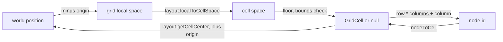
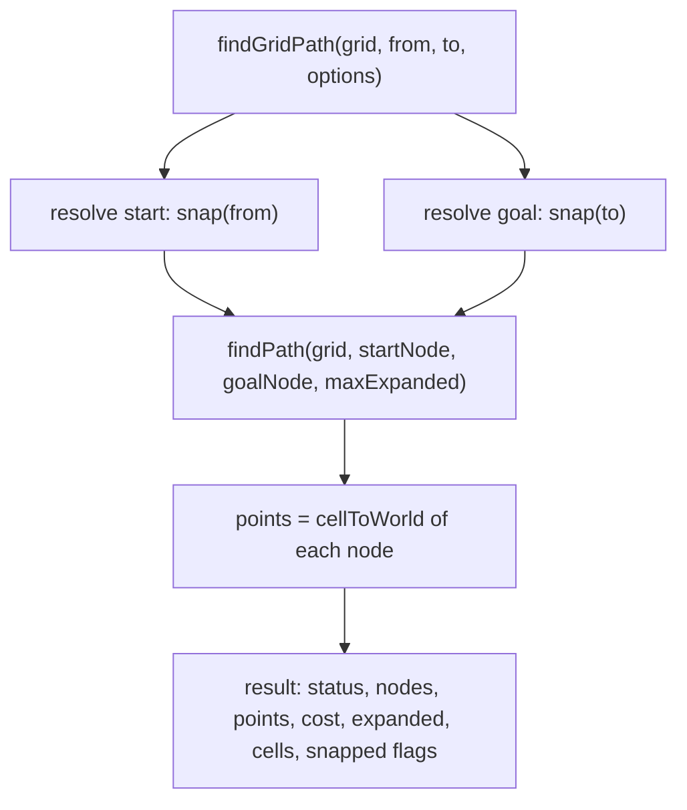

# Navigation grids

<!-- cspell:ignore octile pathfinding walkability fround underflows Chebyshev supercover rescan unclipped -->

Issue: [#776](https://github.com/Forge-Game-Engine/Forge/issues/776)
(Path Finding milestone; builds on [#775's search](./navigation-path-search.md)
and [#869's grid layouts](./grid-layouts.md); #777, #779, #780, #839 and #871
build on it)

| Module or file                                            | Change   | Notes                                                                                     |
| --------------------------------------------------------- | -------- | ----------------------------------------------------------------------------------------- |
| `src/navigation/grid/navigation-grid.ts`                  | New      | The `NavigationGrid` interface, `NavigationGridOptions` and `NavigationGridDiagonals`     |
| `src/navigation/grid/create-navigation-grid.ts`           | New      | `createNavigationGrid(options)`                                                           |
| `src/navigation/grid/dense-navigation-grid.ts`            | New      | `DenseNavigationGrid`, the one implementation, over flat typed arrays. Not exported       |
| `src/navigation/grid/grid-metric.ts`                      | New      | The layout's step lengths and the grid distance the heuristic is built from. Not exported |
| `src/navigation/grid/find-grid-path.ts`                   | New      | `findGridPath`, `FindGridPathOptions`, `FindGridPathResult`                               |
| `src/navigation/grid/snap-to-walkable-cell.ts`            | New      | The bounded ring search for the nearest walkable cell. Not exported                       |
| `src/navigation/grid/*.test.ts`                           | New      | See "Testing"                                                                             |
| `src/navigation/grid/index.ts`, `src/navigation/index.ts` | Modified | Export the grid's public API through `@forge-game-engine/forge/navigation`                |
| `documentation-site/docs/docs/navigation/grids.md`        | New      | The "Navigation grids" guide                                                              |
| `documentation-site/docs/docs/navigation/index.md`        | Modified | A short paragraph linking the grids guide                                                 |
| `AGENTS.md`                                               | Modified | `/navigation`'s line in "Repository Structure" mentions grids                             |
| `CHANGELOG.md`                                            | Modified | `#### Added` bullets (navigation)                                                         |
| **Engine version at time of design**                      |          | `0.26.2`                                                                                  |

## Summary

Most 2D games path-find on a grid. This design adds a navigation grid to
the `navigation` module: a fixed-size block of cells, each walkable or
blocked and each with a traversal cost, that implements #775's
`NavigationGraph` so `findPath` can search it, plus `findGridPath`, which
takes two world positions and returns a world-space path.

```ts
import { createOrthogonalGridLayout } from '@forge-game-engine/forge/math';
import {
  createNavigationGrid,
  findGridPath,
} from '@forge-game-engine/forge/navigation';

const grid = createNavigationGrid({
  columns: 40,
  rows: 30,
  layout: createOrthogonalGridLayout({ cellWidth: 32, cellHeight: 32 }),
  origin: { x: -640, y: -480 },
});

grid.fillWalkable(
  { minColumn: 10, minRow: 5, maxColumn: 10, maxRow: 20 },
  false,
);
grid.setCost(4, 4, 3); // mud

const result = findGridPath(grid, unitPosition, clickedPosition);
// result.points: cell centres in world space, from the unit's cell to the goal's.
```

Godot's `AStarGrid2D` is the reference for the feature set, as the issue
asks: a bounded grid with per-cell solidity and weight, a diagonal mode, a
heuristic matched to the movement rule, and a world offset and cell shape.
The design differs from the issue's text in three places, each in the
decision log:

- **Y-down.** The issue says cell `(0, 0)`'s `origin` is its bottom-left
  corner and rows increase towards `+Y` "following the engine's Y-up
  convention". The engine is Y-down (AGENTS.md "Angles and Directions",
  since #864). Rows increase towards `+Y`, which is down the screen, and
  `origin` is where cell `(0, 0)`'s top-left corner is (decision NG1).
- **A `GridLayout` instead of `cellSize`.** #869's `GridLayout` has
  shipped, and #871 already plans to replace `cellSize` with it. The grid
  takes a `layout` now, so it never ships an option that is removed one
  issue later, and an isometric grid works from the first release
  (decision NG2). This moves most of #871 into this design (open question 1).
- **Step costs in world distance.** A step costs the destination cell's
  cost times the world distance between the two cell centres, rather than
  `1` and `√2`. On a square orthogonal layout that's the issue's rule
  scaled by the cell size; on rectangular and isometric layouts it's what
  keeps paths shortest on screen (decision NG3). The heuristic is the
  exact obstacle-free grid distance for the layout, which is Manhattan or
  octile distance on square cells, as the issue asks (decision NG4).

The grid is plain data with methods, not a component, like `GridLayout`
and the waypoint graph #778 plans. Nothing here changes the ECS or bends
a core design of the engine.

## Scope

### In scope

- `createNavigationGrid({ columns, rows, layout, origin, diagonals })`
  returning a `NavigationGrid` that implements `NavigationGraph`.
- Cell storage in a `Uint8Array` (walkable) and a `Float32Array` (cost),
  with `setWalkable`, `setCost`, `fillWalkable`, `fillCost`, `isWalkable`,
  `getCost`, and a `version` that increases whenever a cell changes.
- Conversions: `worldToCell` (or `null` outside the grid), `cellToWorld`
  (the cell centre), `cellToNode`, `nodeToCell` and `hasCell`.
- The three diagonal rules (`'never'`, `'always'`, `'noCornerCutting'`),
  step costs, and an admissible, consistent heuristic for any
  `GridLayout`, with the lowest cell cost tracked for it.
- `findGridPath(grid, fromWorld, toWorld, options?)`, which snaps a
  blocked or out-of-grid start or goal to the nearest walkable cell within
  a bounded number of rings and says so in the result.
- Unit tests, JSDoc, a "Navigation grids" docs page, `AGENTS.md`'s module
  line and changelog bullets.

### Out of scope

- **Marking cells from colliders** (#777) and from tile layers (#839).
  This design gives them what they need: `fillWalkable`, the `layout` and
  `origin` to rasterize in cell space, and `version`.
- **Path smoothing and line of sight** (#779). `findGridPath` returns one
  point per cell; smoothing is a separate step the caller chooses.
- **Navigation agents, re-planning and the per-frame budget** (#780).
  `version` and `maxExpanded` are what #780 builds on. Whether `version`
  belongs on `NavigationGraph` so an agent can watch grids and waypoint
  graphs alike is #780's decision; this design doesn't change #775's
  interface.
- **A rotated or scaled grid.** A grid has a world `origin` and no
  rotation or scale, like Godot's `AStarGrid2D` (`offset`, `cell_size`).
  A game whose level is rotated converts positions into the grid's frame
  itself. Following an entity's transform would make the grid a component
  (decision NG6).
- **Resizing a grid.** `columns`, `rows`, `layout`, `origin` and
  `diagonals` are fixed when it's created. A level of another size makes
  a new grid.
- **Other diagonal rules**, such as Godot's "at least one walkable" mode
  (open question 6), and **jump point search** (Godot's `jumping_enabled`).
  Both can be added later without changing this API's shape.
- **Agent size.** A grid treats a unit as a point at a cell centre. #777's
  `agentRadius` pads blocked cells for bigger units; several sizes of unit
  use several grids.
- **Staggered and hexagonal layouts.** `GridLayout` doesn't have them
  (grid-layouts.md, decision G4).
- **A docs-site demo.** #781 adds the milestone's demo once agents exist.
  The guide has code samples.

## Coordinates

Everything follows `GridLayout`'s conventions (grid-layouts.md,
"Coordinate conventions"):

- World space is Y-down. Columns increase towards `+X` and rows towards
  `+Y`, down the screen.
- The layout maps cell space to the grid's local space, in which cell
  `(c, r)` is the unit square `[c, c + 1) x [r, r + 1)` and the cell-space
  origin is the local origin. The grid's local space is world space moved
  by `origin`: `world = origin + layout.cellSpaceToLocal(cellSpace)`.
- So `origin` is the world position of cell `(0, 0)`'s cell-space origin
  corner: its top-left corner on an orthogonal layout and its top corner on
  an isometric one. A grid laid over a tile layer whose entity sits at
  `p`, unrotated and unscaled, with the same layout, uses `origin: p` and
  agrees with it on every cell.
- `cellToWorld(column, row)` is `origin + layout.getCellCenter(column, row)`.
- `worldToCell(position)` is `layout.localToCell(position - origin)`, or
  `null` when that cell isn't in the grid. A point on a shared edge belongs
  to the cell the layout says owns it.
- A cell's node id is `row * columns + column`, as #775's design planned,
  and `nodeCount` is `columns * rows`.



Movement rules work in cell space, as Godot's `AStarGrid2D` does for its
isometric cell shapes: the four orthogonal neighbors of `(c, r)` are
`(c ± 1, r)` and `(c, r ± 1)`, and the four diagonal neighbors are
`(c ± 1, r ± 1)`, whatever the layout. On a 2:1 isometric layout the
orthogonal steps run diagonally across the screen and the diagonal steps
run straight across or straight down it, so `'never'` there means
"move only along the diamonds' edges".

## API design

### `createNavigationGrid` and `NavigationGrid`

```ts
/**
 * Which diagonal steps a navigation grid allows. A diagonal step goes from
 * `(c, r)` to `(c ± 1, r ± 1)` in cell space.
 * - `'never'`: only orthogonal steps (4-way movement).
 * - `'always'`: every diagonal step into a walkable cell (8-way movement).
 * - `'noCornerCutting'`: a diagonal step only when both cells it passes
 *   between are walkable too, so a unit never clips a wall's corner.
 */
export type NavigationGridDiagonals = 'never' | 'always' | 'noCornerCutting';

/** Options for {@link createNavigationGrid}. */
export interface NavigationGridOptions {
  /** The number of columns, a positive integer. */
  columns: number;

  /** The number of rows, a positive integer. */
  rows: number;

  /** Where the cells are: orthogonal, isometric, any `GridLayout`. */
  layout: GridLayout;

  /**
   * The world position of cell `(0, 0)`'s cell-space origin corner (the
   * top-left corner of an orthogonal cell, the top corner of an isometric
   * one). Defaults to `(0, 0)`.
   */
  origin?: Vector2;

  /** Which diagonal steps are allowed. Defaults to `'noCornerCutting'`. */
  diagonals?: NavigationGridDiagonals;
}

/**
 * A fixed-size grid of cells that are walkable or blocked, each with a
 * traversal cost, laid out in the world by a `GridLayout`. It's a
 * `NavigationGraph` whose node ids are cell indices (`row * columns +
 * column`), so `findPath` can search it; `findGridPath` does that from
 * world positions.
 */
export interface NavigationGrid extends NavigationGraph {
  readonly columns: number;
  readonly rows: number;
  readonly layout: GridLayout;
  /** A copy of the grid's origin. */
  readonly origin: Vector2;
  readonly diagonals: NavigationGridDiagonals;

  /**
   * Starts at `0` and increases by one after each call that changes at
   * least one cell's walkability or cost, so something holding a path can
   * tell the grid changed under it.
   */
  readonly version: number;

  hasCell(column: number, row: number): boolean;
  cellToNode(column: number, row: number): number;
  nodeToCell(node: number): GridCell;
  worldToCell(position: Vector2): GridCell | null;
  cellToWorld(column: number, row: number): Vector2;

  isWalkable(column: number, row: number): boolean;
  getCost(column: number, row: number): number;
  setWalkable(column: number, row: number, walkable: boolean): void;
  setCost(column: number, row: number, cost: number): void;

  /** Sets every cell of `range` that's in the grid; the rest is ignored. */
  fillWalkable(range: GridCellRange, walkable: boolean): void;
  fillCost(range: GridCellRange, cost: number): void;
}

/**
 * Creates a navigation grid with every cell walkable and costing `1`.
 * @throws An error if `columns` or `rows` isn't a positive integer, if
 * `columns * rows` is more than `2^31 - 1`, or if `origin` isn't finite.
 */
export function createNavigationGrid(
  options: NavigationGridOptions,
): NavigationGrid;
```

`GridCell` and `GridCellRange` are the types from
`@forge-game-engine/forge/math`, so ranges from
`layout.getCellRangeForLocalRect` pass straight to the fill methods.
Defaults are `defaultNavigationGridOptions = { origin: { x: 0, y: 0 },
diagonals: 'noCornerCutting' }`, applied with `withDefaults`, and the
origin is copied.

Member contracts:

- **Cell arguments.** Every method that takes a `column` and `row`, and
  `nodeToCell`, throws when they aren't integers of a cell in the grid,
  with the grid's size in the message, except `hasCell`, which answers
  that question. A wrong cell index in a typed array reads `undefined` or
  writes nothing, so a bug would otherwise show up as a wrong path far from
  its cause (the same reasoning as #775's N11).
- **`worldToCell`** returns `null` for a position outside the grid and
  throws for one that isn't finite (as `localToCell` does).
- **Costs.** A cost must be finite and more than `0` once stored as a
  32-bit float (`Math.fround(cost) > 0` and finite), so a value that
  underflows to `0` or overflows to `Infinity` throws instead of being
  stored. `getCost` returns the stored value. A blocked cell keeps its
  cost, so making it walkable again restores it.
- **`version`** increases once per call, not once per cell, and only when
  a value really changed: `setWalkable(c, r, true)` on a walkable cell, or
  `fillCost` with the cost every cell already has, leaves it alone, so an
  agent doesn't re-plan for nothing.
- **Fill ranges** are inclusive, like every `GridCellRange`, and clipped
  to the grid, so a range from a collider's bounds that hangs over the edge
  is fine. A range whose bounds aren't integers, or whose min is more than
  its max, throws. A range entirely outside the grid changes nothing.

### `findGridPath`

```ts
/** Options for {@link findGridPath}. */
export interface FindGridPathOptions extends FindPathOptions {
  /**
   * How many rings of cells around a blocked or out-of-grid start or goal
   * to look through for a walkable cell, a non-negative integer. Defaults
   * to `2`. `0` never moves either end.
   */
  snapRadius?: number;
}

/** The result of {@link findGridPath}. */
export interface FindGridPathResult extends FindPathResult {
  /**
   * The world position of each cell in `nodes`, in the same order: cell
   * centres from `startCell` to the path's last cell.
   */
  readonly points: Vector2[];

  /** The cell the search started from. */
  readonly startCell: GridCell;

  /** The cell the search looked for. */
  readonly goalCell: GridCell;

  /** `true` when `startCell` isn't the cell `fromWorld` is in. */
  readonly startSnapped: boolean;

  /** `true` when `goalCell` isn't the cell `toWorld` is in. */
  readonly goalSnapped: boolean;
}

/**
 * Finds the cheapest path across a navigation grid between two world
 * positions. A start or goal in a blocked cell, or outside the grid, is
 * moved to the nearest walkable cell within `snapRadius` rings, and the
 * result says so.
 * @throws An error if either position isn't finite, if `snapRadius` isn't
 * a non-negative integer, or for any reason `findPath` throws.
 */
export function findGridPath(
  grid: NavigationGrid,
  fromWorld: Vector2,
  toWorld: Vector2,
  options?: FindGridPathOptions,
): FindGridPathResult;
```

The result extends `FindPathResult`, so `status`, `nodes`, `cost` and
`expanded` mean what they mean for `findPath`, and `points[i]` is always
the centre of `nodes[i]`. `status` is #775's `PathStatus`; the grid adds no
statuses of its own (decision NG9).

## The graph

### Storage

`DenseNavigationGrid` holds, per cell:

| Array       | Type           | Holds                                  |
| ----------- | -------------- | -------------------------------------- |
| `_walkable` | `Uint8Array`   | `1` for walkable, `0` for blocked      |
| `_cost`     | `Float32Array` | The cell's traversal cost, default `1` |

Five bytes per cell: a 512 x 512 grid is 1.3 MB, on top of #775's search
arrays (24 bytes per node of the largest graph searched).

### Steps

`forEachNeighbor(node, visit)` reports, for each neighbor `n` of the node's
cell that's in the grid and walkable:

- an orthogonal step costing `cost[n] * |columnStep|` or
  `cost[n] * |rowStep|`,
- a diagonal step, when `diagonals` allows it, costing
  `cost[n] * |columnStep + rowStep|` or `cost[n] * |columnStep - rowStep|`,

where `columnStep = layout.cellSpaceToLocal({ x: 1, y: 0 })` and
`rowStep = layout.cellSpaceToLocal({ x: 0, y: 1 })`, the world offsets of
one column and one row. A layout is a linear map (grid-layouts.md), so
those two vectors describe it completely, and their four lengths are
computed once, when the grid is created (`grid-metric.ts`). On a square
orthogonal layout with cell size `s` the lengths are `s` and `s√2`, so a
step costs `s ×` or `s√2 ×` the destination cell's cost: the issue's rule,
in world units (decision NG3).

The destination cell's cost is the one that counts, as in Godot's
`AStarGrid2D` (`weight_scale` of the cell stepped into) and #778's plan
for waypoint graphs (the destination point's `costMultiplier`). A path's
`cost` is therefore its world length weighted by the cells it enters, the
same unit #778's waypoint paths use.

`'noCornerCutting'` allows the step from `(c, r)` to `(c + dc, r + dr)`
only when `(c + dc, r)` and `(c, r + dr)` are both walkable (both are in
the grid whenever the destination is). Steps are reported out of a blocked cell
as well as a walkable one, since a step's legality only depends on the
cells it enters and passes between. A search started in a wall can step
out of it; no search ever steps into one.

```text
forEachNeighbor(node, visit):
  row = floor(node / columns); column = node - row * columns
  for (dc, dr, length) in orthogonal steps:
    n = cell (column + dc, row + dr)
    if inside(n) and walkable(n): visit(index(n), cost(n) * length)
  if diagonals == 'never': return
  for (dc, dr, length) in diagonal steps:
    n = cell (column + dc, row + dr)
    if not inside(n) or not walkable(n): continue
    if diagonals == 'noCornerCutting' and
       not (walkable(column + dc, row) and walkable(column, row + dr)): continue
    visit(index(n), cost(n) * length)
```

The `'noCornerCutting'` check reads the two cells after the bounds check
on `n`, so both are inside the grid. Neighbors are visited in a fixed
order, which with #775's tie-breaking makes paths deterministic.

### Heuristic

The heuristic is the cost of the cheapest path between the two cells on
the same grid with no blocked cells and every cell at the grid's lowest
cost, `minCost`. For a cell-space offset `(dc, dr)` with `a = |dc|` and
`b = |dr|`:

```text
'never':  minCost * (a * |columnStep| + b * |rowStep|)

otherwise:
  diagonal = |columnStep + rowStep| if dc * dr >= 0 else |columnStep - rowStep|
  straight = (a - b) * |columnStep| if a > b else (b - a) * |rowStep|
  minCost * (min(a, b) * diagonal + straight)
```

On square orthogonal cells that's Manhattan distance for 4-way movement
and octile distance for 8-way, both times `s * minCost`, which is what the
issue asks for. The same two formulas are exact for rectangular and
isometric layouts too:

- Every step costs at least `minCost` times its length, and blocked cells
  and the corner-cutting rule only take steps away, so the real cost is
  never less than the obstacle-free one: the heuristic is admissible.
- It's a shortest-path distance, so it obeys the triangle inequality
  across every step: it's consistent, and #775's search never expands a
  node twice on a grid.
- Why the formula is that distance: a path's cost only depends on how
  many of each kind of step it takes. With step costs equal to their
  world lengths, the cheapest mix uses the two step directions on either
  side of the offset (one orthogonal and one diagonal), and the linear map
  keeps the cell-space order of directions, so those are the same two
  steps on every layout. With 4-way movement there are only the two axes.

This is tighter than #871's planned Euclidean distance for isometric
grids (`minCost` times the straight line), so a search expands fewer
cells, and it needs no special case for square layouts.

### The lowest cost

`minCost` changes as costs change. Keeping it exact on every `setCost` would
mean scanning every cell when the cheapest cell's cost goes up, and a bake
that sets every cell's cost (#839) would scan the grid once per cell. So
the grid keeps it lazily:

- Lowering a cell below `minCost` updates it at once.
- Raising a cell whose old cost was `minCost` marks it stale.
- `heuristic` checks the flag and, if it's set, scans `_cost` once and
  clears it. Each search after a change pays for at most one scan; a
  search after no change pays a boolean check per call.

`minCost` covers every cell, blocked ones included. Limiting it to
walkable cells would make it a little tighter but also go stale on every
`setWalkable`.

## Finding a path from world positions



### Resolving an end

```text
resolve(grid, position, snapRadius):
  cellSpace = layout.localToCellSpace(position - origin)
  cell = (clamp(floor(cellSpace.x), 0, columns - 1),
          clamp(floor(cellSpace.y), 0, rows - 1))
  wasInGrid = cell is the unclamped cell
  if walkable(cell) and wasInGrid: return cell, snapped false

  for ring in 0 .. snapRadius:           # ring 0 is the cell itself
    best = the walkable cell in the grid at Chebyshev distance `ring`
           from `cell` whose centre is nearest to `position`
           (ties: lower node id)
    if best exists: return best, snapped true

  return cell, snapped = not wasInGrid   # nothing walkable close by
```

- **Rings, then distance.** A cell in a nearer ring wins over one in a
  farther ring, and within a ring the centre nearest the real position
  wins. That's the breadth-first search the issue describes and touches
  at most `(2 * snapRadius + 1)²` cells. It can pick a ring-1 diagonal
  cell over a ring-2 cell whose centre is a little closer; at a radius of
  a few cells the difference is under a cell, and the simple rule is
  easier to predict.
- **Outside the grid.** A position outside the grid starts from the
  nearest cell on the grid's edge (clamped in cell space) and snaps from
  there, so a click past the map's edge gives a path to the edge rather
  than an error (open question 3).
- **Nothing walkable close by.** The end stays on its blocked cell:
  - A blocked goal can never be found, so `findPath` returns
    `'unreachable'` (or `'limitReached'`) with the partial path to the
    reached cell nearest the goal, the same thing #775 returns for an
    unreachable goal: the unit walks as close as it can. Getting there
    searches every cell reachable from the start, up to `maxExpanded`.
  - A blocked start still has steps into its walkable neighbors (see
    "Steps"), so a unit just inside a wall's edge gets out; one buried
    deeper gets `'unreachable'` and the path `[start]`.

### Building the result

Both ends are resolved, then `findPath(grid, startNode, goalNode,
{ maxExpanded })` runs, and `points` is `nodes` mapped through
`cellToWorld`. When the two ends resolve to the same cell, the result is
`'found'` with one point and cost `0`, as `findPath` gives. The only
allocations are the result's arrays and #775's.

## How the milestone builds on it

| Issue                | What it uses                                                                                                                                                                                                                        |
| -------------------- | ----------------------------------------------------------------------------------------------------------------------------------------------------------------------------------------------------------------------------------- |
| #777 colliders       | `layout.localToCellSpace(world - origin)` to rasterize each shape against unit squares (one code path for every layout, as #871 planned), `layout.getCellRangeForLocalRect` to bound it, `fillWalkable` and `setWalkable(…, false)` |
| #779 smoothing       | `worldToCell`, `hasCell`, `isWalkable` for the supercover line walk (cells outside the grid count as blocked); `points` as its input                                                                                                |
| #780 agents          | `findGridPath` with the frame's remaining budget as `maxExpanded`; `version` to re-plan; `snapped` flags and `goalCell` to tell "arrived near" from "arrived"                                                                       |
| #839 tile layers     | The same `GridLayout` as the layer, `origin` at the layer's position, and `setCost` per cell from tile data                                                                                                                         |
| #871 isometric grids | Already covered here except the isometric collider tests, which belong with #777 (open question 1)                                                                                                                                  |

## Performance

- `forEachNeighbor` does up to eight bounds checks, eight byte reads (plus
  two per diagonal for corner cutting) and one multiply per step. It
  allocates nothing: the step offsets and lengths are fields computed when
  the grid is created.
- `heuristic` is a division, a few subtractions and multiplies, and the
  stale-`minCost` check. #775 caches it per reached node.
- With an exact heuristic and #775's tie-break towards the lower
  heuristic, a search across an open grid expands about as many cells as
  the path is long, on every layout.
- `findGridPath` costs one `findPath`, up to two ring searches of
  `(2 * snapRadius + 1)²` cells, and one `Vector2` per path point.
- A blocked or unreachable goal makes the search visit everything
  reachable from the start. On a large grid, pass `maxExpanded` (#780 does).

## Testing

All unit tests, in Vitest, next to the files they test. Nothing here
renders, reads input or runs the game loop, so there are no e2e tests.

### `createNavigationGrid` and cells

- Defaults: every cell walkable with cost `1`, `version` `0`, origin
  `(0, 0)`, `'noCornerCutting'`; `nodeCount` is `columns * rows`; `origin`
  returns a copy.
- Validation: non-integer, zero or negative `columns`/`rows`, a size over
  `2^31 - 1` cells and a non-finite origin throw descriptive errors.
- Set and get: walkability and cost round-trip; a blocked cell keeps its
  cost; costs that are `0`, negative, `NaN`, `Infinity`, or that underflow
  or overflow as 32-bit floats throw; out-of-grid and non-integer cells
  throw from every cell method and `nodeToCell`; `hasCell` answers.
- Fills: inclusive bounds, clipping at each edge, a range fully outside,
  a range with min over max and non-integer bounds.
- `version`: increases once per changing call (including a fill of many
  cells), and not for a call that changes nothing.

### Conversions

Run for an orthogonal square layout, an orthogonal `32 x 16` layout and a
`64 x 32` isometric layout, each with origins `(0, 0)`, `(-100.5, 37)` and
`(250, -480)`:

- `worldToCell(cellToWorld(c, r))` is `(c, r)` for every cell.
- `nodeToCell(cellToNode(c, r))` is `(c, r)`, and node ids are row-major.
- Positions just outside each edge give `null`; a point on a shared edge
  goes to the cell the layout says owns it; non-finite positions throw.
- Orthogonal exact values: with `origin` `(-64, -64)` and 32-pixel cells,
  cell `(0, 0)` covers `[-64, -32)` on both axes, and row `1` is below row
  `0` (greater Y).

### Steps and the heuristic

- Each diagonal rule around a single blocked cell: `'never'` reports four
  neighbors, `'always'` steps diagonally past the blocked cell's corner,
  `'noCornerCutting'` doesn't; at the grid's edges and corners only
  in-grid neighbors are reported.
- Step costs use the destination's cost and the layout's lengths
  (including the isometric `|columnStep - rowStep|` horizontal step).
- Steps out of a blocked cell are reported, steps into one never are.
- The heuristic equals the true cheapest cost on an empty grid, for every
  pair of cells of a small grid (Bellman-Ford from #775's `shortestCosts`
  test helper as the reference), for each diagonal rule and each of the
  three layouts above, so it's exact there and so admissible everywhere.
- Consistency: on seeded random grids with random blocked cells and costs,
  `heuristic(a, goal) <= stepCost(a, b) + heuristic(b, goal)` across every
  step.
- Optimality: on the same random grids, `findPath(grid, …)` costs match
  the Bellman-Ford reference.
- `minCost`: lowering a cost lowers the heuristic at once; raising the
  only cheapest cell raises it after one rescan; raising a cell that wasn't
  the cheapest changes nothing.
- Tie-breaking on an open grid of each layout: `expanded` equals the
  path's length minus one.

### `findGridPath`

- A path around a wall with no corner cut: on a square grid with
  `'noCornerCutting'`, no two consecutive points are diagonal across a
  blocked cell's corner, and `points[i]` is `cellToWorld` of `nodes[i]`.
- Weighted cells: a band of cost-`5` cells is walked around when the
  detour is cheaper, and through when it isn't.
- Blocked start and goal: snapped to the nearest walkable cell in the
  nearest ring, `startSnapped`/`goalSnapped` set, ties broken by node id;
  `snapRadius: 0` leaves both ends, giving `'unreachable'` with a partial
  path for a buried goal and an escape for a start next to open cells.
- Out-of-grid ends are clamped and snapped; a goal buried deeper than
  `snapRadius` gives the partial path to the reachable cell nearest it.
- Start and goal in the same cell: `'found'`, one point, cost `0`.
- `maxExpanded` is passed through: a long corridor stopped part way gives
  `'limitReached'` and a partial path.
- Validation: non-finite positions and a bad `snapRadius` throw.

## Documentation

- `documentation-site/docs/docs/navigation/grids.md`, following the
  `document-feature` skill: creating a grid with an orthogonal and an
  isometric layout, the coordinate convention (Y-down, what `origin` is,
  matching a tile layer), marking cells and costs, the diagonal rules with
  a small diagram of corner cutting, what a path's cost means (world
  distance times the costs of the cells entered), `findGridPath` and
  snapping, using the grid with `findPath` directly, and `version`.
- `navigation/index.md`: a short paragraph linking the new page.
- `AGENTS.md`: `/navigation`'s line in "Repository Structure" adds
  "navigation grids (walkable cells and costs on a `GridLayout`) and
  `findGridPath`".
- JSDoc on every export, including the coordinate convention on
  `NavigationGrid`, the cost rule on `forEachNeighbor`'s implementation,
  and what `points` holds.

## Phases

### Phase 1: the navigation grid

`NavigationGrid` as a `NavigationGraph`. A game can already path-find with
it: `findPath(grid, grid.cellToNode(...), grid.cellToNode(...))` and
`cellToWorld` on the result's nodes.

**Done when** the grid, its conversions, steps and heuristic pass every
test under "createNavigationGrid and cells", "Conversions" and "Steps and
the heuristic", the grid is exported from
`@forge-game-engine/forge/navigation`, the guide covers creating and
marking grids and calling `findPath` on them, and the CLAUDE.md
verification steps pass.

| Task                  | Description                                                                                                  | Size |
| --------------------- | ------------------------------------------------------------------------------------------------------------ | ---- |
| Interface and options | `navigation-grid.ts`: `NavigationGrid`, `NavigationGridOptions`, `NavigationGridDiagonals`, with full JSDoc  | S    |
| Grid metric           | `grid-metric.ts`: step vectors and lengths from a layout, the 4-way and 8-way distance; its own tests        | M    |
| Storage and cells     | `dense-navigation-grid.ts`: typed arrays, cell validation, set/get, clipped fills, `version`, lazy `minCost` | M    |
| Conversions           | `hasCell`, `cellToNode`, `nodeToCell`, `worldToCell`, `cellToWorld` through the layout and origin            | S    |
| Graph                 | `nodeCount`, `forEachNeighbor` with the three diagonal rules, `heuristic`                                    | M    |
| Factory               | `create-navigation-grid.ts`: validation, `withDefaults`, origin copy                                         | S    |
| Tests                 | The phase's tests, including the exactness test against Bellman-Ford on three layouts and the random grids   | L    |
| Exports               | `grid/index.ts`, `navigation/index.ts`                                                                       | S    |
| Docs                  | `navigation/grids.md` (creating, coordinates, marking, diagonal rules, costs, `findPath`), `index.md` link   | M    |
| AGENTS.md, changelog  | Module line; `#### Added` bullet: **navigation:** `createNavigationGrid` and `NavigationGrid`                | S    |

### Phase 2: `findGridPath`

Paths from world positions, with snapping.

**Done when** `findGridPath` passes every test under "findGridPath", the
issue's "done when" holds (a grid with blocked cells gives a world-space
path around them without cutting corners), the guide covers it, and the
CLAUDE.md verification steps pass.

| Task        | Description                                                                                      | Size |
| ----------- | ------------------------------------------------------------------------------------------------ | ---- |
| Snapping    | `snap-to-walkable-cell.ts`: clamp, ring search, nearest centre, tie by node id; its own tests    | M    |
| Path search | `find-grid-path.ts`: options and validation, resolving both ends, `findPath`, points, the result | S    |
| Tests       | The `findGridPath` tests                                                                         | M    |
| Docs        | `grids.md`: `findGridPath`, snapping, what the result holds                                      | S    |
| Changelog   | `#### Added` bullet: **navigation:** `findGridPath`                                              | S    |

The `claude` label run can ship both phases in one pull request.

## Decision log

| #    | Decision                    | Options considered                                                                                                                                                          | Chosen | Rationale                                                                                                                                                                                                                                                                                                                          | Tradeoff                                                                                                   | Assumptions                                                                        |
| ---- | --------------------------- | --------------------------------------------------------------------------------------------------------------------------------------------------------------------------- | ------ | ---------------------------------------------------------------------------------------------------------------------------------------------------------------------------------------------------------------------------------------------------------------------------------------------------------------------------------- | ---------------------------------------------------------------------------------------------------------- | ---------------------------------------------------------------------------------- |
| NG1  | Which way rows run          | (a) Y-down: rows towards `+Y`, `origin` at cell `(0, 0)`'s top-left; (b) the issue's Y-up: `origin` at the bottom-left                                                      | (a)    | The engine is Y-down (AGENTS.md "Angles and Directions", #864), and so are `GridLayout`, Tiled and tile layers. The issue predates #864, as #775's design and #871 note. A Y-up grid would disagree with a tile layer built from the same layout and need a flip at the boundary, which AGENTS.md forbids inside the engine.       | None beyond rewording the issue's text.                                                                    |                                                                                    |
| NG2  | How cells are placed        | (a) `layout: GridLayout`; (b) the issue's `cellSize`, replaced by #871; (c) `cellSize` now, a `layout` option alongside later                                               | (a)    | #869 has shipped and #871 already decides on (a). (b) ships an option to remove one issue later, which the change philosophy treats as churn; (c) is two ways to say one thing. A layout also gives #777 and #839 one rasterization path in cell space from the start. Godot's `cell_shape` is the same idea.                      | A square grid's caller writes `createOrthogonalGridLayout({ cellWidth, cellHeight })` instead of a number. | The maintainers accept the deviation from the issue's signature (open question 1). |
| NG3  | Step cost unit              | (a) Destination cost times the world distance between centres; (b) destination cost times `1` or `√2` (cell steps, Godot's default)                                         | (a)    | (b) is only shortest on screen for square cells: on a `32 x 16` or isometric layout it prefers routes that look longer. (a) is the issue's rule times the cell size on square cells, keeps paths shortest in world space on every layout (#871's plan), and puts grid and waypoint-graph costs (#778, Euclidean) in the same unit. | A path's `cost` depends on the cell size; costs aren't "number of cells".                                  | Games compare path costs as distances, not cell counts (open question 4).          |
| NG4  | Heuristic                   | (a) The exact obstacle-free grid distance from the layout's step lengths; (b) Manhattan/octile for square cells and Euclidean otherwise (#871's plan); (c) Euclidean always | (a)    | One formula that is Manhattan or octile on square cells, as the issue asks, and stays exact on rectangular and isometric layouts, so searches expand fewer cells than with (b) or (c). It's a shortest-path distance, so it's consistent and #775 never reopens a cell.                                                            | A short proof in the docs and tests instead of a familiar name.                                            | Layouts stay linear maps (grid-layouts.md G4).                                     |
| NG5  | Which cell's cost counts    | (a) The destination's; (b) the average of both cells; (c) the source's                                                                                                      | (a)    | Godot's `AStarGrid2D` does (a), #778 plans the same for waypoint multipliers, and the start cell (where the unit already is) never adds cost.                                                                                                                                                                                      | A step from mud onto road is cheap; a game wanting "leaving mud is slow" can't express it.                 |                                                                                    |
| NG6  | Grid as data or a component | (a) A plain object, like `GridLayout`; (b) a component on an entity whose transform places it                                                                               | (a)    | A grid is shared data that searches read and bake steps write, like Godot's `AStarGrid2D` (a `RefCounted`, not a node). #780's agent component refers to it. (b) would bring rotation and scale into the cell math, and an ECS query, for a case no planned issue needs.                                                           | A grid doesn't follow a moving or rotated entity.                                                          | Navigation grids sit still in world space.                                         |
| NG7  | Interface and hidden class  | (a) Export the `NavigationGrid` interface and `createNavigationGrid`, keep the class private; (b) export the class                                                          | (a)    | It's how `GridLayout` ships (`LatticeGridLayout` isn't exported), and what the issue names. The JSDoc lives on the interface.                                                                                                                                                                                                      | A future second implementation has to match the interface exactly.                                         |                                                                                    |
| NG8  | Fill API                    | (a) `fillWalkable(range, walkable)` and `fillCost(range, cost)` over a `GridCellRange`, clipped; (b) one `fillRect(range, { walkable?, cost? })`; (c) unclipped, throwing   | (a)    | Mirrors the two setters and Godot's `fill_solid_region`/`fill_weight_scale_region`, needs no partial options object, and takes `getCellRangeForLocalRect`'s output directly. Clipping, like Godot, lets #777 pass a collider's range without trimming it.                                                                          | Two calls to set both in one area. A wrong range far off the grid is silently a no-op.                     |                                                                                    |
| NG9  | Blocked or out-of-grid ends | (a) Snap within `snapRadius` rings; otherwise keep the cell and let #775's statuses describe the result; (b) new statuses (`'invalidStart'`, `'invalidGoal'`); (c) throw    | (a)    | The issue asks for snapping. Falling back to the plain search reuses #775's meaning of `'unreachable'` (a partial path towards the goal), so a click inside a big building still moves the unit towards it, as Unity's partial paths do, and no second set of statuses is needed.                                                  | A buried goal costs a search of the whole reachable area, up to `maxExpanded`.                             | Units should head towards an unreachable target rather than stand still.           |
| NG10 | Snap order                  | (a) Nearest ring, then nearest centre; (b) nearest centre by world distance, with a ring bound; (c) nearest by path distance                                                | (a)    | The breadth-first rule the issue names, bounded by the ring count, deterministic, and simple to state. (b) needs a stopping rule from the layout's smallest stretch; (c) searches through walls.                                                                                                                                   | Occasionally a cell slightly farther than the nearest is chosen.                                           |                                                                                    |
| NG11 | Steps out of a blocked cell | (a) Reported, only into walkable cells; (b) none from a blocked cell                                                                                                        | (a)    | Legality depends only on the cells a step enters and passes between. A unit pushed slightly into a wall can walk out even with `snapRadius: 0` or via `findPath` directly.                                                                                                                                                         | A blocked cell is a valid start, which some may find surprising.                                           |                                                                                    |
| NG12 | Tracking the lowest cost    | (a) Lazy: update on lower, mark stale on raising the cheapest, rescan in `heuristic`; (b) rescan on every raise; (c) require costs `>= 1` and use `1`                       | (a)    | (b) makes a full bake quadratic. (c) forbids cheap roads under a default of `1`. (a) keeps the heuristic as tight as the grid allows for at most one scan per change.                                                                                                                                                              | One boolean check per heuristic call.                                                                      |                                                                                    |
| NG13 | Zero costs                  | (a) Costs must be more than `0` after rounding to 32 bits; (b) allow `0`                                                                                                    | (a)    | One zero-cost cell makes `minCost` `0`, so the heuristic is `0` everywhere and every search on the grid becomes Dijkstra's, a silent slowdown. #775 allows zero-cost steps, so a graph that really needs them can still have them.                                                                                                 | A free tile has to cost a tiny positive amount.                                                            |                                                                                    |
| NG14 | `version` granularity       | (a) Once per call that changed a value; (b) once per call; (c) once per changed cell                                                                                        | (a)    | (b) makes agents re-plan for writes that changed nothing, which repeated bakes do; (c) makes the number meaningless as a count and no cheaper to use.                                                                                                                                                                              | A setter compares before writing.                                                                          |                                                                                    |
| NG15 | Movement rules on a layout  | (a) Neighbors in cell space for every layout (Godot); (b) neighbors chosen by screen direction                                                                              | (a)    | The grid's topology doesn't change with its projection, `noCornerCutting` keeps its meaning, and step costs (NG3) already make the geometry right.                                                                                                                                                                                 | On isometric layouts `'never'` allows only screen-diagonal moves.                                          |                                                                                    |

## Open questions

1. **Taking a `GridLayout` now, and what's left of #871** (non-blocking).
   The issue specifies `cellSize`; #871 replaces it with `layout`.
   - `layout` now (this design's default): no option ships only to be
     removed, isometric grids work from the start, and #777 is built in
     cell space once. #871 shrinks to the isometric cases of #777's tests,
     or closes with those tests moved into #777.
   - `cellSize` now, as written: a smaller first release, and #871 stays
     as planned. The internals are the same either way (a square layout's
     step lengths), so this changes the options and the conversions only.

   Default: `layout`. Updating #871 and #777 is for the maintainers; this
   design doesn't edit issues.

2. **Where a path starts and ends** (non-blocking). The issue says the
   path is cell centres; #778 plans waypoint paths that start at
   `fromWorld` and end at `toWorld`.
   - Cell centres only (default): `points[i]` matches `nodes[i]`, which a
     turn-based game and #779's smoothing rely on, and a snapped end is a
     walkable centre, never inside a wall.
   - Replace the ends with `fromWorld` and `toWorld` when they weren't
     snapped: the unit stops exactly where it was sent and doesn't walk
     back to its own cell's centre first, and grid and waypoint paths
     match. #780 can also do this when it follows a path.

   Default: centres. The other answer changes how `points` is built and
   its tests.

3. **Positions outside the grid** (non-blocking).
   - Clamp to the edge cell and snap (default): a click past the map gives
     a path to the edge, like a partial path.
   - Throw: an off-grid position is often a bug (a wrong `origin`), and an
     error finds it at once.
   - Return a status (`'outsideGrid'`): explicit, but adds a status only
     grids have.

   Default: clamp, with `startSnapped`/`goalSnapped` set.

4. **Step costs in world units** (non-blocking). The issue says
   orthogonal steps cost `1 ×` and diagonal ones `√2 ×`.
   - World distance (default, NG3): right on every layout, and the same
     unit as waypoint graphs.
   - Cell steps: `cost` reads as "cells walked", which a turn-based game
     with movement points may want; on square cells it's the world cost
     divided by the cell size, so such a game can divide.

   Default: world distance. The other answer changes the four lengths in
   `grid-metric.ts` to `1, 1, √2, √2`.

5. **`snapRadius`'s default** (non-blocking). `2` covers a unit pushed
   into a wall and a click on a thin wall. `1` is cheaper and stricter;
   `4` or more catches clicks on thick buildings but can snap through a
   wall into a room the unit can't reach. Default: `2`.

6. **Godot's "at least one walkable" diagonal rule** (non-blocking). It
   allows a diagonal step when either cell passed between is walkable, so
   units slide around single-cell pillars but not through two touching
   walls. Default: leave it out, since the issue lists three rules; it's
   one more value of `NavigationGridDiagonals` later.
