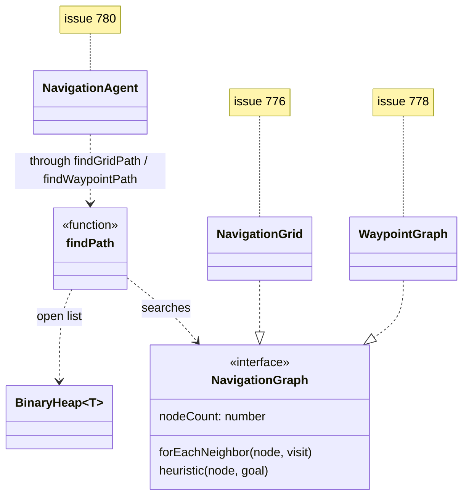

# Navigation module and A\* path search

<!-- cspell:ignore pathfinding astar octile -->

Issue: [#775](https://github.com/Forge-Game-Engine/Forge/issues/775)
(the first issue of the Path Finding milestone: the search that navigation
grids (#776), waypoint graphs (#778), collider baking (#777), smoothing
(#779), navigation agents (#780) and isometric grids (#871) build on)

| Module or file                                     | Change   | Notes                                                                                                                        |
| -------------------------------------------------- | -------- | ---------------------------------------------------------------------------------------------------------------------------- |
| `src/utilities/binary-heap.ts`                     | New      | `BinaryHeap<T>`: a min-heap ordered by a compare function (`push`, `pop`, `peek`, `size`, `clear`)                           |
| `src/utilities/binary-heap.test.ts`                | New      | Ordering, ties, empty-heap errors, random pushes and pops against a sorted array                                             |
| `src/utilities/index.ts`                           | Modified | Exports `binary-heap.js`                                                                                                     |
| `src/navigation/navigation-graph.ts`               | New      | The `NavigationGraph` interface                                                                                              |
| `src/navigation/find-path.ts`                      | New      | `findPath`, `FindPathOptions`, `FindPathResult`, `PathStatus`                                                                |
| `src/navigation/path-search-scratch.ts`            | New      | The arrays a search reuses between calls, stamped per search. Not exported                                                   |
| `src/navigation/test-helpers/`                     | New      | An adjacency-list test graph, a seeded random graph builder and a brute-force shortest-path reference. Not shipped           |
| `src/navigation/*.test.ts`                         | New      | See "Testing"                                                                                                                |
| `src/navigation/index.ts`                          | New      | The module's public API                                                                                                      |
| `src/index.ts`                                     | Modified | `export * from './navigation/index.js'`                                                                                      |
| `package.json`                                     | Modified | `./navigation` in `exports`                                                                                                  |
| `documentation-site/docs/docs/navigation/`         | New      | `_category_.json` and `index.md`: what the module is, graphs, `findPath` and its statuses. #781 grows it into the full guide |
| `documentation-site/src/components/ModuleIcon.tsx` | Modified | A `navigation` icon for the new docs category                                                                                |
| `documentation-site/docs/docs/utils/index.md`      | Modified | Lists `BinaryHeap` with the other data structures                                                                            |
| `AGENTS.md`                                        | Modified | `/navigation` in "Repository Structure"                                                                                      |
| `CHANGELOG.md`                                     | Modified | Two `#### Added` bullets                                                                                                     |
| **Engine version at time of design**               |          | `0.26.2`                                                                                                                     |

## Summary

Forge has no path finding. The Path Finding milestone plans grids,
waypoint graphs and navigation agents, and every one of them needs the same
search: the cheapest route between two nodes of a graph. This design adds
a `navigation` module (`@forge-game-engine/forge/navigation`) with that
search and the small interface that every graph implements, plus the
binary min-heap the search runs on, as a general-purpose utility.

```ts
import { findPath, NavigationGraph } from '@forge-game-engine/forge/navigation';

const result = findPath(graph, startNode, goalNode, { maxExpanded: 2000 });

if (result.status === 'found') {
  // result.nodes runs from startNode to goalNode; result.cost is its total cost.
}
```

The design has three parts:

- **`BinaryHeap<T>`** in `src/utilities`: a min-heap over an array, ordered
  by a compare function with `Array.prototype.sort`'s convention.
- **`NavigationGraph`**: nodes are integer ids from `0` to `nodeCount - 1`.
  A graph lists a node's outgoing steps with their costs through a
  callback, and gives an estimate of the remaining cost that never
  overestimates it. Grids use cell indices as ids; waypoint graphs use
  point ids. The interface is the one in the issue, plus `nodeCount`, which
  the search needs to size its arrays.
- **`findPath(graph, start, goal, options?)`**: A\* with lazy deletion,
  ties on equal estimated total broken towards the lower heuristic, a node
  limit that returns the best partial path, and arrays reused between calls
  and stamped per search, so a search allocates nothing per node and never
  clears an array the size of the graph.

This splits the solver from the graphs the way Godot's `AStar2D` and
`AStarGrid2D` share one solver, and the way the Rust `pathfinding` crate
(used by many Bevy games, since Bevy has no built-in path finding) takes
`successors` and `heuristic` functions rather than a data structure.
Unity's `NavMeshPathStatus` (complete, partial, invalid) is the model for
returning a partial path with a status instead of failing.

The change adds plain functions and one interface. It has no components or
systems, so it doesn't touch the ECS, and nothing in it bends a core part
of the engine.

## Scope

### In scope

- `BinaryHeap<T>` in `src/utilities`, exported from
  `@forge-game-engine/forge/utilities`, with unit tests.
- The new `src/navigation` module, its `index.ts`, its entry in
  `src/index.ts` and its `package.json` export path.
- The `NavigationGraph` interface and its contract (ids, costs, heuristic,
  no changes during a search).
- `findPath` with the `found`, `unreachable` and `limitReached` statuses,
  the `maxExpanded` option, partial paths, tie-breaking, input validation
  and reused, stamped scratch arrays.
- Test helpers for graphs, and unit tests for optimality, statuses,
  limits, validation and reuse.
- JSDoc on everything public, a short navigation docs page, the docs
  category icon, `BinaryHeap` in the utilities docs page, `AGENTS.md`'s
  repository structure, and the changelog.

### Out of scope

- **Any concrete graph.** Navigation grids are #776, waypoint graphs #778.
  The tests use small graphs of their own.
- **World positions.** `findPath` works on node ids and knows nothing
  about coordinates. Converting positions to nodes and back belongs to
  each graph's helper (`findGridPath`, `findWaypointPath`). The milestone
  description and #776 still say "Y-up"; that predates the engine's switch
  to Y-down (#864) and is for #776 to correct, as #871's comments note.
- **Navigation agents, re-planning and the per-frame planning budget**
  (#780). `maxExpanded` is what that budget is built from, but sharing it
  between agents is #780's design.
- **Searches that pause and resume across frames.** See open question 2.
- **Variants of the search:** weighted A\* (a heuristic multiplier that
  trades optimality for speed), jump point search, hierarchical search,
  bidirectional search, several goals or a goal test function, and
  any-angle search. Each can be added later on the same interface.
- **Navigation meshes and tilemap-built graphs.** Later graph types
  implement `NavigationGraph`.
- **A docs-site demo.** #781 adds the milestone's demo once grids and
  agents exist. A search over node ids has nothing to draw.
- **Threads.** The search runs on the calling thread. Running it in a Web
  Worker is the game's choice and isn't designed for here.

## Concepts

- **Node**: an integer id from `0` to `graph.nodeCount - 1`. The graph
  decides what it means (a grid cell, a waypoint).
- **Step**: a directed move from a node to a neighbor, with a cost that is
  finite and at least `0`. An undirected connection is two steps.
- **Cost of a path**: the sum of its steps' costs.
- **Heuristic**: `graph.heuristic(node, goal)`, an estimate of the
  cheapest path's cost from `node` to `goal`. It must never be more than
  the real cost (admissible). When it also never drops by more than a
  step's cost across that step (consistent, true of distance-based
  heuristics such as straight-line distance), no node is ever expanded
  twice.
- **Expanding a node**: taking it off the open list and visiting its
  neighbors. `expanded` in the result counts expansions; the goal is taken
  off the open list but not expanded.

## API design

### `BinaryHeap<T>`

```ts
/**
 * A binary min-heap: `pop` always returns the item that `compare` orders
 * first. Ties come out in no particular order, so a compare function that
 * needs a stable order breaks its own ties.
 */
export class BinaryHeap<T> {
  /**
   * @param compare - Orders two items like `Array.prototype.sort`'s
   * compare function: negative when `a` comes out before `b`, positive when
   * after, `0` when either order is fine.
   */
  constructor(compare: (a: T, b: T) => number);

  /** The number of items in the heap. */
  get size(): number;

  /** Adds an item. O(log n). */
  public push(item: T): void;

  /**
   * Removes and returns the first item. O(log n).
   * @throws An error if the heap is empty.
   */
  public pop(): T;

  /**
   * Returns the first item without removing it. O(1).
   * @throws An error if the heap is empty.
   */
  public peek(): T;

  /** Removes every item, keeping the array's capacity. */
  public clear(): void;
}
```

The items live in one array in the usual implicit-tree layout (the
children of index `i` are `2i + 1` and `2i + 2`). `push` sifts the new
item up, `pop` moves the last item to the root and sifts it down. Sifting
moves a hole and writes the item once at the end rather than swapping at
each level. `clear` sets the array's length to `0`, so object items can be
collected.

Changing an item's ordering while it's in the heap breaks the heap; the
JSDoc says so, and that callers push a new item instead (as `findPath`
does). There's no `remove` or `update`, because nothing needs them yet.

### `NavigationGraph`

```ts
/**
 * A graph that `findPath` can search. Nodes are the integers `0` to
 * `nodeCount - 1`, so a graph can use cell indices or point ids directly
 * and a search can keep per-node data in arrays.
 *
 * A graph must not change while a search over it is running, which only
 * matters if one of its own methods could change it.
 */
export interface NavigationGraph {
  /**
   * One more than the largest node id the graph uses. Ids below it that
   * aren't in use (a removed waypoint) are fine: they're just never
   * reported as a neighbor.
   */
  readonly nodeCount: number;

  /**
   * Calls `visit` for each node reachable in one step from `node`, with
   * the cost of that step. The cost must be finite and at least `0`.
   * Steps are directed: an undirected connection is reported from both
   * ends.
   */
  forEachNeighbor(
    node: number,
    visit: (neighbor: number, cost: number) => void,
  ): void;

  /**
   * An estimate of the cost of the cheapest path from `node` to `goal`,
   * finite, at least `0`, and never more than the real cost. Returning `0`
   * everywhere is always correct, and makes the search Dijkstra's
   * algorithm.
   */
  heuristic(node: number, goal: number): number;
}
```

### `findPath`

```ts
/** How a search ended. */
export type PathStatus = 'found' | 'unreachable' | 'limitReached';

/** Options for `findPath`. */
export interface FindPathOptions {
  /**
   * The most nodes the search expands before it stops with
   * `'limitReached'`. A non-negative integer, or `Infinity` (the default)
   * for no limit.
   */
  maxExpanded?: number;
}

/** The result of `findPath`. */
export interface FindPathResult {
  /**
   * `'found'` when `nodes` ends at the goal. `'unreachable'` when every
   * node reachable from the start was searched without reaching the goal.
   * `'limitReached'` when the search stopped at `maxExpanded`.
   */
  readonly status: PathStatus;

  /**
   * The path from the start, both ends included. For `'found'` it ends at
   * the goal and is the cheapest path. Otherwise it ends at the node,
   * among those the search reached and took off its open list, with the
   * lowest heuristic to the goal (the lowest cost to reach it when tied),
   * which is where a unit should head in the meantime. It's `[start]`
   * when no such node is closer than the start.
   */
  readonly nodes: number[];

  /** The total cost of `nodes`. */
  readonly cost: number;

  /** How many nodes the search expanded. */
  readonly expanded: number;
}

/**
 * Finds the cheapest path from `start` to `goal` with A*.
 * @throws An error if `start` or `goal` isn't a node id of the graph, if
 * the graph reports a neighbor that isn't, a step cost that's negative or
 * not finite, or a heuristic that's negative or not finite, if
 * `maxExpanded` is invalid, or if called from inside a graph's method
 * during another search.
 */
export function findPath(
  graph: NavigationGraph,
  start: number,
  goal: number,
  options?: FindPathOptions,
): FindPathResult;
```

Defaults go in `defaultFindPathOptions = { maxExpanded: Infinity }`,
applied with `withDefaults`. An unreachable goal and a node limit aren't
errors: they're results with a status, which is what the issue's "done
when" asks for and what a navigation agent needs to keep a unit moving.
Invalid input (an id out of range, a negative cost) is a programming error
and throws with the offending value in the message.

## The search

### State

The search keeps per-node and per-entry data in typed arrays that live in
`path-search-scratch.ts`, one set for the module, grown (never shrunk) to
the largest `nodeCount` searched so far:

| Array        | Type           | Per   | Holds                                            |
| ------------ | -------------- | ----- | ------------------------------------------------ |
| `stamp`      | `Uint32Array`  | node  | The id of the last search that reached the node  |
| `cost`       | `Float64Array` | node  | The cheapest cost found so far from the start    |
| `estimate`   | `Float64Array` | node  | The node's heuristic to the goal, asked for once |
| `parent`     | `Int32Array`   | node  | The node it was reached from; `-1` for the start |
| `entryNode`  | `Int32Array`   | entry | The node an open-list entry is for               |
| `entryCost`  | `Float64Array` | entry | The node's cost when the entry was pushed        |
| `entryTotal` | `Float64Array` | entry | `entryCost + estimate`, the entry's ordering key |

Per-node data is only valid when `stamp[node]` equals the current search
id, so starting a search is incrementing the id, not clearing arrays the
size of the graph. A search on a 512 x 512 grid that expands a hundred
nodes touches a few hundred array slots. Search ids start at `1`, so the
zeroed arrays a growth allocates are never valid; when the id would pass
`2^32 - 1`, the stamps are cleared and the id starts again at `1`.

Per-node memory is 24 bytes: a 512 x 512 grid holds 6 MB for as long as
the page runs. The open-list entry arrays add 20 bytes per entry slot. A
search adds at least one entry per node it reaches, and the arrays double
when they fill and never shrink, so a search that reaches every node of
that grid keeps at least another 5 MB.

### Open list with lazy deletion

The open list is one module-level `BinaryHeap<number>` of entry indices.
Its compare function orders entries by `entryTotal`, then by the node's
`estimate` (lower first), then by entry index (newer first), reading the
arrays through the scratch object so it sees them after they grow. An
entry's key never changes after it's pushed, so the heap stays valid.

When the search finds a cheaper way to a node that already has an entry,
it pushes another entry rather than updating the old one. An entry whose
`entryCost` is more than its node's current `cost` is stale and is skipped
when it's popped. This is how the Rust `pathfinding` crate's `astar` works;
it needs no position tracking in the heap, which keeps `BinaryHeap`
general-purpose. The entry arrays grow by doubling and hold at most one
entry per improvement found, plus the start.

### Tie-breaking

On an open grid many nodes share the lowest estimated total. Taking the
one with the lower heuristic (the one further along) first makes the
search run straight at the goal: on an open grid with an exact heuristic it
expands only the nodes on the path, instead of a band of equal-total nodes
across the whole rectangle between start and goal. Godot's `AStar2D` and the
`pathfinding` crate both break ties this way. The last tie-break, newest
entry first, only makes the order fully deterministic.

### Reopening nodes

The search doesn't keep a closed set. When it finds a cheaper way to a
node it has already expanded, it updates the node and pushes it again, so
the result is the cheapest path for any heuristic that never
overestimates, as the interface promises. With a consistent heuristic
(straight-line, Manhattan and octile distance on grids, Euclidean distance
on waypoint graphs) that never happens, so it costs nothing on the graphs
the milestone plans.

### Pseudocode

```text
findPath(graph, start, goal, options):
  maxExpanded = withDefaults(defaultFindPathOptions, options).maxExpanded
  validate graph.nodeCount, start, goal, maxExpanded
  if a search is running: throw (called from inside a graph's method)

  mark a search as running
  try:
    scratch.begin(graph.nodeCount)            # grow if needed, next search id
    reach(start, cost 0, parent -1)           # stamps, asks heuristic, pushes
    best = start
    expanded = 0

    while open list isn't empty:
      entry = open.pop()
      node = entryNode[entry]
      if entryCost[entry] > cost[node]: continue          # stale entry
      if node == goal: return result('found', goal, expanded)
      if closer(node, best): best = node                  # lower estimate, then lower cost
      if expanded == maxExpanded: return result('limitReached', best, expanded)
      expanded += 1
      current = node
      graph.forEachNeighbor(node, visit)                  # one closure for the module

    return result('unreachable', best, expanded)
  finally:
    open.clear(); entry count = 0
    mark no search as running

visit(neighbor, stepCost):
  validate neighbor (integer in [0, nodeCount)) and stepCost (finite, >= 0)
  newCost = cost[current] + stepCost
  if stamp[neighbor] != search id: reach(neighbor, newCost, current)
  else if newCost < cost[neighbor]:
    cost[neighbor] = newCost; parent[neighbor] = current; push entry

result(status, last, expanded):
  walk parent[] from last back to start into a new array, reverse it
  return { status, nodes, cost: cost[last], expanded }
```

`visit` is one function created when the module loads. It reads the node
being expanded and the graph's `nodeCount` from module state, so
expanding a node allocates nothing; the only allocations in a search are
the result and growing the scratch arrays.

The `try`/`finally` resets the running flag and the open list when a
graph's method throws, so the next search starts clean.

### Nested searches

The shared scratch arrays mean only one search runs at a time. JavaScript
runs one call at a time on a thread, so the only way to start a second
search during a first is from inside a graph's `forEachNeighbor` or
`heuristic`. `findPath` throws in that case, saying which call did it,
rather than corrupting the first search. Web Workers have their own copy of
the module.

## How the milestone builds on it



- #776's grid uses the cell index `row * columns + column` as the node id
  and `columns * rows` as `nodeCount`. Its `forEachNeighbor` applies the
  diagonal rule and cell costs; its heuristic is Manhattan or octile
  distance scaled by the lowest cell cost. A blocked cell is never
  reported as a neighbor.
- #778's waypoint graph uses point ids as node ids. A removed or disabled
  point is never reported as a neighbor, and `nodeCount` covers removed
  ids.
- #780's planning system passes the frame's remaining node budget as
  `maxExpanded` and uses `expanded` to charge it. A `limitReached` result
  still gives the agent a path towards the goal.

## Performance

- A search does `O(E log V)` work for the steps `E` it relaxes and the
  nodes `V` it reaches. With the lower-heuristic tie-break, a search across
  an open grid expands about as many nodes as the path is long.
- Each expansion calls `forEachNeighbor` once and each newly reached node
  calls `heuristic` once; the estimate is cached in `estimate`.
- Starting a search costs `O(1)` (a new search id), whatever the graph's
  size. Only the first search on a bigger graph allocates.
- The heap compares entry indices through a closure over typed arrays. A
  heap specialized to numbers would be a little faster; the generic one is
  what the issue asks for, and it's measured before anything is
  specialized (decision N4).

## Testing

All unit tests, in Vitest. Nothing here renders, reads input or runs the
game loop, so there are no e2e tests.

### Test helpers (`src/navigation/test-helpers/`)

- `createTestGraph(nodeCount, edges, heuristic?)`: a `NavigationGraph`
  from a list of `[from, to, cost]` steps, with a heuristic of `0` unless
  given one.
- `createRandomGraph(random, nodeCount, edgeCount)`: places nodes at seeded
  random positions (`Random` from `src/math/random.ts`) and connects random
  pairs with a cost of at least their distance, so the distance is a
  consistent heuristic.
- `shortestCosts(graph, start)`: Bellman-Ford over every step, independent
  of `findPath`, as the reference for optimality.

### `BinaryHeap`

- Pops in compare order for numbers and for objects with a key.
- Ties: many equal items all come out, and a compare that breaks ties
  gives a fixed order.
- `peek` returns the first item without removing it; `size` follows pushes
  and pops.
- `pop` and `peek` throw on an empty heap, including after `clear`.
- Thousands of interleaved random pushes and pops (seeded) against a
  sorted array: every pop matches the array's first item.

### `findPath`

- Hand-built graphs: a line, a diamond with a cheap and an expensive
  route, weighted edges where the long route is cheaper, one-way steps,
  zero-cost steps.
- Start equals goal: `found`, `[start]`, cost `0`, `expanded` `0`.
- Unreachable goal: `unreachable` without throwing; `nodes` ends at the
  reached node with the lowest heuristic; `cost` matches it.
- `maxExpanded`: a corridor stopped part way returns `limitReached`, the
  path to the closest node and `expanded === maxExpanded`; `maxExpanded: 0`
  returns `[start]`; a limit the search doesn't reach changes nothing.
- Tie-breaking: on an open 4-connected grid graph with Manhattan distance,
  `expanded` equals the path's length minus one.
- Optimality on a few hundred seeded random graphs: costs match
  `shortestCosts` with the distance heuristic, with a heuristic of `0`
  (Dijkstra), and with an admissible but inconsistent heuristic (a random
  fraction of the exact remaining cost), which exercises reopening. Every
  returned path's steps exist and add up to `cost`.
- Reuse: the same search twice gives the same result; a search on a
  bigger graph after a smaller one, and the other way round; a search
  after a graph's method threw.
- Search id wrap-around: `path-search-scratch.test.ts` sets the id near
  `2^32 - 1` and checks old stamps aren't read as current.
- No per-node allocation: a test graph records the `visit` function it's
  given, and it's the same function for every call in and across searches.
- Validation: `start` or `goal` out of range or not an integer, a bad
  `nodeCount`, a neighbor out of range, a negative, `NaN` or infinite step
  cost, a negative or `NaN` heuristic, a bad `maxExpanded`, and a
  `findPath` call from inside `forEachNeighbor` each throw a descriptive
  error.

## Documentation

- `documentation-site/docs/docs/navigation/index.md` (new category,
  following the `document-feature` skill): what the module is for, A\* in a
  paragraph, implementing `NavigationGraph` with a small example graph,
  calling `findPath`, what each status means and what `nodes` holds for
  each, `maxExpanded`, and that grids and waypoint graphs are coming as
  graph types. #781 extends this into the full guide.
- `_category_.json` with `customProps.icon: 'navigation'`, and a new
  `navigation` line icon in `ModuleIcon.tsx`, drawn like the others.
- `utils/index.md` lists `BinaryHeap` under data structures, linking to
  its API reference.
- `AGENTS.md`: `/navigation` in "Repository Structure" with a one-line
  description.
- JSDoc on every exported type, member and function, including the
  heuristic's contract and what `nodes` holds for each status.

## Phases

### Phase 1: `BinaryHeap`

A general-purpose min-heap in `@forge-game-engine/forge/utilities`. It's
useful on its own (event queues, scheduling) and is what phase 2 runs on.

**Done when** `BinaryHeap` passes its tests, is exported from
`@forge-game-engine/forge/utilities`, is listed in the utilities docs
page, and the CLAUDE.md verification steps pass.

| Task      | Description                                                                    | Size |
| --------- | ------------------------------------------------------------------------------ | ---- |
| Heap      | `binary-heap.ts` with JSDoc, hole-based sifting and empty-heap errors          | S    |
| Tests     | `binary-heap.test.ts`, including the seeded random test against a sorted array | M    |
| Exports   | `src/utilities/index.ts`                                                       | S    |
| Docs      | `utils/index.md` data structures list                                          | S    |
| Changelog | `#### Added` bullet: **utilities:** `BinaryHeap<T>`                            | S    |

### Phase 2: the navigation module and `findPath`

Adds the module, the graph interface and the search. This is what #776 and
#778 wait for.

**Done when** `findPath` passes every test under "Testing" (optimal on
random graphs against the reference, statuses without throwing, no
per-node allocation), `@forge-game-engine/forge/navigation` resolves from
the built package (`npm run check-exports`), the docs page builds, and the
CLAUDE.md verification steps pass.

| Task            | Description                                                                                                    | Size |
| --------------- | -------------------------------------------------------------------------------------------------------------- | ---- |
| Module scaffold | `src/navigation/index.ts`, `src/index.ts`, `package.json` `exports`                                            | S    |
| Graph interface | `navigation-graph.ts` with the full contract in JSDoc                                                          | S    |
| Scratch arrays  | `path-search-scratch.ts`: growth, search ids and wrap-around, entry arrays; its own test                       | M    |
| Search          | `find-path.ts`: options, validation, the loop, lazy deletion, tie-breaking, partial paths, nested-search guard | L    |
| Test helpers    | Test graph, seeded random graph, Bellman-Ford reference                                                        | M    |
| Search tests    | Every `findPath` case under "Testing"                                                                          | L    |
| Docs page       | `navigation/_category_.json`, `navigation/index.md`, the `navigation` icon                                     | M    |
| AGENTS.md       | `/navigation` in "Repository Structure"                                                                        | S    |
| Changelog       | `#### Added` bullet: **navigation:** the new module, `NavigationGraph` and `findPath`                          | S    |

The `claude` label run can ship both phases in one pull request.

## Decision log

| #   | Decision                      | Options considered                                                                                                                                                      | Chosen | Rationale                                                                                                                                                                                                                                                                     | Tradeoff                                                                                               | Assumptions                                                                                             |
| --- | ----------------------------- | ----------------------------------------------------------------------------------------------------------------------------------------------------------------------- | ------ | ----------------------------------------------------------------------------------------------------------------------------------------------------------------------------------------------------------------------------------------------------------------------------- | ------------------------------------------------------------------------------------------------------ | ------------------------------------------------------------------------------------------------------- |
| N1  | How graphs plug in            | (a) An interface with `forEachNeighbor` and `heuristic`; (b) `findPath` takes `successors` and `heuristic` functions; (c) one graph data structure the engine owns      | (a)    | The issue specifies it. A graph's heuristic depends on its own rules (a grid's diagonal rule), so they belong together. (c) can't express grids without storing every edge.                                                                                                   | A caller with loose functions wraps them in an object.                                                 |                                                                                                         |
| N2  | Node identity                 | (a) Integer ids below `nodeCount`; (b) any value with a key function; (c) objects                                                                                       | (a)    | Grids and waypoint graphs already have integer ids, and ids let per-node data live in typed arrays with no map lookups or allocation.                                                                                                                                         | A graph with sparse or huge ids maps them itself.                                                      | No planned graph needs non-integer nodes.                                                               |
| N3  | `nodeCount` on the interface  | (a) Add it; (b) grow arrays as larger ids appear; (c) a `Map` per search                                                                                                | (a)    | The issue asks for arrays "sized to the graph", which needs the size. (b) bounds-checks and maybe grows on every visit. (c) allocates per node.                                                                                                                               | One member beyond the issue's interface.                                                               | Graphs know their id range.                                                                             |
| N4  | Open-list structure           | (a) Generic `BinaryHeap<number>` of entry indices with lazy deletion; (b) an indexed heap with decrease-key; (c) a heap of objects                                      | (a)    | Keeps `BinaryHeap` general-purpose with the API the issue lists, entries never change key, and nothing allocates per node. (b) needs a position array and an update method that only A\* would use. (c) allocates an object per push.                                         | Stale entries make the heap bigger than the open set; a compare closure is slower than inline numbers. | Heap size stays within a small multiple of reached nodes on game graphs.                                |
| N5  | Where reused arrays live      | (a) One module-level set, grown to the largest graph, stamped per search; (b) a `PathSearch` object the caller creates and passes; (c) one set per graph in a `WeakMap` | (a)    | Keeps the issue's `findPath(graph, start, goal, options?)` signature and needs no setup. Memory is the largest graph's, once. (b) makes every caller, and #780's stateless system, hold a mutable object. (c) holds one set per graph, multiplying memory with several grids. | Memory for the largest graph is never released; searches can't nest (guarded with an error).           | Games don't search graphs of millions of nodes. Resumable searches would change this (open question 2). |
| N6  | Clearing per-node data        | (a) A search id stamped on each reached node; (b) clear the arrays each search; (c) clear only the nodes the last search touched                                        | (a)    | `O(1)` to start, whatever the graph's size, and the same counter technique Godot's `AStar2D` uses (`open_pass`, `closed_pass`). (c) keeps a touched list for nothing (a) doesn't do.                                                                                          | Four bytes per node; a clear every 2^32 searches.                                                      |                                                                                                         |
| N7  | Ties on equal estimated total | (a) Lower heuristic first, then newest entry; (b) heap order; (c) higher cost first                                                                                     | (a)    | The issue asks for it; it expands far fewer nodes on open grids and is what Godot and the `pathfinding` crate do. (c) is the same as (a) when the totals are equal, but (a) reads more directly. The entry tie-break makes results deterministic across runs.                 | One more comparison on ties.                                                                           |                                                                                                         |
| N8  | Closed set                    | (a) None: reopen a node when a cheaper path to it is found; (b) a closed set, requiring a consistent heuristic                                                          | (a)    | Optimal for any heuristic that never overestimates, which is the contract the issue states, and free when the heuristic is consistent.                                                                                                                                        | A badly inconsistent heuristic can expand nodes more than once, counted in `expanded`.                 |                                                                                                         |
| N9  | Goal test                     | (a) When the goal is taken off the open list; (b) when it's first reached                                                                                               | (a)    | (b) can return a costlier path when a cheaper one is still on the open list.                                                                                                                                                                                                  | The goal sits on the open list a little longer.                                                        |                                                                                                         |
| N10 | Failure reporting             | (a) A status in the result, throwing only on invalid input; (b) `null` for no path; (c) throw                                                                           | (a)    | The issue asks for statuses without throwing, and a partial path is useful; Unity's partial path status is the same idea.                                                                                                                                                     | Callers check `status`, not just `nodes.length`.                                                       |                                                                                                         |
| N11 | Validation                    | (a) Check ids, costs and heuristics as they come in; (b) trust the graph                                                                                                | (a)    | A wrong id makes a typed array read `undefined` and write nothing, so a bug shows up as a wrong path far from its cause. Each check is a comparison or two per step.                                                                                                          | A little work per step for correct graphs.                                                             |                                                                                                         |
| N12 | Empty heap                    | (a) `pop` and `peek` throw; (b) return `undefined`; (c) return `null`                                                                                                   | (a)    | A heap of `T` that may itself be `null` or `undefined` can't tell "empty" from an item with (b) or (c), and the natural loop checks `size` anyway. Matches AGENTS.md's "narrow, and throw where it makes sense".                                                              | A caller that wants "first or nothing" checks `size` first.                                            |                                                                                                         |
| N13 | Docs now or with #781         | (a) A short page now; (b) wait for #781's guide                                                                                                                         | (a)    | CLAUDE.md asks for docs with each change, and the module is public from this release.                                                                                                                                                                                         | #781 rewrites part of the page.                                                                        |                                                                                                         |

## Open questions

1. **What `nodes` holds for an unreachable goal** (non-blocking). The
   issue says a `limitReached` result returns the path to the expanded
   node closest to the goal, and doesn't say what `unreachable` returns.
   - The same partial path (this design's default): one rule for every
     result that didn't reach the goal, and a unit clicked onto an island
     it can't reach walks to the nearest shore. Unity's partial paths and
     Godot's `allow_partial_path` do this for unreachable targets.
   - An empty array with cost `Infinity`: clearer that there's no path,
     and #780's `'unreachable'` agent status would stop the unit instead.

   Default: the partial path. The other answer changes one line and its
   tests.

2. **Searches that resume across frames** (non-blocking). #780 shares a
   per-frame node budget between agents and passes it as `maxExpanded`, so
   a search bigger than the budget returns `limitReached` and the agent
   walks the partial path until it re-plans. Unity's navigation instead
   carries a long search over to the next frame with a per-frame iteration
   limit.
   - No (this design's default): every search finishes in one call, the
     scratch arrays can be shared (N5), and no component has to hold a
     search's per-node data between frames.
   - Yes: a `PathSearch` object holding its own arrays and open list, with
     `step(maxExpanded)`; `findPath` becomes a wrapper. Each paused search
     costs memory per node of the graph, and #780 would keep it in a
     component.

   Default: no. Adding resumable searches later adds an API; it doesn't
   change `findPath`.

3. **The name `nodeCount`** (non-blocking). It's one more than the
   largest id, which for a waypoint graph with removed points is more than
   the number of points.
   - `nodeCount`: short, and exact for grids, the common case.
   - `nodeIdLimit` (or similar): exact for every graph, but a less familiar
     word.

   Default: `nodeCount`, with the JSDoc saying what it counts.
