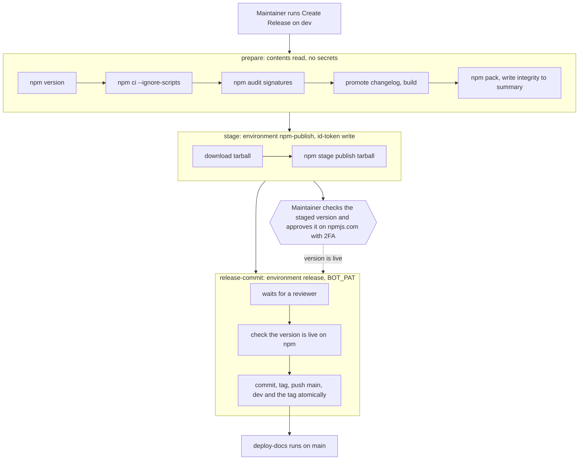

# Publishing to the public npm registry

<!-- cspell:words OIDC pinact userconfig npmjs mktemp lockfiles -->

Issue: https://github.com/Forge-Game-Engine/Forge/issues/760

| Target                                       | Change                          |
| -------------------------------------------- | ------------------------------- |
| `package.json`                               | Modified                        |
| `.npmrc`                                     | Removed                         |
| `documentation-site/.npmrc`                  | Removed                         |
| `SECURITY.md`                                | New                             |
| `README.md`                                  | Modified                        |
| `documentation-site/docs/intro.md`           | Modified                        |
| `CONTRIBUTING.md`                            | Modified                        |
| `AGENTS.md`                                  | Modified                        |
| `CHANGELOG.md`                               | Modified                        |
| `.github/dependabot.yml`                     | Modified                        |
| `.github/workflows/create-release.yml`       | Modified (by a maintainer)      |
| `.github/workflows/test-deploy-docs.yml`     | Modified (by a maintainer)      |
| npm organization, GitHub environments, rules | New (settings, by a maintainer) |
| Engine version at the time of design         | `0.27.1`                        |

## Summary

`@forge-game-engine/forge` is published to GitHub Packages, which needs a
personal access token and `npm login` even to install a public package. That
blocks the milestone's goal, `npm create @forge-game-engine@latest my-game`
on a machine with no npm setup. This design moves the package to the public
npm registry (npmjs.com) and stops publishing to GitHub Packages.

Because publishing is the step where a mistake or a compromise reaches every
user, most of the design is about doing it safely:

- **No long-lived npm token.** The issue planned an `NPM_TOKEN` secret. npm
  no longer offers the automation tokens it had in mind (classic tokens were
  revoked in December 2025), and a granular write token lasts at most 90
  days and has to bypass 2FA to work in CI. The release workflow uses npm
  **trusted publishing** instead: GitHub Actions proves to npm, per run,
  which repository, workflow file and environment is publishing, and npm
  hands it a short-lived credential. There's no npm secret to steal or
  rotate, and every release gets a signed **provenance** statement that
  links the published tarball to the commit and run that built it.
- **A person with 2FA approves every release.** The workflow only _stages_
  a version (`npm stage publish`; the trusted publisher's direct publishing
  is left off, so staging is all it can do).
  It isn't installable until a maintainer approves it on npmjs.com with
  their second factor. Someone who gets write access to the repository, or
  a malicious dependency running in CI, can at most stage a version nobody
  approves.
- **Credentials never share a job with third-party code.** The release
  splits into a build job with no credentials, a stage job that installs
  nothing, and a commit job that installs nothing. Dependencies install
  without lifecycle scripts.
- **Token publishing is switched off** for the package once it exists, so a
  stolen npm token can't publish it.

The design also covers what the maintainer has to do by hand (an ordered
checklist), the legal information the package should carry, and the exact workflow
YAML, since the automated run that implements this issue can't change files
in `.github/workflows`.

Nothing here bends a core design of the engine: it changes packaging,
release automation and documentation, not `/src`.

## Scope

### In scope

- Publishing `@forge-game-engine/forge` to `https://registry.npmjs.org` from
  `create-release.yml` through trusted publishing and staged publishing,
  with provenance.
- A one-time manual bootstrap that puts the current release (`0.27.1`) on
  npm, so the package exists before trusted publishing can be configured
  and before the docs tell anyone to install it.
- Stopping GitHub Packages publishing, deprecating the versions there, and
  removing every `npm.pkg.github.com` reference from the repository.
- `package.json` metadata (`description`, `author`, `homepage`, `bugs`,
  `keywords`, the `repository` URL's casing, `license`, `publishConfig`).
- `SECURITY.md`, a license section in the README and a note on contribution
  licensing in `CONTRIBUTING.md`.
- Install instructions in `README.md` and `documentation-site/docs/intro.md`.
- A "Releasing" section in `CONTRIBUTING.md` and a short publishing note in
  `AGENTS.md`.
- Dependabot updates for GitHub Actions, so pinned action versions stay
  current.
- The maintainer's checklist: npm account and organization, GitHub
  environments, rules and settings, the bootstrap, the first release and
  its verification.

### Out of scope

- Publishing `@forge-game-engine/create` (#763). This design sets up the
  pattern it follows; "Follow-on work" lists what #763 changes.
- Rewriting the getting-started guide around `npm create` (#765). This
  design only replaces the install step.
- Republishing versions older than `0.27.1` to npm.
- Replacing `BOT_PAT` with a GitHub App token, signing commits and tags,
  and publishing an SBOM. Each is worth doing; none is needed to publish
  safely, and the design narrows where `BOT_PAT` is available.
- Changing the package's `exports`, adding an `engines` field or any other
  change to what the package contains.
- A script that checks the packed file list, and a separate third-party
  notices file. `files` in `package.json` already decides what ships, and
  `assets/fonts/default/License.txt` already carries the font's notice (see
  the decision log).
- Legal advice. The "Legal" section lists what's usual for an MIT package
  and what a person has to confirm; it isn't a lawyer's opinion.

## Phases

The phases run in this order. Phase 1 has to finish before the Phase 2 pull
request merges, because that pull request tells readers that a plain
`npm install` works.

### Phase 1: Prepare the accounts and put `0.27.1` on npm

The maintainer secures the npm account, creates the organization, sets up
the GitHub environments and rules the new workflow relies on, and publishes
the existing `0.27.1` tarball to npm by hand. No repository change.

**Done when** `npm install @forge-game-engine/forge` installs `0.27.1` in an
empty directory on a machine with no `.npmrc` and no npm login, and the
package's publishing access is "Require two-factor authentication and
disallow tokens".

| Task                    | Description                                                                                                                | Size |
| ----------------------- | -------------------------------------------------------------------------------------------------------------------------- | ---- |
| Check the scope name    | Confirm the `forge-game-engine` organization name is free on npmjs.com (checklist step 1).                                 | S    |
| Secure the npm accounts | 2FA with a security key or passkey, recovery codes stored, on every account that will own the organization (steps 2-3).    | S    |
| Create the organization | Create `forge-game-engine` on the free plan and add a second owner (steps 4-5).                                            | S    |
| Set up GitHub           | The `npm-publish` and `release` environments, branch and tag rules, Actions and security settings (steps 6-10).            | M    |
| Bootstrap `0.27.1`      | Download the tarball GitHub Packages serves, check it, publish it to npm with 2FA, then disallow token publishing (11-15). | S    |
| Verify a clean install  | Install in a container with no npm configuration (step 16).                                                                | S    |

### Phase 2: Move the repository to the public registry

The implementing run's pull request changes everything outside
`.github/workflows`; the maintainer adds one commit with the workflow
changes to the same pull request before merging, so the release workflow
and `package.json` change together.

**Done when** the pull request is merged into `dev` with the new
`create-release.yml`, CI is green, and no file in the repository refers to
`npm.pkg.github.com`.

| Task                       | Description                                                                                                                                                              | Size |
| -------------------------- | ------------------------------------------------------------------------------------------------------------------------------------------------------------------------ | ---- |
| `package.json` metadata    | Add `description`, `author`, `homepage`, `bugs`, `keywords`, `publishConfig`; fix the `repository` URL's casing; set `license`.                                          | S    |
| Remove the scope registry  | Delete `.npmrc` and `documentation-site/.npmrc`.                                                                                                                         | S    |
| Security policy            | `SECURITY.md`.                                                                                                                                                           | S    |
| Install instructions       | Replace the token and `npm login` steps in `README.md` and `documentation-site/docs/intro.md` with `npm install @forge-game-engine/forge`; add a README license section. | S    |
| Contributor and agent docs | `CONTRIBUTING.md`: "Releasing" and contribution licensing. `AGENTS.md`: a "Publishing" note.                                                                             | M    |
| Dependabot for Actions     | Add the `github-actions` ecosystem to `.github/dependabot.yml`.                                                                                                          | S    |
| Changelog                  | A bullet under `[Unreleased]` → `Changed`.                                                                                                                               | S    |
| Workflows (maintainer)     | Replace `create-release.yml` and edit `test-deploy-docs.yml` with the YAML below, pin actions to commit SHAs, push to the pull request's branch.                         | M    |

### Phase 3: First release through trusted publishing

The maintainer connects the trusted publisher and runs "Create Release".

**Done when** the new version is on npm with a provenance statement that
points at the run and commit, `npm audit signatures` passes in a clean
project, the release commit and tag are on `dev` and `main`, and the docs
site shows the new install step.

| Task                          | Description                                                                                                  | Size |
| ----------------------------- | ------------------------------------------------------------------------------------------------------------ | ---- |
| Connect the trusted publisher | Trusted publisher for `create-release.yml` in `npm-publish`, direct publishing off (steps 19-20).            | S    |
| Move `BOT_PAT`                | Make it a secret of the `release` environment only (step 21).                                                | S    |
| Release                       | Run "Create Release", check and approve the staged version, approve the `release` environment (steps 22-25). | S    |
| Verify                        | Provenance, signatures, clean install, docs site (step 26).                                                  | S    |

### Phase 4: Retire GitHub Packages

**Done when** the GitHub Packages versions carry a deprecation message (or,
if GitHub Packages refuses `npm deprecate`, the decision to leave them is
recorded on the issue), `BOT_PAT` has no packages scope, and no maintainer
machine still maps the scope to GitHub Packages.

| Task                       | Description                                                         | Size |
| -------------------------- | ------------------------------------------------------------------- | ---- |
| Deprecate the old versions | `npm deprecate` against GitHub Packages (step 27).                  | S    |
| Narrow `BOT_PAT`           | Replace it with a token that can only push to this repository (28). | S    |
| Clean up maintainer logins | Remove the GitHub Packages login and token (step 29).               | S    |

## The release flow



1. **`prepare`** checks out `dev`, bumps the version, installs dependencies
   without lifecycle scripts, verifies their registry signatures, promotes
   the changelog, builds and packs the tarball (`files` in `package.json`
   decides what goes in it). It writes the commit it built and the
   tarball's integrity hash to the run summary and uploads the tarball and
   the three changed files as artifacts. It has read-only repository access
   and no secrets, so a compromised dependency running here can tamper with
   the build, but can't publish or push.
2. **`stage`** runs in the `npm-publish` environment, which only `dev` can
   deploy to. It gets `id-token: write`, downloads the tarball and runs
   `npm stage publish` on it. It checks out nothing and installs nothing.
   npm exchanges the run's OIDC token for a credential that can only stage
   this package, and attaches provenance.
3. The maintainer opens the staged version on npmjs.com, checks its version,
   that its provenance names the run they started and the commit the run
   summary shows, and that its integrity matches the summary, then approves
   it with 2FA. Only then can anyone install it.
4. **`release-commit`** runs in the `release` environment, which needs a
   reviewer's approval and holds `BOT_PAT`. The maintainer approves it after
   approving on npm. It checks that the version is live, then commits the
   version bump and changelog, tags it and pushes `main`, `dev` and the tag
   in one atomic push (`git push --atomic`): either all three refs move or
   none does. Pushing `main` deploys the docs.

Git only records a release once it's live on npm, so a rejected staged
version leaves no tag behind. The cost is a second approval click per
release.

The approvals can come hours after `prepare` ran, and `dev` can move in
the meantime. Pushed separately, `main` could take the release commit while
`dev` rejects it as a non-fast-forward, leaving the branches diverged. The
atomic push makes that a clean failure: nothing moves, and the maintainer
follows "Releasing" in `CONTRIBUTING.md`.

## Human checklist

These are the steps only a maintainer can do, in order. Steps 1-16 are
Phase 1, 17-18 Phase 2, 19-26 Phase 3 and 27-29 Phase 4.

### What to consider before starting

- **The scope name is permanent.** Every import in the docs, demos and
  games uses `@forge-game-engine/...`. If the npm organization name isn't
  free, stop and say so on the issue before doing anything else.
- **Who can release.** Every owner of the npm organization can approve a
  release, and every reviewer of the `release` environment can push one.
  Keep both lists to people you'd trust with the whole user base, and have
  at least two of them, so losing one account doesn't lock the package.
- **Your npm account is now the most valuable account in the project.**
  Treat it like a bank login: unique password in a password manager, a
  security key or passkey as the second factor, recovery codes offline.
- **Approving is a check, not a formality.** Approve only a version you
  just started a run for, whose provenance names that run.

### Phase 1: before the pull request merges

1. Sign in to npmjs.com, choose **Add Organization** and check that
   `forge-game-engine` is available. Don't create it yet if you're still
   setting up 2FA.
2. On every npm account that will own the organization: **Account →
   Two-Factor Authentication**, enable it for authorization and publishing,
   preferring a security key or passkey over an authenticator app. Save the
   recovery codes offline.
3. On the same accounts, check **Access Tokens** and delete any token with
   write access. Publishing will never need one.
4. Create the `forge-game-engine` organization on the free plan (public
   packages are free and unlimited).
5. Invite a second owner. Keep the membership to people who release.
6. GitHub, **Settings → Environments → New environment** `npm-publish`:
   - Deployment branches and tags: **Selected branches and tags**, add
     `dev`.
   - No required reviewers and no secrets. The npm approval is the human
     gate for this job; the branch rule is what stops a workflow edited on
     another branch from getting a publishing credential.
7. **New environment** `release`:
   - Required reviewers: the maintainers who release. Leave "Prevent
     self-review" off if you're the only reviewer.
   - Deployment branches and tags: **Selected branches and tags**, `dev`.
   - Don't add `BOT_PAT` yet (step 21).
8. **Settings → Rules → Rulesets** (or the existing branch protection):
   - `dev` and `main`: keep your existing branch protection. If it blocks
     direct pushes, the release bot needs a bypass, since `release-commit`
     pushes the release commit directly. Rulesets don't accept individual
     user accounts as bypass actors, so grant it through a team the bot
     account belongs to (for example a `release-bots` team holding only
     that account), a repository role it holds, or a GitHub App. A team
     with only the bot in it keeps the bypass from reaching anyone else; a
     role grants it to everyone with that role.
   - A tag ruleset for `v*`: restrict creation, update and deletion, with
     the same bypass actor. Only releases create tags.
9. **Settings → Actions → General**: under "Workflow permissions" choose
   **Read repository contents and packages permissions** (every workflow
   that needs more asks for it in its `permissions:`). Under "Fork pull
   request workflows", require approval for outside collaborators.
10. **Settings → Code security**: turn on private vulnerability reporting
    (`SECURITY.md` points to it), secret scanning with push protection, and
    Dependabot alerts.
11. In an empty folder on a machine you trust, download the tarball GitHub
    Packages already serves for `0.27.1`. You're still logged in to GitHub
    Packages from the old install instructions; the scope flag makes sure
    npm asks GitHub Packages and not npm:

    ```sh
    mkdir forge-bootstrap && cd forge-bootstrap
    npm pack @forge-game-engine/forge@0.27.1 \
      --@forge-game-engine:registry=https://npm.pkg.github.com
    npm view @forge-game-engine/forge@0.27.1 dist.integrity \
      --@forge-game-engine:registry=https://npm.pkg.github.com
    ```

    The integrity `npm pack` prints has to equal the one `npm view` prints.
    This is the exact artifact the release workflow built in CI and every
    current user already installs, so nothing new is built on your machine.

12. List the tarball and check it holds only `package/package.json`,
    `package/README.md`, `package/LICENSE`, `package/dist/...`,
    `package/assets/fonts/default/...` and
    `package/scripts/generate-font-atlas.mjs`:

    ```sh
    tar -tzf forge-game-engine-forge-0.27.1.tgz | grep -v '^package/dist/'
    ```

13. Log in to npm (a browser login with your second factor; it creates a
    two-hour session, not a stored token) and publish the tarball. Pass the
    scope flag again, or a `@forge-game-engine:registry` line left in your
    `~/.npmrc` sends the publish to GitHub Packages:

    ```sh
    npm login --auth-type=web --registry=https://registry.npmjs.org/
    npm publish ./forge-game-engine-forge-0.27.1.tgz --access public \
      --registry=https://registry.npmjs.org/ \
      --@forge-game-engine:registry=https://registry.npmjs.org/
    npm logout --registry=https://registry.npmjs.org/
    ```

    npm asks for your second factor before it publishes. This version has
    no provenance, since it wasn't published from CI; every later version
    does.

14. On npmjs.com, **@forge-game-engine/forge → Settings → Publishing
    access**: choose **Require two-factor authentication and disallow
    tokens**. Trusted publishing keeps working; tokens can't publish.
15. Under the organization's packages, check that the package's access is
    public and only the organization's owners can write to it.
16. Check the install works with no npm configuration at all, in a
    container so no `~/.npmrc` is read:

    ```sh
    docker run --rm node:24 sh -c \
      'mkdir /t && cd /t && npm init -y >/dev/null \
       && npm install @forge-game-engine/forge && npm ls @forge-game-engine/forge'
    ```

    Without Docker, run it in a new empty folder with
    `--userconfig "$(mktemp)"` added to `npm install`.

### Phase 2: the pull request

17. Review the pull request. Its description shows the packed file list
    (`npm pack --dry-run` output); check it holds only what step 12 lists.
    Then apply the workflow changes from "Workflow changes" below in one
    commit on the pull request's branch (your own credentials can push
    workflow files; the automated run's can't):
    - Replace `.github/workflows/create-release.yml`.
    - Edit `.github/workflows/test-deploy-docs.yml`.
    - Pin each action to the commit its version tag points at, keeping the
      tag as a comment (`uses: actions/checkout@<sha> # v7.0.1`). Look each
      one up with `gh api repos/actions/checkout/commits/v7.0.1 --jq .sha`,
      or run [pinact](https://github.com/suzuki-shunsuke/pinact) over the
      folder. Dependabot keeps the pins current once this pull request adds
      the `github-actions` ecosystem.
18. Merge the pull request once CI is green. Until Phase 3, a "Create
    Release" run fails in `stage` without publishing or pushing anything.

### Phase 3: the first release

19. Plan to do steps 20-22 on the same day. npm expires a trusted
    publishing configuration that isn't validated (used by a publish or
    stage) within 48 hours of being created. If it lapses, delete it and
    create it again as in step 20.
20. On npmjs.com, **@forge-game-engine/forge → Settings → Trusted
    publishing → GitHub Actions**:
    - Organization or user: `Forge-Game-Engine`
    - Repository: `Forge`
    - Workflow filename: `create-release.yml`
    - Environment name: `npm-publish`
    - Leave direct publishing off. Every trusted publishing configuration
      can stage, and direct publishing is something you opt into per
      configuration; with it off, `npm publish` from the workflow is
      rejected and only `npm stage publish` works.

    npm doesn't check these when you save them, so compare each field
    letter by letter.

21. Rotate `BOT_PAT` and store it only as a secret of the `release`
    environment (**Settings → Environments → release → Add environment
    secret**), then delete the repository-level `BOT_PAT` secret. Only the
    approved `release-commit` job can read it from then on. Generate the
    new token as a fine-grained token limited to this repository with
    **Contents: read and write** (it no longer needs any packages scope),
    from the account in the team or role that has the bypass from step 8.
22. **Actions → Create Release → Run workflow**, branch `dev`, with the
    release type you want.
23. When `stage` finishes, open the package on npmjs.com (or run
    `npm stage list @forge-game-engine/forge`). Before approving, check:
    - the version is the one the run summary shows,
    - the provenance links to the run you just started and to the commit
      the run summary shows,
    - the integrity matches the run summary,
    - optionally, `npm stage download <stage-id>` and list it as in step 12.

    If anything is off, reject it and reply on the issue.

24. Approve the staged version on npmjs.com with your second factor.
25. In the run, approve the `release` environment. `release-commit` checks
    the version is live, then pushes `main`, `dev` and the tag in one
    atomic push. If you approve it before the npm approval lands, it fails
    with a message; use **Re-run failed jobs**. If the push is rejected
    (usually because `dev` moved), nothing was pushed; follow "Releasing"
    in `CONTRIBUTING.md`.
26. Verify:
    - The package page on npmjs.com shows the provenance section, built and
      signed on GitHub Actions, linking the commit and run.
    - In a clean container (as in step 16):
      `npm install @forge-game-engine/forge && npm audit signatures` reports
      verified registry signatures and a verified attestation for Forge.
    - The release commit and `v<version>` tag are on `dev` and `main`, and
      the docs site's Getting Started page shows the new install step once
      "Deploy Documentation" finishes.

### Phase 4: retire GitHub Packages

27. Deprecate every version on GitHub Packages, so anyone still installing
    from it sees where Forge went:

    ```sh
    npm deprecate "@forge-game-engine/forge@<=0.27.1" \
      "Forge is published to npmjs.com now. Remove the @forge-game-engine registry line from .npmrc and install @forge-game-engine/forge from npm." \
      --@forge-game-engine:registry=https://npm.pkg.github.com
    ```

    If GitHub Packages refuses `npm deprecate`, leave the versions as they
    are and note it on the issue. Don't delete them: deleting breaks every
    project whose lockfile points at them.

28. Check that `BOT_PAT` (step 21) has no `write:packages` or
    `read:packages` scope left, and revoke the old token.
29. On your own machines, remove the GitHub Packages login: delete the
    `@forge-game-engine:registry=...` and `//npm.pkg.github.com/:_authToken`
    lines from `~/.npmrc` and revoke the personal access token you made
    for it.

## Safety

The steps above add up to these protections. Each names what it defends
against.

| Protection                                                                                         | Defends against                                                                                            |
| -------------------------------------------------------------------------------------------------- | ---------------------------------------------------------------------------------------------------------- |
| Trusted publishing, no npm token anywhere                                                          | A leaked or stolen CI secret; token rotation that's forgotten.                                             |
| Package publishing access: 2FA required, tokens disallowed                                         | A token stolen from a maintainer's machine (the 2025 npm worm spread exactly this way).                    |
| Trusted publisher with direct publishing off, approval with 2FA on npmjs.com                       | A compromised GitHub account, workflow or dependency publishing a version by itself.                       |
| `npm-publish` environment deployable only from `dev`                                               | A workflow edited on another branch and dispatched from it to get a publishing credential.                 |
| Trusted publisher bound to the workflow file and environment                                       | Any other workflow in the repository publishing.                                                           |
| Build, stage and push in separate jobs; `permissions: {}` at the top, each job grants only its own | A dependency's code reaching the OIDC token or `BOT_PAT`.                                                  |
| `npm ci --ignore-scripts`, `npm pack --ignore-scripts`                                             | Install-time code from a compromised dependency (no Forge dependency needs an install script on Linux).    |
| `npm audit signatures` before building                                                             | A dependency tarball that didn't come from the registry.                                                   |
| `package-manager-cache: false`                                                                     | A poisoned dependency cache shared with pull-request runs.                                                 |
| `files` allowlist, the maintainer checking the staged tarball before approving                     | Publishing something that shouldn't ship (tests, an `.env`, a tarball, a stray config).                    |
| Provenance, `repository.url` matching the repository                                               | Users not being able to tell a real release from a look-alike; `npm audit signatures` checks it.           |
| `publishConfig.provenance: true`                                                                   | An accidental `npm publish` from a maintainer's checkout: provenance can't be made locally, so it refuses. |
| Actions pinned to commit SHAs, updated by Dependabot                                               | A moved or hijacked action tag running in the release.                                                     |
| `BOT_PAT` only in the `release` environment, behind a reviewer                                     | Any other workflow or branch reading the token that can push `main`.                                       |
| `concurrency` on the release workflow                                                              | Two runs bumping from the same version.                                                                    |
| One atomic push of `main`, `dev` and the tag                                                       | `main` and `dev` diverging when `dev` moved during the approvals.                                          |
| Release inputs passed through `env:`, never written into a script                                  | Script injection through a workflow input.                                                                 |

What remains is a malicious change merged into `dev` through review, or a
compromised build tool producing a bad `dist` that a maintainer approves
without noticing. Code review and provenance (which makes such a release
traceable to its commit) are the defense there; no publishing setup removes
it.

## Workflow changes

The automated run can't change `.github/workflows`, so the maintainer
applies these (checklist step 17). Action versions are the latest releases
at the time of design; pin them to SHAs as the checklist says.

### `.github/workflows/create-release.yml`

```yaml
name: Create Release

on:
  workflow_dispatch:
    inputs:
      release_type:
        description: 'Type of release (semver)'
        required: true
        default: 'patch'
        type: choice
        options:
          - patch
          - minor
          - major

# No job gets a permission it doesn't ask for below.
permissions: {}

# Two runs at once would both bump from the same version.
concurrency:
  group: create-release
  cancel-in-progress: false

jobs:
  # Builds and packs the release. It runs dependency code (the compiler,
  # build scripts), so it holds no secrets and can't publish or push.
  prepare:
    name: Build the release
    # A guard against dispatching from the wrong branch. The npm-publish
    # environment's branch rule is what enforces it.
    if: github.ref == 'refs/heads/dev'
    runs-on: ubuntu-24.04
    permissions:
      contents: read
    outputs:
      version: ${{ steps.version.outputs.version }}
      sha: ${{ steps.version.outputs.sha }}
      tarball: ${{ steps.pack.outputs.tarball }}
    steps:
      - name: Checkout dev
        uses: actions/checkout@v7.0.1
        with:
          persist-credentials: false

      - name: Setup Node.js
        uses: actions/setup-node@v7.1.0
        with:
          node-version: '24'
          package-manager-cache: false

      - name: Bump version
        id: version
        env:
          RELEASE_TYPE: ${{ inputs.release_type }}
        run: |
          echo "sha=$(git rev-parse HEAD)" >> "$GITHUB_OUTPUT"
          npm version "$RELEASE_TYPE" --no-git-tag-version --ignore-scripts
          echo "version=$(node -p "require('./package.json').version")" >> "$GITHUB_OUTPUT"

      # No dependency needs an install script on Linux, so none run here.
      - name: Install dependencies
        run: npm ci --ignore-scripts

      - name: Verify dependency signatures
        run: npm audit signatures

      - name: Update CHANGELOG.md
        env:
          VERSION: ${{ steps.version.outputs.version }}
        run: npm run changelog:promote -- --version="$VERSION"

      - name: Build package
        run: npm run build

      - name: Pack
        id: pack
        env:
          VERSION: ${{ steps.version.outputs.version }}
          SHA: ${{ steps.version.outputs.sha }}
        run: |
          mkdir release
          npm pack --ignore-scripts --pack-destination release --json > pack.json
          echo "tarball=$(node -p "require('./pack.json')[0].filename")" >> "$GITHUB_OUTPUT"
          {
            echo "### @forge-game-engine/forge $VERSION"
            echo
            echo "Built from \`$SHA\`."
            echo
            echo "Compare this integrity with the staged version's before approving it:"
            echo
            echo "\`$(node -p "require('./pack.json')[0].integrity")\`"
          } >> "$GITHUB_STEP_SUMMARY"

      - name: Upload the package
        uses: actions/upload-artifact@v7.0.2
        with:
          name: package
          path: release/${{ steps.pack.outputs.tarball }}
          if-no-files-found: error

      - name: Upload the release commit's files
        uses: actions/upload-artifact@v7.0.2
        with:
          name: release-files
          path: |
            package.json
            package-lock.json
            CHANGELOG.md
          if-no-files-found: error

  # Stages the tarball on npm through trusted publishing. Installs and
  # checks out nothing, so no third-party code sees the OIDC token. The
  # version isn't installable until a maintainer approves it on npmjs.com.
  stage:
    name: Stage on npm
    needs: prepare
    runs-on: ubuntu-24.04
    environment: npm-publish
    permissions:
      id-token: write
    steps:
      - name: Setup Node.js
        uses: actions/setup-node@v7.1.0
        with:
          node-version: '24'
          package-manager-cache: false

      - name: Download the package
        uses: actions/download-artifact@v8.0.2
        with:
          name: package
          path: release

      - name: Stage the release
        env:
          TARBALL: ${{ needs.prepare.outputs.tarball }}
        run: npm stage publish "release/$TARBALL"

  # Records the release in git once it's live on npm. The release
  # environment needs a reviewer's approval and is the only place BOT_PAT
  # is available.
  release-commit:
    name: Commit and tag the release
    needs: [prepare, stage]
    runs-on: ubuntu-24.04
    environment: release
    permissions:
      contents: read
    steps:
      - name: Setup Node.js
        uses: actions/setup-node@v7.1.0
        with:
          node-version: '24'
          package-manager-cache: false

      - name: Check the release is live on npm
        env:
          VERSION: ${{ needs.prepare.outputs.version }}
        run: |
          if [ "$(npm view "@forge-game-engine/forge@$VERSION" version)" != "$VERSION" ]; then
            echo "::error::@forge-game-engine/forge@$VERSION isn't live on npm. Approve the staged version on npmjs.com, then re-run this job."
            exit 1
          fi

      - name: Checkout the released commit
        uses: actions/checkout@v7.0.1
        with:
          ref: ${{ needs.prepare.outputs.sha }}
          fetch-depth: 0
          token: ${{ secrets.BOT_PAT }}

      - name: Download the release commit's files
        uses: actions/download-artifact@v8.0.2
        with:
          name: release-files
          path: .

      # One atomic push: main, dev and the tag all move, or none does. The
      # approvals can take hours, and if dev moved meanwhile, separate
      # pushes would leave main with the release commit and dev without it.
      - name: Commit, tag and push
        env:
          VERSION: ${{ needs.prepare.outputs.version }}
        run: |
          git config user.name "Forge[Bot]"
          git config user.email "forgegameengine.noreply@proton.me"
          git add package.json package-lock.json CHANGELOG.md
          git commit -m "chore(release): v$VERSION"
          git tag "v$VERSION"
          git push --atomic origin HEAD:refs/heads/main HEAD:refs/heads/dev "refs/tags/v$VERSION"
```

Notes for whoever applies it:

- `stage` passes the tarball path to `npm stage publish`, which takes the
  same package spec as `npm publish`. If npm refuses a tarball path, extract
  it (`tar -xzf "release/$TARBALL" -C release`) and run
  `npm stage publish ./release/package --ignore-scripts`; never stage from a
  checkout, which would run the package's lifecycle scripts.
- `stage` doesn't check the npm version first. An npm older than 11.15.0
  doesn't know the `stage` command and fails the job without publishing
  anything, which is the same outcome a guard step would give.
- No `registry-url` on `setup-node`: npm's default registry is the right
  one, and `registry-url` writes an `.npmrc` that expects a token.
- `release-commit` checks out with `BOT_PAT` and keeps it in the git config
  for the push. That's acceptable only because the job runs no dependency
  code; keep it that way.

### `.github/workflows/test-deploy-docs.yml`

The docs site installs the engine from `file:..`, so it never needed a
GitHub Packages token. Remove the `packages: read` permission and the
"Authenticate npm with custom token" step:

```yaml
name: CI / Documentation

on:
  pull_request:
    branches:
      - dev

permissions:
  contents: read

jobs:
  test-documentation-build:
    name: Build
    runs-on: ubuntu-24.04
    steps:
      - uses: actions/checkout@v7
        with:
          fetch-depth: 0
      - uses: actions/setup-node@v7
        with:
          node-version: 22
          cache: npm

      - name: Install root dependencies
        run: npm ci

      - name: Build root project
        run: npm run build

      - name: Install dependencies
        run: npm ci
        working-directory: ./documentation-site

      - name: Test build website
        run: npm run build
        working-directory: ./documentation-site
```

`ci.yml` and `deploy-docs.yml` need no change.

## Package changes

### `package.json`

```jsonc
{
  "name": "@forge-game-engine/forge",
  "description": "A browser-based, code-only TypeScript game engine: ECS, WebGL2 rendering, 2D physics, audio, input, UI and more.",
  "keywords": [
    "game-engine",
    "game",
    "ecs",
    "webgl2",
    "2d",
    "physics",
    "typescript",
    "browser",
  ],
  "homepage": "https://forge-game-engine.github.io/Forge/",
  "bugs": { "url": "https://github.com/Forge-Game-Engine/Forge/issues" },
  "repository": {
    "type": "git",
    "url": "git+https://github.com/Forge-Game-Engine/Forge.git",
  },
  "author": "Storm Muller",
  "license": "(MIT AND OFL-1.1)",
  "publishConfig": { "access": "public", "provenance": true },
  "files": [
    "dist",
    "scripts/generate-font-atlas.mjs",
    "assets/fonts/default",
    "README.md",
  ],
  // ...everything else unchanged
}
```

- `repository.url` uses the organization's real casing. npm compares it
  with the repository named in the provenance statement and rejects the
  publish when they differ.
- `publishConfig.access` makes a scoped package public without a flag.
  `publishConfig.provenance` makes `npm publish` refuse to run anywhere it
  can't produce provenance, which is everywhere but CI.
- npm always packs `package.json`, `README.md` and `LICENSE`, so `LICENSE`
  isn't listed in `files`.

### Removed `.npmrc` files

Both files only map the `@forge-game-engine` scope to GitHub Packages.
Nothing in the repository installs a package from that scope: the docs site
depends on `file:..`, and both lockfiles resolve every package from
`registry.npmjs.org`. Deleting them changes no install.

### What decides the package's contents

`files` in `package.json` is an allowlist and the one place that decides
what ships; nothing else lists the package's files, so there's no second
list to keep in step with it. `tsconfig.build.json` already keeps tests,
benchmarks and `test-helpers` out of `dist`. Three things check the result
without adding a script:

- `npm run check-exports` (already in CI) packs the package and checks
  that its exports and their types resolve from the packed files.
- The implementing pull request's description shows `npm pack --dry-run`
  output, and the maintainer reviews it (checklist step 17).
- Before approving a release, the maintainer can download the staged
  tarball and list it (checklist step 23).

## Legal

This section isn't legal advice. It lists what's usual for an MIT package
on npm and marks what a maintainer has to confirm.

**What protects you from liability.** The MIT License's warranty disclaimer
and limitation of liability ("THE SOFTWARE IS PROVIDED "AS IS", WITHOUT
WARRANTY OF ANY KIND ... IN NO EVENT SHALL THE AUTHORS OR COPYRIGHT HOLDERS
BE LIABLE ..."). It's in the root `LICENSE`, and npm always packs `LICENSE`
into the tarball, so every copy carries it. Nothing else is required for it
to apply. How far a disclaimer holds depends on the user's country, which
no file can change.

**What the package should carry:**

| Item                                        | State today                                   | Change                                                                                          |
| ------------------------------------------- | --------------------------------------------- | ----------------------------------------------------------------------------------------------- |
| `LICENSE` (MIT)                             | Present, packed by npm.                       | None. Confirm the copyright line ("Copyright (c) 2024 Storm Muller").                           |
| `license` in `package.json`                 | `MIT`.                                        | `(MIT AND OFL-1.1)`, since the package also ships an OFL font atlas.                            |
| Bundled font atlas license                  | `assets/fonts/default/License.txt` is packed. | None. It names the font, its copyright lines and source, and holds the full OFL; see below.     |
| `author`, `description`, `homepage`, `bugs` | Empty or missing.                             | Filled in (see "Package changes").                                                              |
| `SECURITY.md`                               | Missing.                                      | New. How to report a vulnerability privately.                                                   |
| README license section                      | Missing.                                      | New. MIT, provided as is without warranty, the font under OFL 1.1 (links `License.txt`).        |
| Contribution licensing                      | Implied.                                      | A sentence in `CONTRIBUTING.md`: contributions are licensed under the repository's MIT License. |

**The bundled font.** The package ships `assets/fonts/default/default.png`
and `default.json`, an MSDF atlas generated from Liberation Sans, under the
SIL Open Font License 1.1. The OFL lets the font be bundled with software
"provided that each copy contains the above copyright notice and this
license". `assets/fonts/default/License.txt` holds both and is in `files`,
so the package already meets that. The OFL also says a modified version
can't use the reserved font name "Liberation" as its font name; the atlas
is named `default` and carries no font name, and the docs and credits say it
was generated from Liberation Sans, which the OFL allows as
acknowledgement. Have someone confirm that reading (open question 4).

`License.txt` already names the font, both copyright lines, the source and
which files it covers, so it's the package's only third-party notice. A
separate notices file would repeat it and could drift from it.

**Dependencies.** The package doesn't bundle any dependency: `dist` is
`tsc` output, and `imurmurhash`, `seedrandom` and `@types/imurmurhash` are
installed by the user's package manager with their own `LICENSE` files (all
MIT). The optional peer `msdf-bmfont-xml` is MIT too. Nothing is
redistributed, so no notice is owed for them. A search of `/src` found no
copyright or license headers from copied third-party code; confirm no code
was copied in without one (open question 4).

**Contributions.** Outside contributors keep the copyright in what they
contribute. Under GitHub's terms of service, content added to a repository
with a license is licensed under that license ("inbound = outbound"), which
is enough for an MIT project; a contributor license agreement or sign-off
isn't needed. The sentence in `CONTRIBUTING.md` makes that explicit.

**`SECURITY.md`:**

```markdown
# Security policy

## Supported versions

Forge is below 1.0. Only the latest release gets security fixes.

## Reporting a vulnerability

Please don't open a public issue. Report it privately through
[GitHub's private vulnerability reporting](https://github.com/Forge-Game-Engine/Forge/security/advisories/new).
We'll reply as soon as we can and keep you updated while we fix it.

## Verifying a release

Every release after 0.27.1 is published from GitHub Actions with npm
provenance. In a project that depends on Forge, `npm audit signatures`
checks that the installed package was built from this repository.
```

**Things outside the package a maintainer may want to consider** (none is
needed to publish): whether to hold the npm organization and copyright as a
person or through an organization or fiscal host, and whether "Forge"
needs a trademark check, since other software uses the name. The scoped
package name avoids a clash on npm itself.

## Documentation

- `README.md`, "Install": replace the three steps with
  `npm install @forge-game-engine/forge`. Add a "License" section after
  "Acknowledgements": MIT (link `LICENSE`), provided as is without
  warranty, the default font atlas under OFL 1.1 (link
  `assets/fonts/default/License.txt`), and a link to `SECURITY.md`.
- `documentation-site/docs/intro.md`, "Installing Forge in your project":
  replace both numbered steps with the one install command.
  No migration notes: the changelog bullet covers moving off GitHub
  Packages.
- `CONTRIBUTING.md`:
  - "Releasing": what "Create Release" does, the two approvals and what to
    check before each (checklist steps 22-25), and what to do when a run
    stops partway: a run that fails before `stage` changed nothing; a
    rejected or never-approved staged version leaves no commit or tag, and
    the next run stages the same version number (if npm refuses to reuse
    it, merge a pull request that bumps `package.json` past it). The
    release commit's push is atomic, so a failed `release-commit` either
    pushed `main`, `dev` and the tag, or pushed none of them; it never
    leaves them half done. If it failed before the npm approval landed,
    **Re-run failed jobs**. If the push was rejected because `dev` moved
    in the meantime, record the release by hand: check out the commit the
    run released (in its summary), apply the run's `release-files`
    artifact, commit and tag it, push `main` and the tag together
    (`git push --atomic origin HEAD:refs/heads/main refs/tags/v<version>`), then
    merge that commit into `dev` through a pull request.
  - "Contributing": "By contributing, you agree that your contributions are
    licensed under the project's MIT License."
- `AGENTS.md`, a short "Publishing" subsection under "Changelog" (next to
  "What's automated"): the package is published to npmjs.com only by
  `create-release.yml`, through trusted publishing with a maintainer's
  approval; agents never run `npm publish` or `npm stage`, never add npm
  tokens, registry settings or `.npmrc` files.
- `CHANGELOG.md`, under `[Unreleased]` → `#### Changed`:

  > **build:** Forge is published to the public npm registry instead of
  > GitHub Packages, so `npm install @forge-game-engine/forge` works without
  > a GitHub token or `npm login`. Remove the
  > `@forge-game-engine:registry=https://npm.pkg.github.com` line, and the
  > `//npm.pkg.github.com/:_authToken` line if you added one for Forge, from
  > your `.npmrc`; later versions aren't published to GitHub Packages.
  > Releases are published from GitHub Actions with npm provenance, which
  > `npm audit signatures` verifies.

- The pull request description shows the output of
  `npm pack --dry-run --ignore-scripts` (after `npm run build`), so the
  reviewer sees exactly which files ship, and says not to merge before
  Phase 1 is done and the workflow commit is added.

## Testing

- `npm run check-exports` already packs the package and checks its exports
  in CI; the `license`, `repository` and `publishConfig` changes don't
  affect it.
- The implementing run checks the `npm pack --dry-run` list matches the
  `files` allowlist (only `package.json`, `README.md`, `LICENSE`, `dist/`,
  `assets/fonts/default/` and `scripts/generate-font-atlas.mjs`) and puts
  it in the pull request description.
- The workflow can't be tested before it runs for real. A run before
  Phase 3 fails safely in `stage`. Phase 3's checks (step 26) are its test.
- The docs site build (`test-deploy-docs.yml`) shows that deleting
  `documentation-site/.npmrc` doesn't affect its install.

## Follow-on work

#763 publishes `@forge-game-engine/create` in the same run. With this
design it changes from what that issue describes:

- `prepare` builds and packs both tarballs; `stage` stages both, the engine
  first; `release-commit` checks both are live and commits
  `packages/create/package.json` too.
- The create package needs its own trusted publisher (same workflow file
  and environment, direct publishing off) and its own "disallow tokens"
  setting.
- Trusted publishing can't be configured for a package that doesn't exist
  yet, so #763 needs a bootstrap of its own. There's no earlier release to
  republish; its design decides between staging the first version (npm's
  staged publishing can create a package, from a local session or a
  token) and a first publish by hand. Staging a brand-new package
  publishes a public `0.0.0-stage` placeholder version while the real one
  waits for approval, so #763's design has to account for it: what
  `npm create @forge-game-engine` does if someone runs it while only the
  placeholder exists, and whether the placeholder is deprecated once the
  first real version is live.
- With staging, nothing goes live before both approvals, so the "the run
  failed between the two publishes" case #763 plans for becomes "approve
  the engine first".

## Decision log

### Trusted publishing instead of an npm token

- **Options:** a granular npm token stored as `NPM_TOKEN` (the issue's
  plan); trusted publishing with direct `npm publish`; trusted publishing
  limited to staged publishing.
- **Chosen:** trusted publishing limited to staged publishing: the
  configuration's direct publishing stays off, which is npm's default for
  trusted publishing configurations since September 2026.
- **Rationale:** npm revoked classic and automation tokens in December 2025.
  A granular write token now lasts at most 90 days, has to bypass 2FA to
  work unattended, and is a secret that leaks with the repository's other
  secrets. Trusted publishing has no secret, binds publishing to one
  workflow file and environment, and adds provenance on its own. Limiting
  it to staging makes a maintainer's 2FA approval the last step of every
  release, so a compromised account, workflow or dependency can't publish
  alone. npm and GitHub recommend this pairing.
- **Tradeoff:** a maintainer has to approve each release on npmjs.com.
  Releases depend on npm's OIDC exchange and staging service being up.
- **Assumptions:** the repository stays public (provenance needs it);
  releases run on GitHub-hosted runners (trusted publishing doesn't support
  self-hosted ones); the Node 24 runner's bundled npm (11.19.1 at the time
  of design) is at least 11.15.0. The workflow doesn't check this: an
  older npm fails `stage` on the unknown command without publishing.

### Two GitHub environments, only one with reviewers

- **Options:** required reviewers on the publishing job; branch rule only
  on the publishing job and reviewers on the push job; one environment for
  both.
- **Chosen:** `npm-publish` with a `dev`-only branch rule and no reviewers;
  `release` with reviewers, a `dev`-only branch rule and `BOT_PAT`.
- **Rationale:** staging already needs a human, so reviewers on
  `npm-publish` would add a click that protects nothing more. The branch
  rule is what matters there: the trusted publisher checks the workflow
  filename, and anyone with write access could dispatch an edited copy of
  it from another branch. Putting `BOT_PAT` behind `release` takes the
  token that can push `main` away from every other job and branch.
- **Tradeoff:** two approvals per release (npm, then `release`).
- **Assumptions:** the people who can approve `release` are the npm
  organization's owners.

### Keep the existing branch protection; give the release bot a bypass

- **Options:** require pull requests with an approval on `dev` and `main`;
  keep the repository's existing branch protection and only add the
  bypass the release push needs.
- **Chosen:** keep the existing protection, and grant the bypass through a
  team holding only the bot account, a repository role, or a GitHub App.
- **Rationale:** requiring approvals changes how the project merges, which
  the issue didn't ask for, and would block a maintainer working alone.
  The release push is what this design adds, so the bypass is the only
  rule it needs. Rulesets don't accept individual user accounts as bypass
  actors, so the bypass goes through a team, a role or an App; a team with
  only the bot keeps it from reaching anyone else.
- **Tradeoff:** a repository role as the bypass actor also lets everyone
  with that role push past the rules.
- **Assumptions:** the bot account behind `BOT_PAT` can be put in a team
  of the `Forge-Game-Engine` organization.

### Push the release commit after the version is live

- **Options:** push before staging (today's order); push after staging,
  before approval; wait for the approval, by polling or by an environment
  gate.
- **Chosen:** the `release` environment gate, then a check that the version
  is live, then one atomic push of `main`, `dev` and the tag.
- **Rationale:** git tags then always match published versions, a rejected
  release leaves nothing behind, and the docs site (deployed from `main`)
  never describes a version that isn't installable. An environment gate
  waits without holding a runner, unlike polling. Waiting for approvals
  stretches the time between `prepare` and the push from minutes to
  possibly hours, so the push is atomic: separate pushes could move `main`
  and then have `dev` reject the commit, leaving the two diverged.
- **Tradeoff:** if `dev` moves between `prepare` and the approval, the
  atomic push is rejected as a whole and the maintainer records the release
  by hand ("Releasing" in `CONTRIBUTING.md`). Today's workflow has the same
  race over a shorter time, without the atomic push.
- **Assumptions:** releases are approved within the environment's 30-day
  wait limit.

### Bootstrap by republishing `0.27.1`

- **Options:** publish a placeholder `0.0.0` and configure trusted
  publishing on it; build and publish the real package from a maintainer's
  machine; give CI a short-lived token for the first publish; republish the
  `0.27.1` tarball GitHub Packages already serves.
- **Chosen:** republish `0.27.1`.
- **Rationale:** npm only lets a trusted publisher be configured for a
  package that exists. The `0.27.1` tarball was built by the release
  workflow and is what users install today, so nothing new is built on a
  laptop and no token is created; the integrity check proves it's the same
  bytes. It also makes `npm install` work before the documentation says it
  does, so the pull request can merge with its README change. A placeholder
  would be installed by anyone who tried before the first real release.
  Staging the first version would create the package too, but npm then
  publishes a public `0.0.0-stage` placeholder, which is the same problem.
- **Tradeoff:** `0.27.1` on npm has no provenance, and its README still
  shows the GitHub Packages instructions.
- **Assumptions:** the maintainer can still read GitHub Packages.

### Stop publishing to GitHub Packages and deprecate, not delete

- **Options:** publish to both registries; stop and delete the old
  versions; stop and deprecate them.
- **Chosen:** stop, and deprecate the old versions.
- **Rationale:** Forge keeps no backwards compatibility before 1.0, and two
  registries means two places to secure and two answers to "which one is
  real". Deleting versions breaks lockfiles that point at them; a
  deprecation message tells anyone still installing from GitHub Packages
  where to go.
- **Tradeoff:** users on GitHub Packages have to change their `.npmrc` to
  get new versions.
- **Assumptions:** GitHub Packages accepts `npm deprecate`; if not, the old
  versions stay as they are.

### Three jobs, with dependency code separated from credentials

- **Options:** one job (today); build and publish jobs; build, stage and
  commit jobs.
- **Chosen:** three jobs.
- **Rationale:** today one job runs `npm ci` (thousands of files of
  third-party code, with install scripts) with `BOT_PAT` in scope, and
  `actions/checkout` stores that token in the git config where any of that
  code can read it. With three jobs, the only job that runs third-party
  code has neither the OIDC token nor `BOT_PAT`.
- **Tradeoff:** artifacts between jobs and a longer workflow file.
- **Assumptions:** none.

### Install and pack without lifecycle scripts

- **Options:** `npm ci` as today; `npm ci --ignore-scripts`.
- **Chosen:** `--ignore-scripts` for `npm ci`, `npm pack` and `npm version`
  in the release.
- **Rationale:** install scripts are how npm supply-chain attacks usually
  run. The lockfile's only packages with install scripts are two copies of
  `fsevents`, which only install on macOS, and the repository's own
  `prepare` script only installs git hooks.
- **Tradeoff:** a future dependency that needs an install script fails the
  release until it's reviewed and allowed.
- **Assumptions:** CI keeps running plain `npm ci`, so pull requests still
  catch a dependency that needs its script.

### Pin actions to commit SHAs and let Dependabot update them

- **Options:** major tags (`@v7`, today); exact version tags; commit SHAs.
- **Chosen:** commit SHAs with the version as a comment, kept current by
  Dependabot's `github-actions` ecosystem.
- **Rationale:** a tag can be moved to other code; a SHA can't. Dependabot
  keeps pins from going stale.
- **Tradeoff:** less readable `uses:` lines, and Dependabot pull requests
  to review.
- **Assumptions:** the maintainer pins the release workflow when applying
  it; pinning the other workflows can follow in later changes.

### `(MIT AND OFL-1.1)`, with the font's own license file as its notice

- **Options:** keep `MIT`; `(MIT AND OFL-1.1)` plus a new
  `THIRD-PARTY-NOTICES.md`; `(MIT AND OFL-1.1)` with
  `assets/fonts/default/License.txt` as the only notice; remove the font
  from the package.
- **Chosen:** `(MIT AND OFL-1.1)`, with `License.txt` as the notice and
  the README's license section linking it.
- **Rationale:** the package ships OFL-licensed font data, so `MIT` alone
  misstates its license to users and their license checkers. Packages that
  bundle fonts declare both (Font Awesome Free does). `License.txt` already
  sits next to the font, is packed, and names the font, its copyright
  lines, its source and the files it covers, with the full OFL; a notices
  file would only repeat it, and two copies can drift. The font is a
  feature (text renders with no asset setup), so removing it isn't an
  option.
- **Tradeoff:** some companies' license checkers flag OFL-1.1 for review.
  There's no single file listing every third-party notice, which only
  matters once there's more than one.
- **Assumptions:** see open questions 2 and 4.

### No separate package contents check

- **Options:** a script that packs the package and checks the file list
  against allowed, forbidden and required patterns, run in CI and in the
  release; rely on `files` and the existing checks.
- **Chosen:** rely on `files` and the existing checks.
- **Rationale:** `files` in `package.json` is an allowlist and the single
  owner of what ships; a script with its own lists would be a second
  writer of the same decision that has to be kept in step with it.
  `tsconfig.build.json` already keeps tests and test helpers out of
  `dist`, `npm run check-exports` already packs the package in CI, the
  pull request shows `npm pack --dry-run` output for review, and the
  maintainer can list the staged tarball before approving each release.
- **Tradeoff:** a wrong entry added to `files` later is caught by review
  and by the maintainer's check before approval, not by CI.
- **Assumptions:** changes to `files` are rare and reviewed.

### Remove both `.npmrc` files

- **Options:** keep them pointing at npm; remove them.
- **Chosen:** remove them.
- **Rationale:** npm's default registry is npmjs.com, nothing in the
  repository installs from the scope, and a scope line pointing anywhere
  is one more thing that could send an install or a publish to the wrong
  registry.
- **Tradeoff:** none.
- **Assumptions:** none.

### Workflow changes applied by a maintainer in the same pull request

- **Options:** a separate pull request for the workflows; one commit on
  the implementing pull request's branch.
- **Chosen:** one commit on the same branch.
- **Rationale:** the release workflow and `package.json` (`publishConfig`)
  depend on each other, so they should merge together. The automated run's
  token can't push workflow files; a maintainer's can.
- **Tradeoff:** the pull request isn't complete until the maintainer adds
  the commit.
- **Assumptions:** CI passes with the workflow changes in place (they
  change no CI job; `test-deploy-docs.yml` only loses its GitHub Packages
  authentication, which the docs site never needed).

## Open questions

1. **Is the `forge-game-engine` npm organization name free?**
   (non-blocking) The registry has no `@forge-game-engine/forge`, but the
   organization page couldn't be checked without signing in, and an account
   or organization with that name and no public packages would still hold
   the scope.
   - _Free (default):_ the design applies as written.
   - _Taken:_ every import in the engine's docs, demos and users' games
     changes with the package name, and so does the milestone's
     `npm create` command. Ask npm support whether the name can be
     released before choosing a new one. Checklist step 1 answers this
     before anything is merged.
2. **The `license` field: `(MIT AND OFL-1.1)` or `MIT`?** (non-blocking)
   - _`(MIT AND OFL-1.1)` (default):_ accurate about everything in the
     tarball, which is what license checkers read.
   - _`MIT`:_ simpler for users' license checkers; the font's license
     still ships in `assets/fonts/default/License.txt`, and the OFL's
     conditions are met either way.
3. **Who is the author and copyright holder, and who else owns the npm
   organization?** (non-blocking)
   - _Storm Muller (default):_ matches `LICENSE`. A second owner is still
     needed for the npm organization and the `release` environment;
     the maintainer names them.
   - _"Storm Muller and Forge contributors", or an organization:_ more
     accurate once others contribute, or a way to hold the project apart
     from one person. Changing `LICENSE`'s copyright line is the copyright
     holder's call.
4. **Do the font atlas and the source need a closer license review?**
   (non-blocking)
   - _No (default):_ the OFL's notice condition is met, the atlas doesn't
     use the reserved name, and `/src` shows no copied third-party code.
   - _Yes:_ if someone reads an MSDF atlas as a "Modified Version" that
     can't be described as Liberation Sans, the docs and `License.txt` say
     "generated from Liberation Sans" only as acknowledgement, which the
     OFL allows; if code was copied from another project, its license and
     copyright notice have to ship with the package, which is the point to
     add a notices file listing both it and the font.
5. **Republish versions older than `0.27.1` to npm?** (non-blocking)
   - _No (default):_ pre-1.0 Forge doesn't support old versions, and each
     would be a hand publish without provenance.
   - _Yes:_ users pinned to an older version could move registries
     without upgrading.
6. **Should the `release` approval be replaced by polling npm?**
   (non-blocking)
   - _Environment approval (default):_ no runner waits, and the maintainer
     chooses when the release is recorded.
   - _Polling:_ one approval fewer, at the cost of a runner waiting (with a
     timeout) for the npm approval.
