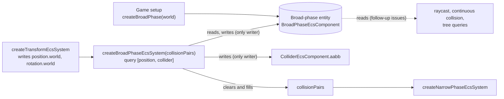
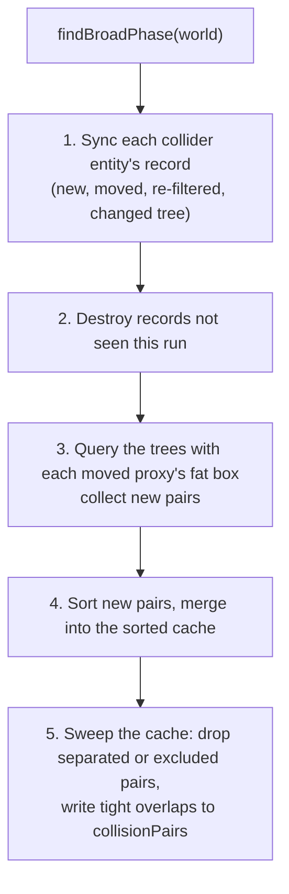

# Persistent broad phase

Issue: [#798](https://github.com/Forge-Game-Engine/Forge/issues/798)
(Physics Broad Phase Spatial Partitioning milestone; builds on
[#792](https://github.com/Forge-Game-Engine/Forge/issues/792)'s
`DynamicAabbTree`, designed in [`dynamic-aabb-tree.md`](./dynamic-aabb-tree.md),
and is measured with [#789](https://github.com/Forge-Game-Engine/Forge/issues/789)'s
`collision-pipeline.bench.ts`)

| Module or file                                                                                                                                                                         | Change   | Notes                                                                                                   |
| -------------------------------------------------------------------------------------------------------------------------------------------------------------------------------------- | -------- | ------------------------------------------------------------------------------------------------------- |
| `src/physics/components/broad-phase-component.ts`                                                                                                                                      | New      | `BroadPhaseEcsComponent`, `broadPhaseId`, `addBroadPhaseComponent`, `BroadPhaseProxy`, `BroadPhasePair` |
| `src/physics/broad-phase/create-broad-phase.ts`                                                                                                                                        | New      | `createBroadPhase(world)` (aggregate factory) and `findBroadPhase(world)`                               |
| `src/physics/broad-phase/update-broad-phase.ts`                                                                                                                                        | New      | Reconciliation, move buffer, pair cache and output. Not exported from any `index.ts`                    |
| `src/physics/is-static-body.ts`                                                                                                                                                        | New      | `isStaticBody(rigidBody)`, internal                                                                     |
| `src/physics/systems/broad-phase-system.ts`                                                                                                                                            | Modified | Finds the broad-phase entity and calls `updateBroadPhase`; no more all-pairs loop                       |
| `src/physics/systems/continuous-collision-system.ts`                                                                                                                                   | Modified | Uses `isStaticBody`                                                                                     |
| `src/navigation/grid/mark-grid-from-colliders.ts`                                                                                                                                      | Modified | Uses `isStaticBody`                                                                                     |
| `src/physics/types/collision-pair.ts`                                                                                                                                                  | Modified | `entityA` and `entityB` become `readonly`                                                               |
| `src/physics/components/collider-component.ts`                                                                                                                                         | Modified | JSDoc of `aabb` and of the static rule                                                                  |
| `src/physics/systems/collision-pipeline.bench.ts`                                                                                                                                      | Modified | Creates a broad phase; adds broad-phase-only cases                                                      |
| Physics tests calling `createBroadPhaseEcsSystem`                                                                                                                                      | Modified | Create a broad phase; give colliders that must pair a rigid body                                        |
| `demo/src/game.ts` and 18 docs-site demos                                                                                                                                              | Modified | `createBroadPhase(world)`; the space shooter's moving colliders get `'kinematic'` rigid bodies          |
| `documentation-site/docs/docs/physics/` `index.md`, `collisions.md`, `rigid-bodies.md`, `sleeping.md`, `raycasting.md`, `dynamic-aabb-tree.md`; `tilemaps/` `index.md`, `collision.md` | Modified | Registration snippets, static pairing rule, how the broad phase works                                   |
| `.claude/skills/create-component/SKILL.md`, `AGENTS.md`                                                                                                                                | Modified | `createBroadPhase` joins `createCamera` as an aggregate factory example                                 |
| `CHANGELOG.md`                                                                                                                                                                         | Modified | Two `#### Changed` bullets                                                                              |
| **Engine version at time of design**                                                                                                                                                   |          | `0.27.0`                                                                                                |

## Summary

`createBroadPhaseEcsSystem` (`src/physics/systems/broad-phase-system.ts`)
recomputes every collider's `aabb` every tick and then tests every collider
against every other one in a nested loop. Its cost is `O(n²)` in the
collider count, it is the same whether anything moved or not, and it pairs
two static colliders (a wall touching a floor) whose collision can never
do anything.

This design makes the broad phase **persistent**, the way Box2D's is. It
keeps two `DynamicAabbTree`s (one for static colliders, one for kinematic
and dynamic ones), one proxy record per collider, and a cache of pairs
that lasts from tick to tick. Each tick it:

1. syncs the records with the ECS: creates proxies for new colliders,
   moves the ones whose pose or shape changed, and destroys the ones whose
   entity no longer has a collider and a position;
2. queries the trees only with the proxies whose stored ("fat") box changed;
3. keeps a cached pair until the two fat boxes separate;
4. writes every cached pair whose tight `aabb`s overlap to `collisionPairs`,
   sorted by entity, so the narrow phase gets the same pairs as today
   (static pairs aside) in an order that doesn't depend on tree shape.

Cost then grows with the number of colliders that move, not with the
square of all of them. A collider that didn't move costs a few
comparisons, and its `aabb` isn't recomputed.

Two things differ from the issue, each for a rule in `CLAUDE.md`:

- **Where the state lives.** The issue passes a `BroadPhase` object to the
  system's factory and has the system change it every tick. That's "a
  field written on a dependency to carry information to the next tick",
  which the stateless-system rule forbids. Here the trees, records and pair
  cache live in a `BroadPhaseEcsComponent` on an entity of its own (the
  `create-system` skill's "resource entity"), which `createBroadPhase(world)`
  creates and the system finds through the world. `createBroadPhaseEcsSystem`
  keeps its one argument. This also lets `raycast(world, ...)` and
  continuous collision find the trees later without changing their
  signatures. See DL-1 and open question 2.
- **No `cleanup`.** With the state in a component, a re-registered system
  reconciles the records against the world and carries on; there is nothing
  to clear (DL-11).

One consequence of the issue's static rule needs a decision before it
ships, listed first in the open questions: **colliders with no rigid body
are static, so two of them never pair**. The space shooter demo moves its
asteroids, bullets and ship by writing their positions, with colliders but
no rigid bodies, so with this change its bullets stop hitting asteroids.
This design gives those entities `'kinematic'` rigid bodies: a collider
that moves needs one when it must detect colliders that have no body, as
in Unity and Box2D. A moved collider that only meets bodies (the brick
breaker's paddle) stays static. The docs, the changelog and the audit of every demo and test
make the rule visible. Nothing here bends a core design of the engine.

## Scope

### In scope

- `BroadPhaseEcsComponent` and `createBroadPhase(world)`, holding a static
  tree, a moving tree, one record per collider entity and the pair cache.
- `createBroadPhaseEcsSystem(collisionPairs)` rewritten around them: the
  same query (`[positionId, colliderId]`), still the only writer of
  `ColliderEcsComponent.aabb`, now also the only writer of the broad-phase
  component.
- Reconciliation by marking records seen, so colliders added or removed,
  entities removed, positions removed and body type changes all take one
  path.
- The move buffer: new proxies, proxies whose fat box changed, proxies
  whose `category` or `mask` changed, and proxies that changed tree.
- Static colliders never compared with each other.
- The pair cache: pairs persist until their fat boxes separate, a filter
  excludes them, or either proxy goes.
- Sorted, deterministic output.
- Skipping `computeAabb` for colliders whose pose, shape and component are
  unchanged.
- Colliders with non-finite bounds (an empty `ChainCollider`, a body whose
  position became `NaN`) kept out of the trees.
- `isStaticBody`, shared by the broad phase, continuous collision and
  `markGridFromColliders`.
- `CollisionPair` fields made `readonly`, since pair objects now last
  across ticks.
- Every caller, test, bench and doc updated; the space shooter's moving
  colliders made kinematic; an audit of every other demo, the `/demo` app
  and the tests for colliders that rely on static colliders pairing.

### Out of scope

- **Moving `raycast` and `createContinuousCollisionEcsSystem` onto the
  trees.** They're follow-up issues. This design makes the trees reachable
  from the world so those changes don't need new signatures.
- **Read-only queries over the trees.** The issue lists `queryAabb` and
  `rayCast` on the broad phase. Nothing in this change calls them, so they
  move to the raycast and continuous collision follow-ups, whose callers
  decide their shape (see "Queries over the trees (deferred)" and DL-16).
- **Moving `collisionPairs`, `collisionManifolds` and `contactConstraints`
  into components.** `/design/3d/14-physics-3d.md` moves all physics state
  into one physics singleton. This design moves only what it adds and
  keeps `collisionPairs` an array passed to two factories (DL-17).
- **Dropping kinematic pairs.** Box2D only makes a contact when one body is
  dynamic, and design 14 plans the same. This design keeps
  kinematic-kinematic and kinematic-static pairs (DL-5, open question 3).
- **Changing the tree** (`aabbMargin`, the shrink rule, bulk builds).
  `dynamic-aabb-tree.md` owns those. Its open question 2 on the margin's
  scale matters here too; see "Performance".
- **Skipping sleeping pairs.** The issue suggests the sleeping-bodies
  milestone would skip pairs between bodies that aren't awake. That
  milestone has shipped, and its narrow phase needs those pairs to write a
  sleeping island's recorded manifolds (DL-15).
- **A fixed timestep for physics.** The broad phase works in any group,
  including one that runs zero or several times a frame
  (`registerFixedUpdate`), because everything it remembers is in a
  component. Moving physics into the fixed-update group is a separate
  change.
- **Multithreading, SIMD and pair-hashing tricks.** See "Performance".

## How other engines do it

- **Box2D v2.4** (`b2BroadPhase`, `b2ContactManager`): one dynamic tree,
  a move buffer of proxies whose fat box changed, `UpdatePairs` querying
  the tree with each moved proxy's fat box and skipping a partner that also
  moved and has the higher id (so a pair isn't added twice), and contacts
  kept until their fat boxes stop overlapping (`b2ContactManager::Collide`).
  `b2Body::ShouldCollide` refuses a contact unless one body is dynamic.
  `b2Fixture::SetFilterData` calls `Refilter`, which flags the shape's
  contacts for re-filtering and puts its proxy in the move buffer.
- **Box2D v3** (`broad_phase.c`): one tree per body type; dynamic proxies
  are paired against the dynamic, kinematic and static trees, and static
  proxies are only ever the second tree of a dynamic one. New pair keys are
  sorted (a radix sort) before contacts are created, so contacts follow
  shape order. A hash set of pair keys finds pairs that already exist.
- **Godot 4** (its 2D BVH broad phase): a BVH with a static and a dynamic tree;
  static objects are only tested against dynamic ones, and pairs are
  reported when they begin and end.
- **Unity**: a collider with no `Rigidbody` is a static collider. Two static
  colliders, triggers included, never send collision or trigger messages to
  each other; a moving collider needs a kinematic `Rigidbody`.
- **bevy_rapier**: the physics context, broad phase included, is a set of
  components on an entity of its own (spawned by default at startup), and
  colliders link to it through a component. Bevy's own physics crates keep
  this kind of state in resources.

The design follows Box2D's broad phase (move buffer, fat-box pair
lifetime, the moved-partner rule, re-filtering), splits static colliders
into their own tree as Box2D v3 and Godot do, and stores the whole thing
the way Forge stores shared state: in a component on its own entity, as
bevy_rapier does.

## How it fits the ECS



- **One writer per value.** `createBroadPhaseEcsSystem` is the only code
  that writes `ColliderEcsComponent.aabb` and the broad-phase component's
  fields, as today it's the only writer of `aabb`. The component's fields
  are output-only, documented like `RigidBodyEcsComponent.sleepRecord`.
- **Fixed query.** `[positionId, colliderId]`, as today. Rigid body and
  rotation stay optional lookups through `getComponentAccessor`, and the
  broad-phase component is found with `world.query([broadPhaseId])`.
- **Stateless system.** The factory's closure holds only `collisionPairs`.
  Everything the system remembers between runs is in the component, so a
  fresh system on the same world produces the same pairs, and removing the
  system and adding it back later reconciles and carries on.
- **Several worlds** each have their own broad-phase entity; nothing is
  module-level.

## API

```ts
// src/physics/components/broad-phase-component.ts

/**
 * A world's persistent broad phase: two DynamicAabbTrees holding a proxy
 * for every collider, one record per collider entity, and the cache of
 * pairs whose stored boxes overlap. Output only: createBroadPhaseEcsSystem
 * is the only writer of every field. Create it with createBroadPhase; a
 * world has at most one.
 */
export interface BroadPhaseEcsComponent {
  /** Proxies of static colliders (no rigid body, or a 'static' one), valued by entity. */
  readonly staticTree: DynamicAabbTree<number>;
  /** Proxies of kinematic and dynamic colliders, valued by entity. */
  readonly movingTree: DynamicAabbTree<number>;
  /** The record of every collider entity the broad phase last saw, by entity. */
  readonly proxies: Map<number, BroadPhaseProxy>;
  /** Every cached pair, sorted by (entityA, entityB). */
  readonly pairs: BroadPhasePair[];
}

export const broadPhaseId =
  createComponentId<BroadPhaseEcsComponent>('broadPhase');

/** Attaches an empty BroadPhaseEcsComponent to `entity`. */
export function addBroadPhaseComponent(
  world: EcsWorld,
  entity: number,
): BroadPhaseEcsComponent;

/** What the broad phase last built one collider's proxy from. Output only. */
export interface BroadPhaseProxy {
  readonly entity: number;
  /** The component the record was synced from; a replaced component is re-synced. */
  collider: ColliderEcsComponent;
  /** The shape the bounds were computed from; a replaced shape is re-synced. */
  shape: Collider;
  /** The pose the bounds were computed from (position.world, collider rotation). */
  x: number;
  y: number;
  rotation: number;
  /** The filter the proxy's pairs were found with. */
  category: number;
  mask: number;
  /** Which tree the proxy is in. */
  isStatic: boolean;
  /** The proxy in that tree, or null while the bounds aren't finite. */
  proxyId: number | null;
  /** A copy of the proxy's fat box, for the per-tick pair check. */
  readonly fatAabb: Aabb;
  /** This proxy's cached pairs, by the other entity. */
  readonly pairs: Map<number, BroadPhasePair>;
  /** Scratch marks for one run; false between runs. */
  seen: boolean;
  moved: boolean;
}

/** A cached pair. Output only. */
export interface BroadPhasePair {
  /** The record with the lower entity handle. */
  readonly proxyA: BroadPhaseProxy;
  readonly proxyB: BroadPhaseProxy;
  /** The object written to collisionPairs, made once per pair. */
  readonly output: CollisionPair;
  /** Set when the pair was dropped this run, before the sweep removes it. */
  removed: boolean;
}
```

```ts
// src/physics/broad-phase/create-broad-phase.ts

/**
 * Creates the world's broad-phase entity with an empty
 * BroadPhaseEcsComponent. Call it once, before the first world.update().
 * @returns The new entity.
 * @throws An error if the world already has a broad-phase entity.
 */
export function createBroadPhase(world: EcsWorld): number;

/**
 * The world's BroadPhaseEcsComponent.
 * @throws An error naming createBroadPhase if the world has none, or if it
 * has more than one.
 */
export function findBroadPhase(world: EcsWorld): BroadPhaseEcsComponent;
```

```ts
// src/physics/systems/broad-phase-system.ts (signature unchanged)
export const createBroadPhaseEcsSystem = (
  collisionPairs: CollisionPair[],
): EcsSystem<[PositionEcsComponent, ColliderEcsComponent]>;
```

```ts
// src/physics/types/collision-pair.ts
export interface CollisionPair {
  readonly entityA: number; // the lower entity handle
  readonly entityB: number;
}
```

Registration becomes:

```ts
createBroadPhase(world);

world.addSystem(createTransformEcsSystem());
world.addSystem(createBroadPhaseEcsSystem(collisionPairs));
world.addSystem(createNarrowPhaseEcsSystem(collisionPairs, collisionManifolds));
// ...the rest as in the physics guide
```

`createBroadPhase` follows the aggregate-factory pattern `createCamera`
uses: it creates an entity and returns it. `findBroadPhase` is what the
system calls each run, and what the follow-up issues (raycast, continuous
collision and their tree queries) use to reach the trees. The error when there's none reads, for example:
`createBroadPhaseEcsSystem: the world has no broad phase. Call createBroadPhase(world) once before the first update.`

### Mutating functions stay internal

`update-broad-phase.ts` exports `updateBroadPhase(broadPhase, world,
entities, positions, colliders, collisionPairs)` to the system only:
neither `src/physics/broad-phase/index.ts` nor `src/physics/index.ts`
re-exports it, the same way `gpu-resource-registry.ts` stays out of the
rendering exports. The component's fields are typed as plain mutable data,
like every other output field in Forge, and documented as output only.

## The static rule

A collider is **static** when its entity has no `RigidBodyEcsComponent`,
or one with `type: 'static'`:

```ts
// src/physics/is-static-body.ts
export function isStaticBody(rigidBody: RigidBodyEcsComponent | null): boolean {
  return rigidBody === null || rigidBody.type === 'static';
}
```

This is the rule the physics guide (`rigid-bodies.md`: "Static: never
moves"), `createContinuousCollisionEcsSystem` and `markGridFromColliders`
already use; all three call `isStaticBody` after this change.
`createEulerIntegrationEcsSystem` and `isRigidBodyAwake` check
`type === 'static'` on a body they already have, which is a different
question, and stay as they are.

- A static collider's proxy goes in `staticTree`; every other one in
  `movingTree`.
- **Two static colliders are never paired.** A moved static proxy queries
  only `movingTree`; a moved moving proxy queries both trees.
- A static collider that game code does move (a door, the brick breaker's
  paddle) still works: its pose changes, its proxy moves in `staticTree`,
  and it pairs with every kinematic and dynamic collider it reaches. It
  just never pairs with another static one.
- **A collider that moves and must detect another collider without a body
  needs a `'kinematic'` rigid body.** Today's space shooter breaks this
  rule (see "Callers"), and so may game code; the changelog says so.

Kinematic-kinematic and kinematic-static pairs are kept (DL-5).

## Per-tick algorithm



```text
updateBroadPhase(bp, world, entities, positions, colliders, collisionPairs):
  getRigidBody = world.getComponentAccessor(rigidBodyId)
  getRotation  = world.getComponentAccessor(rotationId)
  moved = []                                    # this run's move buffer

  # 1. Sync
  for i in entities:
    entity, component = entities[i], colliders[i]
    x, y     = positions[i].world
    rotation = getColliderRotation(getRotation(entity))
    isStatic = isStaticBody(getRigidBody(entity))
    record   = bp.proxies.get(entity) ?? newRecord(entity)   # new: proxyId null, nothing cached
    record.seen = true

    shapeOrPoseChanged = record is new
      or record.collider !== component or record.shape !== component.collider
      or record.x !== x or record.y !== y or record.rotation !== rotation
    if shapeOrPoseChanged:
      box = component.collider.computeAabb(positions[i].world, rotation)
      component.aabb.min = box.min; component.aabb.max = box.max
      record.collider, record.shape, record.x, record.y, record.rotation = ...

    if record.proxyId !== null and record.isStatic !== isStatic:
      destroyProxy(record)                       # drops its pairs (see below)
    record.isStatic = isStatic

    if not isFiniteBox(component.aabb):
      if record.proxyId !== null: destroyProxy(record)
      continue

    tree = isStatic ? bp.staticTree : bp.movingTree
    if record.proxyId === null:
      record.proxyId = tree.createProxy(component.aabb, entity); markMoved(record)
    else if shapeOrPoseChanged and tree.moveProxy(record.proxyId, component.aabb):
      markMoved(record)

    if record.category !== component.category or record.mask !== component.mask:
      record.category, record.mask = component.category, component.mask
      markMoved(record)                          # re-filter: look for pairs again

  markMoved(record): if not record.moved: record.moved = true; copy fat box; moved.push(record)

  # 2. Destroy what wasn't seen (collider or position removed, entity removed)
  for record of bp.proxies.values():
    if not record.seen: destroyProxy(record); bp.proxies.delete(record.entity)
    else: record.seen = false

  destroyProxy(record):
    tree(record).destroyProxy(record.proxyId); record.proxyId = null
    for pair of record.pairs.values():
      pair.removed = true; other(pair, record).pairs.delete(record.entity)
    record.pairs.clear()

  # 3. Find new pairs
  newPairs = []
  for self of moved:
    visit = (proxyId, other) =>
      if other === self.entity: return true
      o = bp.proxies.get(other)
      if o.moved and other > self.entity: return true       # the higher handle adds it
      if self.pairs.has(other): return true                 # already cached
      if not collidersCanCollide(self.collider, o.collider): return true
      newPairs.push(makePair(self, o)); return true         # proxyA = lower handle
    bp.movingTree.query(self.fatAabb, visit)
    if not self.isStatic: bp.staticTree.query(self.fatAabb, visit)
  for self of moved: self.moved = false
  for pair of newPairs: pair.proxyA.pairs.set(B, pair); pair.proxyB.pairs.set(A, pair)

  # 4. Keep the cache sorted
  if newPairs not empty:
    sort newPairs by (entityA, entityB)
    bp.pairs = merge(bp.pairs, newPairs)       # in place: replace contents
                                               # (pairs marked removed are skipped)

  # 5. Sweep and output
  collisionPairs.length = 0
  kept = 0
  for pair of bp.pairs:
    if pair.removed: continue
    if not boxesOverlap(pair.proxyA.fatAabb, pair.proxyB.fatAabb)
       or not collidersCanCollide(pair.proxyA.collider, pair.proxyB.collider):
      pair.proxyA.pairs.delete(B); pair.proxyB.pairs.delete(A); continue
    bp.pairs[kept++] = pair
    if aabbsOverlap(pair.proxyA.collider.aabb, pair.proxyB.collider.aabb):
      collisionPairs.push(pair.output)
  bp.pairs.length = kept
```

Notes on each step:

- **Sync visits every collider.** It has to: the ECS has no change
  tracking, and the system already visits every collider today. What it
  saves is the `computeAabb` call, the `aabb` allocation, the tree work and
  the pair tests. The comparisons are exact (`!==`), so a body at rest to
  the last bit, a sleeping body and a static collider cost a few reads.
- **A replaced shape or component re-syncs.** The tilemap collider system
  assigns a new `Collider` when tiles change (`tilemap-collider-system.ts`),
  and `addComponent` can replace a `ColliderEcsComponent` whose `aabb`
  starts empty. Both fail the identity checks and are recomputed. Every
  shape's fields are already `readonly` (`CircleCollider.radius` included),
  so a shape never changes in place.
- **Changing tree** (a `rigidBody.type` change between static and
  non-static, adding or removing a rigid body) is a destroy and a create:
  the record's pairs go, and the new proxy, being new, finds them again
  with the rules of its new tree.
- **Non-finite bounds stay out of the trees.** An empty `ChainCollider`
  returns `min` at `+Infinity` and `max` at `-Infinity`, and a body whose
  position became `NaN` returns `NaN`s. `DynamicAabbTree` throws for both
  (its DL-13). Such a record keeps no proxy and pairs with nothing, as such
  a collider overlaps nothing today. When its bounds become finite again it
  gets a proxy like a new collider.
- **Reconciliation, not events.** Step 2 catches every way a collider
  leaves the query (collider removed, position removed, entity removed)
  with one rule. Entity handles carry a generation, so an entity that
  reuses a removed one's slot has a different handle and its own record.
- **The moved-partner rule** is Box2D v2.4's: when both proxies of a pair
  moved this run, the one with the higher handle adds it
  (`b2BroadPhase::QueryCallback` skips a moved partner whose id is higher
  than the querying proxy's). So when `self` finds a moved `other` with a
  higher handle it skips it, and `other`'s own query finds `self` (fat
  boxes overlap symmetrically, every move happened in step 1, and a moving
  proxy queries both trees) and adds the pair, so nothing is missed or
  added twice.
- **Filters** are checked when a pair is created and in every sweep (two
  bitwise ANDs), so changing `mask` to exclude a resting pair drops it on
  the next run, and changing it back puts the proxy in the move buffer,
  whose query finds the pair again without either body moving (Box2D's
  re-filter). `sensor` doesn't affect which pairs the broad phase lists
  (the narrow phase decides what a sensor overlap means), so the record
  doesn't track it, unlike the issue's list (DL-7).
- **Fat boxes decide a pair's lifetime, tight boxes decide the output.**
  A pair is cached while the fat boxes overlap, as Box2D's contacts are.
  Only pairs whose tight `aabb`s overlap reach `collisionPairs`, so the
  narrow phase does exactly the work it does today.
- **Sorted output.** `bp.pairs` is always sorted by `(entityA, entityB)`
  (handles compared with `<`, as an order only). New pairs are sorted
  (`k log k`) and merged (`O(p)`); the sweep removes in place and keeps
  the order. So `collisionPairs` comes out in the same order whatever order
  entities were created, moved or found in, and whatever shape the trees
  have. Box2D v3 sorts its new pair keys in the same spirit.
- **No allocation in steady state.** Pair objects and their `output`
  objects are made once per pair; step 1's `computeAabb` only runs for
  changed colliders; queries use `DynamicAabbTree`'s pooled stacks. The
  per-run `moved` and `newPairs` arrays are working memory inside `update`.
  The two `visit` callbacks are created once per run, not per query.

### What changes for the narrow phase and the rest

- `collisionPairs` holds the same object for a pair on every tick it's
  listed, so `CollisionPair` becomes `readonly`. Nothing in `/src`,
  `/demo` or `documentation-site` writes a pair's fields.
- `entityA` is now always the lower handle. Today it's whichever entity
  came first in the query's order. Manifold normals point from `entityA`
  to `entityB` as before; the narrow phase and solver work either way.
- Pairs of two static colliders disappear, so they're missing from each
  other's `ContactsEcsComponent` (a static sensor zone no longer lists the
  wall it overlaps) and the solver gets fewer infinite-mass manifolds.
- Sleeping islands keep their pairs: their proxies don't move, their pairs
  stay cached, and their tight boxes still overlap, so the narrow phase
  keeps writing their recorded manifolds as it does today.
- `ColliderEcsComponent.aabb` is written when the collider's pose, shape or
  component changed, not every tick, and is otherwise unchanged. Readers
  (`raycast`, games) see the same values.

## Callers

`createBroadPhaseEcsSystem`'s signature doesn't change, but every world
that registers it needs `createBroadPhase(world)`:

- `demo/src/game.ts`;
- the docs-site demos `brick-breaker`, `car`, `chain-collider`,
  `isometric-path-finding`, `isometric-tilemap`, `moving-platform`,
  `newtons-cradle`, `path-finding`, `physics`, `physics-stress-test`,
  `prismatic-joint`, `raycasting`, `revolute-joint`, `rolling-ball`,
  `sensors`, `space-shooter`, `tiled-maps` and `wrecking-ball`
  (`grep -rl createBroadPhaseEcsSystem documentation-site/src/pages/demos`);
- the tests that call the factory (`broad-phase-system.test.ts`,
  `narrow-phase-contacts.test.ts`,
  `narrow-phase-sleeping.test.ts`, `terrain-contact-stability.test.ts`,
  `chain-contact-stability.test.ts`, `sleep-stacking.test.ts`,
  `continuous-collision-system.test.ts`, `raycast.test.ts`,
  `raycast-chain.test.ts`, `tilemap-collision-physics.test.ts`,
  `navigation-agent-physics.test.ts`) and `collision-pipeline.bench.ts`;
- the snippets in `physics/index.md`, `physics/sleeping.md`,
  `tilemaps/index.md` and any other doc page that registers the system
  (`grep -rl createBroadPhaseEcsSystem documentation-site/docs`).

**The static rule's audit.** Each of those worlds is checked for colliders
that need to pair while neither has a non-static rigid body:

- **Space shooter**: the ship (`_create-player.ts`), bullets
  (`_gun.system.ts`) and asteroids (`_asteroid-spawner.system.ts`) have
  colliders and no rigid body, and their own systems move them by writing
  `position.local`. With this change no pair forms between them. Each gets
  `addRigidBodyComponent(world, entity, { type: 'kinematic' })`. The demo
  registers only the broad and narrow phases, so nothing integrates or
  resolves them; the kinematic bodies only change which tree they're in.
- **Brick breaker**: the paddle (`_create-paddle.ts`) is a collider-only
  entity moved by game code. It pairs with the dynamic ball either way and
  only loses pairs with the static walls, which did nothing. It must stay
  static: `createContinuousCollisionEcsSystem` only sweeps the fast ball
  against static targets, so a kinematic paddle would let the ball pass
  through it. No change needed. This is why the rule is "a moved collider
  needs a `'kinematic'` body only when it must detect colliders that have
  no body", not "every moved collider is kinematic".
- **Tests**: `broad-phase-system.test.ts` builds collider-only circles and
  expects pairs; tests like it give the entities a rigid body (`'dynamic'`
  or `'kinematic'`, whichever the test is about), and the tests that are
  about static colliders assert that no pair forms.

## Data structures and memory

| Structure              | Per item                                                                                      |
| ---------------------- | --------------------------------------------------------------------------------------------- |
| Two `DynamicAabbTree`s | About 112 bytes a proxy (`dynamic-aabb-tree.md`, "Data layout")                               |
| `proxies` (`Map`)      | One `BroadPhaseProxy` per collider: a dozen fields, a fat-box copy and a small `Map` of pairs |
| `pairs` (sorted array) | One `BroadPhasePair` plus its `CollisionPair` per cached pair                                 |

The per-record pair `Map` is keyed by the other entity's handle, which V8
keeps as a small integer (handles are below `2^30`, `entity-layout.ts`), so
lookups and inserts don't allocate keys. It answers "is this pair cached"
in constant time for step 3, and lets `destroyProxy` drop a record's pairs
without scanning the cache. A global hash set keyed by both handles, as
Box2D uses, doesn't fit: two 30-bit handles don't make an exact 53-bit key.

## Queries over the trees (deferred)

The issue's scope lists two read-only queries on the broad phase,
`queryAabb(aabb, callback)` and `rayCast(start, end, callback)`, over both
trees. This design leaves them to the follow-up issues that move `raycast`
and `createContinuousCollisionEcsSystem` onto the trees (DL-16):

- Nothing in this change calls them. The pipeline bench the issue says
  would use them only ticks the world.
- Their shape depends on their first callers. `raycast` needs closest-hit
  clipping carried from one tree into the other and filters by `mask` and
  `sensor`; continuous collision sweeps a circle against the static tree
  only; a game's selection box wants exact `aabb` overlaps rather than
  fat-box candidates. Choosing between "take the component" and "take the
  world", and between fat and tight results, is best done with those
  callers in hand (open question 5).
- What they need is already here: `findBroadPhase(world)` reaches the
  component from anywhere that has the world, `staticTree` and
  `movingTree` hold every finite collider's proxy valued by its entity,
  and `DynamicAabbTree.query` and `raycast` walk them. A follow-up adds the
  functions without changing anything this design builds.

## Performance

| Work per run     | Cost                                                                                              |
| ---------------- | ------------------------------------------------------------------------------------------------- |
| Sync             | `O(n)` reads and comparisons; `computeAabb` and `moveProxy` only for changed colliders            |
| Destroy unseen   | `O(n)` over the records                                                                           |
| New pairs        | `O(m log n + k)` for `m` moved proxies and `k` candidates; static proxies never query static ones |
| Sort and merge   | `O(k' log k' + p)` for `k'` new pairs and `p` cached ones, only on runs with new pairs            |
| Sweep and output | `O(p)`                                                                                            |

Today's loop is `n(n - 1) / 2` filter and box tests. With 5,000 bodies
that's 12.5 million per tick; the new broad phase does a few comparisons
per collider plus tree work proportional to what moved.

- **The margin's scale.** `aabbMargin` is `0.1` world units. The docs-site
  demos use about 600 world units per screen, so any body that moves
  visibly leaves its fat box every tick and is reinserted (`O(log n)`), and
  only resting and static colliders get the full benefit. That's still far
  below `O(n²)`, and the bench's moving scene measures exactly that case
  (its bodies move two radii a tick). `dynamic-aabb-tree.md`'s open
  question 2 decides whether the margin should follow the world's scale;
  nothing here changes with its answer.
- **The issue's "Done when"**: `npm run bench` shows broad-phase time
  growing roughly linearly from 500 to 5,000 bodies, and the scene with
  500 static boxes and a terrain costs about what the dynamic-only scene
  with the same moving bodies costs. Phase 1 adds broad-phase-only cases
  (transform and broad phase, no narrow phase) next to the pipeline cases,
  since the narrow phase's own cost doesn't change and would hide the
  broad phase's.
- **Not done**: Box2D v3's parallel pair finding, its per-step partial
  tree rebuild, and typed-array pair storage. The bench decides whether
  any of them is worth it later; none changes the API.

## Testing

`broad-phase-system.test.ts`, on top of the existing tests (updated to
create a broad phase and give pairing colliders rigid bodies):

- **Static rule.** Two overlapping static colliders (no rigid body, and
  `type: 'static'`) produce no pair; a kinematic or a dynamic body
  overlapping either does; a static collider that game code moves pairs
  with a dynamic body it reaches.
- **Pair lifetime.** A body that moves within its margin keeps its pair
  and doesn't touch the tree (spy on `moveProxy`'s result or check that the
  fat box is unchanged); a pair whose tight boxes separate leaves
  `collisionPairs` at once; a pair whose fat boxes separate leaves
  `broadPhase.pairs`.
- **Reconciliation.** Removing the `ColliderEcsComponent`, removing the
  `PositionEcsComponent`, removing the entity, and removing an entity and
  creating one that reuses its slot all destroy the proxy and its pairs.
  Changing `rigidBody.type` from `'dynamic'` to `'static'` moves the proxy
  to the static tree and drops its static pairs; changing it back restores
  them. Adding and removing a rigid body does the same.
- **Re-filtering.** Changing `mask` so two resting, overlapping colliders
  exclude each other drops the pair on the next run; changing it back
  restores it without either body moving.
- **Order.** Pairs come out sorted by `(entityA, entityB)` with
  `entityA < entityB`, for entities created in shuffled order and moved in
  shuffled order.
- **Unchanged colliders.** A collider whose pose, shape and component
  didn't change keeps the same `aabb.min`/`aabb.max` objects (`toBe`); a
  replaced shape at the same pose, and a replaced `ColliderEcsComponent`,
  get a recomputed `aabb`.
- **Non-finite bounds.** An empty `ChainCollider`, and a body whose
  position is `NaN`, pair with nothing and don't throw; once finite they
  get a proxy and pair.
- **Statelessness.** A second `createBroadPhaseEcsSystem` instance run on
  the same world after the first produces the same pairs; removing the
  system, moving and removing bodies, and adding it back produces the
  brute-force result on the next run.
- **Setup errors.** Updating with no broad-phase entity, or with two,
  throws an error naming `createBroadPhase`; `createBroadPhase` throws when
  one exists.
- **Randomized comparison.** A seeded `Random` (`src/math/random.ts`)
  builds a few hundred circles and boxes of mixed body types and runs a few
  hundred ticks of small moves, large moves, teleports, type changes,
  filter changes, collider swaps, additions and removals. After every tick,
  `collisionPairs` equals, as an ordered list, the brute-force result:
  every pair with at least one non-static collider, passing
  `collidersCanCollide`, whose tight `aabb`s overlap, sorted by
  `(entityA, entityB)`. Both trees `validate()` after every tick. Run with
  several seeds.

Elsewhere:

- `is-static-body.test.ts` for the helper, and the continuous collision and
  `markGridFromColliders` tests still pass on it.
- The narrow phase, sleeping, contact stability, raycast, tilemap and
  navigation physics tests pass with the broad phase created and their
  pairing colliders given bodies where the audit finds they need them.

No e2e test: nothing renders or reads input. The demos are checked by hand
(see "Documentation and demos").

## Documentation and demos

- `physics/index.md`: the registration snippet calls
  `createBroadPhase(world)`; step 2 says the broad phase keeps every
  collider in a tree and only re-checks colliders that moved; the list of
  parts says the broad phase uses the dynamic AABB tree.
- `physics/collisions.md`: the broad-phase bullet; a "Static colliders"
  paragraph: two static colliders are never paired or reported to each
  other's contacts, and a collider that moves and must detect a collider
  without a body needs a `'kinematic'` rigid body; `aabb` is written when
  the collider's pose or shape changes.
- `physics/rigid-bodies.md`: the static bullet adds that two static
  colliders never collide with or detect each other, and that a collider
  game code moves needs a `'kinematic'` body only when it must detect
  colliders that have no body. A moved collider that only meets bodies
  stays static, as the brick breaker's paddle does, since continuous
  collision only sweeps fast circles against static colliders.
- `physics/sleeping.md` and `tilemaps/index.md`: registration snippets.
- `physics/raycasting.md`: the caution box says "register the broad phase";
  it becomes "create the broad phase with `createBroadPhase(world)` and
  register `createBroadPhaseEcsSystem`", and adds that `aabb` is written
  when a collider's pose or shape changed, which doesn't change which
  colliders a ray tests.
- `tilemaps/collision.md`: the ordering note ("before
  `createBroadPhaseEcsSystem`") stays true; it adds that a rebuilt layer,
  being a new `Collider`, is re-synced by the broad phase on the same tick,
  and that a layer without a rigid body is static, so it never pairs with
  other static colliders such as a second layer.
- `physics/dynamic-aabb-tree.md`: one sentence that the broad phase uses
  the same tree.
- JSDoc: `createBroadPhaseEcsSystem` (no more "all-pairs"; the static
  rule; that it needs `createBroadPhase`), `ColliderEcsComponent.aabb`,
  `ColliderEcsComponent`'s "one with no `RigidBodyEcsComponent` is static",
  and every new export.
- `.claude/skills/create-component/SKILL.md` and `AGENTS.md`: the
  aggregate factory examples become "`createCamera` and
  `createBroadPhase`".
- Demos: run `npm run build`, then from `documentation-site/`
  `npm run typecheck` and `npm run build`, and load every demo in
  "Callers" with a full reload. Check the space shooter's bullets still
  destroy asteroids and asteroids still end the game, and record the
  physics stress test's frame time at a high body count before and after.
- `CHANGELOG.md`, `#### Changed`:
  - "**physics:** The broad phase keeps its state between ticks.
    `createBroadPhaseEcsSystem` keeps every collider in a dynamic AABB
    tree (static colliders in their own), only looks for new pairs for
    colliders that moved, and keeps found pairs until their bounds
    separate, so its cost grows with the number of moving colliders
    instead of the square of all colliders, and a collider that didn't
    move doesn't have its `aabb` recomputed. Call the new
    `createBroadPhase(world)` once before the first update: the system
    throws without it. `collisionPairs` is sorted by entity, with
    `entityA` the lower handle, and `CollisionPair`'s fields are
    read-only, since a pair keeps the same object while it lasts."
  - "**physics:** Two static colliders (with no rigid body or a
    `'static'` one) are no longer paired, so they never appear in each
    other's `ContactsEcsComponent`. Give a collider that game code moves a
    `'kinematic'` rigid body if it must detect colliders without a body,
    as the space shooter demo's ship, bullets and asteroids now do."

## Phases

### Phase 1: Persistent broad phase

Replaces the all-pairs loop with the component, the trees, the move buffer
and the pair cache; applies the static rule; updates every caller, test,
bench, demo and doc. This is the whole of this design's change: the
issue's read-only queries are deferred to the follow-up issues (see
"Queries over the trees (deferred)").

**Definition of done:** the randomized test matches the brute-force
ordered result over several seeds with both trees valid after every tick;
every test in "Testing" passes; `npm run check-types`, `npm test`,
`npm run lint`, `npm run cspell` and `npm run check-exports` pass; every
demo in "Callers" builds, type-checks and behaves as before (the space
shooter included) after a full reload; `npm run bench` before and after
numbers, with the machine, are on the pull request and meet the issue's
"Done when"; docs and changelog are in.

| #    | Task                    | Description                                                                                                                                                   | Size |
| ---- | ----------------------- | ------------------------------------------------------------------------------------------------------------------------------------------------------------- | ---- |
| 1.1  | Component and setup     | `BroadPhaseEcsComponent`, `BroadPhaseProxy`, `BroadPhasePair`, `broadPhaseId`, `addBroadPhaseComponent`, `createBroadPhase`, `findBroadPhase`; exports; JSDoc | M    |
| 1.2  | `isStaticBody`          | The helper and its test; used by continuous collision and `markGridFromColliders`                                                                             | S    |
| 1.3  | Sync and reconciliation | Step 1 and step 2: records, unchanged check, `aabb` writes, tree choice and changes, non-finite bounds, re-filter marks, destroying unseen records            | L    |
| 1.4  | Pairs and output        | Steps 3 to 5: moved-proxy queries with the moved-partner rule, new pairs, sort and merge, sweep, sorted output; `CollisionPair` made `readonly`               | L    |
| 1.5  | System                  | `createBroadPhaseEcsSystem` finds the component and calls `updateBroadPhase`; JSDoc; no `cleanup`                                                             | S    |
| 1.6  | Unit tests              | Everything in "Testing", including the randomized comparison                                                                                                  | L    |
| 1.7  | Test and bench callers  | Every test and the bench create a broad phase; pairing colliders get bodies; broad-phase-only bench cases                                                     | M    |
| 1.8  | Demo callers            | `createBroadPhase(world)` in `/demo` and every docs-site demo; kinematic bodies in the space shooter; the audit in "Callers"; manual checks                   | M    |
| 1.9  | Docs                    | The pages and JSDoc in "Documentation and demos" (`document-feature` skill); the skill and `AGENTS.md` examples                                               | M    |
| 1.10 | Changelog and numbers   | The two `#### Changed` bullets; bench and stress test numbers on the pull request                                                                             | S    |

### Follow-up work (not in this change)

The raycast and continuous collision follow-up issues own the read-only
queries over both trees that the issue listed (`queryAabb`, `rayCast`):
each adds the query it needs, with its tests and docs, next to its first
caller. #798's pull request says the two queries moved there, and those
issues' task lists gain them.

## Decision log

### DL-1: The state lives in a component on the broad-phase entity (departs from the issue)

- **Options:** (a) a `BroadPhaseEcsComponent` on an entity of its own,
  found by the system through the world; (b) the issue's `BroadPhase`
  object, created by the game and passed to the factory, as
  `contactConstraints` is; (c) the trees and records in the system's
  closure; (d) per-entity proxy components plus a tree resource.
- **Chosen:** (a).
- **Rationale:** `CLAUDE.md` says systems are stateless and what they
  remember goes in a component, and the `create-system` skill names (b)
  ("a field written on a dependency to carry information to the next
  tick") as not allowed and (a) ("a component on a single entity") as
  where shared state goes. `/design/3d/03-ecs-foundations.md` §6.5 lists
  `contactConstraints` as state to move, so it isn't a pattern to extend.
  (a) also puts the trees where `raycast(world, ...)` and continuous
  collision can reach them without new arguments, keeps each world's
  broad phase with that world, and matches bevy_rapier's context entity.
  (c) is plainly forbidden. (d) splits each proxy between a component and
  the tree it indexes, so two places must change together, and the
  per-entity component would need its own removal handling.
- **Tradeoff:** Every world calls `createBroadPhase(world)`. The
  component's internals are visible as output-only types.
- **Assumptions:** One broad phase per world, which every Forge game has.

### DL-2: `createBroadPhase(world)` creates the entity explicitly

- **Options:** (a) an aggregate factory the game calls, and the system
  throws without it; (b) the system creates the entity in `onRegister`;
  (c) the system creates it on its first run.
- **Chosen:** (a), with open question 4.
- **Rationale:** It's how `createCamera` and `registerInputs` set up
  shared entities, and it keeps entity creation out of systems. The
  `create-system` skill says `onRegister` isn't for setting up a system's
  own state. A missing call fails on the first tick with a message that
  names the fix.
- **Tradeoff:** One more line in every physics setup.

### DL-3: Reconciliation by marking records seen

- **Options:** (a) the system marks every record it visits and destroys
  the rest; (b) an `onRemove` hook on `colliderId` that destroys the proxy;
  (c) `onEntityRemoved`.
- **Chosen:** (a).
- **Rationale:** An entity also leaves the query when its
  `PositionEcsComponent` is removed, which neither (b) nor (c) sees, and
  (b) would make the hook a second writer of the trees. The system visits
  every collider anyway, so marking costs one write each. Remove hooks are
  for releasing resources outside the ECS (GPU geometry, DOM, audio); a
  proxy is the broad phase's own data.
- **Tradeoff:** A removed collider's proxy lives until the broad phase's
  next run, which nothing can observe.

### DL-4: Static colliders never pair; moving colliders need a body

- **Options:** (a) the issue's rule: static is "no rigid body or
  `'static'`", and two static colliders never pair; (b) one tree and
  today's pairing; (c) classify by `PositionEcsComponent.isStatic`; (d)
  (a), but a static proxy that moved also queries the static tree.
- **Chosen:** (a), with open question 1.
- **Rationale:** It's the rule the physics guide, continuous collision and
  `markGridFromColliders` already use, and Unity, Box2D and Godot all skip
  static-static pairs. It makes walls, tile layers and terrain free
  against each other. (b) keeps the waste. (c) uses a transform
  optimization flag as a physics type. (d) makes a pair depend on which
  collider moved last, and still misses two colliders moved into each
  other in the same tick by different amounts.
- **Tradeoff:** Games and demos that move collider-only entities and rely
  on them pairing (the space shooter) need kinematic bodies.

### DL-5: Kinematic pairs are kept

- **Options:** (a) keep kinematic-kinematic and kinematic-static pairs;
  (b) Box2D's rule: pairs need a dynamic body, as design 14 plans.
- **Chosen:** (a), with open question 3.
- **Rationale:** The issue keeps them, and Forge reports overlaps through
  `ContactsEcsComponent`: a kinematic sensor or a game-moved kinematic
  collider (the space shooter after DL-4) has no other way to learn what
  it touches. (b) would break the space shooter again.
- **Tradeoff:** Kinematic-static manifolds reach the solver, which does
  nothing with two infinite masses, as today.

### DL-6: Fat boxes decide a pair's life, tight boxes the output

- **Options:** (a) cache by fat boxes and output tight overlaps; (b) output
  every cached pair (Box2D's contacts, which run the narrow phase on fat
  overlaps); (c) no cache: re-query every moved proxy's partners each tick.
- **Chosen:** (a), as the issue says.
- **Rationale:** (a) keeps the narrow phase's work exactly as today while
  pairs persist cheaply. (b) adds narrow-phase tests for pairs up to two
  margins apart. (c) loses the persistence that makes resting scenes cheap.

### DL-7: Filters are checked at creation and in every sweep; `sensor` isn't tracked

- **Options:** (a) check `collidersCanCollide` when a pair is made and in
  every sweep, and re-query a proxy whose `category` or `mask` changed;
  (b) cache pairs regardless of filters and filter only on output; (c)
  the issue's list, which also re-queries when `sensor` changes.
- **Chosen:** (a).
- **Rationale:** (b) fills the cache with pairs that can never be output,
  such as projectiles that ignore each other. (a) is Box2D's re-filter. The
  broad phase's output doesn't depend on `sensor`, so tracking it would
  re-query for nothing.

### DL-8: Output sorted by entity handle, kept sorted by merging

- **Options:** (a) keep the cache sorted, sorting only new pairs and
  merging; (b) sort the output every tick; (c) tree or discovery order.
- **Chosen:** (a).
- **Rationale:** The issue asks for `(entityA, entityB)` order so the
  solver doesn't depend on tree shape or history. (a) costs `O(p)` a tick
  plus the new pairs' sort; (b) costs `O(p log p)` every tick; (c) isn't
  deterministic across tree shapes. Handles are compared only for order,
  as the issue asks.
- **Tradeoff:** `entityA` is no longer the entity earlier in query order.

### DL-9: The unchanged check compares pose, shape and component

- **Options:** (a) skip `computeAabb` when `position.world`, the collider
  rotation, the `Collider` object and the `ColliderEcsComponent` object are
  all unchanged; (b) recompute every tick, as today; (c) a dirty flag
  written by whoever changes a pose.
- **Chosen:** (a).
- **Rationale:** Shapes are immutable (every field is `readonly`), so the
  object identity stands for its geometry, as the narrow phase's sleeping
  manifolds already assume. (c) needs every writer of `local` to set a
  flag, which no writer does today. The issue's task to make
  `CircleCollider.radius` read-only is already done.

### DL-10: Non-finite bounds keep a collider out of the trees

- **Options:** (a) no proxy while the bounds aren't finite; (b) let the
  tree throw.
- **Chosen:** (a).
- **Rationale:** Today an empty chain or a `NaN` body overlaps nothing and
  the game keeps running. (b) would turn that into a crash in the physics
  step, for a problem the game may not even have caused (an explosion's
  impulse). The tree's own rejection (its DL-13) stays.

### DL-11: No `cleanup` (departs from the issue)

- **Options:** (a) no `cleanup`; (b) clear the component when the system
  is removed or the world stops.
- **Chosen:** (a).
- **Rationale:** The state is in a component, so it stays with the world
  like every other component. A re-registered system reconciles it against
  the current colliders and gets the right pairs on its first run, which
  the statelessness test checks. The `create-system` skill keeps `cleanup`
  for releasing what a system's dependencies hold.

### DL-12: Pair objects last across ticks; `CollisionPair` is read-only

- **Options:** (a) push each cached pair's own `CollisionPair`; (b) a new
  object per pair per tick, as today.
- **Chosen:** (a).
- **Rationale:** No allocation for resting pairs. `readonly` fields make
  the sharing safe; nothing writes them today.
- **Tradeoff:** A breaking type change for code that builds pairs by hand
  and then writes their fields.

### DL-13: `isStaticBody` is internal

- **Options:** (a) internal, used by three modules; (b) exported.
- **Chosen:** (a).
- **Rationale:** It's one line games don't need, and the rule is
  documented. Exporting it later costs nothing.

### DL-14: The tree's API as shipped, not as the issue wrote it

- **Chosen:** `raycast` (not `rayCast`), callbacks that get the value, and
  `getFatAabb(proxyId, out)`, as `dynamic-aabb-tree.md` DL-8 and DL-15
  settled. Records copy their fat box once per change instead of reading it
  from the tree every sweep.

### DL-15: Sleeping pairs stay in the output (departs from the issue)

- **Options:** (a) list a sleeping island's pairs like any other; (b) the
  issue's suggestion that sleeping skip them in the broad phase.
- **Chosen:** (a).
- **Rationale:** The sleeping-bodies change shipped with the narrow phase
  writing a sleeping pair's recorded manifolds, which keeps the contact in
  `touching` and the island linked. It needs the pair listed. The broad
  phase already costs nothing for a sleeping pair: its proxies don't move
  and its pair stays cached.

### DL-16: The issue's tree queries are deferred to the follow-ups (departs from the issue)

- **Options:** (a) leave `queryAabb` and `rayCast` to the raycast and
  continuous collision follow-up issues; (b) add them here, as the issue's
  task list says, as functions over both trees.
- **Chosen:** (a).
- **Rationale:** Nothing in this change calls them, and the issue's
  reason for them (the bench and the follow-ups) doesn't hold for the
  bench, which only ticks the world. Their shape (taking the component or
  the world, fat-box candidates or exact `aabb` overlaps, how clipping
  carries across the two trees, mask and sensor filtering) depends on what
  `raycast` and continuous collision need, so the first caller should set
  it rather than an API guessed ahead of it. This design leaves everything
  they need reachable: `findBroadPhase(world)` and the two trees.
- **Tradeoff:** The issue's checklist doesn't close complete; the pull
  request says where the two items went.

### DL-17: `collisionPairs` stays an array passed to the factories

- **Options:** (a) keep it; (b) move it into the broad-phase component and
  have the narrow phase read it from there.
- **Chosen:** (a).
- **Rationale:** It's per-tick output, fully written before it's read, and
  moving it changes the narrow phase's signature and every caller for no
  gain in this issue. Design 14's physics singleton moves all three arrays
  together.

## Open questions

1. **Colliders with no rigid body stop pairing with each other. Is that the
   behavior Forge wants?** _Non-blocking._ Default (a).
   - (a) Yes: a collider game code moves gets a `'kinematic'` body when it
     must detect colliders that have no body (the space shooter's ship,
     bullets and asteroids in this change), and one that only meets
     bodies stays static (the brick breaker's paddle, which continuous
     collision needs static). Case: Unity, Box2D and Godot
     work this way, walls and tile layers stop pairing with each other,
     and the rule is already the one the guide and two systems use.
   - (b) Keep pairing collider-only entities with each other, and only
     skip pairs where both colliders have a `'static'` rigid body. Case: no
     game code has to change. Against: the common static case (walls and
     tile layers without bodies) keeps all its waste, and "no body" would
     mean static for collision resolution but not for pairing.
   - (c) One tree and no static rule at all: only persistence and the tree.
     Case: no behavior change. Against: drops half the issue's goal.

   Only the tree choice and the query rules in step 3 change with the
   answer.

2. **Keep the state in a component (this design) or in an object passed to
   the factory (the issue)?** _Non-blocking._ Default (a).
   - (a) `createBroadPhase(world)` and a component found by the system.
     Case: it's what the stateless-system rule requires, and it makes the
     trees reachable from `raycast(world, ...)`.
   - (b) `createBroadPhase()` returning an object passed to
     `createBroadPhaseEcsSystem(broadPhase, collisionPairs)`. Case:
     consistent with how `contactConstraints` is passed today. Against: it
     is the pattern the rule forbids, and the follow-ups would need new
     arguments on `raycast` and `createContinuousCollisionEcsSystem`.

   Only where the object lives and how the system gets it differ; the
   algorithm is the same.

3. **Keep kinematic-kinematic and kinematic-static pairs?** _Non-blocking._
   Default (a). (a) Keep them, as today and as the issue says, since
   contacts are Forge's only overlap report and the space shooter relies on
   kinematic-kinematic pairs after question 1. (b) Box2D's rule, a dynamic
   body in every pair, as design 14 plans for 3D. Case: fewer pairs, the
   same rule as the 3D design. Under (b), kinematic sensors and game-moved
   colliders would need another way to detect overlaps, which no design
   provides yet.
4. **Should the system create the broad-phase entity itself?**
   _Non-blocking._ Default (a). (a) No: `createBroadPhase(world)`, and the
   system throws without it. (b) Yes, in `onRegister`, like bevy_rapier's
   default context, so no caller changes. Case for (b): 20-odd setups
   don't change. Against: a system creating entities, which the
   `create-system` skill says `onRegister` isn't for.
5. **Where do the issue's tree queries go?** _Non-blocking._ Default (a).
   (a) The raycast and continuous collision follow-up issues, each adding
   the query it needs next to its first caller (DL-16). Case: no API is
   designed before something uses it. (b) Here, as the issue's task list
   says, as functions taking the component and returning fat-box
   candidates. Case: games get a spatial query over colliders now, and the
   issue's checklist closes complete. Against: the follow-ups may need a
   different shape (taking the world, exact `aabb` overlaps, mask
   filtering) and change it. Either answer leaves Phase 1 unchanged.
