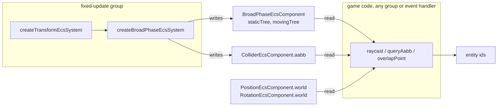

# Physics overlap queries

Issue: [#818](https://github.com/Forge-Game-Engine/Forge/issues/818)
(Physics Broad Phase Spatial Partitioning milestone; builds on
[#798](https://github.com/Forge-Game-Engine/Forge/issues/798)'s persistent
broad phase, designed in [`persistent-broad-phase.md`](./persistent-broad-phase.md),
and [#806](https://github.com/Forge-Game-Engine/Forge/issues/806), which
moved `raycast` onto the broad phase's trees)

| Module or file                                                                                                      | Change   | Notes                                                                                                                 |
| ------------------------------------------------------------------------------------------------------------------- | -------- | --------------------------------------------------------------------------------------------------------------------- |
| `src/physics/raycast/`                                                                                              | Removed  | Moved as a whole to `src/physics/queries/`                                                                            |
| `src/physics/queries/` (`raycast*.ts`, `raycast.bench.ts` renamed `queries.bench.ts`)                               | New      | Every scene query in one folder: the ray tests and `raycast`, moved unchanged apart from the shared filter            |
| `src/physics/queries/physics-query-filter.ts`                                                                       | New      | `PhysicsQueryFilter` (public); `defaultPhysicsQueryFilter`, `readQueryCandidate` (internal)                           |
| `src/physics/queries/query-aabb.ts`                                                                                 | New      | `queryAabb(world, aabb, filter?)`: colliders whose bounds overlap a box                                               |
| `src/physics/queries/contains-point-{circle,polygon,terrain,chain}.ts`                                              | New      | One exact point-containment test per collider type                                                                    |
| `src/physics/queries/collider-contains-point.ts`                                                                    | New      | `colliderContainsPoint(body, point)`: dispatches on `collider.type`                                                   |
| `src/physics/queries/overlap-point.ts`                                                                              | New      | `overlapPoint(world, point, filter?)`: colliders whose shape contains a point                                         |
| `src/physics/queries/raycast.ts`                                                                                    | Modified | `RaycastOptions extends PhysicsQueryFilter`; reads candidates through `readQueryCandidate`                            |
| `src/physics/colliders/chain-collider.ts`                                                                           | Modified | New `outsideIsSolid` field, computed once in the constructor                                                          |
| `src/navigation/grid/baking/collider-regions.ts`                                                                    | Modified | Reads `ChainCollider.outsideIsSolid` instead of computing it                                                          |
| `src/physics/index.ts`                                                                                              | Modified | Exports `./queries/index.js` instead of `./raycast/index.js`                                                          |
| `src/physics/colliders/chain-collider.test.ts`                                                                      | Modified | Imports `raycastChain` from `../queries/`                                                                             |
| `documentation-site/docs/docs/physics/raycasting.md`                                                                | Removed  | Becomes `queries.md`                                                                                                  |
| `documentation-site/docs/docs/physics/queries.md`                                                                   | New      | "Queries": rays, boxes and points, and what each one sees                                                             |
| `documentation-site/docs/docs/physics/` `index.md`, `chain-colliders.md`, `terrain.md`, `dynamic-aabb-tree.md`      | Modified | Links to the new page; what a point query finds inside a chain or a terrain                                           |
| `documentation-site/src/pages/demos/raycasting/` (`_create-game.ts`, `_create-targets.ts`, `index.tsx`), `demos.ts` | Modified | The target under the cursor is tinted through `overlapPoint`                                                          |
| `CHANGELOG.md`                                                                                                      | Modified | `#### Added` bullets for `queryAabb`, then `overlapPoint`, `colliderContainsPoint` and `ChainCollider.outsideIsSolid` |
| **Engine version at time of design**                                                                                |          | `0.27.0`                                                                                                              |

## Summary

Apart from `raycast`, the only way for a game to ask "which colliders are
here?" is to place a sensor entity and read its `ContactsEcsComponent`,
which updates once per fixed step and needs an entity in the world first.
Mouse picking, area damage, spawn-point clearance and box selection all
need a direct answer, now, from game code.

Every engine Forge is measured against answers these questions from the
tree its broad phase keeps: Box2D v3 with `b2World_OverlapAABB` and its
shape overlaps, Godot with `PhysicsDirectSpaceState2D.intersect_point`
and `intersect_shape`, Unity with `Physics2D.OverlapPoint`, `OverlapBox`
and `OverlapCircle`, and Rapier with its query pipeline's
`intersections_with_point` and `colliders_with_aabb_intersecting_aabb`.
After #798 and #806, Forge has the trees (`BroadPhaseEcsComponent`'s
`staticTree` and `movingTree`) and a filtering convention (`mask`,
`includeSensors`) to build the same queries on.

This design adds two queries next to `raycast`, in one `queries/` folder,
filtered the same way:

- `queryAabb(world, aabb, filter?)` returns the entities whose collider's
  **bounds** (`ColliderEcsComponent.aabb`) overlap a box. It tests bounds
  only, which is cheap and enough for box selection or "what's nearby".
- `overlapPoint(world, point, filter?)` returns the entities whose collider
  **shape** contains a point, using an exact test per collider type.

It also makes those exact tests public, as `colliderContainsPoint` and one
function per shape, the way the ray tests (`raycastCircle`, ...) already
are. Every collider type gets a test, including `ChainCollider`, which the
issue leaves out but `ColliderType` includes. A chain contains the points
on its solid side, decided by winding exactly as navigation baking already
decides it. To keep that rule in one place, the "is the outside solid"
flag moves from navigation into `ChainCollider` itself.

Nothing here bends a core design. The queries are plain functions that
read components and the broad phase's trees, write nothing, and keep no
state.

## Scope

### In scope

- Moving `src/physics/raycast/` to `src/physics/queries/`, with its tests
  and bench.
- `PhysicsQueryFilter` (`mask`, `includeSensors`), shared by `raycast`,
  `queryAabb` and `overlapPoint`, with one default and one internal helper
  that reads and filters a tree candidate.
- `queryAabb`, over both trees, testing each candidate's tight `aabb`.
- Exact point containment for `CircleCollider`, `PolygonCollider`,
  `TerrainCollider` and `ChainCollider`, and a dispatcher,
  `colliderContainsPoint`.
- `overlapPoint`, over both trees, culling by tight `aabb` and then
  testing the shape.
- `ChainCollider.outsideIsSolid`, and navigation baking reading it.
- Unit tests, a bench scene for both queries, the "Queries" docs page, the
  raycasting demo's hover highlight and the changelog.

### Out of scope

- **Shape overlaps** (Godot's `intersect_shape`, Unity's `OverlapCircle`
  and `OverlapBox` with exact tests, Box2D's `b2World_OverlapShape`).
  Nothing in the engine needs them yet. A later `overlapShape` can cull
  with `queryAabb`'s walk and test with `detectCollision`.
- **Shape casts** and **closest-point queries.** Design 14
  ([`3d/14-physics-3d.md`](./3d/14-physics-3d.md), section 6.14) plans
  them for both dimensions.
- **`excludeBody` and `predicate` filters.** Design 14's
  `PhysicsQueryFilter` has them. No caller here needs them: a game drops
  its own entity from the returned array with one `filter` call.
  `PhysicsQueryFilter` gains them when a caller does.
- **Moving `applyExplosiveForce` onto `queryAabb`.** It pushes rigid
  bodies, including bodies with no collider, which the broad phase never
  sees. Changing that changes which bodies it pushes.
- **Sorting overlap results**, or picking a single "topmost" collider.
  The issue asks for tree order. Which of several overlapping targets is
  "on top" is a draw-order question; design 15
  ([`3d/15-audio-particles-and-picking-in-3d.md`](./3d/15-audio-particles-and-picking-in-3d.md),
  section 6.4.7) answers it for pointer picking.
- **Finding a chain's unbounded solid beyond its bounds.** A chain whose
  outside is solid (`outsideIsSolid`) is solid everywhere outside its
  loops, and `colliderContainsPoint` and navigation baking both say so.
  `overlapPoint` only finds it at points inside its bounds, because the
  broad phase only reaches colliders whose bounds contain the point. The
  full fix needs unbounded broad-phase bounds (DL-13, open question 3).
- **A UI or input picking system** built on `overlapPoint`. Design 15 owns
  pointer picking.
- **Renaming for the 2D/3D split.** Design 14 renames 2D functions that
  have a 3D twin with a `2d` suffix, and design 15 names the 2D point
  query `overlapPoint2d`. That rename happens with the module split, as it
  does for every other 2D function; this design uses today's names.

## Phases

Each phase ends with every check in `CLAUDE.md`'s verification list
passing and can be released alone.

### Phase 1: One folder for queries, a shared filter, and `queryAabb`

Moves the ray queries into `queries/`, pulls the filter out of
`RaycastOptions` into `PhysicsQueryFilter`, and adds the bounds query. The
goal is a single place for scene queries and one filter that every query
applies the same way.

**Done when:** `queryAabb` and `PhysicsQueryFilter` are exported from
`@forge-game-engine/forge/physics`; every existing `raycast` test passes
with only its import paths changed; `src/physics/raycast/` no longer
exists; the docs site has a "Queries" page covering rays and boxes, and no
link to `physics/raycasting` is left.

| #   | Task                 | Description                                                                                                                                                                                                                                         | Size |
| --- | -------------------- | --------------------------------------------------------------------------------------------------------------------------------------------------------------------------------------------------------------------------------------------------- | ---- |
| 1.1 | Move the folder      | `git mv src/physics/raycast src/physics/queries`; rename `raycast.bench.ts` to `queries.bench.ts`; update `src/physics/index.ts` and `chain-collider.test.ts`'s import. No behavior change.                                                         | S    |
| 1.2 | `PhysicsQueryFilter` | `physics-query-filter.ts` with the interface, `defaultPhysicsQueryFilter` and `readQueryCandidate` (see "API"). `RaycastOptions extends PhysicsQueryFilter`; `raycast`'s callback calls `readQueryCandidate`. The index exports only the interface. | S    |
| 1.3 | `queryAabb`          | `query-aabb.ts`: validate the box, walk both trees with `DynamicAabbTree.query`, read and filter each candidate, keep those whose tight `aabb` overlaps (see "Algorithms"). Full JSDoc.                                                             | S    |
| 1.4 | `queryAabb` tests    | `query-aabb.test.ts`: the cases under "Testing", phase 1.                                                                                                                                                                                           | M    |
| 1.5 | Filter tests         | `physics-query-filter.test.ts`: mask, sensors, a removed entity, a missing position, an empty `aabb`.                                                                                                                                               | S    |
| 1.6 | Bench                | A `queryAabb` scene in `queries.bench.ts`: 100 boxes of a fixed size over the same 1k/4k/16k scenes the ray bench builds.                                                                                                                           | S    |
| 1.7 | "Queries" docs page  | Rename `raycasting.md` to `queries.md`, retitle it "Queries", add "Finding colliders in a box", and turn the caution into a "What a query sees" section shared by every query. Update every link (`grep -rn "raycasting" documentation-site`).      | M    |
| 1.8 | Demo doc link        | The raycasting demo's `docLinks` entry points at the new page.                                                                                                                                                                                      | S    |
| 1.9 | Changelog            | `#### Added`: `queryAabb` and `PhysicsQueryFilter`, which `RaycastOptions` now extends.                                                                                                                                                             | S    |

### Phase 2: Point containment and `overlapPoint`

Adds an exact containment test for every collider type, the dispatcher
and the point query, and shows it in the raycasting demo. The goal is a
point query that agrees with how physics, rays and navigation already
treat each shape's inside.

**Done when:** in the raycasting demo, hovering a target tints it through
`overlapPoint`; `overlapPoint` and `colliderContainsPoint` (and the four
shape tests) are exported from `@forge-game-engine/forge/physics`; a test
shows `containsPointChain` and navigation baking agree on which cell
centres of a chain are solid, and that `overlapPoint` agrees with both at
the cell centres inside the chain's bounds; and a test pins the
documented gap: beyond the bounds of a chain whose outside is solid,
navigation and `containsPointChain` say solid and `overlapPoint` doesn't
find the chain.

| #    | Task                                 | Description                                                                                                                                                                                                                                                                                                                                                                                                                                                      | Size |
| ---- | ------------------------------------ | ---------------------------------------------------------------------------------------------------------------------------------------------------------------------------------------------------------------------------------------------------------------------------------------------------------------------------------------------------------------------------------------------------------------------------------------------------------------- | ---- |
| 2.1  | `ChainCollider.outsideIsSolid`       | Compute it in the constructor from the loop with the largest absolute signed area, as `getChainRegion` does today, with JSDoc; `getChainRegion` reads it. Tests: no loops, a solid loop, a lone hole, a solid loop with a hole.                                                                                                                                                                                                                                  | S    |
| 2.2  | Circle and polygon tests             | `containsPointCircle`, `containsPointPolygon` (see "Algorithms").                                                                                                                                                                                                                                                                                                                                                                                                | S    |
| 2.3  | Terrain test                         | `containsPointTerrain`: local space, binary search on `points`, between the surface and `bottomY`.                                                                                                                                                                                                                                                                                                                                                               | S    |
| 2.4  | Chain test                           | `containsPointChain`: on an edge, or winding at or above the threshold `outsideIsSolid` sets.                                                                                                                                                                                                                                                                                                                                                                    | M    |
| 2.5  | `colliderContainsPoint`              | `Record<ColliderType, ...>` dispatch that throws a descriptive error, naming the type, when it has no test for it.                                                                                                                                                                                                                                                                                                                                               | S    |
| 2.6  | `overlapPoint`                       | Validate the point, walk both trees with a zero-size box, read and filter, cull by tight `aabb`, test the shape. Full JSDoc, including that a chain whose outside is solid is only found inside its bounds.                                                                                                                                                                                                                                                      | S    |
| 2.7  | Containment and `overlapPoint` tests | The cases under "Testing", phase 2.                                                                                                                                                                                                                                                                                                                                                                                                                              | L    |
| 2.8  | Navigation agreement tests           | In `collider-regions.test.ts`: bake a chain with a hole and a lone-hole chain into a grid larger than either chain's bounds. Assert every cell centre's blocked flag equals `containsPointChain` there, and that `overlapPoint` finds the chain at exactly the blocked centres inside its bounds. A second test pins the gap: at a blocked centre beyond the lone-hole chain's bounds, `containsPointChain` is `true` and `overlapPoint` doesn't find the chain. | M    |
| 2.9  | Bench                                | An `overlapPoint` scene in `queries.bench.ts`: 1,000 points over the same scenes.                                                                                                                                                                                                                                                                                                                                                                                | S    |
| 2.10 | Docs                                 | "Finding colliders at a point" on the Queries page, with what "inside" means per shape; a sentence each in `chain-colliders.md` and `terrain.md`. The Queries and Chain Colliders pages both say that `overlapPoint` only finds a chain whose outside is solid inside its bounds.                                                                                                                                                                                | S    |
| 2.11 | Demo hover highlight                 | See "Demo". Update the "How it works" list and `demos.ts`. Run `CLAUDE.md` step 9.                                                                                                                                                                                                                                                                                                                                                                               | M    |
| 2.12 | Changelog                            | `#### Added`: `overlapPoint`, `colliderContainsPoint` and the shape tests, and `ChainCollider.outsideIsSolid`.                                                                                                                                                                                                                                                                                                                                                   | S    |

## API

All in `src/physics/queries/`, exported from
`@forge-game-engine/forge/physics` unless marked internal.

### The filter

```ts
/**
 * Which colliders a physics query (raycast, queryAabb, overlapPoint) can
 * find.
 */
export interface PhysicsQueryFilter {
  /**
   * The collider categories the query can find: a collider is found only
   * if its `category` shares a bit with this mask. The collider's own
   * `mask` isn't read. Defaults to allCollisionCategories.
   */
  mask: number;

  /**
   * When `true`, the query also finds sensor colliders. Defaults to
   * `false`, so a query aimed at bodies ignores trigger zones.
   */
  includeSensors: boolean;
}

// Internal: not re-exported from the folder's index.
export const defaultPhysicsQueryFilter: PhysicsQueryFilter = {
  mask: allCollisionCategories,
  includeSensors: false,
};

export interface RaycastOptions extends PhysicsQueryFilter {
  sort: boolean; // unchanged
}
```

`raycast`'s defaults become
`{ ...defaultPhysicsQueryFilter, sort: true }`, built once at module level.
The overlap queries take `Partial<PhysicsQueryFilter>` and apply
`withDefaults(defaultPhysicsQueryFilter, filter)`.

The internal helper every query's tree callback calls:

```ts
/**
 * Reads a broad-phase tree candidate's collider and position, or returns
 * null when the query must skip it: the entity lost its collider or
 * position (or was removed) since the broad phase ran, the filter rejects
 * it, or its aabb is still the empty box it starts with.
 */
export function readQueryCandidate(
  entity: number,
  getCollider: (entity: number) => ColliderEcsComponent | null,
  getPosition: (entity: number) => PositionEcsComponent | null,
  filter: PhysicsQueryFilter,
): QueryCandidate | null;

interface QueryCandidate {
  collider: ColliderEcsComponent;
  position: PositionEcsComponent;
}
```

The issue names a `passesQueryFilter(collider, filter)` helper. It folds
into `readQueryCandidate`, because every query also needs the same three
staleness checks next to the filter; splitting them would leave each query
to remember them.

### The queries

```ts
/**
 * Finds every entity whose collider's bounds (ColliderEcsComponent.aabb)
 * overlap `aabb`, touching included. Only bounds are tested, not shapes:
 * a circle is found when the box overlaps its bounding square's corner.
 * Use overlapPoint for an exact test.
 * ...same "what the trees see" paragraph as raycast...
 * @returns The entities, in no particular order.
 * @throws If a coordinate of `aabb` is NaN, if `aabb.min` is greater than
 * `aabb.max` on an axis, or if the world has no broad phase or more than
 * one.
 */
export function queryAabb(
  world: EcsWorld,
  aabb: Aabb,
  filter: Partial<PhysicsQueryFilter> = {},
): number[];

/**
 * Finds every entity whose collider's shape contains `point`, its boundary
 * included (see colliderContainsPoint for what "contains" means for each
 * collider type).
 * Only colliders whose bounds contain `point` are found. A ChainCollider
 * whose outside is solid (outsideIsSolid) is solid beyond its loops too,
 * but is only found at points inside its bounds.
 * ...
 * @returns The entities, in no particular order.
 * @throws If `point` isn't finite, or the world has no broad phase or more
 * than one.
 */
export function overlapPoint(
  world: EcsWorld,
  point: Vector2,
  filter: Partial<PhysicsQueryFilter> = {},
): number[];
```

### Containment tests

```ts
/**
 * Checks whether a collider, placed at a body's position and rotation,
 * contains a world-space point, its boundary included.
 * @throws If the collider's type has no containment test. `Collider` is a
 * public abstract class, so a subclass outside the four Forge ships can
 * reach this at run time, though `ColliderType` lists only those four.
 */
export function colliderContainsPoint(
  body: CollisionBody,
  point: Vector2,
): boolean;

export function containsPointCircle(
  body: CollisionBody,
  point: Vector2,
): boolean;
export function containsPointPolygon(
  body: CollisionBody,
  point: Vector2,
): boolean;
export function containsPointTerrain(
  body: CollisionBody,
  point: Vector2,
): boolean;
export function containsPointChain(
  body: CollisionBody,
  point: Vector2,
): boolean;
```

The shape tests take a `CollisionBody`, like `raycastCircle` and the
`detect*Collision` functions, so a caller tests a single entity without
the broad phase (Unity's `Collider2D.OverlapPoint`). Design 15's 2D
collider hit tester is that caller.

### `ChainCollider.outsideIsSolid`

```ts
/**
 * Whether the plane outside every loop is solid: `true` when the loop
 * with the largest area is a hole, as a room carved out of solid is.
 * Loops never cross, so the largest loop isn't inside another, and its
 * winding says what lies outside them all. Loops that disagree (a solid
 * island beside a separate lone hole) have no consistent outside, and the
 * largest decides. `false` for a chain with no loops.
 */
public readonly outsideIsSolid: boolean;
```

## Algorithms

### `queryAabb`

```text
queryAabb(world, aabb, filter):
  throw unless every coordinate of aabb is a number (not NaN)
        and aabb.min <= aabb.max on both axes      // message names queryAabb
  filter = withDefaults(defaultPhysicsQueryFilter, filter)
  { staticTree, movingTree } = findBroadPhase(world)
  found = []
  visit(proxyId, entity):
    candidate = readQueryCandidate(entity, getCollider, getPosition, filter)
    if candidate and aabbsOverlap(candidate.collider.aabb, aabb):
      found.push(entity)
    return true                                    // never stop early
  staticTree.query(aabb, visit)
  movingTree.query(aabb, visit)
  return found
```

The box may have infinite sides; `queryAabb(world, { min: { x: -Infinity,
y: -Infinity }, max: { x: Infinity, y: Infinity } })` finds every
collider. That case is why `readQueryCandidate` rejects the empty starting
`aabb` explicitly: `aabbsOverlap` lets an empty box (`min` at `Infinity`,
`max` at `-Infinity`) through against a box with infinite sides.

Each entity has one proxy, in one tree, so no entity is found twice.

### `overlapPoint`

```text
overlapPoint(world, point, filter):
  throw unless point.x and point.y are finite       // message names overlapPoint
  box = { min: point, max: point }
  visit(proxyId, entity):
    candidate = readQueryCandidate(...)
    if not candidate or not aabbsOverlap(candidate.collider.aabb, box):
      return true
    body = { position: candidate.position.world,
             rotation: getColliderRotation(getRotation(entity)),
             collider: candidate.collider.collider }
    if colliderContainsPoint(body, point): found.push(entity)
    return true
  staticTree.query(box, visit); movingTree.query(box, visit)
  return found
```

### Per-shape containment

Every test moves the point into the collider's local space once
(`toChainLocal`, which only subtracts the position and turns by
`-rotation`), so it compares against the collider's stored local data and
allocates no transformed vertex arrays. Every comparison includes the
boundary and uses no tolerance (DL-6).

- **Circle:** `|local - center|² <= radius²`. `center` is the local
  `CircleCollider.center`, so an offset center is handled for free.
- **Polygon** (always convex, wound to a positive signed area, normals
  outward): contained when `dot(normals[i], local - vertices[i]) <= 0` for
  every `i`. Stop at the first edge the point is in front of.
- **Terrain:** the solid is the slab between the surface and `bottomY`
  over the surface's x range, as `raycastTerrain`'s columns and
  navigation's silhouette already treat it.

  ```text
  first = points[0].x; last = points[n - 1].x
  if local.x < first or local.x > last or local.y > bottomY: return false
  i = the last index with points[i].x <= local.x   // binary search; x strictly increases
  if i == n - 1: i = n - 2                          // local.x == last
  t = (local.x - points[i].x) / (points[i + 1].x - points[i].x)
  surfaceY = points[i].y + t * (points[i + 1].y - points[i].y)
  return local.y >= surfaceY                        // Y-down: below the surface
  ```

- **Chain:** the solid is what the loops' winding marks, exactly as
  `fillLoops` in `src/navigation/grid/baking/mark-region.ts` marks it.

  ```text
  { outline, outsideIsSolid } = collider
  if outline.edges is empty: return false
  // On the boundary counts as inside, like every other shape.
  for e in outline.queryEdges({ min: local, max: local }):
    if local lies on segment e (cross product 0, within its ends): return true
  // Winding: a horizontal ray from the point to -X.
  winding = 0
  for e in outline.queryEdges({ min: { x: -Infinity, y: local.y }, max: local }):
    a = e.start; b = e.end
    if not (min(a.y, b.y) <= local.y < max(a.y, b.y)): continue   // half-open
    x = a.x + (local.y - a.y) * (b.x - a.x) / (b.y - a.y)
    if x < local.x: winding += a.y > b.y ? 1 : -1
  return winding >= (outsideIsSolid ? 0 : 1)
  ```

  The half-open rule counts a vertex on the ray's line once and skips
  horizontal edges, the same rule `bucketEdgesByRow` uses. The edge
  tree's box query only visits edges near the ray, so a whole level's
  outline costs `O(log n + k)` for the `k` edges to the point's left on
  its row.

### Cost

`overlapPoint` and `queryAabb` cost `O(log n + k)` for the `k` colliders
whose fat box reaches the query, like `raycast`. Each call allocates its
result array and one closure; `overlapPoint` also allocates one
`CollisionBody` and one local point per candidate that passes the bounds
check. That's in line with `raycast` and small next to a frame; DL-5 and
open question 4 cover an allocation-free form.

## Data flow and system ordering



The queries read and never write, so they add no system and change no
ordering. What they see is what `raycast` already documents: the trees and
`aabb`s as of the broad phase's last run (once per fixed step), and the
current `position.world` and rotation for the exact test. A collider
added since then isn't found; one removed since then isn't found either.
Called from a default-group system or an event handler, a query sees the
latest fixed step. For static colliders (the demo's targets, a level) the
difference never shows.

## Demo

The raycasting demo (`documentation-site/src/pages/demos/raycasting/`)
keeps its ray and adds a hover highlight:

- `_create-targets.ts` returns the target entities it creates.
- The `mousemove` handler, after the ray, calls
  `overlapPoint(world, mouseWorldPosition)`. It sets the hovered target's
  `SpriteEcsComponent.tintColor` to a highlight color and every other
  target's back to `Color.white`. The handler already runs per event, so
  the hovered entity lives in the handler's closure like the ray origin;
  no system is added.
- "How it works" gains a line: "Hovering a target tints it: each mouse
  move also asks overlapPoint which collider contains the cursor."
- `demos.ts`'s description mentions the hover. The slug stays
  `raycasting` so its URL doesn't change; the title becomes "Raycasting and
  point queries" (open question 5).

## Testing

Unit tests, next to the code. No e2e test: the queries don't touch
rendering, input or the game loop, and the demo check covers the
integration by hand.

**Phase 1**

- `queryAabb`: finds a collider whose `aabb` overlaps the box; edges
  touching count; skips one whose fat box overlaps but tight box doesn't;
  finds a circle by its bounding square's corner (bounds only); finds
  colliders in both trees; an infinite box finds every collider and not
  one whose `aabb` is still empty; mask and sensor filtering; skips a
  collider the broad phase has no proxy for yet, one whose component was
  replaced since, and an entity removed since; throws for `NaN`, for an
  inverted box, and for a world with no broad phase.
- Every existing `raycast.test.ts` case, unchanged apart from imports.

**Phase 2**

- Circle: inside, on the boundary, outside; an offset `center` on a
  rotated entity.
- Polygon: inside, on an edge, on a vertex, outside; rotated; vertices
  authored away from the origin.
- Terrain: above the surface, on it, below it, on `bottomY`, below
  `bottomY`; on a slope; exactly on a surface vertex; left of the first
  point and right of the last; a rotated and offset terrain.
- Chain: inside a solid loop, in a hole inside it, outside every loop; a
  lone hole loop (inside the room is empty, its walls are solid); on an
  edge of each kind; a point level with a vertex; an empty chain; rotated.
- `colliderContainsPoint` dispatches to each, and throws, naming the
  type, for a `Collider` subclass whose `type` has no test.
- `overlapPoint`: finds a contained collider; rejects a point inside the
  `aabb` but outside the shape, which `queryAabb` with a zero-size box at
  the same point does return; filtering and staleness cases as for
  `queryAabb`; an entity with no `RotationEcsComponent`; throws for a
  non-finite point.
- `ChainCollider.outsideIsSolid` cases (task 2.1) and the navigation
  agreement tests (task 2.8): navigation, `containsPointChain` and, inside
  the chain's bounds, `overlapPoint` agree on every cell centre; beyond the
  bounds of a chain whose outside is solid, a test pins that
  `overlapPoint` doesn't find the chain while the other two say solid.

## Documentation

`queries.md` ("Queries", `sidebar_position: 3`), written with the
`document-feature` skill:

1. A short introduction: three queries, what each returns.
2. "Casting a ray": today's content.
3. "Finding colliders in a box": `queryAabb`, bounds only, an example of
   box selection.
4. "Finding colliders at a point": `overlapPoint`, an example of picking
   the body under the cursor with `getCameraView(...).viewportToWorld`,
   and a list of what "inside" means for each collider type (terrain: the
   slab under the surface; chain: its solid side, decided by winding as in
   [Chain Colliders](./chain-colliders.md)). `colliderContainsPoint` for
   testing one entity. A note that `overlapPoint` only finds a chain whose
   outside is solid at points inside the chain's bounds, though the solid
   (and `colliderContainsPoint`, and navigation baking) goes on beyond
   them; `chain-colliders.md` gets the same note next to its description
   of a lone hole loop.
5. "What a query sees": today's caution, written for all three.
6. "Choosing which colliders a query finds": `mask` and `includeSensors`.

## Decision log

### DL-1: The queries take the world, not a broad phase (departs from the issue)

- **Options:** (a) `queryAabb(world, aabb, filter?)` and
  `overlapPoint(world, point, filter?)`, finding the trees with
  `findBroadPhase(world)`; (b) the issue's
  `queryAabb(world, broadPhase, aabb, options)`.
- **Chosen:** (a).
- **Rationale:** The issue asks for `raycast`'s argument order, and the
  shipped `raycast` is `raycast(world, start, end, options?)`: #806's pull
  request (#923) kept that signature after `solution-reviewer` asked for
  it. The trees live in a component on the world
  (`persistent-broad-phase.md`, DL-1) so that queries can reach them from
  the world alone, and a separately passed broad phase could belong to
  another world, resolving its entity ids against the wrong colliders
  without an error. Godot's space state and Box2D's world id play the same
  part `world` does here.
- **Tradeoff:** `findBroadPhase` costs one query over a single entity per
  call.
- **Assumptions:** the issue's signature was written before #806 settled
  `raycast`'s.

### DL-2: The filter is named `PhysicsQueryFilter` (departs from the issue)

- **Options:** (a) `PhysicsQueryFilter`; (b) the issue's `QueryFilter`.
- **Chosen:** (a).
- **Rationale:** `src/index.ts` re-exports every module, and in Forge a
  "query" is first an ECS query (`world.query`, `QueryResult`); a
  `QueryFilter` reads as a filter for those. Design 14 already names the
  same interface `PhysicsQueryFilter`, so the 3D work extends this one
  instead of renaming it.
- **Tradeoff:** a longer name.
- **Assumptions:** open question 2.

### DL-3: `queryAabb` tests tight bounds, not fat boxes and not shapes

- **Options:** (a) tight `ColliderEcsComponent.aabb`; (b) the trees' fat
  boxes, as the tree walk alone gives; (c) exact shapes.
- **Chosen:** (a), as the issue asks.
- **Rationale:** Fat boxes are a broad-phase detail up to several
  `aabbMargin`s larger, so (b) would report colliders a game can see are
  outside its box. Exact shape overlap is the shape query this design
  leaves out. Box2D's `b2World_OverlapAABB` and Rapier's
  `colliders_with_aabb_intersecting_aabb` are bounds queries too.
- **Tradeoff:** a rotated box's bounds are larger than the box; callers who
  need exactness filter the result.

### DL-4: Different verbs for the bounds query and the exact query

- **Options:** (a) the issue's `queryAabb` and `overlapPoint`; (b)
  `overlapAabb` and `overlapPoint`; (c) design 14's `overlapBounds`.
- **Chosen:** (a).
- **Rationale:** "overlap" promises the shape; "query" names a bounds
  lookup, like `DynamicAabbTree.query` and `EdgeChain.queryEdges`. The
  issue and its "done when" use these names.
- **Tradeoff:** the pair doesn't share a prefix.

### DL-5: Results are a new array of entity ids, in tree order

- **Options:** (a) return `number[]`; (b) write into a caller's `out`
  array and return a count, as design 14 plans; (c) a visitor callback,
  as Box2D does.
- **Chosen:** (a).
- **Rationale:** It matches `raycast` and the issue, it's the simplest
  call for picking and selection, and nothing calls a query in a hot loop
  yet. Order is the trees' (static first), as `raycast` with `sort: false`
  documents.
- **Tradeoff:** one allocation per call.
- **Assumptions:** open question 4.

### DL-6: Containment includes the boundary and uses no tolerance

- **Options:** (a) exact comparisons, boundary included; (b) a small
  tolerance, such as `aabbMargin` or Box2D's linear slop.
- **Chosen:** (a).
- **Rationale:** It matches `aabbsOverlap` and the tree's query ("touching
  counts"), and a tolerance is a tuning value no caller asked for. A
  point the mouse can reach is almost never exactly on a rotated edge, and
  axis-aligned edges (tiles, boxes) compare exactly.
- **Tradeoff:** a point on a rotated edge may land either way by rounding.

### DL-7: A chain contains its solid side, by the winding rule navigation uses

- **Options:** (a) a chain contains the points its loops' winding marks
  solid; (b) a chain contains no points, only its edges' lines, as an
  outline with no area (Box2D's chain segments and Unity's
  `EdgeCollider2D` have no inside); (c) leave chains out and throw.
- **Chosen:** (a).
- **Rationale:** A `ChainCollider`'s loops are defined as surrounding
  solid or holes, unlike Box2D's segments, and navigation baking
  (`getChainRegion`, `fillLoops`) already treats that solid as blocked. A
  tile layer's collision is one chain (`tilemap-collision.md`), so with
  (b) a spawn-clearance check against tile walls, one of the issue's
  reasons for the query, would always pass. (c) breaks
  `Record<ColliderType, ...>` dispatch for a type the engine ships.
  `outsideIsSolid` moves into `ChainCollider` so both readers share one
  definition, and a test holds them to the same answer.
- **Tradeoff:** physics treats a chain as one-sided (a body inside solid
  isn't pushed out, a ray from inside passes out), and a point query now
  reports "inside" where nothing pushes. That's the shape's definition,
  not its collision response. The agreement with navigation holds inside
  the chain's bounds only: for a chain whose outside is solid, navigation
  (`markRegion` skips its reach check and `fillLoops` fills every row for
  such a region) and `colliderContainsPoint` treat the outside as solid
  everywhere, while `overlapPoint` can't find the chain beyond its bounds
  (DL-13).
- **Assumptions:** open question 1.

### DL-8: A terrain contains its whole slab

- **Options:** (a) the slab between the surface and `bottomY`, over the
  surface's x range; (b) only points near the surface.
- **Chosen:** (a), as the issue asks.
- **Rationale:** `raycastTerrain` hits the slab from any side and
  navigation blocks the whole silhouette; the point query agrees with
  both.

### DL-9: Tests run in the collider's local space

- **Options:** (a) move the point into local space once; (b) the issue's
  `getWorldVertices`/`getWorldNormals`.
- **Chosen:** (a).
- **Rationale:** The same answer for one transformed point instead of a
  transformed copy of every vertex and normal; it's how `raycastChain` and
  `raycastTerrain` already work (`toChainLocal`).

### DL-10: The containment tests are public

- **Options:** (a) export `colliderContainsPoint` and the four shape
  tests; (b) keep them internal to `overlapPoint`.
- **Chosen:** (a).
- **Rationale:** The ray tests are public for the same reason: testing
  one known entity doesn't need the broad phase, and design 15's 2D hit
  tester calls it.

### DL-11: One shared candidate check, rejecting empty bounds

- **Options:** (a) `readQueryCandidate`, covering the filter and the
  staleness checks `raycast` makes; (b) the issue's
  `passesQueryFilter(collider, filter)` alone.
- **Chosen:** (a).
- **Rationale:** Every query needs the same checks (lost collider or
  position, mask, sensor, empty `aabb`), and `queryAabb` with infinite
  sides is wrong without the empty-box check. One helper keeps the three
  queries filtering identically.

### DL-12: Every scene query lives in `queries/`

- **Options:** (a) move `raycast/` to `queries/`; (b) add an `overlap/`
  folder beside `raycast/`.
- **Chosen:** (a), as the issue asks.
- **Rationale:** One folder for one concern; the filter they share has an
  obvious home. Import paths inside the package change; the public export
  path (`@forge-game-engine/forge/physics`) doesn't.

### DL-13: `overlapPoint` doesn't find an outside-solid chain beyond its bounds

- **Options:** (a) accept and document the gap; (b) give an outside-solid
  chain unbounded broad-phase bounds, as Godot's `WorldBoundaryShape2D`
  and Rapier's `HalfSpace` get, so every query reaches it; (c) keep
  outside-solid chains in a separate list that `overlapPoint` always
  tests.
- **Chosen:** (a). The limit goes in `overlapPoint`'s JSDoc and on the
  Queries and Chain Colliders docs pages, and a test pins it (task 2.8).
- **Rationale:** `overlapPoint` only reaches colliders through the broad
  phase's trees, which only hold a chain's bounds. (b) is the full fix,
  but it's out of scope: `DynamicAabbTree` requires finite proxy boxes
  (`assertFiniteBox` in `dynamic-aabb-tree.ts`), so it needs a change to
  the tree or a second kind of broad-phase entry, and every moving body
  would pair with that chain, which changes the broad phase and narrow
  phase for every world that has one. (c) adds a second kind of candidate
  to one query and leaves `queryAabb` and `raycast` inconsistent with it.
- **Tradeoff:** a room carved out of unbounded solid isn't found by
  `overlapPoint` outside the room's bounds, though navigation and
  `colliderContainsPoint` call it solid there. A level avoids it by
  drawing an outer solid loop.
- **Assumptions:** whether to give unbounded shapes unbounded broad-phase
  bounds is for the user to decide separately (open question 3); nothing
  in this design depends on the answer.

## Open questions

1. **Non-blocking. Does `overlapPoint` find points inside a chain's
   solid?** Default: yes, by winding (DL-7).
   - _Solid by winding (default):_ matches the chain's own definition and
     navigation; makes clearance and picking checks work against tile
     layers.
   - _Edges only (no inside):_ matches Box2D's and Unity's edge shapes and
     the chain's one-sided collision; a game wanting "inside a wall"
     checks the tilemap's cells. Changes only `containsPointChain` and its
     tests, and `outsideIsSolid` would stay in navigation.
2. **Non-blocking. Name the filter `PhysicsQueryFilter` or
   `QueryFilter`?** Default `PhysicsQueryFilter` (DL-2).
   - _`PhysicsQueryFilter`:_ unambiguous in the root export, matches
     design 14.
   - _`QueryFilter`:_ the issue's name, shorter; matches Rapier's type.
3. **Non-blocking. Should `overlapPoint` find a chain whose outside is
   solid beyond the chain's bounds?** Default: no (DL-13). Navigation
   baking and `colliderContainsPoint` treat such a chain's outside as
   solid everywhere, even beyond its bounds. `overlapPoint` doesn't find
   it there, because the broad phase only reaches colliders whose bounds
   contain the point. `overlapPoint`'s JSDoc and the Queries and Chain
   Colliders pages say so, and a test pins it.
   - _No (default):_ no change to the broad phase; a level that needs it
     draws an outer solid loop.
   - _Yes, with unbounded broad-phase bounds:_ the full fix, as Godot's
     `WorldBoundaryShape2D` and Rapier's `HalfSpace` get. It needs
     `DynamicAabbTree` to accept a non-finite proxy (or a second kind of
     broad-phase entry), and every moving body would pair with the chain.
     A separate decision and design.
   - _Yes, with a side list:_ `overlapPoint` always tests outside-solid
     chains. Smaller, but only this query would see the unbounded solid.
4. **Non-blocking. Return a new array, or fill an `out` array?** Default:
   a new array (DL-5).
   - _New array (default):_ matches `raycast` and the issue.
   - _`out` array and count:_ allocation-free, matches design 14's
     planned form; worth doing for all three queries together when a
     caller runs them every frame for many entities.
5. **Non-blocking. Retitle the demo?** Default: keep the `raycasting`
   slug and retitle it "Raycasting and point queries".
   - _Retitle:_ the page shows both queries.
   - _Keep "Raycasting":_ fewer changes; the hover is a small addition.
6. **Non-blocking. Should overlap queries find sensors by default?**
   Default: no, the same as `raycast`.
   - _No (default):_ one default for every query, as the issue asks;
     matches Godot's `collide_with_areas`.
   - _Yes:_ matches Unity's default `queriesHitTriggers`, and a pickup
     under the cursor is found without an option. Diverging defaults
     between queries would be a surprise.
