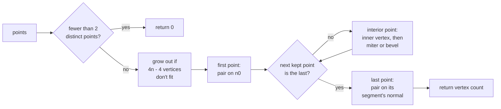

# Ribbon Meshes from a Polyline

Issue: [#784](https://github.com/Forge-Game-Engine/Forge/issues/784)
(milestone "Trail rendering")

|                                       |                                                                                                                                                                                                                                                        |
| ------------------------------------- | ------------------------------------------------------------------------------------------------------------------------------------------------------------------------------------------------------------------------------------------------------ |
| **Status**                            | Draft, for review                                                                                                                                                                                                                                      |
| **Kind**                              | Feature                                                                                                                                                                                                                                                |
| **Engine version at time of writing** | `0.26.2`                                                                                                                                                                                                                                               |
| **Related**                           | [#782](https://github.com/Forge-Game-Engine/Forge/issues/782) (dynamic `Geometry`, closed), [#783](https://github.com/Forge-Game-Engine/Forge/issues/783) (mesh draw commands), [#785](https://github.com/Forge-Game-Engine/Forge/issues/785) (trails) |

## Targeted modules

| Path                                                      | Change   | Notes                                                                                                 |
| --------------------------------------------------------- | -------- | ----------------------------------------------------------------------------------------------------- |
| `src/rendering/geometry/build-ribbon-mesh.ts`             | New      | `buildRibbonMesh`, `createRibbonMeshBuffers`, `RibbonPoint`, `RibbonMeshOptions`, `RibbonMeshBuffers` |
| `src/rendering/geometry/build-ribbon-mesh.test.ts`        | New      | Unit tests, no WebGL                                                                                  |
| `src/rendering/geometry/index.ts`                         | Modified | Exports the new file (reaches `@forge-game-engine/forge/rendering` through the existing re-export)    |
| `documentation-site/docs/docs/rendering/ribbon-meshes.md` | New      | Guide: points, joins, texture modes, feeding a `Geometry`                                             |
| `documentation-site/docs/docs/rendering/geometry.md`      | Modified | Links the ribbon guide from its triangle-strip example                                                |
| `CHANGELOG.md`                                            | Modified | `#### Added` bullet                                                                                   |

## Summary

A trail (#785), and later line rendering, needs the same piece of
geometry: a polyline with a width and a color at each point, turned into
a strip of triangles of that width. This design adds that as one pure
function in the rendering module:

```ts
const vertexCount = buildRibbonMesh(points, options, buffers);
```

It writes vertex positions, texture coordinates and colors into reusable
typed arrays and returns how many vertices it wrote, ready for
`Geometry.update` (#782) with the `'triangleStrip'` topology. It touches no
WebGL, holds no state and allocates nothing once its buffers are big
enough, so it can be unit-tested directly and called every frame.

The ribbon keeps its width around corners: each point is offset along the
miter (the bisector of the two segments' normals), scaled by
`1 / cos(half the turn)`. Sharp turns, where the miter would be longer
than `miterLimit × width`, fall back to a bevel on the outer side, so a
hairpin doesn't spike. On the inner side, the offset is limited so it
never reaches past the middle of either neighboring segment, so a curve
tighter than the ribbon's half-width doesn't fold over itself. Points
closer together than a small epsilon are skipped. U runs along the
ribbon, stretched once over it (`'stretch'`) or repeated every
`tileLength` world units (`'tile'`); V runs across it.

The function fits the engine as it is: no core design is bent. It's
world units and Y-up throughout, its normals are the segment directions
turned +90° (counter-clockwise, the engine's angle convention), and its
colors are straight alpha, which the trail shader outputs and the render
system's premultiplying blend expects.

## Scope

### In scope

- `buildRibbonMesh(points, options, out)`, a pure function.
- `RibbonPoint`: `position`, `width`, `color` and `distance` (along the
  line, in world units).
- `RibbonMeshOptions`: `textureMode` (`'stretch'` or `'tile'`), `tileLength`
  (tile mode only) and `miterLimit`.
- `RibbonMeshBuffers` and `createRibbonMeshBuffers(pointCapacity)`: reusable
  `positions`, `uvs` and `colors` arrays that grow (to a power of two) only
  when a call needs more room.
- Miter joins, the bevel fallback past `miterLimit`, the inner-side limit,
  flat (butt) ends, the duplicate-point skip.
- Unit tests, JSDoc, a documentation page and a changelog bullet.

### Out of scope

- **The trail component and system** (#785), and the trail shader and
  material. This design only describes what #785 passes in and gets back.
- **Drawing meshes in sprite draw order** (#783). The function produces
  data; how a mesh reaches the screen, including the Y flip into the
  sprite pipeline's render space, is #783's (open question 2).
- **A line-rendering component.** The function is shaped to serve one
  later; the component isn't designed here.
- **Round joins and caps** (Unity's corner and end-cap vertices, Godot's
  `LINE_JOINT_ROUND` and `LINE_CAP_ROUND`), square caps and closed loops
  (open question 5).
- **Other texture modes**: Unity's `DistributePerSegment` and
  `RepeatPerSegment`, Godot's `LINE_TEXTURE_NONE`. Unity's `Static` trail
  mode isn't a mode here: the caller-supplied `distance` gives it (see
  "Texture coordinates").
- **3D, camera-facing ribbons.** The 3D program
  ([design 15](./3d/15-audio-particles-and-picking-in-3d.md)) lists trails
  and ribbons as later work; a 3D ribbon faces the camera and needs a view
  direction this 2D function doesn't take.
- **Anti-aliased edges** (feathering with an extra vertex row or a
  distance-to-edge varying). The canvas's own multisampling applies as it
  does to sprites.
- **Changing `Vec2.perpendicular`** (open question 4).
- **Smoothing or resampling the polyline** (Catmull-Rom, as
  `buildTerrainCurve` does for terrain). Callers pass the points they want
  drawn.

## Phases

The change is one pure function with no callers yet, so it's one phase.
Splitting it (for example, miter joins first and the bevel fallback
later) would release a builder that spikes on hairpin turns, which the
issue's definition of done rules out.

### Phase 1: `buildRibbonMesh`

Adds the function, its types and buffers, its tests and its guide.

**Done when** `buildRibbonMesh` produces a constant-width ribbon for any
polyline, including hairpin turns and duplicate points, in both texture
modes, reuses its buffers across calls, and every check in `CLAUDE.md`'s
verification list passes. No demo changes: no demo imports it yet.

| #   | Task                | Description                                                                                                                                                                                             | Size |
| --- | ------------------- | ------------------------------------------------------------------------------------------------------------------------------------------------------------------------------------------------------- | ---- |
| 1.1 | Types and buffers   | `RibbonPoint`, `RibbonMeshOptions`, `RibbonTextureMode`, `RibbonMeshBuffers`, `createRibbonMeshBuffers(pointCapacity)` and the internal capacity check that grows the arrays to a power of two vertices | S    |
| 1.2 | Point walk          | The kept-point walk with the duplicate skip ("Skipping close points"), returning `0` for fewer than two distinct points                                                                                 | S    |
| 1.3 | Joins and ends      | Ends on their segment's normal; interior points: miter, the bevel fallback, the inner-side limit and the exact-reversal case, emitted as a triangle strip ("Join algorithm")                            | M    |
| 1.4 | Texture coordinates | `'stretch'` and `'tile'` U, with tile U rebased by whole tiles for precision; V across the ribbon                                                                                                       | S    |
| 1.5 | Validation          | Throws for a negative or non-finite width, `miterLimit < 1`, or a non-positive `tileLength`, with messages naming the value                                                                             | S    |
| 1.6 | Unit tests          | The cases in "Testing"                                                                                                                                                                                  | M    |
| 1.7 | Exports and JSDoc   | Export from `src/rendering/geometry/index.ts`; JSDoc every public type, field and function; `npm run check-exports`                                                                                     | S    |
| 1.8 | Guide               | `documentation-site/docs/docs/rendering/ribbon-meshes.md` ("Documentation"), linked from `geometry.md`                                                                                                  | S    |
| 1.9 | Changelog           | `#### Added` under `[Unreleased]`: "**rendering:** `buildRibbonMesh(points, options, buffers)` turns a polyline with a width and color at each point into a triangle-strip ribbon ..."                  | S    |

## API design

All of it lives in `src/rendering/geometry/build-ribbon-mesh.ts`, next to
the `Geometry` it feeds.

```ts
/** A point of the polyline a ribbon is built along. */
export interface RibbonPoint {
  /** The point's position, in world units. */
  position: Vector2;

  /** The ribbon's full width at this point, in world units. `0` or more. */
  width: number;

  /**
   * The ribbon's color at this point, straight (not premultiplied) alpha.
   * Red, green and blue can be above `1`, for bloom. A `Color`, or any
   * object with `r`, `g`, `b` and `a`, so a caller can reuse its own.
   */
  color: Pick<Color, 'r' | 'g' | 'b' | 'a'>;

  /**
   * How far along the line this point is, in world units, used for the
   * texture's U coordinate. Usually grows (or shrinks) monotonically from
   * the first point to the last.
   */
  distance: number;
}

/** How the texture's U coordinate runs along a ribbon. */
export type RibbonTextureMode = 'stretch' | 'tile';

/** Options for {@link buildRibbonMesh}. Every field is required. */
export type RibbonMeshOptions =
  | {
      /** The texture is stretched once over the whole ribbon. */
      textureMode: 'stretch';
      /** See {@link RibbonMeshOptions}. */
      miterLimit: number;
    }
  | {
      /** The texture repeats every `tileLength` world units. */
      textureMode: 'tile';
      /** The length of one repeat of the texture, in world units. */
      tileLength: number;
      /**
       * The longest a miter join can be, as a multiple of the ribbon's
       * width at that point, before it's beveled. `1` or more.
       */
      miterLimit: number;
    };

/**
 * The vertex data {@link buildRibbonMesh} writes. Each array is replaced
 * by a larger one when a call needs more room, so read them from this
 * object after every call.
 */
export interface RibbonMeshBuffers {
  /** `x, y` per vertex, in world units, Y-up. */
  positions: Float32Array;
  /** `u, v` per vertex. */
  uvs: Float32Array;
  /** `r, g, b, a` per vertex, straight alpha. */
  colors: Float32Array;
}

/**
 * Creates buffers with room for a ribbon of `pointCapacity` points.
 * @param pointCapacity - The most points the caller expects to pass.
 * @returns Empty buffers.
 */
export function createRibbonMeshBuffers(
  pointCapacity: number,
): RibbonMeshBuffers;

/**
 * Builds a triangle-strip ribbon along `points` into `out`.
 * @returns The number of vertices written; `0` when fewer than two of the
 * points are distinct.
 * @throws An error if a width is negative or not finite, `miterLimit` is
 * below `1`, or `tileLength` isn't positive.
 */
export function buildRibbonMesh(
  points: readonly RibbonPoint[],
  options: RibbonMeshOptions,
  out: RibbonMeshBuffers,
): number;
```

A caller draws the result with a `'triangleStrip'` `Geometry`:

```ts
const buffers = createRibbonMeshBuffers(64);
const geometry = new Geometry(renderContext, {
  attributes: [
    { name: 'a_position', data: buffers.positions, size: 2 },
    { name: 'a_texCoord', data: buffers.uvs, size: 2 },
    { name: 'a_color', data: buffers.colors, size: 4 },
  ],
  topology: 'triangleStrip',
});

// Each frame:
const vertexCount = buildRibbonMesh(points, ribbonOptions, buffers);

geometry.update({
  vertexCount,
  attributes: {
    a_position: buffers.positions,
    a_texCoord: buffers.uvs,
    a_color: buffers.colors,
  },
});
```

The attribute names follow `createQuadGeometry`'s `a_position` and
`a_texCoord`; the trail shader (#785) declares the same three.

## Join algorithm

### Notation

After the duplicate skip, the kept points are `q₀ … q_{m−1}` (`m ≥ 2`),
with half-widths `hᵢ` (half of each point's `width`). Segment `k` runs from `q_k` to
`q_{k+1}`:

- `ℓ_k`, its length;
- `d_k = (q_{k+1} − q_k) / ℓ_k`, its direction;
- `n_k = (−d_k.y, d_k.x)`, its normal: `d_k` turned +90°, so it points to
  the left of travel (`+Y` for a ribbon running toward `+X`).

Every point emits a pair of vertices, left (`+n` side) then right (`−n`
side). A beveled join emits two pairs. The vertices make one triangle
strip.

### Ends

`q₀` is offset along `n₀` and `q_{m−1}` along `n_{m−2}`:
left `q + n·h`, right `q − n·h`. The ribbon ends flat (a butt end) at its
first and last points.

### Interior points

For `q = qᵢ` with incoming normal `a = n_{i−1}` and outgoing normal
`b = nᵢ`:

```
cosTurn = clamp(dot(a, b), −1, 1)       // = dot(d_{i−1}, dᵢ); rounding can
                                        // push it just past ±1
c = sqrt((1 + cosTurn) / 2)             // cos of half the turn
s = sqrt((1 − cosTurn) / 2)             // sin of half the turn
turn = cross(d_{i−1}, dᵢ)               // > 0 turns left, < 0 turns right
bisectorLength = |a + b|

if bisectorLength < 1e−9:               // an exact reversal
  m = −d_{i−1}; inner = left; c = 0; s = 1
else:
  m = (a + b) / bisectorLength          // the miter direction, unit length,
                                        // on the +n side
  inner = turn > 0 ? left : right       // straight (turn = 0): either
outer = the other side
sign(left) = +1, sign(right) = −1

// Inner side: the miter point, but never past the middle of either
// neighboring segment.
k = h == 0 ? 0 : (c > 0 ? h / c : +∞)   // no 0 / 0 at a reversal
if s > 0: k = min(k, min(ℓ_{i−1}, ℓᵢ) / (2s))
I = q + sign(inner) · m · k

// Outer side: the miter point, or a bevel past the miter limit.
if c · miterLimit ≥ 1:
  O = q + sign(outer) · m · (h / c)
  emit pair (I, O) in left-right order
else:
  O₀ = q + sign(outer) · a · h
  O₁ = q + sign(outer) · b · h
  emit pair (I, O₀) in left-right order
  emit pair (I, O₁) in left-right order
```

`1 / c` is the miter's length as a multiple of the ribbon's width, the
ratio SVG's `stroke-miterlimit` and canvas's `miterLimit` compare against,
so the test `c · miterLimit ≥ 1` needs no division and never divides by
zero.

**Numerical safety.** `dot(a, b)` of two unit vectors can come out a
rounding error past `±1` (two collinear diagonal segments give
`1.0000000000000002`), which would make one of the square roots `NaN`, so
it's clamped first. `m` is normalized by `|a + b|` itself, not by `2c`:
in exact arithmetic they're equal, but in floating point `2c` comes from
a different expression, and dividing by it would leave `m` slightly off
unit length near a reversal. Normalizing by the same `|a + b|` the
reversal test reads means the test and the bisector can't disagree:
any `a + b` long enough to pass the test is long enough to normalize.
The `1e−9` threshold sits far below any turn a ribbon can show (a turn
within about `1e−9` radians of 180°) and far above the rounding error of
adding two unit vectors.

**Why the miter scale keeps the width.** The miter vertex sits at
`h / c` from `q` along the bisector `m`. Its distance from either
segment's center line is `(h / c) · dot(m, a) = (h / c) · c = h`. At a 90°
turn (`c = √½`), the outer vertex is `h·√2` from `q` and `h` from both
segments.

**Why the bevel is a strip.** With the inner vertex repeated, a bevel on
the right emits `I, O₀, I, O₁` and one on the left `O₀, I, O₁, I`. The
strip's triangles there are the bevel wedge `(O₀, I, O₁)` and one
zero-area triangle, which the GPU drops. Nothing enables face culling in
`src/rendering`, so the strip's alternating winding doesn't matter.

**Why the inner side is limited.** The inner miter vertex projects
`h · tan(turn / 2)` back along each neighboring segment. Where that's more
than half a segment, the inner vertices of two neighboring joins cross and
the strip folds over itself, which shows as a darker patch on a
translucent trail and as a spike on the inner side of a hairpin. Limiting
`k` to `min(ℓ) / (2s)` keeps the projection at most `min(ℓ) / 2`. For a
smooth curve, this only takes effect where the curve's radius is less than
`h`: where a ribbon of that width can't follow the curve without
overlapping itself, its inner edge is pulled in instead. That's a
deliberate choice over Godot's and Unity's overlap (open question 1).

**Exact reversals.** When the line turns back on itself exactly
(`|a + b| < 1e−9`), there's no bisector. The inner vertex goes straight back
along the incoming segment (`m = −d_{i−1}`), which is where the general
case's `I` tends as the turn approaches 180° from either side; `c = 0`, so
it's always beveled.

**Varying widths.** Each point uses its own `h`. Between points of
different widths, the edges are straight lines between the offset
vertices, so a ribbon tapers linearly from point to point, as Unity's and
Godot's do.

### Vertex count

`2` per end point, `2` per mitered point and `4` per beveled point, so at
most `4m − 4` for `m ≥ 2`. `buildRibbonMesh` checks capacity once, for
`4 · points.length − 4` vertices, before writing.

### Diagram



## Skipping close points

A point within `ε = 1e-4` world units of the previous kept point has no
direction to it, so it's skipped. The rule keeps both ends exact:

- The first and last points are always kept.
- A point in between is skipped when it's within `ε` of the previous kept
  point, or within `ε` of the last point.
- If only the first and last points are left and they're within `ε` of
  each other, the ribbon is empty: `buildRibbonMesh` returns `0`.

Comparing against the previous _kept_ point, not the previous input
point, means a line that creeps forward in steps smaller than `ε` still
keeps a point every `ε`. Skipped points contribute nothing, including
their width, color and distance.

`1e-4` world units is about a hundredth of a pixel at the default camera
(`verticalWorldUnits: 10` on a 1080 pixel canvas is 108 pixels per unit),
so skipping can't be seen. It's a constant, not an option: it only guards
against a zero-length direction (open question 6).

## Texture coordinates

**V** is `0` on the left edge (`+n`) and `1` on the right edge (`−n`).
Forge uploads images with row 0 at `v = 0`, and a sprite shows row 0 at
its top (`sprite.vert.glsl` puts `a_texCoord.y = 0` at the quad's
render-space top). So a texture laid along a ribbon running toward `+X`
shows the same way up as on a sprite: its top row along the ribbon's
`+Y` edge.

**U** is one value per point, shared by every vertex the point emits:

- `'stretch'`: `U = (d − d_first) / (d_last − d_first)`, where `d_first`
  and `d_last` are the first and last points' distances. U runs from `0`
  at the first point to `1` at the last, whichever way the distances
  run. If `d_last = d_first`, every U is `0`.
- `'tile'`: `U = (d − t · tileLength) / tileLength`, where
  `t = floor(d_first / tileLength)`. That's `d / tileLength` less a whole
  number of tiles, which a repeating texture can't tell apart, computed in
  double precision so U stays small and exact in a `Float32Array` however
  far a long-lived trail's distances have grown.

The caller owns `distance`, which decides whether the texture slides. A
trail that gives each point its distance from the head gets a texture
that slides along the trail as it moves, Unity's trail `Tile`. A trail
that records each point's cumulative distance traveled when it's added,
and never changes it, gets a texture fixed to the points, like Unity's
`Static`. #785 chooses; the cumulative distance is the usual choice for
exhaust and sword trails.

The texture modes are an option because games need both: a stretched
gradient or streak, or a repeating pattern (chevrons, a dashed line) that
mustn't stretch as the trail grows. Unity and Godot both offer the pair.

## Colors

Each vertex gets its point's `r, g, b, a`, as given: straight alpha, with
red, green and blue possibly above `1`. The trail shader multiplies the
texture by the vertex color and outputs straight alpha; the render
system's `blendFuncSeparate(SRC_ALPHA, ONE_MINUS_SRC_ALPHA, ONE,
ONE_MINUS_SRC_ALPHA)` stores it premultiplied, as for sprites. Colors
interpolate linearly between points across each triangle.

When design 07 of the 3D program moves 2D blending to linear space
([07, Phase 2](./3d/07-2d-on-the-render-pipeline.md)), vertex colors will
need the same conversion as tints. That conversion belongs to whatever
uploads them (the shader, or a `linear` read), not to this function.

## Data flow

The trail system (#785) is the first caller. Its per-frame flow, for
reference:


- The trail's `RibbonPoint` objects and `RibbonMeshBuffers` belong to the
  trail component's state, written only by the trail system, so the trail
  system stays stateless.
- The trail keeps a pool of `RibbonPoint`s sized to its ring buffer, fills
  their fields each frame, and sets the length of the array it passes,
  since `buildRibbonMesh` reads `points.length`.
- Colors from age are written into each pooled point's own mutable
  `{ r, g, b, a }`, so the trail allocates no `Color` per point per frame.
- `buildRibbonMesh` is the only writer of `out`'s arrays; the trail reads
  them back from `out` after each call.

## Performance

- One pass over the points, with a lookahead for the next kept point, so
  `O(n)`. Per interior point: two square roots for `c` and `s` and one
  per segment length; no trigonometry.
- No allocation once the buffers fit. The capacity check runs once per
  call; when it grows, it grows to the next power of two vertices, so a
  growing trail reallocates a logarithmic number of times, the same rule
  as `Geometry.update`'s buffers. `Geometry.update` then grows its GL
  buffers the same way.
- The inner loop uses plain numbers, not `Vec2` calls on scratch objects:
  it's the hot path, and the formulas are short.
- Options are passed resolved: no `withDefaults` per call, since it builds
  new objects every time it runs (see "Decision log", D9).
- A trail of a few hundred points builds in well under a tenth of a
  millisecond; there's no benchmark suite yet to hold it to a number
  (design 01 of the 3D program adds one).

## Testing

`src/rendering/geometry/build-ribbon-mesh.test.ts`, with no WebGL. A small
helper reads vertex `i`'s position, UV and color out of the buffers;
positions are compared with `toBeCloseTo`.

| Case                        | Asserts                                                                                                                                                                            |
| --------------------------- | ---------------------------------------------------------------------------------------------------------------------------------------------------------------------------------- |
| Straight line, 2 points     | 4 vertices; left vertices `+h` along `+Y` for a line along `+X`, right `−h`; V is `0` left, `1` right                                                                              |
| Straight line, 3 collinear  | 6 vertices (a straight interior point is a miter of length `h`)                                                                                                                    |
| 90° turn, left and right    | Outer vertex `h·√2` from the corner; every vertex is `h` from both segments' center lines (width preserved); no bevel                                                              |
| Turn at the miter limit     | Just under the limit: 2 vertices at the join; just over: 4, with the outer pair at `q ± a·h` and `q ± b·h`                                                                         |
| Near-180° turn (hairpin)    | Beveled; no vertex farther than `max(h, min(ℓ) / (2s))` from the turning point, far below `miterLimit · width` (no spike), for left and right turns                                |
| Exact reversal              | Beveled; inner vertex behind the turning point along the incoming segment; no `NaN`                                                                                                |
| Nearly reversed             | Turns within `1e−6` and `1e−12` radians of 180°, left and right: beveled, no `NaN`, every vertex within the hairpin bound above; the inner vertex is on the same side as at 179°   |
| Collinear diagonal          | Three points along `(1, 1)` (and along `(0.1, 0.7)`), where `dot(a, b)` rounds past `1`: a miter of length `h`, no `NaN`, 6 vertices                                               |
| Tight curve, short segments | On an arc of radius `< h`, the strip doesn't fold: every segment quad's signed area has the same sign as on a gentle arc                                                           |
| Duplicate points            | Identical consecutive points give the same vertices as one point; all-identical points return `0`; a single point returns `0`; creeping steps below `ε` still keep a point per `ε` |
| Ends kept                   | A last point within `ε` of an interior point keeps the last point's position, width, color and distance                                                                            |
| Widths                      | Width `0` gives coincident left and right vertices; tapering widths give per-point offsets                                                                                         |
| `'stretch'`                 | U is `0` at the first point and `1` at the last, for increasing and for decreasing distances; equal distances give `0`                                                             |
| `'tile'`                    | U differences equal distance differences over `tileLength`; distances near `1e7` give the same fractional U as near `0`                                                            |
| Colors                      | Each vertex has its point's color, including components above `1`, not premultiplied                                                                                               |
| Buffer reuse                | A second call that fits leaves the same array objects in `out`; one that doesn't replaces them once with power-of-two capacity, and a later smaller call keeps those               |
| Validation                  | Throws for a negative and a `NaN` width, `miterLimit: 0.5`, `tileLength: 0`                                                                                                        |

No e2e test: the function draws nothing. #785's e2e spec covers a ribbon
on a real canvas.

## Documentation

`documentation-site/docs/docs/rendering/ribbon-meshes.md`, after
`geometry.md` in the sidebar:

- what a ribbon is and when to use `buildRibbonMesh` (a polyline drawn
  with a width and color at each point). The guide describes the engine
  as it is when it ships: it doesn't mention trails or other features
  that haven't shipped. When #785 lands, its own change adds a sentence
  pointing trail users at the trail component;
- `RibbonPoint`'s fields, with world units and straight-alpha colors;
- **coordinates**: the positions are Y-up world space, like every other
  position in the engine. Drawn by hand with today's
  `createProjectionMatrix` (the `material.bind` / `geometry.bind` /
  `geometry.draw` pattern in `geometry.md`), the vertex shader has to
  negate Y before projecting (`u_projection * vec3(a_position.x,
-a_position.y, 1.0)`), because that matrix expects the Y-down render
  space the sprite pipeline produces by negating `position.world.y`
  (`createProjectionMatrix`'s `scale(2 / width, -2 / height)` and the
  comment beside its `translate`). The guide says this is needed until
  meshes have their own draw path, and the guide's sample shader does it;
- joins: miter, bevel past `miterLimit`, and that a curve tighter than the
  half-width is pulled in on its inner side;
- the two texture modes, and how `distance` makes a tiled texture slide or
  stay fixed (with `wrap: 'repeat'` on the texture for `'tile'`);
- the `Geometry` example from "API design", and that the buffers are
  replaced when they grow.

`geometry.md`'s triangle-strip example links to it. No demo: the
milestone's trail demo will show ribbons, and nothing can draw a mesh in
sprite order until #783. (The milestone references in this paragraph are
for the design's readers; none of them goes in the guide.)

## Decision log

**D1. A pure function, not a component or system.**
Options: (a) a pure function over points and output buffers; (b) a
`RibbonEcsComponent` and system that builds geometry; (c) a method on
`Geometry`. Chosen: (a). It's the issue's goal, it's testable without
WebGL, and trails and later lines share it without either owning it.
Unity's `TrailRenderer` and `LineRenderer` share an internal line builder
the same way; Godot's `Line2D` uses an internal `LineBuilder`.
Tradeoff: callers own the buffers and the `Geometry`. Assumption: no
caller needs the ribbon without a `Geometry`-shaped output.

**D2. Points as an array of objects.**
Options: (a) `readonly RibbonPoint[]`; (b) parallel typed arrays
(positions, widths, colors, distances) and a count. Chosen: (a), as the
issue describes, matching `TerrainCurvePoint` (`position`, `distance`).
It's readable for a line of a few points, and a trail reuses a pool of
point objects, so it allocates nothing either way. Tradeoff: (b) would
be a little faster and would let a trail pass its ring buffer's backing
arrays without a pool. Assumption: ribbons are hundreds of points, not
hundreds of thousands.

**D3. `color` is `Pick<Color, 'r' | 'g' | 'b' | 'a'>`.**
Options: (a) `Color`; (b) the structural `r, g, b, a` subset of `Color`;
(c) four numbers on the point. Chosen: (b). `Color` is immutable, so with
(a) a trail would build a new `Color` per point per frame as its points
age. (b) accepts a `Color` unchanged and a reused mutable object. No new
named color type is added. Tradeoff: a caller can pass an object with
alpha outside `[0, 1]`, which `Color`'s constructor would have clamped.
Assumption: callers that build their own color objects keep them in
range, and the function doesn't validate colors per vertex.

**D4. One non-indexed triangle strip.**
Options: (a) a triangle strip, bevels as a repeated inner vertex; (b)
indexed triangles; (c) a strip with an index buffer and primitive
restart. Chosen: (a), as the issue asks. It's the least data (two
vertices per point), needs no index buffer, and the bevel costs two
vertices and one zero-area triangle. Tradeoff: round joins later would
need more degenerate triangles in a strip than in an indexed mesh.
Assumption: round joins aren't needed soon (open question 5).

**D5. Output buffers grow to a power of two.**
Options: (a) grow in `buildRibbonMesh` when needed; (b) throw when the
caller's buffers are too small; (c) return new arrays each call. Chosen:
(a). (c) allocates every frame. (b) makes every caller work out the
worst-case vertex count (four per point), and a future line component
with a changing point count would have to resize itself. Growing to a
power of two matches `Geometry.update`. Tradeoff: `out`'s arrays can
change identity, so callers re-read them after each call (they pass them
to `Geometry.update` every frame anyway). Assumption: growth settles after
the first few frames.

**D6. Miter joins with a bevel fallback, no join-mode option.**
Options: (a) miter, beveled past `miterLimit`; (b) always bevel; (c) a
join-mode option (miter, bevel, round) as Godot's `joint_mode`. Chosen:
(a), the issue's choice and the default in SVG, canvas, Godot (`SHARP`
with `sharp_limit`) and Unity (no corner vertices). Sharp ribbons look
right for trails and lines; the bevel only exists to stop spikes. No
join-mode option: nothing needs another mode yet, and one can be added
when something does. `miterLimit` is an option because
games want different sharpness (a stylized line versus a smooth trail),
and it uses SVG's and canvas's definition (miter length over width), so
its values mean what they mean on the web. Tradeoff: no round joins.

**D7. The inner side is limited to half the neighboring segments.**
Options: (a) always the full inner miter (Unity and Godot, which overlap
on tight curves); (b) limit the inner offset so it never passes the
middle of a neighboring segment; (c) Godot's finite segment intersection
with a fallback to per-segment offsets. Chosen: (b). It's the exact
condition for neighboring joins not to cross, so the strip never folds,
it costs one `min`, and it only takes effect where the curve is tighter
than the ribbon's half-width, where constant width is impossible anyway.
The issue asks for no gaps or overlaps at joins. Tradeoff: on such
curves the inner edge is pulled in, so the ribbon is narrower there than
`width`. Assumption: a narrower inner edge on very tight curves looks
better on translucent trails than a darker overlap (open question 1).

**D8. A fixed `1e-4` world unit skip, ends always kept.**
Options: (a) an absolute constant; (b) relative to width; (c) an option.
Chosen: (a). It only guards against a direction that can't be computed;
`minVertexDistance` in #785 is the user-facing control of point spacing.
Keeping both ends exact means a trail's ribbon always reaches its entity.
Tradeoff: a game with a very small world scale (whole level within a
fraction of a unit) would see points merged. Assumption: world units are
roughly meters or tiles, as `verticalWorldUnits: 10` implies (open
question 6).

**D9. Options are required and resolved by the caller.**
Options: (a) every field required, no defaults inside the function; (b)
optional fields applied with `withDefaults` on each call; (c) optional
fields read with `??`. Chosen: (a). `withDefaults` builds new objects on
every call (`Object.entries`, `filter`, `Object.fromEntries` and a
spread), which a per-frame, per-trail call shouldn't. (c) breaks the
engine's defaults convention. Components that wrap the function (the
trail, a later line component) apply their own defaults once, when the
component is added, and pass the resolved object every frame. A
discriminated union makes `tileLength` exist exactly when it's used.
Tradeoff: a direct caller writes `miterLimit` out. Assumption: most
callers are components, not game code (open question 3).

**D10. Y-up world positions, no flip.**
Options: (a) output Y-up world positions; (b) negate Y, as
`createTerrainMesh` does today for the sprite pipeline's Y-down render
space. Chosen: (a). The function's output is world data, and
"fix the layer that owns the behavior" puts the flip where the Y-down
space comes from, the projection matrix, rather than in every mesh
producer or mesh shader. Tradeoff: until that happens, a mesh drawn by
hand with `createProjectionMatrix` negates Y in its vertex shader, and
the guide says so (open question 2).

**D11. Scalar math with an explicit +90° normal.**
Options: (a) plain-number math, `n = (−d.y, d.x)`; (b) `Vec2` helpers on
scratch vectors; (c) `Vec2.negate(Vec2.perpendicular(d))`. Chosen: (a).
The issue suggests `Vec2` helpers, but the formulas are short and this is
the hot loop; the normal's direction is spelled out and matches the
engine's counter-clockwise angle convention. `Vec2.perpendicular` turns
−90°, so (c) would need a negation and a comment explaining it.
Tradeoff: the function doesn't read like the rest of the math code.

**D12. V is `0` on the left (`+n`) edge.**
Options: `0` on the left; `0` on the right. Chosen: left, so a texture on
a ribbon running toward `+X` is the same way up as on a sprite (row 0 at
the top). Tradeoff: none known; it's a convention that has to be picked
and documented.

## Open questions

1. **Inner edge on curves tighter than the half-width (non-blocking).**
   Default: pull the inner edge in (D7).
   - _Pull it in_: no folds, no double-blended dark patches on translucent
     trails, no inner spikes; the ribbon narrows on very tight curves.
   - _Overlap, as Unity and Godot do_: the full width everywhere and
     what users of those engines expect, but translucent trails show darker
     patches and hairpins with short segments fold.
     A different answer removes the `min` and changes one test.

2. **Where meshes flip into the renderer's Y-down space (non-blocking).**
   Default: the builder outputs Y-up world positions (D10), and the right
   layer for the flip is the projection matrix, not each mesh shader.
   `createProjectionMatrix` builds a Y-down projection
   (`scale(2 / width, -2 / height)`) only because the sprite instance data
   negates `position.world.y` (`bindSpriteInstanceData`) and terrain
   negates its vertices (`create-terrain-mesh.ts`). A Y-up projection,
   with the sprite and terrain negations deleted, puts every producer in
   world space with no per-shader flip. That's #783's (or the 3D
   program's design 07, which replaces `createProjectionMatrix`) to do;
   until then the guide tells hand-drawn meshes to negate Y in their
   vertex shader.
   - _Flip in the projection matrix_: one place; sprites, terrain,
     ribbons and future debug lines all work in Y-up world space, and
     the compensating negations in the sprite and terrain paths go.
   - _Flip in each mesh shader_: no change to the sprite path, but every
     mesh material repeats it, and forgetting it draws the mesh upside
     down about the camera.
   - _Flip in each producer_ (as terrain does today): its output isn't
     world data, and every producer repeats it.
     A different answer negates one line of the builder's output or one
     line of the trail shader; the builder's design doesn't change.

3. **Engine default for `miterLimit` (non-blocking).** Default: no default
   in `buildRibbonMesh` (D9); components that wrap it use `4`.
   - _`4`_: SVG's and canvas's default. Bevels turns of more than about
     151° (an angle under about 29° between the two segments), so most
     corners stay sharp.
   - _`2`_: Godot's `sharp_limit` default. Bevels turns of more than 120°,
     so zig-zag trails have fewer long points.
   - _Optional with a default in the function_: friendlier to direct
     callers, at the cost of a per-call `withDefaults` or a separate
     resolve step.

4. **`Vec2.perpendicular` turns clockwise in a Y-up world (non-blocking,
   separate issue).** It returns `(y, −x)`, which is −90°, while every
   angle in Forge is counter-clockwise. Its callers in `src/physics`
   negate it or use it as a tangent.
   - _Leave it_: this design doesn't use it (D11).
   - _Change it to +90° (`(−y, x)`, Unity's `Vector2.Perpendicular`)_ in
     its own issue, updating the physics callers and `vectors.md`.

5. **Round joins and caps (non-blocking).** Default: none (out of scope).
   - _None_: trails taper to a point or fade at the tail, so ends rarely
     show.
   - _Later, for line rendering_: round caps matter for thick lines; that
     would favor an indexed mesh over the strip (D4).

6. **Skip distance relative to width (non-blocking).** Default: the
   absolute `1e-4` world units (D8).
   - _Absolute_: simple, and independent of a ribbon tapering to `0`.
   - _Relative to width_: scales with the ribbon, but a width of `0`
     would skip nothing, and it changes nothing at normal world scales.
