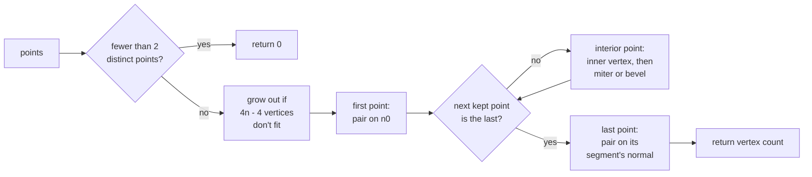

# Ribbon Meshes from a Polyline

Issue: [#784](https://github.com/Forge-Game-Engine/Forge/issues/784)
(milestone "Trail rendering")

|                                       |                                                                                                                                                                                                                                                                                                                                        |
| ------------------------------------- | -------------------------------------------------------------------------------------------------------------------------------------------------------------------------------------------------------------------------------------------------------------------------------------------------------------------------------------- |
| **Status**                            | Draft, for review                                                                                                                                                                                                                                                                                                                      |
| **Kind**                              | Feature                                                                                                                                                                                                                                                                                                                                |
| **Engine version at time of writing** | `0.26.2`                                                                                                                                                                                                                                                                                                                               |
| **Related**                           | [#782](https://github.com/Forge-Game-Engine/Forge/issues/782) (dynamic `Geometry`, closed), [#783](https://github.com/Forge-Game-Engine/Forge/issues/783) (meshes in the draw order, closed by [PR #862](https://github.com/Forge-Game-Engine/Forge/pull/862)), [#785](https://github.com/Forge-Game-Engine/Forge/issues/785) (trails) |

## Targeted modules

| Path                                                           | Change   | Notes                                                                                                 |
| -------------------------------------------------------------- | -------- | ----------------------------------------------------------------------------------------------------- |
| `src/rendering/geometry/build-ribbon-mesh.ts`                  | New      | `buildRibbonMesh`, `createRibbonMeshBuffers`, `RibbonPoint`, `RibbonMeshOptions`, `RibbonMeshBuffers` |
| `src/rendering/geometry/build-ribbon-mesh.test.ts`             | New      | Unit tests, no WebGL                                                                                  |
| `src/rendering/geometry/index.ts`                              | Modified | Exports the new file (reaches `@forge-game-engine/forge/rendering` through the existing re-export)    |
| `documentation-site/docs/docs/rendering/ribbon-meshes.md`      | New      | Guide: points, joins, texture modes, filling a `Geometry`, drawing it as a mesh                       |
| `documentation-site/docs/docs/rendering/geometry.md`           | Modified | One sentence under the `'triangleStrip'` example, linking the ribbon guide                            |
| `documentation-site/docs/docs/rendering/meshes.md`             | Modified | One sentence under "Changing a mesh's vertices", linking the ribbon guide                             |
| `documentation-site/src/pages/demos/meshes/_create-exhaust.ts` | Modified | The exhaust's hand-built strip is replaced by `buildRibbonMesh` (open question 2)                     |
| `CHANGELOG.md`                                                 | Modified | `#### Added` bullet                                                                                   |

## Summary

A trail (#785), and later line rendering, needs the same piece of
geometry: a polyline with a width and a color at each point, turned into
a strip of triangles of that width. This design adds that as one pure
function in the rendering module:

```ts
const vertexCount = buildRibbonMesh(points, options, buffers);
```

It writes vertex positions, texture coordinates and colors into reusable
typed arrays and returns how many vertices it wrote, ready for
`Geometry.update` (#782) with the `'triangleStrip'` topology. It touches no
WebGL, holds no state and allocates nothing once its buffers are big
enough, so it can be unit-tested directly and called every frame.

The ribbon keeps its width around corners: each point is offset along the
miter (the bisector of the two segments' normals), scaled by
`1 / cos(half the turn)`. Sharp turns, where the miter would be longer
than `miterLimit × width`, fall back to a bevel on the outer side, so a
hairpin doesn't spike. On the inner side, the offset is limited so it
never reaches past the middle of either neighboring segment, so a curve
tighter than the ribbon's half-width doesn't fold over itself. Points
closer together than a small epsilon are skipped. U runs along the
ribbon, stretched once over it (`'stretch'`) or repeated every
`tileLength` units (`'tile'`); V runs across it.

The function fits the engine as it is: no core design is bent. It's
Y-down throughout, like the engine's 2D world since #864, in whatever space
its points are in, which for a drawn ribbon is the space of the mesh that
draws it: its entity's local space, as for every mesh since #783 (PR
#862). Its normals are the segment directions turned −90° on the engine's
angle convention (`Vec2.perpendicular`), which is left of travel on
screen, and its colors are straight alpha, which mesh shaders output and
the render system's premultiplying blend expects. Nothing flips Y: mesh
shaders get the world's Y-down view-projection from the `meshVertex`
include.

## Scope

### In scope

- `buildRibbonMesh(points, options, out)`, a pure function.
- `RibbonPoint`: `position`, `width`, `color` and `distance` (along the
  line), all lengths in the points' own units.
- `RibbonMeshOptions`: `textureMode` (`'stretch'` or `'tile'`), `tileLength`
  (tile mode only) and `miterLimit`.
- `RibbonMeshBuffers` and `createRibbonMeshBuffers(pointCapacity)`: reusable
  `positions`, `uvs` and `colors` arrays that grow (to a power of two
  vertices) only when a call needs more room.
- Miter joins, the bevel fallback past `miterLimit`, the inner-side limit,
  flat (butt) ends, the duplicate-point skip.
- Unit tests, JSDoc, a documentation page, links to it from the geometry
  and mesh guides, and a changelog bullet.
- Moving the `meshes` demo's exhaust onto `buildRibbonMesh` (open
  question 2).

### Out of scope

- **The trail component and system** (#785), and the trail shader and
  material. This design only describes what #785 passes in and gets back.
- **A draw path for meshes.** #783 (PR #862) shipped `MeshEcsComponent`,
  `MeshMaterial` and the `meshVertex` include. A ribbon reaches the screen
  as a mesh like any other; this design adds nothing to the render system.
- **A line-rendering component.** The function is shaped to serve one
  later; the component isn't designed here.
- **Round joins and caps** (Unity's corner and end-cap vertices, Godot's
  `LINE_JOINT_ROUND` and `LINE_CAP_ROUND`), square caps and closed loops
  (open question 5).
- **Other texture modes**: Unity's `DistributePerSegment` and
  `RepeatPerSegment`, Godot's `LINE_TEXTURE_NONE`. Unity's `Static` trail
  mode isn't a mode here: the caller-supplied `distance` gives it (see
  "Texture coordinates").
- **3D, camera-facing ribbons.** The 3D program
  ([design 15](./3d/15-audio-particles-and-picking-in-3d.md)) lists trails
  and ribbons as later work; a 3D ribbon faces the camera and needs a view
  direction this 2D function doesn't take.
- **Anti-aliased edges** (feathering with an extra vertex row or a
  distance-to-edge varying). The canvas's own multisampling applies as it
  does to sprites.
- **Smoothing or resampling the polyline** (Catmull-Rom, as
  `buildTerrainCurve` does for terrain). Callers pass the points they want
  drawn.

## Phases

The change is one pure function with no callers yet, so it's one phase.
Splitting it (for example, miter joins first and the bevel fallback
later) would release a builder that spikes on hairpin turns, which the
issue's definition of done rules out.

### Phase 1: `buildRibbonMesh`

Adds the function, its types and buffers, its tests, its guide and the
links to it.

**Done when** `buildRibbonMesh` produces a constant-width ribbon for any
polyline, including hairpin turns and duplicate points, in both texture
modes, reuses its buffers across calls, the ribbon guide and the mesh
guide link each other, the `meshes` demo's exhaust is built with it, and
every check in `CLAUDE.md`'s verification list passes, including step 9
for the `meshes` demo.

| #    | Task                | Description                                                                                                                                                                                                         | Size |
| ---- | ------------------- | ------------------------------------------------------------------------------------------------------------------------------------------------------------------------------------------------------------------- | ---- |
| 1.0  | Bring in #862       | Merge `origin/dev` into the branch first: #862 merged after the branch was cut ("Landing order")                                                                                                                    | S    |
| 1.1  | Types and buffers   | `RibbonPoint`, `RibbonMeshOptions`, `RibbonTextureMode`, `RibbonMeshBuffers`, `createRibbonMeshBuffers(pointCapacity)` and the internal capacity check that grows the arrays to a power of two vertices ("Buffers") | S    |
| 1.2  | Point walk          | The kept-point walk with the duplicate skip ("Skipping close points"), returning `0` for fewer than two distinct points                                                                                             | S    |
| 1.3  | Joins and ends      | Ends on their segment's normal; interior points: miter, the bevel fallback, the inner-side limit and the exact-reversal case, emitted as a triangle strip ("Join algorithm")                                        | M    |
| 1.4  | Texture coordinates | `'stretch'` and `'tile'` U, with tile U rebased by whole tiles for precision; V across the ribbon                                                                                                                   | S    |
| 1.5  | Validation          | Throws for a negative or non-finite width, `miterLimit < 1`, a non-positive `tileLength`, or a `pointCapacity` that isn't an integer of at least `2`, with messages naming the value                                | S    |
| 1.6  | Unit tests          | The cases in "Testing"                                                                                                                                                                                              | M    |
| 1.7  | Exports and JSDoc   | Export from `src/rendering/geometry/index.ts`; JSDoc every public type, field and function; `npm run check-exports`                                                                                                 | S    |
| 1.8  | Guide               | `documentation-site/docs/docs/rendering/ribbon-meshes.md` ("Documentation")                                                                                                                                         | S    |
| 1.9  | Guide links         | One sentence each in `geometry.md` and `meshes.md` ("Documentation")                                                                                                                                                | S    |
| 1.10 | `meshes` demo       | Build the exhaust's strip with `buildRibbonMesh` ("Demo"), then run step 9 of `CLAUDE.md`'s verification list on `/demos/meshes`                                                                                    | S    |
| 1.11 | Changelog           | `#### Added` under `[Unreleased]`: "**rendering:** `buildRibbonMesh(points, options, buffers)` turns a polyline with a width and color at each point into a triangle-strip ribbon ..."                              | S    |

## API design

All of it lives in `src/rendering/geometry/build-ribbon-mesh.ts`, next to
the `Geometry` it feeds.

```ts
/** A point of the polyline a ribbon is built along. */
export interface RibbonPoint {
  /**
   * The point's position. Y-down, in the space of the mesh that draws the
   * ribbon: its entity's local space, which is world space when the entity
   * has no position, rotation or scale of its own.
   */
  position: Vector2;

  /** The ribbon's full width at this point, in the same units. `0` or more. */
  width: number;

  /**
   * The ribbon's color at this point, straight (not premultiplied) alpha.
   * Red, green and blue can be above `1`, for bloom. A `Color`, or any
   * object with `r`, `g`, `b` and `a`, so a caller can reuse its own.
   */
  color: Pick<Color, 'r' | 'g' | 'b' | 'a'>;

  /**
   * How far along the line this point is, in the same units, used for the
   * texture's U coordinate. Usually grows (or shrinks) monotonically from
   * the first point to the last.
   */
  distance: number;
}

/** How the texture's U coordinate runs along a ribbon. */
export type RibbonTextureMode = 'stretch' | 'tile';

/** Options for {@link buildRibbonMesh}. Every field is required. */
export type RibbonMeshOptions =
  | {
      /** The texture is stretched once over the whole ribbon. */
      textureMode: 'stretch';
      /** See {@link RibbonMeshOptions}. */
      miterLimit: number;
    }
  | {
      /** The texture repeats every `tileLength` units of `distance`. */
      textureMode: 'tile';
      /** The length of one repeat of the texture, in `distance`'s units. */
      tileLength: number;
      /**
       * The longest a miter join can be, as a multiple of the ribbon's
       * width at that point, before it's beveled. `1` or more.
       */
      miterLimit: number;
    };

/**
 * The vertex data {@link buildRibbonMesh} writes. Each array is replaced
 * by a larger one when a call needs more room, so read them from this
 * object after every call.
 */
export interface RibbonMeshBuffers {
  /** `x, y` per vertex, Y-down, in the same space as the points. */
  positions: Float32Array;
  /** `u, v` per vertex. */
  uvs: Float32Array;
  /** `r, g, b, a` per vertex, straight alpha. */
  colors: Float32Array;
}

/**
 * Creates buffers with room for a ribbon of `pointCapacity` points: the
 * `4 · pointCapacity − 4` vertices such a ribbon can need, rounded up to a
 * power of two. Each array holds that many vertices (`positions` and `uvs`
 * 2 floats each, `colors` 4), all zero.
 * @param pointCapacity - The most points the caller expects to pass. An
 * integer, `2` or more.
 * @returns The buffers.
 * @throws An error if `pointCapacity` isn't an integer of at least `2`.
 */
export function createRibbonMeshBuffers(
  pointCapacity: number,
): RibbonMeshBuffers;

/**
 * Builds a triangle-strip ribbon along `points` into `out`.
 * @returns The number of vertices written; `0` when fewer than two of the
 * points are distinct.
 * @throws An error if a width is negative or not finite, `miterLimit` is
 * below `1`, or `tileLength` isn't positive.
 */
export function buildRibbonMesh(
  points: readonly RibbonPoint[],
  options: RibbonMeshOptions,
  out: RibbonMeshBuffers,
): number;
```

A caller draws the result with a `'triangleStrip'` `Geometry`, put on an
entity with `addMeshComponent`:

```ts
const buffers = createRibbonMeshBuffers(64); // room for 256 vertices
const geometry = new Geometry(renderContext, {
  attributes: [
    { name: 'a_position', data: buffers.positions, size: 2 },
    { name: 'a_texCoord', data: buffers.uvs, size: 2 },
    { name: 'a_color', data: buffers.colors, size: 4 },
  ],
  topology: 'triangleStrip',
});

// Before the first draw, and each frame the ribbon changes:
const vertexCount = buildRibbonMesh(points, ribbonOptions, buffers);

geometry.update({
  vertexCount,
  attributes: {
    a_position: buffers.positions,
    a_texCoord: buffers.uvs,
    a_color: buffers.colors,
  },
});

addMeshComponent(world, entity, { geometry, material });
```

The first `update` matters: the constructor takes every vertex the arrays
hold as the geometry's `vertexCount`, and the zeroed vertices past the
ribbon would join its last edge to the origin in the strip.

**Attribute names.** `addMeshComponent` requires `a_position` of size 2
or 3 (`mesh-component.ts`), and #862's `meshes` demo exhaust already
declares `a_color` (`_exhaust.shader.ts`). `a_texCoord` is
`createQuadGeometry`'s name for the same thing. The `meshVertex` include
declares no vertex attributes, so these names are the mesh shader's own
`in` declarations: a ribbon material's vertex shader is

```glsl
#pragma forge include(meshVertex)

in vec2 a_position;
in vec2 a_texCoord;
in vec4 a_color;

out vec2 v_texCoord;
out vec4 v_color;

void main() {
  vec2 world = meshWorldPosition(a_position);

  gl_Position = meshClipPosition(world);
  forwardMeshMask(world);
  v_texCoord = a_texCoord;
  v_color = a_color;
}
```

with no Y negation: the points and `u_viewProjection` are both Y-down.

## Buffers

`createRibbonMeshBuffers(pointCapacity)` allocates
`nextPowerOfTwo(4 · pointCapacity − 4)` vertices: `4` for `2` points, `8`
for `3`, `256` for `64`. That's the most a ribbon of `pointCapacity` points
can need ("Vertex count"), so a caller that never passes more points never
sees the arrays replaced.

`buildRibbonMesh` checks capacity once per call, for
`4 · points.length − 4` vertices, before writing. When that doesn't fit,
it replaces all three arrays with arrays of
`nextPowerOfTwo(4 · points.length − 4)` vertices, the same growth rule as
`Geometry.update`'s buffers. It never shrinks them.

## Join algorithm

### Notation

After the duplicate skip, the kept points are `q₀ … q_{m−1}` (`m ≥ 2`),
with half-widths `hᵢ` (half of each point's `width`). Segment `k` runs from
`q_k` to `q_{k+1}`:

- `ℓ_k`, its length;
- `d_k = (q_{k+1} − q_k) / ℓ_k`, its direction;
- `n_k = (d_k.y, −d_k.x)`, its normal: `d_k` turned −90° on the engine's
  angle convention (`Vec2.perpendicular`), so it points to the left of
  travel on screen (`−Y`, up the screen, for a ribbon running toward
  `+X`).

Every point emits a pair of vertices, left (`+n` side) then right (`−n`
side). A beveled join emits two pairs. The vertices make one triangle
strip.

### Ends

`q₀` is offset along `n₀` and `q_{m−1}` along `n_{m−2}`:
left `q + n·h`, right `q − n·h`. The ribbon ends flat (a butt end) at its
first and last points.

### Interior points

For `q = qᵢ` with incoming normal `a = n_{i−1}` and outgoing normal
`b = nᵢ`:

```
bisectorLength = |a + b|
c = bisectorLength / 2                  // cos of half the turn
s = |a − b| / 2                         // sin of half the turn
turn = cross(d_{i−1}, dᵢ)               // > 0 turns right (towards +Y,
                                        // clockwise on screen), < 0 left
inner = turn > 0 ? right : left         // turn = 0 (straight, or an exact
                                        // reversal): left
outer = the other side
sign(left) = +1, sign(right) = −1

if bisectorLength < 1e−9:               // a reversal: no bisector
  m = sign(inner) · (−d_{i−1}); c = 0; s = 1
else:
  m = (a + b) / bisectorLength          // the miter direction, unit length,
                                        // on the +n side

// Inner side: the miter point, but never past the middle of either
// neighboring segment.
k = h == 0 ? 0 : (c > 0 ? h / c : +∞)   // c is 0 at a reversal
if s > 0: k = min(k, min(ℓ_{i−1}, ℓᵢ) / (2s))
I = q + sign(inner) · m · k

// Outer side: the miter point, or a bevel past the miter limit.
if c · miterLimit ≥ 1:
  O = q + sign(outer) · m · (h / c)
  emit pair (I, O) in left-right order
else:
  O₀ = q + sign(outer) · a · h
  O₁ = q + sign(outer) · b · h
  emit pair (I, O₀) in left-right order
  emit pair (I, O₁) in left-right order
```

`1 / c` is the miter's length as a multiple of the ribbon's width, the
ratio SVG's `stroke-miterlimit` and canvas's `miterLimit` compare against,
so the test `c · miterLimit ≥ 1` needs no division and never divides by
zero.

**Half-angle from the normals.** For unit `a` and `b` at an angle `θ`,
`|a + b| = 2 cos(θ/2)` and `|a − b| = 2 sin(θ/2)`. Reading `c` and `s`
from these lengths, instead of from `sqrt((1 ± dot(a, b)) / 2)`, keeps each
accurate where it's small: the dot-product form loses about half its
digits for `c` near a reversal and for `s` near a straight line, because
`1 ± dot` cancels. The lengths can't go negative, so there's no clamp and
no `NaN`: two collinear diagonal segments, whose `dot(a, b)` rounds to
`1.0000000000000002`, give `c` a rounding error above `1` and `s` near `0`,
which places the miter vertex at `h` (to rounding) as it should. `m` is
normalized by the same `|a + b|` the reversal test reads and `c` is half
of it (an exact division in floating point), so the test, the bisector and
`c` can't disagree: any `a + b` long enough to pass the test is long
enough to normalize. The `1e−9` threshold sits far below any turn a ribbon
can show (a turn within about `1e−9` radians of 180°) and far above the
rounding error of adding two unit vectors.

**Why the miter scale keeps the width.** The miter vertex sits at
`h / c` from `q` along the bisector `m`. Its distance from either
segment's center line is `(h / c) · dot(m, a) = (h / c) · c = h`. At a 90°
turn (`c = √½`), the outer vertex is `h·√2` from `q` and `h` from both
segments.

**Why the bevel is a strip.** With the inner vertex repeated, a bevel on
the right emits `I, O₀, I, O₁` and one on the left `O₀, I, O₁, I`. The
strip's triangles there are the bevel wedge `(O₀, I, O₁)` and one
zero-area triangle, which the GPU drops. Nothing enables face culling in
`src/rendering`, so the strip's alternating winding doesn't matter.

**Why the inner side is limited.** The inner miter vertex projects
`h · tan(turn / 2)` back along each neighboring segment. Where that's more
than half a segment, the inner vertices of two neighboring joins cross and
the strip folds over itself, which shows as a darker patch on a
translucent trail and as a spike on the inner side of a hairpin. Limiting
`k` to `min(ℓ) / (2s)` keeps the projection at most `min(ℓ) / 2`. For a
smooth curve, this only takes effect where the curve's radius is less than
`h`: where a ribbon of that width can't follow the curve without
overlapping itself, its inner edge is pulled in instead. That's a
deliberate choice over Godot's and Unity's overlap (open question 1).

**Exact reversals.** When the line turns back on itself
(`|a + b| < 1e−9`), there's no bisector to normalize. The inner side
still comes from the turn's sign, as in the general case: the right when
`turn > 0`, otherwise the left (an exact reversal has `turn = 0`). The
miter direction is `m = sign(inner) · (−d_{i−1})`, so
`I = q + sign(inner) · m · k = q − d_{i−1} · k` lies behind `q` on the
incoming segment, whichever side is inner. That is the limit the general
case reaches as the turn approaches 180° from that side: for a left turn
`m` tends to `−d_{i−1}`, for a right turn to `+d_{i−1}`, and in both
cases `I` tends to `q − d_{i−1} · k`. So a turn that crosses the
threshold, as a moving trail's can, keeps its inner vertex in the same
strip slot and its bevel on the same side. A `turn` that small is still
signed correctly: near 180°, `|turn|` is about `|a + b|`, and its
rounding error is around `1e−16`. `c = 0` and `s = 1`, so the join is
always beveled, with `k = min(ℓ_{i−1}, ℓᵢ) / 2` (`0` when `h = 0`).
Because `b` is `−a` (or within `1e−9` of it), the bevel's outer vertices
`O₀ = q + sign(outer) · a · h` and `O₁ = q + sign(outer) · b · h` are the
two ends of a flat edge across the line at `q`, each on the outer side of
its own segment.

**Varying widths.** Each point uses its own `h`. Between points of
different widths, the edges are straight lines between the offset
vertices, so a ribbon tapers linearly from point to point, as Unity's and
Godot's do.

### Vertex count

`2` per end point, `2` per mitered point and `4` per beveled point, so at
most `4m − 4` for `m ≥ 2`, and at most `4n − 4` for `n` input points.

### Diagram



## Skipping close points

A point within `ε = 1e-4` units of the previous kept point has no
direction to it, so it's skipped. The rule keeps both ends exact:

- The first and last points are always kept.
- A point in between is skipped when it's within `ε` of the previous kept
  point, or within `ε` of the last point.
- If only the first and last points are left and they're within `ε` of
  each other, the ribbon is empty: `buildRibbonMesh` returns `0`.

Comparing against the previous _kept_ point, not the previous input
point, means a line that creeps forward in steps smaller than `ε` still
keeps a point every `ε`. Skipped points contribute nothing, including
their width, color and distance.

For a mesh entity without scale, `1e-4` units is about a hundredth of a
pixel at the default camera (`verticalWorldUnits: 10` on a 1080 pixel
canvas is 108 pixels per unit), so skipping can't be seen. It's a
constant, not an option: it only guards against a zero-length direction
(open question 4).

## Texture coordinates

**V** is `0` on the left edge (`+n`) and `1` on the right edge (`−n`).
Forge uploads images with row 0 at `v = 0`, and a sprite shows row 0 at
its top. So a texture laid along a ribbon running toward `+X` shows the
same way up as on a sprite: its top row along the ribbon's `−Y` edge,
which is up the screen in the Y-down world.

**U** is one value per point, shared by every vertex the point emits:

- `'stretch'`: `U = (d − d_first) / (d_last − d_first)`, where `d_first`
  and `d_last` are the first and last points' distances. U runs from `0`
  at the first point to `1` at the last, whichever way the distances
  run. If `d_last = d_first`, every U is `0`.
- `'tile'`: `U = (d − t · tileLength) / tileLength`, where
  `t = floor(d_first / tileLength)`. That's `d / tileLength` less a whole
  number of tiles, which a repeating texture can't tell apart, computed in
  double precision so U stays small and exact in a `Float32Array` however
  far a long-lived trail's distances have grown.

The caller owns `distance`, which decides whether the texture slides. A
trail that gives each point its distance from the head gets a texture
that slides along the trail as it moves, Unity's trail `Tile`. A trail
that records each point's cumulative distance traveled when it's added,
and never changes it, gets a texture fixed to the points, like Unity's
`Static`. #785 chooses; the cumulative distance is the usual choice for
exhaust and sword trails.

The texture modes are an option because games need both: a stretched
gradient or streak, or a repeating pattern (chevrons, a dashed line) that
mustn't stretch as the trail grows. Unity and Godot both offer the pair.

## Colors

Each vertex gets its point's `r, g, b, a`, as given: straight alpha, with
red, green and blue possibly above `1`. A mesh fragment shader multiplies
its texture by the vertex color and outputs straight alpha (the mesh
material contract in `mesh-material.ts`); the render system's
`blendFuncSeparate(SRC_ALPHA, ONE_MINUS_SRC_ALPHA, ONE,
ONE_MINUS_SRC_ALPHA)` stores it premultiplied, as for sprites. Colors
interpolate linearly between points across each triangle.

When design 07 of the 3D program moves 2D blending to linear space
([07, Phase 2](./3d/07-2d-on-the-render-pipeline.md)), vertex colors will
need the same conversion as tints. That conversion belongs to whatever
uploads them (the shader, or a `linear` read), not to this function.

## Data flow

The trail system (#785) is the first engine caller. Its per-frame flow,
for reference:


- The trail's `RibbonPoint` objects and `RibbonMeshBuffers` belong to the
  trail component's state, written only by the trail system, so the trail
  system stays stateless.
- The trail keeps a pool of `RibbonPoint`s sized to its ring buffer, fills
  their fields each frame, and sets the length of the array it passes,
  since `buildRibbonMesh` reads `points.length`.
- Colors from age are written into each pooled point's own mutable
  `{ r, g, b, a }`, so the trail allocates no `Color` per point per frame.
- `buildRibbonMesh` is the only writer of `out`'s arrays; the trail reads
  them back from `out` after each call.
- A trail records `position.world`, but a mesh's vertices are in its
  entity's local space. Whether the trail's mesh lives on an entity at the
  identity transform or the trail converts its points into its entity's
  local space is #785's to decide; this function draws either the same way.

## Landing order with #862

`buildRibbonMesh` doesn't depend on #783's mesh draw path: it only fills
arrays. Its guide does: the mesh example and the links between the ribbon
and mesh guides need `addMeshComponent` and `meshes.md`.

The rule: the guide describes only what's shipped on the branch it lands
from, and whichever of #784 and #862 merges second adds the links between
`ribbon-meshes.md` and `meshes.md` and the ribbon guide's mesh-component
example. The other one's guide stands alone: filling a `Geometry` from the
buffers, positions Y-down, no Y flip.

How it played out: #862 merged into `dev` on 2026-10-13 at 17:14 UTC,
after this branch was cut from `dev` at `77123e1`. So #784 merges second,
and its implementation merges `origin/dev` first (task 1.0) and adds the
links and the example. #783 is closed, so a `Depends on #783` line on #784
(which a maintainer may want, to sequence the two through
`.github/scripts/claude-dependencies.sh`) would no longer hold anything
back.

The unattended run that implemented this couldn't merge `origin/dev` (its
tools don't allow a merge or rebase), so task 1.0 didn't run, and neither
did the two changes to files that only exist on `dev`: the sentence in
`meshes.md` (task 1.9) and the `meshes` demo's exhaust (task 1.10, open
question 2). Committing either one to a branch without those files would
conflict with `dev`. The ribbon guide still has its mesh-component example
and its link to `meshes.md`, which resolve once the branch merges into
`dev`. Those two changes are left for a follow-up or for #785. A
maintainer later merged `dev`, with #862 and #864's switch to a Y-down
world, into the branch.

## Performance

- One pass over the points, with a lookahead for the next kept point, so
  `O(n)`. Per interior point: two square roots for `|a + b|` and `|a − b|`
  and one per segment length; no trigonometry.
- No allocation once the buffers fit. The capacity check runs once per
  call; when it grows, it grows to the next power of two vertices, so a
  growing trail reallocates a logarithmic number of times, the same rule
  as `Geometry.update`'s buffers. `Geometry.update` then grows its GL
  buffers the same way, and the render system recomputes
  `Geometry.bounds` over the drawn vertices once per update, for culling.
- The inner loop uses plain numbers, not `Vec2` calls on scratch objects:
  it's the hot path, and the formulas are short.
- Options are passed resolved (D9).
- A trail of a few hundred points builds in well under a tenth of a
  millisecond; there's no benchmark suite yet to hold it to a number
  (design 01 of the 3D program adds one).

## Testing

`src/rendering/geometry/build-ribbon-mesh.test.ts`, with no WebGL. A small
helper reads vertex `i`'s position, UV and color out of the buffers;
positions are compared with `toBeCloseTo`.

| Case                        | Asserts                                                                                                                                                                                                                                                                                                                      |
| --------------------------- | ---------------------------------------------------------------------------------------------------------------------------------------------------------------------------------------------------------------------------------------------------------------------------------------------------------------------------- |
| Straight line, 2 points     | 4 vertices; left vertices `h` along `−Y` for a line along `+X`, right `h` along `+Y`; V is `0` left, `1` right                                                                                                                                                                                                               |
| Straight line, 3 collinear  | 6 vertices (a straight interior point is a miter of length `h`)                                                                                                                                                                                                                                                              |
| 90° turn, left and right    | Outer vertex `h·√2` from the corner; every vertex is `h` from both segments' center lines (width preserved); no bevel                                                                                                                                                                                                        |
| Turn at the miter limit     | Just under the limit: 2 vertices at the join; just over: 4, with the outer pair at `q ± a·h` and `q ± b·h`                                                                                                                                                                                                                   |
| Near-180° turn (hairpin)    | Beveled; no vertex farther than `max(h, min(ℓ) / (2s))` from the turning point, far below `miterLimit · width` (no spike), for left and right turns                                                                                                                                                                          |
| Exact reversal              | Beveled; the inner vertex is in the left slot, at `q − d·min(ℓ) / 2` (behind the turning point on the incoming segment); the outer vertices are at `q − a·h` and `q + a·h`; no `NaN`                                                                                                                                         |
| Nearly reversed             | Turns within `1e−6` and `1e−12` radians of 180°, left and right: beveled, no `NaN`, every vertex within the hairpin bound above; the inner vertex is behind the turning point on the incoming segment and in the same strip slot as at 179° (left for a left turn, right for a right turn), with the bevel on the other side |
| Half-angle accuracy         | A turn `ε = 1e−6` radians short of 180°, `h = 1e−7`, segments of length `10`: the inner vertex is `h / sin(ε/2)` (`0.2`) from the turning point to a relative `1e−6` (the `Float32Array`'s precision); the `sqrt((1 + dot) / 2)` form is off there by about `1e−4` relative                                                  |
| Collinear diagonal          | Three points along `(1, 1)` (and along `(0.1, 0.7)`), where `dot(a, b)` rounds past `1`: a miter of length `h`, no `NaN`, 6 vertices                                                                                                                                                                                         |
| Tight curve, short segments | On an arc of radius `< h`, the strip doesn't fold: every segment quad's signed area has the same sign as on a gentle arc                                                                                                                                                                                                     |
| Duplicate points            | Identical consecutive points give the same vertices as one point; all-identical points return `0`; a single point returns `0`; creeping steps below `ε` still keep a point per `ε`                                                                                                                                           |
| Ends kept                   | A last point within `ε` of an interior point keeps the last point's position, width, color and distance                                                                                                                                                                                                                      |
| Widths                      | Width `0` gives coincident left and right vertices; tapering widths give per-point offsets                                                                                                                                                                                                                                   |
| `'stretch'`                 | U is `0` at the first point and `1` at the last, for increasing and for decreasing distances; equal distances give `0`                                                                                                                                                                                                       |
| `'tile'`                    | U differences equal distance differences over `tileLength`; distances near `1e7` give the same fractional U as near `0`                                                                                                                                                                                                      |
| Colors                      | Each vertex has its point's color, including components above `1`, not premultiplied                                                                                                                                                                                                                                         |
| Buffer sizes                | `createRibbonMeshBuffers(2)` holds 4 vertices, `(3)` 8, `(64)` 256 (positions `512` floats, uvs `512`, colors `1024`); throws for `1`, `2.5` and `NaN`                                                                                                                                                                       |
| Buffer reuse                | A second call that fits leaves the same array objects in `out`; one that doesn't replaces them once with power-of-two capacity, and a later smaller call keeps those                                                                                                                                                         |
| Validation                  | Throws for a negative and a `NaN` width, `miterLimit: 0.5`, `tileLength: 0`                                                                                                                                                                                                                                                  |

No new e2e test: the function draws nothing, and #862's `mesh-draw-order`
spec already covers a strip mesh on a real canvas. #785's e2e spec covers
a ribbon built by this function.

## Demo

#862's `meshes` demo builds its ship's exhaust by hand
(`buildExhaustGeometry` in `_create-exhaust.ts`): two vertices per step
down a wavy center line, offset `±halfWidth` along X, with a color per
step. That's a ribbon, and the engine now provides one. The default
(open question 2) moves it onto `buildRibbonMesh`:

- each step becomes a `RibbonPoint` on the center line, with width
  `2 · halfWidth`, its color and `distance = t · length`;
- `buildRibbonMesh` with `{ textureMode: 'stretch', miterLimit: 4 }` fills
  the buffers, and the `Geometry` takes `a_position` and `a_color` from
  them (the exhaust shader samples no texture, so `uvs` isn't attached);
- the hand-built strip goes, and the exhaust now keeps its width across the
  wave instead of narrowing where the line leans.

Its `index.tsx` "How it works" line on the exhaust names `buildRibbonMesh`,
and its documentation links gain "Ribbon Meshes" beside "Meshes".
The demo's subject, draw order, doesn't change, so `demos.ts` doesn't
either.

## Documentation

`documentation-site/docs/docs/rendering/ribbon-meshes.md`, with
`sidebar_position: 6.8`, after `meshes.md` (`6.75`) and before
`multipass-rendering.md` (`7`):

- what a ribbon is and when to use `buildRibbonMesh` (a polyline drawn
  with a width and color at each point). The guide describes the engine
  as it is when it ships: it doesn't mention trails or other features
  that haven't shipped. When #785 lands, its own change adds a sentence
  pointing trail users at the trail component;
- `RibbonPoint`'s fields, with straight-alpha colors;
- **coordinates**: positions are Y-down, like every position in the engine,
  in the space of the mesh that draws the ribbon (the mesh entity's local
  space; world space for an entity at the origin with no rotation or
  scale). Width and distance are in the same units. No Y flip anywhere;
- joins: miter, bevel past `miterLimit`, and that a curve tighter than the
  half-width is pulled in on its inner side;
- the two texture modes, and how `distance` makes a tiled texture slide or
  stay fixed (with `wrap: 'repeat'` on the texture for `'tile'`);
- **filling a geometry**: `createRibbonMeshBuffers` and what it allocates,
  the `Geometry` from "API design", the first `update` before drawing, and
  that the buffers are replaced when they grow;
- **drawing it**: `addMeshComponent` with a mesh material whose vertex
  shader declares `a_position`, `a_texCoord` and `a_color` (the shader in
  "API design"), linking [Meshes](./meshes.md) for the shader contract.

The links into it are one sentence each, so they merge cleanly with
anything else editing those pages:

- `geometry.md`, after the `'triangleStrip'` example in "Choosing a
  topology" (a section #862 didn't touch): "`buildRibbonMesh` builds a
  ribbon's vertices along a line; see [Ribbon Meshes](./ribbon-meshes.md)."
- `meshes.md`, at the end of "Changing a mesh's vertices": the same
  sentence.

(The issue and pull request references in this section are for the
design's readers; none of them goes in the guide.)

## Decision log

**D1. A pure function, not a component or system.**
Options: (a) a pure function over points and output buffers; (b) a
`RibbonEcsComponent` and system that builds geometry; (c) a method on
`Geometry`. Chosen: (a). It's the issue's goal, it's testable without
WebGL, and trails and later lines share it without either owning it.
Unity's `TrailRenderer` and `LineRenderer` share an internal line builder
the same way; Godot's `Line2D` uses an internal `LineBuilder`.
Tradeoff: callers own the buffers and the `Geometry`. Assumption: no
caller needs the ribbon without a `Geometry`-shaped output.

**D2. Points as an array of objects.**
Options: (a) `readonly RibbonPoint[]`; (b) parallel typed arrays
(positions, widths, colors, distances) and a count. Chosen: (a), as the
issue describes, matching `TerrainCurvePoint` (`position`, `distance`).
It's readable for a line of a few points, and a trail reuses a pool of
point objects, so it allocates nothing either way. Tradeoff: (b) would
be a little faster and would let a trail pass its ring buffer's backing
arrays without a pool. Assumption: ribbons are hundreds of points, not
hundreds of thousands.

**D3. `color` is `Pick<Color, 'r' | 'g' | 'b' | 'a'>`.**
Options: (a) `Color`; (b) the structural `r, g, b, a` subset of `Color`;
(c) four numbers on the point. Chosen: (b). `Color` is immutable, so with
(a) a trail would build a new `Color` per point per frame as its points
age. (b) accepts a `Color` unchanged and a reused mutable object. No new
named color type is added. Tradeoff: a caller can pass an object with
alpha outside `[0, 1]`, which `Color`'s constructor would have clamped.
Assumption: callers that build their own color objects keep them in
range, and the function doesn't validate colors per vertex.

**D4. One non-indexed triangle strip.**
Options: (a) a triangle strip, bevels as a repeated inner vertex; (b)
indexed triangles; (c) a strip with an index buffer and primitive
restart. Chosen: (a), as the issue asks. It's the least data (two
vertices per point), needs no index buffer, and the bevel costs two
vertices and one zero-area triangle. Tradeoff: round joins later would
need more degenerate triangles in a strip than in an indexed mesh.
Assumption: round joins aren't needed soon (open question 5).

**D5. Output buffers grow to a power of two.**
Options: (a) grow in `buildRibbonMesh` when needed; (b) throw when the
caller's buffers are too small; (c) return new arrays each call. Chosen:
(a). (c) allocates every frame. (b) makes every caller work out the
worst-case vertex count (four per point), and a future line component
with a changing point count would have to resize itself. Growing to a
power of two matches `Geometry.update`, and `createRibbonMeshBuffers`
sizes to the same rule, so a caller that never exceeds its
`pointCapacity` never sees the arrays replaced. Tradeoff: `out`'s arrays
can change identity, so callers re-read them after each call (they pass
them to `Geometry.update` every frame anyway). Assumption: growth settles
after the first few frames.

**D6. Miter joins with a bevel fallback, no join-mode option.**
Options: (a) miter, beveled past `miterLimit`; (b) always bevel; (c) a
join-mode option (miter, bevel, round) as Godot's `joint_mode`. Chosen:
(a), the issue's choice and the default in SVG, canvas, Godot (`SHARP`
with `sharp_limit`) and Unity (no corner vertices). Sharp ribbons look
right for trails and lines; the bevel only exists to stop spikes. No
join-mode option: nothing needs another mode yet, and one can be added
when something does. `miterLimit` is an option because games want
different sharpness (a stylized line versus a smooth trail), and it uses
SVG's and canvas's definition (miter length over width), so its values
mean what they mean on the web. Tradeoff: no round joins.

**D7. The inner side is limited to half the neighboring segments.**
Options: (a) always the full inner miter (Unity and Godot, which overlap
on tight curves); (b) limit the inner offset so it never passes the
middle of a neighboring segment; (c) Godot's finite segment intersection
with a fallback to per-segment offsets. Chosen: (b). It's the exact
condition for neighboring joins not to cross, so the strip never folds,
it costs one `min`, and it only takes effect where the curve is tighter
than the ribbon's half-width, where constant width is impossible anyway.
The issue asks for no gaps or overlaps at joins. Tradeoff: on such
curves the inner edge is pulled in, so the ribbon is narrower there than
`width`. Assumption: a narrower inner edge on very tight curves looks
better on translucent trails than a darker overlap (open question 1).

**D8. A fixed `1e-4` unit skip, ends always kept.**
Options: (a) an absolute constant; (b) relative to width; (c) an option.
Chosen: (a). It only guards against a direction that can't be computed;
`minVertexDistance` in #785 is the user-facing control of point spacing.
Keeping both ends exact means a trail's ribbon always reaches its entity.
Tradeoff: a game with a very small scale (a whole level within a fraction
of a unit, or a mesh entity scaled up a thousandfold) would see points
merged. Assumption: units are roughly meters or tiles, as
`verticalWorldUnits: 10` implies (open question 4).

**D9. Options are required and resolved by the caller.**
Options: (a) every field required, no defaults inside the function; (b)
optional fields applied with `withDefaults` on each call; (c) optional
fields read with `??`. Chosen: (a). Not for allocation: `Geometry.update`
already runs `withDefaults` on every call (`geometry.ts`), and a trail
calls both once a frame. The reasons are these:

- The callers are components (the trail, a later line component). They
  resolve their own defaults once, when the component is added, and keep
  the resolved values in the component, as `addMeshComponent` does for
  `category` and `layer`. A second set of defaults inside the function
  would be a second place the same default lives.
- The options are a discriminated union so that `tileLength` exists
  exactly when `textureMode` is `'tile'`. `withDefaults` takes one defaults
  object; over a union it would need a `tileLength` default that the
  `'stretch'` branch never reads, or a per-branch resolve step.
- There's no engine-wide `miterLimit` to default to yet (open question 3):
  a trail and a stylized line may want different ones, and each wrapping
  component states its own.

(c) breaks the engine's defaults convention. Tradeoff: a direct caller
writes `miterLimit` out. Assumption: most callers are components, not game
code (open question 3).

**D10. Positions are Y-down, in the space of the mesh that draws them.**
Options: (a) the function is space-agnostic and Y-down: it offsets,
miters and orients V in whatever space its points are in, and a drawn
ribbon's points are in its mesh entity's local space; (b) world space,
with the caller placing the mesh entity at the origin; (c) flip Y inside
the function. Chosen: (a). Since #864 the engine's 2D world is Y-down,
like Godot's 2D, the DOM and texture rows, and mesh shaders get the
world's `u_viewProjection` and `u_model` from the `meshVertex` include,
so nothing that produces mesh vertices flips Y. Mesh vertices are in
their entity's local space and placed by its world transform, so a
ribbon's points are too; world space is the special case of an entity
with no position, rotation or scale. The function only needs its points'
space to be Y-down, for its `+n` (left) side and V orientation to mean
what the guide says. Tradeoff: widths, distances and `tileLength` are in
the same space, so a scaled mesh entity scales them too, as it scales a
sprite. Assumption: no caller draws ribbons through a projection that
flips Y. An earlier draft of this design was Y-up, matching the engine
before #864; the Y-down function is its exact mirror, with the same
vertex order, UVs and colors.

**D11. Scalar math with an explicit left-of-travel normal.**
Options: (a) plain-number math, `n = (d.y, −d.x)`; (b) `Vec2` helpers on
scratch vectors, `Vec2.perpendicular(d)`. Chosen: (a). The issue
suggests `Vec2` helpers, but the formulas are short and this is the hot
loop. The normal is the same one `Vec2.perpendicular` returns (`−90°` on
the engine's clockwise-positive angle convention, left of travel on
screen in the Y-down world), spelled out so the function allocates
nothing and needs no scratch vectors. Godot's `Line2D` uses the same
normal (`orthogonal()`) with V `0` on that side. Tradeoff: the function
doesn't read like the rest of the math code.

**D12. V is `0` on the left (`+n`) edge.**
Options: `0` on the left; `0` on the right. Chosen: left, so a texture on
a ribbon running toward `+X` is the same way up as on a sprite (row 0 at
the top, along the `−Y` edge). Tradeoff: none known; it's a convention that has to be picked
and documented.

**D13. Half-angle cosine and sine from `|a + b|` and `|a − b|`.**
Options: (a) `c = sqrt((1 + dot(a, b)) / 2)` and
`s = sqrt((1 − dot(a, b)) / 2)`, with `dot` clamped to `[−1, 1]`; (b)
`c = |a + b| / 2` and `s = |a − b| / 2`. Chosen: (b), the reviewer's
suggestion. Each is accurate where it's small, where (a) loses about half
its digits to cancellation: `c` near a reversal (where it decides the
inner vertex's distance `h / c`) and `s` near a straight line. Neither can
be `NaN`, so the clamp goes, and `c` is exactly half the `|a + b|` the
reversal test and `m` already use, so the three can't disagree. The cost
is the same two square roots. Tradeoff: `c² + s²` is `1` only to
rounding, which nothing relies on. Assumption: `a` and `b` are unit
length to rounding, as computed from `d`.

**D14. Attribute names `a_position`, `a_texCoord`, `a_color`.**
Options: these, or names of the ribbon's own. Chosen: these.
`addMeshComponent` requires `a_position`; #862's mesh guide, terrain
mesh and `meshes` demo use it, and the demo's exhaust uses `a_color`;
`createQuadGeometry` uses `a_texCoord`. The `meshVertex` include declares
no attributes, so these are conventions for mesh shaders to follow, not
names the function enforces: it returns arrays, and the caller names the
attributes. Tradeoff: none.

**D15. #784 merges after #862 and adds the cross-links.**
Options: (a) the guide describes only shipped features, and whichever of
#784 and #862 merges second adds the links between the ribbon and mesh
guides and the ribbon guide's mesh-component example; (b) add
`Depends on #783` to #784 so the gate sequences them; (c) write the guide
against #862's API before it merged. Chosen: (a), since this run can't
change the issue's dependencies and the function doesn't need #862. #862
merged first, so #784's implementation brings `dev` in (task 1.0) and
adds them. Tradeoff: one extra merge at the start of the implementation.
Assumption: nothing on `dev` since #862 conflicts with this change beyond
the one-sentence guide edits.

## Open questions

1. **Inner edge on curves tighter than the half-width (non-blocking).**
   Default: pull the inner edge in (D7).
   - _Pull it in_: no folds, no double-blended dark patches on translucent
     trails, no inner spikes; the ribbon narrows on very tight curves.
   - _Overlap, as Unity and Godot do_: the full width everywhere and
     what users of those engines expect, but translucent trails show darker
     patches and hairpins with short segments fold.
     A different answer removes the `min` and changes one test.

2. **Move the `meshes` demo's exhaust onto `buildRibbonMesh`
   (non-blocking).** Default: yes ("Demo").
   - _Yes_: the engine's own demo stops hand-building what the engine now
     provides, its code explorer shows readers the reusable function, the
     exhaust keeps its width along the wave, and the function gets a demo
     a human checks in a browser.
   - _No, leave it to #785_: the `meshes` demo stays about draw order
     alone, and this change doesn't touch the docs site's demos; the trail
     demo shows ribbons later. A different answer drops task 1.10.

3. **Engine default for `miterLimit` (non-blocking).** Default: no default
   in `buildRibbonMesh` (D9); components that wrap it use `4`.
   - _`4`_: SVG's and canvas's default. Bevels turns of more than about
     151° (an angle under about 29° between the two segments), so most
     corners stay sharp.
   - _`2`_: Godot's `sharp_limit` default. Bevels turns of more than 120°,
     so zig-zag trails have fewer long points.
   - _Optional with a default in the function_: friendlier to direct
     callers, at the cost of a second place the default lives and a
     per-branch resolve for the union (D9).

4. **Skip distance relative to width (non-blocking).** Default: the
   absolute `1e-4` units (D8).
   - _Absolute_: simple, and independent of a ribbon tapering to `0`.
   - _Relative to width_: scales with the ribbon, but a width of `0`
     would skip nothing, and it changes nothing at normal scales.

5. **Round joins and caps (non-blocking).** Default: none (out of scope).
   - _None_: trails taper to a point or fade at the tail, so ends rarely
     show.
   - _Later, for line rendering_: round caps matter for thick lines; that
     would favor an indexed mesh over the strip (D4).
