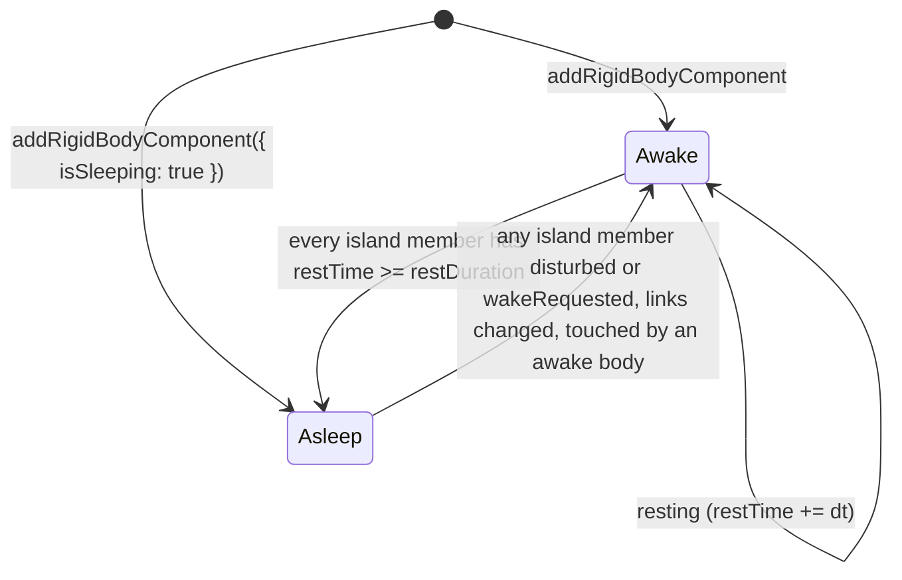

# Rigid body sleep

Issue: [#810](https://github.com/Forge-Game-Engine/Forge/issues/810)
(Physics Sleeping Bodies milestone. Phase 1 is #810. Phases 2 and 3 are
the milestone's later work: collision detection that skips sleeping
bodies, and the guide's demo.)

| Module or file                                                                    | Change   | Phase | Notes                                                                                                                                                    |
| --------------------------------------------------------------------------------- | -------- | ----- | -------------------------------------------------------------------------------------------------------------------------------------------------------- |
| `src/physics/components/rigidbody-component.ts`                                   | Modified | 1     | `canSleep`, `wakeRequested`, `isSleeping`, `restTime`, `sleepRecord`; `RigidBodySleepRecord`; `RigidBodyOptions` for `addRigidBodyComponent`; validation |
| `src/physics/joints/resolve-joint-body.ts`                                        | Modified | 1     | `hasJointBody(world, entity)`: the position-and-rotation check `resolveJointBody` already makes, shared with the sleep system. Not exported              |
| `src/physics/is-body-awake.ts`                                                    | New      | 1     | `isBodyAwake(world, entity)`, the one rule for "does this body take part in this tick's simulation"                                                      |
| `src/physics/islands/union-find.ts`                                               | New      | 1     | `UnionFind` over dense indices (path halving, union by size). Not exported                                                                               |
| `src/physics/islands/island-links.ts`                                             | New      | 1     | The two-body joint component keys that link islands, and a reader for their `entityA`/`entityB`. Not exported                                            |
| `src/physics/systems/sleep-system.ts`                                             | New      | 1     | `createSleepEcsSystem(collisionManifolds, time, options?)`, `SleepOptions`                                                                               |
| `src/physics/systems/gravity-system.ts`                                           | Modified | 1     | Skips bodies that aren't awake                                                                                                                           |
| `src/physics/systems/collision-resolution-system.ts`                              | Modified | 1     | Doesn't solve a contact when neither body is awake, and keeps its accumulated impulses                                                                   |
| `src/physics/systems/revolute-joint-system.ts`, `prismatic-joint-system.ts`       | Modified | 1     | Skip a joint when neither body is awake, keeping its accumulated impulses                                                                                |
| `src/physics/systems/linear-spring-system.ts`, `linear-damper-system.ts`          | Modified | 1     | Skip when neither body is awake                                                                                                                          |
| `src/physics/systems/euler-integration-system.ts`                                 | Modified | 1     | Skips bodies that aren't awake                                                                                                                           |
| `src/physics/index.ts`, `src/physics/systems/index.ts`                            | Modified | 1     | Export `isBodyAwake`, `createSleepEcsSystem`, `SleepOptions`                                                                                             |
| `src/physics/**/*.test.ts`                                                        | New/Mod. | 1, 2  | See "Testing"                                                                                                                                            |
| `src/physics/systems/narrow-phase-system.ts`                                      | Modified | 2     | Reuses last tick's manifolds for a pair when neither body is awake, instead of testing it again                                                          |
| `src/physics/systems/continuous-collision-system.ts`                              | Modified | 2     | Skips bodies that aren't awake                                                                                                                           |
| `documentation-site/docs/docs/physics/sleeping.md`                                | New      | 1     | The "Sleeping bodies" guide                                                                                                                              |
| `documentation-site/docs/docs/physics/index.md`, `rigid-bodies.md`                | Modified | 1     | The registration order with the sleep system; the new rigid body fields                                                                                  |
| `documentation-site/docs/docs/physics/forces.md`                                  | Modified | 1     | Gravity, spring and damper registration (lines 52, 195-196) placed after the sleep system; changing `amount` on sleeping bodies needs `wakeRequested`    |
| `documentation-site/docs/docs/tilemaps/index.md`                                  | Modified | 1     | The tilemap physics sample (lines 84-86): gravity moves after the narrow phase, with the sleep system between them                                       |
| `documentation-site/src/pages/demos/sleeping-bodies/`                             | New      | 3     | A pile of shapes tinted by sleep state, with awake and sleeping counts                                                                                   |
| `documentation-site/src/data/demos.ts`                                            | Modified | 3     | The demo's entry (`physics`)                                                                                                                             |
| `documentation-site/src/pages/demos/physics/_create-game.ts`, other physics demos | Modified | 3     | Register the sleep system in the documented order                                                                                                        |
| `AGENTS.md`                                                                       | Modified | 1     | A "Sleeping bodies" note under "Common Patterns": physics systems that change velocity or pose leave bodies that aren't awake alone                      |
| `CHANGELOG.md`                                                                    | Modified | 1, 2  | `#### Added` (sleep), `#### Changed` (phase 2's narrow phase reuse, if it changes what consumers see)                                                    |
| **Engine version at time of design**                                              |          |       | `0.26.2`                                                                                                                                                 |

## Summary

Every physics system in `src/physics` processes every dynamic body every
tick, including a pile of boxes that settled seconds ago. Production 2D
engines put such bodies to sleep: a body that has moved slower than a
small speed for long enough stops being simulated until something
disturbs it. Box2D, Rapier, avian, Godot Physics and Unity's 2D physics
all do it per **island**, the set of dynamic bodies connected by touching
contacts and joints. A stack sleeps when every body in it has rested long
enough, and disturbing any body wakes the whole stack. Sleeping one body
at a time breaks stacks: the bottom box sleeps, the box above keeps
pushing into a body the solver no longer moves, and the stack sags or
jitters.

This design adds:

- two inputs, one request and two outputs on `RigidBodyEcsComponent`:
  `canSleep` (may this body sleep), `isSleeping` (is it asleep; also how a
  body is created asleep), `wakeRequested` (game code sets it to wake the
  body's island; the sleep system clears it), `restTime` (how long it has
  rested) and `sleepRecord` (its pose and links when it fell asleep, used
  to notice when it's disturbed);
- `createSleepEcsSystem`, the only writer of the outputs, which builds
  islands every tick from contacts and joints, wakes islands that were
  disturbed, and puts islands to sleep;
- `isBodyAwake(world, entity)`, which every physics system that changes a
  body's velocity or pose uses to leave sleeping bodies alone.

```ts
import { createTransformEcsSystem } from '@forge-game-engine/forge/common';
import {
  addRigidBodyComponent,
  createBroadPhaseEcsSystem,
  createCollisionResolutionEcsSystem,
  createEulerIntegrationEcsSystem,
  createGravityEcsSystem,
  createNarrowPhaseEcsSystem,
  createSleepEcsSystem,
} from '@forge-game-engine/forge/physics';

addRigidBodyComponent(world, player, { canSleep: false });
addRigidBodyComponent(world, crate, { isSleeping: true }); // placed settled

world.addSystem(createTransformEcsSystem());
world.addSystem(createBroadPhaseEcsSystem(collisionPairs));
world.addSystem(createNarrowPhaseEcsSystem(collisionPairs, collisionManifolds));
world.addSystem(createSleepEcsSystem(collisionManifolds, time));
world.addSystem(createGravityEcsSystem(time));
world.addSystem(
  createCollisionResolutionEcsSystem(
    collisionManifolds,
    contactConstraints,
    time,
  ),
);
world.addSystem(createEulerIntegrationEcsSystem(time));
```

Forge components are plain fields and the ECS can't observe writes. A
sleeping body has exactly zero velocity and a recorded pose and set of
links, and the sleep system wakes its island when any of those changes:
game code or `applyImpulse` writes a velocity, game code teleports it, a
body it touches is removed, a moving body hits it. This is what avian
does with Bevy's change detection, expressed as a comparison with
recorded data.

Some changes leave no trace in that data: a new gravity, a loosened joint
limit, a motor's new target. For those, game code sets
`rigidBody.wakeRequested = true`, Forge's counterpart of Box2D's
`b2Body_SetAwake`, Rapier's `wake_up`, Godot's `sleeping = false` and
Unity's `WakeUp()`. It's a request, not a second writer of `isSleeping`:
game code only ever sets it to `true`, and the sleep system wakes the
island and sets it back to `false` (the dirty-flag pattern in the
`create-system` skill).

```ts
gravity.amount.y = -600;
rigidBody.wakeRequested = true; // the pile falls upwards on this tick
```

The design keeps the issue's goal, island model, tolerances and opt-out,
and differs from its text in these places, each in the decision log:

- **State lives in components, not in the system's closure** (SL1). The
  issue keeps per-body timers and sleeping-island records "inside the
  system's closure". CLAUDE.md's ground rules forbid that: systems are
  stateless, and anything kept between ticks goes in a component. Timers
  become `restTime` and island records become each body's `sleepRecord`.
- **Phase 1 also makes the systems that change velocity leave sleeping
  bodies alone** (SL2). The issue leaves that to later issues. Without it
  a sleeping box on the floor gets gravity's velocity on the same tick it
  falls asleep, the solver leaves a tiny velocity, and the sleep system
  wakes it on the next tick. Sleep would last one tick, so the phase
  couldn't be released on its own.
- **The sleep system runs after the narrow phase, on this tick's
  manifolds** (SL3), not before gravity on last tick's. A ball that hits a
  sleeping stack then wakes it before the solver runs, instead of bouncing
  off it as if it were static for one tick.
- **Joints, springs and dampers link islands** (SL4). The issue's design
  section says islands are linked by contacts and joints, but its tasks
  only union over manifolds. A pendulum or a chain has to sleep and wake
  as one island, or the joint solver pushes a sleeping body every tick.
- **Islands are rebuilt every tick** (SL5). Sleeping bodies keep their
  contacts (computed in phase 1, reused in phase 2), so membership needs
  no record. Each sleeping body records its pose and links, which is
  enough to notice that it was disturbed or lost a support.
- **`isBodyAwake` counts a disturbed sleeping body as awake** (SL6), so it
  gives the same answer before and after the sleep system runs in a tick.
- **An explicit wake request** (SL15). The issue has none; every engine
  it cites has one, and without it a settings change strands a sleeping
  pile.
- **Forge's own option names** (SL9): `maxRestingSpeed`,
  `maxRestingAngularSpeed` and `restDuration` instead of
  `linearSleepTolerance`, `angularSleepTolerance` and `timeToSleep`, which
  are Unity's property names.

## Scope

### In scope

- `canSleep`, `isSleeping`, `wakeRequested`, `restTime` and
  `sleepRecord` on `RigidBodyEcsComponent`, and a `RigidBodyOptions` type
  for `addRigidBodyComponent` that leaves the request and the two
  output-only fields out.
- `isBodyAwake(world, entity)`.
- `UnionFind`, internal to the physics module.
- `createSleepEcsSystem(collisionManifolds, time, options?)` and
  `SleepOptions`: islands over dynamic bodies linked by this tick's
  manifolds and by revolute joints, prismatic joints, linear springs and
  linear dampers; waking on velocity, pose, link, `canSleep` and `type`
  changes, on `wakeRequested`, and on contact with an awake body or a
  moving kinematic body;
  rest timers; falling asleep.
- Gravity, collision resolution, the joint, spring and damper systems and
  Euler integration leaving bodies that aren't awake alone (phase 1).
- The narrow phase reusing manifolds for pairs where neither body is
  awake, and CCD skipping bodies that aren't awake (phase 2).
- The "Sleeping bodies" guide, the documented system order, the
  `AGENTS.md` note, changelog bullets (phase 1), and a demo (phase 3).

### Out of scope

- **A faster broad phase.** `createBroadPhaseEcsSystem` tests every pair
  of colliders (O(n²)). Skipping sleeping bodies there saves little until
  it has a spatial structure (a grid or a dynamic AABB tree), which is its
  own change. Phase 2 leaves the broad phase as it is.
- **A world length unit.** Box2D (`b2SetLengthUnitsPerMeter`), Rapier
  (`length_unit`) and avian (`PhysicsLengthUnit`) scale every tolerance
  with one setting. Forge doesn't have one: `maxBiasSpeed` and `slop` are
  meters-scale defaults that pixel-scale games override (the demos pass
  `3 * pixelsPerMeter`). The sleep speeds follow the same convention.
  Open question 7.
- **Putting an awake body to sleep on request.** Box2D's
  `b2Body_SetAwake(false)` and Godot's `sleeping = true` have no
  counterpart: bodies are created asleep with `isSleeping: true`, and
  otherwise fall asleep by resting. A sleep request can be added later the
  same way as `wakeRequested` if a game needs one.
- **Noticing changed settings by themselves.** Changing a joint's limits,
  a spring's stiffness, a `GravityEcsComponent`, a collider's friction or
  an `AngularVelocityMotorEcsComponent`'s target isn't detected; game code
  sets `wakeRequested` when it makes such a change (open question 4).
- **Sleep for kinematic bodies.** Only dynamic bodies sleep. A kinematic
  body is "awake" while it has a velocity, and never gets `isSleeping`.
- **Moving static colliders.** A static collider "never moves"
  (`RigidBodyType`). One moved by game code wakes a sleeping body only if
  the move changes which bodies it touches. Use a kinematic body for
  moving level geometry.
- **The fixed timestep.** The Physics Fixed Timestep milestone (#801)
  puts the physics systems in a fixed-step group; the sleep system goes
  there with them and reads that step's `deltaTimeInSeconds` like the
  other systems. Nothing in this design depends on it.
- **Render interpolation of sleeping bodies**, networking and saves. All
  sleep state is component data, so whatever saves or replicates
  components carries it.

## Concepts

- **Awake**: a body that takes part in this tick's simulation. A
  `'dynamic'` body that isn't sleeping, or is sleeping but was disturbed;
  a `'kinematic'` body with a non-zero `velocity` or `angularVelocity`.
  `'static'` bodies, still kinematic bodies and collider-only entities are
  never awake. `isBodyAwake` is the one definition.
- **Link**: what connects a body to another entity for sleeping. A
  **contact link** is a collision manifold this tick between the body and
  another collider (static, kinematic or dynamic). A **joint link** is a
  revolute joint, prismatic joint, linear spring or linear damper whose
  `entityA` or `entityB` is the body, while both of its entities have a
  `PositionEcsComponent` and a `RotationEcsComponent`: exactly when
  `resolveJointBody` resolves both and the joint systems solve it, so
  "linked" and "solved" never disagree. A removed entity has neither, so
  its joints stop being links. Sensor overlaps aren't links: they never
  produce manifolds.
- **Island**: the dynamic bodies connected through links between two
  dynamic bodies. Static and kinematic bodies don't join islands, as in
  Box2D, or every body resting on the same floor would form one island.
- **Resting**: a body whose `velocity` length is at most `maxRestingSpeed`
  and whose `|angularVelocity|` is at most `maxRestingAngularSpeed`, and
  whose `canSleep` is `true`.
- **Disturbed**: a sleeping body whose data no longer matches what it was
  when it fell asleep: a non-zero velocity or angular velocity, a
  `position.local` or `rotation.local` different from `sleepRecord`,
  `canSleep === false`, or `wakeRequested === true`. The sleep system also
  treats a sleeping body whose
  links differ from `sleepRecord.links` as disturbed; `isBodyAwake`
  doesn't check links, since that needs the tick's manifolds.



## API design

### `RigidBodyEcsComponent`

```ts
export interface RigidBodySleepRecord {
  /** `position.local` when the body fell asleep (a copy). */
  readonly position: Readonly<Vector2>;
  /** `rotation.local` when the body fell asleep. */
  readonly rotation: number;
  /**
   * The body's links when it fell asleep, sorted and without duplicates:
   * the other entity of each contact link and the joint entity of each
   * joint link.
   */
  readonly links: readonly number[];
}

export interface RigidBodyEcsComponent {
  velocity: Vector2;
  angularVelocity: number;
  angularDrag: number;
  fixedRotation: boolean;
  type: RigidBodyType;

  /**
   * Whether the body may fall asleep. A body that can't sleep keeps its
   * whole island awake; setting it to `false` on a sleeping body wakes
   * the island. Use it for bodies the game moves every tick in ways the
   * sleep system can't see. Defaults to `true`.
   */
  canSleep: boolean;

  /**
   * A request to wake the body's island on the sleep system's next run,
   * for changes it can't see in the body's data: a new gravity, a joint
   * limit or spring stiffness, a motor's target. Game code sets it to
   * `true` and never to `false`; `createSleepEcsSystem` wakes the island,
   * restarts every member's `restTime` (so the island stays awake at least
   * `restDuration`) and sets it back to `false`. Setting it on an awake
   * body keeps its island awake that long. Starts at `false`.
   */
  wakeRequested: boolean;

  /**
   * Whether the body is asleep: not moved by gravity, collisions, joints
   * or integration until something disturbs it. Output, written only by
   * `createSleepEcsSystem`; pass `true` to `addRigidBodyComponent` to
   * create a `'dynamic'` body asleep (a pile placed already settled).
   * Defaults to `false`.
   */
  isSleeping: boolean;

  /**
   * Seconds the body has been resting, reset to `0` when it moves faster
   * than the sleep system's speeds or is woken. Output, written only by
   * `createSleepEcsSystem`. Starts at `0`.
   */
  restTime: number;

  /**
   * The body's pose and links when it fell asleep, which the sleep system
   * compares against to notice that it was disturbed. `null` while it's
   * awake, and for a body created asleep until the sleep system first sees
   * it. Output, written only by `createSleepEcsSystem`.
   */
  sleepRecord: RigidBodySleepRecord | null;
}

/** The options `addRigidBodyComponent` accepts. */
export type RigidBodyOptions = Partial<
  Omit<RigidBodyEcsComponent, 'wakeRequested' | 'restTime' | 'sleepRecord'>
>;
```

`addRigidBodyComponent(world, entity, options: RigidBodyOptions = {})`:

- adds `canSleep: true` and `isSleeping: false` to its defaults object,
  and always starts `wakeRequested` at `false`, `restTime` at `0` and
  `sleepRecord` at `null` (a new body is awake unless it's created asleep,
  so a wake request at creation means nothing);
- throws when `isSleeping` is `true` and `type` isn't `'dynamic'` ("only
  dynamic bodies sleep"), or `isSleeping` is `true` and `canSleep` is
  `false`.

**Who writes what.** Game code writes the inputs (`canSleep`, and
`isSleeping` only through `addRigidBodyComponent`) and sets
`wakeRequested` to `true`. The sleep system is the only writer of
`isSleeping`, `restTime` and `sleepRecord` after creation, and the only
code that sets `wakeRequested` to `false`.

`restTime` and `sleepRecord` sit on the rigid body rather than in a
separate state component (SL7). The `create-system` skill's table puts
"bookkeeping that isn't part of the user-facing component" in a separate
component the system adds and removes, and `sleepRecord` is a snapshot
from an earlier tick, so the row fits on its face. It isn't followed here
because:

- the record is part of the body's public sleep state: `isBodyAwake`,
  which every physics system and game code call, reads it to tell a
  disturbed sleeping body from an undisturbed one, so it isn't private to
  one system;
- a separate component would be added on every sleep and removed on every
  wake, inside the sleep system's own loop over the bodies it belongs to;
- removing a rigid body from an entity that stays would leave the state
  component behind, and the only clean-up is a remove hook on
  `rigidBodyId` that removes another component, which isn't what remove
  hooks are for (they release resources);
- Box2D keeps `sleepTime` and its island data in `b2Body`, and Rapier
  keeps `time_since_can_sleep` and `sleeping` in the rigid body's
  `RigidBodyActivation`.

### `isBodyAwake`

```ts
/**
 * Whether `entity`'s rigid body takes part in this tick's simulation.
 * Physics systems that change velocity or pose skip a body that isn't
 * awake, and skip a contact or joint when neither of its bodies is awake.
 * ...
 */
export function isBodyAwake(world: EcsWorld, entity: number): boolean;
```

| Entity                                                                                                       | Result  |
| ------------------------------------------------------------------------------------------------------------ | ------- |
| No `RigidBodyEcsComponent` (collider-only, static by convention)                                             | `false` |
| `'static'`                                                                                                   | `false` |
| `'kinematic'`, `velocity` and `angularVelocity` both zero                                                    | `false` |
| `'kinematic'`, either non-zero                                                                               | `true`  |
| `'dynamic'`, `isSleeping === false`                                                                          | `true`  |
| `'dynamic'`, sleeping, disturbed (non-zero velocity, pose differs from record, `!canSleep`, `wakeRequested`) | `true`  |
| `'dynamic'`, sleeping, undisturbed                                                                           | `false` |

A sleeping body without `PositionEcsComponent` or `RotationEcsComponent`
is compared on velocity, `canSleep` and `wakeRequested` only. The disturbance check is a
module-level helper, `isSleepingBodyDisturbed(rigidBody, position,
rotation)`, which the sleep system calls too, so both use one rule.

### `createSleepEcsSystem`

```ts
export interface SleepOptions {
  /**
   * The fastest a body's center of mass may move, in world units per
   * second, and still count as resting. The default is meters-scale, like
   * `CollisionResolutionOptions.maxBiasSpeed`: scale it with your world.
   */
  maxRestingSpeed: number;
  /** The fastest a body may turn, in radians per second, and still count as resting. */
  maxRestingAngularSpeed: number;
  /** How long, in seconds, every body of an island must rest before the island falls asleep. */
  restDuration: number;
}

const defaultSleepOptions: SleepOptions = {
  maxRestingSpeed: 0.01,
  maxRestingAngularSpeed: degreesToRadians(2),
  restDuration: 0.5,
};

export const createSleepEcsSystem = (
  collisionManifolds: readonly CollisionManifold[],
  time: Time,
  options: Partial<SleepOptions> = {},
): EcsSystem<[RigidBodyEcsComponent, PositionEcsComponent, RotationEcsComponent]>;
```

- `query: [rigidBodyId, positionId, rotationId]`, fixed. A dynamic body
  without a `RotationEcsComponent` is never integrated
  (`createEulerIntegrationEcsSystem` has the same query), so it has nothing
  to sleep from.
- Options go through `withDefaults` once, in the factory. It throws for a
  negative or non-finite value.
- The defaults are Box2D v2's `b2_linearSleepTolerance`,
  `b2_angularSleepTolerance` and `b2_timeToSleep`, as the issue asks.
  Phase 1 checks them against Forge's solver (open question 2).
- The JSDoc says where it goes in the order, that it's the only writer of
  `isSleeping`, `restTime` and `sleepRecord` and the only code that clears
  `wakeRequested`, that it zeroes the velocity of bodies it puts to
  sleep, and what wakes a body.

## System order and data flow

The sleep system goes **after the narrow phase and before every system
that changes velocity**. Gravity, springs and dampers move from before the
broad phase to after the sleep system. That changes nothing for a game
without the sleep system: the broad and narrow phases read only poses,
and those systems only write velocities.

```ts
world.addSystem(createTransformEcsSystem());
world.addSystem(createBroadPhaseEcsSystem(collisionPairs));
world.addSystem(createNarrowPhaseEcsSystem(collisionPairs, collisionManifolds));
world.addSystem(createSleepEcsSystem(collisionManifolds, time));
world.addSystem(createGravityEcsSystem(time));
world.addSystem(createLinearSpringEcsSystem(time));
world.addSystem(createLinearDamperEcsSystem(time));
world.addSystem(
  createCollisionResolutionEcsSystem(
    collisionManifolds,
    contactConstraints,
    time,
  ),
);
world.addSystem(createRevoluteJointEcsSystem(time));
world.addSystem(createPrismaticJointEcsSystem(time));
world.addSystem(createAngularVelocityMotorEcsSystem(time));
world.addSystem(createEulerIntegrationEcsSystem(time));
world.addSystem(createContinuousCollisionEcsSystem());
```



```mermaid
flowchart LR
  game["Game systems<br/>(velocity, impulses, teleports)"] --> transform[Transform]
  transform --> broad[Broad phase]
  broad --> narrow["Narrow phase<br/>this tick's manifolds"]
  narrow --> sleep["Sleep<br/>wake, rest timers, fall asleep"]
  sleep --> forces["Gravity, springs, dampers<br/>skip bodies not awake"]
  forces --> solve["Collision resolution, joints<br/>skip when neither body is awake"]
  solve --> motor[Motor]
  motor --> integrate["Integration<br/>skips bodies not awake"]
  integrate --> ccd[CCD]
```

At the sleep system's place in the tick:

- every body's `velocity` is last tick's solved and integrated velocity
  plus whatever game code wrote since. That's the value Box2D measures at
  the end of its step, before this tick's gravity has added `g * dt`
  (which, at `0.16 m/s` for 60 Hz, is above any useful resting speed);
- `collisionManifolds` holds this tick's contacts, so a new contact with
  an awake body wakes a sleeping island before this tick's solver runs, as
  Box2D wakes bodies when a contact starts touching;
- a teleport game code wrote before the transform system has reached the
  narrow phase, and the changed `local` pose wakes the body's island
  before anything solves against it.

A game system registered after the sleep system that writes a sleeping
body's velocity makes `isBodyAwake` true for it right away (it's
disturbed), so integration moves it this tick; the sleep system wakes its
island on the next tick. The guide says to write physics input before the
transform system, as the CCD guide already does for teleports.

## The sleep system's tick

All working memory (the index map, the union-find, link lists, island
buckets) is declared inside `update` and thrown away at the end of it.

```text
update(world, { entities, components: [bodies, positions, rotations] }):
  dt = time.deltaTimeInSeconds
  indexOf = Map(entity -> i) for every entity in the batch
  isDynamic[i] = bodies[i].type === 'dynamic'
  uf = new UnionFind(entities.length)
  woken = new Uint8Array(entities.length)
  links[i] = [] for each dynamic i

  # 1. Wake requests, bodies that stopped being dynamic, and disturbed sleepers
  for each i:
    body = bodies[i]
    requested = body.wakeRequested
    body.wakeRequested = false             # the request is consumed by this run
    if not isDynamic[i]:
      body.restTime = 0
      if body.isSleeping or requested:
        body.isSleeping = false; body.sleepRecord = null
        wakesNeighbors[i] = true         # wakes the dynamic bodies it links to, below
      continue
    if requested: woken[i] = 1             # awake or asleep: restarts the island's timers
    else if body.isSleeping and isSleepingBodyDisturbed(body, positions[i], rotations[i]):
      woken[i] = 1

  # 2. Links
  link(a, b, key):                       # a, b entities; key = other entity or joint entity
    ia = indexOf.get(a); ib = indexOf.get(b)
    if ia is dynamic: links[ia].push(key for a)
    if ib is dynamic: links[ib].push(key for b)
    if both dynamic: uf.union(ia, ib); return
    for (dynamic side d, other side o):
      if (o in batch and wakesNeighbors[o]) or isBodyAwake(world, o):   # o is kinematic and moving
        woken[d] = 1
  for each manifold m in collisionManifolds:
    link(m.entityA, m.entityB, contact keys: m.entityB for A, m.entityA for B)
  for each joint key K in islandLinkComponents (revolute, prismatic, spring, damper):
    for each (jointEntity, joint) in world.query([K]):
      if hasJointBody(world, joint.entityA) and hasJointBody(world, joint.entityB):
        link(joint.entityA, joint.entityB, jointEntity for both)
  sort and de-duplicate each links[i]

  # 3. Link changes
  for each dynamic i that is sleeping with sleepRecord !== null:
    if links[i] differs from sleepRecord.links: woken[i] = 1

  # 4. Islands
  bucket dynamic indices by uf.find(i)
  for each island:
    if every member isSleeping and no member is woken:
      for each member with sleepRecord === null:   # created asleep, first seen now
        member.sleepRecord = record(member)
      continue
    for each member that isSleeping:               # wake the island
      isSleeping = false; sleepRecord = null; restTime = 0
    if some member is woken:                       # a wake request on an awake island
      every member.restTime = 0
    if dt <= 0: continue                           # paused: no timers, no falling asleep
    minRest = Infinity
    for each member:
      member.restTime = isResting(member) ? member.restTime + dt : 0
      minRest = min(minRest, member.restTime)
    if minRest >= restDuration:
      for each member:
        velocity.x = velocity.y = 0; angularVelocity = 0
        isSleeping = true
        sleepRecord = { position: clone(position.local), rotation: rotation.local, links: links[i] }
```

Notes:

- **Waking is per island, by construction.** An island stays asleep only
  when every member is sleeping and none is woken. An awake body linked to
  a sleeping one puts both in one island, which isn't all asleep, so the
  sleeping members wake. That covers "a manifold with an awake body wakes
  the island" without a separate rule.
- **A woken island stays awake at least `restDuration`**, since every
  member's `restTime` restarts at `0`.
- **Losing a link wakes the island.** Removing the bottom box of a
  sleeping stack removes the top box's contact link with it; removing the
  floor removes the boxes' links to it; a body that lost its collider has
  no manifolds; a joint whose other entity was removed stops being a
  link. In each case `links` no longer matches `sleepRecord.links`.
  Without this, a box whose support was removed would hang in the air
  until something else touched it.
- **Gaining a link wakes the island too**: a static collider spawned
  overlapping a sleeping body, a new joint, a collision filter change that
  lets two sleeping bodies collide. Box2D wakes a sleeping island when a
  contact with it starts touching.
- **Removed entities need no clean-up.** Their sleep state is their
  component data, gone with them.
- **Changing `type` away from `'dynamic'`** clears `isSleeping` and wakes
  every dynamic body linked to it this tick, as `b2Body_SetType` wakes
  the body and the bodies jointed to it.
- **A wake request is consumed every run**, on every body in the batch,
  whether it was asleep or not. On a kinematic or static body it wakes the
  dynamic bodies linked to it (a platform whose script changed). A body
  outside the batch (a dynamic body with no `RotationEcsComponent`, which
  never sleeps) keeps its request; nothing reads it.
- **Teleports wake**, as they do in Godot, Unity and avian. Box2D's
  `b2Body_SetTransform` doesn't wake a body, but Forge can't tell a
  teleport from any other write to `local`, and a body left asleep inside
  another collider would never be pushed out.
- **Zeroing velocities is a write the sleep system makes to a shared
  input.** `velocity` and `angularVelocity` already have many writers by
  design (game code, gravity, the solvers, impulses): they're the body's
  accumulated input, not an output with an owner. Box2D zeroes them when a
  body sleeps for the same reason: a sleeping body doesn't move.
- **`restTime` of a woken body is only reset by waking**, not by `dt <= 0`
  ticks, so pausing the game doesn't keep piles awake longer.

### `UnionFind`

```ts
/** Disjoint sets over the indices `0` to `size - 1`. */
export class UnionFind {
  private readonly _parent: Int32Array;
  private readonly _size: Int32Array;

  constructor(size: number);

  /** The representative index of `index`'s set, halving the path it walks. */
  public find(index: number): number;

  /** Merges the sets of `a` and `b`, the smaller under the larger. */
  public union(a: number, b: number): void;
}
```

It works on dense indices into the system's batch, not on entity handles
(SL8): handles pack a slot index and a generation, so they're sparse and
large, and `entity.ts` asks callers not to do arithmetic on them. It
throws for an index out of range. It isn't exported from the package.

### `island-links.ts`

```ts
/** A component that connects two bodies. */
interface TwoBodyLink {
  readonly entityA: number;
  readonly entityB: number;
}

/** The components that link islands: revolute and prismatic joints, linear springs and dampers. */
export const islandLinkComponents: readonly ComponentKey<TwoBodyLink>[];
```

Each listed component already has `entityA` and `entityB`, so one loop
reads them all. A joint counts as a link when `hasJointBody` is true for
both of its entities. `hasJointBody(world, entity)` is the check
`resolveJointBody` already makes before it returns `null` (the entity has
a `PositionEcsComponent` and a `RotationEcsComponent`), moved into a
helper that `resolveJointBody` calls, so the joint, spring and damper
systems solve exactly the joints the sleep system links. The sleep system
doesn't call `resolveJointBody` itself, since that also computes mass data
and throws for a dynamic body without a collider. The `create-component` skill and the `AGENTS.md` note
both say a new two-body joint component must be added here, or bodies it
connects sleep apart. `AngularVelocityMotorEcsComponent` acts on one body
and isn't listed.

## Leaving sleeping bodies alone (phase 1)

Each system that changes a body's velocity or pose applies one rule:

| System                                                          | Change                                                                                                                                                                                                                                    |
| --------------------------------------------------------------- | ----------------------------------------------------------------------------------------------------------------------------------------------------------------------------------------------------------------------------------------- |
| `createGravityEcsSystem`                                        | Skips a body when `isBodyAwake` is `false` (beside the existing `type !== 'dynamic'` skip, which it covers)                                                                                                                               |
| `createCollisionResolutionEcsSystem`                            | `prepareContact` returns `null` when neither entity is awake. `buildContactConstraints` still matches the constraint, so its accumulated impulses carry over and warm-start the contact when the island wakes                             |
| `createRevoluteJointEcsSystem`, `createPrismaticJointEcsSystem` | Skip a joint, including its warm start, when neither body is awake; `accumulatedPointImpulse` and the other accumulated impulses stay as they are                                                                                         |
| `createLinearSpringEcsSystem`, `createLinearDamperEcsSystem`    | Skip when neither body is awake. A spring holding a sleeping body up applies a non-zero force, which would wake it                                                                                                                        |
| `createEulerIntegrationEcsSystem`                               | Skips a body that isn't awake, after its existing parent check, so a parented moving body still throws while asleep                                                                                                                       |
| `createAngularVelocityMotorEcsSystem`                           | Unchanged. On a sleeping body with a target of `0` it adds nothing. With any other target it writes an angular velocity, which disturbs the body: integration moves it and the sleep system wakes its island on the next tick (see below) |

After the sleep system has run, a contact or joint between an awake body
and a sleeping one can't exist: they'd be in one island. "Neither body is
awake" therefore means a sleeping body against a static body, a still
kinematic body or another sleeping body. Skipping those is safe, and it's
where phase 1 saves its time: the solver's iterations, gravity and
integration for every sleeping body.

**A motor re-targeted on a sleeping body moves it for one tick with its
contacts unsolved.** The motor runs after collision resolution, and
resolution skipped the body's contacts because it was asleep when it ran.
The motor's new angular velocity makes the body awake for integration, so
it turns into whatever it rests on for that tick; on the next tick the
sleep system wakes the island and the solver pushes it back out. At a
motor's usual speeds that's a sub-pixel overlap. The same applies to any
game system registered after collision resolution that writes a sleeping
body's velocity.

_Implementation note:_ setting `wakeRequested` with the new target doesn't
avoid that tick. The motor runs after collision resolution whether the body
was awake or asleep, so on the tick its target changes the solver never
sees the motor's velocity either way; an awake body turns into its
contacts for that tick too. The guide therefore lists a motor among the
things that wake a body, without a wake request, and the physics test
checks that the re-targeted body turns on that tick and wakes on the next.

A world without the sleep system is unchanged: no body ever has
`isSleeping`, so every dynamic body is awake. A body created asleep in
such a world stays asleep (the guide says so).

## Collision detection for sleeping bodies (phase 2)

Phase 1 still runs SAT for every pair of a sleeping pile every tick.
Phase 2 stops that, the way Box2D keeps a sleeping island's contacts
without updating them:

- **The narrow phase reuses manifolds.** For a pair where neither entity
  is awake (by `isBodyAwake`, so a disturbed body counts as awake), it
  copies the pair's manifolds from last tick's `collisionManifolds` (read
  before it clears the array) instead of calling `detectCollision`.
  Neither body moved, so they're still right. A pair with no manifolds
  last tick is tested as now. Its `touching`, `started` and `ended`
  bookkeeping is unchanged by this: the reused manifolds record the
  contact as before.
- **Sensor pairs are always tested**, so a sleeping body in a static
  trigger zone keeps its `ContactsEcsComponent` right.
- **Everything downstream is unchanged.** The sleep system sees the same
  links, collision resolution matches the same feature ids, and a woken
  island's contacts are there on the tick it wakes.
- **CCD skips bodies that aren't awake.** A sleeping body's `local` and
  `world` poses are equal, so the sweep does nothing today; the skip saves
  the setup.

This phase changes only time spent, not results, so its changelog bullet
is a `Changed` line about performance if any.

## Performance

Per tick, the sleep system is O(B + M + J + L log L): B bodies in its
batch, M manifolds, J joint components, L links (the sort). It allocates
a `Map`, two typed arrays and the link arrays each tick, since systems
keep no memory between ticks. The four joint lookups use `world.query`,
which builds arrays per call; joints are few in practice. Phase 1's
physics test times the sleep system on a pile of 1,000 bodies and
records the result in the pull request, so a regression has a baseline.
It should cost a small fraction of the solver time it saves on the same
pile.

`isBodyAwake` does up to three component lookups. The collision
resolution and joint systems call it twice per contact or joint per tick,
which is small next to the solver iterations it lets them skip.

Savings for a pile of N settled bodies: phase 1 removes N bodies from
gravity and integration and every contact among them from the solver's
`iterations` passes; phase 2 removes their SAT tests. The broad phase's
O(n²) pair test remains (out of scope).

## Testing

### `union-find.test.ts`

Singletons; union and find; transitive unions; union of already joined
sets; union by size (the smaller set's root joins the larger); out of
range throws.

### `is-body-awake.test.ts`

Every row of the `isBodyAwake` table (including a sleeping body with
`wakeRequested`), plus: a sleeping body whose
`position.local.x` changed by `1e-9` is awake; a sleeping body with no
record is compared on velocity, `canSleep` and `wakeRequested` only.

### `rigidbody-component.test.ts`

New defaults; `wakeRequested`, `restTime` and `sleepRecord` start at
`false`, `0` and `null`;
`isSleeping: true` with a kinematic or static type throws; with
`canSleep: false` throws.

### `sleep-system.test.ts`

Built from real components and hand-written `collisionManifolds`, unless
noted:

- A resting body sleeps after `restDuration` and not one tick before.
- Two dynamic bodies linked by a manifold fall asleep on the same tick,
  even when one started resting later.
- A moving body keeps its whole island awake; its `restTime` stays `0`.
- `canSleep: false` keeps its island awake, and setting it on a sleeping
  member wakes every member.
- Writing `velocity`, `angularVelocity`, `position.local` or
  `rotation.local` on one sleeping member wakes every member, and their
  `restTime` restarts at `0`.
- A manifold between a sleeping body and an awake dynamic body wakes the
  island.
- A moving kinematic body wakes what it touches; a still one doesn't.
- Two bodies on the same static floor are separate islands: moving one
  doesn't wake the other.
- A revolute joint, prismatic joint, spring and damper each link two
  bodies into one island; a joint to a static anchor doesn't link; a
  joint whose other entity has a position but no `RotationEcsComponent`
  isn't a link (the joint systems don't solve it either).
- `wakeRequested` on one sleeping member wakes every member, restarts
  their `restTime` and is `false` after the run; on an awake member it
  restarts the island's `restTime`, so the island stays awake another
  `restDuration`; on a kinematic body it wakes the sleeping bodies it
  touches; with `dt === 0` it still wakes and is still cleared.
- Removing one member of a sleeping stack wakes the rest; removing the
  floor wakes the bodies on it; removing a joint wakes its bodies;
  removing the joint's other body wakes the remaining one.
- A new manifold with a static collider wakes a sleeping body.
- Kinematic and static bodies never get `isSleeping`; changing a sleeping
  body's `type` clears it and wakes the bodies linked to it.
- A body created with `isSleeping: true` stays asleep and gets a record
  on the first tick; two such bodies touching form one island; one
  touching an awake body wakes.
- Falling asleep zeroes `velocity` and `angularVelocity` and records the
  pose and sorted links.
- `dt === 0`: timers don't change and nothing falls asleep, but a
  disturbed island still wakes.
- Options: defaults; overrides; negative values throw.

### Skips in the other systems

One test per system: gravity, integration, the joint, spring and damper
systems leave a sleeping body's velocity and pose alone and process an
awake one. Collision resolution leaves a sleeping-on-static contact
unsolved and keeps its accumulated impulses, then warm-starts from them
when the body wakes. `resolve-joint-body.test.ts` (or the joint system
tests) covers `hasJointBody` for an entity missing its position, its
rotation, or removed.

### Physics test (the issue's "Done when")

Two boxes stacked on a static floor, run through the real transform,
broad phase, narrow phase, sleep, gravity, collision resolution and
integration systems at 60 Hz:

- both report `isSleeping === true` on the same tick, about
  `restDuration` after they stop;
- they **stay** asleep for the next 600 ticks, with unchanged poses (the
  test that fails without the phase 1 skips);
- an `applyImpulse` on the top box between ticks sets both back to
  `false` on the next tick, and they settle and sleep again;
- removing the bottom box makes the top box wake and fall;
- reversing the boxes' `GravityEcsComponent.amount` and setting
  `wakeRequested` on one box makes both rise on that tick;
- a sleeping box on the floor with an angular velocity motor whose target
  changes from `0`, with `wakeRequested` set in the same code, never
  overlaps the floor deeper than it did at rest.

A second scene checks the default speeds: a stack of five boxes and a
pyramid of ten fall asleep within two seconds of landing. If they don't,
open question 2's answer applies.

### Phase 2

Narrow phase: a pair where neither body is awake reuses last tick's
manifolds without calling `detectCollision` (spy), a disturbed body's
pairs are tested, a pair new this tick is tested, sensor pairs are always
tested. The phase 1 physics test passes unchanged.

No e2e test: sleeping is simulation only, with no rendering, input or game
loop behavior of its own. Phase 3's demo is checked in a browser.

## Documentation

- `physics/sleeping.md` (new, `document-feature` skill): what sleeping is
  and why islands; the registration order and why the sleep system goes
  after the narrow phase; `canSleep`, `isSleeping` and creating bodies
  asleep; what wakes a body (writing velocity, `applyImpulse`,
  `applyExplosiveForce`, `applyTorque`, a teleport, contact with an awake
  or moving kinematic body, losing or gaining a contact or joint, setting
  `canSleep` to `false`, setting `wakeRequested`); what doesn't, and so
  needs `wakeRequested` (changing gravity, a joint's limits, a spring's
  stiffness, a collider's friction, a motor's target); that a motor
  re-targeted without a wake request turns its body for one tick before
  its contacts are solved; that moving a static collider or moving a
  kinematic body by its position instead of its velocity doesn't wake
  what rests on it; who writes `wakeRequested` (game code sets it, the
  sleep system clears it); scaling the speeds with the world, with the same worked
  example as `maxBiasSpeed`; reading `isSleeping` and `isBodyAwake`; the
  rule for game systems that write physics input (before the transform
  system).
- `physics/index.md`: the new order and its numbered explanation; a line
  for sleeping in the parts list.
- `physics/rigid-bodies.md`: the five new fields.
- `physics/forces.md`: the gravity, spring and damper registration samples
  (lines 52 and 195-196) say they go after the sleep system when it's
  registered; the "reverse gravity" sample (line 59) sets `wakeRequested`
  on the bodies it affects, with a sentence on why.
- `tilemaps/index.md`: the physics sample (lines 84-86) registers gravity
  after the narrow phase and the sleep system between them, and its
  numbered explanation follows.
- Every other page with a physics registration sample is checked with
  `grep -rl "createGravityEcsSystem" documentation-site/docs` before the
  pull request opens, so no page keeps the old order.
- `AGENTS.md`, under "Common Patterns": a short "Sleeping bodies" note:
  a physics system that changes velocity or pose skips bodies that aren't
  awake (`isBodyAwake`) and skips contacts and joints when neither body is
  awake; a new two-body joint component goes in `islandLinkComponents`.

## Phases

### Phase 1: sleep state, the sleep system, and systems that leave sleeping bodies alone

Adds the fields, `isBodyAwake`, `UnionFind`, the island links, the sleep
system and the skips in the systems that change velocity or pose, with
tests, the guide and the changelog bullet. This is #810, grown by the
skips (open question 1). It's released on its own: a game that registers
the sleep system gets sleeping piles that stay asleep and wake correctly,
and saves the solver, gravity and integration work for them.

**Done when** every phase 1 test above passes, including the physics test
where both boxes stay asleep for 600 ticks and wake together on an
impulse; the default speeds are confirmed or changed by the stacking
measurement; `isBodyAwake`, `createSleepEcsSystem` and `SleepOptions` are
exported from `@forge-game-engine/forge/physics`; the guide, the
registration order in `physics/index.md`, `physics/forces.md` and
`tilemaps/index.md`, `rigid-bodies.md`, `AGENTS.md` and the changelog are
updated; and the verification checklist passes.

| Task               | Description                                                                                                                                                                            | Size |
| ------------------ | -------------------------------------------------------------------------------------------------------------------------------------------------------------------------------------- | ---- |
| Component fields   | `canSleep`, `wakeRequested`, `isSleeping`, `restTime`, `sleepRecord`, `RigidBodySleepRecord`, `RigidBodyOptions`, defaults and validation, JSDoc with who writes each; update the test | S    |
| `hasJointBody`     | Move `resolveJointBody`'s position-and-rotation check into `hasJointBody`, used by `resolveJointBody` and the sleep system; test                                                       | S    |
| `isBodyAwake`      | `is-body-awake.ts` with `isSleepingBodyDisturbed`; tests; export                                                                                                                       | S    |
| `UnionFind`        | `islands/union-find.ts`; tests                                                                                                                                                         | S    |
| Island links       | `islands/island-links.ts`: the four joint keys and their `entityA`/`entityB`                                                                                                           | S    |
| Sleep system       | `sleep-system.ts`: options and validation, the four steps above, JSDoc with the order and the outputs it owns                                                                          | L    |
| Sleep system tests | The `sleep-system.test.ts` list                                                                                                                                                        | L    |
| Skips              | Gravity, collision resolution, revolute, prismatic, spring, damper, integration; a test each                                                                                           | M    |
| Physics test       | The "Done when" scene, the stay-asleep and removal checks, and the stacking measurement for the default speeds                                                                         | M    |
| Docs               | `physics/sleeping.md`, `physics/index.md`, `physics/rigid-bodies.md`, `physics/forces.md`, `tilemaps/index.md`, `AGENTS.md` note, `CHANGELOG.md` `#### Added` bullet                   | M    |

### Phase 2: collision detection skips sleeping pairs

The narrow phase reuses manifolds for pairs where neither body is awake,
and CCD skips bodies that aren't awake. Released on its own: results are
unchanged and settled piles cost no SAT tests.

**Done when** the phase 2 tests pass, the phase 1 physics test passes
unchanged, a benchmark of 500 settled boxes shows the narrow phase's time
falling to the cost of the reuse lookups, the guide's performance note is
updated, and the verification checklist passes.

| Task              | Description                                                                                                  | Size |
| ----------------- | ------------------------------------------------------------------------------------------------------------ | ---- |
| Manifold reuse    | `narrow-phase-system.ts`: index last tick's manifolds by pair before clearing; reuse for pairs neither awake | M    |
| CCD skip          | `continuous-collision-system.ts`: skip movers that aren't awake                                              | S    |
| Tests             | The phase 2 list                                                                                             | M    |
| Benchmark and doc | The 500-box measurement; the guide's performance paragraph; changelog line if consumers see a change         | S    |

### Phase 3: demo

A `sleeping-bodies` demo (`add-feature-demo` skill): a pile of shapes that
are tinted when `isSleeping`, a readout of awake and sleeping body counts,
and a click that applies an explosive force. The existing physics demos
that drop piles (`physics`, `moving-platform`, `chain-collider`,
`tiled-maps`) register the sleep system in the documented order, with
speeds scaled by their `pixelsPerMeter`.

**Done when** the demo is listed in `demos.ts` under `physics`, the guide
links it, every changed demo renders and behaves the same in a browser
(piles settle, sleep, and wake on clicks and moving platforms), and the
verification checklist's demo steps pass.

| Task              | Description                                                                            | Size |
| ----------------- | -------------------------------------------------------------------------------------- | ---- |
| Demo              | `sleeping-bodies/`: scene, tint system, counts, click, `index.tsx` with "How it works" | M    |
| Existing demos    | Register the sleep system in the physics demos that have piles, with scaled speeds     | S    |
| Catalogue and doc | `demos.ts` entry; link from `physics/sleeping.md`                                      | S    |

## Decision log

| #    | Decision                                                         | Options                                                                                                                                                                                                                                                            | Chosen | Rationale                                                                                                                                                                                                                                                                                                                                                                                                                                                                                                                                                                                                                                                                                  | Tradeoff                                                                                                                                                                                                                                                        | Assumptions                                                                     |
| ---- | ---------------------------------------------------------------- | ------------------------------------------------------------------------------------------------------------------------------------------------------------------------------------------------------------------------------------------------------------------ | ------ | ------------------------------------------------------------------------------------------------------------------------------------------------------------------------------------------------------------------------------------------------------------------------------------------------------------------------------------------------------------------------------------------------------------------------------------------------------------------------------------------------------------------------------------------------------------------------------------------------------------------------------------------------------------------------------------------ | --------------------------------------------------------------------------------------------------------------------------------------------------------------------------------------------------------------------------------------------------------------- | ------------------------------------------------------------------------------- |
| SL1  | Where sleep state lives (departs from issue)                     | (a) Component fields; (b) the issue's timers and island records in the system's closure                                                                                                                                                                            | (a)    | CLAUDE.md: systems are stateless, and what they remember goes in components. (b) survives `removeEntity`, isn't in a save or a network snapshot, and makes two instances of the system disagree. Box2D keeps `sleepTime` on the body too.                                                                                                                                                                                                                                                                                                                                                                                                                                                  | Two more output fields on the rigid body.                                                                                                                                                                                                                       |                                                                                 |
| SL2  | When systems start skipping sleeping bodies (departs from issue) | (a) Phase 1, for every system that changes velocity or pose; (b) later issues, as the issue says                                                                                                                                                                   | (a)    | With (b), gravity adds `g * dt` to a body the tick it falls asleep, the solver leaves it a tiny velocity, and the sleep system wakes it next tick: sleep lasts one tick, and the phase can't be released alone. The skips are a few lines each.                                                                                                                                                                                                                                                                                                                                                                                                                                            | #810 grows by one M task.                                                                                                                                                                                                                                       | Open question 1.                                                                |
| SL3  | Where the sleep system runs (departs from issue)                 | (a) After the narrow phase, on this tick's manifolds, with gravity, springs and dampers moved after it; (b) before gravity, on last tick's manifolds; (c) after the solver                                                                                         | (a)    | (b) wakes a stack one tick after a ball hits it, so the solver treats the stack as static for that tick and the ball bounces off without moving it. (c) measures velocities after this tick's gravity was solved, but wakes islands after the solver ran. (a) measures what Box2D measures and wakes before the solve. The moved systems don't read what the phases write.                                                                                                                                                                                                                                                                                                                 | The documented order changes. Games that keep gravity before the broad phase still work but must put the sleep system before gravity.                                                                                                                           | Open question 3.                                                                |
| SL4  | What links islands (departs from issue's tasks)                  | (a) Manifolds between dynamic bodies, plus revolute, prismatic, spring and damper components; (b) manifolds only                                                                                                                                                   | (a)    | The issue's own design says islands are linked by contacts and joints, as in every engine it cites. With (b) a pendulum's bodies sleep apart and the joint solver pushes the sleeping one every tick. A joint links exactly when `resolveJointBody` resolves both entities (`hasJointBody`: position and rotation), so a joint the systems skip never holds an island together and a joint they solve always does.                                                                                                                                                                                                                                                                         | New two-body joints must be added to `islandLinkComponents`; the `AGENTS.md` note says so.                                                                                                                                                                      |                                                                                 |
| SL5  | How sleeping islands are remembered                              | (a) Rebuild islands every tick; each sleeping body records its pose and links; (b) island records (members, poses, pairs) per sleeping island; (c) an island id on each body                                                                                       | (a)    | Sleeping bodies keep their manifolds (computed in phase 1, reused in phase 2), so membership is always available. Comparing links catches a lost support, a removed partner or a new contact, which (c) can't see. (b) needs a list kept in sync with removals.                                                                                                                                                                                                                                                                                                                                                                                                                            | The sleep system sorts each body's links every tick.                                                                                                                                                                                                            | Phase 2 keeps sleeping pairs' manifolds.                                        |
| SL6  | What `isBodyAwake` means                                         | (a) Dynamic and (not sleeping or disturbed), or kinematic and moving; (b) the issue's: dynamic and not sleeping, or kinematic and moving                                                                                                                           | (a)    | The answer is then the same before the sleep system runs in a tick (phase 2's narrow phase) as after it. With (b), phase 2 would reuse a teleported body's stale manifolds for a tick.                                                                                                                                                                                                                                                                                                                                                                                                                                                                                                     | Three lookups instead of one.                                                                                                                                                                                                                                   |                                                                                 |
| SL7  | Where the record goes                                            | (a) `restTime` and `sleepRecord` on `RigidBodyEcsComponent`; (b) a separate state component the sleep system adds and removes                                                                                                                                      | (a)    | (b) is what the `create-system` skill's "bookkeeping that isn't part of the user-facing component" row asks for, and `sleepRecord` is a snapshot from an earlier tick. The row doesn't fit because the record isn't private bookkeeping: `isBodyAwake`, public and called by every physics system and by game code, reads it. (b) would also add and remove components inside the system's loop on every sleep and wake, and leave an orphan when a rigid body is removed from an entity that stays (cleaning it up needs a remove hook that removes another component, which isn't what remove hooks are for). Box2D keeps the same data in `b2Body` and Rapier in `RigidBodyActivation`. | A longer component; `RigidBodyOptions` keeps them out of the factory's options.                                                                                                                                                                                 |                                                                                 |
| SL8  | Union-find keys                                                  | (a) Dense indices into the batch; (b) the issue's entity ids                                                                                                                                                                                                       | (a)    | Handles are packed index plus generation, so they're sparse and large; typed arrays need dense indices, and `entity.ts` says not to do arithmetic on handles.                                                                                                                                                                                                                                                                                                                                                                                                                                                                                                                              | A `Map` from entity to index per tick.                                                                                                                                                                                                                          |                                                                                 |
| SL9  | Option names (departs from issue)                                | (a) `maxRestingSpeed`, `maxRestingAngularSpeed`, `restDuration`; (b) `linearSleepTolerance`, `angularSleepTolerance`, `timeToSleep`                                                                                                                                | (a)    | (b) are Unity's `Physics2D` property names, and Forge uses its own vocabulary. (a) says what each value is and matches `restTime`.                                                                                                                                                                                                                                                                                                                                                                                                                                                                                                                                                         | Readers coming from Unity or Box2D map the names once; the JSDoc names the Box2D defaults.                                                                                                                                                                      |                                                                                 |
| SL10 | Tolerance model                                                  | (a) Separate linear and angular speeds; (b) Box2D v3's one threshold on the fastest point's speed (`abs(v) + maxExtent * abs(w)`)                                                                                                                                  | (a)    | The issue's choice, and what Unity, Godot, Rapier and avian expose. (b) scales the angular part with body size, but needs each collider's extent.                                                                                                                                                                                                                                                                                                                                                                                                                                                                                                                                          | A large body turning slowly can rest while its rim moves faster than `maxRestingSpeed`.                                                                                                                                                                         | Open question 6.                                                                |
| SL11 | How a body is woken                                              | (a) Data comparison (velocity, pose, links, `canSleep`, `type`) plus the `wakeRequested` request (SL15); (b) data comparison only; (c) `wakeBody()` calls only                                                                                                     | (a)    | The issue's design, and avian's (change detection): every writer that already exists (`applyImpulse`, game code, solvers) wakes bodies without knowing about sleep. The request covers what the data can't show. (c) can't exist without a second writer of `isSleeping`.                                                                                                                                                                                                                                                                                                                                                                                                                  | Settings changes need one extra line of game code.                                                                                                                                                                                                              | Open question 4.                                                                |
| SL12 | Validation in `addRigidBodyComponent`                            | (a) Throw for `isSleeping` with a non-dynamic type or `canSleep: false`; (b) let the sleep system clear it                                                                                                                                                         | (a)    | AGENTS.md: validate early with a descriptive error. Both combinations are contradictions in the caller's code.                                                                                                                                                                                                                                                                                                                                                                                                                                                                                                                                                                             | A later `type` change still needs the system's clearing step.                                                                                                                                                                                                   |                                                                                 |
| SL13 | The motor system                                                 | (a) Unchanged; (b) skip sleeping bodies                                                                                                                                                                                                                            | (a)    | With a target of `0` it adds nothing to a sleeping body; with another target it writes a velocity, which wakes the island through the same data rule as game code. (b) would leave a body whose motor was re-targeted asleep for good unless game code sets `wakeRequested`.                                                                                                                                                                                                                                                                                                                                                                                                               | The motor runs after collision resolution, so a body whose motor is re-targeted while it sleeps turns for one tick with its contacts unsolved, then wakes. The guide says to set `wakeRequested` with the new target, which wakes the island before the solver. | A sub-pixel overlap for one tick is acceptable when the game skips the request. |
| SL14 | Default speeds                                                   | (a) Box2D v2's (`0.01` m/s, 2°/s, `0.5` s), checked by a stacking measurement; (b) Box2D v3's `0.05` m/s; (c) avian's `0.15`                                                                                                                                       | (a)    | The issue's values. Forge's solver adds its penetration bias into velocity with no relax pass, so resting bodies may hover above `0.01`; the measurement decides.                                                                                                                                                                                                                                                                                                                                                                                                                                                                                                                          | Possibly a default change inside phase 1.                                                                                                                                                                                                                       | Open question 2.                                                                |
| SL15 | Explicit wake (was open question 4)                              | (a) A `wakeRequested` input: game code sets `true`, the sleep system wakes the island, restarts its timers and sets `false`; (b) no explicit wake: write a velocity or toggle `canSleep` across ticks; (c) a `wakeBody(world, entity)` helper writing `isSleeping` | (a)    | Box2D (`b2Body_SetAwake`), Rapier (`wake_up`), Godot (`sleeping = false`) and Unity (`WakeUp()`) all have one: without it a gravity change, a loosened joint limit or a re-targeted motor strands a sleeping pile, and (b)'s workarounds are a fake velocity or a flag toggled over two ticks. (a) is the dirty-flag pattern the `create-system` skill allows: the request has one setter (game code, `true` only) and one clearer (the sleep system), and `isSleeping` keeps one writer. (c) makes game code a second writer of `isSleeping`.                                                                                                                                             | One more field. A request takes effect when the sleep system next runs, so one set after it in a tick wakes the island a tick later.                                                                                                                            | Game code that changes settings knows which bodies they affect.                 |
| SL16 | Joint link condition                                             | (a) `hasJointBody` on both entities, the check `resolveJointBody` makes; (b) both entities alive with a position; (c) call `resolveJointBody`                                                                                                                      | (a)    | (b) links joints whose entity has no rotation, which the joint systems skip, so an island would be held together by a joint nothing solves. (c) also computes mass data and throws for a dynamic body without a collider, which the sleep system must not do.                                                                                                                                                                                                                                                                                                                                                                                                                              | A small refactor of `resolve-joint-body.ts`.                                                                                                                                                                                                                    |                                                                                 |

## Open questions

None is blocking: each has a default the implementation follows, and a
different answer changes details, not the approach.

1. **Does #810 include the skips?** (non-blocking) The issue says "later
   issues make the other systems skip sleeping bodies".
   - Include them in #810 (default, SL2): the phase works and ships on its
     own, and the later issue shrinks to phase 2's collision detection.
   - Keep #810 to the issue's task list and hold the release until the
     skips merge: smaller pull requests, but `isSleeping` flickers between
     them and the "Done when" test passes only because it checks one tick.

2. **Default resting speeds** (non-blocking). Default: Box2D v2's
   `0.01` world units/s and 2°/s, kept if phase 1's stacking measurement
   shows stacks and pyramids falling asleep within two seconds.
   - If they don't, raise `maxRestingSpeed` to Box2D v3's `0.05` (its soft
     solver is the closer match to Forge's), and record the measured
     resting speeds in the JSDoc.
   - Alternatively avian's `0.15`, which sleeps sooner and risks freezing
     slow slides.

3. **Where the sleep system runs** (non-blocking). Default: after the
   narrow phase, with gravity, springs and dampers moved after it (SL3).
   - The issue's place (after the transform system, before gravity, on
     last tick's manifolds) keeps today's documented order, but a new
     contact wakes a sleeping island one tick late, so the solver treats
     it as static for that tick.

The explicit wake request that was open question 4 is now decided
(SL15): `wakeRequested`, in phase 1.

4. **Noticing changed settings without a request** (non-blocking).
   Default: changing a joint's limits, a spring's stiffness, a
   `GravityEcsComponent`, a collider's friction or shape (when its
   contacts don't change) or a motor's target doesn't wake a sleeping body
   by itself; game code sets `wakeRequested` with the change, and the
   guide lists these cases. Box2D's setters for most of them wake bodies
   themselves.
   - Record those settings in `sleepRecord` too and compare them: no extra
     line in game code, but the record grows with every joint type and
     setting, and each new component has to remember to join it.

5. **Kinematic bodies moved by position** (non-blocking). A kinematic body
   that game code moves by writing `position.local` (rather than
   `velocity`) is never awake, so it doesn't wake a sleeping body it pushes
   into while their contact stays. Default: document that kinematic bodies
   should move by velocity, as the moving platform demo does.
   - Treat a kinematic body as awake for a tick when its pose changes,
     which needs a last-pose field on every kinematic body.

6. **One threshold or two** (non-blocking). Default: separate linear and
   angular speeds (SL10). Box2D v3's single threshold on the fastest point
   (`|v| + maxExtent * |w|`) is scale-aware for rotation and one option
   fewer, at the cost of reading each collider's extent.

7. **A world length unit** (non-blocking, out of scope). Every
   meters-scale default (`maxBiasSpeed`, `slop`, the sleep speeds) needs
   overriding in a pixel-scale game. A length-units-per-meter setting, as
   Box2D, Rapier and avian have, would scale them together. Default:
   follow `maxBiasSpeed`'s convention now and leave the unit to its own
   design.

8. **Phase 2's manifold reuse** (non-blocking for phase 1). Default: the
   narrow phase reuses last tick's manifolds for pairs where neither body
   is awake, and tests pairs with none last tick.
   - Skip those pairs entirely and have collision resolution keep their
     constraints: no copy, but the sleep system would lose contact links
     and need membership records (SL5's option (b)), and contacts lists
     would report false `ended` entries.
