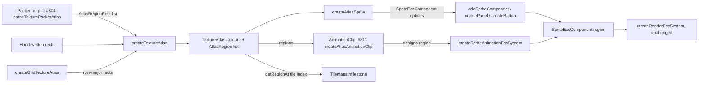

<!-- cspell:words aseprite multipack tilemap tilemaps tileset tilesets tilesheet -->

# Texture Atlases

Issue: https://github.com/Forge-Game-Engine/Forge/issues/796 (the Sprite
Atlases milestone; builds on #793's [texture regions](./texture-regions.md),
and #804, #811 and the Tilemaps milestone build on it)

| Module or file                                                                                                                 | Change   | Notes                                                                                               |
| ------------------------------------------------------------------------------------------------------------------------------ | -------- | --------------------------------------------------------------------------------------------------- |
| `src/rendering/texture-atlas/atlas-region.ts`                                                                                  | New      | `AtlasRegion`, `AtlasRegionRect`, and the pixel-rect to region conversion                           |
| `src/rendering/texture-atlas/texture-atlas.ts`                                                                                 | New      | `TextureAtlas`, `createTextureAtlas`                                                                |
| `src/rendering/texture-atlas/create-grid-texture-atlas.ts`                                                                     | New      | `createGridTextureAtlas`, `GridTextureAtlasOptions`                                                 |
| `src/rendering/texture-atlas/suggest-names.ts`                                                                                 | New      | Internal: close-name suggestions for "region not found" errors. Not exported from the package       |
| `src/rendering/texture-atlas/index.ts`                                                                                         | New      | Exports the public API of the folder                                                                |
| `src/rendering/utilities/create-atlas-sprite.ts`                                                                               | New      | `createAtlasSprite`, `CreateAtlasSpriteOptions`                                                     |
| `src/rendering/utilities/create-image-sprite.ts`                                                                               | Modified | `frameDimensions` removed; shares a private sprite-options builder with `createAtlasSprite`         |
| `src/rendering/index.ts`, `src/rendering/utilities/index.ts`                                                                   | Modified | Export the new files                                                                                |
| `src/rendering/systems/render-system.test.ts`                                                                                  | Modified | One instanced draw for sprites from different regions of one atlas                                  |
| `src/animations/utilities/create-sprite-sheet.ts`, `select-animation-frames.ts`, `create-animation.ts` (and tests, `index.ts`) | Removed  | Phase 3 only, replaced by grid atlas regions (open question 1)                                      |
| `e2e/fixtures/scenes/grid-texture-atlas.ts`, `e2e/specs/grid-texture-atlas.spec.ts`                                            | New      | Each grid cell draws exactly its own texels, in one batch                                           |
| `documentation-site/src/pages/demos/space-shooter/_create-explosions.ts`                                                       | Modified | `createGridTextureAtlas` + `createAtlasSprite` (and, in Phase 3, the clip from the atlas's regions) |
| `documentation-site/src/pages/demos/texture-atlases/`, `documentation-site/src/data/demos.ts`                                  | New      | "Texture Atlases" demo (open question 4)                                                            |
| `documentation-site/docs/docs/rendering/texture-atlases.md`                                                                    | New      | Atlases, regions, grids, sprites from regions                                                       |
| `documentation-site/docs/docs/rendering/sprites.md`, `nine-slice-sprites.md`, `animations/sprite-animations.md`                | Modified | Sprite sheet frames come from a grid atlas; nine-slice from an atlas region                         |
| `documentation-site/docs/docs/asset-loading/asset-registry.md`                                                                 | Modified | Phase 3 only: its `createAnimation` example builds the clip from a grid atlas                       |
| `CHANGELOG.md`                                                                                                                 | Modified | `#### Added` and `#### Removed` bullets                                                             |
| **Engine version at time of design**                                                                                           |          | `0.26.2`                                                                                            |

## Summary

After #793, a sprite draws a `TextureRegion`: an immutable, shared value
holding a UV rect and where that rect sits in its untrimmed frame
(`src/rendering/texture-region.ts`). Nothing builds those regions from
what an artist or a packer actually produces, which is texel rects in an
image. The only helpers are grid-only and live in two places:
`createImageSprite(texture, { frameDimensions })`
(`src/rendering/utilities/create-image-sprite.ts`) always picks the
top-left frame, and `createSpriteSheet`
(`src/animations/utilities/create-sprite-sheet.ts`) slices a grid into
animation frames that rendering and UI can't look up.

This design adds one atlas type, owned by the rendering module:

- `AtlasRegion extends TextureRegion` with the texel data a sprite needs
  that a bare region doesn't have: a `name`, the untrimmed frame's
  `sourceSize` in texels, and a `pivot`.
- `TextureAtlas`: one `Texture` and an ordered list of `AtlasRegion`s,
  looked up by name or index.
- `createTextureAtlas(texture, rects)`: texel rects, with optional trim and
  pivot, converted to regions with exact texel edges and checked against
  the texture. This is what #804's TexturePacker loader feeds.
- `createGridTextureAtlas(texture, { cellWidth, cellHeight, ... })`: a
  uniform grid with `spacing` and `margin`, named by index. This replaces
  `frameDimensions`, is the frame source for sprite animations, and is the
  tileset the Tilemaps milestone addresses by tile index.
- `createAtlasSprite(atlas, nameOrIndex, { pixelsPerUnit?, slices? })`:
  sprite options for one region, sized from its untrimmed size, with its
  pivot, and nine-slice native size resolved against the untrimmed size,
  so `createPanel` and `createButton` take an atlas sprite unchanged.

Every engine compared has this shape. Bevy separates the image from a
`TextureAtlasLayout` of rects (built `from_grid(tile_size, columns, rows,
padding, offset)` or by a packer) and a sprite refers to `(layout, index)`.
Godot has `AtlasTexture` (atlas, region, margin) and a grid in
`TileSetAtlasSource` (`texture_region_size`, `separation`, `margins`).
Unity has a `Sprite` (texture, rect, pivot, border) and looks sprites up by
name in a `SpriteAtlas`. Forge keeps the texture beside the regions, like
Bevy, and puts the per-frame data (name, untrimmed size, pivot) on the
region, like Unity's `Sprite`.

The change bends no core design. It adds no component and no system:
atlases are load-time data, sprites keep their one `region` field with one
writer (game code, or the sprite animation system), and the render system
is unchanged, so sprites from one atlas keep batching on the texture.

## Scope

### In scope

- `AtlasRegion`, `AtlasRegionRect`, `TextureAtlas` and
  `createTextureAtlas`, with validation of names, texel values, trims and
  bounds against the texture.
- Region lookup by name (`getRegion`, `hasRegion`) and index
  (`getRegionAt`), with "did you mean" suggestions for a missing name.
- `createGridTextureAtlas` with `columns`, `rows`, `spacing` and `margin`.
- `createAtlasSprite`, including nine-slice from an untrimmed region.
- Removing `frameDimensions` from `CreateImageSpriteOptions`, and updating
  every caller in `/src`, `/demo`, `/e2e` and `documentation-site`.
- Unit tests, one render-system batching test, one e2e scene and spec, a
  docs page, a docs-site demo, and changelog bullets.
- Phase 3: deleting `createSpriteSheet`, `SpriteSheet`,
  `selectAnimationFrames` and `createAnimation`, whose job a grid atlas
  now does (open question 1).

### Out of scope

- **Loading packer output** (TexturePacker JSON, `TextureAtlasCache`):
  #804. This design fixes the rect shape #804's parser returns.
- **Clips built from atlases** (`createAtlasAnimationClip`,
  `AnimationClip.texture`, `getAtlasRegionNames`, atlas `sequences`): #811.
  Until then a clip is `new AnimationClip(atlas.regions.slice(...))`, since
  an `AtlasRegion` is a `TextureRegion`.
- **Runtime packing** (building one texture from many images at load
  time). Forge has no import pipeline, and packing on every start costs a
  canvas draw and an upload for nothing an offline packer doesn't already
  give. It can be added later as a function that returns a
  `TextureAtlas`, without changing the type.
- **Multi-page atlases** (TexturePacker "multipack"). One atlas is one
  texture: sprites on different pages can't batch anyway, and each page
  loads as its own atlas.
- **Rotated frames**: #804 rejects them (see #793's design).
- **Per-region nine-slice borders** (Unity's sprite `border`, TexturePacker's
  `scale9Borders`). `createAtlasSprite` takes `slices` as an option. A
  `borders` field on `AtlasRegion` can be added when a loader reads them.
- **Half-texel insets or edge extrusion.** Regions sample exact texel
  edges; keeping neighbors from bleeding under linear filtering is the
  atlas author's job (spacing, extrusion in the packer, or `'nearest'`
  filtering). The milestone's documentation issue explains it.
- **Tilemap data, tile properties and animated tiles**: the Tilemaps
  milestone, which reads a grid atlas's regions by index.
- **Other atlas formats** (Starling/Sparrow XML like Kenney's
  `shipsMiscellaneous_sheet.xml`, Aseprite JSON's frame tags). A parser for
  any of them returns `AtlasRegionRect`s, as #804's does.

## Phases

Each phase is its own pull request, or all three land in #796's one pull
request; each passes the full verification checklist on its own.

### Phase 1: Atlases from texel rects

Adds the atlas type, building it from texel rects, region lookup, and
sprites from regions. Nothing is removed yet.

**Done when** `createAtlasSprite(createTextureAtlas(texture, rects),
'name')` returns sprite options that draw exactly that rect (trimmed or
not) at its untrimmed size and pivot; a nine-sliced atlas sprite can be
passed to `createPanel`; several sprites from different regions of one
atlas, consecutive in draw order, draw in one instanced draw call; and
`texture-atlases.md` documents it.

| Task                    | Description                                                                                                                                                                                                                                                                                                                            | Size |
| ----------------------- | -------------------------------------------------------------------------------------------------------------------------------------------------------------------------------------------------------------------------------------------------------------------------------------------------------------------------------------- | ---- |
| `AtlasRegion` and rects | `atlas-region.ts`: `AtlasRegion`, `AtlasRegionRect`, and a module function that validates one rect against a texture size and returns a frozen `AtlasRegion` (see "Converting texel rects"). Per-rect defaults via `withDefaults` with a defaults object built from the rect's own `width`/`height`, like `resolveNineSliceNativeSize` | M    |
| Name suggestions        | `suggest-names.ts`: up to three close names by case-insensitive edit distance, or containing / contained in the requested name (see "Lookup and error messages"); not exported from the rendering index                                                                                                                                | S    |
| `TextureAtlas`          | `texture-atlas.ts`: the interface and `createTextureAtlas(texture, rects)`, which checks the texture has a size, the list isn't empty, names are non-empty and unique, then builds the frozen region list and a `Map` name index; `getRegion`, `hasRegion`, `getRegionAt`                                                              | M    |
| `createAtlasSprite`     | `create-atlas-sprite.ts`: sprite options from a region (see "Sprites from regions"); throws for `slices` on a trimmed region. `createImageSprite` and it share one private builder                                                                                                                                                     | S    |
| Exports and JSDoc       | `texture-atlas/index.ts`, `rendering/index.ts`, `utilities/index.ts`; JSDoc on every public member, including the Y-down pivot and that the atlas doesn't own its texture                                                                                                                                                              | S    |
| Unit tests              | See "Testing": conversion on a non-square texture, trims, pivots, validation errors, lookups and suggestions, sprite sizes and nine-slice native size, `createPanel` with an atlas sprite                                                                                                                                              | M    |
| Render system batching  | `render-system.test.ts`: three sprites from three regions of one atlas, consecutive in draw order, one `drawArraysInstanced` with an instance count of `3`                                                                                                                                                                             | S    |
| Docs and changelog      | New `texture-atlases.md` (document-feature skill): what an atlas is, `createTextureAtlas` from texel rects with trim and pivot, lookups, `createAtlasSprite`, nine-slice from an atlas, bleeding and padding. `sprites.md`'s "Drawing a trimmed frame" points to it. `#### Added` bullet                                               | M    |

### Phase 2: Grid atlases

Adds `createGridTextureAtlas` and removes `frameDimensions`, so a sprite
sheet frame is picked the same way as a packed one.

**Done when** `createAtlasSprite(createGridTextureAtlas(texture, {
cellWidth: 32, cellHeight: 32, spacing: 2 }), 5)` returns sprite options
that draw exactly the sixth cell; sprites from different cells draw in one
batch; no `frameDimensions` is left in `/src`, `/demo`, `/e2e` or
`documentation-site`; the space shooter's explosions look as before; the
e2e spec passes; and the demo page renders.

| Task                     | Description                                                                                                                                                                                                                                                                    | Size |
| ------------------------ | ------------------------------------------------------------------------------------------------------------------------------------------------------------------------------------------------------------------------------------------------------------------------------ | ---- |
| `createGridTextureAtlas` | `create-grid-texture-atlas.ts` (see "Grid atlases"): validates options, counts whole cells like Tiled, builds row-major rects named `'0'`, `'1'`, ... and calls `createTextureAtlas`                                                                                           | S    |
| Grid unit tests          | Spacing and margin, a partial last row and column ignored, explicit `columns`/`rows`, explicit counts that don't fit, no whole cell, non-integer options, the issue's "sixth cell" example                                                                                     | S    |
| Remove `frameDimensions` | From `CreateImageSpriteOptions` and its JSDoc; delete its three tests in `create-image-sprite.test.ts`                                                                                                                                                                         | S    |
| Space shooter            | `_create-explosions.ts`: `createGridTextureAtlas(texture, { cellWidth: 517, cellHeight: 517 })` (the sheet is 3102 by 2585 texels, 6 by 5 cells) and `createAtlasSprite(atlas, explosionStartFrame, { pixelsPerUnit: 1 })`, so the sprite starts on the clip's first frame     | S    |
| E2E scene and spec       | `grid-texture-atlas` (see "Testing")                                                                                                                                                                                                                                           | M    |
| Demo                     | `documentation-site/src/pages/demos/texture-atlases/` (add-feature-demo skill, see "Documentation and demos") and its `demos.ts` entry in `rendering`                                                                                                                          | M    |
| Docs and changelog       | `texture-atlases.md` gains "Grid atlases"; `sprites.md`'s "Drawing a frame of a sprite sheet" and `sprite-animations.md`'s "Playing a clip on an entity" use `createGridTextureAtlas` + `createAtlasSprite`; `#### Added` grid bullet, `#### Removed` `frameDimensions` bullet | S    |

### Phase 3: Retire the sprite sheet helpers

Deletes the three grid frame builders in `src/animations/utilities`, whose
job a grid atlas does, so there's one way to slice a grid (open question 1;
if the answer is to leave this to #811, this phase moves there unchanged).

**Done when** no `createSpriteSheet`, `SpriteSheet`, `selectAnimationFrames`
or `createAnimation` is left in `/src`, `/demo`, `/e2e` or
`documentation-site`, and the space shooter's explosion clip plays its 26
frames from the atlas.

| Task               | Description                                                                                                                                                                                                                                                       | Size |
| ------------------ | ----------------------------------------------------------------------------------------------------------------------------------------------------------------------------------------------------------------------------------------------------------------- | ---- |
| Delete helpers     | `create-sprite-sheet.ts`, `select-animation-frames.ts` (and its test), `create-animation.ts`, and their exports from `src/animations/utilities/index.ts`                                                                                                          | S    |
| Callers            | `_create-explosions.ts` builds its clip from `atlas.regions.slice(explosionStartFrame, explosionStartFrame + explosionFrameCount)`; any caller in `/demo` or `/e2e`                                                                                               | S    |
| Docs and changelog | `sprite-animations.md`'s "Sprite sheets" and "Animation clips" sections use a grid atlas and `regions.slice` (row-major, like `selectAnimationFrames`); `asset-registry.md`'s example registers a clip built that way; `#### Removed` bullet with the replacement | S    |

## API design

### `AtlasRegion`

```ts
/**
 * A named region of a texture atlas: a TextureRegion plus the texel data a
 * sprite needs. Immutable and shared by every sprite, clip and tile that
 * draws it.
 */
export interface AtlasRegion extends TextureRegion {
  /** Unique within its atlas. Grid atlases name regions by index: '0', '1', ... */
  readonly name: string;
  /** The untrimmed frame's size, in texels. */
  readonly sourceSize: Readonly<Vector2>;
  /** The sprite's origin, normalized to the untrimmed frame, Y-down. */
  readonly pivot: Readonly<Vector2>;
}
```

`pivot` follows `SpriteEcsComponent.pivot`: `(0, 0)` is the untrimmed
frame's top-left corner and `(0.5, 0.5)` its center. It may lie outside `0`
to `1` (a character's feet below its frame, for example), like a sprite's.
The issue describes it as Y-up; that predates the Y-down world, as #793's
design notes for the trim formula (D3 here).

### `AtlasRegionRect`

```ts
/** One region of an atlas in texels, as packers write them: top-left origin. */
export interface AtlasRegionRect {
  name: string;
  /** The packed (drawn) rect in the texture. */
  x: number;
  y: number;
  width: number;
  height: number;
  /** The untrimmed frame's size. Default: width and height (untrimmed). */
  sourceWidth?: number;
  sourceHeight?: number;
  /** Where the packed rect's top-left sits in the untrimmed frame. Default: 0. */
  trimX?: number;
  trimY?: number;
  /** Normalized to the untrimmed frame, Y-down. Default: (0.5, 0.5). */
  pivot?: Vector2;
}
```

The trim fields map one to one onto TexturePacker's `frame`,
`spriteSourceSize` and `sourceSize`, and onto Godot's `AtlasTexture.margin`
(`trimX`, `trimY`, and the remaining width and height).

### `TextureAtlas`

```ts
export interface TextureAtlas {
  /** The texture every region samples. The atlas doesn't own it. */
  readonly texture: Texture;
  /** Every region, in the order it was given (row-major for a grid). */
  readonly regions: readonly AtlasRegion[];
  /** @throws if no region has this name, naming up to three close ones. */
  getRegion(name: string): AtlasRegion;
  hasRegion(name: string): boolean;
  /** @throws if index isn't an integer in [0, regions.length). */
  getRegionAt(index: number): AtlasRegion;
}

export function createTextureAtlas(
  texture: Texture,
  rects: readonly AtlasRegionRect[],
): TextureAtlas;
```

`createTextureAtlas` throws a descriptive error, naming the region where
there is one, when:

- the texture's `width` or `height` is `0` (an empty texture, not yet
  updated with a source);
- `rects` is empty;
- a name is empty or used twice;
- a texel value isn't an integer, `x`, `y`, `trimX` or `trimY` is negative,
  or a size isn't greater than `0`;
- the packed rect reaches outside the texture (`x + width >
texture.width`, likewise for `y`);
- the packed rect doesn't fit in its untrimmed frame at its trim
  (`trimX + width > sourceWidth`, likewise for `y`);
- a pivot value isn't finite.

The result and its `regions` array are frozen, and the name index is a
`Map` closed over by `getRegion` and `hasRegion`.

The atlas reads the texture's size once, when it's created. A texture whose
contents are later replaced with an image of another size
(`Texture.update`) leaves the atlas's UVs describing the old size; the JSDoc
says so (D9).

### `createGridTextureAtlas`

```ts
export interface GridTextureAtlasOptions {
  /** A cell's size, in texels. */
  cellWidth: number;
  cellHeight: number;
  /** Default: as many whole cells as fit. */
  columns?: number;
  rows?: number;
  /** Texels between neighboring cells. Default 0. */
  spacing?: number;
  /** Texels before the first cell, on the left and top. Default 0. */
  margin?: number;
}

export function createGridTextureAtlas(
  texture: Texture,
  options: GridTextureAtlasOptions,
): TextureAtlas;
```

See "Grid atlases" for the counting rule.

### `createAtlasSprite`

```ts
export interface CreateAtlasSpriteOptions {
  /** Texels per world unit. Default 100, as for createImageSprite. */
  pixelsPerUnit?: number;
  /** Nine-slice insets, in world units at this pixelsPerUnit. Untrimmed regions only. */
  slices?: NineSliceOptions;
}

export function createAtlasSprite(
  atlas: TextureAtlas,
  region: string | number, // a name, or an index into atlas.regions
  options?: CreateAtlasSpriteOptions,
): SpriteEcsComponent;
```

## Converting texel rects

For a texture of `W` by `H` texels and a rect with packed rect
`(x, y, width, height)`, untrimmed size `(sourceWidth, sourceHeight)` and
trim `(trimX, trimY)`:

```
uvOffset   = (x / W, y / H)
uvScale    = (width / W, height / H)
trimOffset = (trimX / sourceWidth, trimY / sourceHeight)
trimScale  = (width / sourceWidth, height / sourceHeight)
sourceSize = (sourceWidth, sourceHeight)
pivot      = rect.pivot ?? (0.5, 0.5)   // via withDefaults, not ??
```

The texture-region part is built with `createTextureRegion(uvOffset,
uvScale, { offset: trimOffset, scale: trimScale })`, so it gets the same
checks and freezing as every other region, and its result is spread into a
frozen `AtlasRegion` with frozen `sourceSize` and `pivot` vectors. An
untrimmed rect gives `trimOffset` `(0, 0)` and `trimScale` exactly `(1, 1)`,
so `isTextureRegionTrimmed` is `false` and the region can be nine-sliced.

The UVs land on exact texel edges, with no half-texel inset (D5). Every
texel value must be an integer (D4), so `x / W` is a texel boundary, not a
point inside a texel.

The checks run in texels, before any division, so an out-of-bounds rect is
reported in the units the caller wrote, e.g. `Unable to create texture
atlas region "hero_idle_0": its rect (x 120, width 16) reaches past the
texture's width of 128 texels.`

## Grid atlases

Cells are laid out from the top-left, row-major, `margin` texels in from
the left and top edges and `spacing` texels apart. Cell `i` is at column
`i % columns` and row `floor(i / columns)`:

```
x = margin + column * (cellWidth + spacing)
y = margin + row * (cellHeight + spacing)
```

When `columns` or `rows` is omitted, it's the number of whole cells that
fit, counted the way Tiled counts a tileset image's tiles:

```
columns = floor((W - margin + spacing) / (cellWidth + spacing))
rows    = floor((H - margin + spacing) / (cellHeight + spacing))
```

The trailing margin isn't required: a sheet with a margin only on the left
and top, or with a few spare texels at the right and bottom, gives the same
count as one with a full border. A partial last column or row is ignored.
Godot (`margins`, `separation`) and Bevy (`offset`, `padding`) use the same
meaning: a leading offset and a gap between cells.

`createGridTextureAtlas` throws a descriptive error when `cellWidth` or
`cellHeight` isn't a positive integer, `spacing` or `margin` isn't a
non-negative integer, a given `columns` or `rows` isn't a positive integer
or doesn't fit (`margin + columns * cellWidth + (columns - 1) * spacing >
W`), or no whole cell fits. Its regions are untrimmed, pivoted at their
center and named by index, so `getRegion('5')` and `getRegionAt(5)` return
the same region.

The issue's example on a 100 by 100 texel texture with 32 by 32 cells and
`spacing: 2`: `columns = rows = floor(102 / 34) = 3`, and region `5` is
column `2`, row `1`, the texel rect `(68, 34, 32, 32)`.

## Sprites from regions

`createAtlasSprite(atlas, region, options)`:

1. Looks the region up: `getRegionAt(region)` for a number,
   `getRegion(region)` for a string, so the lookup's error is the one the
   caller sees.
2. Throws when `slices` is set and the region is trimmed
   (`isTextureRegionTrimmed`), naming the region: nine-slice insets are
   authored against the untrimmed art (#793's D6). `addSpriteComponent`
   would throw too, but only once the sprite is attached; this fails where
   the options are made.
3. Sizes the sprite through `importTexture(atlas.texture, { pixelsPerUnit,
width: sourceSize.x, height: sourceSize.y })`, so `width`/`height` are
   the **untrimmed** frame's world size and a trimmed region draws its share
   of it.
4. Returns `SpriteEcsComponent` options like `createImageSprite`'s:
   `texture: atlas.texture`, `region` (the `AtlasRegion` itself, by
   reference), `pivot` a fresh copy of the region's pivot, `slices` through
   `resolveNineSliceNativeSize` against the untrimmed world size, and every
   other field at its default.

`createImageSprite` and `createAtlasSprite` build the result with one
private function of `(texture, region, worldWidth, worldHeight, pivot,
slices)`, so their defaults can't drift apart.

The region is stored by reference, so `sprite.region ===
atlas.getRegion('hero_idle_0')` holds, which lets later code (an animation
event, a tilemap cell) compare regions by identity. The pivot is copied
because UI layout writes `pivot` in place
(`src/ui/systems/ui-layout-system.ts`) and the region's is frozen.
`addSpriteComponent` copies it again, so one result can be shared by many
sprites.

Nine-slice from an atlas works without any change to
`computeNineSliceRegions`: it already cuts its bands from the sprite's
`region.uvOffset`/`uvScale`, which is the region's rect in the atlas, and
the insets map to UV fractions through the native size, which is the
untrimmed world size here. `createPanel({ sprite: createAtlasSprite(ui,
'panel', { pixelsPerUnit: 1, slices }) })` therefore works unchanged, and a
unit test covers it.

## Lookup and error messages

`getRegion(name)` throws when the name is missing:

```
Unable to find region "hero_idol_0" in the texture atlas. Did you mean "hero_idle_0", "hero_idle_1"?
```

The suggestions are up to three region names, nearest first, that either
are within an edit distance (Levenshtein, case-insensitive) of
`max(2, floor(name.length / 3))` of the requested name, or contain it or
are contained in it. When nothing is close, the message gives the region
count and the first three names instead, so a call against the wrong atlas
is obvious (`The atlas has 96 regions, named "0", "1", "2", ...`). The
search only runs on the error path, so its cost (one edit distance per
region) doesn't matter.

`getRegionAt(index)` throws for a non-integer or out-of-range index and
gives the valid range. `hasRegion` never throws.

The suggestion helper is internal (not exported from the package). #811's
`createAtlasAnimationClip`, which "throws listing any missing names", can
reuse it from inside `/src`.

## Data flow



Atlases are plain load-time data, so nothing here touches system ordering
or a component field's writer. A sprite's `region` keeps one writer at a
time: whoever created the sprite, or the sprite animation system for a
sprite with a `SpriteAnimationEcsComponent`.

Batching is unchanged and is the point of an atlas: `isSameBatch` in
`render-system.ts` compares renderable, texture and emissive texture, so
consecutive sprites from any regions of one atlas draw in one instanced
call.

## Performance

- Building an atlas is linear in its regions, plus one `Map` insert per
  region; it runs at load time.
- `getRegion` is one `Map` lookup; `getRegionAt` one array index. Games
  that look up regions per frame (a tilemap painting cells) pay nothing
  more than that.
- Every sprite, clip frame and tile shares the atlas's region objects, so
  a thousand sprites of one frame hold one region, not a thousand.

## Testing

Unit tests (Vitest), with a fake texture of a given `width`/`height` (the
conversion reads only those):

- `atlas-region.test.ts` / `texture-atlas.test.ts`:
  - conversion on a non-square texture (e.g. 128 by 64): `uvOffset`,
    `uvScale` exact (`toBe`, not `toBeCloseTo`, for power-of-two sizes);
  - trim fractions for a trimmed rect, and exactly `(0, 0)`, `(1, 1)` for
    an untrimmed one (`isTextureRegionTrimmed` is `false`);
  - default pivot `(0.5, 0.5)` and a given pivot, frozen, and a pivot
    outside `0` to `1` accepted;
  - `sourceSize` defaults to the packed size;
  - errors: empty texture, empty list, empty and duplicate names,
    non-integer and negative texel values, zero sizes, a rect past the
    texture's right and bottom edges, a trim that doesn't fit its frame,
    a non-finite pivot. Each message names the region;
  - the atlas, its `regions` and every region are frozen; regions keep the
    input order;
  - `getRegion`, `hasRegion`, `getRegionAt` (including `-1`,
    `regions.length` and `1.5`);
  - suggestions: a typo, a case difference, a prefix, nothing close (count
    and first names), at most three.
- `create-grid-texture-atlas.test.ts`: as in Phase 2's table.
- `create-atlas-sprite.test.ts`: lookup by name and index; `width`/`height`
  from the untrimmed size at `pixelsPerUnit` (default `100`); `pivot` copied
  from the region and not the same object; `region` the same object;
  nine-slice native size from the untrimmed world size; `slices` on a
  trimmed region throws; the issue's "sixth cell" example.
- `create-panel.test.ts`: a panel made from a nine-sliced atlas sprite
  keeps the atlas region and native size.
- `render-system.test.ts`: one instanced draw for three consecutive
  sprites from three regions of one atlas.

E2E (`write-e2e-test` skill), `grid-texture-atlas`:

- The scene paints a texture on a canvas: 3 columns by 2 rows of 8 by 8
  texel cells, `margin: 1`, `spacing: 2`, the margin and spacing in one
  color and each cell a two-tone pattern of its own colors, uploaded with
  `filter: 'nearest'`.
- It draws the whole texture as a reference sprite with `createImageSprite`
  and each of the six cells with `createAtlasSprite`, all at the same
  integer CSS-pixels-per-texel scale, cell sprites consecutive in draw
  order. The handle records `drawArraysInstanced` instance counts, as
  `shared-texture-sprites.ts` does.
- The spec, in the same `page.evaluate` as `step()`, reads the canvas once
  and asserts, relative and same-run, that each cell sprite's pixels equal
  the reference sprite's pixels over that cell's rect (no spacing or
  neighbor texels at the edges, no off-by-one cell), and that the six cell
  sprites drew in one instanced draw of six. No absolute color values are
  compared, so the SwiftShader caveat in AGENTS.md doesn't apply.

## Documentation and demos

- `texture-atlases.md` (new, `rendering`): what an atlas is and why it
  batches; `createTextureAtlas` with plain and trimmed rects and a pivot;
  `getRegion`/`getRegionAt`; `createAtlasSprite`; nine-slice from an atlas;
  grid atlases with `spacing` and `margin`; bleeding under linear filtering
  and how to avoid it; that the atlas doesn't own or watch its texture.
- `sprites.md`: "Drawing a frame of a sprite sheet" becomes a short section
  that links to the atlas page and shows `createGridTextureAtlas` +
  `createAtlasSprite`; "Drawing a trimmed frame" shows a trimmed
  `AtlasRegionRect` instead of hand-computed fractions, keeping the
  `createTextureRegion` form for regions built without an atlas.
- `nine-slice-sprites.md`: slicing a region of an atlas with
  `createAtlasSprite`.
- `sprite-animations.md`: the sprite comes from `createAtlasSprite` on a
  grid atlas; in Phase 3, the clip's frames are `atlas.regions.slice(...)`.
- Demo `texture-atlases` (add-feature-demo skill, `rendering` category),
  built from assets already in `documentation-site/static/img`:
  - a small island map drawn from Kenney's pirate tile sheet
    (`kenney_pirate-pack/Tilesheet/tiles_sheet.png`, 64 by 64 texel tiles,
    16 by 6, no spacing) with `createGridTextureAtlas` and a hard-coded
    array of tile indices;
  - a few named props from `kenney_pirate-pack/Spritesheet/shipsMiscellaneous_sheet.png`,
    their rects copied from its XML into `createTextureAtlas` (the demo
    doesn't parse the XML);
  - "How it works" notes that the map draws in one batch per atlas.
- The space shooter (`_create-explosions.ts`) is updated, built, and loaded
  by hand per CLAUDE.md step 9.

## Changelog

`#### Added`:

- `TextureAtlas`, `createTextureAtlas` and `AtlasRegion`: a texture and its
  named regions, built from texel rects with optional trim and pivot.
  `createAtlasSprite(atlas, nameOrIndex, options)` returns sprite options
  for a region, including nine-slice.
- `createGridTextureAtlas(texture, { cellWidth, cellHeight, columns, rows,
spacing, margin })`: a uniform grid of regions named by index.

`#### Removed`:

- `createImageSprite`'s `frameDimensions`. Use
  `createAtlasSprite(createGridTextureAtlas(texture, { cellWidth, cellHeight }), index)`.
- Phase 3: `createSpriteSheet`, `SpriteSheet`, `selectAnimationFrames` and
  `createAnimation`. Build a clip from a grid atlas's regions:
  `new AnimationClip(atlas.regions.slice(start, start + count))`.

## Decision log

### D1. The atlas holds the texture; the region holds the per-frame data

- **Options**: (a) Bevy's split: a layout of rects with no texture, and a
  sprite referring to `(layout, index)`; (b) one atlas holding a texture and
  its regions, each region carrying its name, untrimmed size and pivot; (c)
  each region holding its texture (Unity's `Sprite`, Godot's
  `AtlasTexture`).
- **Chosen**: (b).
- **Rationale**: a region's UVs only mean something against one texture's
  size, so pairing them in one value stops a layout being applied to the
  wrong image (which is what #811 guards clips against). The sprite still
  holds `texture` and `region` separately, as #793 decided (its D1), so
  batching keeps keying on the sprite's texture. The per-frame data a
  sprite needs (untrimmed size, pivot) travels with the region, as with a
  Unity `Sprite`.
- **Tradeoff**: two textures with the same layout (a palette swap) need two
  atlases. `createGridTextureAtlas` makes that one call each.
- **Assumptions**: none.

### D2. `TextureAtlas` is an interface built by `createTextureAtlas`

- **Options**: (a) a class with a public validating constructor; (b) an
  interface returned frozen by `createTextureAtlas`, like `FontAtlas`.
- **Chosen**: (b).
- **Rationale**: one way to build one. A public constructor taking
  `AtlasRegion`s would let callers pass hand-written regions that skip the
  texel checks and freezing; one taking rects would duplicate
  `createTextureAtlas`. The engine's other load-time data (`FontAtlas`,
  `TextureRegion`) are interfaces with factories.
- **Tradeoff**: no `instanceof TextureAtlas`.
- **Assumptions**: #811 adds `sequences` through an options argument to
  `createTextureAtlas`.

### D3. Pivots are Y-down

- **Options**: (a) Y-down, like `SpriteEcsComponent.pivot`; (b) Y-up, as
  the issue says.
- **Chosen**: (a).
- **Rationale**: the issue predates the Y-down world. A sprite's pivot has
  `(0, 0)` at the top-left (`SpriteDefaultedOptions.pivot`), and
  `createAtlasSprite` copies the region's pivot into it, so any other
  convention would need a flip at that boundary for no reason. #804
  converts TexturePacker's pivot at its own boundary (TexturePacker is
  Y-down too, so it needs no flip either).
- **Tradeoff**: none.
- **Assumptions**: none.

### D4. Texel values must be integers

- **Options**: (a) integers only; (b) any finite number.
- **Chosen**: (a).
- **Rationale**: every packer and tile editor writes integer texel rects,
  and a texel rect that starts inside a texel samples half of a neighbor's
  texel. A fractional value is almost always a mistake, such as passing UV
  fractions instead of texels, and an early error says so.
- **Tradeoff**: an atlas exported at a fractional scale has to be built
  from its texel rects, not scaled ones (open question 2).
- **Assumptions**: none.

### D5. Exact texel edges, no inset

- **Options**: (a) UVs on exact texel edges; (b) inset each region by half
  a texel, as `shapeText` does for glyphs.
- **Chosen**: (a).
- **Rationale**: an inset shrinks every region by one texel, which blurs
  pixel art and breaks tiles that must meet seamlessly. Godot's
  `AtlasTexture`, Bevy's layouts and Unity's sprites all sample the exact
  rect and leave padding and extrusion to the packer. Glyphs differ: an
  MSDF atlas is always linear-filtered and glyph edges are never meant to
  touch.
- **Tradeoff**: a linear-filtered atlas packed with no spacing bleeds
  neighbors at region edges; the docs explain spacing and extrusion.
- **Assumptions**: the milestone's documentation issue covers padding.
- **Revised in review**: the tradeoff showed up in the demo: Kenney's tile
  sheet, drawn at a fractional scale, showed a seam of transparent
  neighbor texels at every water tile's edge. The UVs stay on exact texel
  edges, but sprite sampling now clamps to the region inset by half a texel
  for a `'clamp'` texture (`v_texBounds` in `sprite.vert`), the way Godot's
  `region_filter_clip_enabled` does. It gives what Godot 4's TileSet
  `use_texture_padding` gives, without a padded copy of the texture.
  `'repeat'` textures aren't clamped, so their regions can still tile and
  scroll. This keeps `TextureWrap`'s promise that a `'clamp'` frame never
  bleeds into its neighbor, which held for whole textures but not regions.

### D6. Grid `spacing` and `margin` are single numbers counted like Tiled

- **Options**: (a) one number each, margin before the first cell only when
  counting; (b) `Vector2`s per axis, like Godot and Bevy; (c) margin
  required on all four sides when counting.
- **Chosen**: (a).
- **Rationale**: Tiled, whose tilesets the Tilemaps milestone will read,
  stores one `spacing` and one `margin` and counts cells with
  `(size - margin + spacing) / (cell + spacing)`; matching it means a Tiled
  tileset maps onto `createGridTextureAtlas` field for field. (c) loses the
  last column of a sheet that has no trailing margin.
- **Tradeoff**: a sheet with different spacing on each axis can't be
  described (open question 3).
- **Assumptions**: such sheets are rare.

### D7. `createAtlasSprite` stores the region by reference and copies the pivot

- **Options**: (a) store the `AtlasRegion` object; (b) store a plain
  `TextureRegion` copy.
- **Chosen**: (a).
- **Rationale**: regions are immutable and shared on purpose (#793). One
  object per frame keeps memory flat and lets code compare regions by
  identity. The pivot is copied because a sprite's pivot is written in
  place by UI layout.
- **Tradeoff**: none.
- **Assumptions**: none.

### D8. `createAtlasSprite` throws for `slices` on a trimmed region

- **Options**: (a) throw in `createAtlasSprite`; (b) rely on
  `addSpriteComponent`'s throw.
- **Chosen**: (a), keeping (b) as well.
- **Rationale**: the error then names the atlas region at the line that
  asked for it. #793's design already throws in `addSpriteComponent` and
  at draw time for regions assigned later.
- **Tradeoff**: one duplicated check.
- **Assumptions**: none.

### D9. The atlas reads the texture's size once

- **Options**: (a) compute UVs at creation and document that replacing the
  texture's contents with another size invalidates the atlas; (b) keep
  texel rects and recompute UVs when the texture's size changes; (c)
  record the size and make `createAtlasSprite` throw on a mismatch.
- **Chosen**: (a).
- **Rationale**: regions are immutable values shared by sprites (#793), so
  they can't follow a resize, and (b) would need a texture-size event and
  mutable regions. Changing an atlas image's size at runtime isn't a use
  an atlas has; (c) adds a field and still can't fix sprites already made.
- **Tradeoff**: a texture reloaded at another size silently samples the
  wrong rects until the atlas is rebuilt.
- **Assumptions**: textures behind atlases are loaded once, through
  `textureCache`.

### D10. No runtime packing, no multi-page atlases

- **Options**: (a) pack at load time like Bevy's `TextureAtlasBuilder`;
  (b) offline packing only; (c) one atlas spanning several textures.
- **Chosen**: (b), one texture per atlas.
- **Rationale**: as the issue says, packing at load costs a draw and an
  upload on every start for nothing an offline packer doesn't give, and
  Unity and Godot pack at import. Pages can't batch together, so a
  multi-page atlas only hides that cost.
- **Tradeoff**: runtime-generated content (procedural sprites) has to
  build its own texture and rects.
- **Assumptions**: a later runtime packer returns a `TextureAtlas`.

### D11. Grid regions are named by index

- **Options**: (a) name each cell by its index; (b) leave grid regions
  unnamed and allow nameless regions.
- **Chosen**: (a).
- **Rationale**: every region has a name, so `getRegion` and the suggestion
  error work the same for every atlas, and a grid atlas used with code
  written for named atlases works. Index lookup stays `getRegionAt`.
- **Tradeoff**: `getRegion('5')` and `getRegionAt(5)` are two spellings of
  one lookup on a grid.
- **Assumptions**: none.

## Open questions

1. **Delete the sprite sheet helpers here or in #811** (non-blocking).
   #796's design says grid atlases replace `createSpriteSheet` "rather than
   living beside them", but its task list doesn't delete it, and #811's
   does.
   - _Here, as Phase 3_ (default): once grid atlases exist,
     `createSpriteSheet` + `selectAnimationFrames` and `createAnimation` are
     a second and third way to slice a grid, which the change philosophy
     rules out, and `atlas.regions.slice(start, start + count)` replaces
     `selectAnimationFrames` exactly. The docs never have to show the
     sprite coming from an atlas and its frames from a sheet.
   - _In #811, as planned_: #811 replaces clip construction as a whole
     (`createAtlasAnimationClip`, `AnimationClip.texture`), so the
     animations module changes once. Phase 3 then moves to #811 unchanged.
2. **How #804's `meta.scale` reaches the sprite's world size**
   (non-blocking). #804 plans to divide `meta.scale` into the region's
   `sourceSize` so an `@2x` export gives the same world size at the same
   `pixelsPerUnit`. With D4, `sourceSize` stays in integer texels.
   - _#804 adds the scale to the atlas_ (default): e.g. a `TextureAtlas`
     field that `createAtlasSprite` multiplies into `pixelsPerUnit`, the way
     PixiJS treats a sheet's resolution. Regions stay texel-exact.
   - _Relax D4 for `sourceWidth`/`sourceHeight` only_: #804 divides as
     planned; `sourceSize` is then in source pixels, not texels.
   - _No automatic scale_: the game passes `pixelsPerUnit * scale` itself.
3. **Per-axis grid spacing and margin** (non-blocking). Default: single
   numbers, like Tiled (D6). Godot and Bevy take vectors; switching later
   changes only the option types.
4. **Ship the demo in #796 or in the milestone's documentation issue**
   (non-blocking). Default: here, in Phase 2, since `add-feature-demo` asks
   for a demo with a major feature and grid and named atlases are the
   user-facing part of the milestone. If the documentation issue already
   plans an atlas demo, this task moves there.
5. **Name the atlas in error messages** (non-blocking). Default: no. An
   atlas has no name or URL, so "region not found" errors can't say which
   atlas; the suggestions and the "has N regions, named ..." fallback
   usually identify it. #804's cache knows the data URL and can wrap the
   error, or `createTextureAtlas` could take a `label`.
