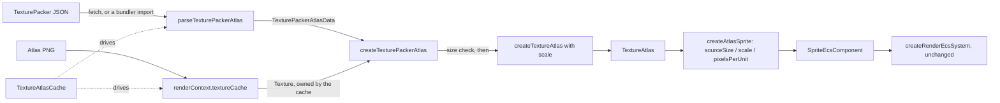

<!-- cspell:words aseprite multiatlas multipack pixijs smartupdate spritesheet -->

# Loading TexturePacker Atlases

Issue: https://github.com/Forge-Game-Engine/Forge/issues/804 (the Sprite
Atlases milestone; builds on #796's [texture atlases](./texture-atlases.md)
and #793's [texture regions](./texture-regions.md); #811 and #816 build on
it)

| Module or file                                                                                                     | Change   | Notes                                                                                                  |
| ------------------------------------------------------------------------------------------------------------------ | -------- | ------------------------------------------------------------------------------------------------------ |
| `src/rendering/texture-atlas/parse-texture-packer-atlas.ts`                                                        | New      | `parseTexturePackerAtlas`, `TexturePackerAtlasData`                                                    |
| `src/rendering/texture-atlas/create-texture-packer-atlas.ts`                                                       | New      | `createTexturePackerAtlas(texture, data)`: size check, then `createTextureAtlas`                       |
| `src/rendering/texture-atlas/texture-atlas-cache.ts`                                                               | New      | `TextureAtlasCache`, `TextureAtlasUrls`, `TextureAtlasLoadOptions`                                     |
| `src/rendering/texture-atlas/texture-atlas.ts`                                                                     | Modified | `createTextureAtlas` takes `CreateTextureAtlasOptions` (`scale`); `TextureAtlas.scale`                 |
| `src/rendering/utilities/create-atlas-sprite.ts`                                                                   | Modified | Divides the region's `sourceSize` by `atlas.scale` when sizing the sprite                              |
| `src/rendering/texture-atlas/index.ts`                                                                             | Modified | Exports the new files                                                                                  |
| `e2e/fixtures/assets/texture-packer-atlas/atlas.png`, `atlas.json`                                                 | New      | A small committed atlas in TexturePacker's "JSON (Hash)" format                                        |
| `e2e/fixtures/scenes/texture-packer-atlas.ts`, `e2e/specs/texture-packer-atlas.spec.ts`                            | New      | Trimmed and untrimmed frames loaded by name land where the source art puts them, in one instanced draw |
| `documentation-site/docs/docs/rendering/texture-atlases.md`, `documentation-site/docs/docs/asset-loading/index.md` | Modified | "Loading a TexturePacker export" section; the cache listed with the other caches                       |
| `CHANGELOG.md`                                                                                                     | Modified | `#### Added` bullets                                                                                   |
| **Engine version at time of design**                                                                               |          | `0.26.2`                                                                                               |

## Summary

#796 gave Forge `TextureAtlas`: one texture plus named `AtlasRegion`s,
built by `createTextureAtlas(texture, rects)` from texel rects
(`src/rendering/texture-atlas/texture-atlas.ts`). Nothing reads those rects
from what a packer writes, so today a game copies them out of the packer's
file by hand, as the texture atlases demo does
(`documentation-site/src/pages/demos/texture-atlases/_create-ships.ts`).

This design reads TexturePacker's "JSON (Hash)" and "JSON (Array)" files,
the format TexturePacker, free-tex-packer and Aseprite's sprite sheet
export write, and Phaser and PixiJS read. It has three parts, split the way
the font atlas loader is (`validateFontAtlasFileData` +
`toFontAtlasData` + `FontAtlasCache`):

- `parseTexturePackerAtlas(json)` validates `unknown` JSON and returns
  `TexturePackerAtlasData`: the image size and scale the file declares, and
  one `AtlasRegionRect` per frame. It does no GL work, so it's tested
  without a context and works on JSON a game already has (a bundler's JSON
  import).
- `createTexturePackerAtlas(texture, data)` checks that the texture is the
  size the file declares (which catches a stale PNG) and calls
  `createTextureAtlas`.
- `TextureAtlasCache`, constructed with a `RenderContext` like
  `FontAtlasCache`, loads `{ dataUrl, imageUrl }` once per data URL. The
  image comes from `renderContext.textureCache`, which owns the texture, so
  an atlas and a plain sprite of the same file share one texture and batch.

Frames map onto `AtlasRegionRect` field for field: `frame` is the packed
rect, `spriteSourceSize` and `sourceSize` the trim, and `pivot` the
pivot, which is Y-down in TexturePacker as in Forge, so it's copied without
a flip. A file's `meta.scale` (an `@2x` or half-size export) becomes the
atlas's new `scale`, which `createAtlasSprite` divides into the region's
untrimmed size, so one `pixelsPerUnit` gives the same world size at every
export scale. Rotated frames are rejected with an error that says how to
turn rotation off.

The change bends no core design. It adds no component and no system: an
atlas is load-time data, sprites keep their one `region` field with one
writer, and the render system is unchanged.

## Scope

### In scope

- `parseTexturePackerAtlas` for `frames` as an object (hash, keyed by
  name) and as an array (each entry has `filename`), with validation of
  every field it reads and errors that give the frame's name and the
  field's path.
- Rejecting rotated frames, duplicate names (array form), frames outside
  `meta.size`, and multi-page files (`textures` instead of `frames`).
- `meta.scale` as `TextureAtlas.scale`, used by `createAtlasSprite`.
- `createTexturePackerAtlas` and its image-size check.
- `TextureAtlasCache` with `get(dataUrl)` and
  `getOrLoad({ dataUrl, imageUrl }, { filter })`: shared concurrent loads,
  retry after failure, and an error for one data URL requested with a
  different image URL or filter.
- Unit tests, one e2e scene and spec with a committed atlas, the
  documentation sections and changelog bullets.

### Out of scope

- **TexturePacker's `animations` list and Aseprite's `frameTags`**: #811
  adds atlas sequences and reads `animations` in `parseTexturePackerAtlas`.
  This design ignores both.
- **The milestone's demo and atlas guide**: #816 adds a TexturePacker atlas
  to `documentation-site/static/img/sprite-atlas/`, a `sprite-atlas` demo
  that loads it through `TextureAtlasCache`, and the export-settings
  guidance. This design adds the reference section on loading (open
  question 5).
- **Rotated frames**: rejected (D4).
- **Multi-page atlases** (TexturePacker "multipack", Phaser's
  `textures` array): one atlas is one texture (#796's D10). Each page is
  exported as its own "JSON (Hash)" file and loaded as its own atlas.
- **Nine-slice borders from the file** (TexturePacker's `borders`,
  Aseprite's `slices`): `AtlasRegion` has no borders field (#796, "Out of
  scope"). `createAtlasSprite` keeps taking `slices` as an option.
- **Other formats** (Starling/Sparrow XML, Spine `.atlas`, Phaser 3
  multiatlas): a parser for any of them returns `AtlasRegionRect`s the same
  way.
- **Detecting premultiplied alpha.** Textures are uploaded straight-alpha
  and the sprite shaders expect it (`Texture.update`). A PNG exported with
  "premultiply alpha" on can't be told apart by the loader; the docs say to
  export with it off.
- **Resolving `meta.image` relative to the data URL.** The caller gives both
  URLs (D1).
- **Scale on grid atlases**: `createGridTextureAtlas` keeps
  `scale` at `1`.

## Phases

Each phase is its own pull request, or both land in #804's one pull
request; each passes the full verification checklist on its own.

### Phase 1: Parse TexturePacker data into an atlas

Adds the parser, the atlas scale and `createTexturePackerAtlas`. A game
with the JSON already in hand (a bundler's JSON import) and a texture from
`textureCache` can build an atlas.

**Done when** `createTexturePackerAtlas(texture,
parseTexturePackerAtlas(json))` on hash and array fixtures returns an atlas
whose `createAtlasSprite(atlas, 'hero_idle_0')` has the trimmed frame's
region, untrimmed world size and pivot; a `meta.scale: "2"` file gives the
same sprite size as its `"1"` twin at the same `pixelsPerUnit`; every
invalid-input case throws naming the frame and field; and
`texture-atlases.md` documents it.

| Task                       | Description                                                                                                                                                                                                                                                                       | Size |
| -------------------------- | --------------------------------------------------------------------------------------------------------------------------------------------------------------------------------------------------------------------------------------------------------------------------------- | ---- |
| Atlas scale                | `CreateTextureAtlasOptions { scale?: number }` (default `1` via `withDefaults`) as `createTextureAtlas`'s third argument; frozen `TextureAtlas.scale`; throws for a `scale` that isn't a finite number above `0`. JSDoc on both. Unit tests                                       | S    |
| `createAtlasSprite` scale  | Sizes through `importTexture(atlas.texture, { pixelsPerUnit, width: sourceSize.x / atlas.scale, height: sourceSize.y / atlas.scale })`; `pixelsPerUnit`'s JSDoc says it counts the art's pixels at scale `1`. Unit tests at scale `2` and `0.5`, including nine-slice native size | S    |
| `parseTexturePackerAtlas`  | `parse-texture-packer-atlas.ts` (see "Parsing"): root, `frames` as hash or array, `meta.size`, `meta.scale`, each frame's `frame`, `rotated`, `trimmed`, `spriteSourceSize`, `sourceSize`, `pivot`; returns frozen `TexturePackerAtlasData`                                       | L    |
| `createTexturePackerAtlas` | `create-texture-packer-atlas.ts`: throws when the texture's size isn't `data.size` (naming `data.imageName` when there is one), then `createTextureAtlas(texture, data.regions, { scale: data.scale })`                                                                           | S    |
| Parser unit tests          | See "Testing": hash and array fixtures shaped like TexturePacker, free-tex-packer and Aseprite output; trimmed, untrimmed and `trimmed: false`; pivot; scale as string and number; every rejection                                                                                | M    |
| Exports and JSDoc          | `texture-atlas/index.ts`; JSDoc every public member, including the formats read, the rotation restriction, hash order, and that names are kept as written                                                                                                                         | S    |
| Docs and changelog         | `texture-atlases.md`: "Loading a TexturePacker export" (from JSON in hand), "Export scale". `#### Added` bullet (see "Changelog")                                                                                                                                                 | S    |

### Phase 2: Load atlases by URL

Adds `TextureAtlasCache` and the end-to-end test against a real file.

**Done when** `await new TextureAtlasCache(renderContext).getOrLoad({
dataUrl, imageUrl })` on the committed fixture returns an atlas whose
`createAtlasSprite(atlas, 'hero_idle_0')` draws the trimmed frame at its
original position and size, the untrimmed frame beside it, in one
instanced draw; the cache's unit tests pass; and the docs show loading by
URL.

| Task                | Description                                                                                                                                                                                                                                     | Size |
| ------------------- | ----------------------------------------------------------------------------------------------------------------------------------------------------------------------------------------------------------------------------------------------- | ---- |
| `TextureAtlasCache` | `texture-atlas-cache.ts` (see "Loading"): `get`, `getOrLoad`, the per-data-URL load record, the mismatch error, retry after failure, errors wrapped with the data URL                                                                           | M    |
| Cache unit tests    | Mocked `fetch` and `ImageCache`, as in `font-atlas-cache.test.ts`: load and `get`, `get` before load, shared concurrent load, mismatched image URL and filter, failed fetch, bad JSON, size mismatch, retry, texture shared with `textureCache` | M    |
| E2E fixture         | Commit `atlas.png` (64 by 32 texels) and `atlas.json` (TexturePacker "JSON (Hash)") under `e2e/fixtures/assets/texture-packer-atlas/` (see "Testing")                                                                                           | S    |
| E2E scene and spec  | `texture-packer-atlas` (write-e2e-test skill, see "Testing")                                                                                                                                                                                    | M    |
| Docs and changelog  | `texture-atlases.md` "Loading a TexturePacker export" leads with `TextureAtlasCache`; `asset-loading/index.md` lists it beside `FontAtlasCache`. `#### Added` bullet                                                                            | S    |

## API design

### Parsed data

```ts
/**
 * The contents of a TexturePacker "JSON (Hash)" or "JSON (Array)" file:
 * what parseTexturePackerAtlas returns.
 */
export interface TexturePackerAtlasData {
  /** meta.image, for error messages. null when the file doesn't name one. */
  readonly imageName: string | null;
  /** meta.size: the image's size in texels. */
  readonly size: Readonly<{ width: number; height: number }>;
  /** meta.scale: texels per pixel of the packed art. 1 when absent. */
  readonly scale: number;
  /** One rect per frame, in file order (see "Frame order"). */
  readonly regions: readonly Readonly<AtlasRegionRect>[];
}

/** @throws naming the frame and field path, for any invalid input. */
export function parseTexturePackerAtlas(json: unknown): TexturePackerAtlasData;

/** @throws if the texture isn't data.size, or createTextureAtlas throws. */
export function createTexturePackerAtlas(
  texture: Texture,
  data: TexturePackerAtlasData,
): TextureAtlas;
```

#811 adds `sequences` to `TexturePackerAtlasData` and passes it through
`createTexturePackerAtlas`, so the mapping from file to atlas stays in one
place.

### Atlas scale

```ts
export interface CreateTextureAtlasOptions {
  /**
   * Texels of the texture per pixel of the art it was packed from. An
   * export at twice the art's size has scale 2. createAtlasSprite divides
   * region sizes by it. Default 1.
   */
  scale?: number;
}

export function createTextureAtlas(
  texture: Texture,
  rects: readonly AtlasRegionRect[],
  options?: CreateTextureAtlasOptions,
): TextureAtlas;

export interface TextureAtlas {
  // ... unchanged members ...
  readonly scale: number;
}
```

Regions stay in whole texels (#796's D4); only the sprite's world size
uses the scale. For a 64-texel frame at `scale: 2`, `createAtlasSprite(atlas,
name, { pixelsPerUnit: 32 })` gives a sprite `64 / 2 / 32 = 1` world unit
wide, the same as the 32-texel frame of the `scale: 1` export.

### Cache

```ts
/** The two files an atlas loads from. Pass the URLs your bundler gives you. */
export interface TextureAtlasUrls {
  /** The URL of the TexturePacker JSON file. The cache's key. */
  dataUrl: string;
  /** The URL of the atlas image exported with it. */
  imageUrl: string;
}

export interface TextureAtlasLoadOptions {
  /** How the atlas texture is filtered. Default 'linear'; 'nearest' for pixel art. */
  filter?: TextureFilter;
}

export class TextureAtlasCache {
  constructor(renderContext: RenderContext);
  /** @throws if the atlas at dataUrl hasn't finished loading. */
  public get(dataUrl: string): TextureAtlas;
  /** Rejects on a fetch, parse, image or size error, or a mismatched request. */
  public getOrLoad(
    urls: TextureAtlasUrls,
    options?: TextureAtlasLoadOptions,
  ): Promise<TextureAtlas>;
}
```

Usage with Vite:

```ts
import heroDataUrl from './hero.json?url';
import heroImageUrl from './hero.png';

const atlases = new TextureAtlasCache(renderContext);
const heroAtlas = await atlases.getOrLoad(
  { dataUrl: heroDataUrl, imageUrl: heroImageUrl },
  { filter: 'nearest' },
);

addSpriteComponent(
  world,
  hero,
  createAtlasSprite(heroAtlas, 'hero_idle_0', { pixelsPerUnit: 16 }),
);
```

## Parsing

### Accepted shape

```jsonc
{
  "frames": {
    "hero_idle_0": {
      "frame": { "x": 2, "y": 2, "w": 20, "h": 30 },
      "rotated": false,
      "trimmed": true,
      "spriteSourceSize": { "x": 6, "y": 2, "w": 20, "h": 30 },
      "sourceSize": { "w": 32, "h": 32 },
      "pivot": { "x": 0.5, "y": 1 },
    },
  },
  "meta": { "image": "hero.png", "size": { "w": 64, "h": 32 }, "scale": "1" },
}
```

The array form has `"frames": [{ "filename": "hero_idle_0", ... }]`.
Fields not listed here (`anchor`, `borders`, `duration`, `animations`,
`meta.app`, `meta.format`, `meta.frameTags`, `meta.layers`, `meta.slices`,
`meta.smartupdate`) are ignored, so files from every tool load.

### Field mapping

| TexturePacker             | `AtlasRegionRect`                  | Rule                                                                                   |
| ------------------------- | ---------------------------------- | -------------------------------------------------------------------------------------- |
| hash key, or `filename`   | `name`                             | Non-empty string, kept as written (open question 2)                                    |
| `frame.x`, `y`, `w`, `h`  | `x`, `y`, `width`, `height`        | Whole numbers; `x`, `y` at least `0`; `w`, `h` above `0`; inside `meta.size`           |
| `rotated`                 | none                               | Absent or `false`; `true` throws (D4)                                                  |
| `trimmed`                 | none                               | Absent or a boolean; `false` means untrimmed and the two fields below are ignored (D6) |
| `spriteSourceSize.x`, `y` | `trimX`, `trimY`                   | Whole numbers at least `0`; read only when trimmed                                     |
| `spriteSourceSize.w`, `h` | none                               | Must equal `frame.w`, `h` (a mismatch means a rotated or hand-edited frame)            |
| `sourceSize.w`, `h`       | `sourceWidth`, `sourceHeight`      | Whole numbers above `0`; the trimmed rect must fit inside at its trim                  |
| `pivot.x`, `y`            | `pivot`                            | Finite numbers, copied as-is: both are Y-down with `(0, 0)` at the top-left (D3)       |
| `meta.size.w`, `h`        | `TexturePackerAtlasData.size`      | Required; whole numbers above `0`                                                      |
| `meta.scale`              | `TexturePackerAtlasData.scale`     | Absent, a number or a numeric string (D10); finite and above `0`                       |
| `meta.image`              | `TexturePackerAtlasData.imageName` | Optional string; only used in messages (D1)                                            |

A frame without `spriteSourceSize` and `sourceSize` is untrimmed whatever
`trimmed` says. A frame with only one of them throws, naming the missing
one.

### Validation and errors

The parser checks the whole file, so `parseTexturePackerAtlas` on its own
(without a texture) reports every problem in the file's own terms (D7):

- the root isn't an object; `frames` is missing or neither an object nor
  an array; a `textures` array is present instead of `frames` (a
  multi-page export: the message says to export each page as "JSON
  (Hash)");
- `frames` is empty, or has more than 100 000 entries (the same kind of
  cap `validateFontAtlasFileData` puts on glyphs, since atlas files may be
  moddable content);
- `meta` or `meta.size` is missing or invalid;
- any rule in the table above fails;
- two array entries share a `filename`.

Each message starts `Invalid TexturePacker atlas JSON:` and gives the
field's path and the value it got, for example:

```
Invalid TexturePacker atlas JSON: frames["hero_idle_0"].frame.w must be a whole number of texels above 0, got 12.5.
Invalid TexturePacker atlas JSON: frames[3] ("hero_run_2").spriteSourceSize.w (18) doesn't match frame.w (20).
Invalid TexturePacker atlas JSON: frames["hero_idle_0"] is rotated. Forge doesn't draw rotated frames; turn off rotation in the packer ("Allow rotation" in TexturePacker and free-tex-packer) and export again.
Invalid TexturePacker atlas JSON: frames["coin"].frame (x 60, w 8) reaches past meta.size.w of 64 texels.
```

The parser builds its result with `Object.entries` and arrays, never by
assigning names as keys of a plain object, so a frame named `__proto__`
is just a name. The result is frozen.

`createTextureAtlas` keeps its own checks (names, whole texels, bounds
against the texture, trim inside the frame). They overlap the parser's on
valid-looking data and catch what only the texture can tell.

### Frame order

The array form keeps the file's order. The hash form gets JavaScript's
property order: names that look like array indices (`"0"`, `"12"`) come
first, in numeric order, then the rest in file order. The JSDoc and docs
say not to rely on hash order; look regions up by name, or export as
"JSON (Array)" when order matters. #811's `getAtlasRegionNames` sorts by
trailing number for this reason.

## Loading

`TextureAtlasCache` follows `FontAtlasCache`
(`src/text/font-atlas/font-atlas-cache.ts`):

```
getOrLoad({ dataUrl, imageUrl }, options):
  filter = withDefaults(defaultTextureAtlasLoadOptions, options).filter
  load = loads.get(dataUrl)
  if load:
    if load.imageUrl != imageUrl or load.filter != filter: reject (names both requests)
    return load.promise
  promise = load(dataUrl, imageUrl, filter)
  loads.set(dataUrl, { imageUrl, filter, promise })
  on rejection: delete loads[dataUrl] if it's still this promise; rethrow

load(dataUrl, imageUrl, filter):
  [json, texture] = await all(fetchJson(dataUrl), textureCache.getOrLoad(imageUrl, { filter }))
  atlas = createTexturePackerAtlas(texture, parseTexturePackerAtlas(json))
  atlases.set(dataUrl, atlas)
  return atlas
  (any error is rethrown as `Unable to load texture atlas "<dataUrl>": <message>`, with the original as `cause`)
```

- The texture comes from `renderContext.textureCache.getOrLoad(imageUrl,
{ filter })`, which owns it: `TextureAtlasCache` has no `dispose`, and
  nothing extra to rebuild after context loss, since the atlas holds only
  CPU-side data and the texture rebuilds itself.
- `wrap` is always `'clamp'`, the texture default (D9).
- A failed load is forgotten, so the next `getOrLoad` tries again;
  `textureCache` and `imageCache` already retry their own failures.
- A JSON response that isn't `ok` rejects with the status, like
  `loadFontAtlasData`.

## Data flow



Nothing here runs per frame, touches system ordering or adds a writer to a
component field. Sprites from one atlas share its texture, so consecutive
ones batch (`isSameBatch` in `render-system.ts`).

## Performance

- Parsing is linear in frames, at load time. The 100 000-frame cap bounds
  the cost of a hostile file.
- The JSON and the image load in parallel.
- An atlas and plain sprites of the same image share one texture through
  `textureCache`, so loading both doesn't upload twice.

## Testing

Unit tests (Vitest):

- `parse-texture-packer-atlas.test.ts`, with small fixtures in the test
  file shaped like each tool's output (TexturePacker's string
  `meta.scale` and `pivot`, free-tex-packer's numeric `scale`, Aseprite's
  `duration` and `meta.frameTags`, in both hash and array form):
  - an untrimmed frame gives `sourceWidth`/`sourceHeight` equal to its size
    and zero trim; a trimmed one gives `trimX`, `trimY` and its
    `sourceSize`; `trimmed: false` ignores `spriteSourceSize`;
  - a given pivot is copied unchanged; a missing one is left out, so
    `createTextureAtlas` defaults it to `(0.5, 0.5)`;
  - `meta.scale` `"2"`, `2`, `"0.5"`, absent (`1`);
  - the result and its regions are frozen; array order is kept;
  - rejections, each message checked for the frame name and field path: a
    non-object root, missing or empty `frames`, a `textures` array, missing
    `meta.size`, a non-integer or negative `frame` value, a zero size,
    `rotated: true`, a non-boolean `trimmed`, a `spriteSourceSize` size
    that doesn't match `frame`, only one of `spriteSourceSize`/
    `sourceSize`, a trim that doesn't fit `sourceSize`, a frame past
    `meta.size`, a non-finite pivot, a non-numeric or non-positive scale,
    an empty name, a duplicate array `filename`, too many frames;
  - a frame named `__proto__` parses as a region of that name.
- `create-texture-packer-atlas.test.ts`, with a fake texture of a given
  size: a matching texture gives an atlas with `scale` from the data; a
  mismatched one throws naming both sizes and `imageName`.
- `texture-atlas.test.ts`: `scale` defaults to `1`, is kept, and throws
  when not finite or not above `0`.
- `create-atlas-sprite.test.ts`: at `scale: 2` a region's world size is
  half its `scale: 1` size; nine-slice native size follows.
- `texture-atlas-cache.test.ts`: as in Phase 2's table.

E2E (write-e2e-test skill), `texture-packer-atlas`:

- The committed `atlas.png` is 64 by 32 texels and holds two frames cut
  from the same 32 by 32 source art, a green marker square off-center on
  transparency: `hero_idle_0` packed trimmed to the marker's rect, and
  `hero_idle_ref` packed untrimmed. `atlas.json` is the TexturePacker
  "JSON (Hash)" file for it, with different pivots on the two frames so a
  pivot read with the wrong Y convention moves one marker against the
  other. The two files are made by hand (any image editor), and the JSON
  follows the shape in "Accepted shape".
- The scene imports both with Vite (`atlas.json?url`, `atlas.png`),
  awaits `TextureAtlasCache.getOrLoad` with `filter: 'nearest'`, and draws
  `createAtlasSprite` of each frame at known positions, consecutive in draw
  order, at a whole number of CSS pixels per texel. The handle records
  `drawArraysInstanced` instance counts, as `shared-texture-sprites.ts`
  does, and scans the canvas for each marker's bounds, like
  `trimmed-sprite-animation.ts`.
- The spec, in the same `page.evaluate` as `step()`, asserts relative,
  same-run: the two markers are the same size, and their on-screen offset
  is the sprites' position difference plus the pivot difference (both
  known from the scene), within a two-pixel tolerance; and the frame made
  one instanced draw of two. No absolute colors are compared.

## Documentation

- `texture-atlases.md` gains "Loading a TexturePacker export": the
  formats read; `TextureAtlasCache.getOrLoad` with bundler URLs and
  `filter`; `get`; building one from JSON already in hand with
  `parseTexturePackerAtlas` + `createTexturePackerAtlas`; that names are
  the file's (enable "Trim sprite names" in TexturePacker to drop `.png`);
  that hash order isn't file order; the export settings it needs (rotation
  off, premultiplied alpha off, one page). "Export scale" explains
  `meta.scale` and `TextureAtlas.scale`. #816 turns the page into the full
  guide.
- `asset-loading/index.md` lists `TextureAtlasCache` beside
  `FontAtlasCache`, as another two-URL cache.

## Changelog

`#### Added`:

- Phase 1: `parseTexturePackerAtlas(json)` reads a TexturePacker "JSON
  (Hash)" or "JSON (Array)" file (also written by free-tex-packer and
  Aseprite) into a `TexturePackerAtlasData` of texel rects, and
  `createTexturePackerAtlas(texture, data)` builds a `TextureAtlas` from it,
  with each frame's trim and pivot. Rotated frames, multi-page files and an
  image whose size doesn't match `meta.size` throw. `createTextureAtlas`
  takes `{ scale }`, kept as `TextureAtlas.scale` and read from the file's
  `meta.scale`, and `createAtlasSprite` divides region sizes by it, so an
  `@2x` export draws at the same world size.
- Phase 2: `TextureAtlasCache`: `getOrLoad({ dataUrl, imageUrl }, { filter
})` loads an atlas once per data URL, with its texture from
  `renderContext.textureCache`.

## Decision log

### D1. The caller gives the image URL

- **Options**: (a) `{ dataUrl, imageUrl }`, like `FontAtlasUrls`; (b)
  resolve `meta.image` relative to the data URL, like PixiJS's
  `Assets.load('sheet.json')`.
- **Chosen**: (a).
- **Rationale**: bundlers rename files (`hero-3f2a.png`), so `meta.image`
  doesn't name the served file. `FontAtlasCache` moved to explicit URLs
  for the same reason (see the changelog). Phaser's `load.atlas(key,
textureUrl, atlasUrl)` takes both too.
- **Tradeoff**: two imports per atlas.
- **Assumptions**: none.

### D2. Parsing, building and loading are three functions

- **Options**: (a) only a cache; (b) a parser and a cache; (c) a parser,
  `createTexturePackerAtlas`, and a cache that calls both.
- **Chosen**: (c).
- **Rationale**: the parser is GL-free and tested on plain objects, as the
  issue asks. `createTexturePackerAtlas` is the one place parsed data
  becomes an atlas (the size check, the scale, and #811's sequences), so a
  game that imports the JSON through its bundler gets the same checks as
  the cache without remembering to pass `scale`.
- **Tradeoff**: one more exported function than the issue lists.
- **Assumptions**: games import atlas JSON directly often enough to want
  it (open question 6).

### D3. Pivots are copied without a flip

- **Options**: (a) copy TexturePacker's pivot as-is; (b) convert it to
  Y-up with `y' = 1 - y`, as the issue says.
- **Chosen**: (a).
- **Rationale**: the issue predates the Y-down world. `AtlasRegion.pivot`
  and `SpriteEcsComponent.pivot` are Y-down with `(0, 0)` at the top-left
  (#796's D3), and TexturePacker's pivot is normalized the same way, as
  Phaser reads it straight into its Y-down origin. A flip here would be a
  flip at a boundary where both sides agree.
- **Tradeoff**: none.
- **Assumptions**: TexturePacker's `pivot` is relative to the untrimmed
  frame with `(0, 0)` at its top-left. The e2e fixture is hand-made, so it
  can't prove this against the tool; a doubt here is checked by exporting a
  frame with a bottom pivot from TexturePacker.

### D4. Rotated frames are rejected

- **Options**: (a) reject with an error naming the frame and the packer
  setting; (b) support them with a per-instance UV rotation.
- **Chosen**: (a).
- **Rationale**: as the issue says, (b) needs another instance attribute in
  `sprite.vert`, which is close to WebGL2's 16-attribute floor, and
  rotated regions would need handling in nine-slice and trim too. Godot's
  `AtlasTexture` and Bevy's `TextureAtlasLayout` don't support rotated
  frames either, and the space saved is small for typical sprite sets.
- **Tradeoff**: atlases packed with rotation on must be exported again.
- **Assumptions**: none.

### D5. `meta.scale` becomes the atlas's scale

- **Options**: (a) a `scale` on `TextureAtlas`, which `createAtlasSprite`
  divides into `sourceSize`; (b) divide `meta.scale` into each region's
  `sourceSize`, as the issue says; (c) return the scale and let the game
  multiply it into `pixelsPerUnit`; (d) reject files whose scale isn't `1`.
- **Chosen**: (a), the default of #796's open question 2.
- **Rationale**: `sourceSize` is in whole texels (#796's D4) and is what the
  trim fractions are computed against (`trimX / sourceWidth`), so (b) breaks
  the trim of every scaled frame. (c) leaves every `@2x` user to find the
  factor themselves, which the change philosophy rules out. (a) is how
  PixiJS treats a sheet's resolution and how Unity keeps a sprite's world
  size when an import setting shrinks its texture.
- **Tradeoff**: `TextureAtlas` gains a field that is `1` for grid and
  hand-built atlases.
- **Assumptions**: `meta.scale` is texels per pixel of the packed art, as
  TexturePacker's "Scale" setting writes it.

### D6. `trimmed: false` means untrimmed

- **Options**: (a) read the trim only when `trimmed` isn't `false`, as
  PixiJS does; (b) always read `spriteSourceSize` and `sourceSize`.
- **Chosen**: (a).
- **Rationale**: it's the reading every consumer of the format uses, and
  what the issue specifies. Some exporters write a `sourceSize` for
  untrimmed frames that only restates `frame`.
- **Tradeoff**: a file that says `trimmed: false` but has a real trim draws
  untrimmed.
- **Assumptions**: none.

### D7. The parser validates the whole file

- **Options**: (a) validate types, then leave rect rules to
  `createTextureAtlas`; (b) validate everything the file declares,
  including bounds against `meta.size`, with field paths.
- **Chosen**: (b).
- **Rationale**: the parser runs without a texture, so (a) would let
  invalid data through until an atlas is built, and report it as a rect
  rather than as a field of the file. The issue asks for errors with the
  frame name and field path.
- **Tradeoff**: some checks run twice on the cache's path.
- **Assumptions**: none.

### D8. One atlas per data URL

- **Options**: (a) key by data URL and reject a second request with a
  different image URL or filter; (b) key by data URL, image URL and filter,
  like `textureCache` keys by options.
- **Chosen**: (a).
- **Rationale**: one data file describes one image, so a second image URL
  is a mistake, and `FontAtlasCache` rejects it the same way. Keeping one
  atlas per file keeps `get(dataUrl)` unambiguous and region objects
  unique per file, which later code compares by identity.
- **Tradeoff**: the same atlas can't be loaded with both filters through
  one cache.
- **Assumptions**: a game uses one filter per atlas.

### D9. Only `filter` is an option

- **Options**: (a) `filter`; (b) all of `TextureOptions`, `wrap` included.
- **Chosen**: (a).
- **Rationale**: pixel-art atlases need `'nearest'`, so games really differ
  there. A `'repeat'` atlas would turn off the region clamp that keeps
  neighbors from bleeding (`v_texBounds`), and repeating part of a packed
  sheet isn't something an atlas is for.
- **Tradeoff**: none known.
- **Assumptions**: none.

### D10. `meta.scale` may be a number or a numeric string

- **Options**: (a) accept both; (b) only strings, as TexturePacker writes.
- **Chosen**: (a).
- **Rationale**: TexturePacker and Aseprite write `"1"`, free-tex-packer
  writes `1`. Reading both is translating at the boundary, not two code
  paths in the engine. A string must read as a finite number
  (`Number(value)`, rejecting `""` and `"2x"`).
- **Tradeoff**: none.
- **Assumptions**: none.

## Open questions

1. **Where the scale lives** (non-blocking). Default: `TextureAtlas.scale`
   (D5).
   - _On the atlas_ (default): matches the file (one `meta.scale` per
     sheet), keeps regions texel-exact, and works for clips (#811), whose
     frames play inside the sprite's size.
   - _Reject a scale other than `1`_: smallest change; HD/SD export
     workflows then need hand-built atlases or a `pixelsPerUnit` the game
     scales itself. Changes only the parser and drops two tasks.
2. **Strip image extensions from frame names** (non-blocking). Default:
   no; names are kept as written and the docs point to "Trim sprite names".
   - _Keep names_ (default): what Phaser and PixiJS do; a frame is always
     found under the name the file shows; no collisions between
     `coin.png` and `coin.webp`.
   - _Strip `.png`/`.webp`/...:_ `getRegion('hero_idle_0')` works on a
     default TexturePacker export, which keeps `.png`. Changes only the
     parser's name rule.
3. **Read PixiJS's `anchor` as a pivot** (non-blocking). Default: no;
   only `pivot`, which the "JSON (Hash)" and "JSON (Array)" exporters
   write.
   - _`pivot` only_ (default): one field, the one the targeted formats
     use.
   - _Also `anchor`_: TexturePacker's PixiJS exporter writes `anchor`
     instead, so its files would keep their pivots. It would need a rule
     for files with both.
4. **Who creates the cache** (non-blocking). Default: the game constructs
   `new TextureAtlasCache(renderContext)`, as the issue says and as
   `FontAtlasCache` works.
   - _Game-constructed_ (default): consistent with `FontAtlasCache`; the
     render context stays a rendering object.
   - _`renderContext.textureAtlasCache`_: one per context, like
     `textureCache`, so two parts of a game share atlas objects without
     passing a cache around. Changes only where the instance comes from.
5. **Update the texture atlases demo now** (non-blocking). Default: no;
   #816 adds the `sprite-atlas` demo that loads a TexturePacker export.
   - _Leave to #816_ (default): one demo change for the milestone, with a
     real packed, trimmed atlas.
   - _Now_: convert `_create-ships.ts`'s hand-copied rects into a
     TexturePacker JSON beside Kenney's sheet and load it with
     `TextureAtlasCache`, so the feature has a demo when it ships. The rects
     would be converted from Kenney's XML by hand.
6. **Export `createTexturePackerAtlas`** (non-blocking). Default: yes
   (D2).
   - _Export it_ (default): JSON imported by a bundler gets the size check
     and scale without the cache.
   - _Keep it internal_: smaller API; games with JSON in hand call
     `createTextureAtlas(texture, data.regions, { scale: data.scale })`
     and skip the size check.
