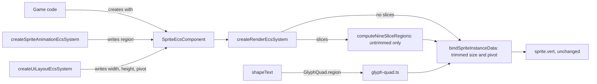

# Texture Regions

Issue: https://github.com/Forge-Game-Engine/Forge/issues/793 (the Sprite
Atlases milestone; #796, #804 and #811 build on it)

| Module or file                                                                                                       | Change   | Notes                                                                                                         |
| -------------------------------------------------------------------------------------------------------------------- | -------- | ------------------------------------------------------------------------------------------------------------- |
| `src/rendering/texture-region.ts`                                                                                    | New      | `TextureRegion`, `TextureRegionTrim`, `createTextureRegion`, `fullTextureRegion`, `isTextureRegionTrimmed`    |
| `src/rendering/index.ts`                                                                                             | Modified | Exports `texture-region.js`                                                                                   |
| `src/rendering/components/sprite-component.ts`                                                                       | Modified | `uvOffset`/`uvScale` become `region`; `addSpriteComponent` stops cloning UV vectors; JSDoc for untrimmed size |
| `src/rendering/utilities/sprite-instance-data-segment.ts`                                                            | Modified | `bindSpriteInstanceData` and `computeSpriteInstanceBounds` read `region` and apply the trim                   |
| `src/rendering/utilities/compute-nine-slice-regions.ts`                                                              | Modified | Takes and emits `TextureRegion`s; throws for a trimmed region                                                 |
| `src/rendering/systems/render-system.ts`                                                                             | Modified | The nine-slice path passes and assigns `region`                                                               |
| `src/rendering/utilities/create-image-sprite.ts`                                                                     | Modified | Returns `region` (`frameDimensions` stays until #796)                                                         |
| `src/text/components/text-mesh-component.ts`, `src/text/utilities/shape-text.ts`, `src/text/rendering/glyph-quad.ts` | Modified | `GlyphQuad.region` replaces `uvOffset`/`uvScale`                                                              |
| `src/animations/types/AnimationClip.ts`, `src/animations/types/index.ts`                                             | Modified | Frames are `TextureRegion`s                                                                                   |
| `src/animations/types/AnimationFrame.ts`                                                                             | Removed  | Replaced by `TextureRegion`                                                                                   |
| `src/animations/systems/sprite-animation-system.ts`                                                                  | Modified | Assigns `sprite.region = frame`                                                                               |
| `src/animations/utilities/create-sprite-sheet.ts`, `select-animation-frames.ts`, `create-animation.ts`               | Modified | Build and return `TextureRegion`s                                                                             |
| `src/particles/utilities/spawn-particle.ts`                                                                          | Modified | Comment names `region`                                                                                        |
| Tests under `src/rendering`, `src/text`, `src/animations`, `src/particles`, `src/ui`                                 | Modified | Fixtures use `region`; new trim, flip, bounds and nine-slice tests                                            |
| `e2e/fixtures/scenes/trimmed-sprite-animation.ts`, `e2e/specs/trimmed-sprite-animation.spec.ts`                      | New      | Trimmed frames of one clip keep their art in place and draw in one batch                                      |
| `documentation-site/src/pages/demos/space-shooter/_create-explosions.ts`                                             | Modified | Only if it stops compiling (it reads no UV field directly)                                                    |
| `documentation-site/docs/docs/rendering/sprites.md`, `nine-slice-sprites.md`, `animations/sprite-animations.md`      | Modified | Describe `region` and trimming                                                                                |
| `CHANGELOG.md`                                                                                                       | Modified | `#### Changed` bullets                                                                                        |
| **Engine version at time of design**                                                                                 |          | `0.26.2`                                                                                                      |

## Summary

A sprite chooses the part of its texture it draws with two loose, mutable
vectors, `SpriteEcsComponent.uvOffset` and `uvScale`
(`src/rendering/components/sprite-component.ts`). That works for a uniform
grid and nothing else:

- `createSpriteAnimationEcsSystem`
  (`src/animations/systems/sprite-animation-system.ts`) copies only
  `AnimationFrame.offset` into `uvOffset` and ignores `dimensions`, so a
  clip's frames all sample a rect the size the sprite was created with.
- There's nowhere to say that a packed frame was trimmed (its transparent
  border cut off by the atlas packer) and where the trimmed rect sat in the
  original frame, so a trimmed frame would be stretched over the whole
  sprite and an animation of trimmed frames would jitter.
- Systems write the vectors in place, so `addSpriteComponent` has to clone
  them for every sprite.
- The same UV rect is declared three times: on the sprite, on
  `NineSliceRegion` (`src/rendering/utilities/compute-nine-slice-regions.ts`)
  and on `GlyphQuad` (`src/text/components/text-mesh-component.ts`).

This design adds one immutable value, `TextureRegion`, that describes "which
part of the texture, and where it sits in its untrimmed frame". Sprites,
nine-slice regions, glyph quads and animation clips all hold one. A sprite
keeps the untrimmed frame's `width`, `height` and `pivot`; the instance data
segment shrinks and re-pivots the quad on the CPU so the trimmed art lands
exactly where it sat in the untrimmed frame. The shader and the instance
layout don't change, so sprites with different regions of one texture still
draw in one instanced batch.

This is how Godot (`AtlasTexture.region` plus `margin`), Unity (a
`Sprite`'s tight texture rect inside its full rect) and PixiJS (`Texture`'s
`frame`, `orig` and `trim`) describe atlas frames. Bevy's
`TextureAtlasLayout` has rects without trim; Forge follows the engines that
support trimmed atlases, since off-the-shelf packers (#804) trim by default.

The change bends no core design: each field keeps one writer (animation
writes `region`, UI layout writes `width`, `height` and `pivot`), no system
gains state or an option, and no behavior is configurable.

## Scope

### In scope

- `TextureRegion`, its factory, the shared untrimmed `fullTextureRegion`,
  and `isTextureRegionTrimmed`, in `src/rendering/texture-region.ts`.
- `SpriteEcsComponent.region` replacing `uvOffset` and `uvScale`.
- Trimmed drawing and culling bounds in `sprite-instance-data-segment.ts`,
  including flipped sprites.
- `NineSliceRegion` and `GlyphQuad` carrying a `region`, and nine-slice
  rejecting trimmed regions.
- `AnimationClip` frames as `TextureRegion`s, `AnimationFrame` removed, the
  sprite animation system assigning the whole region, and the three frame
  builders (`createSpriteSheet`, `selectAnimationFrames`, `createAnimation`)
  returning regions.
- `createImageSprite` returning `region`.
- Every caller in `/src`, `/demo`, `/e2e` and `documentation-site`, unit
  tests, one e2e scene and spec, docs and changelog.

### Out of scope

- **Texture atlases, pixel-rect conversion and grid atlases**
  (`TextureAtlas`, `AtlasRegion`, `createGridTextureAtlas`,
  `createAtlasSprite`): #796. `createImageSprite`'s `frameDimensions` stays
  until #796 replaces it.
- **Loading packer output** (TexturePacker JSON): #804.
- **Building clips from atlases, `AnimationClip.texture`, deleting
  `createSpriteSheet`/`selectAnimationFrames`**: #811.
- **Rotated atlas frames.** #804 rejects them: supporting them needs a
  per-instance UV rotation, an extra vertex attribute against WebGL2's
  16-attribute floor.
- **Per-frame pivots and frames whose untrimmed sizes differ within one
  clip.** A sprite's `width`, `height` and `pivot` are the untrimmed
  frame's and don't change when its region does (open question 1).
- **Polygon (tight-mesh) sprites** like Unity's "Tight" mesh type. Forge
  sprites are quads.
- **Writing the clip's first frame on the first tick.** The animation
  system writes a frame only once a frame's duration has passed, so a new
  sprite shows whatever region it was created with until then. That's
  today's behavior; the docs tell users to create the sprite with the
  clip's first region.
- **`AnimationClip.onAnimationFrameChangeEvent` never being raised.** Only
  its type parameter changes here.

## Phases

Both phases land in the pull request for #793. Phase 1 is a pure
replacement with no visual change; Phase 2 adds trimming on top. Each
passes the full verification checklist on its own.

### Phase 1: One region type

Adds `TextureRegion` and replaces every `uvOffset`/`uvScale` pair with it.
The animation system now assigns a frame's whole region (offset and size)
instead of only its offset.

What this fixes for animations, precisely: a clip's frames can sit anywhere
in the texture, and each frame samples its own rect size instead of the size
the sprite was created with. Every frame is still drawn over the sprite's
whole `width` by `height`, so frames must still cover the same untrimmed
frame; without trim data, frames that were packed at different sizes are
stretched to the sprite's size. That's what Phase 2 fixes.

**Done when** no `uvOffset`/`uvScale` field or `AnimationFrame` type is left
in `/src`, `/e2e`, `/demo` or `documentation-site`; every untrimmed sprite,
nine-slice sprite, glyph and animation draws exactly as before (existing
unit and e2e tests pass with only fixture changes); and the docs describe
`region`.

| Task                   | Description                                                                                                                                                                                                                                                                                                                                                                                           | Size |
| ---------------------- | ----------------------------------------------------------------------------------------------------------------------------------------------------------------------------------------------------------------------------------------------------------------------------------------------------------------------------------------------------------------------------------------------------- | ---- |
| `TextureRegion` module | `src/rendering/texture-region.ts` with the interface, `TextureRegionTrim`, `createTextureRegion` (finite and positive-size checks on both rects, `0` to `1` bounds on the trim rect only; copies, freezes), `fullTextureRegion` and `isTextureRegionTrimmed` (same `1e-6` tolerance); export from `src/rendering/index.ts`; unit tests for validation, tolerance, unbounded UVs, freezing and copying | S    |
| Sprite component       | Replace `uvOffset`/`uvScale` with `region` (default `fullTextureRegion`); JSDoc on `texture`, `width`, `height`, `pivot` says they describe the untrimmed frame; `addSpriteComponent` keeps cloning `pivot` and stops cloning UV vectors; tests assert the region is shared by reference                                                                                                              | S    |
| Instance data segment  | `bindSpriteInstanceData` writes `region.uvOffset`/`uvScale` to `a_instanceTexRect`. No trim yet                                                                                                                                                                                                                                                                                                       | S    |
| Nine-slice             | `computeNineSliceRegions(width, height, pivot, region, slices)`; `NineSliceRegion.region` replaces its UV pair; the render system's `regionSprite` assigns `region`                                                                                                                                                                                                                                   | M    |
| Text                   | `GlyphQuad.region`, built in `shape-text.ts` with `createTextureRegion`; `glyph-quad.ts` assigns `glyphSprite.region` in both the effects and fill passes                                                                                                                                                                                                                                             | S    |
| `createImageSprite`    | Returns `region` (`fullTextureRegion`, or a `createTextureRegion` for `frameDimensions`)                                                                                                                                                                                                                                                                                                              | S    |
| Animations             | `AnimationClip` takes and exposes `readonly TextureRegion[]`; `OnAnimationFrameChangeEvent` is `ParameterizedForgeEvent<TextureRegion>`; delete `AnimationFrame.ts` and its export; the system assigns `sprite.region = frame`; `createSpriteSheet`, `selectAnimationFrames` and `createAnimation` produce regions; a system unit test for frames of different `uvScale`                              | M    |
| Callers and fixtures   | Every test fixture in `src/ui`, `src/particles`, `src/rendering` and `src/text` that spells out `uvOffset`/`uvScale`; the culling tests in `render-system.test.ts` that use `uvOffset.x` as a sprite tag get distinct regions instead; the `spawn-particle.ts` comment                                                                                                                                | M    |
| Docs                   | `sprites.md` (field list, sprite sheet section, "Changing a sprite's image", batching), `nine-slice-sprites.md`, `sprite-animations.md` (frames are regions; the system writes `region`)                                                                                                                                                                                                              | S    |

### Phase 2: Trimmed regions

Applies `trimOffset`/`trimScale` when drawing and culling a sprite, and
makes nine-slice reject trimmed regions.

**Done when** a clip whose frames share one untrimmed frame size but were
trimmed to different packed sizes and margins plays on one sprite without
its art moving or stretching, flipped or not; two sprites showing different
trimmed frames of one texture draw in one instanced draw call; and culling
bounds match the trimmed quad.

| Task                        | Description                                                                                                                                                                                                                                                                                    | Size |
| --------------------------- | ---------------------------------------------------------------------------------------------------------------------------------------------------------------------------------------------------------------------------------------------------------------------------------------------- | ---- |
| Trimmed instance data       | `bindSpriteInstanceData` writes the trimmed size and re-expressed pivot (see "Trimming on the CPU"); unit tests: untrimmed output unchanged bit for bit, trimmed, trimmed with `flipX`, with `flipY`                                                                                           | S    |
| Trimmed bounds              | `computeSpriteInstanceBounds` uses the trimmed quad; unit tests with and without rotation that compare against the corners `sprite.vert` would produce                                                                                                                                         | S    |
| Nine-slice trim guard       | `computeNineSliceRegions` throws a descriptive error for a trimmed `region`; `addSpriteComponent` also throws when `slices` is set and `region` is trimmed, so the common mistake fails where the sprite is made; one shared helper for the check and message; tests                           | S    |
| Render system batching test | In `render-system.test.ts`: consecutive sprites with different trimmed regions of one texture produce one instanced draw                                                                                                                                                                       | S    |
| E2E scene and spec          | `trimmed-sprite-animation` (see "Testing")                                                                                                                                                                                                                                                     | M    |
| Docs and changelog          | `sprites.md` gains "Trimmed regions" (what trim is, that `width`/`height`/`pivot` are the untrimmed frame's); `nine-slice-sprites.md` says sliced sprites need untrimmed regions; `sprite-animations.md` says a clip's frames share one untrimmed size; `#### Changed` bullets for both phases | S    |

## API design

### `TextureRegion`

```ts
/** Immutable and shared: change a sprite's region by assigning another. */
export interface TextureRegion {
  /** Top-left of the sampled rect, as a fraction of the texture. Y-down. Unbounded. */
  readonly uvOffset: Readonly<Vector2>;
  /** Size of the sampled rect, as a fraction of the texture. > 0, unbounded. */
  readonly uvScale: Readonly<Vector2>;
  /** Top-left of the drawn (trimmed) rect in the untrimmed frame, 0 to 1. Y-down. */
  readonly trimOffset: Readonly<Vector2>;
  /** Size of the drawn rect, 0 to 1 of the untrimmed frame. (1, 1) when untrimmed. */
  readonly trimScale: Readonly<Vector2>;
}

export interface TextureRegionTrim {
  offset: Vector2;
  scale: Vector2;
}

export function createTextureRegion(
  uvOffset: Vector2,
  uvScale: Vector2,
  trim?: TextureRegionTrim, // omitted: untrimmed
): TextureRegion;

export const fullTextureRegion: TextureRegion; // (0,0) (1,1), untrimmed

export function isTextureRegionTrimmed(region: TextureRegion): boolean;
```

`createTextureRegion`:

- copies its vectors and freezes the result and each vector, so a region
  can't change under the sprites that share it;
- throws a descriptive error when a value isn't finite or a scale isn't
  greater than `0`, for both rects;
- throws when the **trim** rect reaches outside `0` to `1`, with `1e-6` of
  slack, because fractions computed from texel counts
  (`trimX / sourceWidth`) can land a rounding error past `1`. A trim rect is
  part of its untrimmed frame by definition, so anything outside it is a
  mistake;
- doesn't bounds-check the **UV** rect. A UV rect outside `0` to `1` is
  valid: on a `wrap: 'repeat'` texture, `uvScale` above `1` tiles the image
  across the sprite and a growing `uvOffset` scrolls it, which
  `uvOffset`/`uvScale` allow today and Godot's `region_rect` allows too. On
  a clamped texture the edge texels stretch, as today. Checking that a
  region lies inside its atlas is the atlas's job: #796's `AtlasRegion`
  checks it against the texture's size in texels when the atlas is built.

`isTextureRegionTrimmed` compares `trimScale` with `1` using the same `1e-6`
tolerance, so a region whose trim was computed from texel counts and lands
within rounding error of the full frame counts as untrimmed (and can be
nine-sliced).

The issue's task asks `createTextureRegion` to check that "the rects stay
inside `[0, 1]`". This design keeps that check for the trim rect only (D9):
applied to the UV rect, it would remove scrolling and tiled sprites, which
work today.

All four fields are fractions. Pixel rects, untrimmed texel sizes and
pivots belong to #796's `AtlasRegion extends TextureRegion`, which knows the
texture's size.

Every 2D coordinate in the region is Y-down, like the rest of the engine:
`uvOffset.y = 0` is the texture's top row and `trimOffset.y = 0` is the
untrimmed frame's top edge, as packers write them.

### `SpriteEcsComponent`

```ts
interface SpriteDefaultedOptions {
  pivot: Vector2; // of the untrimmed frame; written by UI layout
  region: TextureRegion; // default fullTextureRegion; written by animation
  // ... tintColor, emissive, material, category, layer, slices unchanged
}
```

`width`, `height` and `pivot` describe the untrimmed frame. The emissive
map is sampled at the same UVs as `texture`, so it must share the atlas's
layout, as today.

`addSpriteComponent` stores `region` by reference. It still clones `pivot`,
because `createUiLayoutEcsSystem` writes `pivot` in place
(`src/ui/systems/ui-layout-system.ts`).

### `NineSliceRegion` and `GlyphQuad`

```ts
interface NineSliceRegion {
  offset: Vector2;
  size: Vector2;
  region: TextureRegion;
}

function computeNineSliceRegions(
  width: number,
  height: number,
  pivot: Vector2,
  region: TextureRegion,
  slices: NineSliceOptions,
): NineSliceRegion[];

interface GlyphQuad {
  offset: Vector2;
  size: Vector2;
  region: TextureRegion;
  color?: Color;
  embolden: number;
}
```

### Animations

```ts
class AnimationClip {
  readonly frames: readonly TextureRegion[];
  constructor(frames: readonly TextureRegion[]);
  getFrame(index: number): TextureRegion;
  // events unchanged; onAnimationFrameChangeEvent: ParameterizedForgeEvent<TextureRegion>
}
```

`SpriteSheet.frames` becomes `TextureRegion[][]`, built with
`createTextureRegion`; `selectAnimationFrames` and `createAnimation` return
regions. These builders only produce untrimmed regions; #796 and #811
replace them with atlases.

## Trimming on the CPU

`sprite.vert` places a quad of `a_instanceSizePivot.xy` around the pivot
`a_instanceSizePivot.zw`, scaled (and so flipped) by `a_instancePosScale.zw`
around that pivot. `bindSpriteInstanceData` writes the **trimmed** quad's
size and its pivot re-expressed relative to the trimmed rect:

```
size'  = (width * trimScale.x, height * trimScale.y)
pivot' = ((pivot.x - trimOffset.x) / trimScale.x,
          (pivot.y - trimOffset.y) / trimScale.y)
texRect = (uvOffset, uvScale)
```

The pivot and the trim are both Y-down fractions of the untrimmed frame, so
the same formula holds on both axes. (The issue's Y-flipped `pivot'.y`
predates the engine's switch to a Y-down world, which made `pivot` Y-down;
see `SpriteDefaultedOptions.pivot`.)

Why it's right: in the untrimmed frame's normalized space, the trimmed rect
spans `trimOffset` to `trimOffset + trimScale`, and the pivot is the point
`pivot`. Expressed in the trimmed rect's own normalized space, that point
is `(pivot - trimOffset) / trimScale`, which can be outside `0` to `1` (the
pivot is often outside the trimmed art). Placing the trimmed quad so that
point lands on the entity's position puts every trimmed pixel exactly where
it was in the untrimmed frame, at the same world size per texel.

Consequences:

- **Untrimmed regions are unchanged bit for bit**: `x * 1` and
  `(x - 0) / 1` are exact in floating point, so no branch is needed and
  every existing sprite test keeps its numbers.
- **Flip and scale mirror around the untrimmed pivot.** The shader flips
  around the instance pivot, which is the same world point as the untrimmed
  pivot, so a flipped trimmed frame is the mirror of the flipped untrimmed
  frame.
- **Division is safe**: `createTextureRegion` rejects a `trimScale` that
  isn't greater than `0`, and nine-slice and glyph regions are untrimmed.
- **Masks are unaffected**: `sprite-mask.vert.glsl` works in world space.
- **Custom shaders** that compose `spriteInstanceDataSegment` get the
  trimmed quad too. A fragment shader that reads `v_texCoord` sees atlas
  UVs, as today.

`computeSpriteInstanceBounds` uses the same quad. With
`w = width * scaleX` and `h = height * scaleY` (scale includes flip), the
quad's center relative to the pivot, before rotation, is

```
center = ((trimOffset.x + trimScale.x / 2 - pivot.x) * w,
          (trimOffset.y + trimScale.y / 2 - pivot.y) * h)
half   = (|w * trimScale.x| / 2, |h * trimScale.y| / 2)
```

which reduces to today's `(0.5 - pivot) * size` when untrimmed. Culling
against the trimmed rect is tighter than against the frame, which is the
point of trimming.

## Data flow and ownership



Each field keeps one writer. The animation system writes only `region`,
and UI layout writes only `width`, `height` and `pivot`, so an animated UI
image works without the two fighting. Nothing writes inside a region.

Batching is unchanged: `isSameBatch` in `render-system.ts` compares
renderable, texture and emissive texture only, so sprites with different
regions of one texture join one instanced draw.

## Nine-slice

Nine-slice insets are authored against the untrimmed art, so a trimmed
region has no defined border bands. `computeNineSliceRegions` throws for a
region where `isTextureRegionTrimmed(region)`, naming the trim. When
`slices` is set, `addSpriteComponent` also throws for a trimmed `region`, so
the usual mistake fails where the sprite is made rather than on the first
draw. The draw-time throw stays because a region can be assigned after the
sprite is added. Both use one helper so the message is the same. Unity likewise requires
a full-rect sprite for sliced drawing.

`computeNineSliceRegions` builds its band regions as plain `TextureRegion`
objects, one per grid cell (tiled segments of a cell share it), reusing
`fullTextureRegion.trimOffset` and `trimScale`. It doesn't go through
`createTextureRegion`:

- the bands are derived from an already valid region with clamped insets,
  so they stay inside it;
- a center band can legitimately have a UV size of `0` (insets that cover
  the whole native size, drawn larger), which `createTextureRegion` rejects;
- it runs every frame for every sliced sprite, so it shouldn't validate and
  freeze nine objects each time.

## Text

`shapeText` builds each glyph's region with `createTextureRegion` from the
inset atlas bounds it already computes. Shaping runs only when a text
changes, so the cost is per change, not per frame. The texel inset leaves a
positive size for any glyph tile wider than two texels, which every atlas
`generate-font-atlas.mjs` writes satisfies. A malformed atlas (a glyph with
non-finite bounds, or a tile two texels or less across, so its inset size
isn't positive) makes `createTextureRegion` throw while that text is
shaped, instead of drawing a broken quad.

## Testing

Unit tests (Vitest):

- `texture-region.test.ts`: valid regions; non-finite values and
  non-positive scales throw for both rects; a trim rect outside `0` to `1`
  throws, and one within `1e-6` of the edge doesn't; a UV rect outside `0`
  to `1` (negative `uvOffset`, `uvScale` of `3`) is accepted; frozen result;
  copied inputs; `isTextureRegionTrimmed` for `(1, 1)`, for a trim within
  `1e-6` of `1` (untrimmed) and for a real trim.
- `sprite-component.test.ts`: default is `fullTextureRegion`; a given region
  is stored by reference; pivot is still cloned; `addSpriteComponent`
  throws for `slices` with a trimmed region and doesn't for a region trimmed
  within the tolerance.
- `sprite-instance-data-segment.test.ts`: untrimmed output identical to
  today; a trimmed region's size, pivot and tex rect; trimmed with `flipX`
  and `flipY`; bounds for trimmed regions with and without rotation, checked
  against the four corners `sprite.vert`'s math gives for the instance data.
- `compute-nine-slice-regions.test.ts`: regions carry `TextureRegion`s with
  the same values as today; zero-size center band doesn't throw; trimmed
  input throws.
- `render-system.test.ts`: one instanced draw for consecutive sprites with
  different trimmed regions of one texture.
- Sprite animation system test (new): frames of different `uvScale` and
  trim are assigned whole; the assigned object is the clip's frame.
- `shape-text.test.ts`, `glyph-quad.test.ts`, `text-shaping-system.test.ts`:
  read `region`. `shape-text.test.ts` also shapes text against a malformed
  font atlas, one glyph with non-finite atlas bounds and one with a
  zero-size tile, and expects each to throw.

E2E (`write-e2e-test` skill), `trimmed-sprite-animation`:

- The scene draws a texture on a canvas holding three frames of one 32 by
  32 texel untrimmed frame: frame 0 untrimmed, frames 1 and 2 trimmed to
  different rects and margins. Every frame has the same solid marker at the
  same place in the untrimmed frame. The regions are built with
  `createTextureRegion` from those texel rects.
- Two sprites play the clip one frame apart, consecutive in draw order, and
  a third, unanimated sprite shows frame 0 as the reference. The handle
  records `drawArraysInstanced` instance counts, like
  `shared-texture-sprites.ts`.
- The spec steps through every frame and, in the same `page.evaluate` as
  each `step()`, measures each animated sprite's marker bounds. It asserts,
  relative and same-run, that each marker's bounds equal the reference
  sprite's marker bounds (shifted by the known sprite spacing) on every
  frame, and that the animated sprites drew in one instanced draw with
  their instance count. A Y-up pivot formula, or a missing trim, moves the
  marker on frames 1 and 2 and fails the spec.

## Documentation and demos

- `sprites.md`: the field list names `region`; "Drawing a frame of a sprite
  sheet" says `createImageSprite` sets `region`; "Changing a sprite's image"
  and "Batching" name `region`; a new "Trimmed regions" section explains
  `createTextureRegion` with a trim and that `width`, `height` and `pivot`
  are the untrimmed frame's.
- `nine-slice-sprites.md`: sliced sprites need an untrimmed region.
- `sprite-animations.md`: frames are `TextureRegion`s; the system writes
  `region`; a clip's frames share one untrimmed size; create the sprite with
  the clip's first frame as its `region`.
- The space shooter's `_create-explosions.ts` uses `createImageSprite`,
  `createSpriteSheet` and `selectAnimationFrames` without touching UV
  fields, so it should compile unchanged; the docs-site build and a manual
  load of the space shooter demo confirm it.

No new demo: atlases (#796, #804) are the user-facing feature and get the
demo.

## Changelog

`#### Changed`:

- `SpriteEcsComponent.uvOffset` and `uvScale` are replaced by
  `region: TextureRegion`. Assign `createTextureRegion(uvOffset, uvScale)`
  instead of setting the vectors; regions are immutable and shared. Sprites
  can now draw trimmed atlas frames: `width`, `height` and `pivot` are the
  untrimmed frame's.
- `AnimationClip` frames are `TextureRegion`s and `AnimationFrame` is
  removed; the sprite animation system assigns each frame's whole region.
- `NineSliceRegion` and `GlyphQuad` carry a `region` instead of
  `uvOffset`/`uvScale`, and `computeNineSliceRegions` takes a
  `TextureRegion`. A sliced sprite with a trimmed region throws.

## Decision log

### D1. One immutable region value instead of loose vectors

- **Options**: (a) keep `uvOffset`/`uvScale` and add `trimOffset`/
  `trimScale` vectors on the sprite; (b) one immutable `TextureRegion` value
  the sprite references; (c) a region that also holds its texture (Unity's
  `Sprite`, Godot's `AtlasTexture`).
- **Chosen**: (b).
- **Rationale**: an atlas frame is one value that many sprites, clips and
  (with tile maps) cells share. Assigning a reference is one write by one
  owner, so the animation system needs no in-place vector writes and
  `addSpriteComponent` no clones. Nine-slice, glyphs and animation reuse the
  type.
- **Why not (c)**: the sprite's `texture` is what batching keys on and what
  game code changes; holding it twice would give it two sources. Bevy keeps
  the image and the layout apart too. #811 makes a clip check that its
  texture matches the sprite's.
- **Tradeoff**: per-frame computed regions (nine-slice) allocate an object
  with nested vectors instead of two vectors.
- **Assumptions**: nothing needs to mutate a region in place. Code that
  animated `uvOffset` by hand, such as a scrolling texture on a
  `wrap: 'repeat'` texture, assigns a new region with the new offset each
  time it changes. That's one small allocation per change, and the offset
  can grow past `1` because UV rects aren't bounds-checked (D9).

### D2. Trim as fractions of the untrimmed frame

- **Options**: (a) fractions of the untrimmed frame; (b) texel margins, as
  Godot's `margin` and packers' `spriteSourceSize`.
- **Chosen**: (a).
- **Rationale**: a sprite's size is in world units and a region doesn't know
  the texture's size. Fractions apply directly to `width`/`height` and need
  no `pixelsPerUnit`. #796's `AtlasRegion` keeps the texel data and converts.
- **Tradeoff**: authoring a trimmed region by hand needs a division.
- **Assumptions**: regions are mostly built by #796/#804, not by hand.

### D3. Apply the trim on the CPU, not in the shader

- **Options**: (a) CPU, in `bindSpriteInstanceData` and
  `computeSpriteInstanceBounds`; (b) pass trim to `sprite.vert` as another
  attribute.
- **Chosen**: (a).
- **Rationale**: the trimmed quad is fully described by size and pivot,
  which the shader already takes. No layout change, no new attribute
  against WebGL2's 16-attribute floor (glyph and mask segments already add
  their own), and custom vertex shaders composing
  `spriteInstanceDataSegment` get trimming for free. Culling uses the same
  numbers.
- **Tradeoff**: four multiplications and two divisions per instance on the
  CPU.
- **Assumptions**: none.

### D4. The sprite keeps the untrimmed size and pivot

- **Options**: (a) `width`, `height`, `pivot` describe the untrimmed frame
  and the region only shrinks the drawn quad inside it; (b) the region
  carries its own size and pivot and the animation system writes them too
  (Unity's per-sprite rect and pivot, Godot's per-frame texture size).
- **Chosen**: (a).
- **Rationale**: UI layout already owns `width`, `height` and `pivot`;
  (b) would give them a second writer. With (a) swapping frames never moves
  the art, which is what trimming is for.
- **Tradeoff**: frames of one clip must share an untrimmed size (open
  question 1).
- **Assumptions**: packers keep each source image's size as the untrimmed
  size, and an animation's source frames share a canvas size (sprite sheet exports
  from animation tools and TexturePacker do).

### D5. Pivot formula is Y-down on both axes

- **Options**: (a) `(pivot - trimOffset) / trimScale` on both axes; (b) the
  issue's Y-up form for `y`.
- **Chosen**: (a).
- **Rationale**: since the Y-down world change, `SpriteEcsComponent.pivot`
  has `(0, 0)` at the top-left, the same as `trimOffset`. (b) would move a
  trimmed frame's art vertically. The e2e spec fails under (b).
- **Tradeoff**: none.
- **Assumptions**: none.

### D6. Nine-slice rejects trimmed regions

- **Options**: (a) throw; (b) slice the untrimmed frame and clip each band
  to the trimmed rect.
- **Chosen**: (a).
- **Rationale**: insets are measured on the untrimmed art. Clipping bands
  would add cases to an already intricate function for art that packers
  shouldn't trim (UI panels have no transparent border to remove). Unity
  requires full-rect sprites for slicing.
- **Tradeoff**: a sliced sprite from a trimmed atlas frame fails until the
  frame is exported untrimmed.
- **Assumptions**: open question 2.

### D7. Nine-slice band regions skip `createTextureRegion`

- **Options**: (a) build band regions through `createTextureRegion`; (b)
  build plain `TextureRegion` objects.
- **Chosen**: (b).
- **Rationale**: a zero-width center band is valid today and
  `createTextureRegion` rejects it; the bands come from a valid region; and
  the function runs every frame.
- **Tradeoff**: these regions aren't frozen. Their `readonly` type still
  stops writes at compile time, and they live only for one frame's render
  commands.
- **Assumptions**: none.

### D8. Keep the grid builders, converted

- **Options**: (a) convert `createSpriteSheet`, `selectAnimationFrames` and
  `createAnimation` to regions; (b) delete them now.
- **Chosen**: (a).
- **Rationale**: their replacements (`createGridTextureAtlas`,
  `createAtlasAnimationClip`) are #796 and #811. Deleting them here would
  leave no way to build a clip.
- **Tradeoff**: they live one or two more releases.
- **Assumptions**: #811 deletes `createSpriteSheet` and
  `selectAnimationFrames`; open question 3 covers `createAnimation`.

### D9. Bounds-check the trim rect, not the UV rect

- **Options**: (a) check both rects stay inside `0` to `1`, as the issue's
  task text asks; (b) check only the trim rect, and only that the UV rect
  is finite with a positive size; (c) check neither.
- **Chosen**: (b). This deviates from the issue's task text.
- **Rationale**: a UV rect outside `0` to `1` is meaningful. On a
  `wrap: 'repeat'` texture it tiles (`uvScale` above `1`) or scrolls (a
  growing `uvOffset`); `uvOffset`/`uvScale` allow both today and Godot's
  `region_rect` allows them too, so (a) would remove working behavior. A
  trim rect describes where the drawn rect sits inside its own untrimmed
  frame, so outside `0` to `1` is always an authoring mistake, and it also
  keeps `trimScale` from silently enlarging the quad. Whether a region lies
  inside its atlas depends on the atlas's texel size, which #796's
  `AtlasRegion` knows and checks when the atlas is built.
- **Tradeoff**: a hand-written region that reaches past a clamped
  texture's edge draws stretched edge texels instead of throwing.
- **Assumptions**: hand-written regions are rare once atlases (#796, #804)
  exist.

## Open questions

1. **Frames whose untrimmed sizes differ within one clip** (non-blocking).
   The design draws every frame over the sprite's `width` by `height`, so a
   clip whose source frames had different canvas sizes stretches the
   smaller ones.
   - _Document it as unsupported_ (default): clips are made of frames of one
     canvas size, which is what animation tools export. #811 can check it,
     since #796's `AtlasRegion` knows each frame's `sourceSize`.
   - _The animation system also writes `width`/`height`_: matches Godot's
     `AnimatedSprite2D`, but gives those fields a second writer next to UI
     layout.
   - _Store the untrimmed size as a fraction of a clip-wide size in the
     region_: works without a second writer, but every region would need to
     know which clip it's in.
2. **Nine-slice of trimmed regions** (non-blocking). Default: throw (D6).
   Supporting it means clipping each band to the trimmed rect; worth doing
   only if users slice trimmed atlas frames often.
3. **Delete `createAnimation` in this change or in #811** (non-blocking).
   It's a third grid frame builder beside `createSpriteSheet` and
   `selectAnimationFrames`, used only in the asset-registry docs. Default:
   convert it here and let #811 delete it with the other two. Deleting it
   now saves converting code that's about to go.
4. **Freeze regions at runtime** (non-blocking). Default: `createTextureRegion`
   freezes (cheap, catches a mutation that types missed through a cast).
   Not freezing would save a little at creation; regions are created at
   load time, so it doesn't matter.
