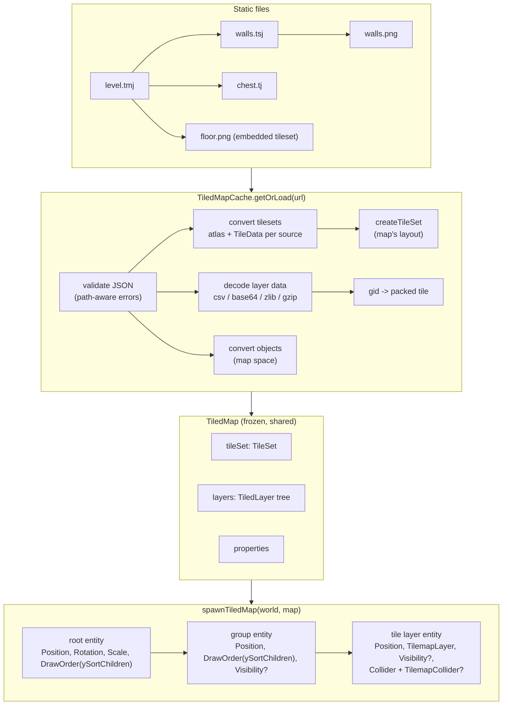

<!-- cspell:words tilemap tilemaps tileset tilesets texel texels tileid firstgid tileoffset tilerendersize fillmode offsetx offsety tintcolor objectgroup objectalignment tilewidth tileheight tilecount imagewidth imageheight startx starty renderorder zstd zlib gzip tmj tsj tmx tsx parallaxx parallaxy wangsets transparentcolor backgroundcolor bevy_ecs_tiled SuperTiled2Unity YATI pixelsize halign valign fontfamily propertytype hexsidelength gids Gids Ogmo AARRGGBB -->

# Tiled map loader

Issue: [#836](https://github.com/Forge-Game-Engine/Forge/issues/836)
(milestone "Tilemaps"; builds on
[tile sets and tilemap layers](./tilesets-and-tilemap-layers.md) (#805),
[tilemap collision](./tilemap-collision.md) (#825),
[animated tiles](./animated-tiles.md) (#830),
[y-sort units](./y-sort-units.md) (#870),
[grid layouts](./grid-layouts.md) (#869) and
[texture atlases](./texture-atlases.md) (#796))

| Module or file                                                                                 | Change   | Notes                                                                                                                               |
| ---------------------------------------------------------------------------------------------- | -------- | ----------------------------------------------------------------------------------------------------------------------------------- |
| `src/tilemaps/tiled/` (`index.ts`)                                                             | New      | The loader, exported from `src/tilemaps/index.ts`, so from `@forge-game-engine/forge/tilemaps`. No new package export path          |
| `src/tilemaps/tiled/file-data/`                                                                | New      | Internal: TypeScript types for the subset of Tiled's JSON read here, and the path-aware validators for maps, tilesets and templates |
| `src/tilemaps/tiled/tiled-map.ts`                                                              | New      | `TiledMap`, `TiledLayer` and its kinds, `TiledObject`, `TiledObjectShape`, `TiledProperty`, `TiledTileSetInfo`: the loaded data     |
| `src/tilemaps/tiled/tiled-map-cache.ts`                                                        | New      | `TiledMapCache` with `get`/`getOrLoad`, URL resolution, shared loads, external tileset and template caching                         |
| `src/tilemaps/tiled/conversion/`                                                               | New      | Internal: tileset, tile data, collision, layer data (decoding, decompression, gids), object and property conversion                 |
| `src/tilemaps/tiled/spawn-tiled-map.ts`                                                        | New      | `spawnTiledMap`, `SpawnedTiledMap`, `findTiledLayer`                                                                                |
| `src/tilemaps/tiled/test-helpers/`                                                             | New      | Fixture `.tmj`/`.tsj`/`.tj` files and a fake `fetch`/texture cache. Excluded from `/dist` like every `test-helpers/` folder         |
| `src/tilemaps/cells/edit-tiles.ts`                                                             | Modified | `setTileBlock`: writes a rectangle of tiles from a row-major array as one change                                                    |
| `src/tilemaps/tiles/get-tile-image-rect.ts`                                                    | Modified | A transposed tile's image rect swaps its width and height, as Tiled draws it (resolves the tile set design's open question 2)       |
| `src/tilemaps/tile-set/tile-set.ts`, `src/tilemaps/collision/build-tilemap-collision-loops.ts` | Modified | JSDoc only: the transform bits move a collision shape within the footprint's bounds, not with the (now swappable) image rect        |
| `e2e/fixtures/scenes/tiled-map.ts`, `e2e/specs/tiled-map.spec.ts`                              | New      | A real-browser check that a loaded map draws the way Tiled does: flips, offsets, isometric placement                                |
| `documentation-site/docs/docs/tilemaps/index.md`                                               | Modified | "Loading Tiled maps" section                                                                                                        |
| `documentation-site/src/pages/demos/tiled-map/`, `src/data/demos.ts`                           | New      | A demo that loads an orthogonal and an isometric map (phase 4), in the `rendering` category                                         |
| `CHANGELOG.md`                                                                                 | Modified | `#### Added` bullets (loader, `setTileBlock`); `#### Changed` bullet (transposed non-square tiles)                                  |
| **Engine version at time of design**                                                           |          | `0.26.2`                                                                                                                            |

## Summary

Games shouldn't hand-author tile data. Tiled is the most widely used open
2D map editor, and its JSON formats (`.tmj` maps, `.tsj` tilesets, `.tj`
object templates) are documented and stable. This design loads orthogonal
and isometric Tiled maps into the tilemap data model and spawns them as
entities.

It follows the issue's direction closely:

- **Loading and spawning are separate**, like an imported resource and an
  instanced scene in Godot. `TiledMapCache.getOrLoad(url)` fetches and
  validates the map, its external tilesets, its templates and their images,
  and returns a frozen `TiledMap`: one Forge `TileSet` (one source per
  Tiled tileset), the layer tree with every tile layer's cells already
  packed, typed custom properties, and object layers as data.
  `spawnTiledMap(world, map)` builds the entities. One loaded map can be
  spawned any number of times.
- **Conversion happens once, at the boundary.** Tiled is Y-down like Forge,
  its flip bits are Forge's transform bits, its tile placement rule is
  Forge's, its `tileoffset` is `textureOrigin`, its animation durations are
  milliseconds and its rotation is clockwise like Forge's. Isometric object
  coordinates are the one real projection, and go through the tileset's
  `GridLayout`. Nothing downstream of the loader compensates for Tiled.
- **A spawned map is the hierarchy the tile set design already describes**:
  a root entity, one entity per tile layer and per group layer, in Tiled's
  layer order, so later layers draw on top. Layers whose tiles have
  collision shapes get a static tile-layer collider. Object layers stay
  data, since turning a "spawn point" or "chest" into entities is the
  game's job.

It also settles two things the earlier designs left to this one:

- The tile set design's open question 2 asked this issue to confirm how
  Tiled draws a transposed non-square tile. Tiled's `CellRenderer` turns the
  image a quarter turn and swaps its width and height, keeping its
  bottom-left corner in place. Forge keeps the rect and stretches the
  image. This design changes `getTileImageRect` to swap the rect for
  transposed tiles, in the layer that owns placement, so imported maps match
  Tiled and nothing in the loader compensates (decision TL-9). Collision
  shapes don't follow the swapped rect: the transform bits keep moving a
  shape within the cell's footprint bounds, and the JSDoc that says they
  move it "the way they move the tile's image" is reworded to say so.
- Unity's `Tilemap.SetTilesBlock` has no Forge equivalent, and spawning a
  200 x 200 layer one `setTile` at a time bumps the layer's `version` 40,000
  times. `setTileBlock` writes a rectangle of tiles as one change, a general
  cell function any game can use (decision TL-8).

**One engine convention is in tension with the issue's text.** The issue
makes one Tiled pixel one world unit and tells games to scale the map's
root entity to change that. Scaling the root doesn't work for a map that
collides: 2D colliders ignore `ScaleEcsComponent` today (tilemap collision
design, TC-13), so a scaled map's collision wouldn't match its tiles. And
`importTexture` defaults to 100 pixels per unit, so a map and a sprite
drawn from the same pixel art come out 100 times apart by default. The
design keeps one pixel per unit with no option, which matches the tilemaps
guide's 16-unit cells, but drops the "scale the root" advice: a game works
in map pixels and scales its physics to match (gravity, speeds, the
collision resolver's `slop`), and scaling the root only suits maps without
colliding layers. Every pixel-to-unit conversion goes through one internal
factor, so a `pixelsPerUnit` option later is a small change. Open
question 1 asks which way to go.
Nothing else here bends a core design: the loader adds no system, the cell
functions stay the only writers of cells, and the transform system stays
the only writer of `world`.

## Scope

### In scope

- `TiledMapCache` (`get`, `getOrLoad`) loading `.tmj` maps over `fetch`,
  resolving external tileset `source` paths, template paths and tileset
  `image` paths relative to the file that names them, loading images through
  `renderContext.textureCache` (`'nearest'` filtering by default), sharing
  concurrent loads, and caching external tilesets and templates across maps.
- Validation of the Tiled JSON subset with errors that name the file and the
  JSON path of the bad field.
- Orientations `orthogonal` and `isometric`; finite and infinite maps.
- Tile layers: CSV and base64 data, uncompressed, `zlib` and `gzip`
  (through the browser's `DecompressionStream`); `chunks` for infinite maps;
  `offsetx`/`offsety`, `visible`, `opacity`, `tintcolor`.
- Group layers, with their offsets, visibility, opacity and tint.
- Tilesets, embedded and external (`.tsj`): `firstgid` ranges, the image
  sliced by `tilewidth`/`tileheight`/`margin`/`spacing`/`columns`,
  `tileoffset`, `tilerendersize`, `fillmode: "stretch"`, per-tile
  `properties`, `animation` and `objectgroup` collision shapes, tileset
  properties.
- The flip bits on every gid (tile layers and tile objects), including
  transposed non-square tiles drawn as Tiled draws them.
- Object layers as data: rectangles, ellipses, capsules, points, polygons,
  polylines, tile objects and text objects, in map space, with rotation in
  radians, and isometric objects projected through the layout.
- Object templates (`.tj`), merged into their instances.
- Typed custom properties on the map, layers, tilesets, tiles and objects
  (`string`, `int`, `float`, `bool`, `color`, `file`, `object`).
- `spawnTiledMap` and `findTiledLayer`.
- `setTileBlock` in the cell functions, and the transposed-rect change in
  `getTileImageRect`.
- Unit tests with fixture files, an e2e scene, JSDoc, the guide section, a
  docs-site demo and changelog bullets.

### Out of scope

- **XML formats** (`.tmx`, `.tsx`, `.tx`). Tiled exports JSON for all of
  them; a game converts once in the editor or with `tiled --export-map`.
- **Staggered, hexagonal and oblique maps.** `GridLayout` has no such
  layouts (grid layouts design, G4). The loader throws, naming the file and
  the orientation.
- **Image-collection tilesets** (one image per tile). They need runtime
  atlas packing, which the texture atlas design leaves out. The loader
  throws, naming the tileset.
- **`zstd` compression.** Browsers have no `zstd` decoder; the loader
  throws and the message says to save the map with `zlib` or `gzip`.
- **`fillmode: "preserve-aspect-fit"`** and **`transparentcolor`**. The
  first needs per-tile aspect handling the tile set doesn't have, the second
  color-keying at load time. Both throw.
- **Image layers, parallax factors, layer blend modes (`mode`), Wang sets,
  terrains, `transformations`, tile `probability`, the editor-only `locked`
  flag, and `class`-typed custom properties.** Ignored, and listed in the
  guide as unsupported. A map that uses them loads and draws without them.
- **`renderorder`.** Forge always draws cells row-major, which is Tiled's
  default `right-down`. Ignored and documented: overlapping tall tiles in a
  map saved with another order draw in Forge's order.
- **Turning objects into entities.** The loader hands objects to the game;
  which factory a "chest" calls is game-specific (CLAUDE.md
  "General-purpose only").
- **Choosing which layers y-sort or collide differently.** The game sets
  `ySortChildren` and collider settings on the entities `findTiledLayer`
  returns. The loader doesn't read custom properties to decide.
- **Hot reloading and unloading maps.** The cache holds CPU-side data only;
  textures belong to the texture cache.
- **LDtk, Ogmo and other editors.** A loader of their own each.
- **Y-sorting a layer's tiles row by row** (#872). Until it lands, a layer
  with `ySortChildren` sorts its chunk meshes.

## Concepts and data flow



The cache fetches every file once and shares it: two maps that use
`walls.tsj` share its parsed data and its atlas, and the texture cache
shares `walls.png` with any sprite drawn from it. Each map gets its own
`TileSet`, because a tile set holds the map's layout (its orientation and
cell size) and its sources are numbered in the map's tileset order.

After spawning, the existing systems take over, in the order the tilemap
guide already gives:

```
game systems that edit tiles
createTilemapColliderEcsSystem   // builds each colliding layer's ChainCollider
createTilemapRenderEcsSystem     // builds chunk meshes as child entities
createTransformEcsSystem         // composes local into world
physics systems, createRenderEcsSystem
```

`spawnTiledMap` is a function the game calls once, like `createCamera`. It
is not a system, keeps nothing between calls, and writes only components of
entities it creates.

## Loading

### API

```ts
/** Options for {@link TiledMapCache.getOrLoad}. */
export interface TiledMapLoadOptions {
  /**
   * How every tileset texture of the map is filtered. Defaults to
   * `'nearest'`, since Tiled tilesets are usually pixel art.
   */
  filter?: TextureFilter;
}

/**
 * Loads and caches Tiled maps saved as JSON (`.tmj`), keyed by the map's
 * resolved URL. Tileset images come from the render context's
 * `textureCache`, which owns them. Holds only CPU-side data, so it has
 * nothing to dispose or rebuild after a context loss.
 */
export class TiledMapCache {
  constructor(renderContext: RenderContext);

  /** @throws if the map at `url` hasn't finished loading. */
  public get(url: string): TiledMap;

  /**
   * Loads the map the first time it's requested. Concurrent calls share one
   * load, and a failed load is tried again by the next call.
   * @throws The promise rejects if `url` was already requested with another
   * filter, a file fails to fetch, or a file is invalid or uses an
   * unsupported Tiled feature (the message names the file and the field).
   */
  public getOrLoad(
    url: string,
    options?: TiledMapLoadOptions,
  ): Promise<TiledMap>;
}
```

`getOrLoad` follows `TextureAtlasCache` (`src/rendering/texture-atlas/
texture-atlas-cache.ts`) and `FontAtlasCache`: a `_loads` map of
in-flight promises, a `_maps` map of finished ones, a failed load removed
so the next call retries, and a request for a URL already loading with a
different filter throws rather than silently returning the first one. It
also keeps two shared caches, keyed by resolved URL: parsed external
tilesets (with their atlases, per filter) and parsed templates.

### URL resolution

A map names its tilesets, templates and images by paths relative to
itself, and an external tileset names its image relative to the tileset.
The loader resolves each with `new URL(path, baseUrl)`:

- the map's own URL is resolved first against `document.baseURI`, so
  `'maps/level.tmj'` and `'/maps/level.tmj'` work, and the cache key is the
  absolute URL (`get` resolves the same way, so it finds the same entry);
- a tileset's `source` and a template's path resolve against the map's URL
  (or, for a template's own tileset, the template's URL);
- a tileset's `image` resolves against the URL of the file the tileset
  lives in: the `.tsj` for an external tileset, the map for an embedded one;
- a `file` custom property resolves against the file it's written in, and is
  given to the game as an absolute URL, not fetched.

Because these paths are resolved at runtime, maps and every file they name
must be served as static files with their folder structure intact
(Vite's `public/`, Docusaurus's `static/`). A bundler's content-hashed
`?url` import works for the map's own URL but not for the files it names.
The guide says so with a Vite example.

### Loading steps

```
load(mapUrl, filter):
  json  = fetchJson(mapUrl)
  file  = validateTiledMapFile(json, mapUrl)          // throws with a JSON path
  reject unsupported orientation, infinite+chunks mismatch, ...
  layout = orientation == 'orthogonal'
         ? createOrthogonalGridLayout({ cellWidth: tilewidth, cellHeight: tileheight })
         : createIsometricGridLayout({ cellWidth: tilewidth, cellHeight: tileheight })

  // tilesets, in parallel; each becomes one source, in firstgid order
  tilesets = await all(file.tilesets.map(ref =>
    ref.source ? externalTileset(resolve(ref.source, mapUrl), filter)   // cached
               : embeddedTileset(ref, mapUrl, filter)))
  sources  = tilesets.map(t => toSourceOptions(t, layout, file))         // tile data, collision
  tileSet  = createTileSet({ layout, sources })                          // wraps errors with file + tile

  templates = await all(distinct template paths in object layers)       // cached
  layers    = await convertLayers(file.layers, context)                 // async: decompression
  return freeze({ url, orientation, tileSet, tileSets, size, backgroundColor, properties, layers })
```

Every error is wrapped once at the top as
`Unable to load Tiled map "<mapUrl>": <reason>`, with `cause` set, and the
reason names the file it came from when that isn't the map
(`tileset "walls.tsj": tiles[3].objectgroup.objects[1] is an ellipse, ...`).

## Validation

The loader reads maps that may be user-supplied content (mods, level
editors), so it validates at the boundary, in the style of
`validateFontAtlasFileData` (`src/text/font-atlas/validate-font-atlas-data.ts`):
the validator takes `unknown` and the file's URL, checks every field the
loader reads, and returns the narrowed file type. Unlike the font atlas
validator, the Tiled format is deep, so a small internal reader keeps the
JSON path as it descends and every message names it:

```
Invalid Tiled map JSON at "level.tmj": layers[2].chunks[0].width must be a whole number greater than 0, got 0.
```

Rules:

- **Fields the loader reads are checked; unknown fields are ignored.** Tiled
  adds fields in most releases, and ignoring them keeps newer files
  loading. No version check: `class`/`type`, `tilerendersize` and
  `fillmode` fall back to Tiled's defaults when absent, which is what older
  files mean.
- **Anything that would change what's drawn or where, and that Forge can't
  honor, throws**: an unsupported orientation, `zstd`, an image-collection
  tileset, `preserve-aspect-fit`, `transparentcolor`, a gid with bit 28
  (hexagonal rotation) set, a gid outside every tileset, a tileset image
  whose loaded size isn't its `imagewidth` x `imageheight`.
- **Features Forge doesn't model but whose absence leaves the map correct
  otherwise are ignored** (the out-of-scope list), and the guide lists them.
- **Sizes are bounded** so a hostile file can't exhaust memory: a layer or
  chunk holds at most `2^24` cells (64 MiB of packed tiles), a decompressed
  stream is read only up to the bytes its cell count needs (a larger one
  throws instead of inflating further), cell coordinates stay inside the
  cell functions' `-2^30` to `2^30 - 1`, and a map has at most 256 tilesets
  (a tile set's source limit).

## Tilesets

### Tiled tilesets become sources

Each entry of the map's `tilesets`, sorted by `firstgid`, becomes one
`TileSetSource`, at the same index. Tiled allows gaps between ranges; a gid
maps to the tileset with the largest `firstgid` not above it, and its local
id must be below that tileset's `tilecount`.

| Tiled                                                                  | Forge                                                                                                                                                    |
| ---------------------------------------------------------------------- | -------------------------------------------------------------------------------------------------------------------------------------------------------- |
| `image`, `imagewidth`, `imageheight`                                   | `textureCache.getOrLoad(imageUrl, { filter })`, size checked                                                                                             |
| `tilewidth`, `tileheight`, `margin`, `spacing`, `columns`, `tilecount` | `createGridTextureAtlas(texture, { cellWidth, cellHeight, columns, rows: ceil(tilecount / columns), spacing, margin })`. Region `i` is local tile id `i` |
| `tilewidth`, `tileheight` (`tilerendersize: "tile"`)                   | `TileSetSourceOptions.tileWidth`/`tileHeight`, in world units                                                                                            |
| `tilerendersize: "grid"`                                               | `tileWidth`/`tileHeight` = the map's `tilewidth`/`tileheight` (`fillmode: "stretch"`)                                                                    |
| `tileoffset { x, y }`                                                  | Every tile's `textureOrigin`. Both Y-down pixels; copied across                                                                                          |
| `tiles[i].properties`                                                  | `TileData.properties` (see "Properties")                                                                                                                 |
| `tiles[i].animation[{ tileid, duration }]`                             | `TileData.animation[{ tile: tileid, durationMilliseconds: duration }]`                                                                                   |
| `tiles[i].objectgroup`                                                 | `TileData.collision` (see "Tile collision shapes")                                                                                                       |
| `name`, `properties`, `firstgid`, `source`                             | `TiledMap.tileSets[sourceIndex]` (data for the game)                                                                                                     |

`tileoffset` applies to every tile of the tileset, so every tile with data
of its own gets it too, and the tiles without data share one `TileData`
built with it. A tile set source has no per-source `textureOrigin`, so the
loader passes an entry in `tiles` for every tile when the offset isn't
`(0, 0)`. That costs one frozen object per tile of an offset tileset, which
is acceptable; a `textureOrigin` on the source would be a tile set change
no other caller needs (decision TL-12).

`createTileSet` checks animation frames and collision polygons. Its errors
name "tile 3 of source 1", which the loader rewrites as the tileset's name
and file and the Tiled tile id, so a level author can find it in Tiled.

### Tile image placement

Forge's placement rule is Tiled's: the image's bottom-left corner sits on
the bottom-left corner of the cell footprint's bounds, then moves by
`tileoffset` (`getTileImageRect`). Tiled's `IsometricRenderer` draws a tile
at `tileToScreenCoords(x, y)`, the cell's top corner, moved left by half a
cell and down by a cell, which is that same corner. So tall tiles, wide
tiles and offset tiles need no conversion. The fixtures check it with
images wider and taller than the cell in both orientations, against
positions computed from Tiled's renderer formulas.

**Transposed non-square tiles.** Tiled's `CellRenderer::render` draws a
tile with the anti-diagonal flag turned 90 degrees, with its flip flags
exchanged and its position moved by half the difference between its width
and height, so the turned image is `tileHeight` wide and `tileWidth` tall
and its bottom-left corner stays where an unturned image's would be. Forge
keeps the rect `tileWidth` x `tileHeight` and stretches the content into
it. The tile set design left this open (its question 2) for this issue to
confirm, and it's the one place a loaded map would draw differently from
Tiled. The fix belongs in placement, not in the loader:
`getTileImageRect` swaps `tileWidth` and `tileHeight` when the tile's
transpose bit is set.

```
size     = transpose ? (tileHeight, tileWidth) : (tileWidth, tileHeight)
min.x    = bounds.min.x + textureOrigin.x
max.y    = bounds.max.y + textureOrigin.y
max.x    = bounds.max.x + textureOrigin.x + (size.x - cellWidth)
min.y    = bounds.min.y + textureOrigin.y - (size.y - cellHeight)
```

The content map stays the same (transpose, then flips, in the rect's
normalized coordinates): with the rect swapped, Tiled's rotate-and-swap is
exactly that map. Square tiles, the usual case, are unaffected.

**Collision shapes stay in the footprint.** Today two comments describe
the transform bits as moving a tile's collision shape "the way they move
the tile's image": `TileData.collision` in
`src/tilemaps/tile-set/tile-set.ts` and `buildTilemapCollisionLoops` in
`src/tilemaps/collision/build-tilemap-collision-loops.ts`. That was true
while the image rect never changed. After the swap, a transposed
non-square image no longer fits the footprint's bounds, while the
collision baker keeps applying `applyTileTransform` in the footprint
bounds' normalized coordinates (tilemap collision design, TC-4). That's the
rule this design keeps, because a tile's collision is its footprint (TC-3),
and a shape that followed the swapped rect would leave its cell and break
the outline merge:

- The transform bits move a collision shape within the cell's footprint
  bounds: transpose, then flip X, then flip Y, in the bounds' normalized
  coordinates. That matches the image's content map exactly for a square
  tile, and for a non-square tile it's the same map on a rect of the
  footprint's shape rather than the image's.
- Phase 1 rewords both comments, and the tilemaps guide's "Turned and
  mirrored shapes" section, to say this instead of "the way they move the
  image". A unit test checks that a transposed 16 x 32 tile's shape stays
  inside its footprint for all four transposed bit combinations, while its
  image rect is swapped.

## Tile layers

### Layer data

```
decode(layer data, encoding, compression, cells):
  csv (JSON array)   -> validate each entry: whole number in [0, 2^32 - 1]
  base64             -> atob -> bytes
    ""               -> bytes
    "zlib"           -> DecompressionStream('deflate'), read at most 4 * cells bytes
    "gzip"           -> DecompressionStream('gzip'),    read at most 4 * cells bytes
    "zstd"           -> throw
  bytes.length must be 4 * cells; read little-endian uint32s with a DataView
```

Finite maps have one `data` array of `width * height` gids at cell
`(0, 0)`. Infinite maps (`infinite: true`) have `chunks`, each with its own
`x`, `y` (in cells, possibly negative), `width`, `height` and `data`. Both
become a list of **blocks** on the loaded layer, so one code path spawns
them. Rows copy across unchanged in both cases: Tiled's row `r` is Forge's
row `r`, down the screen.

### Gids to packed tiles

```
toPackedTile(gid):
  if gid == 0: return emptyTile
  if gid & 0x1000_0000: throw "bit 28 (hexagonal 120-degree rotation)"
  id     = gid & 0x0fff_ffff
  source = last index with firstgid <= id      // binary search, memoized per run
  local  = id - firstgid[source]; local < tilecount[source] or throw
  return packTile({ source, tile: local,
                    flipX:     gid & 0x8000_0000,   // horizontal
                    flipY:     gid & 0x4000_0000,   // vertical
                    transpose: gid & 0x2000_0000 }) // anti-diagonal, applied first
```

The three flags are Forge's transform bits at the same positions and with
the same order of operations (the tile set design's T4 and T9). Errors name
the layer's path, the cell and the gid. Packed tiles are computed at load,
so spawning only copies arrays.

### `setTileBlock`

```ts
/**
 * Writes a rectangle of tiles from a row-major array: `tiles[r * columns + c]`
 * goes to cell `(column + c, row + r)`. `emptyTile` entries clear their cell.
 * The whole block is one change: `version` goes up by one at most, and every
 * chunk it changed is stamped with the new value.
 * @throws without changing the layer, if the rectangle reaches outside the
 * cell range, `tiles.length` isn't `columns * rows`, or a tile is malformed
 * or names a source or tile the layer's tile set doesn't have (naming the cell).
 */
export function setTileBlock(
  layer: TilemapLayerEcsComponent,
  column: number,
  row: number,
  columns: number,
  rows: number,
  tiles: ArrayLike<number>,
): void;
```

It's Unity's `Tilemap.SetTilesBlock` and Godot's batch of `set_cell` calls
in one update. It lives next to `fillTiles` in `edit-tiles.ts`, validates
every tile first (so a bad block changes nothing), then walks the chunks the
rectangle overlaps as `fillTiles` does and copies each chunk's rows, keeping
`tileCount`, `changedAt` and `version` in step through the same internal
helpers. It is a general cell function, useful to any game that stamps
prefabricated rooms, not a loader detail (decision TL-8).

## Tile collision shapes

A tile's `objectgroup` becomes its `TileData.collision`, a
`TileCollisionShape` in tile-local space: origin at the center of the
cell's footprint, layer-local units, Y-down (tilemap collision design,
TC-3).

**Which space Tiled's points are in** depends on the tileset's `grid`:

- **Orthogonal grid** (Tiled's default, also common in isometric maps):
  points are image pixels from the tile image's top-left. The loader maps
  them onto the image as it's drawn on cell `(0, 0)`:
  `local = imageRect.min + p * (drawnSize / textureSize) - cellCenter(0, 0)`,
  where `imageRect` is `getTileImageRect` for the untransformed tile, so
  `tileoffset` and `tilerendersize: "grid"` move and scale the shape with
  the image.
- **Isometric grid** (`grid.orientation: "isometric"`): Tiled's tile
  collision editor shows the tile on a one-cell isometric map, and points
  are in that map's projected pixel space, where the cell is `grid.height`
  along each axis. The loader maps them through the layout:
  `local = layout.cellSpaceToLocal(p / grid.height) - cellCenter(0, 0)`.
  This needs `grid.width` x `grid.height` to equal the map's
  `tilewidth` x `tileheight`; otherwise it throws, naming the tileset.

**Which objects are accepted:**

| Object                                               | Result                                                                           |
| ---------------------------------------------------- | -------------------------------------------------------------------------------- |
| Rectangle, any rotation                              | Its four corners, rotated about its `(x, y)` clockwise by `rotation` degrees     |
| Polygon, any rotation                                | Its points, offset by `(x, y)` and rotated the same way; must be convex          |
| None (no `objectgroup` or it's empty)                | `null`                                                                           |
| Ellipse, capsule, point, polyline, text, tile object | Throws, naming the tile and the object, and saying to use a rectangle or polygon |
| More than one shape object                           | Throws, naming the tile (decision TL-10, open question 2)                        |

**Clipping.** Tiled lets a shape reach outside the cell, and authors
commonly draw a rectangle over a whole tall wall image. `createTileSet`
only takes shapes inside the footprint, so the loader clips the convex
shape to the footprint polygon (`layout.getCellPolygon(0, 0)`, made
tile-local) with Sutherland-Hodgman, which keeps a convex shape convex. A
shape whose clipped area is zero (entirely outside, or a sliver on an
edge) throws, naming the tile. A clipped shape whose area equals the
footprint's within `1e-9` of it becomes `'cell'`, so full tiles collide as
exact cells in both layouts and merge without rounding (tilemap collision
design, open question on clipping; decision TL-11).

Shapes are taken from the placed tile only; an animated tile's frames don't
change its collision (animated tiles design). A cell's transform bits turn
the shape with the image, which the collision baker already does.

## Objects

### Data, not entities

Object layers are returned as `TiledObject`s. The game reads them and calls
its own factories:

```ts
for (const object of objectLayer.objects) {
  if (object.type === 'Chest') {
    const point = localToWorldPoint(world, spawned.root, object.position);
    createChest(world, point, object.properties);
  }
}
```

Positions are in **map space**: the local space of the root entity, with
the object layer's offset and its groups' offsets already added. When the
root sits at the origin unrotated and unscaled, which is how
`spawnTiledMap` creates it, map space is world space. A game that moves the
root converts with `localToWorldPoint`.

### Types

```ts
export interface TiledObject {
  readonly id: number;
  readonly name: string;
  /** The object's class (`type` in Tiled 1.10+, `class` in 1.9), or ''. */
  readonly type: string;
  /** The object's origin in map space, in world units. */
  readonly position: Readonly<Vector2>;
  /** Radians, clockwise on screen, about `position` (Forge's convention). */
  readonly rotation: number;
  readonly visible: boolean;
  readonly properties: TiledProperties;
  readonly shape: TiledObjectShape;
}

export type TiledObjectShape =
  /** Orthogonal maps only. Its top-left corner is at `position`. */
  | {
      readonly kind: 'rectangle';
      readonly width: number;
      readonly height: number;
    }
  /** Orthogonal maps only. Its bounding box's top-left corner is at `position`. */
  | {
      readonly kind: 'ellipse';
      readonly width: number;
      readonly height: number;
    }
  /** Orthogonal maps only. Its bounding box's top-left corner is at `position`. */
  | {
      readonly kind: 'capsule';
      readonly width: number;
      readonly height: number;
    }
  | { readonly kind: 'point' }
  /** Points relative to `position`, before rotation. Isometric rectangles, ellipses and capsules arrive as polygons. */
  | { readonly kind: 'polygon'; readonly points: readonly Readonly<Vector2>[] }
  | { readonly kind: 'polyline'; readonly points: readonly Readonly<Vector2>[] }
  /**
   * A tile drawn as an object: the packed tile in `TiledMap.tileSet`
   * (flip bits included), its drawn size, and the point of the image at
   * `position` as a Y-down normalized pivot, as a sprite takes it.
   */
  | {
      readonly kind: 'tile';
      readonly tile: number;
      readonly width: number;
      readonly height: number;
      readonly pivot: Readonly<Vector2>;
    }
  | {
      readonly kind: 'text';
      readonly text: string;
      readonly width: number;
      readonly height: number;
      readonly pixelSize: number;
      readonly color: Color;
      readonly fontFamily: string;
      readonly bold: boolean;
      readonly italic: boolean;
      readonly wrap: boolean;
      readonly horizontalAlignment: 'left' | 'center' | 'right' | 'justify';
      readonly verticalAlignment: 'top' | 'center' | 'bottom';
    };
```

Every shape is in the object's own frame: a world point of the shape is
`position + rotate(p, rotation)`, the same composition the transform system
uses for a child. Rotation converts with `degreesToRadians`, no sign
change, since both are clockwise on screen.

A tile object's pivot comes from its tileset's `objectalignment`:
`unspecified` is bottom-left `(0, 1)` in an orthogonal map and bottom
`(0.5, 1)` in an isometric one, as Tiled documents; the nine named
alignments map to their pivots. Its `width`/`height` are Tiled's, which
scale the image. Its gid goes through the same conversion as a layer's, so
the flip bits come along.

### Isometric objects

In an isometric map Tiled stores an object's `x`/`y`, and its polygon
points, in projected "tile pixel" space, where one cell is `tileheight`
along each axis. Tiled's `IsometricRenderer::pixelToScreenCoords` is

```
screen.x = (x / th - y / th) * tw / 2 + mapHeight * tw / 2
screen.y = (x / th + y / th) * th / 2
```

and Forge's isometric layout maps cell space to local space with the same
linear map minus the `mapHeight * tw / 2` shift (grid layouts design: Forge
adds no x offset). Tile layers are drawn without that shift too, so
dropping it from objects keeps objects and tiles where Tiled shows them
relative to each other. Each point converts through the layout:

```
project(p) = layout.cellSpaceToLocal({ x: p.x / tileheight, y: p.y / tileheight })

position          = project(object.x, object.y) + composed layer offsets
rectangle         -> polygon [project(corner) - project(origin)] for its 4 corners
ellipse, capsule  -> polygon of 32 points sampled on the outline in pixel space, each projected
polygon, polyline -> points p -> project(origin + p) - project(origin)
point             -> position only
tile, text        -> position projected; width, height, pivot unprojected (Tiled draws them screen-aligned)
rotation          -> unchanged: Tiled rotates the projected shape about its projected origin, in screen space
```

`project` is linear, so `project(origin + p) - project(origin)` is
`project(p)` and points stay relative to `position`. Sampling an ellipse
before projecting is exact for its points, since a projected ellipse is
the ellipse's points projected. 32 points is a constant.

The fixtures check a rectangle, a polygon and a point object that sits on a
known cell's center against positions from Tiled's formulas, and a rotated
rectangle against Tiled's screen-space rotation. Whether Tiled rotates
isometric objects in screen space is an assumption to confirm in its
`MapObjectItem` source while writing that fixture (decision TL-6). If
Tiled's source contradicts it (it rotates before projecting, or about
another point), the implementer updates this design (the conversion table
above, TL-6 and the guide plan) in the same pull request and implements
what Tiled does, rather than quietly changing the behavior in code. The
same goes for tile and text objects being drawn screen-aligned.

### Templates

An object with `template` takes every field it doesn't set from the
template file's `object` (`.tj`, resolved against the map's URL, fetched
once per URL). Properties merge by name, the instance's winning; `x`, `y`
and `id` always come from the instance. A template whose object is a tile
names its own tileset (`tileset.source`); its gid converts through the map
tileset with the same resolved `source` (Tiled adds a template's tileset to
the map that uses it). A template tileset the map doesn't list throws,
naming the object and the template.

## Properties

```ts
export type TiledProperty =
  | { readonly type: 'string'; readonly value: string }
  | { readonly type: 'int'; readonly value: number }
  | { readonly type: 'float'; readonly value: number }
  | { readonly type: 'bool'; readonly value: boolean }
  /** `null` for Tiled's empty color. */
  | { readonly type: 'color'; readonly value: Color | null }
  /** An absolute URL, resolved against the file the property is written in. */
  | { readonly type: 'file'; readonly value: string }
  /** The id of an object in the map, or `0` for none. */
  | { readonly type: 'object'; readonly value: number };

export type TiledProperties = Readonly<Record<string, TiledProperty>>;
```

The map, layers, tilesets and objects expose `TiledProperties`, so a game
can tell an `int` from a `float` and a color from a string. Tiled writes
colors `#AARRGGBB` (or `#RRGGBB`), alpha first, and the loader converts them
to `Color` at the boundary, as it does for `tintcolor` and
`backgroundcolor`. Properties of type `class` (custom property types) are
left out, as the issue asks.

`TileData.properties` takes `string | number | boolean`
(`TilePropertyValue`), so per-tile properties are flattened when they go
into the tile set: numbers and booleans as they are, a color as its
`#AARRGGBB` string, a file as its resolved URL and an object reference as
its id. `TiledMap.tileSets` doesn't repeat per-tile properties; the tile
set is where a game reads a cell's data (`getTileData`).

## The loaded map

```ts
export interface TiledMap {
  /** The map's resolved URL. */
  readonly url: string;
  readonly orientation: 'orthogonal' | 'isometric';
  /** One source per Tiled tileset, in `firstgid` order, laid out by the map's orientation and tile size. */
  readonly tileSet: TileSet;
  /** What the map says about each source, by source index. */
  readonly tileSets: readonly TiledTileSetInfo[];
  /** The map's size in cells, or `null` for an infinite map. */
  readonly size: Readonly<{ columns: number; rows: number }> | null;
  readonly backgroundColor: Color | null;
  readonly properties: TiledProperties;
  /** The top-level layers, in Tiled's order (first is drawn first). */
  readonly layers: readonly TiledLayer[];
}

export interface TiledTileSetInfo {
  readonly name: string;
  readonly firstGid: number;
  readonly tileCount: number;
  /** The `.tsj` URL, or `null` for a tileset embedded in the map. */
  readonly url: string | null;
  readonly properties: TiledProperties;
}

interface TiledLayerFields {
  readonly id: number;
  readonly name: string;
  /** The names of the layer's groups and its own, joined with '/'. */
  readonly path: string;
  /** `offsetx`/`offsety`, relative to the parent group, in world units. */
  readonly offset: Readonly<Vector2>;
  readonly visible: boolean;
  readonly opacity: number;
  /** `tintcolor`, or white. Opacity isn't folded in. */
  readonly tintColor: Color;
  readonly properties: TiledProperties;
}

export interface TiledTileLayer extends TiledLayerFields {
  readonly kind: 'tiles';
  /** Rectangles of packed tiles: one for a finite map, one per chunk for an infinite one. */
  readonly blocks: readonly TiledTileBlock[];
  /** Whether any of its tiles has a collision shape. */
  readonly collides: boolean;
}

export interface TiledTileBlock {
  readonly column: number;
  readonly row: number;
  readonly columns: number;
  readonly rows: number;
  /** `columns * rows` packed tiles, row-major. */
  readonly tiles: Uint32Array;
}

export interface TiledObjectLayer extends TiledLayerFields {
  readonly kind: 'objects';
  readonly objects: readonly TiledObject[];
}

export interface TiledGroupLayer extends TiledLayerFields {
  readonly kind: 'group';
  readonly layers: readonly TiledLayer[];
}

export type TiledLayer = TiledTileLayer | TiledObjectLayer | TiledGroupLayer;
```

The map and everything in it is frozen, as the tile set is. `blocks`'
arrays can't be frozen; their JSDoc says they're shared by every spawn and
must not be written. Image layers aren't in `layers`.

## Spawning

```ts
export interface SpawnedTiledLayer {
  readonly layer: TiledTileLayer | TiledGroupLayer;
  readonly entity: number;
}

export interface SpawnedTiledMap {
  readonly root: number;
  /** Every tile and group layer, in Tiled's order, depth first. */
  readonly layers: readonly SpawnedTiledLayer[];
}

/** Creates a map's entities. Can be called any number of times for one map. */
export function spawnTiledMap(world: EcsWorld, map: TiledMap): SpawnedTiledMap;

/**
 * Finds a spawned layer by id, by name, or by path ('Buildings/Walls').
 * @throws if none matches, or a name matches more than one (the message
 * lists their paths).
 */
export function findTiledLayer(
  spawned: SpawnedTiledMap,
  key: number | string,
): SpawnedTiledLayer;
```

What `spawnTiledMap` creates:

| Entity      | Components                                                                                                                                                                                                                                                                          |
| ----------- | ----------------------------------------------------------------------------------------------------------------------------------------------------------------------------------------------------------------------------------------------------------------------------------- |
| Root        | `Position` (0, 0), `Rotation` 0, `Scale` (1, 1), `DrawOrder { ySortChildren: true }`                                                                                                                                                                                                |
| Group layer | `Position` (offset), `DrawOrder { ySortChildren: true }`, `Visibility { visible: false }` when hidden; parented to its group or the root                                                                                                                                            |
| Tile layer  | `Position` (offset), `TilemapLayer { tileSet: map.tileSet, tintColor }` filled with `setTileBlock` per block, `Visibility { visible: false }` when hidden; when `collides`, `Collider { collider: new ChainCollider([]) }` and `TilemapCollider`; parented to its group or the root |

- **Order.** Entities are created and parented in Tiled's order, so
  `getChildren` returns them in that order and later layers draw on top
  (tile set design, T2). Object layers create nothing and take no sibling
  slot.
- **Offsets** go on `position.local`, Y-down as Tiled writes them, so
  group offsets compose through the transform hierarchy.
- **Tint.** A tile layer's `tintColor` is its own `tintcolor` with its
  `opacity` multiplied into alpha, multiplied by every ancestor group's tint
  and opacity, since Tiled applies a group's opacity and tint to everything
  in it and Forge's tint doesn't compose through the hierarchy (decision
  TL-13). Visibility does compose, so hidden groups just get
  `VisibilityEcsComponent`.
- **Collision.** A tile layer that holds any tile with a collision shape
  gets a static collider (no rigid body), Godot's default where every layer
  collides with its tiles' shapes. The game tunes `friction`, `category`
  and so on through `findTiledLayer`, or removes the components from a
  decorative layer. The game must register `createTilemapColliderEcsSystem`.
  A hidden layer (`visible: false` in Tiled) still collides:
  `VisibilityEcsComponent` only affects drawing, layout and input, never
  physics, as hiding a `TileMapLayer` in Godot leaves its collision on. The
  guide says so, and that a game removes the collider components, or
  clears the collider's `mask`, to switch a layer's collision off.
- **Y-sorting.** The root and every group set `ySortChildren`, so a game
  turns y-sorting on for a layer by adding `DrawOrderEcsComponent` with
  `ySortChildren: true` to that layer's entity, and its tiles (chunks,
  until #872) sort against characters. Under a camera with `ySort`, every
  other layer is then a sort unit at its own origin, so a character above
  the map's top edge would draw behind the floor. The guide says to give
  floor layers a lower `DrawOrderEcsComponent.order`, which wins over Y,
  as #872 also documents. Cameras without `ySort` ignore all of it.
- **Units.** A cell is the map's `tilewidth` x `tileheight` world units:
  one Tiled pixel per unit, as the tilemaps guide's 16-unit cells already
  are. Forge's physics defaults are tuned for units about a meter across
  (gravity `(0, 9.81)` on `GravityEcsComponent`, a `slop` of `0.002` on
  `createCollisionResolutionEcsSystem`), so the guide tells a game that
  uses a map's colliders to work in map pixels and scale its physics to
  match: gravity's `amount`, its speeds and forces, and the resolver's
  `slop`, all by the same pixels-per-meter factor (for 16-pixel tiles that
  stand for a meter, 16). It also sizes sprites in pixels to match
  (`pixelsPerUnit: 1`). Scaling the root entity resizes what's drawn but
  not the colliders, which ignore `ScaleEcsComponent`, so the guide says it
  only suits maps without colliding layers (open question 1).

Spawning writes only components of entities it creates, each through its
`add*Component` factory or the cell functions, so every field keeps its one
writer.

## Testing

Unit tests (Vitest, jsdom, no WebGL) next to each file. Fixtures are real
Tiled files in `src/tilemaps/tiled/test-helpers/fixtures/`, kept small and
openable in Tiled so a reviewer can compare. Tests import them with `?raw`
and serve them through a fake `fetch` keyed by URL; the texture cache is a
fake returning `Texture`-shaped objects with a `width` and `height`, as the
texture atlas tests do. Compressed fixtures are built at test time with
`CompressionStream`, the counterpart of what the loader decodes with.

- **Rows** copied unchanged for a finite map and an infinite map with
  chunks at negative coordinates.
- **Flip bits**: all eight combinations of a gid's top three bits give the
  packed tile with the same transform bits; bit 28 throws.
- **Tilesets**: several tilesets with `firstgid` gaps map gids to the right
  source and local id; a gid in a gap or past `tilecount` throws; margin,
  spacing and columns cut the right regions; image size mismatch throws.
- **Encodings**: CSV, base64, base64 + zlib and base64 + gzip give the same
  tiles; `zstd` throws; a stream that inflates past the layer's size throws.
- **External files**: tilesets, images and templates resolve relative to the
  file that names them (a `.tsj` in another folder with its image beside
  it); two maps sharing a `.tsj` fetch it once; concurrent `getOrLoad`s
  share a load; a failed load retries; a second filter throws.
- **Placement**: a tileset with `tileoffset` and images wider and taller
  than the cell gives `getTileImageRect`s equal to positions from Tiled's
  orthogonal and isometric renderer formulas.
- **Transposed tiles**: `getTileImageRect` for a 16 x 32 tile with each of
  the eight bit combinations, swapped exactly when transpose is set, with
  the bottom-left corner fixed; square tiles unchanged. For the same tile
  with a collision polygon touching three footprint edges, the loops
  `buildTilemapCollisionLoops` builds for each of the four transposed
  combinations stay inside the cell's footprint and equal the polygon moved
  by `applyTileTransform` in the footprint bounds' normalized coordinates,
  while the image rect is swapped.
- **Collision**: rectangles and convex polygons, rotated and not, for an
  orthogonal-grid tileset (with offset and `tilerendersize: "grid"`) and an
  isometric-grid tileset; a full-cell rectangle gives `'cell'` in both
  layouts; a tall wall's whole-image rectangle clips to its footprint; a
  concave polygon, an ellipse, two objects and a shape outside the cell
  throw, naming the tileset and tile.
- **Animation**: Tiled frames become `TileData.animation` with the same
  durations.
- **Layers**: group offsets compose (checked through
  `createTransformEcsSystem`); sibling order follows Tiled's order;
  hidden layers and groups get `VisibilityEcsComponent`; tint and opacity
  compose through groups; only layers with collision tiles get colliders,
  hidden ones included;
  `ySortChildren` is on the root and every group; `findTiledLayer` finds by
  id, name and path and throws for a missing or ambiguous name.
- **Spawning twice** gives two independent sets of entities whose layers
  hold equal tiles, and editing one doesn't change the other or the map.
- **Objects**: rotation converts degrees to radians with no sign change;
  an orthogonal rectangle, ellipse, point, polygon, polyline, tile object
  (pivot from `objectalignment`) and text object; an isometric map's
  rectangle (as a polygon), polygon and a point on a known cell's center,
  against Tiled's formulas; object positions include their layer's and
  groups' offsets; templates merge, and a tile template's gid resolves.
- **Properties**: each type, colors in both hex forms, `file` resolved
  against a tileset in another folder, `class` properties left out, and
  per-tile properties flattened into `TileData.properties`.
- **Validation**: each error names the file and the JSON path, including
  staggered, hexagonal and oblique maps, an image-collection tileset,
  `preserve-aspect-fit`, `transparentcolor`, a missing required field, a
  wrong type and an over-large layer.
- **`setTileBlock`**: writes across chunk boundaries at negative cells,
  clears for `emptyTile` entries, bumps `version` once and stamps exactly
  the changed chunks, changes nothing for a block equal to what's there,
  and throws without changing the layer for a bad tile or a wrong length.

**E2e** (`write-e2e-test` skill): `e2e/fixtures/scenes/tiled-map.ts` loads a
fixture map with a tiny committed tileset image (four 16 x 16 tiles, each a
solid color with a marker in its top-left corner) through `TiledMapCache`,
spawns it and draws it. The spec measures, in the same run, where a tile's
marker lands for its unflipped, flip X, flip Y and transposed copies and
asserts the markers move to the corners the transform table predicts, and
that a layer with `offsety: 16` draws one tile lower than its twin. Both are
relative measurements, as AGENTS.md asks.

## Documentation and demo

- A "Loading Tiled maps" section in `documentation-site/docs/docs/tilemaps/
index.md` (`document-feature` skill): exporting JSON from Tiled, serving
  maps as static files, `TiledMapCache` and the `filter` option,
  `spawnTiledMap`, finding layers, turning on y-sorting and tuning
  colliders per layer (and that a hidden layer still collides), reading
  objects and properties, how isometric objects are converted, and the list
  of unsupported Tiled features with what each does when loaded.
- A "Units and physics" part of that section: one Tiled pixel is one world
  unit; a game that collides with the map works in map pixels and scales
  gravity, speeds, forces and the resolver's `slop` by its pixels-per-meter
  factor, with a short example (a gravity `amount` of
  `{ x: 0, y: 9.81 * 16 }` and `{ slop: 0.002 * 16 }` as
  `createCollisionResolutionEcsSystem`'s options), and sizes
  sprites with `pixelsPerUnit: 1`; scaling the root entity resizes the
  drawing only, so it suits maps without colliding layers.
- JSDoc on every exported type and function, with the thrown errors.
- A docs-site demo, `tiled-map` (`add-feature-demo` skill), in the
  `rendering` category beside the existing `tilemaps` demo, which keeps
  showing maps built in code: an orthogonal map with a
  collision layer, an animated tile and an object layer whose spawn point
  places a player who walks and collides, and a toggle to an isometric map
  with a y-sorted wall layer. The demo works in map pixels: the camera
  frames the map with its zoom rather than a scaled root, and the player's
  gravity, speed and the resolver's `slop` are scaled to pixels, as the
  guide's "Units and physics" part shows. The art must be redistributable
  (open question 8).

## Phases

Each phase ships on its own; the `claude` label run can ship phases 1 to 3
in one pull request.

### Phase 1: block writes and transposed tiles

Two tilemap changes the loader needs, each useful on its own.

**Done when** `setTileBlock` passes its tests and is exported,
`getTileImageRect` swaps the rect for transposed tiles and the renderer's
tests cover it, a transposed non-square tile's collision is tested to stay
in its footprint, the two collision comments and the guide state the
footprint rule, the guide documents both changes, the changelog has an
`Added` and a `Changed` bullet, and the CLAUDE.md verification steps pass.

The rule phase 1 writes down: **the transform bits move a tile's image
content within its image rect (swapped for a transposed tile), and move its
collision shape within the cell's footprint bounds.** Both apply the same
content map (transpose, then flip X, then flip Y) in their own rect's
normalized coordinates; only for a non-square transposed tile are the two
rects different shapes.

| Task            | Description                                                                                                                                                                                                                                                              | Size |
| --------------- | ------------------------------------------------------------------------------------------------------------------------------------------------------------------------------------------------------------------------------------------------------------------------ | ---- |
| `setTileBlock`  | In `edit-tiles.ts`: validate every tile and the length first, then copy per overlapped chunk with the existing helpers; one `version` bump                                                                                                                               | M    |
| Transposed rect | `getTileImageRect` swaps `tileWidth`/`tileHeight` when transpose is set; JSDoc of `packTile`, `TileSetSource` and the guide's placement section                                                                                                                          | S    |
| Renderer check  | `write-chunk-vertices` and `tilemap-render-system` tests for a transposed non-square tile; check culling bounds use the swapped rect                                                                                                                                     | S    |
| Collision rule  | Reword `TileData.collision`'s JSDoc (`src/tilemaps/tile-set/tile-set.ts`) and `buildTilemapCollisionLoops`'s (`src/tilemaps/collision/build-tilemap-collision-loops.ts`): the bits move the shape within the footprint's bounds, not with the image rect. No code change | S    |
| Tests           | The `setTileBlock` and transposed-rect tests from "Testing", including the transposed non-square tile whose collision stays in its footprint                                                                                                                             | S    |
| Docs, changelog | Guide: "Writing a block of tiles", placement of transposed tiles, the footprint rule in "Turned and mirrored shapes"; `#### Added` and `#### Changed` bullets                                                                                                            | S    |

### Phase 2: loading and spawning tile layers

Loads maps, tilesets and layers, and spawns them. Object layers load as
empty lists of objects until phase 3.

**Done when** a multi-layer orthogonal or isometric map with external
tilesets, flipped, animated and tall offset tiles, tile collision shapes
and group layers loads with each encoding, spawns entities that draw as in
Tiled (unit fixtures and the e2e spec) and collide where the tileset says,
every validation error names the file and field, the guide section covers
loading and spawning, and the verification steps pass.

| Task                 | Description                                                                                                                                | Size |
| -------------------- | ------------------------------------------------------------------------------------------------------------------------------------------ | ---- |
| File types           | Internal types for the map, layer, chunk, tileset, tile, frame, grid and property JSON read here                                           | S    |
| Validators           | Path-aware reader and `validateTiledMapFile`/`validateTiledTileSetFile`; unsupported-feature errors; size bounds                           | L    |
| Cache                | `TiledMapCache`: URL resolution, shared and retried loads, filter conflicts, external tileset cache, error wrapping                        | M    |
| Tileset conversion   | Atlas from the grid, drawn size, `tileoffset`, `tilerendersize`, flattened tile properties, animation, `TiledTileSetInfo`, error rewriting | M    |
| Collision conversion | Orthogonal-grid and isometric-grid spaces, rectangles and polygons, rotation, clipping, `'cell'` detection, rejections                     | M    |
| Layer data           | CSV, base64, `zlib`/`gzip` with bounded `DecompressionStream` reads, chunks, gid to packed tile                                            | M    |
| Properties           | `TiledProperty` conversion, colors, `file` URLs                                                                                            | S    |
| Spawning             | `spawnTiledMap` (entities, order, offsets, composed tint, visibility, colliders, `ySortChildren`), `findTiledLayer`                        | M    |
| Unit tests           | Fixtures and the tile-layer, tileset, collision, encoding, file, placement, layer, property and validation tests from "Testing"            | L    |
| E2e                  | Scene, tiny tileset image and fixture map, relative marker measurements                                                                    | M    |
| Docs, changelog      | Guide section (loading, spawning, units, unsupported features); `#### Added` bullet                                                        | M    |

### Phase 3: objects and templates

Adds object layers as data, including isometric conversion and templates.

**Done when** every object shape loads in map space for orthogonal and
isometric maps, rotation is in radians, tile objects carry their packed
tile and pivot, templates merge, the guide shows reading objects, and the
verification steps pass. With phase 2 this meets the issue's done
condition.

| Task              | Description                                                                                                      | Size |
| ----------------- | ---------------------------------------------------------------------------------------------------------------- | ---- |
| Object types      | `TiledObject`, `TiledObjectShape`; validation of objects, text and points                                        | S    |
| Object conversion | Map-space positions with composed offsets, rotation, orthogonal shapes, tile objects and pivots, text            | M    |
| Isometric objects | Projection through the layout, rectangles and ellipses as polygons, screen-space rotation; confirm against Tiled | M    |
| Templates         | `.tj` validation, fetch and cache, merge rules, template tilesets                                                | M    |
| Tests             | Object, isometric object, template and object-property tests from "Testing"                                      | M    |
| Docs, changelog   | Guide: reading objects, isometric objects, templates; extend the loader bullet                                   | S    |

### Phase 4: demo

**Done when** the `tiled-map` demo page loads both maps from
`documentation-site/static`, the player walks, collides and sorts behind
walls, the demo is in `demos.ts`, and the docs-site typecheck, build and a
browser check pass (CLAUDE.md step 9).

| Task      | Description                                                                                  | Size |
| --------- | -------------------------------------------------------------------------------------------- | ---- |
| Assets    | Redistributable tilesets, an orthogonal and an isometric map built in Tiled, saved as JSON   | M    |
| Demo page | `documentation-site/src/pages/demos/tiled-map/` with `DemoPage`, controls and "How it works" | M    |
| Catalogue | `demos.ts` entry in the `rendering` category                                                 | S    |

## Decision log

### TL-1: Load and spawn are separate steps

- **Options:** (a) a cache that returns immutable map data, and a spawn
  function (the issue; Godot's importer and scene instancing,
  bevy_ecs_tiled's `TiledMap` asset and spawned entities); (b) one
  `loadTiledMap(world, url)` that does both.
- **Chosen:** (a).
- **Rationale:** a map loaded once spawns many times (rooms, restarts,
  split screen), loading is async while spawning is synchronous, and the
  data can be read without entities (minimaps, level select).
- **Tradeoff:** two calls instead of one.
- **Assumptions:** none.

### TL-2: One Forge tile set per map, one source per Tiled tileset

- **Options:** (a) one `TileSet` per map, a source per tileset in
  `firstgid` order (the tile set design's note for this issue); (b) one
  `TileSet` per Tiled tileset and a layer per tileset; (c) one `TileSet`
  per external `.tsj`, shared across maps.
- **Chosen:** (a).
- **Rationale:** a Tiled layer mixes tiles from every tileset, and a Forge
  layer has one tile set, so (b) splits layers. (c) can't work: a tile set
  holds the map's layout and the map's source numbering. Atlases and
  textures are still shared per file through the cache.
- **Tradeoff:** two maps using the same tilesets have two `TileSet`
  objects, so a layer can't move between them with `setTileSet` without a
  check.
- **Assumptions:** maps use at most 256 tilesets.

### TL-3: The cache's shape

- **Options:** (a) a class like `FontAtlasCache`/`TextureAtlasCache`, built
  from a `RenderContext`; (b) implement the `AssetCache` interface
  (`src/asset-loading/asset-cache.ts`); (c) a free `loadTiledMap` function
  with no cache.
- **Chosen:** (a).
- **Rationale:** the issue asks for `FontAtlasCache`'s shape, and the two
  atlas caches already work this way (shared loads, retries, conflict
  errors). `AssetCache.load` returns `void` and has no options, which the
  filter needs. (c) fetches shared tilesets again for every map.
- **Tradeoff:** one more cache class for a game to construct.
- **Assumptions:** none.

### TL-4: One Tiled pixel is one world unit, with no option

- **Options:** (a) one pixel per unit; a game that collides with the map
  works in map pixels and scales its physics (gravity, speeds, forces,
  `slop`) to pixels; (b) one pixel per unit, games resize the map by
  scaling the root (the issue's text); (c) a `pixelsPerUnit` load option,
  like `importTexture` and `createAtlasSprite`; (d) a fixed engine-wide
  pixels per unit.
- **Chosen:** (a), pending open question 1.
- **Rationale:** it keeps the loaded data in the units the level author
  sees in Tiled, matches the tilemaps guide's 16-unit cells, and adds no
  option. (b) breaks collision: 2D colliders ignore `ScaleEcsComponent`
  (tilemap collision design, TC-13), so a scaled map draws at one size and
  collides at another. Scaling the root stays fine for a map without
  colliding layers, and the guide says only that. Godot's 2D physics works
  in pixels the same way, with gravity and speeds given in pixels. Box2D
  instead recommends keeping physics in meters and converting at
  rendering, which is what option (c) would allow.
- **Tradeoff:** a game scales gravity, speeds and `slop` itself, since the
  physics defaults (`(0, 9.81)`, `0.002`) are tuned for meter-sized units,
  and a map is 100 times larger than a sprite imported with
  `importTexture`'s default. Every pixel-to-unit conversion goes through
  one internal factor (now `1`), so (c) is a small change.
- **Assumptions:** games using maps size their sprites in pixels
  (`pixelsPerUnit: 1`), or ask for (c).

### TL-5: Orientation becomes the layout, and Tiled's isometric x shift is dropped

- **Options:** (a) the map's `orientation` and tile size become the tile
  set's layout; Tiled's `mapHeight * tilewidth / 2` shift is left out of
  layers and objects alike; (b) apply the shift to every layer's position
  and every object.
- **Chosen:** (a).
- **Rationale:** the grid layouts design keeps cell `(0, 0)` at the
  origin and leaves the shift to this loader "if it wants Tiled's pixel
  positions". Nothing else in the engine sees Tiled's pixel positions, and
  dropping the shift from both keeps tiles and objects aligned. Infinite
  maps have no fixed height to shift by.
- **Tradeoff:** a game comparing positions with Tiled's status bar adds
  the shift itself.
- **Assumptions:** none.

### TL-6: Isometric objects are projected point by point, rotated in screen space

- **Options:** (a) project every point through
  `layout.cellSpaceToLocal(p / tileheight)`; rectangles and ellipses
  become polygons; rotation applies after projection about the projected
  origin; (b) return Tiled's unprojected values and let games project.
- **Chosen:** (a).
- **Rationale:** it's what Tiled draws, so objects line up with the
  tiles, and games never need to know Tiled's projected space (convert at
  the boundary).
- **Tradeoff:** an isometric rectangle loses its "rectangle" kind.
- **Assumptions:** Tiled rotates an isometric object in screen space about
  its projected position, and draws tile and text objects screen-aligned.
  Confirm against Tiled's `MapObjectItem`/`IsometricRenderer` source when
  writing the fixture. If the source contradicts either assumption, the
  implementer updates this decision, the conversion table under
  "Isometric objects" and the guide plan in the same pull request, and
  implements what Tiled does; the behavior never changes in code alone.

### TL-7: Object layers are data

- **Options:** (a) typed data in map space (the issue); (b) an entity per
  object with position and a name component, with a hook for game
  components (bevy_ecs_tiled, SuperTiled2Unity, Godot's YATI importer);
  (c) an entity per object layer, objects as data under it.
- **Chosen:** (a).
- **Rationale:** what an object becomes is the game's choice, and Forge
  has no prefab or observer mechanism a hook would lean on, so (b) would
  create entities the game immediately replaces. Data is easy to filter and
  spawn from with the game's own factories.
- **Tradeoff:** objects don't follow a root moved after spawning; the game
  converts with `localToWorldPoint`. Open question 5.
- **Assumptions:** none.

### TL-8: Packed tiles at load, and a general block write

- **Options:** (a) convert gids to packed tiles at load and write each
  block with a new `setTileBlock`; (b) keep gids and call `setTile` per
  cell at spawn; (c) write chunks directly from the loader.
- **Chosen:** (a).
- **Rationale:** spawning repeats per spawn, loading once. (b) bumps
  `version` once per cell and validates per call. (c) breaks the cell
  functions' single-writer rule (tile set design, T10). Unity's
  `SetTilesBlock` is the established shape.
- **Tradeoff:** one more public cell function.
- **Assumptions:** none.

### TL-9: Transposed non-square tiles swap their rect

- **Options:** (a) `getTileImageRect` swaps width and height for transposed
  tiles, matching Tiled's `CellRenderer`; (b) keep the rect and document
  that Forge stretches; (c) reject transposed non-square tiles at load.
- **Chosen:** (a).
- **Rationale:** the issue's done condition is that maps draw as in Tiled,
  and placement is the layer that owns the behavior. With the rect swapped,
  Tiled's turn-and-swap is exactly Forge's content map, so the renderer's
  UV code doesn't change. Square tiles are unaffected. Collision shapes
  keep transforming within the footprint's bounds (TC-3, TC-4), not with
  the swapped rect, so the outline merge is unchanged.
- **Tradeoff:** a transposed tall tile now reaches further right than
  `tileWidth`, so it can break the back-to-front preconditions the way a
  wide tile does; the JSDoc says so. The rule "collision moves the way the
  image moves" no longer holds word for word for non-square transposed
  tiles: the image and the shape apply the same content map in different
  rects (image rect versus footprint bounds). Two comments and a guide
  section that state the old wording are reworded in phase 1, with a test.
- **Assumptions:** no game relies on the stretched rendering (pre-1.0, and
  stretched tiles look wrong).

### TL-10: One collision object per tile

- **Options:** (a) one rectangle or convex polygon, anything else throws;
  (b) take the first object; (c) merge several objects when their union is
  convex; (d) change `TileData.collision` to a list.
- **Chosen:** (a).
- **Rationale:** `TileCollisionShape` holds one shape (tilemap collision
  design, TC-2), and silently dropping shapes would make tiles collide
  wrongly. (d) is a collision design change, open question 2.
- **Tradeoff:** maps that use several shapes per tile don't load until
  their author merges them.
- **Assumptions:** most tiles have one shape.

### TL-11: Clip collision shapes to the footprint

- **Options:** (a) clip the convex shape to the cell's footprint and throw
  only for an empty result; (b) throw for any point outside the footprint.
- **Chosen:** (a).
- **Rationale:** Tiled authors draw shapes over tall images, and a Forge
  tile's collision is its footprint (TC-3), so the clipped shape is what
  they mean. Clipping a convex shape to a convex footprint stays convex.
- **Tradeoff:** a shape drawn over a tall tile's upper part (a hanging
  sign) clips to nothing and throws, and a partly outside shape changes
  silently. Open question 3.
- **Assumptions:** none.

### TL-12: `tileoffset` goes on every tile's data

- **Options:** (a) give every tile of an offset tileset a `TileData` with
  the offset; (b) add a source-level `textureOrigin` to `TileSetSource`.
- **Chosen:** (a).
- **Rationale:** it needs no tile set change, and offset tilesets are
  few.
- **Tradeoff:** one frozen object per tile of an offset tileset instead of
  one shared default.
- **Assumptions:** offset tilesets have at most a few thousand tiles.

### TL-13: Group opacity and tint are baked into tile layers

- **Options:** (a) multiply each group's tint and opacity into its
  descendant tile layers' `tintColor` at spawn; (b) add a tint that
  composes through the hierarchy.
- **Chosen:** (a).
- **Rationale:** Forge's tint is per drawable; a composing tint is an
  engine-wide rendering feature of its own (UI has `CanvasGroupEcsComponent`
  for this). Visibility already composes.
- **Tradeoff:** changing a group's opacity at runtime means updating its
  layers' tints.
- **Assumptions:** group tints are static in most maps.

### TL-14: Strict about drawing, lenient about the rest

- **Options:** (a) throw for features that would draw wrongly, ignore
  editor and unsupported cosmetic features, ignore unknown fields; (b)
  throw for anything unsupported; (c) ignore everything unsupported.
- **Chosen:** (a).
- **Rationale:** a map that loads but draws tiles in the wrong place or
  look is a bug the author can't see the cause of, while parallax or an
  image layer missing is visible and documented. Ignoring unknown fields
  keeps newer Tiled files loading.
- **Tradeoff:** the line between the two lists is a judgment (open
  question 10).
- **Assumptions:** none.

### TL-15: `'nearest'` filtering by default, with an option

- **Options:** (a) a `filter` option defaulting to `'nearest'` (the issue);
  (b) `'linear'` like `TextureAtlasCache`; (c) no option.
- **Chosen:** (a).
- **Rationale:** Tiled tilesets are almost always pixel art, and the tile
  renderer's region clamp keeps nearest-filtered tiles free of seams.
  Different games need different filters, so it's a real option.
- **Tradeoff:** differs from `TextureAtlasCache`'s default.
- **Assumptions:** none.

### TL-16: Layers are found by id, name or path

- **Options:** (a) `findTiledLayer` matching id, name or slash path, and
  throwing on ambiguity; (b) a `Map` from name to entity; (c) ids only.
- **Chosen:** (a).
- **Rationale:** Tiled layer names aren't unique, and a map keyed by name
  would silently pick one; ids are unique but opaque to read in code.
- **Tradeoff:** a function rather than plain data, though the spawned
  layer list is plain data too.
- **Assumptions:** none.

### TL-17: Templates are supported

- **Options:** (a) resolve `.tj` templates and merge them; (b) throw for
  template instances.
- **Chosen:** (a).
- **Rationale:** templates are how Tiled users place repeated objects
  (enemies, pickups), so many real maps use them, and the merge rules are
  simple.
- **Tradeoff:** another file kind to fetch and validate.
- **Assumptions:** Tiled lists a tile template's tileset in the map that
  uses it.

## Open questions

1. **Non-blocking. How do map pixels become world units?** The default is
   one pixel per unit with no option, and pixel-scale physics for games
   that collide with the map (TL-4).
   - _One pixel per unit, pixel-scale physics (default):_ no option, the
     loaded data matches what the author sees in Tiled and the tilemaps
     guide's 16-unit cells, and collision always matches the tiles. The
     game scales gravity, speeds, forces and `slop` by its pixels-per-meter
     factor, and sizes sprites with `pixelsPerUnit: 1`. Scaling the root is
     documented only for maps without colliding layers, since colliders
     ignore `ScaleEcsComponent` until physics bakes scale.
   - _One pixel per unit, resize by scaling the root (the issue's text):_
     the same loader, but the advice breaks collision for any scaled map
     with colliding layers, so the design doesn't give it.
   - _A `pixelsPerUnit` load option:_ matches `importTexture` and
     `createAtlasSprite`, lets a game keep meter-tuned physics defaults with
     collision right at any size, and is the setting Unity's Tiled importers
     have. It's part of the cache key, like the filter. Every conversion
     already goes through one factor, so this changes the options type, the
     cache key and the docs.
   - _Default `pixelsPerUnit` to 100 to match `importTexture`:_ consistent
     defaults, but a 16-pixel tile becomes 0.16 units, which surprises
     level authors.
2. **Non-blocking. Several collision shapes per tile.** The default throws
   (TL-10).
   - _Throw (default):_ honest, and the message says what to change.
   - _Make `TileData.collision` a list of convex shapes:_ the tilemap
     collision design's open question 2; loads common Tiled tilesets as
     they are, at the cost of a collision change (overlap checks, per-shape
     cancellation).
   - _Merge objects whose union is convex:_ helps only some tiles, and the
     rule is hard to explain.
3. **Non-blocking. Shapes outside the cell.** The default clips (TL-11).
   - _Clip (default):_ tall-tile shapes load as their base.
   - _Throw:_ no silent change, but most tall-tile tilesets won't load.
4. **Non-blocking. Transposed non-square tiles.** The default swaps the
   rect (TL-9).
   - _Swap (default):_ matches Tiled; changes shipped behavior for
     transposed non-square tiles. Collision keeps transforming within the
     footprint's bounds, and the comments that tie it to the image are
     reworded.
   - _Keep the stretch and document it:_ no change outside the loader, but
     such maps draw differently from Tiled.
   - _Reject them at load:_ no mismatch, but valid maps fail.
5. **Non-blocking. Should object layers get an entity?** The default is
   data only (TL-7).
   - _Data only (default):_ the issue's choice; nothing to clean up.
   - _An empty entity per object layer, positioned at its offset:_ gives
     the game a parent for spawned objects, so they follow the map's
     transform and visibility, and objects' positions become layer-local.
6. **Non-blocking. Tile classes.** A tile's `type`/`class` is dropped
   because `TileData` has no field for it.
   - _Drop it (default):_ properties carry tile data.
   - _Add it to `TileData.properties` under a reserved key, or add a
     `TileData.type`:_ games that branch on tile class keep that.
7. **Non-blocking. Supported Tiled versions.** The default checks no
   version and falls back to Tiled's defaults for missing fields.
   - _No version check (default):_ older files load when they have the
     fields read here.
   - _Require 1.9 or later:_ one rule to document; rejects old files
     that would work.
8. **Non-blocking. The demo and its art.** The demo needs tilesets that
   can be redistributed in the repository.
   - _A new `tiled-map` demo with a CC0 pack such as Kenney's (default):_
     quick and good-looking; adds a credit. The `tilemaps` demo keeps
     showing maps built in code.
   - _Art drawn for Forge:_ no license questions, more work.
   - _Convert the existing `tilemaps` demo to load its maps from Tiled:_
     one demo fewer, but the page stops showing how to build a layer in
     code.
9. **Non-blocking. The default filter.** `'nearest'` (TL-15) versus
   `'linear'` to match `TextureAtlasCache`. A different answer changes a
   default and the docs.
10. **Non-blocking. Ignore or throw for parallax, blend modes and image
    layers.** The default ignores them (TL-14).
    - _Ignore (default, the issue):_ the map still loads; the guide lists
      them.
    - _Throw:_ no silent difference from Tiled, but maps with a parallax
      background fail to load at all.

## Relationship to other designs

- **[Tile sets and tilemap layers](./tilesets-and-tilemap-layers.md):**
  builds the map hierarchy it describes, copies flip bits and `tileoffset`
  as its notes for #836 say, adds `setTileBlock` to its cell functions, and
  answers its open question 2 (transposed non-square tiles) after checking
  Tiled's renderer.
- **[Tilemap collision](./tilemap-collision.md):** fills
  `TileData.collision` from Tiled's object groups, clipping to the
  footprint as its "Tiled collision objects" scope note allows, and keeps
  its one-shape rule. Its open question 3 (scaled layers) is why units are
  open question 1 here.
- **[Animated tiles](./animated-tiles.md):** Tiled frames map onto
  `TileData.animation` unchanged.
- **[Y-sort units](./y-sort-units.md):** sets `ySortChildren` on the map
  root and groups, as it says the loader does.
- **[Grid layouts](./grid-layouts.md):** uses both layouts, and leaves
  Tiled's isometric x shift out, as it allows.
- **[Texture atlases](./texture-atlases.md):** slices tilesets with
  `createGridTextureAtlas`, whose margin and spacing count tiles as Tiled
  does.
- **#872 (y-sorted tile layers):** relies on the root and group
  `ySortChildren` set here.
