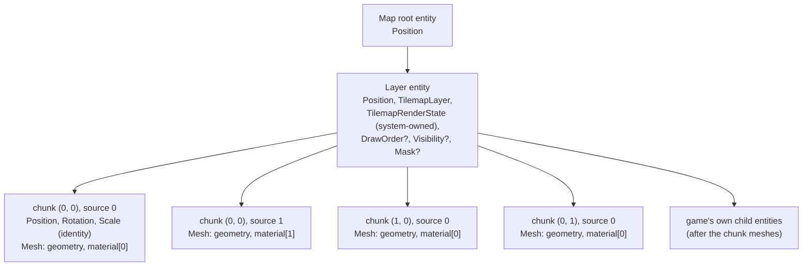
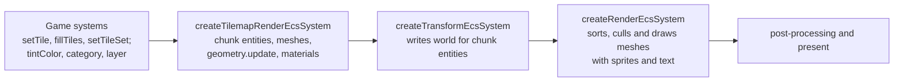

<!-- cspell:words tilemap tilemaps tileset tilesets texel texels quadrant quadrants subarray -->

# Tilemap chunk rendering

Issue: [#812](https://github.com/Forge-Game-Engine/Forge/issues/812)
(milestone "Tilemaps"; builds on [tile sets and tilemap layers](./tilesets-and-tilemap-layers.md)
(#805), [meshes in the draw order](./meshes-in-the-draw-order.md) (#783),
[geometry sections and batched mesh draws](./mesh-sections-and-batching.md)
(#874), [grid layouts](./grid-layouts.md) (#869), [y-sort units](./y-sort-units.md)
(#870) and `EcsWorld.setSiblingIndex` (#868); #825, #830, #836 and #872
build on it)

| Module or file                                                                                  | Change   | Notes                                                                                                                           |
| ----------------------------------------------------------------------------------------------- | -------- | ------------------------------------------------------------------------------------------------------------------------------- |
| `src/tilemaps/systems/tilemap-render-system.ts`                                                 | New      | `createTilemapRenderEcsSystem(renderContext)`                                                                                   |
| `src/tilemaps/systems/index.ts`, `src/tilemaps/index.ts`                                        | New, mod | Export the systems folder                                                                                                       |
| `src/tilemaps/components/tilemap-render-state-component.ts`                                     | New      | `TilemapRenderStateEcsComponent`, `TilemapChunkMesh`, `tilemapRenderStateId` (with its remove hook)                             |
| `src/tilemaps/rendering/write-chunk-vertices.ts`                                                | New      | Internal: one (chunk, source)'s quads, in row-major cell order. No WebGL. Not exported from the package                         |
| `src/tilemaps/rendering/quad-indices.ts`                                                        | New      | Internal: the constant index pattern every chunk geometry draws from. Not exported                                              |
| `src/tilemaps/rendering/shaders/` (`tilemap.vert.glsl`, `tilemap.frag.glsl`, `index.ts`)        | New      | The tilemap shader pair: `meshVertex` and `mask`, region clamping, a layer tint, straight alpha                                 |
| `src/rendering/utilities/create-shader-cache.ts`                                                | Modified | Registers `tilemap.vert` and `tilemap.frag`, as it registers the trail and MSDF shaders                                         |
| `src/rendering/utilities/compute-region-inset.ts`, `src/rendering/materials/sprite-material.ts` | New, mod | `computeRegionInset` moves out of `sprite-material.ts` so sprites and tiles share it. Not exported from the package             |
| `src/tilemaps/tiles/get-tile-image-rect.ts`                                                     | Modified | Each edge of the image is anchored to the matching edge of the footprint bounds, so neighboring tiles share bit-identical edges |
| `src/tilemaps/**/*.test.ts`                                                                     | New, mod | Vertex, system, state and placement tests                                                                                       |
| `e2e/fixtures/scenes/tilemap-*.ts`, `e2e/specs/tilemap-*.spec.ts`                               | New      | Layers sorted with a sprite and panned; an isometric tall-tile overlap; tile edges at fractional camera positions               |
| `documentation-site/docs/docs/tilemaps/index.md`                                                | Modified | A "Rendering" section                                                                                                           |
| `documentation-site/docs/docs/rendering/meshes.md`                                              | Modified | Names the tilemap render system as a mesh producer, next to trails                                                              |
| `documentation-site/src/pages/demos/tilemaps/`, `documentation-site/src/data/demos.ts`          | New, mod | The tilemaps demo deferred from #805: an orthogonal and an isometric map, painting and picking (Phase 3)                        |
| `AGENTS.md`                                                                                     | Modified | The `/tilemaps` line in "Repository Structure" says layers are drawn as chunk meshes                                            |
| `CHANGELOG.md`                                                                                  | Modified | `#### Added` bullets                                                                                                            |
| **Engine version at time of design**                                                            |          | `0.26.2`                                                                                                                        |

## Summary

A `TilemapLayerEcsComponent` (#805) draws nothing today. This design draws
it the way Unity's `TilemapRenderer` in chunk mode, Godot's rendering
quadrants and `bevy_ecs_tilemap` do: a static mesh per chunk of tiles,
redrawn as it is until a tile in that chunk changes. It adds no rendering
code that knows about tiles. Everything goes through the mesh path the
render system already has (#783, #874):

- **One mesh entity per (chunk, source).** For every stored chunk of a
  layer and every tileset source its tiles use, a child entity of the layer
  entity carries a `MeshEcsComponent` whose geometry holds two triangles per
  tile, in row-major cell order. Being children, they inherit the layer's
  transform, `DrawOrderEcsComponent`, `VisibilityEcsComponent` and masks,
  so the layer sorts with sprites as one unit and the render system needs
  no tilemap code.
- **Vertices in layer-local space, chunk entities at the layer's origin.**
  Each tile's quad is exactly `getTileImageRect` (#805), and its texture
  coordinates apply the transform bits through the sampling map
  (`invertTileTransform`). Every chunk entity of a layer has the same
  world transform, so tiles on either side of a chunk boundary meet on
  bit-identical coordinates. This differs from the issue's text, which
  places each chunk entity at its chunk's origin (decision R3, open
  question 1).
- **Edits update in place.** `createTilemapRenderEcsSystem` follows #805's
  consumer contract: it records the layer component it built from and the
  `version` it last saw, rebuilds only chunks whose `changedAt` is newer,
  and writes their vertices with `Geometry.update`, so editing tiles at
  runtime creates no GL objects. Chunk entities stay in row-major chunk
  order among the layer's children (`setSiblingIndex`), so drawing them in
  sibling order is back to front (#869).
- **One writer.** The system is the only writer of the chunk entities,
  their meshes, geometries and materials, and of a
  `TilemapRenderStateEcsComponent` it keeps on the layer entity. It keeps
  nothing in closure state.
- **No lines between tiles.** The tilemap shader clamps each tile's texture
  coordinates to its atlas region, inset by half a texel, which is the rule
  `sprite.vert` already uses for atlas sprites. That stops bleeding with
  `'nearest'` filtering at fractional camera positions and with
  `'linear'` filtering alike, without extruded tiles (decision R9).

A layer draws with one draw call per visible (chunk, source). A
1,000 x 1,000 layer with one source is 1,024 chunk meshes; a camera showing
a screen of 32-pixel tiles sees a handful of them.

Nothing here bends a core design of the engine. The render system keeps its
fixed queries, the transform system stays the only writer of `world`, and
the layer's cells keep their one writer (the cell functions).

## Scope

### In scope

- `createTilemapRenderEcsSystem` and `TilemapRenderStateEcsComponent`, with
  its remove hook.
- Building and updating (chunk, source) meshes for orthogonal and isometric
  layouts, including tall tiles and `textureOrigin`, trimmed atlas regions
  and all eight transform-bit combinations.
- Row-major triangle order inside a mesh, row-major sibling order of chunk
  entities, source order within a chunk.
- The tilemap shader pair and one `MeshMaterial` per (layer, source), with
  the layer's `tintColor`.
- Copying the layer's `category` and draw `layer` onto its chunk meshes.
- Releasing a layer's meshes when its layer component, position or entity
  is removed, or the layer component is replaced.
- Bit-identical edges between neighboring tiles (`getTileImageRect`).
- Bleeding protection, culling through `Geometry.bounds`, context loss.
- Unit tests, e2e specs, the guide's "Rendering" section, the tilemaps
  demo, JSDoc and changelog bullets.

### Out of scope

- **Y-sorting a layer's tiles with characters** (#872). A layer is one sort
  unit here. With chunk entities at the layer's origin, setting
  `ySortChildren` on a layer has no visible effect yet: every chunk unit
  sorts at the layer's Y and ties keep sibling order (decision R3). #872
  replaces the chunk meshes of such layers with row meshes.
- **Animated tiles** (#830). This design leaves room for them in
  `TilemapChunkMesh` ("Notes for later issues").
- **Collision** (#825) and **Tiled loading** (#836).
- **Custom tile materials** (a layer drawn with a game's own shader, for
  wind or water). The system creates its own materials. A game that needs
  one can build a mesh with its own material from `forEachTile` and
  `getTileImageRect` today; a per-layer material option can be added when
  a game needs it.
- **Per-cell color**, emissive maps and normal maps for tiles.
- **Exact back-to-front order between sources.** Tiles from different
  sources in one chunk draw source by source, as Unity's chunk mode does
  (decision R2, open question 4).
- **Changes to the render system, `Geometry` or `MeshMaterial`.** None are
  needed.
- **A per-tile instancing path** in the render system (decision R1).
- **Staggered and hexagonal layouts** (#869 leaves them out).

## Concepts and entity composition



- The **layer entity** is what the game builds (#805). The system adds a
  `TilemapRenderStateEcsComponent` to it the first time it sees the layer.
- A **chunk mesh entity** draws the tiles of one source in one chunk. It
  has a `PositionEcsComponent`, `RotationEcsComponent` and
  `ScaleEcsComponent`, all identity in `local`, so the transform system
  gives it exactly the layer's world transform (the transform system only
  composes a parent's rotation and scale into a child that has those
  components), and a `MeshEcsComponent`. It has no draw order, visibility
  or mask of its own; it inherits the layer's.
- **Sibling order.** The layer's chunk mesh entities stay sorted among
  themselves by chunk row, then chunk column, then source index. A layer's
  first chunk mesh goes to sibling index `0`, and each later one is placed
  next to its neighbor in that order, so a child the game parents to the
  layer lands after the meshes and draws over the tiles under a camera that
  doesn't y-sort. The system only relies on the order of its own entities:
  sibling order is the game's to change for its own children (moving a prop
  to index `0` puts it behind the tiles), and the system never moves them.
- **Materials.** Every chunk mesh of one (layer, source) shares one
  `MeshMaterial` from the tilemap shaders: `u_texture` is the source's
  atlas texture and `u_tint` the layer's `tintColor`. Materials made from
  the same shaders share one program (#783).

A game sees the chunk entities in `world.getChildren(layerEntity)`. The
guide says they belong to the tilemap render system: don't reorder,
re-parent or edit them.

## The render state component

```ts
/**
 * What createTilemapRenderEcsSystem built for one layer. Added and written
 * only by that system; read it, don't write it.
 */
export interface TilemapRenderStateEcsComponent {
  /** The layer component the meshes were built from, or null before the first build. */
  readonly builtFrom: TilemapLayerEcsComponent | null;
  /** The `version` of `builtFrom` the meshes show; -1 before the first build. */
  readonly builtVersion: number;
  /** The `category` and draw `layer` last copied onto every chunk mesh. */
  readonly appliedCategory: number;
  readonly appliedDrawLayer: number;
  /** Every chunk mesh, in sibling order: chunk row, chunk column, then source. */
  readonly meshes: readonly TilemapChunkMesh[];
  /** One material per source index that has at least one mesh. */
  readonly materials: ReadonlyMap<number, MeshMaterial>;
}

/** One (chunk, source) mesh of a layer. */
export interface TilemapChunkMesh {
  readonly chunkColumn: number;
  readonly chunkRow: number;
  readonly source: number;
  /** The child entity drawing it. */
  readonly entity: number;
  /** Its geometry, owned by the system and disposed when the mesh goes. */
  readonly geometry: Geometry;
  /** How many tiles (quads) it holds. */
  readonly tileCount: number;
  /** The arrays `geometry` was last updated from: a_position, a_texCoord, a_texRect. */
  readonly positions: Float32Array;
  readonly texCoords: Float32Array;
  readonly texRects: Float32Array;
}

export const tilemapRenderStateId =
  createComponentId<TilemapRenderStateEcsComponent>('tilemapRenderState', {
    onRemove: releaseTilemapRenderState,
  });
```

- It's a separate component the system adds and owns, the row "Bookkeeping
  that isn't part of the user-facing component" in the `create-system`
  skill, and the "render-state component" #805 reserved a remove hook for.
  The fields are `readonly` in the public type and written through an
  internal writable view, the pattern `TilemapLayerEcsComponent` uses.
- It's exported (type and key) so the state is visible like any component
  data, and so tests and tools can read which chunk meshes exist. There's
  no `add...Component` factory: only the system creates it.
- **Arrays per geometry.** `Geometry` keeps a reference to the arrays it's
  given and uploads them again after a lost context is restored, so each
  chunk mesh owns its arrays and never shares them. A rebuild writes into
  them when they're big enough and replaces them with arrays sized to the
  next power of two in tiles when they aren't.
- **The remove hook** (`releaseTilemapRenderState`, a module-level
  function, like `releaseTrail`) removes every chunk mesh entity that's
  still alive and disposes every geometry. When the layer entity itself is
  removed, the world removes its children first, so the hook finds them
  dead and only disposes. It runs for `removeComponent`, `removeEntity`
  (descendants included) and replacement by `addComponent`.

## The system

```ts
/**
 * Creates the system that draws tilemap layers: it builds a mesh for each
 * (chunk, tileset source) of every layer, as child entities of the layer,
 * and updates them when tiles change.
 *
 * Register it after the systems that edit tiles and before
 * createTransformEcsSystem, so new chunk entities get their world
 * transform in the same frame, and createRenderEcsSystem draws them.
 *
 * Each tick it also queries every TilemapRenderStateEcsComponent to release
 * the meshes of entities that lost their layer or position. That query
 * builds new arrays every call, which is fine for the few layer entities a
 * game has; don't copy the pattern for components many entities carry.
 */
export function createTilemapRenderEcsSystem(
  renderContext: RenderContext,
): EcsSystem<[TilemapLayerEcsComponent, PositionEcsComponent]>;
```

Its `query` is fixed: `[tilemapLayerId, positionId]`. Per tick:

```text
releaseOrphans(world):
  for each entity in world.query([tilemapRenderStateId]):
    if it has no TilemapLayerEcsComponent or no PositionEcsComponent:
      world.removeComponent(entity, tilemapRenderStateId)   // hook releases

for each (entity, layer) in the query result:
  state = getComponent(entity, tilemapRenderStateId)
       ?? addComponent(entity, tilemapRenderStateId, emptyState())

  if state.builtFrom !== layer:                 // first tick, or the layer was replaced
    release every mesh in state (remove entities, dispose geometries)
    clear state.materials
    state.builtFrom = layer; state.builtVersion = -1

  if layer.version !== state.builtVersion:     // setTileSet also stamps every chunk
    for each chunk in layer.chunks.values():
      if chunk.changedAt > state.builtVersion: rebuildChunk(entity, layer, state, chunk)
    for each mesh in state.meshes whose chunk key isn't in layer.chunks:
      remove its entity, dispose its geometry, drop it
    drop the material of every source no mesh draws any more
    state.builtVersion = layer.version

  if layer.category !== state.appliedCategory or layer.layer !== state.appliedDrawLayer:
    write both onto every mesh in state.meshes; record them

  for each (source s, material) in state.materials:   // stored values, uploaded on bind
    texture = layer.tileSet.sources[s].atlas.texture
    material.setUniform('u_texture', texture)
    material.setUniform('u_regionInset', computeRegionInset(texture))  // its size now
    material.setColorUniform('u_tint', layer.tintColor)
```

```text
rebuildChunk(entity, layer, state, chunk):
  count the chunk's tiles per source (a 256-entry array local to update)
  for each source s with tiles, ascending:
    mesh = the state's mesh for (chunk, s), or create one:
      e = world.createEntity(); setParent(e, entity)
      identity Position, Rotation, Scale
      insert it into state.meshes at rank k (binary search on chunk key, then source)
      placeBesideNeighbor(e, state.meshes, k)          // see "Sibling index"
    write s's tiles into mesh's arrays (writeChunkVertices), growing them if needed
    first build: new Geometry with the arrays and quadIndices.subarray(0, 6n)
    otherwise:   geometry.update({ vertexCount: 4n, attributes, indices: quadIndices.subarray(0, 6n) })
    material = state.materials[s] ?? createMeshMaterial('tilemap.vert', 'tilemap.frag')
    add or update the MeshEcsComponent: geometry, material, category, layer
  for each mesh of this chunk whose source has no tiles now:
    remove its entity, dispose its geometry, drop it
```

- **Orphans.** The issue asks for a remove hook on the state's key. That
  covers removing the state or the entity, but when only the layer
  component (or the position) is removed, the entity keeps its state and
  its chunk meshes would keep drawing. The system catches that case with
  one ad-hoc query at the start of each tick: a state whose entity no
  longer matches the system's query is removed, and its hook releases the
  meshes (decision R7, open question 2). The query costs one pass over the
  layers that have a state, and `EcsWorld.query` builds new arrays on every
  call. That's fine for the handful of layer entities a game has, but it's
  not a pattern for components many entities carry: the system's JSDoc and
  a comment beside the pass say so, so later code doesn't copy it there.
- **A removed chunk entity.** If game code removes a chunk mesh entity
  anyway, the next rebuild of that chunk finds it dead
  (`world.isAlive`) and creates a new one in the same place.
- **Sibling index.** A new mesh's rank `k` in `state.meshes` says which
  of the system's own entities it goes between, not its sibling index:
  game code can move its own children of the layer (a prop to index `0`),
  which shifts every chunk mesh. So `placeBesideNeighbor` reads the
  neighbors' current places. `setParent` appends the new entity, then:
  - if there's a next mesh (rank `k + 1`), it moves to
    `getSiblingIndex(next.entity)`, just in front of it;
  - otherwise, if there's a previous mesh, to
    `getSiblingIndex(previous.entity) + 1`, just behind it;
  - otherwise (the layer's first mesh) to `0`.

  Removing a mesh entity keeps its siblings in order. Painting a tile into
  a new chunk above and to the left of every existing one puts its mesh
  just in front of the old first mesh, wherever the game's children are.
  Each insertion is one `getSiblingIndex` and one `setSiblingIndex`, both
  linear in the layer's children, only on ticks that create a mesh.

- **No cleanup.** The system has no `cleanup`. Removing it, or stopping the
  world (`Game.stop`), leaves every layer's meshes as they are, drawn but
  no longer updated; removing a layer or its state still releases them.
  This follows `createTrailEcsSystem` and the `create-system` skill, which
  keep per-entity resources in remove hooks, not in `cleanup`. The issue
  asks for `cleanup` to remove them (decision R8, open question 3).
- **Static cost.** On a tick with no edits and no changed category or
  layer, each layer costs a few comparisons and three uniform writes per
  source it uses (stored values; nothing reaches GL until the material is
  bound), plus the orphan query.

## Vertex data

Each tile is four vertices and six indices (two triangles), with three
attributes, 8 floats per vertex:

| Attribute    | Size | Value                                                                                     |
| ------------ | ---- | ----------------------------------------------------------------------------------------- |
| `a_position` | 2    | The quad corner, in layer-local space                                                     |
| `a_texCoord` | 2    | Where that corner samples the atlas texture, in UV (Y-down, `0` is the texture's top row) |
| `a_texRect`  | 4    | The tile's region rect, `uvOffset` (xy) and `uvScale` (zw), the same on all four vertices |

Corners are written top-left, top-right, bottom-right, bottom-left, and
every quad's indices are `4i + (0, 1, 2, 0, 2, 3)`. That pattern doesn't
depend on the tiles, so it's one constant `Uint16Array` of
`6 * tilemapChunkSize²` indices, built once when the module loads, and
every geometry draws a `subarray` of it. It's never written, so sharing it
between geometries is safe even though each geometry keeps a reference to
it for context restore. A full chunk is 4,096 vertices, inside `Uint16`
indices (#805's reason for 32 x 32 chunks).

### Placement

For the tile `t` in cell `(c, r)`, from source `s`, with transform bits
`b`:

```text
image  = getTileImageRect(tileSet, c, r, t)               // layer-local, Y-down
region = s.atlas.regions[tileIndex(t)]                    // uvOffset, uvScale, trimOffset, trimScale

drawn  = the axis-aligned rect around applyTileTransform(b, trimOffset)
         and applyTileTransform(b, trimOffset + trimScale)  // in the image's normalized coords

for each corner p of drawn (TL, TR, BR, BL):
  position = untrimmed ? the matching corner of image            // exact, no arithmetic
                       : image.min + p * (image.max - image.min)
  q        = invertTileTransform(b, p)                        // the untransformed frame point it shows
  texCoord = region.uvOffset + (q - trimOffset) / trimScale * region.uvScale
```

- **One definition of placement.** Positions come from
  `getTileImageRect`, so the renderer, a game previewing a tile under the
  mouse and #872's row meshes agree. Orthogonal and isometric layouts run
  the same code.
- **Transform bits through texture coordinates.** The image's rect never
  changes; the bits permute which texture point each corner samples,
  through the sampling map, as #805 specifies. Using `applyTileTransform`
  instead would swap the two 90-degree turns, which a unit test pins.
- **Trimmed regions** draw only their share of the frame, as on a sprite:
  the quad shrinks to `drawn`, moved by the bits like the content.
- **Untrimmed quads use the image rect's corners as they are.** A lerp
  (`min + 1 * (max - min)`) can differ from `max` in the last bit; copying
  the corners keeps shared edges identical.

### Exact edges between tiles

Neighboring tiles must share bit-identical edge coordinates, or a
rasterizer can leave a one-pixel crack between them. Three things give
that:

1. **`getTileImageRect` anchors each edge to the matching footprint edge.**
   Today it computes the right and top edges as `left + tileWidth` and
   `bottom - tileHeight`. With a cell width like `0.1`, `c * w + w` can
   differ from the neighbor's left edge, `(c + 1) * w`, which the layout
   computes through `_toLocal`. It becomes:

   ```text
   image.min.x = bounds.min.x + textureOrigin.x
   image.max.x = bounds.max.x + textureOrigin.x + (tileWidth - layout.cellWidth)
   image.max.y = bounds.max.y + textureOrigin.y
   image.min.y = bounds.min.y + textureOrigin.y - (tileHeight - layout.cellHeight)
   ```

   It's the same rect (the footprint bounds are `cellWidth` by
   `cellHeight` in both layouts), but a tile of the cell's size with no
   `textureOrigin` now has exactly its footprint bounds' edges, which the
   layout computes from shared integer cell-space corners (`getCellPolygon`),
   so its neighbor's edge is the same number.

2. **Untrimmed quads copy those edges** (above).
3. **One transform for the whole layer.** Every chunk entity sits at the
   layer's origin, so tiles on either side of a chunk boundary are mapped
   by the same `u_model` and stay identical on the GPU (decision R3).

This holds for orthogonal layouts and for isometric tiles whose images
meet. Tiles of another size, or with a `textureOrigin`, aren't meant to
meet edge to edge.

### Bounds and culling

`Geometry.bounds` is computed from `a_position`, so a chunk mesh's bounds
include every image that overhangs its footprint (tall walls). The render
system culls a chunk mesh whose bounds, placed by the layer's transform,
miss the camera's view, and never clips a tall tile at the edge of the
screen. Nothing in this design writes bounds.

## The tilemap shaders and material

```glsl
#version 300 es
#pragma forge name(tilemap.vert)
#pragma forge include(meshVertex)

in vec2 a_position;           // layer-local
in vec2 a_texCoord;
in vec4 a_texRect;            // the tile's region: offset (xy), size (zw), in UV

uniform vec2 u_regionInset;   // half a texel for a 'clamp' texture, 0 for 'repeat'

out highp vec2 v_texCoord;
flat out highp vec4 v_texBounds;

void main() {
  vec2 world = meshWorldPosition(a_position);
  gl_Position = meshClipPosition(world);
  forwardMeshMask(world);
  v_texCoord = a_texCoord;

  // As sprite.vert: inset around the rect's center so a rect narrower than
  // a texel collapses to its center line.
  vec2 halfSize = a_texRect.zw * 0.5;
  vec2 center = a_texRect.xy + halfSize;
  vec2 boundsHalfSize = max(halfSize - u_regionInset, vec2(0.0));
  v_texBounds = vec4(center - boundsHalfSize, center + boundsHalfSize);
}
```

```glsl
#version 300 es
#pragma forge name(tilemap.frag)
precision mediump float;
#pragma forge include(mask)

uniform sampler2D u_texture;  // the source's atlas texture
uniform vec4 u_tint;          // the layer's tintColor, straight alpha

in highp vec2 v_texCoord;
flat in highp vec4 v_texBounds;
out vec4 fragColor;

void main() {
  vec4 color = texture(u_texture, clamp(v_texCoord, v_texBounds.xy, v_texBounds.zw)) * u_tint;
  fragColor = vec4(color.rgb, color.a * maskCoverage()); // straight alpha
}
```

- It's a `MeshMaterial`, so it follows the mesh contract: `meshVertex`
  positions it and forwards masks, `mask` clips it, and the render system's
  straight-alpha blend state premultiplies it into the destination
  (`AGENTS.md`, "Alpha Blending"). Red, green and blue of `u_tint` above
  `1` brighten tiles for bloom, as a sprite's tint does.
- `u_regionInset` comes from `computeRegionInset(texture)`, moved out of
  `sprite-material.ts` into `src/rendering/utilities/compute-region-inset.ts`
  so sprites and tiles use one rule. The system writes `u_texture` and
  `u_regionInset` from the source's texture every tick, with `u_tint`, the
  way `SpriteMaterial` recomputes the inset on every bind: a texture is `0`
  by `0` (inset `0`) until its image loads, and `Texture.update` can change
  its size, so an inset computed once when the material is made goes
  stale.
- The shaders live in `src/tilemaps/rendering/shaders/` and
  `createShaderCache` registers them, as it registers the MSDF shaders from
  `src/text` and the trail shaders.
- `flat` varyings take the provoking vertex's value; every vertex of a quad
  carries the same `a_texRect`, so it doesn't matter which one.

### Texture bleeding

With `'nearest'` filtering and a camera at a fractional position, a pixel
on a tile's edge can sample a texture coordinate a hair past the region and
pick the neighboring tile's texel in the atlas, which shows as a line
between tiles. With `'linear'` filtering the edge texels blend with their
atlas neighbors on every frame. Clamping each fragment's texture coordinate
to the region inset by half a texel stops both: the farthest a sample can
reach is the center of the region's edge texel. This is what Forge's
sprite path already does for atlas sprites (`sprite.vert`'s `v_texBounds`).
Godot 4 reaches the same result by building a padded copy of each atlas
(`TileSetAtlasSource.use_texture_padding`); clamping needs no copy.

The issue suggests a small UV inset, as Godot 3's `cell_clip_uv` did, and
documenting that `'linear'` filtering needs extruded tiles. The clamp makes
both unnecessary (decision R9, open question 5). What the guide still
documents: a texture with `wrap: 'repeat'` isn't inset (as for sprites),
so tilesets use the default `'clamp'`; and with `'linear'` filtering each
tile shows its own edge texels at its edges, without blending into the
neighboring cell's tile.

## Draw order

- **Against sprites.** Each chunk mesh is one draw item whose world order,
  visibility and masks come from the layer entity. Its hierarchy index is
  just after the layer's, in sibling order. So a background layer created
  before the player, or with a lower `DrawOrderEcsComponent.order`, draws
  behind it, and a foreground layer with a higher order in front. A layer
  without `ySortChildren` sorts as one unit under a y-sorting camera,
  at the layer entity's sort unit's Y, as floors, backgrounds and
  foregrounds need. The draw `layer` copied from the tilemap layer decides
  first, as for sprites.
- **Inside a layer.** Tiles draw back to front when, as #869 guarantees,
  cells draw in row-major order within a chunk and chunks in row-major
  chunk order. Each mesh's triangles are written in row-major cell order
  and chunk meshes are kept in row-major chunk order, so a two-cell-tall
  isometric wall in row `5` covers the tile behind it in row `4`.
- **Between sources.** A chunk's meshes draw source by source, so a tile
  from source `1` in row `0` draws after a tile from source `0` in row `31`
  of the same chunk. When such tiles overlap (walls from two sheets in an
  isometric layer), the back one can cover the front one. Unity's chunk
  mode has the same limit and the same advice: keep tiles that overlap each
  other in one atlas, or put them in separate layers ordered with the
  hierarchy (decision R2, open question 4).
- **Placement limits.** Tiles outside #805's limits (wider than a cell,
  offset sideways, or reaching below the footprint) may draw out of order
  against their neighbors. The guide says so, next to `textureOrigin`.

## Data flow and system order



An edited tile shows on the same frame when the editing system runs before
the tilemap render system. A new chunk entity gets its world transform in
the frame it's created because the tilemap render system runs before the
transform system.

## Performance

- **Draw calls.** One per visible (chunk, source), never merged (each has
  its own geometry). Sorting adds one draw item per chunk mesh.
- **Memory.** 8 floats per vertex, 128 bytes per tile, plus GPU buffers of
  the same size: about 128 KiB for a full single-source chunk, 128 MiB for
  a fully painted 1,000 x 1,000 layer. Indices are shared.
- **Edits.** Rebuilding a chunk writes its tiles of each affected source,
  at most 1,024 quads, and uploads them with `bufferSubData`. A tick that
  edits one tile rebuilds one chunk.
- **First build.** Every chunk is built on the layer's first tick.
  `getTileImageRect` and `getCellFootprintBounds` allocate a few small
  objects per tile, which is fine for edits and acceptable for loading a
  map; the guide notes that a very large map is best built before the
  first frame it's shown in. If profiling shows the first build matters,
  an allocation-free placement path can follow (open question 6).
- **Static frames.** No uploads; the per-layer checks above.

## Context loss

Nothing extra. Geometries keep their latest arrays and rebuild themselves
when the context is restored; an edit while the context is lost updates the
arrays and records the change (`Geometry.update`); materials take their
program from the render context's cache; atlas textures restore their own
source; the render system draws nothing while the context is lost. A unit
test edits a layer while the mocked context is lost, restores it, and
checks that the restored buffers hold the latest tiles.

## Testing

Unit tests (Vitest; a mocked WebGL context behind a real `RenderContext`
where geometry or materials are created, as `AGENTS.md` describes; the
vertex writer needs no WebGL):

- **Vertices.**
  - An orthogonal tile's positions are its `getTileImageRect` corners,
    TL, TR, BR, BL; isometric positions likewise; a two-cell-tall tile with
    a `textureOrigin` reaches up from its footprint.
  - All eight transform-bit combinations: each corner's texture coordinate
    is `invertTileTransform`'s, and the two 90-degree turns differ from
    `applyTileTransform`'s.
  - A trimmed region's quad covers the transformed trimmed rect and samples
    only its region.
  - `a_texRect` is the region's rect on all four vertices.
  - Triangles are in row-major cell order.
  - Two neighboring tiles with a cell width of `0.1` share bit-identical
    edges, in one chunk and across a chunk boundary.
- **Placement.** `getTileImageRect` still returns the same rect for tall,
  offset and resized tiles, and the right edge of a cell-sized tile equals
  its right neighbor's left edge exactly.
- **System.**
  - One mesh entity per (chunk, source); a chunk mixing two sources gets
    two, source `0` first.
  - Chunk entities are children of the layer, with identity local
    transforms, and get the layer's rotated and scaled world transform
    after the transform system runs.
  - Editing one tile rebuilds only that chunk (one `Geometry.update`, no
    new geometry); an edit that adds a source to a chunk adds one mesh.
  - Emptying a chunk removes its entities and disposes their geometries;
    emptying one source of a chunk removes only that mesh.
  - Sibling order is row-major after painting a tile into a new chunk up
    and to the left of the existing ones, and stays so after a game
    parents its own child to the layer (which comes after the meshes),
    and after the game moves that child to sibling index `0` and a new
    chunk is painted between two existing ones (the new mesh lands
    between its neighbors, and the game's child stays first).
  - `setTileSet` rebuilds every chunk with the new sources' textures.
  - Replacing the layer component on the same entity removes every old
    mesh and builds the new layer's.
  - Removing the layer entity, the layer component, the position or the
    state component removes the chunk entities and disposes the
    geometries.
  - `category` and draw `layer` reach every chunk mesh on build and when
    changed later; `tintColor` reaches `u_tint`; a source texture that
    was `0` by `0` when its material was made, then updated to its image's
    size, gets the half-texel `u_regionInset` on the next tick.
  - Statelessness: a fresh system on a world with built layers adopts
    their state without rebuilding (the state is component data).
  - Context loss, as above.
- **Draw order with the render system.** A sprite whose world order is
  between two layers draws between their chunk meshes; a camera whose
  `cullingMask` misses the layer's category draws none of them.

E2E (the `write-e2e-test` skill; relative, same-run pixel measurements,
stepping and reading in one `page.evaluate`):

- **`tilemap-layers`** (issue scenario a). A two-layer orthogonal map from
  a canvas-made atlas: a background layer, a foreground layer covering
  part of it, and a sprite at a world order between them. Assert the
  sprite's color shows where it overlaps the background, and the
  foreground's where it overlaps the foreground, against a frame with the
  sprite hidden. Pan the camera by a known amount and assert a landmark
  tile's measured bounds move by that amount times the zoom.
- **`tilemap-isometric-overlap`** (scenario b). An isometric layer where a
  two-cell-tall tile in row `1` overlaps a differently colored tile in row
  `0`. Assert the front tile's color fills the overlap, measured against a
  frame without the front tile. Swapping the rows' contents flips the
  result, which catches a reversed order.
- **`tilemap-texture-edges`**. A `'nearest'` atlas whose tiles are
  surrounded by a contrasting color in the texture, a filled layer, and a
  camera stepped through fractional positions and zooms. Assert no pixel of
  the contrasting color appears, as `texture-atlas-region-edges` does for
  sprites; repeat with `'linear'` filtering.

## Documentation and demo

- **Tilemaps guide, "Rendering"** (the `document-feature` skill):
  registering `createTilemapRenderEcsSystem` and where it goes in the
  system order; one mesh per chunk and source, and what that costs; chunk
  entities as children of the layer, kept in order among themselves, not
  to be edited, and how a game's own children of the layer draw against
  them (after the meshes unless moved); draw order
  against sprites (layer entity order, `DrawOrderEcsComponent`, the draw
  `layer`), inside a layer (back to front) and between sources (keep
  overlapping tiles in one atlas); placement limits; `tintColor`,
  `category` and `layer`; filtering, `'clamp'` and why no extruded tiles
  are needed; edit and build costs; what removing a layer releases.
- **`rendering/meshes.md`**: the tilemap render system builds meshes too,
  next to trails.
- **Demo `demos/tilemaps`** (Phase 3, the `add-feature-demo` skill), the
  demo #805 deferred to this issue: an orthogonal map with a background
  and a foreground layer and a character walking between them, a toggle
  to an isometric map with tall walls, painting and erasing tiles with the
  mouse through `worldToCell`, and a readout of the cell under the mouse
  and its tile properties. Listed in `demos.ts` under `rendering`.
- JSDoc on every new export; the state component's JSDoc says only the
  system writes it.

## Phases

### Phase 1: Chunk meshes

Draws layers as (chunk, source) meshes, keeps them up to date as tiles
change, and releases them with the layer.

**Definition of done:** a layer with tens of thousands of tiles draws with
one draw call per visible (chunk, source), sorted between sprites by the
layer entity's draw order; isometric tiles overlap back to front; an edited
tile shows on the next frame; removing or replacing a layer releases its
meshes; the `tilemap-layers` and `tilemap-isometric-overlap` specs pass;
the guide has its "Rendering" section; every check in `CLAUDE.md`'s
verification list passes.

| Task            | Description                                                                                                                                                                      | Size |
| --------------- | -------------------------------------------------------------------------------------------------------------------------------------------------------------------------------- | ---- |
| Exact edges     | `getTileImageRect` anchors each edge to the footprint bounds ("Exact edges between tiles"); tests that cell-sized neighbors share edges and that the rect is otherwise unchanged | S    |
| Region inset    | Move `computeRegionInset` to `src/rendering/utilities/compute-region-inset.ts`; `SpriteMaterial` imports it                                                                      | S    |
| Shaders         | `tilemap.vert`/`tilemap.frag` in `src/tilemaps/rendering/shaders/`, registered in `createShaderCache`                                                                            | S    |
| Vertex writer   | `writeChunkVertices` and the constant quad indices: placement, trimmed regions, sampling map, `a_texRect`, row-major order; unit tests                                           | M    |
| State component | `TilemapRenderStateEcsComponent`, `TilemapChunkMesh`, `tilemapRenderStateId` with `releaseTilemapRenderState`; internal writable view                                            | S    |
| System          | `createTilemapRenderEcsSystem`: orphan release, identity and version checks, chunk rebuilds, mesh creation and removal, sibling order, materials, category, layer and tint       | L    |
| System tests    | The "System" and "Draw order with the render system" tests above, including context loss                                                                                         | M    |
| E2E             | `tilemap-layers` and `tilemap-isometric-overlap` scenes and specs                                                                                                                | M    |
| Docs            | Guide "Rendering" section, `rendering/meshes.md`, JSDoc, `AGENTS.md` structure line                                                                                              | M    |
| Changelog       | `#### Added`: tilemap layers draw as chunk meshes with `createTilemapRenderEcsSystem`. The `getTileImageRect` change returns the same rect, so it needs no bullet of its own     | S    |

### Phase 2: Tile edges

Proves the region clamp keeps lines out from between tiles. The clamp ships
in Phase 1's shader; this phase adds the evidence and the guide's filtering
advice.

**Definition of done:** the `tilemap-texture-edges` spec passes with
`'nearest'` and `'linear'` filtering at fractional camera positions and
zooms; the guide's filtering paragraph is written.

| Task | Description                                                                   | Size |
| ---- | ----------------------------------------------------------------------------- | ---- |
| E2E  | `tilemap-texture-edges` scene and spec                                        | M    |
| Docs | Filtering, `'clamp'`, and why tilesets need no extrusion or spacing for Forge | S    |

If the spec shows lines despite the clamp (for example from a driver's
texture-coordinate precision), the fallback is a larger inset, not an
option.

### Phase 3: Tilemaps demo

**Definition of done:** `demos/tilemaps` renders both maps, painting and
picking work, the docs site builds (`npm run typecheck`, `npm run build`),
and the page has been loaded in a browser.

| Task  | Description                                                                        | Size |
| ----- | ---------------------------------------------------------------------------------- | ---- |
| Demo  | The page, its `_*.ts` sources and controls, following the `add-feature-demo` skill | L    |
| Index | An entry in `documentation-site/src/data/demos.ts` under `rendering`               | S    |

The `claude` label run can ship all three phases in one pull request.

## Decision log

| #   | Decision                             | Options considered                                                                                                                                                                                                                                                      | Chosen | Rationale                                                                                                                                                                                                                                                                                                                                                                                                                                              | Tradeoff                                                                                                                        | Assumptions                                                   |
| --- | ------------------------------------ | ----------------------------------------------------------------------------------------------------------------------------------------------------------------------------------------------------------------------------------------------------------------------- | ------ | ------------------------------------------------------------------------------------------------------------------------------------------------------------------------------------------------------------------------------------------------------------------------------------------------------------------------------------------------------------------------------------------------------------------------------------------------------ | ------------------------------------------------------------------------------------------------------------------------------- | ------------------------------------------------------------- |
| R1  | How tiles reach the screen           | (a) Static meshes per chunk through `MeshEcsComponent`; (b) one `QuadRenderCommand` per visible tile each frame; (c) a per-chunk instance buffer drawn with `quadGeometry`, a new instanced-mesh path in the render system                                              | (a)    | Unity's chunk mode, Godot's quadrants and `bevy_ecs_tilemap` build static chunk meshes. (b) re-uploads every visible tile every frame. (c) needs new render-system code for one producer, while (a) reuses the mesh path with no render-system change.                                                                                                                                                                                                 | 128 bytes per tile, more than an instance would need.                                                                           | Tiles change rarely compared with how often they're drawn.    |
| R2  | Mesh granularity                     | (a) One mesh per (chunk, source); (b) one geometry per (layer, source) with a section per chunk; (c) runs of same-source cells per chunk, exact order across sources; (d) one mesh per chunk sampling several textures                                                  | (a)    | What the issue asks and what Unity's chunk mode does. Edits touch one chunk. (b) re-uploads the whole layer on every edit, and its chunks still alternate with other sources, so they'd rarely merge. (c) makes draw calls depend on how sources interleave. (d) needs a branch per texture unit in the fragment shader.                                                                                                                               | Overlapping tiles from different sources can draw out of order (open question 4).                                               | Overlapping tiles (walls) usually come from one atlas.        |
| R3  | Where chunk entities sit             | (a) At the layer's origin, vertices in layer-local space; (b) at each chunk's origin, vertices in chunk-local space (the issue's text)                                                                                                                                  | (a)    | One model matrix for the whole layer, so chunk seams are exact for any cell size; vertex positions are `getTileImageRect`'s output with no subtraction; #872's row entities sit at the layer's origin too; and `ySortChildren` on a layer sorts every chunk at one Y until #872. Precision is the same: the GPU adds translation in float32 either way, so world precision limits both.                                                                | Chunk entities' positions don't show where their chunk is.                                                                      | Nothing reads a chunk entity's position.                      |
| R4  | Transform bits                       | (a) Baked into texture coordinates through `invertTileTransform`; (b) passed per vertex and applied in the shader                                                                                                                                                       | (a)    | #805 defines the bits as a UV permutation with the rect unchanged; baking costs nothing per frame and keeps the shader minimal.                                                                                                                                                                                                                                                                                                                        | Changing a tile's bits rebuilds its chunk, like any edit.                                                                       |                                                               |
| R5  | Tint                                 | (a) A `u_tint` uniform per (layer, source) material; (b) a per-vertex color                                                                                                                                                                                             | (a)    | Fading or flashing a layer is a uniform write, not a rebuild. Materials share one program.                                                                                                                                                                                                                                                                                                                                                             | One material per (layer, source).                                                                                               | No per-cell color (out of scope).                             |
| R6  | Where the system's bookkeeping lives | (a) A `TilemapRenderStateEcsComponent` on the layer entity, exported and read-only; (b) fields on `TilemapLayerEcsComponent`; (c) closure state                                                                                                                         | (a)    | The `create-system` skill's place for bookkeeping that isn't part of the user-facing component; #805 already expects it. (b) mixes a consumer's state into shared data that #825 also reads. (c) breaks stateless systems.                                                                                                                                                                                                                             | One more component per layer.                                                                                                   |                                                               |
| R7  | Releasing meshes of a removed layer  | (a) The state's remove hook, plus an orphan pass in the system for a layer or position removed from a live entity; (b) a remove hook on `tilemapLayerId` that removes consumer state; (c) only the state's hook                                                         | (a)    | (c) leaves meshes drawing after `removeComponent(entity, tilemapLayerId)`. (b) makes the layer know its consumers (#805 decision T5 rejects that) and wouldn't cover a removed position. (a) keeps the data model ignorant of renderers.                                                                                                                                                                                                               | One ad-hoc query per tick, which allocates its result arrays; the JSDoc says not to copy it for components many entities carry. | Few entities have a tilemap render state.                     |
| R8  | System removal and `world.stop`      | (a) No `cleanup`: meshes stay as built; (b) `cleanup` removes every layer's meshes (the issue's text)                                                                                                                                                                   | (a)    | `AGENTS.md` and the `create-system` skill put per-entity resource release in remove hooks, not `cleanup`, and `createTrailEcsSystem` leaves its meshes. (b) would blank every map when `Game.stop` runs.                                                                                                                                                                                                                                               | A removed system leaves static meshes until their layer goes.                                                                   |                                                               |
| R9  | Bleeding between tiles               | (a) Clamp to the region inset by half a texel, as `sprite.vert` does; (b) a small fixed UV inset (Godot 3's `cell_clip_uv`) and documenting extrusion for `'linear'`; (c) a padded atlas copy (Godot 4)                                                                 | (a)    | It's the engine's existing answer for atlas sprites, it covers `'linear'` too, and it needs no texture copy. (b) still bleeds with `'linear'`. (c) doubles texture memory and needs CPU-side image data.                                                                                                                                                                                                                                               | Two extra varyings and a `clamp` per fragment.                                                                                  | Tilesets use `'clamp'` textures.                              |
| R10 | Sibling order                        | (a) Chunk meshes sorted among themselves by chunk row, column, then source, each new one placed beside its neighbor's current sibling index, the first at `0`; (b) each new mesh at its rank in the system's list, assuming chunk meshes are the layer's first children | (a)    | Sibling order of the layer's children has two writers otherwise: (b) breaks as soon as game code moves one of its own children (a prop to index `0` shifts every mesh, so a new chunk of rank `k` lands in front of chunk `k - 1`). (a) relies only on the order of the system's own entities and never moves the game's. A game's children land after the meshes, so a door or prop placed on a layer draws over its tiles, unless the game moves it. | One `getSiblingIndex` per new mesh, linear in the layer's children.                                                             | Game code doesn't reorder the chunk mesh entities themselves. |
| R11 | System order                         | (a) Before the transform system; (b) after it, like the trail system                                                                                                                                                                                                    | (a)    | The meshes are built from layer data, not world positions, and new chunk entities need `world` the same frame.                                                                                                                                                                                                                                                                                                                                         |                                                                                                                                 |                                                               |
| R12 | Exact edges                          | (a) Anchor each edge of `getTileImageRect` to the footprint edge; (b) special-case cell-sized tiles in the vertex writer                                                                                                                                                | (a)    | `getTileImageRect` is the one placement definition (#805); fixing it there keeps every caller exact.                                                                                                                                                                                                                                                                                                                                                   | A behavior-neutral change to shipped code.                                                                                      |                                                               |
| R13 | Indices                              | (a) One constant index pattern shared by every geometry; (b) indices per geometry; (c) no indices, six vertices per tile                                                                                                                                                | (a)    | The pattern doesn't depend on the tiles; sharing a never-written array is safe for context restore. (c) costs 50% more vertex data.                                                                                                                                                                                                                                                                                                                    |                                                                                                                                 |                                                               |
| R14 | Shader location                      | (a) `src/tilemaps/rendering/shaders`, registered by `createShaderCache`; (b) `src/rendering/shaders`                                                                                                                                                                    | (a)    | The shaders belong to the tilemaps module, as the MSDF shaders belong to `src/text`.                                                                                                                                                                                                                                                                                                                                                                   | `createShaderCache` imports from one more module.                                                                               |                                                               |

## Open questions

All are non-blocking: each has a default the implementation follows, and a
different answer changes details, not the approach.

1. **Non-blocking. Where chunk entities sit.** The issue places each chunk
   entity at its chunk's origin with chunk-local vertices.
   - Layer origin, layer-local vertices (the default, decision R3): exact
     seams for any cell size, positions equal `getTileImageRect`'s, the
     same convention as #872's rows, no visible effect from
     `ySortChildren` before #872.
   - Chunk origin: an entity's position says where its chunk is; seams are
     exact only when cell sizes and chunk origins are exactly
     representable in float32 (integers, halves, quarters).

   Changing to the chunk origin changes the vertex writer's offset and
   each entity's `position.local`.

2. **Non-blocking. Releasing meshes when only the layer component is
   removed.** The issue's remove hook on the state's key doesn't fire when
   the layer component or the position is removed from a live entity.
   - An orphan pass in the system (the default): no coupling between the
     layer and its consumers.
   - A remove hook on `tilemapLayerId` that removes the render state: no
     per-tick query, but the data model then knows about its renderer, and
     #825's collider state would need the same.

3. **Non-blocking. `cleanup` on system removal.** The issue asks for it.
   - No `cleanup` (the default): the trail system's behavior and the
     `create-system` skill's rule; `Game.stop` doesn't blank maps.
   - `cleanup` removes every state: a removed system leaves nothing drawn.

4. **Non-blocking. Tiles from several sources that overlap in one chunk.**
   - Per-source meshes (the default, Unity's chunk mode): bounded draw
     calls; document "keep overlapping tiles in one atlas".
   - Same-source runs in row-major order, each a section of one chunk
     geometry with its own material: exact order, but draw calls grow
     with how often sources alternate.

5. **Non-blocking. Bleeding protection.** The issue suggests a small UV
   inset and documenting extrusion for `'linear'` filtering.
   - Region clamp with a half-texel inset (the default): the sprite path's
     rule, works for both filters.
   - A fixed small inset: one less varying, but `'linear'` still bleeds.

6. **Non-blocking. Allocation-free placement.** Building a chunk calls
   `getTileImageRect`, which allocates a few objects per tile.
   - Accept it (the default) and measure in the demo.
   - Add an `out` parameter to `getTileImageRect` and
     `GridLayout.getCellFootprintBounds`, a public API addition.

7. **Non-blocking. The demo in this issue.** CLAUDE.md asks for a demo
   with a major feature, and #805 deferred the tilemaps demo here.
   - Phase 3 (the default).
   - A separate issue, keeping this pull request to the renderer.

## Notes for later issues

- **#830 (animated tiles)** adds, per `TilemapChunkMesh`, the vertex ranges
  of its animated tiles, and rewrites only their `a_texCoord` (and
  `a_texRect`) with `Geometry.update` when a frame changes. Since each mesh
  owns its arrays, rewriting a range in place and updating the attribute
  is enough.
- **#872 (y-sorted layers)** reads `ySortChildren` on the layer entity and
  builds row meshes instead of chunk meshes for it, in the same state
  component. Row entities at the layer's origin match this design's chunk
  entities (decision R3).
- **#825 (collision)** faces the same "layer removed from a live entity"
  case for its collider state; the orphan pass (decision R7) is the
  pattern to copy.
- **#836 (Tiled)** loads atlases with `'nearest'` filtering; the region
  clamp keeps them free of lines without Tiled's spacing or margins.
