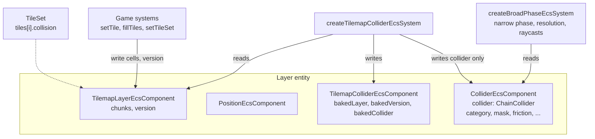

<!-- cspell:words tilemap tilemaps tileset tilesets quadrant quadrants Rapier avian -->

# Tilemap collision from per-tile shapes

Issue: [#825](https://github.com/Forge-Game-Engine/Forge/issues/825)
(milestone "Tilemaps"; builds on [tile sets and tilemap layers](./tilesets-and-tilemap-layers.md)
(#805), [chain colliders](./chain-collider.md) (#820) and
[grid layouts](./grid-layouts.md) (#869); #836 and #839 build on it)

| Module or file                                                    | Change        | Notes                                                                                                                    |
| ----------------------------------------------------------------- | ------------- | ------------------------------------------------------------------------------------------------------------------------ |
| `src/tilemaps/tile-set/tile-set.ts`                               | Modified      | `TileCollisionShape`; `collision` on `TileData` and `TileDataOptions`, validated against the layout in `createTileSet`   |
| `src/tilemaps/collision/tile-collision-variant.ts`                | New           | Internal: a tile's shape with its transform bits applied, quantized into cell space, with what it puts on each cell side |
| `src/tilemaps/collision/build-tilemap-collision-loops.ts`         | New           | `buildTilemapCollisionLoops(layer)`: the layer's solid outline as `ChainCollider` loops                                  |
| `src/tilemaps/collision/link-collision-loops.ts`                  | New           | Internal: joins the outline's edges into loops and merges straight runs                                                  |
| `src/tilemaps/components/tilemap-collider-component.ts`           | New           | `TilemapColliderEcsComponent`, `tilemapColliderId`, `addTilemapColliderComponent`                                        |
| `src/tilemaps/systems/tilemap-collider-system.ts`                 | New           | `createTilemapColliderEcsSystem()`                                                                                       |
| `src/tilemaps/collision/index.ts`, `systems/index.ts`, `index.ts` | New, Modified | Exports                                                                                                                  |
| `src/physics/colliders/chain-collider.ts`                         | Modified      | Accepts zero loops: an empty chain collides with nothing                                                                 |
| `documentation-site/docs/docs/tilemaps/index.md`                  | Modified      | "Collision" section                                                                                                      |
| `documentation-site/docs/docs/physics/chain-colliders.md`         | Modified      | Empty chains; link to tile layer collision                                                                               |
| `CHANGELOG.md`                                                    | Modified      | `#### Added` (tile collision) and `#### Changed` (`ChainCollider` with no loops) bullets                                 |
| **Engine version at time of design**                              |               | `0.26.2`                                                                                                                 |

## Summary

Solid tiles should collide without the game building colliders by hand.
This design lets a tile set say which tiles are solid and what shape they
are, and gives each layer that uses them one static `ChainCollider` that
outlines all of its solid tiles and follows every edit on the tick it
happens:

```ts
const tileSet = createTileSet({
  layout: createOrthogonalGridLayout({ cellWidth: 32, cellHeight: 32 }),
  sources: [
    {
      atlas,
      tiles: new Map([
        [0, { collision: 'cell' }], // a full block
        [
          1,
          {
            collision: [
              { x: -16, y: 16 },
              { x: 16, y: -16 },
              { x: 16, y: 16 },
            ],
          },
        ], // a slope
      ]),
    },
  ],
});

const walls = world.createEntity();
addPositionComponent(world, walls);
const layer = addTilemapLayerComponent(world, walls, { tileSet });
addColliderComponent(world, walls, {
  collider: new ChainCollider([]),
  friction: 0.4,
});
addTilemapColliderComponent(world, walls);

world.addSystem(createTilemapColliderEcsSystem()); // after tile edits, before the broad phase
```

It has four parts:

- **Shapes on the tile set.** `TileData.collision` is `'cell'` (the cell's
  whole footprint: a rectangle in an orthogonal layout, a diamond in an
  isometric one), one convex polygon in tile-local space (origin at the
  cell's center, layer-local units, Y-down), or `null`. `createTileSet`
  checks each polygon is convex and inside the footprint. This is Godot's
  per-tile collision polygons and Tiled's per-tile collision objects.
- **The layer's outline.** `buildTilemapCollisionLoops(layer)` turns every
  solid cell into its shape, with the cell's flip and transpose bits
  applied the way they move the tile's image, and removes the parts of
  edges two neighbors share. What's left is joined into closed loops wound
  as `ChainCollider` expects, with straight runs merged. The work happens
  in the layout's cell space, where every cell is a unit square, so
  orthogonal and isometric layers go through the same code. Coordinates
  are snapped to a fixed grid of 1/65,536 of a cell there, so shared edges
  match exactly and the result is the exact union of the tiles' shapes.
- **One collider per layer.** `createTilemapColliderEcsSystem` is the only
  writer of the layer entity's `ColliderEcsComponent.collider`. When the
  layer changed since its last bake (or was replaced, or someone else wrote
  the collider), it replaces the collider with a new `ChainCollider` built
  from the loops. What it last baked from is kept on
  `TilemapColliderEcsComponent`, so the system holds no state.
- **Empty chains.** `ChainCollider` accepts zero loops, so a layer with no
  solid tiles has a collider that collides with nothing, and the caller's
  `category`, `mask`, `friction`, `restitution` and `sensor` stay on the
  entity throughout.

Unity (`TilemapCollider2D` with a `CompositeCollider2D`) and Godot (shapes
merged per physics quadrant since 4.5) both merge tile shapes rather than
give each tile a collider. Forge merges a whole layer: its broad phase is
all pairs (`src/physics/systems/broad-phase-system.ts`), so per-tile or
per-chunk colliders cost pair tests, and any cut in the outline is a seam
for bodies to catch on.

Where this differs from the issue's text:

- The transform bits act on a collision shape in the cell footprint's
  normalized coordinates, the way they act on the tile's image
  (`applyTileTransform`), not in cell space. The two agree for orthogonal
  layouts. For isometric ones the issue's cell-space rule mirrors the
  diamond across the wrong axis, so a flipped tile's shape wouldn't land
  where the tile draws, which the issue's own test asks for. The tile set
  design already flagged this ("Notes for later issues"). See TC-4 and
  open question 1.
- Shared edges are cancelled side by side between neighbors, which makes
  the union exact for every shape `createTileSet` accepts, including
  shapes that touch a neighbor along part of a side or at a single point.
  The issue's caveat that overlapping shapes aren't merged doesn't apply:
  shapes inside their own cells' footprints can't overlap (TC-6).
- The system also rebuilds the collider when the entity's collider isn't the one it last
  wrote, so a game that replaces the `ColliderEcsComponent` to change its
  settings gets the outline back on the next tick (TC-10).

Nothing here bends a core design of the engine. Every value keeps one
writer, the system's query is fixed, its memory is component data, and the
physics module only gains the ability to hold an empty chain.

## Scope

### In scope

- `TileData.collision` and `TileCollisionShape`, with validation in
  `createTileSet`.
- `buildTilemapCollisionLoops`, exported, for both layouts and every
  combination of transform bits.
- `TilemapColliderEcsComponent`, `addTilemapColliderComponent` and
  `createTilemapColliderEcsSystem`.
- `ChainCollider` with zero loops.
- Unit tests, physics pipeline tests, JSDoc, the tilemap guide's
  "Collision" section, the chain collider guide's note on empty chains, and
  changelog bullets.

### Out of scope

- **More than one shape per tile, and concave shapes** (open question 2).
  A tile has at most one convex polygon.
- **Per-tile collision settings.** One `ColliderEcsComponent` per layer
  means one category, mask, friction, restitution and sensor flag per
  layer. Spikes that should be sensors go on a layer of their own, as in
  Unity (one `TilemapCollider2D` per `Tilemap`). Godot's several physics
  layers per tile set are the same thing inside one node; Forge's layer
  entities already give it.
- **One-way tiles** (Godot's one-way collision polygons). `ChainCollider`
  has no one-way edges; that's contact filtering, not shape (see the chain
  collider design's scope).
- **Finding the tile a body touched.** There's no per-edge tile id. The
  guide shows the pattern: `worldToCell` at the contact point moved a
  little against the contact normal, which is Godot's
  `get_coords_for_body_rid` without the quadrant imprecision.
- **Scaled layers.** Forge's 2D colliders ignore `ScaleEcsComponent` today,
  so a tile layer's collider does too (open question 3).
- **Incremental rebuilds** (open question 5). A change anywhere rebuilds the
  layer's whole outline, as the issue asks.
- **Tiled collision objects.** The Tiled importer (#836) converts a tile's
  object group into `TileData.collision`; this design only defines the
  field. Tiled lets a collision object reach outside its tile, which
  `createTileSet` rejects, so the importer must clip each object to the
  cell's footprint or reject it with an error naming the tile and file.
- **Navigation.** #839 marks blocked cells from the layer's
  `ChainCollider`; nothing here is navigation-specific.
- **Rendering and debug drawing.** Tile layers draw in #812. A game that
  wants to see the outline draws the loops `buildTilemapCollisionLoops`
  returns (the guide shows ribbon meshes, as the chain collider demo does).
- **A docs-site demo** (open question 6).

## Entity composition and data flow



Each value has one writer: the cell functions write the layer, the
tilemap collider system writes `TilemapColliderEcsComponent` and
`ColliderEcsComponent.collider`, game code writes the collider's other
fields, and the broad phase writes `aabb`.

**System order.** Register `createTilemapColliderEcsSystem` after every
system that edits tiles and before `createBroadPhaseEcsSystem`, so an edit
collides on the tick it's made. Raycasts made by game systems that run
before it in a tick see the previous outline.

```ts
world.addSystem(
  createLevelEditingEcsSystem(/* game code that calls setTile */),
);
world.addSystem(createTilemapColliderEcsSystem());
world.addSystem(createTransformEcsSystem());
world.addSystem(createGravityEcsSystem(time));
world.addSystem(createBroadPhaseEcsSystem(collisionPairs));
// ... the rest of the physics systems, in the order the physics guide gives
```

The system only reads the layer, which is in the entity's local space, so
it can go before or after the transform system.

## API

### Tile data

```ts
/**
 * A tile's collision shape, in tile-local space: origin at the center of
 * the cell's footprint, layer-local units, Y-down.
 * - `'cell'`: the whole footprint (a rectangle in an orthogonal layout, a
 *   diamond in an isometric one).
 * - A convex polygon with at least 3 points, inside the footprint.
 * - `null`: the tile doesn't collide.
 */
export type TileCollisionShape = 'cell' | readonly Readonly<Vector2>[] | null;

export interface TileData {
  // properties, textureOrigin, ySortOrigin: unchanged

  /**
   * The tile's collision shape. A polygon is stored wound with positive
   * signed area (clockwise on screen), whatever order it was given in.
   * The cell's flip and transpose bits move it as they move the image.
   */
  readonly collision: TileCollisionShape;
}

export interface TileDataOptions {
  // ...
  /** See {@link TileData.collision}. Copied. Defaults to `null`. */
  collision?: TileCollisionShape;
}
```

Tile-local space doesn't depend on the tile's image: a tall isometric wall
tile's collision is its base on the floor, whatever its `tileHeight` and
`textureOrigin`. The layout is part of the tile set, so tile-local space
is the same for every cell, and `createTileSet` can validate shapes once.

**Validation**, in `createTileSet`, with errors naming the tile and source
(`Unable to create a tile set: tile 3 of source 0 has a collision polygon that isn't convex.`):

1. fewer than 3 points, or a point that isn't finite;
2. a point outside the footprint by more than half a snapping step. A
   point within half a step of the footprint's edge is on the edge;
3. for any of the eight transform-bit variants, after snapping (see "A
   tile's variant" and "Snapping"), a variant that isn't **strictly
   convex and simple**, checked exactly on its integer cell-space points:
   - consecutive points that snap to the same point are merged first, and
     a point whose two edges point the same way (cross product `0`, dot
     product `> 0`) is removed. Removing collinear points rather than
     rejecting them is deliberate: snapping can make a point that was a
     hair inside a side land on it, which leaves the shape's meaning
     unchanged, and it guarantees a side holds at most one edge;
   - at least 3 points remain;
   - every turn is strictly positive (cross product of consecutive edges
     `> 0`), so there are no reflex points and no edges turning straight
     back;
   - the edge directions go round exactly once: counting, with exact
     integer comparisons, the edges whose direction passes `+X` while
     turning, gives exactly one. This rejects a star whose points all
     turn the same way but wind round twice, which the per-turn test
     alone accepts.

Rules 1 and 2 run on the authored points; the polygon's winding is
normalized from its floating-point signed area before rule 3. Rule 3 runs
on every variant because each is snapped after its transform, so one
variant can round differently from another. `createTileSet` computes the
eight variants with the same function the outline builder uses, so the
builder never meets a shape it can't handle and `ChainCollider` never
throws inside the system's tick for a shape's sake. The error says which
check failed and, for a variant, which transform bits, and suggests
moving points onto the cell's edge or further inside it.

Mapped into cell space (`layout.localToCellSpace(p)` plus `(0.5, 0.5)`),
the footprint of every cell is the unit square, so every rule is the same
code for both layouts, with no tolerance that depends on the cell size.
`PolygonCollider`'s convexity check isn't reused: it compares each turn
against a tolerance in floating point, so it accepts self-crossing stars
and collinear points, and it would run before snapping.

### Building the outline

```ts
/**
 * The outline of a layer's solid tiles, as loops in the layer entity's
 * local space, wound as `ChainCollider` requires: positive signed area
 * around solid and negative around holes. Neighbors' shared edges are
 * removed and straight runs are one edge, so a floor of 20 tiles is one
 * edge. Loops may touch at a vertex (two tiles meeting at a corner) but
 * never cross. The loops and their points come in a fixed order: the same
 * tiles give the same loops however they were painted.
 * @param layer - The layer.
 * @returns The loops; none for a layer with no solid tiles.
 */
export function buildTilemapCollisionLoops(
  layer: TilemapLayerEcsComponent,
): Vector2[][];
```

It's exported because it's useful on its own: drawing the outline for
debugging, building a collider for another entity, and tests.

### Component and system

```ts
/**
 * Keeps the `ColliderEcsComponent` on a tilemap layer's entity in step with
 * the layer's solid tiles. Add it, a `TilemapLayerEcsComponent` and a
 * `ColliderEcsComponent` to the same entity and register
 * `createTilemapColliderEcsSystem`. The system then owns the collider's
 * `collider` field: anything else written there is replaced on its next
 * tick. Set `category`, `mask`, `friction`, `restitution` and `sensor` on
 * the `ColliderEcsComponent` as usual; the system never touches them.
 *
 * Every field is output, written only by the system.
 */
export interface TilemapColliderEcsComponent {
  /** The layer component the collider was last built from, or `null` before the first build. */
  readonly bakedLayer: TilemapLayerEcsComponent | null;
  /** That layer's `version` at the last build, or `-1` before the first. */
  readonly bakedVersion: number;
  /** The collider the system last wrote, or `null` before the first build. */
  readonly bakedCollider: ChainCollider | null;
}

export const tilemapColliderId =
  createComponentId<TilemapColliderEcsComponent>('tilemapCollider');

/** Attaches a {@link TilemapColliderEcsComponent}, with nothing built yet. */
export function addTilemapColliderComponent(
  world: EcsWorld,
  entity: number,
): TilemapColliderEcsComponent;

/** Rebuilds each layer's collider on ticks its solid tiles may have changed. */
export const createTilemapColliderEcsSystem = (): EcsSystem<
  [TilemapLayerEcsComponent, TilemapColliderEcsComponent, ColliderEcsComponent]
> => ({
  query: [tilemapLayerId, tilemapColliderId, colliderId],
  update: (world, { components: [layers, bakes, colliders] }) => {
    for (let i = 0; i < layers.length; i++) {
      const layer = layers[i];
      const bake = asWritableBake(bakes[i]);
      const collider = colliders[i];

      if (
        bake.bakedLayer === layer &&
        bake.bakedVersion === layer.version &&
        bake.bakedCollider === collider.collider
      ) {
        continue;
      }

      const chain = new ChainCollider(buildTilemapCollisionLoops(layer));

      collider.collider = chain;
      bake.bakedLayer = layer;
      bake.bakedVersion = layer.version;
      bake.bakedCollider = chain;
    }
  },
});
```

The outputs are `readonly` and written through an internal writable view,
as the layer's own outputs are (`asWritableLayer` in
`src/tilemaps/cells/chunk-key.ts`). The component holds no GPU or DOM
resource, so it needs no remove hook. Removing it leaves the last collider
in place; removing the `ColliderEcsComponent` stops the query from
matching, and adding one back fails the identity check, so it's rebuilt.

This is the consumer pattern from the tile set design's "Change tracking"
for a consumer that rebuilds the whole layer: the identity check catches a
replaced layer (whose `version` restarts at `0`), the version check
catches edits, including `setTileSet`, which bumps `version`. The third
check is new: it catches a collider written by someone else.

### `ChainCollider` with no loops

`new ChainCollider([])` is valid and has no edges. Its `computeAabb`
returns the empty box (`min` at `+Infinity`, `max` at `-Infinity`), the
same box `addColliderComponent` starts with, which `aabbsOverlap` never
matches, so it never reaches the narrow phase. Raycasts and sweeps find no
edges. `EdgeTree` already handles zero items. The constructor's
"requires at least 1 loop" error and its test are deleted, and the chain
guide says an empty chain collides with nothing.

## Shapes in cell space

The outline is built in the layout's cell space, where cell `(c, r)` is
the unit square from `(c, r)` to `(c + 1, r + 1)` in both layouts
(`GridLayout.localToCellSpace`, `cellSpaceToLocal`). Both maps are linear
with a positive determinant, so straight edges stay straight, convex
shapes stay convex, winding and the cyclic order of directions around a
point are kept, and the sides of a cell are the same four lines whatever
the layout. Orthogonal and isometric layers run the same code; nothing
asks which layout it has.

### A tile's variant

For each distinct packed tile in the layer (tile and transform bits
together), the builder computes a **variant** once per build and keeps it
in a `Map` local to the call:

```text
variantOf(tileSet, packedTile):
  shape = getTileData(tileSet, packedTile).collision
  if shape is null: return null
  if shape is 'cell': return the full unit square          // fast path, no rounding
  bits = getTileTransformBits(packedTile)
  w, h = layout.cellWidth, layout.cellHeight
  points = []
  for p in shape:
    n = (p.x / w + 0.5, p.y / h + 0.5)                     // footprint-normalized, (0, 0) top-left
    n = applyTileTransform(bits, n)                        // moves like the image's content
    q = layout.localToCellSpace(((n.x - 0.5) * w, (n.y - 0.5) * h)) + (0.5, 0.5)
    points.push(snap(q))                                   // integers in [0, S]
  if bits has an odd number of set bits: reverse points    // a mirror flips winding
  merge consecutive duplicates; remove points whose two edges point the same way
  return { points, sides: contactsOnSides(points), interiorEdges }
```

`createTileSet` has already run this for all eight bit combinations of
every tile and checked each result is strictly convex and simple
(validation rule 3), so the builder can rely on it. The builder runs the
same deterministic function again rather than keeping the variants, since
`TileData` is public, frozen data with no place for internal caches.

`S` is the snapping resolution (65,536 steps per cell, see "Snapping"),
and `snap(q) = clamp(round(q * S), 0, S)` per axis.

- **The transform bits** move the shape in the footprint's bounding box,
  exactly as `applyTileTransform` moves the image's content in its own
  rect (decision TC-4). For an isometric layout, the diamond's corners are
  at the middle of each side of that box, so all eight combinations map
  the diamond onto itself and a `'cell'` shape is unchanged. The box is
  the tile's image rect for a tile whose image is the cell's size, so the
  shape follows the image. For a taller or offset image, the bits still
  turn the shape within the cell's footprint, about its center: a shape
  must stay inside its cell, and turning a wall's base by the image's rect
  would lift it off the floor. The guide says so.
- **Winding.** Stored shapes have positive signed area. Each transform bit
  is a mirror, so an odd number of them reverses the winding, and the
  points are reversed back. Every variant has solid on the right of each
  edge as it's walked (on screen), which is what makes the loops come out
  wound for `ChainCollider` without classifying them.
- **Sides.** A convex polygon has at most one edge on each side of the
  cell (each side is a supporting line of the convex footprint), and
  otherwise touches the side at one vertex or not at all. So a variant's
  contact with each side is nothing, one point, or one interval along the
  side. With integer coordinates, "on the side" is an exact test
  (`x === 0`, `x === S`, `y === 0`, `y === S`).
- **Interior edges** are the variant's edges on no side. Nothing in a
  neighboring cell can share them, so they're always part of the outline.

Each side is described by a parameter along it: `x` for the top and
bottom sides, `y` for the left and right. Walking a variant with solid on
the right, an edge on the top side runs towards `+x`, on the right side
towards `+y`, on the bottom side towards `-x` and on the left side towards
`-y`.

### Cancelling shared edges

Two neighbors across a side meet along the same segment: cell `(c, r)`'s
right side is cell `(c + 1, r)`'s left side with the same parameter, and
its bottom side is cell `(c, r + 1)`'s top side. For every solid cell:

```text
for each side s where the cell's variant has an interval [a, b]:
  other = the neighbor's variant's contact with the matching side
  pieces = [a, b] minus other's interval (if other is an interval)
  split pieces at other's interval ends and at other's touching point,
    where they fall strictly inside a piece
  emit each piece, in the side's direction for this cell
emit every interior edge
```

Each cell emits only its own edges, so a full tile next to a full tile
emits nothing on their shared side, a full tile next to a half-height step
emits the half of its side the step doesn't cover, and the step does the
same from its side. The pieces left are exactly the parts of the side where
solid is on one side only.

**Why this is the exact union.** Every shape lies in its cell's footprint
and footprints only meet along sides and at corners, so two shapes in
different cells never overlap. The union's boundary is all the shapes'
edges except where two shapes have solid on both sides of an edge, and
that can only happen on a shared side, which the interval difference
removes exactly. Where shapes touch at a single point, the point stays a
vertex of both outlines:

- along a side, the neighbor's touching point splits this cell's edge, so
  a slope's tip resting on a full tile's top doesn't sit in the middle of
  an edge (a T-junction, which `ChainCollider` rejects);
- at a corner, nothing needs splitting: a corner is the end of every side
  through it, and an edge inside a convex cell can only reach a corner at
  its own end.

Neighbors inside the same chunk are read straight from its `tiles` array;
only cells on a chunk's border look up the neighboring chunk.

### Linking edges into loops

Every emitted edge goes into an index of vertices keyed by its start
point's two integer coordinates in the layer's cell space
(`column * S + x`, `row * S + y`, both exact integers below `2^47`; the
index is a `Map` of `Map`s, since two of them don't pack into one safe
integer).

Each edge's successor is one of the edges leaving its end point: the one
that turns furthest to the right of the edge's direction (on screen),
which is towards the solid. Directions are compared exactly with integer
cross and dot products: every edge emitted here lies in one cell, so its
components are at most `S` and the products stay below `2^35`.

```text
successor(e):
  d = e.end - e.start
  candidates = edges starting at e.end
  return the candidate o with the largest turn angle from d,
    a right turn on screen being positive (cross(d, o) > 0), in (-π, π)
```

At a point where only two edges meet, there's one candidate. Where more
meet (two solid tiles touching at a corner, a slope's tip on a neighbor's
side), the solid and empty sectors around the point alternate, and
turning furthest towards the solid pairs each incoming edge with the
outgoing edge that bounds the same solid sector. So successor is a
one-to-one map, the loops are its cycles, and two pieces of solid that
touch at a point get separate loops that share the point, each turning
around its own solid. `ChainCollider` accepts loops touching at a shared
vertex, and each touching corner keeps its own convex ghost edges.

Then, for each loop:

1. **Merge straight runs.** Drop a vertex when its two edges point the
   same way (`cross === 0`, `dot > 0`, exact on the edges as emitted) and
   it's the start of only one edge. A vertex other loops pass through
   stays, so no loop's vertex ever lies inside another loop's edge.
2. **Fix the order.** Start the loop at its smallest vertex (by `y`, then
   `x`), and sort loops by their first vertex, so the result doesn't depend
   on the order tiles were painted or chunks are stored.
3. **Map back.** Each vertex becomes
   `layout.cellSpaceToLocal({ x: X / S, y: Y / S })`. Dividing by a power
   of two is exact, and a vertex shared by two loops is one integer pair,
   so it maps to the same `Vector2` value in both.

Each loop has positive signed area around solid and negative around a
hole, because every edge has solid on its right. A ring of tiles gives an
outer loop and a hole loop; a single full tile gives one loop of 4 edges;
a row of tiles along one column axis gives one 4-edge loop (a rectangle
in an orthogonal layout, a parallelogram in an isometric one).

### Snapping

Cell-space coordinates are snapped to `S = 65,536` steps per cell
(`2^16`) before anything is compared. That's 1/2,048 of a pixel on a
32-pixel cell. Snapping makes the result exact rather than nearly exact:

- an authored point on a cell's edge lands exactly on the side, so
  neighbors' contacts are compared with `===`;
- a point shared by two loops is one integer pair, so `ChainCollider`'s
  crossing check sees the same point twice, not two points `1e-15` apart;
- cancelling, linking and merging are integer arithmetic with no
  tolerances to tune.

The integer coordinate of a vertex is `column * S + x` with `x` in
`[0, S]`, so the cell's part is exact and only the shape's offset in the
cell is rounded. Cells go up to `±2^30` (the layer's limit), which keeps
every coordinate below `2^46`, inside the safe integer range.

`S` is an internal constant, not an option (TC-7).

## Performance

- **Build:** one pass over the layer's tiles. A full tile next to full
  tiles costs four neighbor reads and four comparisons and emits nothing.
  Variants are computed once per distinct packed tile per build. Linking
  and merging are linear in the number of emitted edges, which is the
  outline's length, not the tile count. Expect a 200 x 100 layer to build
  in a few milliseconds.
- **Collider:** `new ChainCollider(loops)` builds its edge tree and checks
  for crossings, `O(n log n)` in the outline's edges (see the chain
  collider design). This is a full rebuild on every changed tick, since
  chains are immutable.
- **Only on changed ticks.** A static layer costs three comparisons per
  tick. A tick with many edits rebuilds once.
- **Allocation:** a build allocates its vertex index, the loops and the
  collider. Painting a tile every tick (a destructible level) therefore
  allocates every tick; open question 5 covers making that incremental.
- **Warm starting.** Contacts are matched across ticks by entity pair and
  feature id, and a chain's feature ids come from its edge indices. After
  a rebuild, edge indices change, so a body resting on the layer loses its
  warm-start impulses for one tick, as a recreated shape does in Box2D. A
  pipeline test checks this doesn't visibly move a resting body.

## Testing

Unit tests next to the code (Vitest, no WebGL; tile sets use the existing
`create-test-tile-set.ts` helper).

**Tile data** (`tile-set.test.ts`): `collision` defaults to `null`; a
polygon is copied, frozen and stored with positive signed area when given
in either winding; `'cell'` is kept; each validation rule throws with the
tile and source in its message, for an orthogonal and an isometric
layout; a point exactly on the footprint's edge and one within half a
snapping step outside are accepted. Exact validation after snapping:

- a five-pointed star whose points all turn the same way (winding twice)
  throws, though every turn has the same sign;
- a polygon with an extra point in the middle of an edge lying on a side
  is accepted, and its variant has one edge on that side, not two;
- a point a fraction of a snapping step inside a side, between two points
  on that side, is accepted (it snaps onto the side and is removed);
- a shape that is convex as authored but whose point a fraction of a step
  inside a side snaps so that one variant turns the wrong way (two separate
  contacts with one side) throws, naming the transform bits;
- an edge that turns straight back throws.

**Variants:** for each of the eight transform-bit combinations, a
half-cell triangle's variant equals the triangle's normalized points moved
by `applyTileTransform`, mapped into cell space, so the shape lands where
`getTileImageRect` and the image's content map put the same tile; in an
isometric layout, `'cell'` maps to the full unit square for every
combination; every variant has positive signed area.

**Outline, orthogonal** (`build-tilemap-collision-loops.test.ts`):

- an empty layer gives no loops;
- a single tile gives one 4-edge loop at the cell's corners;
- a row of tiles gives one loop with 4 edges;
- a ring of tiles gives an outer loop and a hole, with positive and
  negative signed area;
- a slope next to a full tile shares its edge (the shared side is gone);
- a half-height step next to a full tile: the full tile keeps the half of
  its side the step doesn't cover;
- flipped and transposed slopes, one test per combination;
- two tiles meeting at a corner give two loops sharing that vertex;
- a triangle's tip touching the middle of a neighbor's side: the side is
  split there and both loops share the vertex;
- the loops are identical however the tiles were painted (random order,
  across chunk borders, at negative cells).

**Outline, isometric:**

- a single `'cell'` tile gives one diamond loop, matching
  `layout.getCellPolygon`;
- a row of tiles along one column axis gives one 4-edge parallelogram;
- an L of tiles gives one 6-edge loop;
- a ring with a hole;
- a half-cell polygon, flipped and transposed, lands where the same tile
  draws (its corners map through `applyTileTransform` within the
  footprint's bounds).

**Outline, properties** (seeded `Random`, both layouts, layers of full,
slope, step and empty tiles with random bits, across chunk borders and
negative cells):

- `new ChainCollider(loops)` never throws;
- the sum of the loops' signed areas equals the sum of the solid tiles'
  shape areas;
- for every edge, a point just in front of its midpoint (along its normal)
  is outside every tile's shape, and a point just behind it is inside one.

**ChainCollider** (`chain-collider.test.ts`): zero loops is valid, has
no edges, its AABB overlaps nothing and raycasts miss it; the old "at
least 1 loop" test is deleted.

**System** (`tilemap-collider-system.test.ts`):

- the first tick builds; a tick with no change leaves `collider` the same
  object;
- several edits in one tick rebuild exactly once (the collider changes
  once, and not again on the next tick);
- clearing every tile gives an empty `ChainCollider`;
- `setTileSet` with different shapes rebuilds;
- replacing the layer with `addTilemapLayerComponent` rebuilds, even when
  the new layer's `version` equals the old `bakedVersion`;
- a collider written by game code (or a replaced `ColliderEcsComponent`)
  is replaced on the next tick, and its `category`, `friction` and
  `sensor` are kept;
- the system never changes `category`, `mask`, `friction`, `restitution`
  or `sensor`.

**Physics pipeline** (`tilemap-collision-physics.test.ts`, the real
systems in the physics guide's order, modeled on
`chain-contact-stability.test.ts`):

- a box with zero friction pushed along a 20-tile floor keeps its
  horizontal velocity, and no manifold normal has a horizontal component;
- a circle dropped on a slope tile lands and rolls down it;
- a circle pushed along an isometric wall's diagonal edge slides along it
  and keeps its speed along the edge, without catching at tile joints;
- clearing the tile under a resting box makes it fall on the same tick;
- a box resting on the floor while a tile far away is edited every tick
  for 60 ticks stays at rest (warm-start loss doesn't move it).

No e2e test: nothing here draws, handles input or changes the game loop.

## Documentation

`documentation-site/docs/docs/tilemaps/index.md` gains a "Collision"
section, written with the `document-feature` skill:

- **Solid tiles:** `collision` in `TileDataOptions`; `'cell'`; polygons in
  tile-local space, with an orthogonal and an isometric figure; the rules
  `createTileSet` checks.
- **Turned and mirrored tiles:** shapes move with the image's content;
  tiles taller than their cell turn within the cell.
- **Giving a layer a collider:** the three components, the empty
  `ChainCollider` to start with, and the system order.
- **Collision settings per layer:** category, mask, friction and sensors
  come from the layer's `ColliderEcsComponent`; put tiles that collide
  differently on their own layer.
- **How the outline is built:** shared edges removed, straight runs
  merged, no seams to catch on, rebuilt on any tick the layer changes;
  drawing it with `buildTilemapCollisionLoops`.
- **Finding the tile a body touched:** `worldToCell` at the contact point,
  nudged against the normal.
- **Scale:** colliders ignore the layer's scale, like every 2D collider.

`physics/chain-colliders.md` says an empty chain collides with nothing and
links the tilemap guide's "Collision" section for tile layers.

## Phases

### Phase 1: tile shapes and the layer outline

Adds collision shapes to tile data and the function that turns a layer's
solid tiles into loops, and lets `ChainCollider` be empty. Released on its
own, a game can mark tiles solid and build a layer's collider itself with
`new ChainCollider(buildTilemapCollisionLoops(layer))`, and the Tiled
importer (#836) can fill in `collision`.

**Done when** `TileData.collision` validates and stores shapes for both
layouts; `buildTilemapCollisionLoops` passes the orthogonal, isometric,
variant and property tests above; `new ChainCollider([])` is valid and
collides with nothing; everything new is exported from
`@forge-game-engine/forge/tilemaps`; the guide covers solid tiles and the
outline; the chain guide covers empty chains; and the CLAUDE.md
verification steps pass. The chain collider demo is built and loaded in a
browser, since the physics module changed (CLAUDE.md step 9).

| Task                | Description                                                                                                                                                                                                                                                                                                    | Size |
| ------------------- | -------------------------------------------------------------------------------------------------------------------------------------------------------------------------------------------------------------------------------------------------------------------------------------------------------------- | ---- |
| Empty chains        | `ChainCollider` accepts zero loops; `computeAabb` returns the empty box for no edges; delete the "at least 1 loop" error and test; tests; `chain-colliders.md`                                                                                                                                                 | S    |
| Tile collision data | `TileCollisionShape`, `collision` on `TileData`/`TileDataOptions`, `createTileData` takes the layout, validation in cell space, winding normalized, frozen copy                                                                                                                                                | M    |
| Variants            | Internal `tile-collision-variant.ts`: bits applied in footprint-normalized coordinates, cell-space mapping, snapping, merging duplicate and collinear points, side contacts, interior edges; `createTileSet` builds all eight per tile and checks each is strictly convex and winds once, exactly, in integers | L    |
| Side cancellation   | Per solid cell, interval difference against each side neighbor, splits at touching points, chunk-local neighbor reads                                                                                                                                                                                          | M    |
| Linking and merging | Internal `link-collision-loops.ts`: vertex index, successor rule, straight-run merge at single-edge vertices, canonical order, mapping back to local space                                                                                                                                                     | M    |
| Outline function    | `buildTilemapCollisionLoops` with JSDoc; exports from `src/tilemaps/collision/index.ts` and the module index                                                                                                                                                                                                   | S    |
| Tests               | Tile data, variant, orthogonal, isometric, property and empty-chain tests from "Testing"                                                                                                                                                                                                                       | L    |
| Guide               | "Solid tiles", "Turned and mirrored tiles" and "How the outline is built" in the tilemap guide                                                                                                                                                                                                                 | M    |
| Changelog           | `#### Added`: tile collision shapes and `buildTilemapCollisionLoops`; `#### Changed`: `ChainCollider` accepts zero loops                                                                                                                                                                                       | S    |
| Demo check          | `npm run build`, docs-site `typecheck` and `build`, load the chain collider demo (it uses `ChainCollider`)                                                                                                                                                                                                     | S    |

### Phase 2: the layer collider component and system

Adds the component and system that keep a layer's collider in step with
its tiles, and checks the whole thing against the real physics pipeline.
With phase 1 this meets the issue's done condition.

**Done when** a layer whose tile set marks some tiles solid gets a single
static collider whose outline matches the solid tiles' footprints, in an
orthogonal and an isometric layout; the system and pipeline tests above
pass, including no snagging on tile seams and an edit colliding on the
same tick; the guide covers giving a layer a collider, settings per layer,
finding the touched tile and scale; and the verification steps pass.

| Task           | Description                                                                                                                           | Size |
| -------------- | ------------------------------------------------------------------------------------------------------------------------------------- | ---- |
| Component      | `TilemapColliderEcsComponent`, `tilemapColliderId`, `addTilemapColliderComponent`; readonly outputs through an internal writable view | S    |
| System         | `createTilemapColliderEcsSystem` with the three checks; `src/tilemaps/systems/index.ts`; exports                                      | S    |
| System tests   | The system tests from "Testing"                                                                                                       | M    |
| Pipeline tests | The physics pipeline tests from "Testing", orthogonal and isometric                                                                   | L    |
| Guide          | "Giving a layer a collider", "Collision settings per layer", "Finding the tile a body touched", "Scale"; system order                 | M    |
| Changelog      | Extend phase 1's `#### Added` bullet if unreleased, otherwise a new one                                                               | S    |

The `claude` label run can ship both phases in one pull request.

## Decision log

### TC-1: Shapes live on the tile set, per tile

- **Options:** (a) a shape per tile in `TileData`, shared by every cell
  holding the tile (Godot's tile set physics polygons, Tiled's per-tile
  collision objects); (b) Unity's per-tile collider type taken from the
  sprite's physics shape; (c) a separate "collision layer" of cells.
- **Chosen:** (a).
- **Rationale:** tiles that look the same collide the same, so the shape
  belongs with the tile. It's what Tiled exports, so the importer copies
  it across. (b) ties collision to sprite data Forge doesn't have. (c)
  makes every level author paint collision twice.
- **Tradeoff:** a cell can't override its tile's shape; a different shape
  is a different tile.
- **Assumptions:** none.

### TC-2: One convex polygon, `'cell'` or nothing

- **Options:** (a) `'cell' | polygon | null`, the polygon convex (the
  issue); (b) a list of polygons per tile; (c) simple concave polygons.
- **Chosen:** (a).
- **Rationale:** convex shapes meet each cell side in one interval or one
  point, which keeps cancellation a per-side interval difference and makes
  the union exact (TC-6). Convex shapes are also what navigation (#839)
  rasterizes and what `PolygonCollider` takes. `'cell'` names the common
  case for both layouts without the author computing a diamond.
- **Tradeoff:** a tile with two separate solid parts, or an L-shaped tile,
  can't be described; Tiled tiles with several collision objects can't be
  imported as they are. Open question 2.
- **Assumptions:** most solid tiles are full blocks, slopes and half
  tiles.

### TC-3: Tile-local space is centered on the cell, in layer-local units

- **Options:** (a) origin at the footprint's center, layer-local units,
  independent of the image (the issue); (b) the image's pixel space, as
  Tiled stores it; (c) normalized `[0, 1]` cell coordinates.
- **Chosen:** (a).
- **Rationale:** a tall wall's collision is its base, not its image, and
  shapes keep their meaning if the image's size or `textureOrigin`
  changes. It's the space `cellToLocal` and `ySortOrigin` already use.
  (c) would be layout-specific to author (a diamond's corners aren't at
  the unit square's corners).
- **Tradeoff:** the importer converts from Tiled's image space.
- **Assumptions:** none.

### TC-4: The transform bits act like they do on the image

- **Options:** (a) apply `applyTileTransform` in the footprint's
  normalized bounding-box coordinates; (b) apply the bits in cell space, as
  the issue's text says.
- **Chosen:** (a).
- **Rationale:** the bits are defined on the image (tile set design, T9),
  and a shape must land where the tile draws, which is the issue's own
  test. (b) is the same for orthogonal layouts, but in an isometric one a
  cell-space flip X swaps the diamond's top and right corners, while the
  image's flip X swaps its left and right corners, so a flipped slope
  would collide in a different place from where it draws. (a) is still one
  code path for both layouts: normalize by `cellWidth` and `cellHeight`,
  apply the map, then go into cell space.
- **Tradeoff:** for an image larger than its cell, flips turn the shape
  about the cell's center, not the image's, so a vertically flipped tall
  tile's shape doesn't follow its image. A shape following such an image
  would leave its cell.
- **Assumptions:** tiles that are flipped or turned are usually the cell's
  size. Open question 1.

### TC-5: One `ChainCollider` per layer

- **Options:** (a) one chain for the whole layer; (b) one `PolygonCollider`
  entity per tile; (c) one chain per chunk, like Godot's physics
  quadrants.
- **Chosen:** (a).
- **Rationale:** (b) is quadratic in the all-pairs broad phase and snags
  at every joint. (c) cuts the outline at chunk borders, which puts
  internal edges back for bodies to catch on and still adds broad-phase
  entries. A chain has its own edge tree, so a whole layer is one
  broad-phase entry that culls its edges internally (chain collider design,
  DL-1). Unity's composite collider also merges a whole tilemap.
- **Tradeoff:** every body near the layer pairs with it in the broad
  phase; any edit rebuilds the whole outline (TC-9).
- **Assumptions:** layers have up to a few thousand outline edges.

### TC-6: Cancel shared edges per side, in cell space

- **Options:** (a) for each solid cell, subtract its side neighbor's
  contact from its own on each side, in cell space; (b) emit every edge,
  then remove pairs that appear in opposite directions, with edges split
  at the cell's corners (the issue); (c) a general polygon union (Clipper,
  as Unity's composite collider uses); (d) marching squares over a
  solidity grid.
- **Chosen:** (a), which is (b) made exact.
- **Rationale:** with shapes inside their footprints, two shapes only meet
  on a shared side or at a point, so subtracting contacts side by side is
  the exact union, including partial overlaps along a side (a half-height
  step next to a full block) that (b) can't cancel, and touching points,
  which (b) leaves as T-junctions `ChainCollider` rejects. It needs no
  global edge hash, and full tiles next to full tiles emit nothing. (c) is
  a large dependency or a large piece of code for a problem whose inputs
  are far simpler than general polygons. (d) only handles full cells.
- **Tradeoff:** relies on every variant, as snapped, being strictly convex,
  simple and inside the unit square, so `createTileSet` checks exactly
  that, in integers, for all eight transform-bit combinations (validation
  rule 3). A floating-point convexity check before snapping wouldn't be
  enough: it accepts self-crossing stars and collinear points, and a point
  can snap into a reflex turn.
- **Assumptions:** shapes are convex and inside the footprint (TC-2), and
  `createTileSet` is the only way a `TileData` is made.

### TC-7: Snap to 1/65,536 of a cell

- **Options:** (a) snap cell-space coordinates to a fixed integer grid;
  (b) compare floats with a tolerance; (c) compare floats exactly.
- **Chosen:** (a).
- **Rationale:** a vertex two neighbors share is computed from two
  different cells' shapes, so its floats can differ in the last bits for
  non-dyadic positions; (c) then leaves slivers and T-junctions. (b) needs
  tolerance-based welding, which isn't transitive and needs tuning. With
  (a), cancelling, linking and merging are exact integer operations, and a
  shared vertex maps back to one value. `2^16` steps keeps every
  coordinate in a layer's range inside safe integers and is far finer than
  a pixel. It's a constant, since no game needs to tune it.
- **Tradeoff:** shapes move by at most half a step (1/131,072 of a cell).
- **Assumptions:** cells aren't drawn at more than tens of thousands of
  pixels.

### TC-8: Touching pieces get separate loops; straight runs merge only where one loop passes

- **Options:** for the edge after a point where several edges meet: (a)
  the one that turns furthest towards the solid; (b) the one that turns
  furthest away from it; (c) any. For merging: (d) merge only at vertices
  one loop passes through; (e) merge every straight vertex.
- **Chosen:** (a) and (d).
- **Rationale:** (a) keeps each piece of solid in its own loop, so a
  corner where two tiles touch is a convex corner of each, with that
  tile's own edges as its ghost edges. (b) makes one pinched loop whose
  ghost edges at the pinch belong to the other tile. (e) would turn a
  vertex another loop touches into a point in the middle of an edge, which
  `ChainCollider`'s crossing check rejects.
- **Tradeoff:** a floor touched from below by a slope's tip keeps a vertex
  there.
- **Assumptions:** none.

### TC-9: Rebuild the whole layer, once per changed tick

- **Options:** (a) rebuild the outline and the collider on any change
  (the issue); (b) cache each chunk's emitted edges and rebuild only
  changed chunks and their neighbors before linking.
- **Chosen:** (a).
- **Rationale:** the collider is immutable and its tree and crossing check
  cover every edge anyway, so (b) saves only the tile pass. (a) is simpler
  and its cost is only paid on ticks with edits.
- **Tradeoff:** a game that edits a large layer every tick pays for the
  whole layer every tick.
- **Assumptions:** levels are edited occasionally. Open question 5.

### TC-10: The bake state is a component, with three checks

- **Options:** (a) the layer component built from, its version, and the
  collider written, on `TilemapColliderEcsComponent`; (b) only the layer
  and version (the issue and the tile set design's pattern); (c) state in
  the system's closure.
- **Chosen:** (a).
- **Rationale:** (c) breaks "systems are stateless". (b) misses a
  collider replaced by game code (for example `addColliderComponent`
  called again to change settings), which would then keep the
  placeholder. Checking the collider's identity makes the system the
  collider's one writer in fact, the way the transform system overwrites
  `world` on its next pass.
- **Tradeoff:** one more reference per layer.
- **Assumptions:** none.

### TC-11: An empty layer has an empty `ChainCollider`

- **Options:** (a) let `ChainCollider` take zero loops; (b) the system
  removes the `ColliderEcsComponent` when the layer has no solid tiles and
  adds it back later; (c) the system keeps the last non-empty collider.
- **Chosen:** (a).
- **Rationale:** (b) loses the caller's settings, makes the system add and
  remove a component its own query matches on (so it could never add it
  back), and gives the component two owners. (c) leaves solid where there
  isn't any. An empty shape that collides with nothing is what Unity's
  composite collider with no paths and Godot's empty concave shape are.
  The chain collider design's "no loops" error existed because nothing
  needed empty chains; this does.
- **Tradeoff:** `new ChainCollider([])` no longer catches a caller that
  forgot its loops.
- **Assumptions:** none. Open question 4.

### TC-12: The caller adds the `ColliderEcsComponent`

- **Options:** (a) the caller adds it with `new ChainCollider([])` and its
  settings, and `addTilemapColliderComponent` adds only its own component;
  (b) `addTilemapColliderComponent` takes collider settings and adds both
  components.
- **Chosen:** (a).
- **Rationale:** an `add<Name>Component` factory attaches its own
  component (AGENTS.md "Component Pattern"), and the collider settings are
  the physics module's options, used as everywhere else.
- **Tradeoff:** three lines instead of one, and a placeholder collider.
- **Assumptions:** none. Open question 4.

### TC-13: Colliders ignore the layer's scale

- **Options:** (a) build in layer-local space and document that colliders
  ignore scale, as every 2D collider does today; (b) bake the layer's
  `scale.world` into the loops in this system; (c) throw for a scaled
  layer.
- **Chosen:** (a).
- **Rationale:** physics ignoring scale is a physics-wide gap, and the
  fix belongs in physics (the physics design plans to bake scale into
  shapes for every collider, `/design/3d/14-physics-3d.md` §6.7.7). (b)
  fixes it for one kind of collider in the wrong layer and would have to
  be deleted then. (c) singles out tile layers for a rule no other
  collider follows.
- **Tradeoff:** a scaled tile layer collides at its unscaled size.
- **Assumptions:** Open question 3.

### TC-14: The code lives in the tilemaps module

- **Options:** (a) `src/tilemaps` depends on `src/physics`; (b) the
  system in `src/physics`, depending on tilemaps.
- **Chosen:** (a).
- **Rationale:** physics is general and shouldn't know about tiles;
  tilemaps already depends on rendering for its atlases. Godot's tile map
  creates physics bodies, not the other way round.
- **Tradeoff:** importing `@forge-game-engine/forge/tilemaps` pulls in
  physics code.
- **Assumptions:** none.

## Open questions

All are non-blocking: each has a default the implementation follows, and
a different answer changes only the code it names.

1. **Non-blocking. Which frame do the transform bits act in?** The issue
   says cell space; the default follows the image (TC-4).
   - _The image's frame (default):_ a flipped or turned tile collides
     where it draws, in both layouts, which the issue's own isometric test
     asks for, and the tile set design defines the bits this way.
   - _Cell space:_ the same for orthogonal tiles; for isometric tiles,
     transpose would leave the diamond in place and flips would mirror it
     across the cell's diagonals, so a flipped slope collides away from
     its image. A different answer changes only the variant function.
2. **Non-blocking. Should a tile have several shapes, or a concave one?**
   The default is one convex shape (TC-2).
   - _One convex shape (default):_ exact union with a simple per-side
     rule; matches the issue.
   - _Several convex shapes per tile:_ Tiled tiles often have several
     collision objects, and the importer (#836) then has to reject them.
     `createTileSet` would have to reject shapes that overlap each other,
     and cancellation would also run between shapes in the same cell.
     `collision` becomes an array, so deciding before #836 avoids changing
     its type later.
   - _Concave shapes:_ a side could hold several intervals, so contacts
     become lists, and validation checks the polygon is simple instead of
     convex. Godot allows them and splits them into convex parts for
     physics.
3. **Non-blocking. What should happen to a scaled layer?** The default
   documents that its collider isn't scaled (TC-13).
   - _Document it (default):_ consistent with every 2D collider until
     physics bakes scale. The Tiled importer (#836) suggests scaling a
     map's root to change units, which would show the mismatch; it should
     say so too.
   - _Bake scale here:_ correct today for tile layers only, and replaced
     when physics bakes scale for all colliders.
   - _Throw for a scaled layer:_ no silent mismatch, but a rule no other
     collider has.
4. **Non-blocking. How is an empty or new layer's collider set up?** The
   default is an empty `ChainCollider` that the caller adds (TC-11,
   TC-12).
   - _Empty chain, caller adds it (default):_ settings stay where physics
     keeps them; one extra line.
   - _`addTilemapColliderComponent` adds both components:_ one call, but a
     factory that attaches another module's component, which no other
     factory does.
5. **Non-blocking. Should rebuilds be incremental?** The default rebuilds
   the whole layer on a changed tick (TC-9).
   - _Whole layer (default):_ simple, and a static layer costs nothing.
   - _Per-chunk edge cache:_ keep each chunk's emitted edges on
     `TilemapColliderEcsComponent` and redo only changed chunks and their
     neighbors before linking. Worth it if a destructible-terrain game
     measures the tile pass as the cost; the collider rebuild stays
     whole-layer either way.
6. **Non-blocking. Where's the demo?** CLAUDE.md asks for one with a major
   feature, but tile layers don't draw until #812.
   - _None here (default):_ the tilemap demo #812 adds gets bodies that
     collide with its layers once both land.
   - _A demo now:_ tiles drawn as sprites with their outline drawn as
     ribbons. It shows collision, but teaches drawing tiles one entity
     each, which this milestone replaces.

## Relationship to other designs

- **[Tile sets and tilemap layers](./tilesets-and-tilemap-layers.md):**
  adds `collision` to `TileData`, as that design left room for; uses its
  change-tracking pattern with one more identity check (TC-10); applies the
  transform bits with `applyTileTransform`, as its "Notes for later
  issues" asks.
- **[Chain colliders](./chain-collider.md):** builds one `ChainCollider`
  per layer from loops wound as its "Geometry and vocabulary" describes,
  with touching loops sharing exact vertices (its validation rule 5).
  Changes its "no loops" rule (TC-11).
- **[Grid layouts](./grid-layouts.md):** works in its cell space, as its
  consumer table says #825 would.
- **`/design/3d/14-physics-3d.md`:** its scale baking (§6.7.7) is where a
  scaled layer's collider gets fixed (TC-13); its rename of 2D shapes
  renames `ChainCollider` here too.
- **#836 (Tiled):** must clip a collision object that reaches outside its
  tile to the cell's footprint, or reject it, before building
  `TileData.collision`; converts each tile's collision objects into
  `TileData.collision`.
- **#839 (navigation from tiles):** marks cells blocked from the layer's
  `ChainCollider`.
