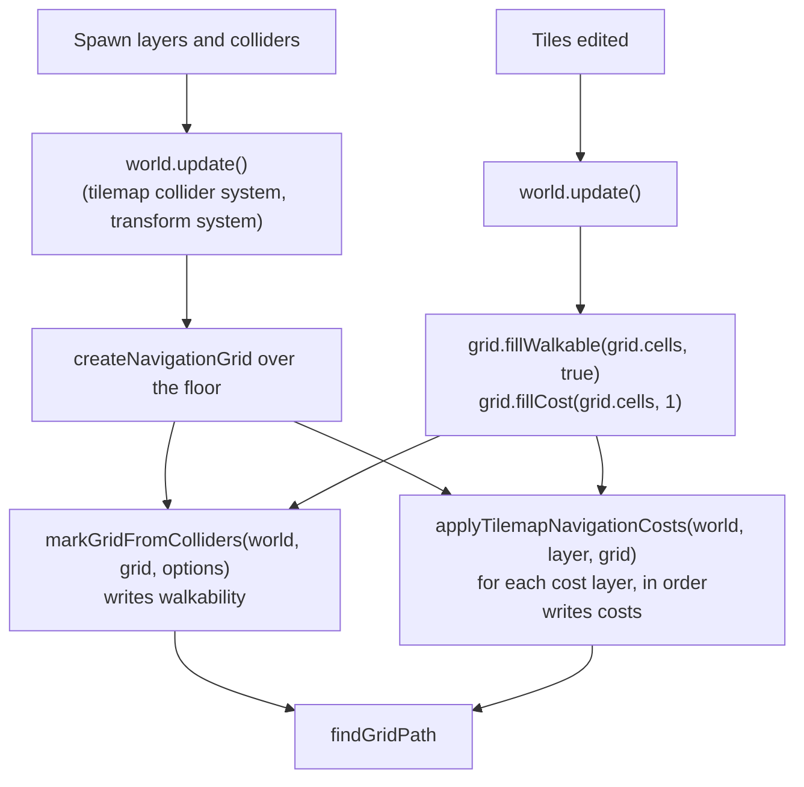

# Navigation costs from tile layers

<!-- cspell:ignore walkability fround rescan scanline -->

Issue: [#839](https://github.com/Forge-Game-Engine/Forge/issues/839)
(Path Finding milestone; builds on [navigation grids](./navigation-grids.md)
(#776), [marking cells from colliders](./navigation-grid-from-colliders.md)
(#777), [the chain collider](./chain-collider.md) (#820),
[tile collision](./tilemap-collision.md) (#825) and
[isometric navigation grids](./isometric-navigation-grids.md) (#871))

| Module or file                                                     | Change   | Notes                                                                                              |
| ------------------------------------------------------------------ | -------- | -------------------------------------------------------------------------------------------------- |
| `src/navigation/grid/navigation-grid.ts`                           | Modified | `NavigationGrid.setCosts(costs)`                                                                   |
| `src/navigation/grid/dense-navigation-grid.ts`                     | Modified | Implements `setCosts`                                                                              |
| `src/tilemaps/tile-set/tile-set.ts`                                | Modified | `TileData.navigationCost`, `TileDataOptions.navigationCost`, validation                            |
| `src/tilemaps/navigation/apply-tilemap-navigation-costs.ts`        | New      | `applyTilemapNavigationCosts(world, layerEntity, grid)`                                            |
| `src/tilemaps/navigation/index.ts`                                 | New      | Exports the new folder                                                                             |
| `src/tilemaps/index.ts`                                            | Modified | Exports `navigation/index.js`                                                                      |
| `src/navigation/grid/tile-layer-alignment.test.ts`                 | Modified | The one tile-layer bake test the issue lists that doesn't exist yet: `agentRadius` pads tile walls |
| `src/tilemaps/tiled/conversion/convert-tile-set.ts`                | Modified | Phase 2: a tile's `navigationCost` custom property becomes its `navigationCost`                    |
| `documentation-site/docs/docs/tilemaps/navigation.md`              | New      | "Navigation over tile layers" guide                                                                |
| `documentation-site/docs/docs/tilemaps/tile-sets.md`               | Modified | "Tile data" lists `navigationCost`                                                                 |
| `documentation-site/docs/docs/navigation/grids.md`                 | Modified | "Setting cell costs" documents `setCosts` and links the new guide                                  |
| `documentation-site/docs/docs/tilemaps/isometric-maps.md`          | Modified | "Finding paths across the map" mentions tile costs                                                 |
| `documentation-site/docs/docs/tilemaps/loading-tiled-maps.md`      | Modified | Phase 2: the `navigationCost` property                                                             |
| `documentation-site/src/pages/demos/isometric-path-finding/`       | Modified | Phase 2: a terrain tile with a cost, applied after each bake                                       |
| `documentation-site/static/tilemaps/isometric-tilemap/terrain.tsj` | Modified | Phase 2: the tile's `navigationCost` property                                                      |
| `AGENTS.md`                                                        | Modified | `/tilemaps`'s line in "Repository Structure" mentions per-tile navigation costs                    |
| `CHANGELOG.md`                                                     | Modified | `#### Added` bullets (navigation, tilemaps)                                                        |
| **Engine version at time of design**                               |          | `0.26.2`                                                                                           |

## Summary

A top-down or isometric game made of tiles wants its path finding to follow
the tiles: walls block, and roads are cheaper to walk than mud. Walls are
already done. A tile layer's collider is a `ChainCollider` built from its
tiles' collision shapes (`createTilemapColliderEcsSystem`), and
`markGridFromColliders` (`src/navigation/grid/mark-grid-from-colliders.ts`)
already bakes chain colliders, holes and `agentRadius` included, on
orthogonal and isometric grids. `tile-layer-alignment.test.ts` and the
"layouts" block of `mark-grid-from-colliders.test.ts` test it against tile
layers. So the issue's first task shipped with #777, and blocking stays a
collider bake with no tilemap-specific code, as the issue asks.

What's left is cost, which collision can't express. This design adds:

- `TileData.navigationCost: number | null`, set per tile in the tile set.
  `null`, the default, means the tile leaves the grid's cost alone.
- `applyTilemapNavigationCosts(world, layerEntity, grid)` in
  `src/tilemaps`: for each grid cell, it finds the tile of the layer under
  the cell's centre, through the layer's world transform, and sets the
  cell's cost to the tile's `navigationCost`. It never changes walkability.
  It's a bake step, like `markGridFromColliders`, run when the level loads
  and after it changes.
- `NavigationGrid.setCosts(costs)`, a bulk cost write that raises `version`
  at most once, so a bake that sets thousands of cells is one change, the
  same way `fillWalkableMask` serves `markGridFromColliders`.
- The one test the issue lists that's missing: `agentRadius` padding a tile
  layer's walls.

```ts
import {
  createNavigationGrid,
  findGridPath,
  markGridFromColliders,
} from '@forge-game-engine/forge/navigation';
import {
  applyTilemapNavigationCosts,
  createTileSet,
} from '@forge-game-engine/forge/tilemaps';

const tileSet = createTileSet({
  layout,
  sources: [
    {
      atlas: terrainAtlas,
      tiles: new Map([
        [0, { navigationCost: 0.5 }], // road
        [3, { navigationCost: 3 }], // mud
        [7, { collision: 'cell' }], // wall
      ]),
    },
  ],
});

// After the level's entities exist and one world.update() has placed them:
markGridFromColliders(world, grid, { agentRadius: 6 });
applyTilemapNavigationCosts(world, ground, grid);

const path = findGridPath(grid, from, to); // prefers the road, avoids mud
```

Godot keeps navigation data on its `TileSet`, next to physics and custom
data, and its `AStarGrid2D` has a per-cell weight
(`set_point_weight_scale`); Unity marks navigation areas with costs
(`NavMeshModifier`, area costs) on top of geometry baked from colliders.
This design is the grid version of both: geometry comes from colliders,
and cost from data on the tile.

The design differs from the issue's text in two places, each in the
decision log: the argument order is `(world, layerEntity, grid)`, like
every other Forge function that takes a world and an entity (TN8), and the
write goes through a new `setCosts` so `version` rises once (TN5).

## Scope

### In scope

- `TileData.navigationCost` and `TileDataOptions.navigationCost`, checked by
  `createTileSet`.
- `NavigationGrid.setCosts(costs: Float32Array)` and its
  `DenseNavigationGrid` implementation.
- `applyTilemapNavigationCosts(world, layerEntity, grid)`, for any grid and
  any layer: same or different layout, cell size, origin and cells, and
  layers that are offset, parented, rotated or scaled.
- A tile-layer `agentRadius` test, the only test from the issue's list not
  already in `src/navigation/grid`.
- A tilemap guide page on navigation, JSDoc, changelog bullets, the
  `AGENTS.md` module line.
- Phase 2: reading a Tiled tile's `navigationCost` custom property, and a
  cost tile in the Isometric Path Finding demo (open questions 1 and 2).

### Out of scope

- **Blocking from tile data.** There's no "not walkable" flag on tiles.
  Blocked cells come only from `markGridFromColliders`, so tiles, terrain
  and hand-placed colliders bake one way (the issue's design). A tile that
  should block has a collision shape.
- **Changes to the chain-collider bake.** It shipped with #777
  (`baking/collider-regions.ts`, `baking/mark-region.ts`); this design
  only adds a test.
- **A helper that builds a grid for a layer** (open question 1 of
  [isometric navigation grids](./isometric-navigation-grids.md)). The
  recipe in `navigation/grids.md` stays; that question stays there.
- **Costs that follow edits automatically.** Like the collider bake, the
  game re-applies costs when it changes the layer (it can watch the
  layer's `version`). No system or component is added.
- **Per-agent costs** (a boat that finds water cheap). One grid has one set
  of costs; a second kind of agent gets its own grid.
- **Tile-shape-aware sampling** (averaging over a grid cell, or the most
  expensive tile it overlaps). Costs are point-sampled at cell centres
  (TN3).

## API

### `TileData.navigationCost`

```ts
export interface TileData {
  // ...existing fields...

  /**
   * How much more entering a navigation grid cell costs when this tile is
   * under the cell's centre, than a cell of cost `1`: `0.5` for a road, `3`
   * for mud. `applyTilemapNavigationCosts` copies it into a grid. `null`
   * leaves the grid's cost as it is, so a layer of roads applied after a
   * layer of grass only changes the road cells. It never blocks a cell: a
   * tile that should block has a `collision` shape, which
   * `markGridFromColliders` bakes. Like `collision`, it belongs to the
   * placed tile, not to the frame an animation shows.
   */
  readonly navigationCost: number | null;
}

export interface TileDataOptions {
  // ...existing fields...

  /**
   * See {@link TileData.navigationCost}. Finite and more than `0` as a
   * 32-bit float, or `null`. Defaults to `null`.
   */
  navigationCost?: number | null;
}
```

`createTileSet` checks a non-null `navigationCost` with the grid's own
rule, `Math.fround(cost)` finite and more than `0`, and stores the rounded
value, so applying it can never throw and `getCost` reads back exactly the
tile's value. The error names the tile, as the other `createTileData`
checks do:

```text
Unable to create a tile set: tile 3 of source 0 has a navigationCost of 0, which must be finite and more than 0 as a 32-bit float, or null.
```

`defaultTileDataOptions` gains `navigationCost: null`, and
`createTileSet`'s JSDoc lists it among the defaults and the errors.

### `NavigationGrid.setCosts`

```ts
/**
 * Sets every cell's traversal cost from an array, as one change: `version`
 * increases at most once. Entry `i` is the cost of the cell whose node id
 * is `i` (see `cellToNode`). Every entry is checked before any is written,
 * so an array with a bad entry changes nothing. Use it to write costs
 * worked out from your own data in one call; read the costs you want to
 * keep with `getCost` first.
 * @param costs - One cost per cell, `nodeCount` long, each finite and more
 * than `0`.
 * @throws An error if `costs.length` isn't `nodeCount`, or an entry isn't
 * finite and more than `0`.
 */
setCosts(costs: Float32Array): void;
```

A `Float32Array` holds the grid's storage type, so no entry rounds when
it's written, and it mirrors `fillWalkableMask`'s `Uint8Array`. The
implementation:

1. Throws for a wrong length, naming `nodeCount`.
2. Scans `costs` once: throws for the first entry that isn't finite and
   more than `0` (naming its index and cell), and tracks the lowest entry
   and whether any entry differs from `_cost`.
3. If nothing differs, returns without touching `version`.
4. Otherwise copies `costs` into `_cost` (`_cost.set(costs)`), sets
   `_minCost` to the lowest entry, clears `_isMinCostStale` and increases
   `version` once.

The lowest cost is exact after the call, so the next search doesn't rescan.

### `applyTilemapNavigationCosts`

```ts
/**
 * Sets the cost of every cell of a navigation grid from a tile layer: the
 * cell takes the `navigationCost` of the layer's tile under the cell's
 * centre. A cell over an empty cell, or over a tile whose
 * `navigationCost` is `null`, keeps its cost. Walkability never changes,
 * so a blocked cell keeps blocking and takes the cost it will have if it's
 * opened.
 *
 * The centre is mapped into the layer through the layer entity's world
 * position, rotation and scale, as `worldToCell` maps it, so the grid and
 * the layer needn't share a layout, cell size, origin or cells. A grid
 * laid over the layer (the layer's layout, its origin at the layer's world
 * position) gets each cell's own tile.
 *
 * It's a bake step: run it when the level loads, after one
 * `world.update()` has placed the layer, and again after the layer's tiles
 * change, not every frame. Since `null` leaves costs alone, reset them
 * first with `grid.fillCost(grid.cells, 1)` when re-applying, and apply
 * several layers in order: a later layer's costs replace an earlier one's.
 * `grid.version` increases once if any cost changed.
 * @param world - The ECS world the layer entity belongs to.
 * @param layerEntity - The entity with the `TilemapLayerEcsComponent` and a
 * `PositionEcsComponent`.
 * @param grid - The grid whose costs to set.
 * @throws An error if the entity has no `TilemapLayerEcsComponent` or no
 * `PositionEcsComponent`, or its world scale is `0` on an axis.
 */
export function applyTilemapNavigationCosts(
  world: EcsWorld,
  layerEntity: number,
  grid: NavigationGrid,
): void;
```

It lives in `src/tilemaps/navigation/` and imports `NavigationGrid` as a
type only, so `src/tilemaps` takes no runtime dependency on
`src/navigation` (TN6).

## Algorithm

```text
applyTilemapNavigationCosts(world, layerEntity, grid):
  layer = world.getComponent(layerEntity, tilemapLayerId)   or throw
  world.getComponent(layerEntity, positionId)               or throw
  costs = new Float32Array(grid.nodeCount)
  layout = layer.tileSet.layout

  for row in grid.cells.minRow .. maxRow:
    for column in grid.cells.minColumn .. maxColumn:
      node = grid.cellToNode(column, row)
      costs[node] = grid.getCost(column, row)

      local = worldToLocalPoint(world, layerEntity, grid.cellToWorld(column, row))
      cell = layout.localToCell(local)

      if cell is outside the addressable range (-2^30 .. 2^30 - 1):
        continue                       // no tile can be stored there
      tile = getTile(layer, cell.column, cell.row)
      if tile == emptyTile:
        continue
      cost = getTileData(layer.tileSet, tile).navigationCost
      if cost != null:
        costs[node] = cost

  grid.setCosts(costs)
```

- `worldToLocalPoint` followed by `layout.localToCell` is exactly
  `worldToCell(world, layerEntity, point)`, without looking the layer up
  again per cell. A test checks they agree.
- A grid cell's centre on an edge shared by two tile cells goes to the one
  the layout says owns it, as every Forge cell conversion does, so the
  result doesn't depend on rounding.
- Reading the tiles directly means an edit is visible at once. The layer's
  collider only follows edits after `createTilemapColliderEcsSystem` runs,
  but the costs need no system to run first.
- The function never reads `position.local`: it sees the transform the
  transform system wrote on its last pass, like `markGridFromColliders`.

### Data flow at load and after edits



Walkability and cost are separate fields with separate bake steps, so the
two run in either order. The game owns both writes: the grid has no
system, so "one writer per value" means one bake routine in the game, like
the Isometric Path Finding demo's `createBakeGridEcsSystem`.

### Performance

For a grid of `n` cells the function makes `n` centre and inverse
transform computations, `n` chunk lookups (a `Map` read by chunk key), one
`Float32Array` of `n` entries and one `setCosts` pass. A 256 × 256 grid is
65,536 cells, a few milliseconds once per load or edit. The per-cell
vectors from `cellToWorld` and `worldToLocalPoint` are short-lived; if a
profile shows them, the layer's world transform can be read once and
applied inline with the same math, which changes nothing observable.

There's no fast path for an aligned grid (reading tile `(c, r)` for cell
`(c, r)`): the general path already gives that answer, and a second path
would need its own tests to stay equal.

## Testing

### `tile-set.test.ts`

- `navigationCost` defaults to `null`, for the default tile and a tile
  with other data.
- A given cost is stored, rounded to 32 bits (`0.1` reads back as
  `Math.fround(0.1)`), and `null` is accepted.
- Throws, naming the tile, for `0`, `-1`, `NaN`, `Infinity`, `1e-50`
  (underflows to `0`) and `1e39` (overflows to `Infinity`).

### `dense-navigation-grid` / `create-navigation-grid.test.ts`

- `setCosts` writes every cell, read back with `getCost`.
- Throws for a wrong length; throws for a `0`, negative, `NaN` or
  `Infinity` entry and changes no cell and not `version`.
- `version` increases once for an array that changes many cells, and not
  for one equal to the current costs.
- The heuristic uses the new lowest cost: after raising every cost to `4`,
  a search on an open grid returns the same cost as `findPath` on a
  reference graph with step costs times `4`, and lowering one cell below
  the rest is reflected straight away.

### `apply-tilemap-navigation-costs.test.ts`

Built with `createCollisionTestTileSet`-style test tile sets that give
tiles costs, on the orthogonal and isometric layouts
`tile-layer-alignment.test.ts` uses.

- **Aligned grid.** With the layer's layout, origin at the layer's world
  position and its used cells, every cell's cost is its own tile's
  `navigationCost`, for both layouts and a layer at a non-zero position.
- **Leaves costs alone.** Prefilled with `7`, cells over empty cells and
  over tiles whose `navigationCost` is `null` stay `7`.
- **Finer grid.** A grid with half the layer's cell size gives each of the
  four grid cells over a tile that tile's cost.
- **Coarser grid.** A grid with twice the cell size takes the tile under
  each cell's centre (the issue's "different cell size").
- **Offset and parented layer.** A layer whose own position and parent's
  position differ from the grid's origin, after the transform system has
  run, samples the tile `worldToCell` reports for each centre.
- **Rotated and scaled layer.** Each cell's cost matches
  `worldToCell(world, layerEntity, grid.cellToWorld(c, r))`.
- **Walkability.** Blocked cells stay blocked and take their tile's cost;
  open cells stay open.
- **Animated tile.** A cell holding an animated tile takes the placed
  tile's cost, whichever frame shows.
- **Layers in order.** Applying a ground layer then a road layer leaves the
  road layer's costs on road cells and the ground's elsewhere.
- **Version.** It increases once for a call that changes costs, and not for
  a second identical call.
- **Errors.** It throws for an entity without a `TilemapLayerEcsComponent`,
  without a `PositionEcsComponent`, and with a world scale of `0`.
- **Paths.** After applying a road and a mud band, `findGridPath` goes
  along the road around the mud when that's cheaper, and through the mud
  when going round costs more.

### `tile-layer-alignment.test.ts`

The issue's tile-layer bake tests are already there or in
`mark-grid-from-colliders.test.ts`'s "layouts" block, on both layouts: the
walled room with a hole that stays walkable, the slope tile, corner-touching
tiles and paths through open cells. The missing one:

- **`agentRadius` pads tile walls.** With the existing wall and
  `{ agentRadius }` of a quarter and of one cell height, the blocked cells
  match `compareWithReference` over the layer collider's loops moved to the
  layer's world position (no wrong cells), and include the wall cells.

## Documentation

- **New page** `documentation-site/docs/docs/tilemaps/navigation.md`
  ("Navigation over tile layers", `sidebar_position` after "Tile
  collision"): laying a grid over a layer (linking
  `navigation/grids.md#laying-a-grid-over-a-tile-layer`), blocking cells
  from the layer's collider (linking `navigation/colliders.md`), giving
  tiles a `navigationCost`, `applyTilemapNavigationCosts` and how centres
  are sampled when the grid's cells differ from the layer's, applying
  several layers in order, and re-baking after an edit (reset walkability
  and costs, then bake both).
- **`tilemaps/tile-sets.md`**, "Tile data": `navigationCost` joins the list
  of fields and defaults.
- **`navigation/grids.md`**, "Setting cell costs": `setCosts`, and a link to
  the new page for costs from tiles. "Laying a grid over a tile layer"
  links it too.
- **`tilemaps/isometric-maps.md`**, "Finding paths across the map": one
  sentence on `applyTilemapNavigationCosts`.
- **Phase 2:** `tilemaps/loading-tiled-maps.md`, "Tiles and tile data",
  lists the `navigationCost` property.
- JSDoc on every new export and field, as above.

## Phases

### Phase 1: costs from tile layers

`setCosts`, `navigationCost`, `applyTilemapNavigationCosts`, the missing
bake test, docs and changelog.

**Done when** the tests under "Testing" pass, a level made of orthogonal or
isometric tile layers gives a grid whose blocked cells match its solid
tiles and whose costs match its tiles' `navigationCost` with no cell set by
hand (the issue's "done when"), the docs pages are written, and the
CLAUDE.md verification steps pass.

| Task                          | Description                                                                                                                                                                                     | Size |
| ----------------------------- | ----------------------------------------------------------------------------------------------------------------------------------------------------------------------------------------------- | ---- |
| `setCosts`                    | Interface method with JSDoc; `DenseNavigationGrid`: length check, one validating scan, copy, exact `_minCost`, one `version` increase; tests                                                    | S    |
| `navigationCost`              | `TileData` and `TileDataOptions` fields with JSDoc, default, 32-bit validation naming the tile, `createTileSet` JSDoc; tests                                                                    | S    |
| `applyTilemapNavigationCosts` | `src/tilemaps/navigation/`: lookups and errors, the per-cell sampling, the addressable-range guard, one `setCosts`; exports from `src/tilemaps/navigation/index.ts` and `src/tilemaps/index.ts` | M    |
| Tests                         | `apply-tilemap-navigation-costs.test.ts` as listed; the tile-layer `agentRadius` test in `tile-layer-alignment.test.ts`                                                                         | M    |
| Docs                          | `tilemaps/navigation.md`; edits to `tile-sets.md`, `grids.md`, `isometric-maps.md`; `AGENTS.md` `/tilemaps` line                                                                                | M    |
| Changelog                     | `#### Added`: **navigation:** `NavigationGrid.setCosts(costs)`; **tilemaps:** `TileData.navigationCost` and `applyTilemapNavigationCosts(world, layerEntity, grid)`                             | S    |

### Phase 2: Tiled costs and the demo

Tiled maps get costs without code, and the Isometric Path Finding demo
shows a path choosing cheaper tiles. Depends on open questions 1 and 2;
dropping either drops its tasks.

**Done when** a Tiled tile with a numeric `navigationCost` property loads
with that `navigationCost`, a non-numeric or invalid one fails the load
naming the tile, the demo's path visibly avoids its costly tile, and the
CLAUDE.md verification steps (including the demo steps) pass.

| Task         | Description                                                                                                                                                                                                         | Size |
| ------------ | ------------------------------------------------------------------------------------------------------------------------------------------------------------------------------------------------------------------- | ---- |
| Tiled loader | `convert-tile-set.ts`: an `int` or `float` property named `navigationCost` becomes `navigationCost`, still kept in `properties`; any other type throws naming the tile; tests with a fixture tileset                | S    |
| Demo         | Give one terrain tile a `navigationCost` in `terrain.tsj`, place it in `courtyard.tmj`, and call `applyTilemapNavigationCosts` for the floor in `_bake-grid.system.ts` after resetting costs; update "How it works" | M    |
| Docs         | `loading-tiled-maps.md`, "Tiles and tile data"                                                                                                                                                                      | S    |
| Changelog    | `#### Added`: **tilemaps:** the Tiled loader reads a tile's `navigationCost` property                                                                                                                               | S    |

The `claude` label run can ship both phases in one pull request.

## Decision log

| #    | Decision                                | Options considered                                                                                                                                 | Chosen | Rationale                                                                                                                                                                                                                                                                                                                                 | Tradeoff                                                                                                     | Assumptions                                               |
| ---- | --------------------------------------- | -------------------------------------------------------------------------------------------------------------------------------------------------- | ------ | ----------------------------------------------------------------------------------------------------------------------------------------------------------------------------------------------------------------------------------------------------------------------------------------------------------------------------------------- | ------------------------------------------------------------------------------------------------------------ | --------------------------------------------------------- |
| TN1  | Where a tile's cost lives               | (a) A typed `TileData.navigationCost`; (b) a `properties.navigationCost` convention; (c) a callback argument, `(data: TileData) => number \| null` | (a)    | The issue's choice. Godot's `TileSet` keeps navigation and physics data typed, apart from custom data. A field is checked once when the tile set is built, so a bad cost fails at load, not mid-game. (b) gives a property name a hidden meaning in a free-form map. (c) adds a parameter every caller writes the same way.               | A game deriving cost from other data builds its tile set with it.                                            | Cost is a property of the tile, not of where it's placed. |
| TN2  | What `null` means                       | (a) Leave the grid's cost alone; (b) set it to `1`                                                                                                 | (a)    | The issue's choice. It lets layers stack (grass, then roads over it) and lets a layer of decorations carry no cost opinion. (b) makes the last layer applied reset every cell it covers.                                                                                                                                                  | Re-applying after an edit resets costs first (`fillCost(grid.cells, 1)`), as re-baking resets walkability.   |                                                           |
| TN3  | Which tile a grid cell takes            | (a) The tile under the cell's centre; (b) the most expensive tile the cell overlaps; (c) an area-weighted average                                  | (a)    | The issue's choice. It's exact for a grid laid over the layer, the common case, and each cell has one answer from one cell conversion. (b) and (c) need cell-polygon overlap against tile cells for every pair of layouts, for grids most games don't build.                                                                              | A coarser grid misses tiles between centres (a thin road).                                                   | Grids finer than or equal to their tiles are the norm.    |
| TN4  | How centres reach the layer             | (a) Through the layer entity's world transform, as `worldToCell`; (b) require an aligned grid and read tile `(c, r)` for cell `(c, r)`             | (a)    | The issue asks for it: grids and layers needn't share layout, cell size or origin, and an offset or parented layer still works. (b) would throw or silently misread for the offset layers Tiled produces. For an aligned grid (a) gives (b)'s answer.                                                                                     | One inverse transform per cell.                                                                              | Bakes run on load and after edits, not per frame.         |
| TN5  | How the bake writes costs               | (a) A new `setCosts(Float32Array)`, `version` once; (b) `setCost` per cell; (c) `setCostsMasked(mask, costs)`                                      | (a)    | #776 promises one `version` increase per changing call (NG14), and #777 added `fillWalkableMask` for the same reason (MC9); (b) raises it once per cell. (a) also makes the lowest cost exact in one pass instead of marking it stale. Reading kept costs with `getCost` costs one array read per cell, simpler than a second mask array. | A public method added to `NavigationGrid` for the bake, which games can use for their own data.              |                                                           |
| TN6  | Where the function lives                | (a) `src/tilemaps`, importing the `NavigationGrid` type; (b) `src/navigation`, importing tilemaps                                                  | (a)    | The issue's choice, and the lighter dependency: tilemaps already depends on physics and rendering, and a type-only import adds no runtime code. (b) would make `@forge-game-engine/forge/navigation` pull in tilemaps and through it rendering, for a module that otherwise knows nothing of tiles.                                       | Unlike `markGridFromColliders`, the navigation bake for tiles is found under tilemaps; the guides link both. |                                                           |
| TN7  | A function, not a system                | (a) A bake function; (b) a system that re-applies when a layer's `version` changes                                                                 | (a)    | Matches `markGridFromColliders` (MC1). The game decides when its level changed and which layers carry costs; a system would need a component naming the grid and its layers, and would race the game's walkability bake for the reset.                                                                                                    | The game calls it after edits (the demo shows how).                                                          |                                                           |
| TN8  | Argument order                          | (a) `(world, layerEntity, grid)`; (b) the issue's `(grid, world, layerEntity)`                                                                     | (a)    | Every Forge function taking a world and an entity puts them first (`cellToWorld`, `worldToCell`, `worldToLocalPoint`), and `markGridFromColliders(world, grid)` puts the world before the grid.                                                                                                                                           | Differs from the issue's text.                                                                               | Open question 3                                           |
| TN9  | Validating a cost                       | (a) At tile set creation, with the grid's 32-bit rule, storing the rounded value; (b) "positive" only; (c) when applied                            | (a)    | A cost that's fine as a 64-bit number can still underflow or overflow as a 32-bit one, which `setCost` would reject mid-bake. (a) makes `applyTilemapNavigationCosts` unable to fail on tile data, and `getTileData(...).navigationCost` reads back what the grid will hold.                                                              | `TileData` holds a 32-bit-rounded number.                                                                    |                                                           |
| TN10 | The chain-collider task                 | (a) Treat it as shipped with #777 and add the one missing test; (b) re-design the bake                                                             | (a)    | `collider-regions.ts` and `mark-region.ts` bake chains by scanline in cell space with holes and `agentRadius`, as the task asks, and the tile-layer tests cover rooms, holes, slopes and both layouts. Only `agentRadius` over a tile layer is untested.                                                                                  |                                                                                                              |                                                           |
| TN11 | Cells with no tile, and centres far off | (a) Keep their cost; (b) set them to `1`                                                                                                           | (a)    | An empty cell says nothing about cost, as a `null` tile doesn't (TN2). A centre mapped outside `-2^30 .. 2^30 - 1` can't hold a tile, so it counts as empty instead of making `getTile` throw.                                                                                                                                            |                                                                                                              |                                                           |

## Open questions

1. **Tiled maps' costs** (non-blocking). Tiled has no navigation data, and
   `TileSet` is frozen once loaded, so without loader support a Tiled game
   can't give tiles a `navigationCost` short of rebuilding the tile set.
   - _Read a `navigationCost` custom property (default, Phase 2)._ An
     `int` or `float` property of that name becomes the tile's
     `navigationCost` and stays in `properties`, which remains a verbatim
     copy. Costs are authored in Tiled with no code. The cost is one
     reserved property name, the first the loader has.
   - _Leave Tiled out._ The loader keeps no reserved names; a Tiled game
     works out costs from `properties` with `forEachTile` and `setCost`
     itself, so `applyTilemapNavigationCosts` only serves code-built tile
     sets.
   - _A loader option naming the property._ Flexible, but an option every
     game sets to the same thing.

   A different answer drops or changes Phase 2's loader task. Phase 1 is
   unaffected.

2. **The demo** (non-blocking).
   - _Give a terrain tile a cost in the Isometric Path Finding demo
     (default, Phase 2)._ The page shows the whole tile-to-navigation
     story, walls and costs. Needs open question 1's loader support, since
     the demo loads a Tiled map.
   - _No demo change._ Costs are a small addition to a demo that already
     shows tile layers baked into a grid; the docs page and tests cover
     it.

3. **Argument order** (non-blocking). `(world, layerEntity, grid)` (default,
   TN8) matches Forge's other world-and-entity functions; the issue wrote
   `(grid, world, layerEntity)`. A different answer reorders one signature
   and its callers.

4. **Combining several cost layers** (non-blocking).
   - _The last layer applied wins (default)._ Simple, and the game controls
     the order, like drawing layers.
   - _The highest cost wins, or costs multiply._ Order-independent, but a
     road can no longer make grass cheaper, and the rule hides in the
     function.
