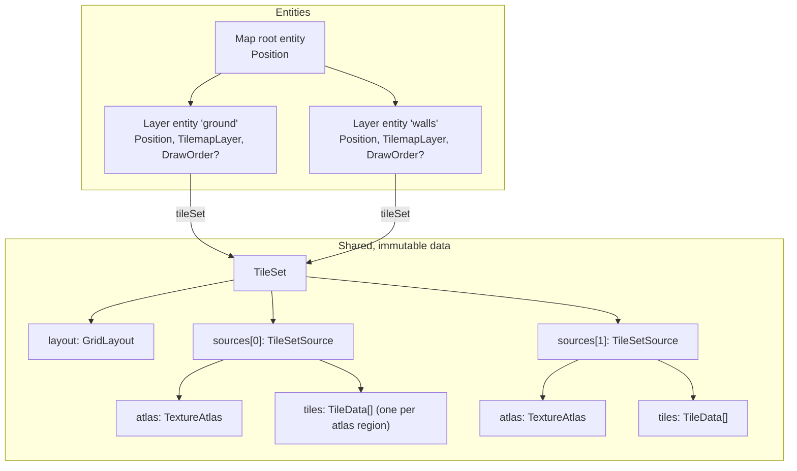

<!-- cspell:words tilemap tilemaps tileset tilesets quadrant quadrants tileoffset firstgid -->

# Tile sets and tilemap layers

Issue: [#805](https://github.com/Forge-Game-Engine/Forge/issues/805)
(milestone "Tilemaps"; builds on [grid layouts](./grid-layouts.md) (#869)
and [texture atlases](./texture-atlases.md) (#796); #812, #825, #830, #836
and #872 build on it)

| Module or file                                                                  | Change   | Notes                                                                                                                        |
| ------------------------------------------------------------------------------- | -------- | ---------------------------------------------------------------------------------------------------------------------------- |
| `src/tilemaps/` (`index.ts`)                                                    | New      | The module, exported from `/src/index.ts` and as `@forge-game-engine/forge/tilemaps` in `package.json` `exports`             |
| `src/tilemaps/tile-set/tile-set.ts`                                             | New      | `TileSet`, `TileSetSource`, `TileData` and their options, `createTileSet`, `getTileData`                                     |
| `src/tilemaps/tiles/packed-tile.ts`                                             | New      | `PackedTile`, `emptyTile`, `packTile`, `unpackTile`, the bit layout and its limits                                           |
| `src/tilemaps/tiles/get-tile-image-rect.ts`                                     | New      | `getTileImageRect`: where a tile's image sits on its cell, the one definition #812 draws with                                |
| `src/tilemaps/tiles/tile-transform.ts`                                          | New      | Internal: the transform bits' content map and its inverse (the sampling map). Not exported from the package                  |
| `src/tilemaps/components/tilemap-layer-component.ts`                            | New      | `TilemapLayerEcsComponent`, `TilemapChunk`, `tilemapLayerId`, `addTilemapLayerComponent`, `tilemapChunkSize`                 |
| `src/tilemaps/cells/`                                                           | New      | The cell functions: `setTile`, `getTile`, `clearTile`, `fillTiles`, `clearTiles`, `forEachTile`, `getUsedRect`, `setTileSet` |
| `src/tilemaps/cells/chunk-key.ts`                                               | New      | Internal: cell to chunk, chunk keys, row-major chunk order. Not exported from the package                                    |
| `src/tilemaps/conversions/`                                                     | New      | `cellToLocal`, `localToCell`, `cellToWorld`, `worldToCell`                                                                   |
| `src/common/transforms/` (`local-to-world-point.ts`, `world-to-local-point.ts`) | New      | General point conversion through an entity's world transform, which `cellToWorld`/`worldToCell` use                          |
| `cspell.json`                                                                   | Modified | `tilemap`, `tilemaps`, `tileset`, `tilesets`                                                                                 |
| `documentation-site/docs/docs/tilemaps/` (`_category_.json`, `index.md`)        | New      | The tilemaps guide                                                                                                           |
| `documentation-site/src/components/ModuleIcon.tsx`                              | Modified | A `tilemaps` icon for the new category                                                                                       |
| `documentation-site/docs/docs/common/transforms.md`                             | Modified | "Converting points between local and world space"                                                                            |
| `documentation-site/docs/docs/math/grid-layouts.md`                             | Modified | Links the tilemaps guide                                                                                                     |
| `CHANGELOG.md`                                                                  | Modified | `#### Added` bullets                                                                                                         |
| **Engine version at time of design**                                            |          | `0.26.2`                                                                                                                     |

## Summary

Forge can't describe a grid of tiles. A game that wants a tile map today
makes one sprite entity per tile, and `createRenderEcsSystem`
(`src/rendering/systems/render-system.ts`) sorts every sprite every frame
while `createBroadPhaseEcsSystem` (`src/physics/systems/broad-phase-system.ts`)
tests every collider pair, so that doesn't scale past a few screens of tiles.

This design adds the data model every other Tilemaps issue builds on, in a
new `src/tilemaps` module:

- **`TileSet`**: an immutable description of what tiles look like and how
  cells are laid out. It holds a `GridLayout` (#869) and a list of
  **sources**, each a `TextureAtlas` (#796) whose regions are the tiles,
  the size a tile draws at, and a `TileData` per tile (custom properties,
  where the image sits, where the tile y-sorts).
- **Packed tiles**: a cell holds one unsigned 32-bit number naming a source,
  a tile in it, and three transform bits (flip X, flip Y, transpose) that
  together give all eight 90-degree rotations and mirrors. `0` is an empty
  cell.
- **`TilemapLayerEcsComponent`**: one layer of cells on one entity, stored
  sparsely in 32 x 32 chunks of `Uint32Array`, unbounded in every
  direction. A map is a root entity whose children are layer entities,
  ordered by sibling order and `DrawOrderEcsComponent` like anything else.
- **Cell functions** (`setTile`, `getTile`, `fillTiles`, ...): the only
  code that writes a layer's cells. Every write stamps the chunks it
  changed with the layer's new `version`, so the renderer (#812) and the
  collider baker (#825) each find what changed since they last looked,
  without sharing or clearing a dirty flag. A consumer also records which
  layer component it built from, so a layer replaced on the same entity
  (whose `version` starts again at `0`) is rebuilt from scratch.
- **Conversions** between cells and layer-local positions through the
  tileset's layout, and between cells and world positions through the
  layer entity's world transform, for mouse picking.

```ts
const layout = createIsometricGridLayout({ cellWidth: 64, cellHeight: 32 });
const tileSet = createTileSet({
  layout,
  sources: [
    {
      atlas: createGridTextureAtlas(floorTexture, {
        cellWidth: 64,
        cellHeight: 32,
      }),
    },
    {
      atlas: createGridTextureAtlas(wallTexture, {
        cellWidth: 64,
        cellHeight: 96,
      }),
      tileHeight: 96,
      tiles: new Map([[3, { properties: { door: true } }]]),
    },
  ],
});

const ground = world.createEntity();
addPositionComponent(world, ground);
const layer = addTilemapLayerComponent(world, ground, { tileSet });

fillTiles(layer, -8, -8, 16, 16, packTile({ source: 0, tile: 2 }));
setTile(layer, 0, 3, packTile({ source: 1, tile: 3, flipX: true }));

const cell = worldToCell(world, ground, cameraView.viewportToWorld(mouse));
const data = getTileData(tileSet, getTile(layer, cell.column, cell.row));
```

The design follows Godot's `TileMapLayer` and `TileSet` and Unity's
`Tilemap` closely: tiles are data in one component, not entities; layers
are separate entities grouped by the hierarchy; tilesets have several
atlas sources; cells hold a tile reference plus a transform. It differs in
one place from the issue's text: change tracking uses per-chunk change
stamps, as Bevy's change detection does, instead of a shared set of dirty
chunk keys, because a set that one consumer clears hides the change from
the others (decision T5, open question 1).

Nothing here bends a core design of the engine. A layer is one component
on one entity, its cell data has one writer (the cell functions), no
system is added, and the transform system stays the only writer of
`world`.

## Scope

### In scope

- The `src/tilemaps` module, its exports and its docs category.
- `TileSet`, `TileSetSource` and `TileData`, built and validated by
  `createTileSet`, and `getTileData`.
- The packed tile value: `packTile`, `unpackTile`, `emptyTile`, the
  documented bit layout and the meaning of each transform bit.
- The tile image placement rule and `getTileImageRect`.
- `TilemapLayerEcsComponent` with chunked sparse storage, `version` and
  per-chunk change stamps, and `addTilemapLayerComponent`.
- The cell functions: `setTile`, `getTile`, `clearTile`, `fillTiles`,
  `clearTiles`, `forEachTile`, `getUsedRect` and `setTileSet`.
- `cellToLocal`, `localToCell`, `cellToWorld` and `worldToCell`, and the
  general `localToWorldPoint`/`worldToLocalPoint` in `src/common` they're
  built on.
- Validation, unit tests, JSDoc, the tilemaps guide and changelog bullets.

### Out of scope

- **Drawing tiles.** Chunk meshes, the tilemap material, culling and
  texture bleeding are #812. Until then a layer draws nothing.
- **Collision shapes and colliders** (#825), **tile animation** (#830),
  **y-sorting a layer's tiles with characters** (#872) and **loading Tiled
  maps** (#836). This design only leaves `TileData` open for the fields
  they add and records what they need from it ("Notes for later issues").
- **Staggered and hexagonal layouts** (see #869 and
  [grid layouts](./grid-layouts.md), decision G4).
- **Per-cell data beyond the tile**: a per-cell color, a per-cell
  arbitrary matrix (Unity's `SetTransformMatrix`) or per-cell custom data.
  Per-tile custom data is `TileData.properties`; anything per cell is a
  second layer or game data keyed by cell.
- **Rule tiles, terrains and automatic tile matching** (Godot terrains, Unity's
  `RuleTile`). They're editing tools that call `setTile`, and can be added
  on top later.
- **Looking up a tile by region name** (open question 5). A tile is its
  atlas region's index.
- **Tile change events or callbacks.** Consumers compare versions
  (decision T5).
- **Saving and loading layers.** The chunk arrays are plain typed arrays a
  save system can copy; a format is a design of its own.
- **A docs-site demo** (open question 6). A layer draws nothing until #812.
- **Runtime atlas packing** for image-collection tilesets; #796 leaves it
  out, and #836 rejects such tilesets.

## Concepts and entity composition



- **A tileset is shared data, not an entity**, like a `TextureAtlas` or a
  `Material`. Any number of layers (and maps) use one tileset. It's frozen
  once built (decision T6).
- **A layer is one entity** with a `TilemapLayerEcsComponent` and a
  `PositionEcsComponent` (plus `RotationEcsComponent`/`ScaleEcsComponent`
  when it needs them). Its cells are in layer-local space: cell `(0, 0)` is
  placed by the layout at the layer entity's origin.
- **A map is a hierarchy**, as in Godot 4.3, where standalone
  `TileMapLayer` nodes under a plain parent replaced the multi-layer
  `TileMap` node. There's no map component. The root entity carries the
  map's transform; layers are its children, in sibling order (later
  siblings draw on top), with `DrawOrderEcsComponent` when a sprite has to
  sort between two layers (`src/rendering/draw-order.ts`). The Tiled
  importer (#836) builds exactly this, with group layers as intermediate
  entities.

### Tile sets and sources

A `TileSetSource` is one atlas: one texture, so one draw batch (#812).
A tileset with several sources is how a map mixes a floor sheet, a wall
sheet and a prop sheet, the way Godot's `TileSet` holds several
`TileSetAtlasSource`s and Tiled's map lists several tilesets.

A tile is identified by its **source index** in `tileSet.sources` and its
**tile index**, which is the index of its region in `source.atlas.regions`.
For a grid atlas (`createGridTextureAtlas`) that's row-major, the same
local tile id Tiled uses, so the importer copies ids across. For a packed
atlas (`createTexturePackerAtlas`) it's the region order the atlas keeps.
Every region of the atlas is a tile; nothing has to be "created" in the
source first, as it does in Godot (decision T7).

Each source has a drawn tile size, `tileWidth` by `tileHeight`, in
layer-local units. It defaults to the layout's `cellWidth` by `cellHeight`.
Every tile of a source draws at that size, whatever its region's texel
size, which is the rule Tiled and Godot use per tileset/atlas source. A
trimmed region (from a packer) draws only its share of that frame, exactly
as a trimmed region draws on a sprite (`SpriteEcsComponent.width`/`height`
are the untrimmed frame), so trimming is invisible to placement.

### Tile data

```ts
interface TileData {
  /** Custom data, like Tiled's tile properties and Godot's custom data layers. */
  readonly properties: Readonly<Record<string, TilePropertyValue>>;
  /** Moves the image from its default spot, in layer-local units, Y-down. */
  readonly textureOrigin: Readonly<Vector2>;
  /** Where a y-sorted layer sorts the tile: an offset from the cell's center, Y-down. */
  readonly ySortOrigin: number;
}
```

`TileData` is a plain frozen object, so later issues add fields to it
(#825's `collision`, #830's `animation`) without changing its shape.
Tiles without overrides share one frozen default `TileData` per tileset
(decision T8).

### Tile image placement

Tiles can draw larger than their cell: isometric walls, and props in a
3/4-view orthogonal game, are taller than the cell's footprint. One rule
places every tile, in both layouts, and it's the rule Tiled uses:

- the image is the source's `tileWidth` by `tileHeight`;
- its bottom-left corner sits on the bottom-left corner of the cell
  footprint's bounds (`layout.getCellFootprintBounds(column, row)`);
- then it moves by the tile's `textureOrigin`, Y-down: `+Y` moves it down.

```
image.min.x = bounds.min.x + textureOrigin.x
image.max.y = bounds.max.y + textureOrigin.y
image.max.x = image.min.x + tileWidth
image.min.y = image.max.y - tileHeight
```

`getTileImageRect(tileSet, column, row, tile)` returns that rect in
layer-local space. It's the only definition: #812's mesh builder calls it,
and so can a game that previews a tile under the mouse.

`textureOrigin` plays the role of Godot's `texture_origin` and Tiled's
`tileoffset`, with Forge's Y-down sign: Godot's `texture_origin` moves the
texture the opposite way, Tiled's `tileoffset` the same way, so the
importer copies it across unchanged.

The back-to-front guarantee of `GridLayout` holds for an image that is at
most one cell wide, starts at the footprint's left edge
(`textureOrigin.x === 0`) and doesn't reach below the footprint
(`textureOrigin.y <= 0`). It can reach up by any amount. `createTileSet`
doesn't reject tiles outside those limits, since props need them; the
JSDoc of `textureOrigin` and `tileWidth` says that such tiles may draw in
the wrong order against their neighbors in a layer that isn't y-sorted.

### The packed tile value

A cell holds a `PackedTile`, an unsigned 32-bit integer:

| Bits  | Field     | Meaning                                                                      |
| ----- | --------- | ---------------------------------------------------------------------------- |
| 31    | flipX     | Mirror the image left to right                                               |
| 30    | flipY     | Mirror the image top to bottom on screen (Y-down)                            |
| 29    | transpose | Swap the image's X and Y axes (mirror across its top-left/bottom-right line) |
| 28    | present   | Always `1` in a non-empty tile, so no tile packs to `0`                      |
| 20–27 | source    | Source index, `0` to `255`                                                   |
| 0–19  | tile      | Tile index in the source, `0` to `1,048,575`                                 |

`0` (`emptyTile`) is an empty cell. A non-zero value with bit 28 clear is
malformed, and every function that takes a tile throws for it.

The three transform bits sit where Tiled puts its horizontal, vertical and
diagonal flip bits, and mean the same thing, so a Tiled `gid`'s flags carry
across bit for bit (#836 still rebuilds the rest of the value from the
`gid` and `firstgid`). Tiled's bit 28 (hexagonal 120-degree rotation)
doesn't apply to the layouts Forge has; the importer rejects it.

**What the transform bits do.** They move the image's content within its
own normalized coordinates `(u, v)`, `(0, 0)` at the image's top-left and
`(1, 1)` at its bottom-right (Y-down, like every normalized 2D coordinate
in the engine). Each formula says where content moves to: the texel drawn
at `(u, v)` in the untransformed image is drawn at `f(u, v)` in the
transformed one. Transpose applies first, then flip X, then flip Y, the
order Tiled documents:

```
transpose: (u, v) -> (v, u)
flipX:     (u, v) -> (1 - u, v)
flipY:     (u, v) -> (u, 1 - v)

content map:  f      = flipY ∘ flipX ∘ transpose   (only the bits that are set)
sampling map: f⁻¹    = transpose ∘ flipX ∘ flipY   (each step is its own inverse)
```

So turning 90 degrees clockwise (transpose and flip X) has the content map
`f(u, v) = (1 - v, u)`: the image's top-left content `(0, 0)` lands at the
top-right `(1, 0)`.

The image's rect doesn't move or change size (it's still
`getTileImageRect`), so a renderer applies the bits through the quad's
texture coordinates (#812), and that needs the **inverse**: the quad's
corner at `p` (in the rect's normalized coordinates) shows the content that
moved there, so it samples the untransformed image at `f⁻¹(p)`, which is
the flips undone first, then the transpose. For 90 degrees clockwise the
sampling map is `(u, v) -> (v, 1 - u)`: the screen's top-left corner
samples the image's bottom-left `(0, 1)`. Using `f` instead of `f⁻¹` for
texture coordinates swaps the two 90-degree turns and leaves the other six
combinations right, which is why both maps are spelled out here.

The eight combinations, with both maps:

| transpose | flipX | flipY | On screen                                      | Content at `(u, v)` moves to | Screen point `(u, v)` samples |
| --------- | ----- | ----- | ---------------------------------------------- | ---------------------------- | ----------------------------- |
| 0         | 0     | 0     | As drawn                                       | `(u, v)`                     | `(u, v)`                      |
| 0         | 1     | 0     | Mirrored left to right                         | `(1 - u, v)`                 | `(1 - u, v)`                  |
| 0         | 0     | 1     | Mirrored top to bottom                         | `(u, 1 - v)`                 | `(u, 1 - v)`                  |
| 0         | 1     | 1     | Turned 180 degrees                             | `(1 - u, 1 - v)`             | `(1 - u, 1 - v)`              |
| 1         | 1     | 0     | Turned 90 degrees clockwise                    | `(1 - v, u)`                 | `(v, 1 - u)`                  |
| 1         | 0     | 1     | Turned 90 degrees counter-clockwise            | `(v, 1 - u)`                 | `(1 - v, u)`                  |
| 1         | 0     | 0     | Mirrored across the top-left/bottom-right line | `(v, u)`                     | `(v, u)`                      |
| 1         | 1     | 1     | Mirrored across the top-right/bottom-left line | `(1 - v, 1 - u)`             | `(1 - v, 1 - u)`              |

Only the two 90-degree turns have a sampling map different from their
content map; each is the other's. The sampling map's `(u, v)` is in the
source's untrimmed frame, which the renderer maps into the region's
texture rect. A trimmed region draws only its share of the frame (see
"Tile sets and sources"): the quad covers `f` of the trimmed sub-rect (an
axis-aligned rect, since all eight maps keep rects axis-aligned), and its
corners sample through `f⁻¹` the same way.

Both maps live in one internal file, `src/tilemaps/tiles/tile-transform.ts`
(`applyTileTransform` for the content map, `invertTileTransform` for the
sampling map, each taking the transform bits and writing into a caller's
`Vector2`, so they don't allocate). #812 draws with `invertTileTransform`
and #825 places collision shapes with `applyTileTransform`, so neither
re-derives the direction. They aren't exported from the package, like the
packed tile's internal accessors.

For a square tile these are the eight symmetries of the square. For a
non-square tile, transpose turns the content but keeps the rect, which
stretches it (open question 2).

```ts
export type PackedTile = number;

export const emptyTile = 0;

export interface TileFields {
  source: number;
  tile: number;
  flipX?: boolean; // default false
  flipY?: boolean; // default false
  transpose?: boolean; // default false
}

/** @throws if source or tile isn't a whole number in range. */
export function packTile(fields: TileFields): PackedTile;

/** @throws for emptyTile, a malformed value, or a value that isn't a uint32. */
export function unpackTile(tile: PackedTile): Required<TileFields>;
```

`packTile` ends with `>>> 0`, so a flipped tile is a positive number (JS
bitwise operators return signed 32-bit values, and bit 31 would make it
negative), and equals what a `Uint32Array` stores and `getTile` returns.
Packed tiles are compared with `===`, which is how a game checks "is this
cell the same tile" and how a brush stores its tile.

Inside the module, the cell functions and later consumers read fields with
small internal accessors (`getTileSourceIndex`, `getTileIndex`,
`getTileTransformBits`) that don't allocate. They aren't exported:
`unpackTile` is the public way to read a tile.

## The layer component and its storage

```ts
export interface TilemapLayerRequiredOptions {
  /** The tileset every cell's tile comes from. */
  tileSet: TileSet;
}

export interface TilemapLayerDefaultedOptions {
  /** Multiplies every tile's color, alpha included. Defaults to Color.white. */
  tintColor: Color;
  /** Matched against each camera's cullingMask. Defaults to 1. */
  category: number;
  /** The draw-order layer, as on SpriteEcsComponent. Defaults to 0. */
  layer: number;
}

export interface TilemapLayerEcsComponent extends TilemapLayerDefaultedOptions {
  /** Output of setTileSet: read it, change it with setTileSet. */
  readonly tileSet: TileSet;
  /** The stored chunks by internal key. Written only by the cell functions. */
  readonly chunks: Map<number, TilemapChunk>;
  /**
   * Goes up by one on every call that changes a cell. Written only by the
   * cell functions. It counts changes to this component only: it starts at
   * 0 when the component is created, so a layer added again to the same
   * entity starts again at 0. A consumer compares it against the version it
   * last processed and also records this component (by identity), and
   * rebuilds from scratch when the entity's layer component isn't the one
   * it recorded.
   */
  readonly version: number;
}

export interface TilemapChunk {
  /** The chunk's column and row: cells [column * size, (column + 1) * size). */
  readonly column: number;
  readonly row: number;
  /** tilemapChunkSize * tilemapChunkSize packed tiles, row-major. Written only by the cell functions. */
  readonly tiles: Uint32Array;
  /** How many of `tiles` aren't empty. Never 0: an emptied chunk is removed. */
  readonly tileCount: number;
  /** The layer's `version` after the last call that changed this chunk. */
  readonly changedAt: number;
}

/** The width and height of a chunk, in cells. Not an option. */
export const tilemapChunkSize = 32;

export const tilemapLayerId =
  createComponentId<TilemapLayerEcsComponent>('tilemapLayer');

export function addTilemapLayerComponent(
  world: EcsWorld,
  entity: number,
  options: TilemapLayerRequiredOptions & Partial<TilemapLayerDefaultedOptions>,
): TilemapLayerEcsComponent;
```

`tintColor`, `category` and `layer` mean what they mean on
`SpriteEcsComponent` (`src/rendering/components/sprite-component.ts`) and
are plain fields game code changes freely; #812 copies them onto its chunk
meshes. `tileSet`, `chunks`, `version` and the chunks' fields are outputs
of the cell functions, which keep them consistent: the factory leaves
`chunks` and `version` out of its options, as the `create-component` skill
asks for output fields (`SoundEcsComponent.hasFinished` is the model).

The outputs are `readonly` in the public interfaces, as
`ParentEcsComponent.parent` is (`src/ecs/hierarchy.ts`, written only by
`EcsWorld.setParent`), so game code that assigns `layer.version` or
`layer.tileSet` doesn't compile and can't skip the version bump, the chunk
stamps or `setTileSet`'s validation. The cell functions write them through
an internal writable view of the same object
(`type Writable<T> = { -readonly [K in keyof T]: T[K] }`, reached by a
function whose return type is the view; TypeScript allows assigning a
`readonly` property's object to a type without it, so there's no cast).
The view isn't exported. What `readonly` can't cover is the contents of the
`chunks` map and of each chunk's `tiles` array; their JSDoc says only the
cell functions write them.

The layer component needs no remove hook: it holds no GPU or DOM resource.
#812's render-state component on the same entity has its own.

### Chunks

Cells are stored in square chunks of `tilemapChunkSize` (32) cells a side,
keyed by chunk coordinate, as Unity's tilemap, Godot's quadrants and Tiled's
infinite maps do. Cell `(c, r)` is in chunk `(floor(c / 32), floor(r / 32))`
at index `(r - row * 32) * 32 + (c - column * 32)` of its `tiles`, so
negative cells work the same as positive ones, and a layer has no bounds,
size or origin to configure.

- A chunk is created by the first write of a non-empty tile into it, and
  removed by the write that empties it (`tileCount` reaches `0`), so
  clearing a region frees its memory and consumers see the chunk go.
- A chunk is 4 KiB. A fully painted 1,000 x 1,000 layer is 1,024 chunks,
  about 4 MiB.
- 32 is a constant, not an option (decision T3). It's the size #812 builds
  one mesh per (chunk, source) at: 1,024 quads is 4,096 vertices, inside
  `Uint16` indices, and few enough that rebuilding a chunk after one edit
  is cheap.

**Chunk keys.** The internal key packs chunk coordinates into one safe
integer, `(row + 2^25) * 2^26 + (column + 2^25)`, which keeps `Map` lookups
on numbers rather than strings. Cell coordinates must be whole numbers from
`-2^30` to `2^30 - 1` (about a billion cells each way), which keeps every
key below `2^52`. Because the row is the high part, sorting keys
numerically gives row-major chunk order, which `forEachTile` and #812's
sibling order use.

### Change tracking

Two consumers read a layer's changes today (#812's renderer and #825's
collider baker), and more will (#830 animation, navigation baking, game
code). Each needs "what changed since I last looked", and none may hide a
change from another. The layer keeps no dirty set. Instead:

- `layer.version` starts at `0` and goes up by one on every call to a cell
  function that changes at least one cell. A call that changes nothing
  (writing the tile a cell already has, clearing an empty cell) leaves it
  alone, so it doesn't trigger rebuilds.
- Every chunk a call changed gets `changedAt = layer.version`, the new
  version.
- A chunk the call emptied is removed from `chunks`.

`version` counts the changes of one component instance, not of the entity.
Calling `addTilemapLayerComponent` (or `world.addComponent`) again on the
same entity replaces the layer with a new component whose `version` starts
again at `0`. A consumer that only compared versions would then skip every
chunk with `changedAt` at or below the version it last saw, and keep stale
meshes or colliders for a layer it no longer has. So a consumer keeps, in
its own component on the layer entity, the **layer component it built
from** (by identity) as well as the `version` it last processed and
whatever it built per chunk. Its state starts with `layer` set to `null`
and `lastVersion` to `-1`. Each tick, with `layer` the entity's current
`TilemapLayerEcsComponent` (the one the consumer's query matched, which is
`world.getComponent(entity, tilemapLayerId)`):

```
if layer !== state.layer:              // first tick, or the layer was replaced
  remove everything the consumer built for this entity
  state.layer = layer
  state.lastVersion = -1               // every chunk counts as changed
if layer.version === state.lastVersion: nothing to do
for each chunk in layer.chunks:
  if chunk.changedAt > state.lastVersion: rebuild what it built for chunk
for each chunk key the consumer built something for:
  if layer.chunks has no such key: remove it
state.lastVersion = layer.version
```

The first build and a replacement go through the same branch, so there's
no separate "first time" path. Removing the layer component and adding a
new one later is a replacement too: the consumer's query stops matching
while the layer is gone, and the identity check catches the new one. The
removal pass only runs on ticks where the version changed and walks the
consumer's own entries, so it costs nothing on a static layer. A consumer
that rebuilds the whole layer on any change (#825's collider baker) only
needs the identity check and the version check. This is Bevy's change
detection (a component's change tick compared against the tick a system
last ran) applied per chunk; Bevy's ticks are world-wide, so a replaced
component's tick is still newer than the reader's, which a per-component
counter needs the identity check to match (decision T16). The JSDoc of
`version` and `changedAt` spells the contract out, identity check
included. No consumer clears anything on the layer, so they can't steal
each other's changes, and every consumer's state is component data, as
stateless systems require.

## Cell functions

Functions over the component, like `Vec2`'s static functions over plain
vectors. They are the only code that writes `chunks`, `version`,
`tileSet` and chunk fields (decision T10).

```ts
/** Writes one cell. `emptyTile` clears it. */
export function setTile(
  layer: TilemapLayerEcsComponent,
  column: number,
  row: number,
  tile: PackedTile,
): void;

/** The cell's tile, or `emptyTile`. Never throws for a cell with no chunk. */
export function getTile(
  layer: TilemapLayerEcsComponent,
  column: number,
  row: number,
): PackedTile;

/** Empties one cell. Same as setTile(layer, column, row, emptyTile). */
export function clearTile(
  layer: TilemapLayerEcsComponent,
  column: number,
  row: number,
): void;

/** Writes `tile` into the `columns` x `rows` cells starting at (column, row). */
export function fillTiles(
  layer: TilemapLayerEcsComponent,
  column: number,
  row: number,
  columns: number,
  rows: number,
  tile: PackedTile,
): void;

/** Empties every cell and removes every chunk. */
export function clearTiles(layer: TilemapLayerEcsComponent): void;

/** Calls `callback` for every non-empty cell, in row-major chunk order, row-major within each chunk. */
export function forEachTile(
  layer: TilemapLayerEcsComponent,
  callback: (column: number, row: number, tile: PackedTile) => void,
): void;

/** The smallest range of cells holding every non-empty cell, or null for an empty layer. */
export function getUsedRect(
  layer: TilemapLayerEcsComponent,
): GridCellRange | null;

/** Replaces the tileset, after checking every stored tile exists in it. */
export function setTileSet(
  layer: TilemapLayerEcsComponent,
  tileSet: TileSet,
): void;

/** The TileData of a tile. */
export function getTileData(tileSet: TileSet, tile: PackedTile): TileData;
```

Behavior:

- **Validation.** `setTile` and `fillTiles` throw, before writing
  anything, when `tile` is malformed or names a source or tile index the
  layer's tileset doesn't have, and every function that takes a cell
  throws when `column` or `row` isn't a whole number in the supported
  range. `fillTiles` throws when `columns` or `rows` isn't a whole number
  of `0` or more (`0` writes nothing) or the area reaches out of range.
  Messages name the cell and the value, e.g.
  `Unable to set the tile at (3, -2): its source 4 doesn't exist, the tile set has 2 sources.`
- **`getTile`** reads cells outside every chunk as `emptyTile` and never
  creates a chunk.
- **`fillTiles`** walks the chunks the area overlaps and writes each
  chunk's sub-rectangle with `Uint32Array.fill` per row, so filling a
  1,000 x 1,000 area touches each chunk once. It changes `version` once,
  and stamps every chunk it changed.
- **`forEachTile`** sorts the chunk keys (a few hundred numbers for a
  large map) and visits each chunk's cells in row-major order: the order
  #812 writes triangles in and #825 collects edges in, so their output is
  deterministic. The callback must not write the layer; JSDoc says so, and
  the function doesn't defend against it.
- **`getUsedRect`** scans the stored chunks' cells, 1,024 per chunk.
  That's for editor-style queries and fitting a camera to a map,
  not per frame. Godot's `get_used_rect` and Unity's `CompressBounds` scan
  the same way.
- **`setTileSet`** checks every stored tile against the new tileset first
  and throws, naming the first bad cell, without changing anything. Then it
  assigns `tileSet`, increments `version` and stamps every chunk, since
  every chunk's appearance may have changed. It's how a game swaps a
  seasonal tileset; the layout may differ too.
- **`getTileData`** throws for `emptyTile`, a malformed tile and a tile the
  tileset doesn't have. A game reads a cell's properties with
  `getTileData(layer.tileSet, getTile(layer, column, row))` after checking
  for `emptyTile`.

Calls write through immediately. A game system that paints tiles runs
before the systems that read them in the same tick (#812's renderer, #825's
baker), which the guide's system order shows.

## Coordinate conversions

### Layer-local

```ts
/** The center of the cell's footprint, in layer-local space. */
export function cellToLocal(
  layer: TilemapLayerEcsComponent,
  column: number,
  row: number,
): Vector2;

/** The cell containing `point` (layer-local), floored, so negative points work. */
export function localToCell(
  layer: TilemapLayerEcsComponent,
  point: Vector2,
): GridCell;
```

Both go through `layer.tileSet.layout` (`getCellCenter`, `localToCell`),
so they're the same code for orthogonal and isometric layers, follow the
layout's edge ownership rule, and return new objects. Nothing in the
module asks which layout it has.

### World

```ts
/** The center of the cell's footprint, in world space. */
export function cellToWorld(
  world: EcsWorld,
  entity: number,
  column: number,
  row: number,
): Vector2;

/** The cell of the layer on `entity` that contains `point` (world space). */
export function worldToCell(
  world: EcsWorld,
  entity: number,
  point: Vector2,
): GridCell;
```

They take the layer's entity because the transform lives on the entity,
not the component. They throw when the entity has no
`TilemapLayerEcsComponent`. The transform math is general, so it goes in
`src/common`, next to the transform system that defines it:

```ts
/** `point` in `entity`'s local space, mapped to world space. */
export function localToWorldPoint(
  world: EcsWorld,
  entity: number,
  point: Vector2,
): Vector2;

/** `point` in world space, mapped to `entity`'s local space. */
export function worldToLocalPoint(
  world: EcsWorld,
  entity: number,
  point: Vector2,
): Vector2;
```

They use exactly the composition `createTransformEcsSystem`
(`src/common/systems/transform-system.ts`) uses for children, applied to
the entity's own world transform:

```
localToWorldPoint: world = position.world + rotate(scale.world * local, rotation.world)
worldToLocalPoint: local = rotate(world - position.world, -rotation.world) / scale.world
```

`RotationEcsComponent` and `ScaleEcsComponent` are optional (rotation `0`,
scale `(1, 1)` without them); `PositionEcsComponent` is required, and both
functions throw without it. `worldToLocalPoint` throws when either axis of
`scale.world` is `0`, since no local point maps there. They only read
`world`, never write it, and they see the world transform from the last
transform pass, so a point converted after moving the layer's
`position.local` and before the transform system runs uses last tick's
position. The JSDoc says so. These are Godot's `Node2D.to_global`/
`to_local` and Unity's `Transform.TransformPoint`/`InverseTransformPoint`;
navigation grids (#776's origin) and trails' local-space mapping
(`mapToLocalSpace` in `src/rendering/trails/build-trail-ribbon.ts`) need
the same math.

Mouse picking, in the guide:

```ts
const worldPoint = cameraView.viewportToWorld(mouse.position);
const { column, row } = worldToCell(world, layerEntity, worldPoint);
```

## Notes for later issues

These aren't decided here, but they're what the issues that build on this
data model need from it, and two of them affect their designs:

- **#812 (rendering)** builds from `getTileImageRect` per cell and the
  transform bits as texture coordinates through the sampling map
  (`invertTileTransform`, not the content map), in `forEachTile` order
  within a chunk, and tracks changes with `changedAt` against its own last
  version and the layer component it recorded. The internal chunk-key
  helpers give it row-major chunk order for sibling order.
- **#825 (collision)** reads `TileData.collision` and bakes again when
  `version` changes or the layer component isn't the one it baked from.
  Shapes move with the content map (`applyTileTransform`), like the
  image's content. Its issue maps shapes into cell space to apply flips
  and transpose. That matches the image only for orthogonal tiles. In an
  isometric layout the bits act on the image (above), and an image flip X
  mirrors the diamond left to right, which in cell space is a transpose
  (it swaps the right corner `(c + 1, r)` and the left corner `(c, r + 1)`).
  #825's design should apply the bits as this document defines them, in
  the footprint bounds' normalized coordinates, so a shape follows its
  image ("lands where the same tile draws", as #825's own test asks).
- **#830 (animation)** asks for per-tileset animation state. A `TileSet`
  is immutable and isn't an entity, so that state can't live on it. Since
  every cell holding a tile shows the same frame, the current frame can be
  computed from elapsed game time (`Time`) and the frame durations with no
  stored state at all, which also keeps every layer in sync. If #830 needs
  stored state, it goes in a component, not on the tileset.
- **#836 (Tiled)** copies flip bits, rows and `tileoffset` across
  unchanged, maps each Tiled tileset to one source, and builds tiles with
  `packTile` from the `gid` minus the tileset's `firstgid`.
- **#872 (y-sorted layers)** reads `ySortOrigin`, an offset from the cell
  center in layer-local units, Y-down.

## Testing

Unit tests next to each file (Vitest, no WebGL: a `TextureAtlas` only
needs a `Texture`-shaped object with a `width` and `height`, which the
texture atlas tests already build).

- **`createTileSet`**: defaults (`tileWidth`/`tileHeight` from the layout,
  every tile's `TileData` has empty `properties`, a `(0, 0)`
  `textureOrigin` and a `0` `ySortOrigin`), overrides land on the right tile index, everything
  is frozen, and it throws for no sources, a `tileWidth`/`tileHeight` that
  isn't a positive finite number, a `tiles` key that isn't a region index,
  a non-finite `textureOrigin` or `ySortOrigin`, and more than 256 sources
  or 1,048,576 regions.
- **Packed tiles**: `unpackTile(packTile(f))` round-trips for all eight
  transform combinations, source `0` and `255`, tile `0` and `1,048,575`;
  a tile with flip X is positive and survives a `Uint32Array` round trip;
  `packTile` throws out of range and for non-integers; `unpackTile` throws
  for `emptyTile`, a value with bit 28 clear, a negative number, a
  fraction and a value above `2^32 - 1`.
- **Transform bits**: for all eight combinations, `applyTileTransform`
  maps the four image corners and the point `(0.25, 0.1)` (which tells the
  combinations apart) to the table's "moves to" column, and
  `invertTileTransform` to its "samples" column. Turning 90 degrees
  clockwise moves the content at the top-left `(0, 0)` to the top-right
  `(1, 0)`, and its screen top-left samples the image's bottom-left
  `(0, 1)`; turning counter-clockwise is the reverse. For every
  combination and point, `invertTileTransform(applyTileTransform(p)) = p`
  and the other way round. A sampled 2 x 2 image with four distinct
  texels, drawn through `invertTileTransform` at each texel center, gives
  the same grid as moving each texel with `applyTileTransform`, so the
  renderer's direction and the collision baker's direction agree.
- **Image placement**: `getTileImageRect` for an orthogonal and an
  isometric layout, a tile taller than its cell (bottom-left on the
  footprint bounds, reaching up), `textureOrigin` in both axes, and a
  source with its own tile size.
- **Storage**: set, get and clear at `(0, 0)`, `(31, 31)`, `(32, 32)`,
  `(-1, -1)`, `(-32, -33)` and across every chunk boundary around the
  origin; `getTile` on an untouched cell is `emptyTile` and creates no
  chunk; cells at `±(2^30 - 1)` work and `2^30` throws.
- **Chunks**: an emptied chunk is removed; `tileCount` follows writes,
  overwrites and clears; `fillTiles` over a 70 x 70 area at negative
  coordinates creates exactly the overlapped chunks, and a fill with
  `emptyTile` removes them.
- **Change tracking**: each changing call adds exactly one to `version`
  and stamps exactly the chunks it changed; a write that changes nothing
  doesn't; two simulated consumers with their own last versions each see
  every change (one runs every call, one every third call), including a
  chunk removed and re-created between their looks.
- **Replaced layer**: the same two consumers, each following the
  pseudo-code above with its state on the layer entity, track a layer
  brought to version 10 over several chunks. Then `addTilemapLayerComponent`
  replaces the layer on the same entity, and the new one gets fewer writes
  (so its `version` stays below 10) in partly the same and partly new
  chunks. After their next look, both consumers hold exactly the new
  layer's chunks with its contents, nothing built from the old one, and
  their recorded layer is the new component. The same holds after
  `world.removeComponent` and a new `addTilemapLayerComponent`. A third
  consumer that compares versions only, run alongside, keeps a stale
  chunk, which shows the identity check is what catches it.
- **Validation**: `setTile`/`fillTiles` throw for an unknown source, an
  unknown tile and a malformed tile, and leave the layer unchanged;
  `setTileSet` with a tileset missing a stored tile throws and leaves the
  layer unchanged; non-integer cells throw.
- **Iteration and bounds**: `forEachTile` order is row-major across chunks
  added in a scrambled order; `getUsedRect` is `null` when empty, and right
  for a single negative cell and a scattered set.
- **Conversions**: `localToCell(cellToLocal(c, r))` round-trips for cells
  in `[-40, 40]²` (crossing chunk boundaries) for an orthogonal and an
  isometric tileset; `worldToCell(cellToWorld(...))` round-trips with the
  layer entity rotated by `0.3` and scaled by `(2, 0.5)` and parented under
  a translated root; `localToWorldPoint`/`worldToLocalPoint` invert each
  other and agree with the transform system's composition for a child
  entity; zero scale and a missing position throw.
- **Component factory**: defaults, overrides, the returned component is
  the stored one, and `chunks`/`version` can't be passed in. Type-level
  checks (`// @ts-expect-error`) that assigning `layer.version`,
  `layer.tileSet`, `chunk.tileCount` and `chunk.changedAt` doesn't compile,
  and that `tintColor`, `category` and `layer` can be assigned.

No e2e test: nothing here draws, handles input or runs in the game loop.
#812's e2e scene renders layers; picking through `CameraView` is covered by
the unit round-trips plus `CameraView`'s own tests.

## Documentation

`documentation-site/docs/docs/tilemaps/` is a new category
(`_category_.json` with a `tilemaps` icon drawn in `ModuleIcon.tsx` in the
existing style) with one guide, `index.md`, written with the
`document-feature` skill. Later tilemap issues add their sections
(Rendering, Collision, Animated tiles, Loading Tiled maps) to it. Outline:

- **Tilemaps**: tiles are data on a layer entity, not entities; what a
  tileset, a source, a layer and a map are.
- **Tile sets**: building one from grid atlases, sources and how they
  relate to texture atlases and batching, tile indices, drawn tile size,
  `TileData` and custom properties.
- **Layouts**: orthogonal and isometric tilesets, linking the grid layouts
  guide; Y-down rows and columns.
- **Layers and maps**: a layer entity, a map as a root with layer
  children, ordering layers with sibling order and `DrawOrderEcsComponent`.
- **Cells and tiles**: the packed tile value, the bit table, the eight
  orientations, `packTile`/`unpackTile`, `emptyTile`, and which way the
  transform bits map: they move content, so code that draws a tile
  samples through the inverse.
- **Tile image placement**: the rule, `textureOrigin`, tall tiles, and the
  limits within which tiles draw back to front.
- **Building and editing a layer**: `setTile`, `fillTiles`, reading
  properties, iterating, `getUsedRect`, swapping tilesets; where tile
  editing systems go in the system order.
- **Finding cells**: `cellToLocal`/`localToCell`, mouse picking with
  `CameraView` and `worldToCell`.
- **Reacting to changes**: `version` and `changedAt`, for game systems
  that derive data from a layer, with the consumer pattern from "Change
  tracking": keep the last version and the layer component you built from
  in your own component on the layer entity, and rebuild from scratch when
  the entity's layer component isn't the one you recorded, because a
  replaced layer's `version` starts again at `0`.

`common/transforms.md` gains "Converting points between local and world
space" for `localToWorldPoint`/`worldToLocalPoint`, and
`math/grid-layouts.md` links the new guide. Per-function detail (thrown
errors, costs) goes in JSDoc.

**No docs-site demo in this change.** A layer draws nothing until #812, so
the tilemaps demo, with editing and picking, is deferred to #812 (open
question 6).

## Phases

### Phase 1: tile sets and packed tiles

Adds the module and the immutable data: tilesets, tile data, the packed
tile value and the placement rule. On its own it lets the Tiled importer's
tileset half (#836) and tools describe tiles.

**Done when** `createTileSet`, `getTileData`, `packTile`, `unpackTile`,
`emptyTile` and `getTileImageRect` pass their tests, are exported from
`@forge-game-engine/forge/tilemaps`, the internal transform maps pass the
transform-bit tests in both directions, the guide covers tilesets, packed
tiles and placement, and the CLAUDE.md verification steps pass.

| Task           | Description                                                                                                                                                                      | Size |
| -------------- | -------------------------------------------------------------------------------------------------------------------------------------------------------------------------------- | ---- |
| Module         | `src/tilemaps/index.ts`, `/src/index.ts`, `package.json` `exports` entry for `./tilemaps`, `cspell.json` words; `npm run check-exports`                                          | S    |
| Tile set       | `TileSet`, `TileSetSource`, `TileData`, their options, `createTileSet` with defaults from the layout, a shared frozen default `TileData`, freezing and validation, `getTileData` | M    |
| Packed tile    | `PackedTile`, `emptyTile`, `packTile`, `unpackTile`, the internal non-allocating accessors, JSDoc with the bit table and the eight orientations                                  | M    |
| Image rect     | `getTileImageRect` with the placement rule, JSDoc stating the draw-order limits                                                                                                  | S    |
| Tile transform | Internal `tile-transform.ts`: `applyTileTransform` (content map) and `invertTileTransform` (sampling map), non-allocating, JSDoc stating which way each maps                     | S    |
| Tests          | Tile set, packed tile, transform-bit and placement tests from "Testing"                                                                                                          | M    |
| Guide          | `tilemaps/_category_.json`, the `tilemaps` icon, `index.md` sections up to "Tile image placement"; link from `math/grid-layouts.md`                                              | M    |
| Changelog      | `#### Added` bullet for the tilemaps module's tilesets and packed tiles                                                                                                          | S    |

### Phase 2: layers, cells and change tracking

Adds the layer component, chunked storage, the cell functions, change
tracking and layer-local conversions. This is the part #812 and #825
consume.

**Done when** a game can add a layer with an orthogonal or isometric
tileset, set, fill, read, iterate and clear tiles at positive and negative
cells, find the used rect, swap tilesets, convert between layer-local
points and cells, and two consumers can each track every change, including
a layer replaced on the same entity; the guide
covers layers, editing and change tracking; and the verification steps
pass.

| Task               | Description                                                                                                                                                                                                                                               | Size |
| ------------------ | --------------------------------------------------------------------------------------------------------------------------------------------------------------------------------------------------------------------------------------------------------- | ---- |
| Component          | `TilemapLayerEcsComponent`, `TilemapChunk`, `tilemapChunkSize`, `tilemapLayerId`, `addTilemapLayerComponent` (outputs not options, `readonly`, written through the internal writable view); `version` JSDoc with the consumer contract and identity check | S    |
| Chunk keys         | Internal `chunk-key.ts`: cell to chunk and index, key packing, row-major key order, cell range validation                                                                                                                                                 | S    |
| Single-cell writes | `setTile`, `getTile`, `clearTile`: validation, chunk creation and removal, `tileCount`, `version`, `changedAt`, no-op detection                                                                                                                           | M    |
| Bulk writes        | `fillTiles` by chunk sub-rectangles, `clearTiles`, `setTileSet` with validate-then-apply                                                                                                                                                                  | M    |
| Reads              | `forEachTile` in row-major chunk order, `getUsedRect`                                                                                                                                                                                                     | S    |
| Local conversions  | `cellToLocal`, `localToCell` through the layout                                                                                                                                                                                                           | S    |
| Tests              | Storage, chunk, change-tracking, replaced-layer, validation, iteration, local conversion and readonly-field tests from "Testing"                                                                                                                          | L    |
| Guide              | "Layers and maps", "Building and editing a layer", "Reacting to changes", the local half of "Finding cells"                                                                                                                                               | M    |
| Changelog          | Extend phase 1's bullet if unreleased, otherwise a new `#### Added` bullet                                                                                                                                                                                | S    |

### Phase 3: world conversions

Adds the general point conversions in `src/common` and the tilemap's
world-space conversions on top of them, for mouse picking.

**Done when** `cellToWorld`/`worldToCell` round-trip on a rotated, scaled,
parented layer entity, `localToWorldPoint`/`worldToLocalPoint` agree with
the transform system, both are exported, the guides cover picking and
point conversion, and the verification steps pass. With phase 2 this
meets the issue's done condition.

| Task                | Description                                                                                                                                       | Size |
| ------------------- | ------------------------------------------------------------------------------------------------------------------------------------------------- | ---- |
| Point conversions   | `localToWorldPoint`, `worldToLocalPoint` in `src/common/transforms/`, exported from `src/common/index.ts`; zero-scale and missing-position errors | S    |
| Tilemap conversions | `cellToWorld`, `worldToCell` over the layer entity                                                                                                | S    |
| Tests               | Round-trips with rotation, non-uniform scale and a parent; agreement with `createTransformEcsSystem`; errors                                      | M    |
| Guides              | Picking with `CameraView` in the tilemaps guide; "Converting points between local and world space" in `common/transforms.md`                      | S    |
| Changelog           | `#### Added` bullet for the point conversions; extend the tilemaps bullet                                                                         | S    |

The `claude` label run can ship all three phases in one pull request.

## Decision log

| #   | Decision                       | Options considered                                                                                                                                                                                                                                                                         | Chosen | Rationale                                                                                                                                                                                                                                                                                                                                                                                                                                          | Tradeoff                                                                                                                                                       | Assumptions                                                                                                        |
| --- | ------------------------------ | ------------------------------------------------------------------------------------------------------------------------------------------------------------------------------------------------------------------------------------------------------------------------------------------ | ------ | -------------------------------------------------------------------------------------------------------------------------------------------------------------------------------------------------------------------------------------------------------------------------------------------------------------------------------------------------------------------------------------------------------------------------------------------------- | -------------------------------------------------------------------------------------------------------------------------------------------------------------- | ------------------------------------------------------------------------------------------------------------------ |
| T1  | Tiles as data or entities      | (a) Typed arrays in one component per layer (Godot `TileMapLayer`, Unity `Tilemap`); (b) one entity per tile (`bevy_ecs_tilemap`)                                                                                                                                                          | (a)    | A 2D grid has no use for per-tile identity, and per-tile entities cost entity slots (`maxEntities` is about a million), per-tile queries, and sort and broad-phase work this milestone exists to avoid.                                                                                                                                                                                                                                            | Per-tile behavior (a door that opens) is a game entity placed on the cell, not the tile itself.                                                                | Tiles that need behavior are few enough to be entities of their own.                                               |
| T2  | How layers group into a map    | (a) One entity per layer, grouped by the hierarchy (Godot 4.3); (b) a `Tilemap` container component holding layers                                                                                                                                                                         | (a)    | Ordering, visibility, transforms and draw order already work through the hierarchy. A container would duplicate them and give layers a second ordering.                                                                                                                                                                                                                                                                                            | Nothing marks an entity as "a map"; a game finds its layers through children or the importer's lookup.                                                         |                                                                                                                    |
| T3  | Storage                        | (a) Sparse 32 x 32 chunks of `Uint32Array` in a `Map`, size a constant; (b) one dense bounded array per layer (Tiled finite maps); (c) a `Map` per cell; (d) a chunk size option                                                                                                           | (a)    | Unbounded, negative coordinates and Tiled's infinite maps work, memory follows painted area, and chunks are the unit #812 and #825 rebuild. (b) needs a size and resizing. (c) costs an entry per cell. (d) is an option no game needs to tune (the issue asks for a constant). 32 keeps a chunk's mesh within `Uint16` indices.                                                                                                                   | A small map still allocates a 4 KiB chunk; random reads cost a `Map` lookup.                                                                                   | 32 balances rebuild cost and draw calls; #812 can measure and change the constant.                                 |
| T4  | Packed tile layout             | (a) Tiled's flip bits at 31-29, a present bit at 28, 8-bit source, 20-bit tile; (b) the same without a present bit, storing `tile + 1` (9-bit source); (c) a global id like Tiled's `gid` with per-source offsets                                                                          | (a)    | Flip bits copy from Tiled bit for bit. The present bit makes `0` empty with plain fields and round limits (256 sources, 1,048,576 tiles). (c) ties a tile's value to the tileset's other sources, so adding a source shifts ids.                                                                                                                                                                                                                   | A malformed value (bit 28 clear, others set) is possible and must be rejected. 256 sources per tileset.                                                        | No tileset needs more than 256 atlases (open question 3).                                                          |
| T5  | Change tracking                | (a) `version` plus a per-chunk `changedAt` stamp, compared by each consumer against its own last version (Bevy change ticks); (b) a shared set of dirty chunk keys (the issue's text); (c) a dirty set per registered consumer                                                             | (a)    | Nothing on the layer is cleared, so consumers can't steal changes from each other, and each consumer's progress is its own component data. (b) loses changes for every consumer but the first to clear it, or grows without bound. (c) makes the layer know its consumers.                                                                                                                                                                         | A consumer finds removed chunks by checking its own entries against `chunks`, on ticks where `version` changed.                                                | Consumers run at most once per tick and keep their own last version and the layer component they built from (T16). |
| T6  | Tile set mutability            | (a) Immutable and frozen, replaced with `setTileSet`; (b) mutable with a change event (Godot's `TileSet.changed`)                                                                                                                                                                          | (a)    | Matches `TextureAtlas` and regions, which are immutable and shared. A mutable tileset would need every consumer to watch it, outside the layer's `version`.                                                                                                                                                                                                                                                                                        | Editing a tile's data at runtime means building a new tileset and calling `setTileSet`, which rebuilds every chunk.                                            | Tile data changes at runtime are rare.                                                                             |
| T7  | What a tile index is           | (a) The index of the atlas region; every region is a tile; (b) atlas grid coordinates (Godot); (c) explicitly created tiles per source                                                                                                                                                     | (a)    | One number per tile packs into a cell, matches Tiled's local tile ids for grid atlases and `TextureAtlas.getRegionAt`, and works for packed atlases, which have no grid.                                                                                                                                                                                                                                                                           | Unused regions still get a (shared) `TileData`.                                                                                                                | Atlases have at most 1,048,576 regions.                                                                            |
| T8  | Per-tile data input            | (a) `tiles?: ReadonlyMap<number, TileDataOptions>` of overrides, everything else the shared default; (b) a full array; (c) a `Record<number, ...>`                                                                                                                                         | (a)    | Most tiles have no data; a map keeps numeric keys numeric (a `Record` turns them into strings to validate). Same shape as `TextureAtlas`'s `sequences`.                                                                                                                                                                                                                                                                                            | Map literals are wordier than object literals.                                                                                                                 |                                                                                                                    |
| T9  | Transform bit meaning          | (a) Act on the image in its normalized coordinates, transpose first, rect unchanged (UV permutation); (b) act in cell space; (c) rotate the image and swap its size for transpose                                                                                                          | (a)    | Matches Tiled's documented order and #812's UV permutation, works the same in both layouts, and keeps every image inside `getTileImageRect`. (b) mirrors an isometric image wrongly (flip X is a cell-space transpose). The formulas move content; texture coordinates sample through the inverse, and both maps are one internal file, so the renderer and the collision baker can't disagree on direction (only the two 90-degree turns differ). | A transposed non-square tile stretches.                                                                                                                        | Transposed tiles are square in practice (open question 2).                                                         |
| T10 | Who writes cells               | (a) Exported functions over the component, the only writers; (b) methods on a class stored in the component; (c) direct writes to `chunks`                                                                                                                                                 | (a)    | Components stay plain data, as AGENTS.md asks, and one code path keeps `tileCount`, `version` and `changedAt` consistent, as `setParent` does for `ParentEcsComponent`. Testable without a world.                                                                                                                                                                                                                                                  | TypeScript can't stop code writing the `chunks` map's entries or a chunk's `tiles` directly; JSDoc marks them output. The scalar outputs are `readonly` (T17). |                                                                                                                    |
| T11 | Cell coordinate validation     | (a) Whole numbers from `-2^30` to `2^30 - 1`, checked by every cell function; (b) unchecked                                                                                                                                                                                                | (a)    | A fractional cell would land in an arbitrary cell after flooring, and an out-of-range one would collide chunk keys silently. The check is two comparisons and `Number.isInteger`.                                                                                                                                                                                                                                                                  | Differs from `GridLayout`, which accepts fractional cells because they have a continuous meaning there.                                                        |                                                                                                                    |
| T12 | World conversions              | (a) General `localToWorldPoint`/`worldToLocalPoint` in `src/common`, used by `cellToWorld`/`worldToCell`; (b) the inverse transform inside the tilemap module                                                                                                                              | (a)    | The math belongs to the transform convention, not to tilemaps (CLAUDE.md "general-purpose only"), and navigation grids need it too. Godot (`to_local`) and Unity (`InverseTransformPoint`) put it on the transform.                                                                                                                                                                                                                                | `src/common` grows two functions in this change.                                                                                                               |                                                                                                                    |
| T13 | Chunk storage visibility       | (a) `chunks`, `TilemapChunk` and `tilemapChunkSize` public and documented as output; (b) hidden behind accessors                                                                                                                                                                           | (a)    | Component data is meant to be visible (saves, debugging), and #812/#825 read chunks directly in hot loops.                                                                                                                                                                                                                                                                                                                                         | The chunk shape is public API; changing the chunk size is a breaking change.                                                                                   |                                                                                                                    |
| T14 | No-op writes                   | (a) A call that changes no cell leaves `version` alone; (b) every call bumps it                                                                                                                                                                                                            | (a)    | Painting tools and game systems often rewrite the same tile each tick; (b) would rebuild meshes and colliders every tick for nothing.                                                                                                                                                                                                                                                                                                              | Each write compares before writing.                                                                                                                            |                                                                                                                    |
| T15 | Placement rule                 | (a) Bottom-left of image on bottom-left of footprint bounds, plus `textureOrigin` (Tiled); (b) image centered on the cell center plus an offset (Godot)                                                                                                                                    | (a)    | The issue chooses it, it's what Tiled draws, so imported maps match, and it's what `GridLayout`'s draw-order guarantee is stated against.                                                                                                                                                                                                                                                                                                          | Godot users expect centered tiles and the opposite `texture_origin` sign.                                                                                      |                                                                                                                    |
| T16 | A layer replaced on its entity | (a) Consumers record the layer component they built from and rebuild from scratch when the entity's component isn't it; (b) a module-wide version counter, so a new layer's versions are always above any older layer's (Bevy's world-wide change ticks); (c) make replacing a layer throw | (a)    | `addComponent` replacing a component is ordinary ECS behavior (`EcsWorld.addComponent`), so the contract has to handle it, not forbid it as (c) would. (b) puts mutable state at module level, shared by every world, and makes a layer's `version` depend on unrelated layers. (a) is one reference comparison per tick, and the reference is component data.                                                                                     | Each consumer's state holds a reference to the layer it built from until its next tick.                                                                        | Consumers read the layer component through their own query or `getComponent` each tick.                            |
| T17 | Output fields' types           | (a) `tileSet`, `version`, `tileCount` and `changedAt` `readonly`, written through an internal writable view; (b) mutable, documented as output in JSDoc                                                                                                                                    | (a)    | Game code that assigns them skips the version bump, the chunk stamps or `setTileSet`'s validation, and consumers then miss changes silently. `ParentEcsComponent.parent` is `readonly` for the same reason.                                                                                                                                                                                                                                        | The cell functions need an internal writable view type.                                                                                                        |                                                                                                                    |

## Open questions

1. **Change tracking without a dirty set** (non-blocking). The issue asks
   for "a set of dirty chunk keys" and a `version`, and for consumers to
   keep their own dirty state. This design drops the shared dirty set in
   favor of per-chunk `changedAt` stamps (decision T5), because a set
   cleared by one consumer hides the change from the others.
   - Per-chunk stamps (the default): no shared state to clear, cheap, and
     each consumer's progress is one number in its own component.
   - A dirty set on the layer that no consumer clears, plus stamps: the
     set would only grow, so it adds nothing.
   - Per-consumer dirty sets that the cell functions push into: needs
     consumers registered on the layer, which ties data to its readers.

   Default: per-chunk stamps. #812 and #825 aren't built yet, so a
   different answer changes this design's storage and their designs, not
   shipped code.

2. **Transposed non-square tiles** (non-blocking). Transpose keeps the
   image's rect and permutes UVs, so a non-square transposed tile
   stretches (decision T9).
   - Keep the rect (the default): one rule, matches #812's UV
     permutation, and square tiles (the common case) are exact.
   - Swap the rect's width and height for transposed tiles, so the image
     turns without stretching, which may be what Tiled draws for
     non-square tiles: placement then depends on the bits, and #836
     should confirm Tiled's behavior with a fixture first.

   Default: keep the rect. A different answer changes `getTileImageRect`
   and its tests only.

3. **Packed tile limits** (non-blocking). A present bit gives 256 sources
   and 1,048,576 tiles per source (decision T4).
   - Present bit (the default): round limits, plain fields.
   - `tile + 1` without a present bit: 512 sources, 1,048,575 tiles.

   Default: present bit. Only `packed-tile.ts` and its tests change.

4. **The `layer` field's name** (non-blocking). `TilemapLayerEcsComponent`
   has a draw-order `layer` field, as `SpriteEcsComponent` does, so code
   reads `layer.layer` when its variable is named for the component.
   - Keep `layer`: one name for the draw-order layer across sprites, text
     and tile layers.
   - Rename it on the tilemap layer only (`drawLayer`): clearer here,
     inconsistent with sprites.

   Default: keep `layer`, and name variables `tilemapLayer` or `ground` in
   docs and examples.

5. **Tile lookup by region name** (non-blocking). Packed atlases name their
   regions, and placing `'grass'` reads better than its index.
   - Leave it out (the default): `source.atlas.regions.indexOf(source.atlas.getRegion('grass'))`
     works, and grid atlases (the usual tileset) are named by index anyway.
   - Add `getTileIndex(source, name)` now, backed by a name index built in
     `createTileSet`.

   Default: leave it out; it's additive.

6. **A docs-site demo** (non-blocking). CLAUDE.md asks for one with a major
   feature, but a layer draws nothing until #812.
   - None now (the default): #812 adds the tilemaps demo, with editing and
     picking.
   - A demo now that draws cells with sprites per tile: shows the API, but
     teaches the per-tile-entity approach this milestone exists to replace.

   Default: none now.
