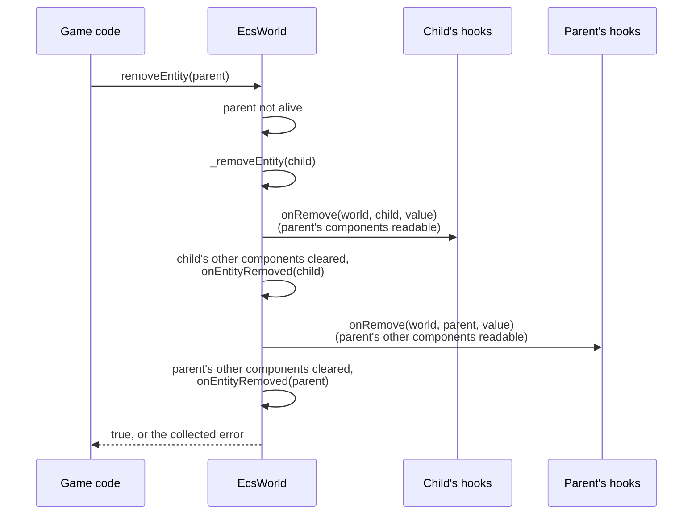
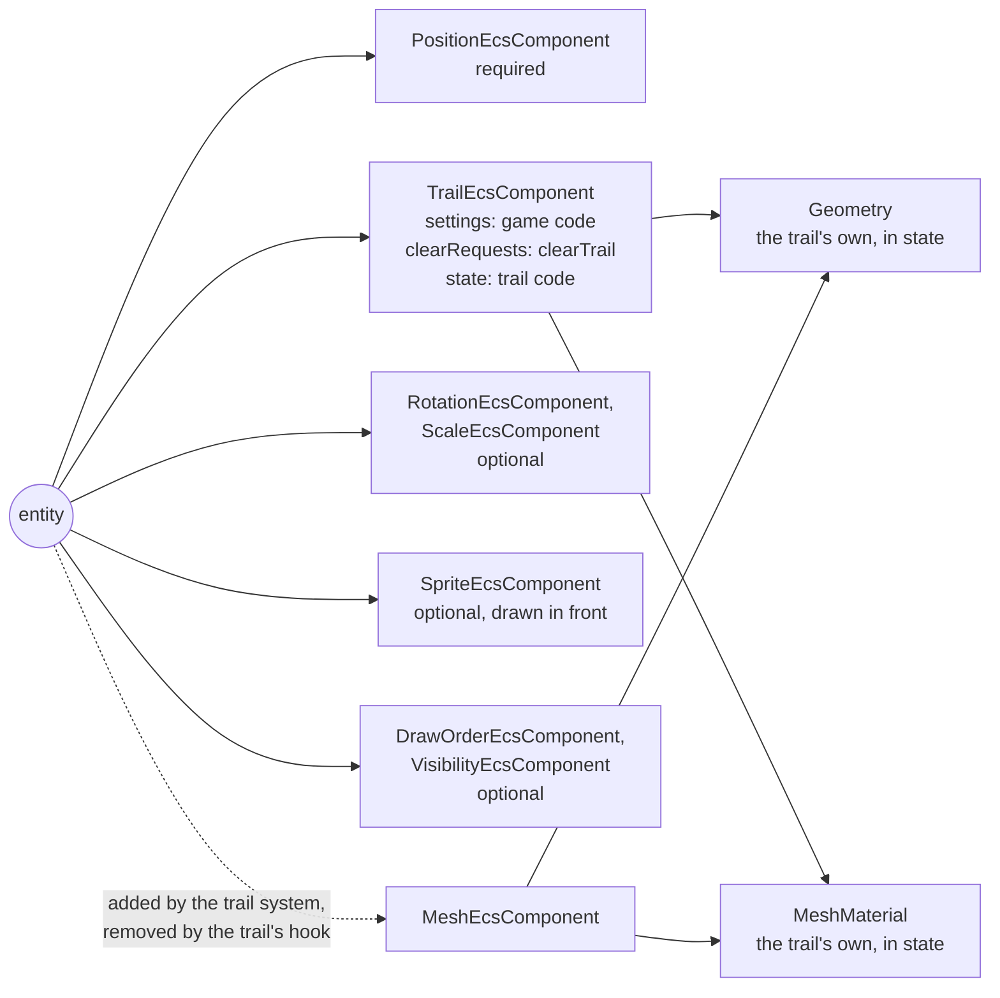

# Trails, and component remove hooks

Issue: [#785](https://github.com/Forge-Game-Engine/Forge/issues/785)
(milestone "Trail rendering", after #782, #783 and #784; the demo and full
guide are [#786](https://github.com/Forge-Game-Engine/Forge/issues/786))

| Module or file                                                                                   | Change   | Notes                                                                                                                                                                                          |
| ------------------------------------------------------------------------------------------------ | -------- | ---------------------------------------------------------------------------------------------------------------------------------------------------------------------------------------------- |
| `src/ecs/ecs-component.ts`                                                                       | Modified | `createComponentId(name, hooks?)`; `ComponentHooks`, `ComponentRemoveHook`                                                                                                                     |
| `src/ecs/component-hooks.ts`                                                                     | New      | The remove hook of each component key, written only by `createComponentId`. Not exported                                                                                                       |
| `src/ecs/ecs-world.ts`                                                                           | Modified | One internal path for removing a stored component; remove hooks from `removeComponent`, `removeEntity` (descendants too) and `addComponent` replacing a value; errors collected during removal |
| `src/ecs/ecs-world.test.ts`, `src/ecs/hierarchy.test.ts`                                         | Modified | Remove hook tests, and `removeEntity` finishing when a hook or listener throws ("Testing")                                                                                                     |
| `src/ecs/component-hooks.test.ts`                                                                | New      | `createComponentId` keeps and returns a key's hook ("Testing")                                                                                                                                 |
| `src/rendering/trails/components/trail-component.ts`                                             | New      | `TrailEcsComponent`, `trailId` (with its remove hook, `releaseTrail`, which the file doesn't export), `addTrailComponent`, `TrailState`                                                        |
| `src/rendering/trails/systems/trail-system.ts`                                                   | New      | `createTrailEcsSystem(time, renderContext)`                                                                                                                                                    |
| `src/rendering/trails/trail-recording.ts`                                                        | New      | The point ring buffer: record, trim, clear, grow. Pure functions over `TrailState`, no WebGL                                                                                                   |
| `src/rendering/trails/build-trail-ribbon.ts`                                                     | New      | Turns a recording into `RibbonPoint`s by run (widths and colors from age, the tail cut at the lifetime) and stitches the runs into one strip. No WebGL                                         |
| `src/rendering/trails/clear-trail.ts`                                                            | New      | `clearTrail(world, entity)`                                                                                                                                                                    |
| `src/rendering/trails/shaders/trail.vert.glsl`, `trail.frag.glsl`                                | New      | The trail shader pair: texture times vertex color, straight alpha, masks                                                                                                                       |
| `src/rendering/trails/index.ts`, `src/rendering/index.ts`                                        | Modified | Export the trails folder through `@forge-game-engine/forge/rendering`                                                                                                                          |
| `src/rendering/utilities/create-shader-cache.ts`                                                 | Modified | Registers `trail.vert` and `trail.frag`                                                                                                                                                        |
| `src/rendering/geometry/build-ribbon-mesh.ts`                                                    | Modified | V runs the other way across the ribbon; its JSDoc and inline comments describe the Y-down world ("Ribbon orientation")                                                                         |
| `e2e/fixtures/scenes/trail.ts`, `e2e/specs/trail.spec.ts`                                        | New      | A moving entity with a trail, measured on the canvas                                                                                                                                           |
| `documentation-site/docs/docs/ecs/component.md`                                                  | Modified | "Releasing what a component holds": remove hooks                                                                                                                                               |
| `documentation-site/docs/docs/ecs/world.md`                                                      | Modified | Removal order with hooks                                                                                                                                                                       |
| `documentation-site/docs/docs/ecs/system.md`                                                     | Modified | Per-entity resources move from `cleanup` bookkeeping to component remove hooks                                                                                                                 |
| `documentation-site/docs/docs/rendering/trails.md`                                               | New      | A short guide; #786 extends it with the demo                                                                                                                                                   |
| `documentation-site/docs/docs/rendering/ribbon-meshes.md`                                        | Modified | Y-down wording, the V orientation, a link to trails                                                                                                                                            |
| `documentation-site/docs/docs/rendering/meshes.md`                                               | Modified | One sentence: a component that creates its geometry can dispose it from its remove hook                                                                                                        |
| `AGENTS.md`, `.claude/skills/create-component/SKILL.md`, `.claude/skills/create-system/SKILL.md` | Modified | Components that own a resource release it from a remove hook                                                                                                                                   |
| `CHANGELOG.md`                                                                                   | Modified | `#### Added` bullets for remove hooks (ecs) and trails (rendering)                                                                                                                             |
| **Engine version at time of design**                                                             |          | `0.26.2`                                                                                                                                                                                       |

## Summary

Give a moving entity a `TrailEcsComponent` and it leaves a ribbon behind it
that tapers and fades: exhaust, sword swings, projectiles, a cursor.
Unity's `TrailRenderer` is the reference for what a trail does.

```ts
addTrailComponent(world, ship, {
  lifetimeSeconds: 0.6,
  startWidth: 0.4,
  endWidth: 0,
  startColor: new Color(2, 1.2, 0.4, 1), // brighter than white, for bloom
  endColor: new Color(1, 0.2, 0, 0),
});

world.addSystem(createTrailEcsSystem(time, renderContext)); // after the transform system
```

A trail owns GPU geometry, and Forge's ECS can't tell anything that a
component was removed: `EcsWorld.removeEntity` drops the component data
before `onEntityRemoved` fires, and `removeComponent` reports nothing. So
this design adds a general ECS feature first, **component remove hooks**,
the way Bevy's component hooks, flecs's `OnRemove` and EnTT's `on_destroy`
let a component release what it holds. The maintainer chose this on the
issue, over a pool of shared geometries that the first draft of this design
proposed and the design review rejected (hidden module state, and mesh
components pointing at geometry another trail owned the next frame).

The design has five parts:

- **Component remove hooks (ECS).** `createComponentId('trail', { onRemove
})` gives a component type a hook. The world calls `onRemove(world,
entity, component)` whenever a value stops being an entity's component:
  `removeComponent`, `removeEntity` (descendants included, while the
  entity's other components are still there), and `addComponent` replacing
  it with a different value. The hook belongs to the component type, so it
  holds in every world, whatever systems are registered, and it's a plain
  function of its arguments, with no state.
- **A component of settings and state.** Game code writes the settings
  (lifetime, minimum vertex distance, widths, colors, easing, texture,
  `emitting`, `category`, `layer`). Only the trail system writes its
  `state`: a ring buffer of recorded points, the trail's clock, and the
  trail's own `Geometry`, vertex arrays and material. `clearTrail` writes a
  request counter of its own.
- **A stateless system that records and builds.** Each frame it reads the
  entity's `position.world` (and never writes it), adds a point once the
  entity has moved `minVertexDistance`, ages points with `Time`'s delta,
  and builds the ribbon with `buildRibbonMesh` (#784), with each point's
  width and color from its age. The newest end follows the entity every
  frame and the oldest end is cut exactly at `lifetimeSeconds`, so a trail
  is the same length at 30 and at 144 frames a second.
- **Drawn as a mesh.** The system creates the trail's geometry the first
  time it sees the trail and adds a `MeshEcsComponent` (#783) that draws
  it, so the render system draws the trail in the same draw order as
  sprites: behind the entity's own sprite, in front of what's under it.
  Points are recorded in world space and mapped into the entity's local
  space when the ribbon is built, because mesh vertices are local
  (decision M3 of [meshes-in-the-draw-order](./meshes-in-the-draw-order.md)).
- **Released by the trail's remove hook.** When the trail goes (its
  component removed or replaced, or its entity removed), the hook removes
  the mesh that draws the trail's geometry and disposes the geometry, in
  the same call. The hook is the only thing that releases a trail's GPU
  data: the trail system has no `cleanup`, and `world.stop()` or
  `removeSystem` leave every trail and its mesh as they are.

The design also fixes a defect in `buildRibbonMesh` that trails would
expose: its texture's V runs upside down for the Y-down world, and its
docs and comments still describe a Y-up one.

Nothing here bends a core design of the engine. Remove hooks are a new,
general ECS mechanism, not a trail special case, and they keep the ECS
rules: the hook is part of the component type, not of a system, and it
holds no state. The trail system has a fixed query and keeps nothing
between ticks, it writes only the trail's state and the trail's mesh, and
the render system stays the one place that draws.

## Scope

### In scope

- Component remove hooks: `createComponentId`'s `hooks` argument, and when
  `EcsWorld` calls them (`removeComponent`, `removeEntity` with its
  descendants, `addComponent` replacing a value), their order, removals made
  from inside a hook, and errors.
- `TrailEcsComponent`, `addTrailComponent`, `clearTrail`.
- `createTrailEcsSystem`: recording, aging, runs (gaps where `emitting`
  was off), the tail cut at the lifetime, widths and colors from age with
  easing, the local-space mapping, and the trail's geometry and mesh.
- The trail's remove hook.
- The trail shader pair and its `MeshMaterial`, with colors above `1`.
- `buildRibbonMesh`'s V orientation, and its JSDoc and inline comments for
  the Y-down world.
- Unit tests (ECS hooks and trails), an e2e spec, the ECS guide's hook
  sections, a short trails guide, the ribbon guide's corrections, the
  `AGENTS.md` and skill updates, changelog bullets.

### Out of scope

- **Trails that outlive their entity** (`detachTrail`, so a projectile's
  trail fades out after the projectile is removed). A follow-up issue: it
  moves the recorded points to a new entity whose trail has `emitting`
  off, and removes that entity with a `LifetimeEcsComponent` and
  `RemoveFromWorldLifetimeStrategyId` once `lifetimeSeconds` has passed,
  rather than with a mode on the trail. Removing the old trail disposes its
  geometry through its hook, so the follow-up gives the new entity a new
  trail and copies the points, instead of moving the component object.
- **Other hooks**: on add, on insert, observers or per-component removal
  events. Nothing needs them yet; `onRemove` is what releasing a resource
  needs.
- **Moving existing systems that keep per-entity closure state onto
  remove hooks**: `createSoundEcsSystem`'s `trackedSounds` (the playing
  sound per component), `createTextShapingEcsSystem`'s snapshot map and
  the UI text input system's hidden input elements. Each is follow-up work
  in its own module, moving the per-entity data into a component and
  releasing it from that component's remove hook. File one issue per
  system with this change, so the `create-system` skill's list of systems
  not to copy shrinks as they land.
- **The trails demo and the full guide** (#786), and using trails in the
  space shooter (#786).
- **Custom trail materials.** Every trail draws with the trail shader;
  textures and colors are its settings (open question 8).
- **Other blend modes** (additive trails). The render system has one blend
  state for every mesh and sprite. Bright, glowing trails use colors above
  `1` and bloom.
- **Batching or pooling trails.** Each trail is one draw call with its own
  geometry, as every mesh is (decision M12 of the meshes design). Many
  hundreds of trails on screen would want a merged draw; nothing needs it
  yet.
- **World-space meshes** (a `space` field on `MeshEcsComponent`). Trails
  map into local space instead (open question 4).
- **Smoothing** the recorded line (Catmull-Rom between points) and
  **round caps or joins**. Points are as recorded; the ribbon builder has
  miter and bevel joins only.
- **Trails in 3D** (camera-facing ribbons), which design 15 lists as later
  work.
- **Automatic teleport detection.** Code that teleports an entity calls
  `clearTrail`.
- **Line rendering** (a polyline component). It would reuse
  `buildRibbonMesh` and the same geometry ownership.

## Phases

### Phase 1: Component remove hooks

Adds remove hooks to the ECS, so a component can release what it holds
when it stops being an entity's component.

**Definition of done:** `createComponentId(name, { onRemove })` registers a
hook; `EcsWorld` calls it exactly once for every value that stops being an
entity's component through `removeComponent`, `removeEntity` (descendants
included) or `addComponent` replacing it, in the order and with the error
handling under "Remove hooks"; tags, `setParent`/`removeParent`, `stop()`
and `removeSystem` behave as today. The unit tests pass, the ECS guide
describes hooks, `AGENTS.md` and the `create-component` and
`create-system` skills tell contributors to use them, the changelog has an
`ecs` bullet, and every check in `CLAUDE.md`'s verification list passes.

| #   | Task           | Description                                                                                                                                                                                        | Size |
| --- | -------------- | -------------------------------------------------------------------------------------------------------------------------------------------------------------------------------------------------- | ---- |
| 1.1 | Hook API       | `ComponentRemoveHook`, `ComponentHooks`, `createComponentId(name, hooks?)`; `component-hooks.ts` keeps each key's hook ("API")                                                                     | S    |
| 1.2 | Removal path   | One private path that detaches a stored value and calls its hook; `removeComponent`, `removeParent` and `addComponent`'s replacement go through it ("When a hook runs")                            | M    |
| 1.3 | `removeEntity` | Descendants first, then the entity's hooked components while the rest are still stored, then the rest, the free slot and `onEntityRemoved`; errors collected and rethrown once the subtree is gone | M    |
| 1.4 | Unit tests     | "Testing", ECS rows                                                                                                                                                                                | M    |
| 1.5 | ECS guide      | `component.md` "Releasing what a component holds"; `world.md` removal order; `system.md` "Acquiring and releasing resources" points per-entity resources at hooks ("Documentation")                | S    |
| 1.6 | Conventions    | `AGENTS.md`'s "Architecture" (components) and the `create-component` and `create-system` skills ("Documentation")                                                                                  | S    |
| 1.7 | Changelog      | `#### Added`, `ecs` ("Documentation")                                                                                                                                                              | S    |

### Phase 2: Trails

Adds the component, the system, the shader and the ribbon fix, so a
moving entity with a trail leaves a ribbon behind it, released by its
remove hook. Needs Phase 1.

**Definition of done:** a moving entity with a `TrailEcsComponent` leaves a
ribbon that tapers and fades as configured, is the same length at any frame
rate, fades out with `emitting` off, starts a new piece when `emitting`
comes back on, sorts with sprites by draw order, and survives a lost WebGL
context. Removing or replacing the trail, or removing its entity or an
ancestor, removes the trail's mesh and disposes its geometry in the same
call; stopping the world or removing the trail system changes no trail or
mesh. The unit tests and the e2e spec pass, `trails.md` describes it, and every check in
`CLAUDE.md`'s verification list passes.

| #    | Task                | Description                                                                                                                                                                                                    | Size |
| ---- | ------------------- | -------------------------------------------------------------------------------------------------------------------------------------------------------------------------------------------------------------- | ---- |
| 2.1  | Ribbon orientation  | `buildRibbonMesh` writes V `0` on the `−n` edge; its JSDoc, the inline comments listed under "Ribbon orientation" and `ribbon-meshes.md` describe the Y-down world in terms of `+n` and `−n`; its V tests flip | S    |
| 2.2  | Component           | "Component" below, following the `create-component` skill: settings with defaults, `state` and `clearRequests` left out of the options, validation, the check for another mesh, the key with its remove hook   | M    |
| 2.3  | Recording           | "Recording" below: the ring buffer and its growth, adding points past `minVertexDistance`, runs, the final point when emission stops, trimming by age, `clearTrail`'s request. Unit tests, no WebGL            | M    |
| 2.4  | Ribbon points       | "Building the ribbon" below: oldest-first `RibbonPoint`s per run, the tail cut at the lifetime, width and color from age with easing and clamping, distances; stitching runs into one strip                    | M    |
| 2.5  | Local space         | Map the built vertices into the entity's local space ("Local space"), or draw nothing while the entity's world scale is zero                                                                                   | S    |
| 2.6  | Shader and material | `trail.vert`, `trail.frag` (`meshVertex`, `mask`, `u_texture` times `v_color`, straight alpha), registered in `createShaderCache`                                                                              | S    |
| 2.7  | Release             | The trail's remove hook ("Releasing a trail")                                                                                                                                                                  | S    |
| 2.8  | System              | "System" below: the update loop, creating the trail's geometry and material on first sight, adding its mesh; no `cleanup`                                                                                      | M    |
| 2.9  | Unit tests          | "Testing", trail rows                                                                                                                                                                                          | M    |
| 2.10 | E2E spec            | `trail`: "Testing" below, with the `write-e2e-test` skill                                                                                                                                                      | M    |
| 2.11 | Exports and JSDoc   | Export from `src/rendering/trails/index.ts` and `src/rendering/index.ts` (not `releaseTrail`); JSDoc every public type, field and function; `npm run check-exports`                                            | S    |
| 2.12 | Guide               | `documentation-site/docs/docs/rendering/trails.md` ("Documentation"); the sentence linking it from `ribbon-meshes.md`                                                                                          | S    |
| 2.13 | Changelog           | `#### Added`, `rendering` ("Documentation")                                                                                                                                                                    | S    |

## Decision log

### Remove hooks

**H1. Hooks belong to the component key.**
Options: (a) passed to `createComponentId` and kept with the key, as
Bevy's `#[component(on_remove = ...)]` attaches them to the component type;
(b) registered per world, `world.setComponentHooks(key, hooks)`, as flecs's
`world.component<T>().on_remove(...)`, EnTT's `registry.on_destroy<T>()`
and Bevy's `World::register_component_hooks` do; (c) registered by the
system that owns the component, from its `onRegister`. Chosen: (a).
`AGENTS.md` asks that a component mean the same thing everywhere: with (a)
a trail releases its geometry in every world, whichever systems are
registered and whether or not its system was already removed. (b) and (c)
make the release depend on a registration step that can be forgotten, run
twice (two trail systems) or run after a trail already exists, and let
the same key mean different things in two worlds. flecs and EnTT register
per world because a component type is only made a component by
registering it with a world; Forge's keys are already values made once by
`createComponentId`, so the key is the natural home, as the type is in
Bevy. Nothing in (a) needs closure state: the hook is a module-level
function of its arguments. Tradeoff: a game can't add a hook to an engine
component, and a key's hooks can't change after it's made. The keys'
hooks live in a module-level `Map` written only by `createComponentId`:
definition data fixed when the key is made, like the symbol itself, not
state anything changes later. Open question 1.

**H2. When a hook runs.**
Whenever a value stops being an entity's component for its key:
`removeComponent`, `removeEntity` (for the entity and each descendant),
and `addComponent` storing a different value under a key the entity
already has. Not when `addComponent` stores the same object again (nothing
was removed), not for tags (no value to release; `createTagId` takes no
hooks), not on `world.stop()` or `removeSystem` (no component is removed),
and not when a world is dropped without removing its entities (JavaScript
has no destructors; game states remove their entities on exit, which runs
the hooks), and not from a system's `cleanup`: stopping a world or
removing a system leaves entity components as they are. Forge's
`onRemove` therefore has the semantics of Bevy's `on_replace` (which runs
both when a value is replaced and when it's removed), not of Bevy's
`on_remove`, flecs's `OnRemove` or EnTT's `on_destroy`, none of which run
on replacement; the JSDoc and `component.md` say so, so readers who know
those engines don't misread the name. Forge has one hook for both because
what a component releases is the same whether it was removed or replaced.
Without the replacement case, `addTrailComponent` on an entity that
already has a trail would leak the old geometry.

**H3. The hook runs after the value is detached, and receives it.**
Options: (a) the world takes the value out of storage, then calls the hook
with it; (b) the hook runs while the value is still stored, as in Bevy,
flecs and EnTT. Chosen: (a). The value is still readable, as the hook's
argument, so nothing is lost; and (a) makes the edge cases safe without
rules of their own: a hook that removes its own key again does nothing
(the value is already gone, so it can't recurse), and a hook that throws
can't leave the value behind in storage. On replacement, `getComponent`
in the hook already returns the new value, which is what the hook needs to
tell a replaced trail's mesh from the new one's. Tradeoff: code written for
Bevy's order that reads its own component through the world sees `null`
and has to use the argument. Open question 2.

**H4. Order inside `removeEntity`.**
Descendants first, depth first and in sibling order, as today, each with
its hooks and its `onEntityRemoved`. Then the entity's hooked components,
one at a time, each detached and its hook called while the entity's other
components are still stored; then every remaining component and tag is
removed, the slot is freed and `onEntityRemoved` is raised. So a
descendant's hook can read its ancestors' components (as an
`onEntityRemoved` listener can today), and a hook can read its entity's
other components, the way the trail hook finds its mesh. Hooks of several
components on one entity run in an order the documentation leaves
unspecified (the order keys were first stored in the world); a hook mustn't
depend on another component's hook having run. Bevy leaves that order
unspecified too.

**H5. Errors.**
`removeComponent` and `addComponent` detach or replace the value first, so
a hook that throws leaves the world consistent and its error propagates.
`removeEntity` is many steps, and one throwing hook or `onEntityRemoved`
listener mustn't leave a dead entity holding components, or a subtree half
removed: it catches each error, finishes removing the whole subtree (every
hook still runs), then rethrows the error, or an `AggregateError` of all of
them when there are several. Today a listener that throws for a descendant
stops its ancestors' removal halfway; this fixes that too.

**H6. Hooks may change the world, with no rules of their own.**
A hook can remove other components, other entities, or its own entity
(during `removeComponent`); each runs that removal's hooks immediately.
The world checks that a hooked component is still stored before detaching
it, so a component another hook already removed isn't hooked twice. A
dying entity is already not alive, so adding a component to it from a hook
throws (collected as in H5), and removing it again does nothing.

**H7. Hooks and design 03's journals do different jobs.**
[Design 03](./3d/03-ecs-foundations.md)'s `removed` journals tell a
system, at its next run, which entities left its query, for data the
system derived from them. A remove hook releases what the component value
itself holds, synchronously, in the call that removed it. That matters for
resources: an entity created and removed between two runs appears in no
journal (design 03 E8), so a geometry it held would leak, and a resource
released a frame late may be drawn after it's gone. The two don't replace
each other. [Design 11](./3d/11-gltf-and-asset-lifetime.md) GA1 released
asset handles from a journal partly because the ECS had no remove hook;
this design doesn't change GA1, but that premise no longer holds when it's
built. Design 03's "one internal path for every storage write" is where the
hook call sits when that design lands.

### Trails

**T1. Each trail owns its own `Geometry`, released by its remove hook.**
Options: (a) a `Geometry` in each trail's system-written state, disposed by
the trail's remove hook (H1-H6), and by nothing else; (b) the render
system streams vertex data held in components through a scratch buffer it
owns, as it draws sprites through `instanceBuffer`, so trails own no GPU
objects; (c) a pool of geometries owned by `RenderContext`, handed to
trails each frame; (d) the same pool kept per render context and world in a
module-level `WeakMap` (this design's first draft); (e) design 03's
journals. Chosen: (a), by the maintainer on the issue. It's how the issue
describes trails, how Bevy, flecs and EnTT release resources, and it keeps
`MeshEcsComponent`'s rule that whoever creates a geometry owns it: the
trail's mesh draws the trail's geometry for the trail's whole life. The
review rejected (d) because the pool was hidden state the `create-system`
skill forbids, mesh components pointed at slots another trail owned the
next frame, and it only worked with one trail system per world. (c) moves
the same pool to a visible owner but keeps the slot sharing. (b) changes the
shipped mesh path and is a separate question (the maintainer asked whether
`instanceBuffer` itself should be revisited; that's not part of this
design). (e) needs design 03 first and leaks short-lived trails (H7).
The issue also asked the system's `cleanup` to dispose every trail's
geometry; this design drops that. `cleanup` is for what a system acquires
outside any component, and a trail's geometry is the trail's: disposing it
from `cleanup` would leave every trail's mesh pointing at a disposed
geometry, or make `world.stop()` and `removeSystem` change entity
components. A trail's GPU data goes when the trail goes. Tradeoff: each
trail creates its own GL buffers and vertex array on its first frame and
deletes them when it goes ("Performance"), and a world that's stopped but
whose entities are kept keeps its trails' GPU data until they're removed.

**T2. The trail draws through a `MeshEcsComponent` on its own entity.**
Options: (a) the trail system adds a `MeshEcsComponent` on the trail's
entity; (b) a child entity created for the mesh; (c) the render system
queries trails. Chosen: (a), as the issue asks. It sorts with the entity
(behind its own sprite, decision M9 of the meshes design), follows its
visibility, masks, category and layer, and leaves the render system one
mesh query (decision M1). (b) adds entities the game didn't make and that
removal has to keep in step. (c) is what M1 rejected. Tradeoff: an entity
can't have a trail and another mesh; `addTrailComponent` and the system
throw for that. Put the other mesh on a child entity.

**T3. Points are recorded in world space and mapped into local space when
the ribbon is built.**
Options: (a) record `position.world`, build the ribbon in world units
around the entity's world position, then apply the inverse of the entity's
world rotation and scale to each vertex; (b) record local positions; (c)
add a world-space mode to `MeshEcsComponent` (Unity's
`LineRenderer.useWorldSpace`). Chosen: (a), the default of the meshes
design's open question 1. A trail is where the entity has been in the
world, so it must stay put when the entity turns, and widths are world
units whatever the entity's scale (building before mapping keeps them so,
even under non-uniform scale). Subtracting the entity's position before
building keeps the vertex values small, so a trail far from the origin
loses no precision in the `Float32Array`. Tradeoff: an entity whose world
scale is `0` on either axis can't map anything, so its trail draws nothing
until the scale returns (it keeps recording and aging). (c) avoids that,
at the cost of a field on a shipped component and a second vertex space in
the render system (open question 4).

**T4. The trail's state lives in the component, under `state`.**
Options: (a) a `state` field on `TrailEcsComponent`, left out of
`addTrailComponent`'s options and written only by the trail's own code
(the system, and on release the remove hook, T19); (b) a
separate system-owned component (as `TextMeshEcsComponent` is for text).
Chosen: (a), as the issue asks. Removing the trail removes its points and
geometry with it, the hook receives everything it releases in one value,
and nothing has to keep two components in step. With (b) the hook would
have to find the second component, and the trail's removal could leave it
behind. Tradeoff: the state is visible on the component a game edits; its
JSDoc says it's the system's.

**T5. The trail's mesh is the one that draws the trail's geometry.**
Options: (a) a mesh is the trail's when its `geometry` is the trail's
`state.geometry`: the system adds it and writes its `category` and
`layer`, and the trail's remove hook removes it; (b) a tag on the mesh, as the first draft had; (c) the hook removes
whatever mesh the entity has. Chosen: (a). Only the trail creates its
geometry, so identity is exact and needs no extra data. (b) was there for a
sweep the hook makes unnecessary. (c) would remove a mesh another component
put there after replacing the trail's. All of this code is the trail
module's, so the mesh has one owner: game code doesn't write a trail's
mesh. If game code removes it, the system adds it again next frame; if game
code replaces it with another mesh, the system throws, naming the trail.

**T6. Width and color come from each point's age.**
Options: (a) `t = age / lifetimeSeconds`; (b) the point's position along
the trail's current length. Chosen: (a), as the issue asks. Each point
keeps the look of how long ago the entity was there, so a trail whose
entity stops, or stops emitting, fades and thins in place rather than
squeezing its whole gradient into what's left. Tradeoff: a trail that
moves slowly for part of its life shows its gradient over a shorter
stretch there.

**T7. The tail is cut exactly at `lifetimeSeconds`.**
Options: (a) keep the newest expired point and interpolate the tail
between it and the next younger point at age `lifetimeSeconds`; (b) drop
points once they're older than `lifetimeSeconds`, so the tail jumps a
segment at a time. Chosen: (a). It's what makes the length the same at
any frame rate and point spacing (the issue's done-when), and the tail
shrinks smoothly. It costs one kept point and one interpolation per run.

**T8. A point is added at most once per frame, at the entity's position.**
Options: (a) record the entity's position when it's `minVertexDistance`
or more from the newest recorded point; (b) also add points along the
straight line between frames, every `minVertexDistance`. Chosen: (a).
Between two frames the engine only knows the two positions, so (b) adds
vertices on a straight line, which changes nothing but the spacing of the
age gradient. Ages are exact either way (each point has the time it was
recorded), so the length doesn't depend on it.

**T9. The ring buffer grows; it's first sized from the lifetime.**
Options: (a) start at the next power of two above
`ceil(lifetimeSeconds × 60) + 2` points and double when full; (b) a fixed
capacity from `lifetimeSeconds` and `minVertexDistance`, as the issue
suggests; (c) a `maxPoints` setting. Chosen: (a). The number of live
points is at most one per frame over the lifetime (T8), and at most the
distance traveled in the lifetime over `minVertexDistance`. Neither is
known from the settings: the first depends on the frame rate and the
second on speed. (a) never allocates at 60 frames a second, and at higher
rates grows a few times and then settles. (c) is a setting that only exists
to cap memory, which growth makes unnecessary. Tradeoff: the first frames
at a high frame rate allocate.

**T10. A gap where `emitting` was off.**
Options: (a) points recorded after `emitting` turns back on start a new
run, drawn as a separate piece of the same strip; (b) connect to the old
points; (c) clear the old points. Chosen: (a). A car whose skid trail
stops while it's airborne, or a sword trail between swings, shouldn't draw
a straight streak across the gap. (c) cuts off a trail that was still
fading. Runs are joined in one strip with two repeated vertices (zero-area
triangles), so a trail stays one mesh and one draw call. Open question 5.

**T11. Points go to `buildRibbonMesh` oldest first.**
Options: (a) oldest to newest, the direction of travel; (b) newest first,
as the ribbon design's data-flow sketch assumed. Chosen: (a). With V fixed
(T12), a trail moving towards `+X` shows its texture as it shows on a
sprite facing `+X` (Forge's convention for which way art faces): the
texture's left edge at the tail, its right edge at the entity, its top row
on top. With (b) the texture would be upside down and back to front.
`'stretch'` U is then `0` at the tail and `1` at the entity, and `'tile'`
U grows towards the entity.

**T12. Fix `buildRibbonMesh`'s orientation here.**
Options: (a) V `0` on the `−n` edge, so a ribbon towards `+X` shows its
texture the same way up as a sprite, and correct its JSDoc, its inline
comments and its guide for the Y-down world, in Phase 2; (b) a separate
defect fix first; (c) leave it and have trails flip V. `buildRibbonMesh`
was designed for a Y-up world: `+n`, the direction turned `+90°`, was to
the left of travel and up for a ribbon towards `+X`, and V `0` there
matched a sprite's top row. Since the world became Y-down, `+n` is to the
right of travel on screen and down for that ribbon, so V `0` is now its
bottom edge, and the comments' "left", "right", "left turn" and "Y-up" are
all mirrored. Chosen: (a): trails are the first user that shows it, and (c)
is a compensation in a caller, which `CLAUDE.md` rules out. It's one
expression, its comments and its tests. Open question 6.

**T13. `texture: Texture | null`, `null` drawing the colors alone.**
Options: (a) `null` by default, bound as `renderContext.whiteTexture`; (b)
`addTrailComponent` takes the render context to default the texture; (c)
a required texture. Chosen: (a), the way a sprite without an emissive map
draws with `blackTexture`. `null` means "no texture", not a missing
default, and `addTrailComponent` keeps the issue's
`(world, entity, options)` shape (T18).

**T14. One material per trail.**
Options: (a) each trail gets its own `MeshMaterial` from the trail shaders
the first time the system sees it, kept in its state; (b) one material per
texture, shared. Chosen: (a). A mesh's texture is a material uniform
(decision M4), and the render system reads materials when it draws, after
every trail has been built, so two trails sharing a material would both
draw with whichever texture was set last. Materials made from the same
shaders share one program and hold no GPU objects, so (a) costs a small
object per trail and nothing on the GPU, and the remove hook has nothing to
release for it.

**T15. `clearTrail` writes a counter only it writes.**
Options: (a) `clearTrail` increments `clearRequests`, a field on the
component that only `clearTrail` writes and `addTrailComponent`'s options
don't include; the system clears the points when it differs from
`state.clearsApplied`, which only the system writes; (b) `clearTrail`
empties the ring buffer itself; (c) a flag `clearTrail` sets and the
system resets; (d) a request tag `clearTrail` adds and the system removes.
Chosen: (a). Each value has one writer: the request count is
`clearTrail`'s, what was carried out is the system's. (b) gives the points
a second writer, and (c) and (d) give the flag or the tag's presence two.
The first draft had `clearRequests` in the options, so game code could
write it too; the design review rejected that. The clear happens in the
same frame as long as `clearTrail` is called before the trail system runs,
which is where game logic runs. Tradeoff: one more field on the component.

**T16. No `miterLimit` setting.**
Options: (a) a constant `4` (SVG's and canvas's default, the ribbon
design's open question 3); (b) a trail setting. Chosen: (a). Unity's trail
exposes no miter limit either, and a trail turning sharper than about 151°
at one point bevels. A setting can be added when a game needs one.

**T17. Easing results are clamped.**
`easeInBack` and `easeInOutElastic` overshoot `[0, 1]`, so an eased width
can go below `0` (which `buildRibbonMesh` throws for) and an eased alpha
outside `[0, 1]`. The system clamps width and red, green and blue to `0`
or more and alpha to `[0, 1]`, as `Color`'s constructor does. Overshoot
above the larger end is kept, so an elastic width can bulge.

**T18. The system creates the trail's geometry the first time it sees the
trail.**
Options: (a) the system creates the geometry and material when
`state.geometry` is `null`, and adds the mesh; (b) `addTrailComponent`
takes the render context and creates the geometry, material and mesh with
the component. Chosen: (a). It keeps `addTrailComponent(world, entity,
options)`, the issue's shape, and every other `add<Name>Component`'s,
none of which takes a render context or creates GPU objects; GPU objects
come from the render context's user, here the system. A trail whose system
never runs creates nothing. Tradeoff:
the system adds a component during `update` (the mesh), and a trail draws
nothing until the system's first update after it's added, which in the
usual order is the same frame. Open question 3.

**T19. Releasing a trail resets its `state.geometry`.**
The remove hook, `releaseTrail`, removes the trail's mesh, disposes the
geometry and sets `state.geometry` to `null`. Setting it to `null` lets a
removed trail object be added again (to the same or another entity) and
get a new geometry, instead of drawing a disposed one. The hook is the
trail module's own code releasing what it created, and it only runs once
the trail is no longer an entity's component, never alongside the system's
update of that trail, so it doesn't give `state.geometry` a second
independent writer; the JSDoc says so. Nothing else releases it: the trail
system has no `cleanup` (T1).

**T20. A short guide in this issue.**
Options: (a) `trails.md` with the essentials here, which #786 extends with
the demo, draw order and bloom examples; (b) no docs until #786. Chosen:
(a). `CLAUDE.md` asks every change to document what it adds, and the
ribbon guide's link to trails needs a page to point at.

## Open questions

All are non-blocking: each has a default the implementation follows, and a
different answer changes only details.

1. **Non-blocking. Where remove hooks are declared (H1).** Default: on the
   key, `createComponentId(name, { onRemove })`.
   - _On the key_: a component means the same in every world, with no
     registration step to forget, repeat or order; the hook is a
     module-level function with no state. Bevy's primary form.
   - _Per world_ (`world.setComponentHooks(key, hooks)`): flecs's and
     EnTT's shape; a game could hook an engine component, but someone has
     to register it in each world before the first removal, and the same
     key could mean different things in two worlds. Switching changes only
     where the trail module registers its hook.
2. **Non-blocking. Whether the hook runs before or after the value is
   detached (H3).** Default: after, with the value as an argument.
   - _After_: a nested removal of the same key and a throwing hook are
     safe without extra rules; on replacement, the world already shows the
     new value.
   - _Before_ (Bevy, flecs, EnTT): code reading its own component through
     the world works unchanged, but needs a guard against a nested
     removal of the same key, and a throwing hook leaves the value stored.
3. **Non-blocking. When a trail's geometry is created (T18).** Default:
   lazily, by the system.
   - _By the system_: `addTrailComponent(world, entity, options)` stays
     like every other component factory; nothing is created for a trail
     that's never drawn.
   - _By `addTrailComponent`_ (taking the render context): the mesh exists
     from the start and the system never adds components, but the factory
     creates GPU objects, unlike any other.
4. **Non-blocking. Trails on an entity scaled to zero (T3).** Default:
   draw nothing while the world scale is `0` on either axis.
   - _Draw nothing_: one rule for meshes (local space), no new field. A
     projectile that shrinks to nothing before it's removed hides its
     trail; the `detachTrail` follow-up is the way out.
   - _A `space: 'local' | 'world'` field on `MeshEcsComponent`_: trails
     draw whatever the entity's transform, with no mapping pass, but the
     shipped component gets a field and the render system a second vertex
     space. This is the more common solution elsewhere: Unity's
     `TrailRenderer` always builds its trail in world space, and Godot
     draws a trail as a `Line2D` set `top_level` so it ignores its
     parent's transform. The default stays local space because the meshes
     design chose one vertex space for every mesh, and the mapping pass
     handles every case except a zero scale.
5. **Non-blocking. What happens when `emitting` turns back on (T10).**
   Default: a gap.
   - _A gap_: what skid marks and sword trails need.
   - _Connect_: simpler (no runs), but draws a straight streak from where
     emission stopped. Choosing it removes the run bookkeeping and the
     stitching from tasks 2.3 and 2.4.
6. **Non-blocking. Fix `buildRibbonMesh`'s orientation here (T12).**
   Default: yes, in task 2.1.
   - _Here_: the trail's textures are the first place it shows, and both
     changes are unreleased.
   - _A separate fix first_: keeps this change to trails, but trails then
     wait for it or ship textures upside down.
7. **Non-blocking. Keep `EcsWorld.onEntityRemoved`.** Default: keep. No
   engine code, demo or test scene listens to it today, and remove hooks
   cover releasing what a component holds.
   - _Keep_: it's the one notice that an entity (rather than a component)
     went, which game code may use, for example to forget an entity it
     tracked by handle. Its timing is unchanged and documented next to
     hooks.
   - _Remove_: `AGENTS.md` prefers deleting what's unused; game code can
     put a hooked marker component on the entities it tracks.
8. **Non-blocking. Custom trail materials.** Default: none; every trail
   uses the trail shader.
   - _None_: texture, colors and bloom cover exhaust, swords and cursors.
   - _A `material` setting_: lets a game write dissolving or scrolling
     trails; the material would have to accept the trail's vertex
     attributes, and would replace `texture`.
9. **Non-blocking. `'tile'` texture that stays on the points or slides.**
   Default: stays. Each point's distance is the distance traveled when it
   was recorded, so the pattern stays where it was laid down, like tire
   tracks.
   - _Stays_: no swimming as the trail moves.
   - _Slides_ (distance measured from the entity): the pattern moves with
     the entity, like a conveyor; a game wanting it could get it from a
     setting later.
10. **Non-blocking. Default settings.** Default: `lifetimeSeconds: 1`,
    `minVertexDistance: 0.1`, `startWidth: 0.25`, `endWidth: 0`, white to
    transparent white, linear easing. Sizes are for the default camera
    (`verticalWorldUnits: 10`), where `0.25` units is about 27 pixels on a
    1080-pixel canvas. Any other values change only the defaults object.

## Remove hooks

### API

```ts
/**
 * Runs when a value stops being an entity's component for a key: the
 * component was removed with `removeComponent`, its entity (or an ancestor)
 * was removed with `removeEntity`, or `addComponent` stored a different
 * value under the same key. It runs on replacement as well as removal, as
 * Bevy's `on_replace` does; unlike Bevy's `on_remove`, flecs's `OnRemove`
 * and EnTT's `on_destroy`, which don't run on replacement. It doesn't run
 * when a world is stopped or a system removed: those don't change
 * components. The value is no longer stored when the hook runs. Use it to
 * release what the component holds, such as a GPU geometry. A hook uses
 * only its arguments: it's part of the component type, shared by every
 * world.
 * @param world - The world the value was removed from.
 * @param entity - The entity it belonged to. During `removeEntity` the
 * entity is no longer alive, but its other components are still stored
 * until every hook has run.
 * @param component - The value that was removed.
 */
export type ComponentRemoveHook<T> = (
  world: EcsWorld,
  entity: number,
  component: T,
) => void;

/** Functions the world calls at points in a component's life. */
export interface ComponentHooks<T> {
  /**
   * Runs when a value stops being an entity's component for this key:
   * removed, or replaced by a different value (see `ComponentRemoveHook`).
   */
  onRemove?: ComponentRemoveHook<T>;
}

/**
 * Creates the key for a component type.
 * @param name - The component's name, shown in error messages.
 * @param hooks - Functions the world calls for this component type, in
 * every world. Defaults to none.
 * @returns A new, unique component key.
 */
export function createComponentId<T>(
  name: string,
  hooks?: ComponentHooks<T>,
): ComponentKey<T>;
```

- `ComponentKey` stays a branded symbol. A symbol can't carry the hook, so
  `src/ecs/component-hooks.ts` (which `src/ecs/index.ts` doesn't export,
  as `gpu-resource-registry.ts` isn't) keeps a `Map<symbol, hook>` that
  `createComponentId` writes once per key that has a hook, and the world
  reads with `getComponentRemoveHook(key)`. Only keys with a hook are in
  it. A plain `Map`: keys are module constants made once, so holding them
  costs nothing, and it doesn't rely on symbols as `WeakMap` keys, which
  older browsers lack.
- The map stores hooks untyped by key, as the world's `SparseSet<unknown>`
  stores values, with the one conversion next to the world's existing
  ones.
- `createTagId` takes no hooks: a tag has no value to release.
- `parentId` has none, so `setParent` and `removeParent` behave as today;
  they still go through the same internal path (below), so a key can't
  skip it.

### When a hook runs

The world gets one private method that every removal of a stored value
goes through:

```text
_detachComponent(entity, key):
  set = componentSets.get(key)
  if not set?.has(entity): return     // presence, not a null value: a
                                      // stored value may itself be null
  value = set.get(entity)
  set.remove(entity)
  getComponentRemoveHook(key)?.(this, entity, value)
```

- **`removeComponent(entity, key)`**: `_detachComponent`. Removing a
  component the entity doesn't have runs nothing.
- **`removeParent(child)`**: `_detachComponent(child, parentId)`.
- **`addComponent(entity, key, value)`**: checks `set.has(entity)` and
  reads the stored value, stores the new one, then, if the entity had one
  and it's a different object, runs the hook with the old one. Storing the same object again runs nothing.
- **`removeEntity(entity)`**, for the entity and recursively for each
  descendant:

  ```text
  _removeEntity(entity, errors):
    if not alive: return false
    mark the slot dead
    for each child (a copy of the list) still parented to it:
      _removeEntity(child, errors)          // depth first, sibling order
    drop its children list; detach it from its parent
    for each (key, set) in componentSets whose key has a hook:
      if set has entity:                    // another hook may have removed it
        value = set.get(entity); set.remove(entity)
        try hook(this, entity, value) catch e: errors.push(e)
    remove it from every remaining set (components and tags)
    queue the slot's next handle
    try onEntityRemoved.raise(entity) catch e: errors.push(e)
    return true

  removeEntity(entity):
    errors = []
    removed = _removeEntity(entity, errors)
    if errors has one: throw it
    if errors has several: throw new AggregateError(errors,
      'Removed entity <e> and its descendants, but <n> remove hooks or onEntityRemoved listeners threw.')
    return removed
  ```

- **Not** on `stop()`, `removeSystem`, `addTag`, or a world that's
  dropped.

### Ordering and nested removals



- Hooks of one entity's components run one after another, in an order the
  guide leaves unspecified; each sees the components whose hooks haven't
  run yet and every unhooked component.
- A hook may remove other components or entities; their hooks run inside
  it. A hook that removes a component whose hook hasn't run yet runs that
  hook then, and the loop skips it later.
- A hook can't add components to a dying entity (it isn't alive, so
  `addComponent` throws); removing the dying entity again does nothing.
- Queries return new arrays (`QueryResult`), so a hook that removes
  entities while a system is iterating its result is as safe as the system
  removing them itself.

## Entity composition



| Value                                   | Writer                                                                                      |
| --------------------------------------- | ------------------------------------------------------------------------------------------- |
| `TrailEcsComponent` settings            | Game code                                                                                   |
| `TrailEcsComponent.clearRequests`       | `clearTrail` (starts at `0` in `addTrailComponent`)                                         |
| `TrailEcsComponent.state`               | The trail system; the remove hook (`releaseTrail`) resets `geometry` to `null` (T19)        |
| The trail's `Geometry` vertex data      | The trail system                                                                            |
| The trail entity's `MeshEcsComponent`   | The trail system adds it and writes `category` and `layer`; the remove hook removes it (T5) |
| `position`, `rotation`, `scale` `world` | The transform system; the trail system only reads them                                      |

## Component

```ts
/** Settings of a trail, written by game code. */
export interface TrailSettings {
  /** How long a point stays, in seconds of game time. Greater than `0`. Default `1`. */
  lifetimeSeconds: number;

  /**
   * How far the entity moves, in world units, before a new point is
   * recorded. Greater than `0`. Default `0.1`.
   */
  minVertexDistance: number;

  /** The width at the entity (age `0`), in world units. Default `0.25`. */
  startWidth: number;

  /** The width at the tail (age `lifetimeSeconds`), in world units. Default `0`. */
  endWidth: number;

  /** The color at the entity, straight alpha; red, green and blue can be above `1`. Default white. */
  startColor: Color;

  /** The color at the tail. Default transparent white. */
  endColor: Color;

  /** Maps age (`0` to `1`) to the width's mix between start and end. Default `linear`. */
  widthEasing: (t: number) => number;

  /** Maps age (`0` to `1`) to the color's mix between start and end. Default `linear`. */
  colorEasing: (t: number) => number;

  /**
   * The texture laid along the trail, multiplied by the color, or `null`
   * for the color alone. Use `wrap: 'repeat'` for `'tile'`. Default `null`.
   */
  texture: Texture | null;

  /** How the texture runs along the trail (see `RibbonTextureMode`). Default `'stretch'`. */
  textureMode: RibbonTextureMode;

  /** The length of one repeat of the texture in `'tile'` mode, in world units. Default `1`. */
  tileLength: number;

  /**
   * Whether new points are recorded. While `false`, the trail stops at
   * where the entity was when it turned off, and fades out. Default `true`.
   */
  emitting: boolean;

  /** Matched against each camera's `cullingMask`. Default `1`. */
  category: number;

  /** The draw-order layer, shared with sprites, text and meshes. Default `0`. */
  layer: number;
}

/**
 * The trail's record and GPU data. Written only by the trail system, except
 * that removing or replacing the trail disposes `geometry` and sets it to
 * `null`.
 */
export interface TrailState {
  /** Seconds of game time the trail system has advanced this trail by. */
  elapsedSeconds: number;

  /** The recorded points, oldest first, in a ring buffer (see "Recording"). */
  points: TrailPoints;

  /** Whether the trail was emitting when the system last ran. */
  wasEmitting: boolean;

  /** The `clearRequests` the system has carried out. */
  clearsApplied: number;

  /** The geometry the trail draws, created the first time the system draws it. */
  geometry: Geometry | null;

  /** The trail's material, created the first time the system draws it. */
  material: MeshMaterial | null;

  /** The vertex arrays `geometry` is updated from. */
  buffers: RibbonMeshBuffers;

  /** Buffers for runs after the first, created when the trail first has two. */
  runBuffers: RibbonMeshBuffers | null;

  /** `RibbonPoint`s reused for every build, grown to the most points built. */
  ribbonPoints: RibbonPoint[];
}

export interface TrailEcsComponent extends TrailSettings {
  /** How many times `clearTrail` has been called. Written only by `clearTrail`. */
  clearRequests: number;

  /** The trail system's record. Don't write it. */
  readonly state: TrailState;
}

/** The component key of {@link TrailEcsComponent}. Removing a trail disposes its geometry and mesh. */
export const trailId = createComponentId<TrailEcsComponent>('trail', {
  onRemove: releaseTrail,
});

export function addTrailComponent(
  world: EcsWorld,
  entity: number,
  options?: Partial<TrailSettings>,
): TrailEcsComponent;

export function clearTrail(world: EcsWorld, entity: number): void;
```

- `addTrailComponent` applies `defaultTrailSettings` with `withDefaults`,
  then adds `clearRequests: 0` and a fresh state (`elapsedSeconds: 0`, an
  empty point buffer with the starting capacity of T9, `wasEmitting:
false`, `clearsApplied: 0`, `geometry: null`, `material: null`,
  `buffers: createRibbonMeshBuffers(2)`, `runBuffers: null`,
  `ribbonPoints: []`). It creates no GPU objects (T18).
- It throws, naming the value, for a `lifetimeSeconds`,
  `minVertexDistance` or `tileLength` that isn't a finite number greater
  than `0`, and a width that isn't a finite number of `0` or more. The
  system checks the settings again each frame, since game code can change
  them, with the same messages.
- It throws for an entity whose `MeshEcsComponent` isn't its current
  trail's (T5): the trail needs the entity's one mesh. Adding a trail to an
  entity that already has one replaces it: the old trail's hook disposes
  its geometry and removes its mesh (H2), and the system adds the new
  trail's mesh on its next update.
- `clearTrail` increments `clearRequests`, and throws if the entity has no
  trail.
- `linear` is imported from `src/animations/easing-functions/linear.ts`
  directly, not the animations index, so the rendering module doesn't load
  the animation module.

## Recording

`TrailPoints` is a ring buffer in typed arrays, so recording allocates
nothing once it has grown:

```ts
interface TrailPoints {
  capacity: number; // a power of two
  start: number; // index of the oldest point
  count: number;
  x: Float64Array; // world position
  y: Float64Array;
  time: Float64Array; // state.elapsedSeconds when recorded
  distance: Float64Array; // world units traveled along the trail when recorded
  runStart: Uint8Array; // 1 for the first point of a run
}
```

Each frame, for each trail, in this order:

1. **Advance the clock.** `elapsedSeconds += time.deltaTimeInSeconds`.
   Ages are `elapsedSeconds − point.time`, so they follow `timeScale`, and
   a trail whose system doesn't run (a paused game state's `runIf`) is
   frozen rather than aged all at once on resume.
2. **Clear.** If `clearRequests !== clearsApplied`, empty the buffer and
   set `clearsApplied = clearRequests`. The next point recorded starts a
   new run.
3. **Record**, at the entity's `position.world`:
   - emitting, and there are no points, the trail was just cleared, or it
     wasn't emitting last frame (`wasEmitting` is false): record a point
     that starts a run;
   - emitting otherwise, and the newest point is `minVertexDistance` or
     more away: record a point;
   - just stopped emitting (`wasEmitting` and not `emitting`): record a
     final point here if it's farther than `1e-4` units from the newest, so
     the trail ends where the entity was when emission stopped;
   - then `wasEmitting = emitting`.

   A recorded point's distance is the newest point's distance plus the
   gap between them. The first point of a run takes the newest point's
   distance unchanged (or `0` when there are no points), since nothing is
   drawn across the gap.

4. **Trim.** From the oldest end, drop each point whose age is
   `lifetimeSeconds` or more, while the next younger point of the same run
   (or, for the newest point of the current run while emitting, the
   entity itself) is also that old. So each run keeps at most one expired
   point, to cut its tail from.
5. **Grow** (in step 3, when the buffer is full): double the capacity,
   copying the points in order to the start of the new arrays.

Run boundaries come from `runStart`, so the gap between two runs is never
drawn. The entity's current position is the trail's head: it's drawn as
the last point of the current run while `emitting`, but only recorded
once it's `minVertexDistance` from the newest point, so the trail reaches
the entity smoothly between recorded points.

## Building the ribbon

For each run, oldest first (T11), the system fills the trail's
`state.ribbonPoints`:

```text
for each run, oldest run first:
  line = the run's points, oldest first, then the head
         (entity position, age 0, distance = newest + gap)
         if this is the current run and the trail is emitting
  points = []
  for each point p of line:
    if p is expired (age >= lifetime):
      anchor = p          // at most one, the oldest (see "Recording")
      continue
    if anchor:
      push the point between anchor and p at age = lifetime  // T7
      anchor = none
    push p

  for each pushed point:
    t = clamp(age / lifetime, 0, 1)
    width = max(lerp(startWidth, endWidth, widthEasing(t)), 0)
    color = lerp(startColor, endColor, colorEasing(t)), clamped (T17)
    position = world position − entity world position  // "Local space"
  vertexCount = buildRibbonMesh(points, options, runBuffers)
  append to state.buffers, with the previous run's last vertex
  and this run's first vertex repeated in between
```

- `options` is `{ textureMode: 'stretch', miterLimit: 4 }` or
  `{ textureMode: 'tile', tileLength, miterLimit: 4 }`.
- A run with fewer than two distinct points builds nothing
  (`buildRibbonMesh` returns `0`) and isn't appended.
- With a single run, which is the usual case, the system builds straight
  into `state.buffers` and skips the copy. `state.runBuffers` is created
  the first time a trail has two runs, and `state.buffers` grows to hold
  the stitched strip.
- `RibbonPoint`s, their `position` and `color` objects, and the buffers
  are the trail's, reused every frame; nothing is allocated per point once
  they've grown.
- The color mix is per channel, in the colors' straight alpha, as
  `Color`'s values are. When design 07 moves 2D blending to linear space,
  the conversion belongs where it does for every vertex color (the ribbon
  design's "Colors").

## Local space

Mesh vertices are in the entity's local space and the render system draws
them through `T · R · S` from the entity's world position, rotation and
scale (`createModelMatrix` in `render-system.ts`). The ribbon is built
around the entity's world position (step "position" above), so only `R`
and `S` remain to undo, per vertex `v` of `state.buffers.positions`:

```text
c = cos(−rotation.world), s = sin(−rotation.world)
local.x = (c · v.x − s · v.y) / scale.world.x
local.y = (s · v.x + c · v.y) / scale.world.y
```

Missing rotation and scale count as `0` and `(1, 1)`, as in the render
system. When `scale.world.x` or `scale.world.y` is `0` the system writes
no vertices that frame (open question 4). Negative scale works: the ribbon
is mirrored twice, so it lands where it was recorded.

## The trail's geometry

- **Created** by the system the first time it updates a trail whose
  `state.geometry` is `null`: `new Geometry(renderContext, { attributes:
[a_position (2), a_texCoord (2), a_color (4)], topology:
'triangleStrip' })`, each from an empty `Float32Array`, so it starts with
  no vertices. Its material is `createMeshMaterial(renderContext,
'trail.vert', 'trail.frag')`.
- **Updated** every frame with `geometry.update({ vertexCount, attributes:
{ a_position: buffers.positions, a_texCoord: buffers.uvs, a_color:
buffers.colors } })`. Passing the arrays every frame picks up the larger
  ones `buildRibbonMesh` makes when it grows them. A frame with nothing to
  draw updates with `vertexCount: 0`, which the render system skips.
- **Bounds** are the trail's own: each geometry computes them from its
  own arrays, so view culling works per trail.
- **Context loss.** A `Geometry` created or updated while the context is
  lost records the data and creates its buffers when the context is
  restored, from the arrays it was last given; the next update writes the
  current ribbon. The material's program is cached and rebuilt by the
  render context. Disposing while lost deletes nothing on the GPU and
  unregisters the geometry, so it isn't rebuilt.

## Releasing a trail

```ts
/**
 * The trail's remove hook. Removes the mesh that draws the trail's geometry
 * from `entity`, disposes the geometry and forgets it, so the trail gets a
 * new one if it's added and drawn again. Does nothing if the trail has no
 * geometry. In trail-component.ts, not exported.
 */
function releaseTrail(
  world: EcsWorld,
  entity: number,
  trail: TrailEcsComponent,
): void {
  const { geometry } = trail.state;

  if (!geometry) {
    return;
  }

  if (world.getComponent(entity, meshId)?.geometry === geometry) {
    world.removeComponent(entity, meshId);
  }

  geometry.dispose();
  trail.state.geometry = null;
}
```

- **Removing the trail** (`removeComponent(entity, trailId)`): the hook
  removes the mesh and disposes the geometry in the same call, so nothing
  draws a disposed geometry, even if the trail is removed between the
  trail system and the render system.
- **Removing the entity or an ancestor**: the hook runs while the mesh is
  still stored (H4), removes it, and disposes the geometry.
- **Replacing the trail** (`addTrailComponent` or `addComponent` again):
  the hook runs with the old trail after the new one is stored; the mesh
  draws the old geometry, so it's removed, and the system adds the new
  trail's mesh on its next update.
- **Nothing else releases it.** The trail system has no `cleanup`, so
  `world.stop()` and `removeSystem` leave every trail, its geometry and its
  mesh as they are; a system registered again carries on with them (T1).
- `releaseTrail` is a function declaration, so it's hoisted above the
  `trailId` constant that names it.
- `MeshEcsComponent` keeps its rule that whoever creates a geometry owns
  it: the trail creates its geometry, and the trail's code removes the
  mesh before disposing it.

## System

```ts
/**
 * Records each trail's points from its entity's world position, ages them
 * with `time`, and draws them as a ribbon through a MeshEcsComponent it
 * adds to the entity, with a geometry it creates for the trail. Removing
 * the trail disposes that geometry. Register it after
 * createTransformEcsSystem and before createRenderEcsSystem.
 */
export const createTrailEcsSystem = (
  time: Time,
  renderContext: RenderContext,
): EcsSystem<[TrailEcsComponent, PositionEcsComponent]>;
```

```text
query: [trailId, positionId]

update(world, { entities, components: [trails, positions] }):
  rotations, scales = world.getComponentAccessor(...)
  for i in entities:
    trail = trails[i]; entity = entities[i]; state = trail.state
    validate the settings (throws)
    record and trim (see "Recording")
    state.geometry ??= create the trail geometry (see "The trail's geometry")
    state.material ??= createMeshMaterial(renderContext, 'trail.vert', 'trail.frag')
    mesh = world.getComponent(entity, meshId)
    none: mesh = addMeshComponent(world, entity,
            { geometry: state.geometry, material: state.material })
    mesh.geometry !== state.geometry: throw (another mesh is on the entity)
    vertexCount = build into state.buffers (see "Building the ribbon"),
                  map to local space, or 0
    state.geometry.update({ vertexCount, attributes: state.buffers })
    state.material.setUniform('u_texture', trail.texture ?? renderContext.whiteTexture)
    mesh.category = trail.category; mesh.layer = trail.layer

// No onRegister and no cleanup: the system acquires nothing outside the
// trail components, and the trail's remove hook releases what they hold.
```

- **Order.** After the transform system (it reads `world` values) and
  before the render system (which reads the mesh). Physics and game logic
  write `local` before the transform system, as today.
- **One writer per value.** The system writes the trail's `state`, the
  trail's geometry, and the trail entity's mesh. It never writes a
  transform or the trail's settings.
- **Stateless.** Everything it remembers is in `TrailEcsComponent.state`;
  the factory keeps only `time` and `renderContext`. A fresh instance on
  the same world uses each trail's existing geometry.
- **Hidden trails** (a hidden ancestor, a camera's `cullingMask`) still
  record and age, so they're right when they show again; the render system
  doesn't draw them.

## Shaders

```glsl
#version 300 es
#pragma forge name(trail.vert)
#pragma forge include(meshVertex)

in vec2 a_position;
in vec2 a_texCoord;
in vec4 a_color;

out vec2 v_texCoord;
out vec4 v_color;

void main() {
  vec2 world = meshWorldPosition(a_position);

  gl_Position = meshClipPosition(world);
  forwardMeshMask(world);
  v_texCoord = a_texCoord;
  v_color = a_color;
}
```

```glsl
#version 300 es
#pragma forge name(trail.frag)

precision mediump float;

uniform sampler2D u_texture;

in vec2 v_texCoord;
in vec4 v_color;
out vec4 fragColor;

#pragma forge include(mask)

void main() {
  vec4 color = texture(u_texture, v_texCoord) * v_color;

  fragColor = vec4(color.rgb, color.a * maskCoverage()); // straight alpha
}
```

The render system's blend state premultiplies (`AGENTS.md`'s "Alpha
Blending"). Color channels above `1` pass through `mediump` (its range is
at least `2^14`) to an HDR target, where bloom picks them up.

## Ribbon orientation

`+n` is a segment's direction turned `+90°`, `(−dy, dx)` for a unit
direction `(dx, dy)`. In the Y-down world it points to the right of travel
on screen, and a positive cross product of two directions is a clockwise
turn on screen. After task 2.1, `buildRibbonMesh` writes V `1` on the `+n`
edge and `0` on the `−n` edge (`1 − vertexIndex % 2`, since every pair
writes its `+n` vertex first), so a ribbon drawn towards `+X` shows a
texture the same way up as a sprite. With trails passing their points
oldest first (T11), a trail moving right looks like its texture laid
behind the entity: left edge (U `0`) at the tail, right edge at the
entity, top row on top. Moving left, it's mirrored both ways, as a sprite
turned by `π` is.

Every comment in `build-ribbon-mesh.ts` that names a side or a turn
direction says it in terms of `+n` and `−n` (and, where it helps, which way
that is on screen), not "left" and "right" of a Y-up world:

| Where                               | Now says                                                                        | Says after task 2.1                                                                                                      |
| ----------------------------------- | ------------------------------------------------------------------------------- | ------------------------------------------------------------------------------------------------------------------------ |
| `RibbonPoint.position` JSDoc        | "Y-up, in the space of the mesh"                                                | In the engine's Y-down world, in the space of the mesh                                                                   |
| `RibbonMeshBuffers.positions` JSDoc | "Y-up, in the same space as the points"                                         | In the same space as the points                                                                                          |
| `RibbonMeshBuffers.uvs` JSDoc       | V "`0` on the left edge ... `1` on the right"                                   | V is `0` on the `−n` edge (left of travel on screen) and `1` on the `+n` edge, so a ribbon towards `+X` matches a sprite |
| `writeVertex` JSDoc                 | "left-right pairs ... V (`0` on the left edge, `1` on the right) is its parity" | Pairs, `+n` vertex first, so V is `1` minus the index's parity                                                           |
| `writeEnd` JSDoc                    | "turned +90°, so it points left of travel"; "the pair's left vertex"            | Turned +90°, the `+n` side, right of travel on screen; the pair's `+n` vertex                                            |
| `writeJoin` JSDoc                   | "the first pair's left vertex"                                                  | The first pair's `+n` vertex                                                                                             |
| The turn comment above `const turn` | "A left turn (positive cross product) puts the inner corner on the left"        | A positive cross product (clockwise on screen) puts the inner corner on the `+n` side, a negative one on the `−n` side   |
| The slot comment above `innerSlot`  | "the pair's left slot (index parity 0) for a left turn and its right slot ..."  | The pair's `+n` slot (parity 0) for a positive turn and its `−n` slot for a negative one                                 |

## Performance

- Per trail per frame: one pass over its points to record and trim
  (amortized constant), one pass to build (`O(points)`, no trigonometry
  beyond one `sin` and `cos` for the mapping), one `bufferSubData` per
  attribute, and one draw call. A 64-point trail is about 256 vertices.
- **Each trail creates its own `Geometry`** the first time it's drawn:
  three GL buffers, and a vertex array per program it's drawn with. They're
  deleted when the trail is removed. A gun firing ten bullets a second with
  trails creates and deletes about forty GL objects a second, small next to
  the per-frame uploads every trail already makes; buffers grow by doubling (`Geometry.update`), so
  a trail's buffers are reallocated a few times early in its life and then
  settle. If profiling ever shows bullet trails churning, pooling
  geometries per render context is later work that doesn't change the API.
- CPU memory per trail: the point ring buffer (37 bytes a point), the
  vertex arrays (a 64-point trail's are about 8 KB) and its `RibbonPoint`s,
  freed with the component.
- No allocation per frame once a trail's buffers have grown, except the
  render system's per-mesh command (decision M13 of the meshes design).
- `Geometry.bounds` is recomputed once per trail per frame, by the render
  system, over vertices just written.
- Hundreds of trails cost hundreds of draw calls, since meshes don't batch.
  Merging trails into one draw is later work.
- Remove hooks cost a `Map` lookup per `removeComponent` and per replacing
  `addComponent`, and in `removeEntity` a lookup per component key the
  world has used, in a loop over those keys that `removeEntity` already
  runs. Components without a hook pay nothing else.

## Testing

Unit tests (Vitest). ECS rows use a bare `EcsWorld`. Trail rows use a
mocked WebGL context behind a real `RenderContext` where a geometry or
material is involved, as `AGENTS.md` describes; the recording and
ribbon-point tests need no WebGL.

| Case (ECS)        | Asserts                                                                                                                                                                                                                                                                                                                                                                                                                                                       |
| ----------------- | ------------------------------------------------------------------------------------------------------------------------------------------------------------------------------------------------------------------------------------------------------------------------------------------------------------------------------------------------------------------------------------------------------------------------------------------------------------- |
| `removeComponent` | The hook runs once with the world, the entity and the removed value; `getComponent` returns `null` inside it; removing again, or a component the entity doesn't have, runs nothing                                                                                                                                                                                                                                                                            |
| Replacement       | `addComponent` with a different value runs the hook with the old one and `getComponent` returns the new one inside it; the same object again, or a first add, runs nothing                                                                                                                                                                                                                                                                                    |
| `removeEntity`    | Every hooked component's hook runs once; inside each, the entity isn't alive but its unhooked components (and hooked ones not yet run) are readable; `onEntityRemoved` is raised after the hooks                                                                                                                                                                                                                                                              |
| Descendants       | Removing a parent runs a child's hooks before the parent's, with the parent's components readable from the child's hook                                                                                                                                                                                                                                                                                                                                       |
| Nested removals   | A hook that removes another hooked component of the same entity runs that hook once; one that removes its own key again does nothing; one that removes other entities runs their hooks                                                                                                                                                                                                                                                                        |
| Dying entity      | A hook adding a component to its dying entity: the entity is still fully removed and the `addComponent` error is rethrown                                                                                                                                                                                                                                                                                                                                     |
| Errors            | A throwing hook in `removeComponent` leaves the component removed and propagates; in `removeEntity`, every other hook still runs, the subtree is gone, the slot is reused, and the error is rethrown                                                                                                                                                                                                                                                          |
| Several errors    | Two throwing hooks in one `removeEntity` throw an `AggregateError` holding both                                                                                                                                                                                                                                                                                                                                                                               |
| Throw partway     | Next to the existing `onEntityRemoved` listener tests (`ecs-world.test.ts`, `hierarchy.test.ts`): a listener (and, separately, a hook) that throws for the first of three children; the other two children and the parent are still removed, run their hooks and raise `onEntityRemoved`, none is alive, no component of any of them is left in a query, every slot is reused, and the error is rethrown once. Today the parent's removal stops at that child |
| Stored `null`     | A component stored as `null` under a hooked key: `removeComponent` runs the hook with `null` (presence comes from `has`, not the value)                                                                                                                                                                                                                                                                                                                       |
| Untouched paths   | Tags, `setParent`/`removeParent`, `stop()` and `removeSystem` run no hooks; a key made without hooks behaves as before                                                                                                                                                                                                                                                                                                                                        |
| Two worlds        | One key's hook runs in each world with that world                                                                                                                                                                                                                                                                                                                                                                                                             |

| Case (trails)           | Asserts                                                                                                                                                                                             |
| ----------------------- | --------------------------------------------------------------------------------------------------------------------------------------------------------------------------------------------------- |
| Min vertex distance     | Moving less than `minVertexDistance` records nothing new (the head still follows); reaching it records a point at the entity's world position                                                       |
| Same length at any rate | An entity moving at constant speed for longer than its lifetime, stepped at 30 and at 144 frames a second: the built ribbon's tail-to-head length is `speed × lifetimeSeconds` in both, to `1e-6`   |
| Aging out               | After `lifetimeSeconds` with the entity still, the trail builds no vertices; points are trimmed to one anchor per run                                                                               |
| `timeScale`             | With `timeScale: 0`, nothing ages                                                                                                                                                                   |
| `emitting: false`       | No new points; a final point where it stopped; no head; the existing points fade and are gone after `lifetimeSeconds`                                                                               |
| Resume after `emitting` | Points after resuming start a new run; the strip has two repeated vertices between the runs and no triangle spans the gap                                                                           |
| `clearTrail`            | The next update has no old points and starts a run at the current position; no streak from the old position after a teleport in the same frame; `clearRequests` isn't an `addTrailComponent` option |
| Widths and colors       | Width and color per vertex from age, with `linear` and with `easeInBack` (clamped at `0`); colors above `1` kept                                                                                    |
| Texture modes           | `'stretch'`: U `0` at the tail and `1` at the entity; `'tile'`: U from recorded distances, unchanged for a point as the trail moves                                                                 |
| Ring buffer             | Growth keeps points in order across the wrap; no allocation at 60 frames a second for `lifetimeSeconds: 1`                                                                                          |
| Local space             | An entity rotated and non-uniformly scaled: vertices mapped through its model matrix land at the world positions built; widths stay in world units; scale `0` builds nothing                        |
| Mesh                    | The system adds a `MeshEcsComponent` drawing the trail's geometry and material, writes `category` and `layer`; re-adds it if game code removed it; throws if another mesh replaced it               |
| `addTrailComponent`     | Creates no GPU objects; throws for an entity with another mesh; on an entity with a trail, replaces it                                                                                              |
| One geometry per trail  | 100 updates create one `Geometry` per trail; two trails have different geometries with their own `bounds`                                                                                           |
| Removing the trail      | `removeComponent(entity, trailId)` removes the mesh and disposes the geometry (its buffers deleted) before returning                                                                                |
| Removing the entity     | Removing the entity, or its parent, disposes the trail's geometry                                                                                                                                   |
| Replacing the trail     | The old geometry is disposed and its mesh removed; after the next update the new trail draws with a new geometry                                                                                    |
| Re-adding a trail       | A removed trail object added again gets a new geometry, not the disposed one                                                                                                                        |
| Stop and system removal | `world.stop()` and `removeSystem(trailSystem)` leave every trail, its mesh and its geometry as they were (no dispose); a system registered again draws them with the same geometries                |
| Draw order              | Through the render system: the trail draws before its entity's sprite and after a sprite with a lower world order                                                                                   |
| Context loss            | Creating and updating a trail while lost touches no GL; after restore, the trail draws; removing it while lost disposes without GL errors                                                           |
| Statelessness           | A fresh system instance on the same world produces the same ribbon as one that has run, and uses the same geometry                                                                                  |
| Validation              | Each invalid setting throws, from `addTrailComponent` and from the system after a game writes it                                                                                                    |
| Ribbon V (task 2.1)     | In `build-ribbon-mesh.test.ts`: V is `0` on the `−n` edge, `1` on the `+n` edge                                                                                                                     |

E2E (`write-e2e-test` skill), `e2e/fixtures/scenes/trail.ts`: a white
background, a camera, and an entity with a small blue sprite and an opaque
red trail (red start and end color, constant width, alpha `1` to `0`),
moved along `+X` at a constant speed by the scene's `step`. The spec
measures along the row through the entity, stepping and measuring in one
`page.evaluate`:

1. Before the entity moves: the row is white apart from the blue sprite.
2. After moving for longer than the lifetime at 16.7 ms steps: there's a
   red run that ends at the sprite's left edge (the sprite covers the
   trail's head, so the trail is behind its entity), and its length in
   pixels is within a few pixels of `speed × lifetimeSeconds ×
pixelsPerUnit`, measured against the sprite's own width in the same
   frame.
3. The same in a second scene instance at 7 ms steps: the red run's length
   matches step 2's (the same length at any frame rate).
4. Turning `emitting` off and stepping past the lifetime: the row is back
   to white apart from the sprite.
5. In a fresh run, removing the trail component while the trail is
   visible, then stepping once: the row is white apart from the sprite (the
   hook removed the mesh), with no WebGL error in the console.

## Documentation

- `documentation-site/docs/docs/ecs/component.md` (task 1.5), a section
  "Releasing what a component holds": `createComponentId(name, { onRemove
})`, when the hook runs (remove, entity removal with descendants,
  replacement), that the value is passed in and no longer stored, that the
  entity's other components are readable during entity removal, that the
  hook uses only its arguments, that stopping the world or removing a
  system runs no hooks, and an example disposing a geometry. It says
  plainly that `onRemove` also runs when `addComponent` replaces a value
  with a different one, the semantics of Bevy's `on_replace`, while Bevy's
  `on_remove`, flecs's `OnRemove` and EnTT's `on_destroy` don't run on
  replacement, so readers coming from those engines don't misread the
  name.
- `world.md`: the removal order (descendants, hooks, components,
  `onEntityRemoved`) and how errors are reported.
- `system.md`'s "Acquiring and releasing resources": `cleanup` is for what
  the system acquires outside any component; a resource held for one
  entity goes in a component and is released by the component's remove
  hook. Its example of a system tracking per-entity labels in its closure
  becomes a component with a hook. A stateless system usually has no
  `cleanup`, and `cleanup` never changes entity components.
- `meshes.md`: one sentence that a component which creates its own
  geometry disposes it from its remove hook, as trails do.
- `AGENTS.md`'s "Architecture" (Components) and the `create-component`
  skill: a component that owns something to release (a GPU object, a DOM
  element, a playing sound) gets a remove hook on its key; the hook is a
  module-level function of its arguments. The `create-system` skill's
  "Where state goes instead" table gets a row: a resource created for an
  entity goes in that entity's component (system-owned state) and is
  released by the component's remove hook, not by a closure map swept in
  `cleanup`.
- `documentation-site/docs/docs/rendering/trails.md` (task 2.12): what a
  trail is, adding one, registering the system after the transform system
  and before the render system, lifetime and minimum vertex distance,
  widths, colors and easing, the texture's orientation and modes,
  `emitting` and `clearTrail`, that a trail uses its entity's one mesh,
  and that removing the trail or its entity releases its GPU data. #786
  adds the demo, draw-order and bloom examples to it.
- `ribbon-meshes.md`: `position` is in the engine's Y-down world; `+n` is
  to the right of travel on screen; V is `0` on the left edge and `1` on
  the right, so a ribbon towards `+X` is the same way up as a sprite; one
  sentence linking to trails.
- Changelog, `#### Added`:
  - "**ecs:** Component remove hooks: `createComponentId(name, { onRemove
})` gives a component type a hook that every world calls with `(world,
entity, component)` when a value stops being an entity's component, through
    `removeComponent`, `removeEntity` (its descendants too, while the
    entity's other components can still be read) or `addComponent` storing
    a different value, so a component can release what it holds, such as
    a GPU geometry. If hooks or `onEntityRemoved` listeners throw during
    `removeEntity`, the whole entity and its descendants are still removed
    before the error is rethrown."
  - "**rendering:** Trails: `addTrailComponent(world, entity, options)`
    makes an entity leave a ribbon behind it that tapers and fades from
    `startWidth` and `startColor` to `endWidth` and `endColor` over
    `lifetimeSeconds`, recorded every `minVertexDistance` world units, with
    easing, a texture in `'stretch'` or `'tile'` mode, `emitting`,
    `category` and `layer`. `createTrailEcsSystem(time, renderContext)`
    records and draws it in the same draw order as sprites, behind the
    entity's own sprite, at the same length at any frame rate, and
    removing the trail or its entity frees its GPU data.
    `clearTrail(world, entity)` empties a trail after a teleport."

  The ribbon V change needs no bullet of its own: the unreleased
  `buildRibbonMesh` bullet doesn't describe V, and `buildRibbonMesh` hasn't
  been released.

## Relationship to other designs

- [meshes-in-the-draw-order](./meshes-in-the-draw-order.md): trails draw
  through its `MeshEcsComponent` and `MeshMaterial`, take its default for
  open question 1 (local space, mapped by the trail), its order of an
  entity's mesh before its sprite (M9), and its rule that whoever creates a
  geometry owns it.
- [ribbon-meshes](./ribbon-meshes.md): trails are its first engine caller.
  This design differs in two places: points go oldest first (T11), not
  head first as its data-flow sketch assumed, and V runs the other way
  (T12), since that design was written for a Y-up world. Its D2 (points as
  objects) and D9 (resolved options) hold: each trail keeps its
  `RibbonPoint`s and passes `miterLimit: 4`.
- [Design 03](./3d/03-ecs-foundations.md): remove hooks sit in its single
  internal storage-write path when it lands; its journals stay the tool
  for data a system derives from entities, and hooks for what a component
  holds (H7).
- [Design 11](./3d/11-gltf-and-asset-lifetime.md): GA1 released asset
  handles from a journal partly because there was no remove hook; this
  design doesn't change GA1, but its implementation can reconsider that
  with hooks available.
- [Design 07](./3d/07-2d-on-the-render-pipeline.md): when 2D blending
  moves to linear space, vertex colors convert where every tint does.
- [Design 15](./3d/15-audio-particles-and-picking-in-3d.md): the
  `detachTrail` follow-up mirrors its `detachParticleEmitter`; 3D ribbons
  are its later work.
