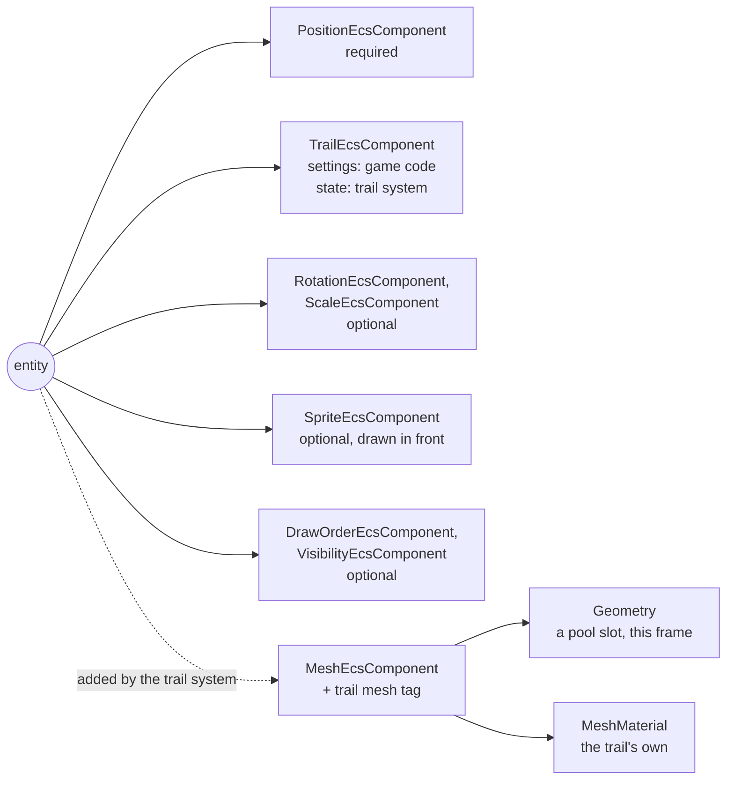

# Trails

Issue: [#785](https://github.com/Forge-Game-Engine/Forge/issues/785)
(milestone "Trail rendering", after #782, #783 and #784; the demo and full
guide are [#786](https://github.com/Forge-Game-Engine/Forge/issues/786))

| Module or file                                                    | Change   | Notes                                                                                                                                                  |
| ----------------------------------------------------------------- | -------- | ------------------------------------------------------------------------------------------------------------------------------------------------------ |
| `src/rendering/trails/components/trail-component.ts`              | New      | `TrailEcsComponent`, `trailId`, `addTrailComponent`, `TrailState`                                                                                      |
| `src/rendering/trails/systems/trail-system.ts`                    | New      | `createTrailEcsSystem(time, renderContext)`                                                                                                            |
| `src/rendering/trails/trail-recording.ts`                         | New      | The point ring buffer: record, trim, clear, grow. Pure functions over `TrailState`, no WebGL                                                           |
| `src/rendering/trails/build-trail-ribbon.ts`                      | New      | Turns a recording into `RibbonPoint`s by run (widths and colors from age, the tail cut at the lifetime) and stitches the runs into one strip. No WebGL |
| `src/rendering/trails/trail-mesh-pool.ts`                         | New      | The geometries trails are drawn from, per render context and world. Not exported                                                                       |
| `src/rendering/trails/clear-trail.ts`, `detach-trail.ts`          | New      | `clearTrail(world, entity)`; `detachTrail(world, entity)` (Phase 2)                                                                                    |
| `src/rendering/trails/shaders/trail.vert.glsl`, `trail.frag.glsl` | New      | The trail shader pair: texture times vertex color, straight alpha, masks                                                                               |
| `src/rendering/trails/index.ts`, `src/rendering/index.ts`         | Modified | Export the trails folder through `@forge-game-engine/forge/rendering`                                                                                  |
| `src/rendering/utilities/create-shader-cache.ts`                  | Modified | Registers `trail.vert` and `trail.frag`                                                                                                                |
| `src/rendering/geometry/build-ribbon-mesh.ts`                     | Modified | V runs the other way across the ribbon, and the JSDoc describes the Y-down world (open question 5)                                                     |
| `e2e/fixtures/scenes/trail.ts`, `e2e/specs/trail.spec.ts`         | New      | A moving entity with a trail, measured on the canvas                                                                                                   |
| `documentation-site/docs/docs/rendering/trails.md`                | New      | A short guide; #786 extends it with the demo                                                                                                           |
| `documentation-site/docs/docs/rendering/ribbon-meshes.md`         | Modified | Y-down wording, the V orientation, a link to trails                                                                                                    |
| `CHANGELOG.md`                                                    | Modified | `#### Added` bullets for trails and `detachTrail`                                                                                                      |
| **Engine version at time of design**                              |          | `0.26.2`                                                                                                                                               |

## Summary

Give a moving entity a `TrailEcsComponent` and it leaves a ribbon behind it
that tapers and fades: exhaust, sword swings, projectiles, a cursor.
Unity's `TrailRenderer` is the reference for what a trail does.

```ts
addTrailComponent(world, ship, {
  lifetimeSeconds: 0.6,
  startWidth: 0.4,
  endWidth: 0,
  startColor: new Color(2, 1.2, 0.4, 1), // brighter than white, for bloom
  endColor: new Color(1, 0.2, 0, 0),
});

world.addSystem(createTrailEcsSystem(time, renderContext)); // after the transform system
```

The design has four parts:

- **A component of settings and state.** Game code writes the settings
  (lifetime, minimum vertex distance, widths, colors, easing, texture,
  `emitting`, `category`, `layer`). Only the trail system writes its
  `state`: a ring buffer of recorded points (world position, time,
  distance along the trail), the trail's own clock and its material.
- **A stateless system that records and builds.** Each frame it reads the
  entity's `position.world` (and never writes it), adds a point once the
  entity has moved `minVertexDistance`, ages points with `Time`'s delta,
  and builds the ribbon with `buildRibbonMesh` (#784), with each point's
  width and color from its age. The newest end follows the entity every
  frame and the oldest end is cut exactly at `lifetimeSeconds`, so a trail
  is the same length at 30 and at 144 frames a second.
- **Drawn as a mesh.** The system writes the entity's `MeshEcsComponent`
  (#783), so the render system draws the trail in the same draw order as
  sprites: behind the entity's own sprite, in front of what's under it.
  Points are recorded in world space and mapped into the entity's local
  space when the ribbon is built, because mesh vertices are local
  (decision M3 of [meshes-in-the-draw-order](./meshes-in-the-draw-order.md)).
- **GPU geometry from a pool.** A trail owns no GPU objects. The system
  writes each frame's ribbons into geometries from a pool kept per render
  context and world, and points each trail's mesh at one of them. Forge's
  ECS has no way to tell a stateless system that a component was removed,
  so a geometry owned by a trail would leak whenever its entity was
  removed. The pool needs no such notice, and short-lived trails (bullets)
  create no GPU objects at all. This is the design's biggest choice, and
  open question 1.

A second phase lets a trail outlive its entity (`detachTrail`), so a
projectile's trail fades out after the projectile is removed, as
`detachParticleEmitter` does for particles in
[design 15](./3d/15-audio-particles-and-picking-in-3d.md).

Nothing here bends a core design of the engine. The system has a fixed
query and keeps nothing between ticks (the points are component data), it
writes only the trail's state and the trail's mesh component, and the
render system stays the one place that draws. The design also fixes a
defect in `buildRibbonMesh` that trails would expose: its texture's V runs
upside down for the Y-down world, and its docs still describe a Y-up one
(open question 5).

## Scope

### In scope

- `TrailEcsComponent`, `addTrailComponent`, `clearTrail`.
- `createTrailEcsSystem`: recording, aging, runs (gaps where `emitting`
  was off), the tail cut at the lifetime, widths and colors from age with
  easing, the local-space mapping, the mesh it writes, and its `cleanup`.
- The trail mesh pool.
- The trail shader pair and its `MeshMaterial`, with colors above `1`.
- `buildRibbonMesh`'s V orientation and its Y-down documentation.
- Phase 2: `detachTrail` and removing a detached trail's entity when it's
  empty.
- Unit tests, an e2e spec, a short guide, the ribbon guide's corrections,
  changelog bullets.

### Out of scope

- **The trails demo and the full guide** (#786), and using trails in the
  space shooter (#786).
- **Custom trail materials.** Every trail draws with the trail shader;
  textures and colors are its settings (open question 6).
- **Other blend modes** (additive trails). The render system has one blend
  state for every mesh and sprite. Bright, glowing trails use colors above
  `1` and bloom.
- **Batching trails.** Each trail is one draw call, as every mesh is
  (decision M12 of the meshes design). Many hundreds of trails on screen
  would want a merged draw; nothing needs it yet.
- **World-space meshes** (a `space` field on `MeshEcsComponent`). Trails
  map into local space instead (open question 2).
- **Smoothing** the recorded line (Catmull-Rom between points) and
  **round caps or joins**. Points are as recorded; the ribbon builder has
  miter and bevel joins only.
- **Trails in 3D** (camera-facing ribbons), which design 15 lists as later
  work.
- **Automatic teleport detection.** Code that teleports an entity calls `clearTrail`.
- **Line rendering** (a polyline component). It would reuse
  `buildRibbonMesh` and, if it's rebuilt every frame, the pool.

## Phases

### Phase 1: Trails

Adds the component, the system, the pool, the shader and the ribbon fix,
so a moving entity with a trail leaves a ribbon behind it.

**Definition of done:** a moving entity with a `TrailEcsComponent` leaves a
ribbon that tapers and fades as configured, is the same length at any frame
rate, fades out with `emitting` off, starts a new piece when `emitting`
comes back on, sorts with sprites by draw order, survives a lost WebGL
context, and is gone when its component or entity is removed, with no GPU
object created or leaked per trail. The unit tests and the e2e spec pass,
`trails.md` describes it, and every check in `CLAUDE.md`'s verification
list passes.

| #    | Task                | Description                                                                                                                                                                                         | Size |
| ---- | ------------------- | --------------------------------------------------------------------------------------------------------------------------------------------------------------------------------------------------- | ---- |
| 1.1  | Ribbon V and docs   | `buildRibbonMesh` writes V `0` on the `−n` edge ("Texture orientation"); its JSDoc and `ribbon-meshes.md` describe the Y-down world (`+n` is to the right of travel on screen); its V tests flip    | S    |
| 1.2  | Component           | "Component" below, following the `create-component` skill: settings with defaults, `state` left out of the options, validation, the check for an existing mesh                                      | M    |
| 1.3  | Recording           | "Recording" below: the ring buffer and its growth, adding points past `minVertexDistance`, runs, the final point when emission stops, trimming by age, `clearTrail`'s request. Unit tests, no WebGL | M    |
| 1.4  | Ribbon points       | "Building the ribbon" below: oldest-first `RibbonPoint`s per run, the tail cut at the lifetime, width and color from age with easing and clamping, distances; stitching runs into one strip         | M    |
| 1.5  | Local space         | Map the built vertices into the entity's local space ("Local space"), or draw nothing while the entity's world scale is zero                                                                        | S    |
| 1.6  | Shader and material | `trail.vert`, `trail.frag` (`meshVertex`, `mask`, `u_texture` times `v_color`, straight alpha), registered in `createShaderCache`                                                                   | S    |
| 1.7  | Mesh pool           | "Mesh pool" below: slots of a `Geometry` and its `RibbonMeshBuffers`, the empty geometry and the scratch, per render context and world; disposal                                                    | M    |
| 1.8  | System              | "System" below: the update loop, the trail's mesh component and tag, the sweep of meshes whose trail is gone, `cleanup`                                                                             | M    |
| 1.9  | Unit tests          | "Testing" below                                                                                                                                                                                     | M    |
| 1.10 | E2E spec            | `trail`: "Testing" below, with the `write-e2e-test` skill                                                                                                                                           | M    |
| 1.11 | Exports and JSDoc   | Export from `src/rendering/trails/index.ts` and `src/rendering/index.ts` (not the pool or the tag); JSDoc every public type, field and function; `npm run check-exports`                            | S    |
| 1.12 | Guide               | `documentation-site/docs/docs/rendering/trails.md` ("Documentation"); the sentence linking it from `ribbon-meshes.md`                                                                               | S    |
| 1.13 | Changelog           | `#### Added`: "**rendering:** Trails: `addTrailComponent(world, entity, options)` ..." ("Documentation")                                                                                            | S    |

### Phase 2: Trails that outlive their entity

Adds `detachTrail`, so a projectile's trail fades out after the projectile
is removed.

**Definition of done:** `detachTrail(world, entity)` moves the trail to a
new entity at the old one's world position with `emitting` off, the trail
keeps its draw order and fades as before, the new entity is removed once
its last point has expired, and the unit tests, the guide and the
changelog cover it.

| #   | Task            | Description                                                                                                                                                                               | Size |
| --- | --------------- | ----------------------------------------------------------------------------------------------------------------------------------------------------------------------------------------- | ---- |
| 2.1 | `whenEmpty`     | A `whenEmpty: 'keep' \| 'removeEntity'` setting (default `'keep'`); the system removes an entity whose trail is `'removeEntity'`, not emitting and has no points left                     | S    |
| 2.2 | `detachTrail`   | "Detaching a trail" below: a new root entity with the old one's world position, layer and `DrawOrderEcsComponent`, the component moved to it, `emitting` off, `whenEmpty: 'removeEntity'` | S    |
| 2.3 | Tests           | Detach then remove the old entity: the trail draws at the same world points, fades, and its entity is removed after `lifetimeSeconds`; the old entity draws no trail                      | S    |
| 2.4 | Docs, changelog | `trails.md` section "When the entity goes away"; `#### Added` bullet                                                                                                                      | S    |

## Decision log

**T1. Who owns a trail's GPU geometry.**
Options: (a) a pool of geometries per render context and world, assigned
to trails each frame, with no geometry owned by any trail; (b) a
`Geometry` in each trail's state, disposed by a new on-remove hook on
component keys, as Bevy's component hooks, flecs's `OnRemove` and Unity's
`OnDestroy` do; (c) a `Geometry` in each trail's state, released from the
`removed` journal of [design 03](./3d/03-ecs-foundations.md) (as
[design 11](./3d/11-gltf-and-asset-lifetime.md) GA1 releases asset
handles), built first; (d) a `Geometry` per trail, with the system
remembering which it created (as `createSoundEcsSystem` remembers its
sounds). Chosen: (a). A stateless system can't see a component that's no
longer there, and `EcsWorld.onEntityRemoved` fires after the components are
gone, so (b), (c) and (d) each need something the engine doesn't have or
forbids: (b) adds a removal mechanism design 11 deliberately did without,
(c) needs design 03's cached queries and journals first (a large ECS
change), and (d) is the closure state the `create-system` skill rules out.
With (a), removing a trail or its entity has nothing to release, because
the trail never held a GPU object. The pool also suits the issue's own use
cases: a gun firing ten bullets a second with trails creates and deletes no
buffers or vertex arrays, where per-trail geometry would create and delete
thirty GL objects a second. Per-frame GPU scratch on the render context is
where design 07 puts the 2D renderer's buffers too. Tradeoff: a trail's
mesh component points at a different geometry from frame to frame, so a
mesh component left behind by a removed trail would draw another trail's
vertices; the sweep (T5) removes it. The pool keeps its high-water mark of
concurrent trails until the system's `cleanup`. Assumption: one trail
system per world (open question 1).

**T2. The trail draws through a `MeshEcsComponent` on its own entity.**
Options: (a) the trail system writes a `MeshEcsComponent` on the trail's
entity; (b) a child entity created for the mesh; (c) the render system
queries trails. Chosen: (a), as the issue asks. It sorts with the entity
(behind its own sprite, decision M9 of the meshes design), follows its
visibility, masks, category and layer, and leaves the render system one
mesh query (decision M1). (b) adds entities the game didn't make and that
removal has to keep in step. (c) is what M1 rejected. Tradeoff: an entity
can't have a trail and another mesh; `addTrailComponent` and the system
throw for that. Put the other mesh on a child entity.

**T3. Points are recorded in world space and mapped into local space when
the ribbon is built.**
Options: (a) record `position.world`, build the ribbon in world units
around the entity's world position, then apply the inverse of the entity's
world rotation and scale to each vertex; (b) record local positions; (c)
add a world-space mode to `MeshEcsComponent` (Unity's
`LineRenderer.useWorldSpace`). Chosen: (a), the default of the meshes
design's open question 1. A trail is where the entity has been in the
world, so it must stay put when the entity turns, and widths are world
units whatever the entity's scale (building before mapping keeps them so,
even under non-uniform scale). Subtracting the entity's position before
building keeps the vertex values small, so a trail far from the origin
loses no precision in the `Float32Array`. Tradeoff: an entity whose world
scale is `0` on either axis can't map anything, so its trail draws nothing
until the scale returns (it keeps recording and aging). (c) avoids that,
at the cost of a field on a shipped component and a second vertex space in
the render system (open question 2).

**T4. The trail's state lives in the component, under `state`.**
Options: (a) a `state` field on `TrailEcsComponent`, left out of
`addTrailComponent`'s options and written only by the trail system; (b) a
separate system-owned component (as `TextMeshEcsComponent` is for text).
Chosen: (a), as the issue asks. Removing the trail removes its points with
it, and nothing has to keep two components in step. Tradeoff: the state is
visible on the component a game edits; its JSDoc says it's the system's.

**T5. Meshes left by a removed trail are swept by tag.**
Options: (a) the system tags the meshes it adds (an unexported tag) and,
each update, removes the mesh and tag from every tagged entity without a
trail; (b) a `removeTrailComponent` function that removes both, and
documentation that `world.removeComponent(entity, trailId)` mustn't be
used; (c) nothing. Chosen: (a). It holds for any way the component goes
(game code, a state's cleanup, `detachTrail`), and it's stateless: the
tag is data. When design 03 lands, the ad-hoc query becomes a declared
secondary query with `without: [trailId]`. Tradeoff: one `world.query` a
frame, which allocates as the render system's three queries do today.
Removing the entity needs no sweep: its mesh goes with it.

**T6. Width and color come from each point's age.**
Options: (a) `t = age / lifetimeSeconds`; (b) the point's position along
the trail's current length. Chosen: (a), as the issue asks. Each point
keeps the look of how long ago the entity was there, so a trail whose
entity stops, or stops emitting, fades and thins in place rather than
squeezing its whole gradient into what's left. Tradeoff: a trail that
moves slowly for part of its life shows its gradient over a shorter
stretch there.

**T7. The tail is cut exactly at `lifetimeSeconds`.**
Options: (a) keep the newest expired point and interpolate the tail
between it and the next younger point at age `lifetimeSeconds`; (b) drop
points once they're older than `lifetimeSeconds`, so the tail jumps a
segment at a time. Chosen: (a). It's what makes the length the same at
any frame rate and point spacing (the issue's done-when), and the tail
shrinks smoothly. It costs one kept point and one interpolation per run.

**T8. A point is added at most once per frame, at the entity's position.**
Options: (a) record the entity's position when it's `minVertexDistance`
or more from the newest recorded point; (b) also add points along the
straight line between frames, every `minVertexDistance`. Chosen: (a).
Between two frames the engine only knows the two positions,
so (b) adds vertices on a straight line, which changes nothing but the
spacing of the age gradient. Ages are exact either way (each point has the
time it was recorded), so the length doesn't depend on it.

**T9. The ring buffer grows; it's first sized from the lifetime.**
Options: (a) start at the next power of two above
`ceil(lifetimeSeconds × 60) + 2` points and double when full; (b) a fixed
capacity from `lifetimeSeconds` and `minVertexDistance`, as the issue
suggests; (c) a `maxPoints` setting. Chosen: (a). The number of live
points is at most one per frame over the lifetime (T8), and at most the
distance traveled in the lifetime over `minVertexDistance`. Neither is
known from the settings: the first depends on the frame rate and the
second on speed. (a) never allocates at 60 frames a second, and at higher
rates grows a few times and then settles. (c) is a setting that only exists
to cap memory, which growth makes unnecessary. Tradeoff: the first frames
at a high frame rate allocate.

**T10. A gap where `emitting` was off.**
Options: (a) points recorded after `emitting` turns back on start a new
run, drawn as a separate piece of the same strip; (b) connect to the old
points; (c) clear the old points. Chosen: (a). A car whose
skid trail stops while it's airborne, or a sword trail between swings,
shouldn't draw a straight streak across the gap. (c) cuts off a trail that
was still fading. Runs are joined in one strip with two repeated vertices
(zero-area triangles), so a trail stays one mesh and one draw call. Open
question 3.

**T11. Points go to `buildRibbonMesh` oldest first.**
Options: (a) oldest to newest, the direction of travel; (b) newest first,
as the ribbon design's data-flow sketch assumed. Chosen: (a). With V fixed
(T12), a trail moving towards `+X` shows its texture as it shows on a
sprite facing `+X` (Forge's convention for which way art faces): the
texture's left edge at the tail, its right edge at the entity, its top row
on top. With (b) the texture would be upside down and back to front.
`'stretch'` U is then `0` at the tail and `1` at the entity, and `'tile'`
U grows towards the entity.

**T12. Fix `buildRibbonMesh`'s V orientation here.**
Options: (a) V `0` on the `−n` edge, so a ribbon towards `+X` shows its
texture the same way up as a sprite, and correct its docs for the Y-down
world, in Phase 1; (b) a separate defect fix first; (c) leave it and have
trails flip V. `buildRibbonMesh` was designed for a Y-up world: `+n`, the
direction turned `+90°`, was to the left of travel and up for a ribbon
towards `+X`, and V `0` there matched a sprite's top row. Since the world
became Y-down, `+n` is to the right of travel on screen and down for that
ribbon, so V `0` is now its bottom edge, and the guide's "same way up as on
a sprite" and "Y-up" are wrong. Chosen: (a): trails
are the first user that shows it, and (c) is a compensation in a caller,
which `CLAUDE.md` rules out. It's one expression and its tests. Open
question 5.

**T13. `texture: Texture | null`, `null` drawing the colors alone.**
Options: (a) `null` by default, bound as `renderContext.whiteTexture`; (b)
`addTrailComponent` takes the render context to default the texture; (c)
a required texture. Chosen: (a), the way a sprite without an emissive map
draws with `blackTexture`. `null` means "no texture", not a missing
default, and `addTrailComponent` keeps the issue's
`(world, entity, options)` shape.

**T14. One material per trail.**
Options: (a) each trail gets its own `MeshMaterial` from the trail shaders
the first time the system sees it, kept in its state; (b) one material per
texture, shared. Chosen: (a). A mesh's texture is a material uniform
(decision M4), and the render system reads materials when it draws, after
every trail has been built, so two trails sharing a material would both
draw with whichever texture was set last. Materials made from the same
shaders share one program and hold no GPU objects, so (a) costs a small
object per trail and nothing on the GPU. Tradeoff: none known.

**T15. `clearTrail` is a request the system carries out.**
Options: (a) `clearTrail` increments `clearRequests`, a setting, and the
system clears the points when it differs from the count in its state; (b)
`clearTrail` empties the ring buffer itself; (c) a boolean the function
sets and the system resets. Chosen: (a). (b) gives the points a second
writer and (c) gives the flag two. The clear happens in the same frame as
long as `clearTrail` is called before the trail system runs, which is
where game logic runs. Tradeoff: one more field on the component.

**T16. No `miterLimit` setting.**
Options: (a) a constant `4` (SVG's and canvas's default, the ribbon
design's open question 3); (b) a trail setting. Chosen: (a). Unity's trail
exposes no miter limit either, and a trail turning sharper than about 151°
at one point bevels. A setting can be added when a game needs one.

**T17. Easing results are clamped.**
`easeInBack` and `easeInOutElastic` overshoot `[0, 1]`, so an eased width
can go below `0` (which `buildRibbonMesh` throws for) and an eased alpha
outside `[0, 1]`. The system clamps width and red, green and blue to `0`
or more and alpha to `[0, 1]`, as `Color`'s constructor does. Overshoot
above the larger end is kept, so an elastic width can bulge.

**T18. A short guide in this issue.**
Options: (a) `trails.md` with the essentials here, which #786 extends with
the demo, draw order and bloom examples; (b) no docs until #786. Chosen:
(a). `CLAUDE.md` asks every change to document what it adds, and the
ribbon guide's link to trails needs a page to point at.

## Open questions

All are non-blocking: each has a default the implementation follows.

1. **Non-blocking. Who owns a trail's GPU geometry (T1).** Default: the
   pool.
   - _The pool (a)_: needs no ECS change, creates no GPU objects for
     short-lived trails, and frees nothing on removal because nothing is
     owned. Needs the sweep (T5) and a per-world pool.
   - _An on-remove hook on component keys (b)_: the familiar shape (Bevy's
     hooks, Unity's `OnDestroy`), a trail owns its geometry and no sweep is
     needed, but it adds a removal mechanism design 11 chose to do
     without, and every bullet still creates and deletes GL objects. Moving
     to it later replaces the pool and the sweep, about a quarter of
     Phase 1.
   - _Design 03's journals first (c)_: the planned mechanism, but a large
     ECS change that would hold trails back.
2. **Non-blocking. Trails on an entity scaled to zero (T3).** Default:
   draw nothing while the world scale is `0` on either axis.
   - _Draw nothing_: one rule for meshes (local space), no new field.
     A projectile that shrinks to nothing before it's removed hides its
     trail; `detachTrail` (Phase 2) is the way out.
   - _A `space: 'local' | 'world'` field on `MeshEcsComponent`_: trails
     draw whatever the entity's transform, with no mapping pass, but the
     shipped component gets a field and the render system a second vertex
     space.
3. **Non-blocking. What happens when `emitting` turns back on (T10).**
   Default: a gap.
   - _A gap_: what skid marks and sword trails need.
   - _Connect_: simpler (no runs), but draws a straight
     streak from where emission stopped. Choosing it removes the run
     bookkeeping and the stitching from tasks 1.3 and 1.4.
4. **Non-blocking. Ship Phase 2 (`detachTrail`) with this issue.**
   Default: yes.
   - _Yes_: projectiles are one of the issue's own examples, and removing
     a projectile otherwise cuts its trail off at once. It's small.
   - _A follow-up issue_: keeps this change to what the issue lists.
5. **Non-blocking. Fix `buildRibbonMesh`'s V here (T12).** Default: yes,
   in task 1.1.
   - _Here_: the trail's textures are the first place it shows, and both
     changes are unreleased.
   - _A separate fix first_: keeps this change to trails, but trails then
     wait for it or ship textures upside down.
6. **Non-blocking. Custom trail materials.** Default: none; every trail
   uses the trail shader.
   - _None_: texture, colors and bloom cover exhaust, swords and cursors.
   - _A `material` setting_: lets a game write dissolving or scrolling
     trails; the material would have to accept the trail's vertex
     attributes, and would replace `texture`.
7. **Non-blocking. `'tile'` texture that stays on the points or slides.**
   Default: stays. Each point's distance is the distance traveled when it
   was recorded, so the pattern stays where it was laid down, like tire
   tracks.
   - _Stays_: no swimming as the trail moves.
   - _Slides_ (distance measured from the entity): the pattern moves with
     the entity, like a conveyor; a game wanting it could get it from a
     setting later.
8. **Non-blocking. Default settings.** Default: `lifetimeSeconds: 1`,
   `minVertexDistance: 0.1`, `startWidth: 0.25`, `endWidth: 0`, white to
   transparent white, linear easing. Sizes are for the default camera
   (`verticalWorldUnits: 10`), where `0.25` units is about 27 pixels on a
   1080-pixel canvas. Any other values change only the defaults object.

## Entity composition



| Value                                          | Writer                                                      |
| ---------------------------------------------- | ----------------------------------------------------------- |
| `TrailEcsComponent` settings, `clearRequests`  | Game code (`clearTrail` for `clearRequests`; `detachTrail`) |
| `TrailEcsComponent.state`                      | The trail system                                            |
| The trail entity's `MeshEcsComponent`, its tag | The trail system (the sweep and `detachTrail` remove them)  |
| Pool geometries' vertex data                   | The trail system                                            |
| `position`, `rotation`, `scale` `world`        | The transform system; the trail system only reads them      |

## Component

```ts
/** Settings of a trail, written by game code. */
export interface TrailSettings {
  /** How long a point stays, in seconds of game time. Greater than `0`. Default `1`. */
  lifetimeSeconds: number;

  /**
   * How far the entity moves, in world units, before a new point is
   * recorded. Greater than `0`. Default `0.1`.
   */
  minVertexDistance: number;

  /** The width at the entity (age `0`), in world units. Default `0.25`. */
  startWidth: number;

  /** The width at the tail (age `lifetimeSeconds`), in world units. Default `0`. */
  endWidth: number;

  /** The color at the entity, straight alpha; red, green and blue can be above `1`. Default white. */
  startColor: Color;

  /** The color at the tail. Default transparent white. */
  endColor: Color;

  /** Maps age (`0` to `1`) to the width's mix between start and end. Default `linear`. */
  widthEasing: (t: number) => number;

  /** Maps age (`0` to `1`) to the color's mix between start and end. Default `linear`. */
  colorEasing: (t: number) => number;

  /**
   * The texture laid along the trail, multiplied by the color, or `null`
   * for the color alone. Use `wrap: 'repeat'` for `'tile'`. Default `null`.
   */
  texture: Texture | null;

  /** How the texture runs along the trail (see `RibbonTextureMode`). Default `'stretch'`. */
  textureMode: RibbonTextureMode;

  /** The length of one repeat of the texture in `'tile'` mode, in world units. Default `1`. */
  tileLength: number;

  /**
   * Whether new points are recorded. While `false`, the trail stops at
   * where the entity was when it turned off, and fades out. Default `true`.
   */
  emitting: boolean;

  /** Matched against each camera's `cullingMask`. Default `1`. */
  category: number;

  /** The draw-order layer, shared with sprites, text and meshes. Default `0`. */
  layer: number;

  /** Phase 2. Whether to remove the entity once it isn't emitting and has no points left. Default `'keep'`. */
  whenEmpty: 'keep' | 'removeEntity';

  /** Incremented by `clearTrail`. Default `0`. */
  clearRequests: number;
}

/** The trail system's record of a trail. Written only by `createTrailEcsSystem`. */
export interface TrailState {
  /** Seconds of game time the trail system has advanced this trail by. */
  elapsedSeconds: number;

  /** The recorded points, oldest first, in a ring buffer (see "Recording"). */
  points: TrailPoints;

  /** Whether the trail was emitting when the system last ran. */
  wasEmitting: boolean;

  /** The `clearRequests` the system has carried out. */
  clearsApplied: number;

  /** The trail's material, created the first time the system draws it. */
  material: MeshMaterial | null;
}

export interface TrailEcsComponent extends TrailSettings {
  /** The trail system's record. Don't write it. */
  readonly state: TrailState;
}

export const trailId = createComponentId<TrailEcsComponent>('trail');

export function addTrailComponent(
  world: EcsWorld,
  entity: number,
  options?: Partial<TrailSettings>,
): TrailEcsComponent;

export function clearTrail(world: EcsWorld, entity: number): void;
```

- `addTrailComponent` applies `defaultTrailSettings` with `withDefaults`,
  then adds a fresh state (`elapsedSeconds: 0`, an empty buffer with the
  starting capacity of T9, `wasEmitting: false`, `clearsApplied` equal to
  `clearRequests`, `material: null`).
- It throws, naming the value, for a `lifetimeSeconds`,
  `minVertexDistance` or `tileLength` that isn't a finite number greater
  than `0`, a width that isn't a finite number of `0` or more, and for an
  entity that already has a `MeshEcsComponent` (the trail needs the
  entity's one mesh). The system checks the settings again each frame,
  since game code can change them, with the same messages.
- `clearTrail` throws if the entity has no trail.
- `linear` is imported from `src/animations/easing-functions/linear.ts`
  directly, not the animations index, so the rendering module doesn't load
  the animation module.

## Recording

`TrailPoints` is a ring buffer in typed arrays, so recording allocates
nothing once it has grown:

```ts
interface TrailPoints {
  capacity: number; // a power of two
  start: number; // index of the oldest point
  count: number;
  x: Float64Array; // world position
  y: Float64Array;
  time: Float64Array; // state.elapsedSeconds when recorded
  distance: Float64Array; // world units traveled along the trail when recorded
  runStart: Uint8Array; // 1 for the first point of a run
}
```

Each frame, for each trail, in this order:

1. **Advance the clock.** `elapsedSeconds += time.deltaTimeInSeconds`.
   Ages are `elapsedSeconds − point.time`, so they follow `timeScale`, and
   a trail whose system doesn't run (a paused game state's `runIf`) is
   frozen rather than aged all at once on resume.
2. **Clear.** If `clearRequests !== clearsApplied`, empty the buffer and
   set `clearsApplied`. The next point recorded starts a new run.
3. **Record**, at the entity's `position.world`:
   - emitting, and there are no points, the trail was just cleared, or it
     wasn't emitting last frame (`wasEmitting` is false): record a point
     that starts a run;
   - emitting otherwise, and the newest point is `minVertexDistance` or
     more away: record a point;
   - just stopped emitting (`wasEmitting` and not `emitting`): record a
     final point here if it's farther than `1e-4` units from the newest, so
     the trail ends where the entity was when emission stopped;
   - then `wasEmitting = emitting`.

   A recorded point's distance is the newest point's distance plus the
   gap between them. The first point of a run takes the newest point's
   distance unchanged (or `0` when there are no points), since nothing is
   drawn across the gap.

4. **Trim.** From the oldest end, drop each point whose age is
   `lifetimeSeconds` or more, while the next younger point of the same run
   (or, for the newest point of the current run while emitting, the
   entity itself) is also that old. So each run keeps at most one expired
   point, to cut its tail from.
5. **Grow** (in step 3, when the buffer is full): double the capacity,
   copying the points in order to the start of the new arrays.

Run boundaries come from `runStart`, so the gap between two runs is never
drawn. The entity's current position is the trail's head: it's drawn as
the last point of the current run while `emitting`, but only recorded
once it's `minVertexDistance` from the newest point, so the trail reaches
the entity smoothly between recorded points.

## Building the ribbon

For each run, oldest first (T11), the system fills a scratch array of
`RibbonPoint`s:

```text
for each run, oldest run first:
  line = the run's points, oldest first, then the head
         (entity position, age 0, distance = newest + gap)
         if this is the current run and the trail is emitting
  points = []
  for each point p of line:
    if p is expired (age >= lifetime):
      anchor = p          // at most one, the oldest (see "Recording")
      continue
    if anchor:
      push the point between anchor and p at age = lifetime  // T7
      anchor = none
    push p

  for each pushed point:
    t = clamp(age / lifetime, 0, 1)
    width = max(lerp(startWidth, endWidth, widthEasing(t)), 0)
    color = lerp(startColor, endColor, colorEasing(t)), clamped (T17)
    position = world position − entity world position  // "Local space"
  vertexCount = buildRibbonMesh(points, options, runBuffers)
  append to the slot's buffers, with the previous run's last vertex
  and this run's first vertex repeated in between
```

- `options` is `{ textureMode: 'stretch', miterLimit: 4 }` or
  `{ textureMode: 'tile', tileLength, miterLimit: 4 }`.
- A run with fewer than two distinct points builds nothing
  (`buildRibbonMesh` returns `0`) and isn't appended.
- With a single run, which is the usual case, the system builds straight
  into the slot's buffers and skips the copy.
- `RibbonPoint`s, their `position` and `color` objects, and `runBuffers`
  are scratch in the pool, reused every frame; nothing is allocated per
  point.
- The color mix is per channel, in the colors' straight alpha, as
  `Color`'s values are. When design 07 moves 2D blending to linear space,
  the conversion belongs where it does for every vertex color (the ribbon
  design's "Colors").

## Local space

Mesh vertices are in the entity's local space and the render system draws
them through `T · R · S` from the entity's world position, rotation and
scale (`createModelMatrix` in `render-system.ts`). The ribbon is built
around the entity's world position (step "position" above), so only `R`
and `S` remain to undo, per vertex `v` of the slot's `positions`:

```text
c = cos(−rotation.world), s = sin(−rotation.world)
local.x = (c · v.x − s · v.y) / scale.world.x
local.y = (s · v.x + c · v.y) / scale.world.y
```

Missing rotation and scale count as `0` and `(1, 1)`, as in the render
system. When `scale.world.x` or `scale.world.y` is `0` the system writes
no vertices that frame (open question 2). Negative scale works: the ribbon
is mirrored twice, so it lands where it was recorded.

## Mesh pool

```ts
/** Per render context and world. Not exported. */
interface TrailMeshPool {
  /** A geometry with no vertices, for trails with nothing to draw this frame. */
  readonly empty: Geometry;

  /** One per trail drawn in a frame, reused every frame, grown on demand. */
  readonly slots: TrailMeshSlot[];

  /** Scratch: RibbonPoints, and buffers for runs after the first. */
  readonly ribbonPoints: RibbonPoint[];
  readonly runBuffers: RibbonMeshBuffers;
}

interface TrailMeshSlot {
  /** `a_position` (2), `a_texCoord` (2), `a_color` (4), `'triangleStrip'`. */
  readonly geometry: Geometry;

  /** The arrays the geometry was last updated from. */
  readonly buffers: RibbonMeshBuffers;
}

function getTrailMeshPool(
  renderContext: RenderContext,
  world: EcsWorld,
): TrailMeshPool;
function getTrailMeshSlot(
  pool: TrailMeshPool,
  renderContext: RenderContext,
  index: number,
): TrailMeshSlot;
function disposeTrailMeshPool(
  renderContext: RenderContext,
  world: EcsWorld,
): void;
```

- **Kept per render context and world** in a module the package doesn't
  export, in a `WeakMap<RenderContext, WeakMap<EcsWorld, TrailMeshPool>>`,
  the way `gpu-resource-registry.ts` keeps its per-context data. It's
  render-context-owned scratch (as design 07 places the 2D renderer's
  buffers), not system state: every slot is rewritten each frame before
  anything draws it, and a fresh system gets the same result. Per world,
  because a world whose trail system isn't running (a paused state)
  keeps drawing its trails from slots another world would otherwise
  overwrite. Not a public `RenderContext` member, because slots are handed
  out by index each frame, and a second user would take the same slots.
- **Each slot has its own buffers.** A `Geometry` keeps a reference to the
  arrays it's updated from and computes `bounds` from them when the render
  system reads it, after every trail is built. Shared arrays would give
  every trail the last trail's bounds, and culling would drop trails that
  are on screen.
- **Slots are taken in order** each frame: the `k`-th trail with vertices
  takes slot `k`, creating it if needed. Trails with nothing to draw point
  their mesh at `empty` (the render system skips a mesh with no vertices).
- **Context loss.** Slots are `Geometry`s, so they record while the
  context is lost and are rebuilt when it's restored; the next frame's
  update writes the current ribbons before anything draws.
- **Disposal.** The pool keeps its high-water mark of slots (a 64-point
  trail's buffers are about 8 KB) until the system's `cleanup` disposes
  it. Unused slots aren't trimmed during play: a burst of bullets would
  otherwise create and dispose geometries every burst.

## System

```ts
/**
 * Records each trail's points from its entity's world position, ages them
 * with `time`, and draws them as a ribbon through the entity's
 * MeshEcsComponent. Register it after createTransformEcsSystem and before
 * createRenderEcsSystem.
 */
export const createTrailEcsSystem = (
  time: Time,
  renderContext: RenderContext,
): EcsSystem<[TrailEcsComponent, PositionEcsComponent]>;
```

```text
query: [trailId, positionId]

update(world, { entities, components: [trails, positions] }):
  sweep: for each entity in world.query([meshId], [trailMeshTag])
    without a trail: remove its mesh and tag
  pool = getTrailMeshPool(renderContext, world)
  rotations, scales = world.getComponentAccessor(...)
  slotIndex = 0
  for i in entities:
    validate the settings (throws)
    record and trim (see "Recording")
    if Phase 2: whenEmpty is 'removeEntity', not emitting, no points:
      world.removeEntity(entity); continue
    mesh = the entity's mesh:
      none: add one (geometry pool.empty, the trail's material,
            created on first use) and the tag
      present without the tag: throw (another mesh is on the entity)
    slot = getTrailMeshSlot(pool, renderContext, slotIndex)
    vertexCount = build into slot.buffers (see "Building the ribbon"),
                  map to local space, or 0
    if vertexCount > 0:
      slot.geometry.update({ vertexCount, attributes: slot.buffers })
      mesh.geometry = slot.geometry; slotIndex++
    else:
      mesh.geometry = pool.empty
    material.setUniform('u_texture', trail.texture ?? renderContext.whiteTexture)
    mesh.category = trail.category; mesh.layer = trail.layer

cleanup(world):
  remove the mesh and tag from every tagged entity
  disposeTrailMeshPool(renderContext, world)
```

- **Order.** After the transform system (it reads `world` values) and
  before the render system (which reads the mesh). Physics and game logic
  write `local` before the transform system, as today.
- **One writer per value.** The system writes the trail's `state`, the
  trail entity's `MeshEcsComponent` and its tag, and the pool's
  geometries. It never writes a transform.
- **Stateless.** Everything it remembers is in `TrailEcsComponent.state`;
  the pool is rewritten every frame; the factory keeps only `time` and
  `renderContext`.
- **Hidden trails** (a hidden ancestor, a camera's `cullingMask`) still
  record and age, so they're right when they show again; the render system
  doesn't draw them.

## Detaching a trail

```ts
/**
 * Moves the entity's trail to a new root entity at the entity's world
 * position, stops it emitting and removes the new entity once the trail
 * has faded, so the trail outlives the entity it was on.
 * @returns The new entity.
 * @throws An error if the entity has no trail.
 */
export function detachTrail(world: EcsWorld, entity: number): number;
```

- The new entity gets a `PositionEcsComponent` at the old one's
  `position.world` (no rotation or scale, so the local mapping is only the
  subtraction), a copy of its `DrawOrderEcsComponent` if it has one, and
  the same `TrailEcsComponent` object, with `emitting: false` and
  `whenEmpty: 'removeEntity'`.
- The old entity's trail, mesh and tag are removed.
- The detached trail is a root entity, so it sorts as one: by its layer,
  its copied world order, then creation order. It was behind its entity's
  sprite; the entity is usually removed next.
- This mirrors `detachParticleEmitter` in design 15 (§6.3.5), so the two
  read the same when that lands.

## Shaders

```glsl
#version 300 es
#pragma forge name(trail.vert)
#pragma forge include(meshVertex)

in vec2 a_position;
in vec2 a_texCoord;
in vec4 a_color;

out vec2 v_texCoord;
out vec4 v_color;

void main() {
  vec2 world = meshWorldPosition(a_position);

  gl_Position = meshClipPosition(world);
  forwardMeshMask(world);
  v_texCoord = a_texCoord;
  v_color = a_color;
}
```

```glsl
#version 300 es
#pragma forge name(trail.frag)

precision mediump float;

uniform sampler2D u_texture;

in vec2 v_texCoord;
in vec4 v_color;
out vec4 fragColor;

#pragma forge include(mask)

void main() {
  vec4 color = texture(u_texture, v_texCoord) * v_color;

  fragColor = vec4(color.rgb, color.a * maskCoverage()); // straight alpha
}
```

The render system's blend state premultiplies (`AGENTS.md`'s "Alpha
Blending"). Color channels above `1` pass through `mediump` (its range is
at least `2^14`) to an HDR target, where bloom picks them up.

## Texture orientation

After task 1.1, `buildRibbonMesh` writes V `0` on the `−n` edge (the left
of travel on screen) and `1` on the `+n` edge, so a ribbon drawn towards
`+X` shows a texture the same way up as a sprite. With trails passing their
points oldest first (T11), a trail moving right looks like its texture laid
behind the entity: left edge (U `0`) at the tail, right edge at the entity,
top row on top. Moving left, it's mirrored both ways, as a sprite turned
by `π` is.

## Performance

- Per trail per frame: one pass over its points to record and trim (amortized
  constant), one pass to build (`O(points)`, no trigonometry beyond one
  `sin` and `cos` for the mapping), one `bufferSubData` per attribute, and
  one draw call. A 64-point trail is about 256 vertices.
- No allocation per frame once buffers have grown, except the sweep's
  `world.query` and the render system's per-mesh command (decision M13 of
  the meshes design).
- No GPU objects are created or deleted when trails come and go; the pool
  grows to the most trails drawn in one frame.
- `Geometry.bounds` is recomputed once per trail per frame, by the render
  system, over vertices just written.
- Hundreds of trails cost hundreds of draw calls, since meshes don't batch.
  Merging trails into one draw is later work.

## Testing

Unit tests (Vitest; a mocked WebGL context behind a real `RenderContext`
where a geometry or material is involved, as `AGENTS.md` describes; the
recording and ribbon-point tests need no WebGL):

| Case                    | Asserts                                                                                                                                                                                           |
| ----------------------- | ------------------------------------------------------------------------------------------------------------------------------------------------------------------------------------------------- |
| Min vertex distance     | Moving less than `minVertexDistance` records nothing new (the head still follows); reaching it records a point at the entity's world position                                                     |
| Same length at any rate | An entity moving at constant speed for longer than its lifetime, stepped at 30 and at 144 frames a second: the built ribbon's tail-to-head length is `speed × lifetimeSeconds` in both, to `1e-6` |
| Aging out               | After `lifetimeSeconds` with the entity still, the trail builds no vertices; points are trimmed to one anchor per run                                                                             |
| `timeScale`             | With `timeScale: 0`, nothing ages                                                                                                                                                                 |
| `emitting: false`       | No new points; a final point where it stopped; no head; the existing points fade and are gone after `lifetimeSeconds`                                                                             |
| Resume after `emitting` | Points after resuming start a new run; the strip has two repeated vertices between the runs and no triangle spans the gap                                                                         |
| `clearTrail`            | The next update has no old points and starts a run at the current position; no streak from the old position after a teleport in the same frame                                                    |
| Widths and colors       | Width and color per vertex from age, with `linear` and with `easeInBack` (clamped at `0`); colors above `1` kept                                                                                  |
| Texture modes           | `'stretch'`: U `0` at the tail and `1` at the entity; `'tile'`: U from recorded distances, unchanged for a point as the trail moves                                                               |
| Ring buffer             | Growth keeps points in order across the wrap; no allocation at 60 frames a second for `lifetimeSeconds: 1`                                                                                        |
| Local space             | An entity rotated and non-uniformly scaled: vertices mapped through its model matrix land at the world positions built; widths stay in world units; scale `0` builds nothing                      |
| Mesh                    | The system adds a `MeshEcsComponent` and tag, writes `category` and `layer` from the trail, and throws for an entity with another mesh; `addTrailComponent` throws for one                        |
| Draw order              | Through the render system: the trail draws before its entity's sprite and after a sprite with a lower world order                                                                                 |
| Sweep                   | Removing the trail component removes its mesh and tag in the next update; removing the entity leaves nothing                                                                                      |
| Pool                    | Creating and removing a trail every frame for 100 frames creates no geometry after the first; two trails get different slots; a trail with nothing to draw points at `empty`                      |
| Bounds                  | Two trails in different places each get their own `geometry.bounds`                                                                                                                               |
| `cleanup`               | Removes every trail mesh and tag, and disposes the pool's geometries                                                                                                                              |
| Context loss            | Updating while lost touches no GL; after restore, the trail draws                                                                                                                                 |
| Statelessness           | A fresh system instance on the same world produces the same ribbon as one that has run                                                                                                            |
| Validation              | Each invalid setting throws, from `addTrailComponent` and from the system after a game writes it                                                                                                  |
| Ribbon V (task 1.1)     | In `build-ribbon-mesh.test.ts`: V is `0` on the `−n` edge, `1` on the `+n` edge                                                                                                                   |
| `detachTrail` (Phase 2) | The rows of task 2.3                                                                                                                                                                              |

E2E (`write-e2e-test` skill), `e2e/fixtures/scenes/trail.ts`: a white
background, a camera, and an entity with a small blue sprite and an opaque
red trail (red start and end color, constant width, alpha `1` to `0`),
moved along `+X` at a constant speed by the scene's `step`. The spec
measures along the row through the entity, stepping and measuring in one
`page.evaluate`:

1. Before the entity moves: the row is white apart from the blue sprite.
2. After moving for longer than the lifetime at 16.7 ms steps: there's a
   red run that ends at the sprite's left edge (the sprite covers the
   trail's head, so the trail is behind its entity), and its length in
   pixels is within a few pixels of `speed × lifetimeSeconds ×
pixelsPerUnit`, measured against the sprite's own width in the same
   frame.
3. The same in a second scene instance at 7 ms steps: the red run's length
   matches step 2's (the same length at any frame rate).
4. Turning `emitting` off and stepping past the lifetime: the row is back
   to white apart from the sprite.

## Documentation

- `documentation-site/docs/docs/rendering/trails.md` (task 1.12): what a
  trail is, adding one, registering the system after the transform system
  and before the render system, lifetime and minimum vertex distance,
  widths, colors and easing, the texture's orientation and modes,
  `emitting` and `clearTrail`, that a trail uses its entity's one mesh, and
  (Phase 2) `detachTrail`. #786 adds the demo, draw-order and bloom
  examples to it.
- `ribbon-meshes.md`: `position` is in the engine's Y-down world; `+n` is
  to the right of travel on screen; V is `0` on the left edge and `1` on
  the right, so a ribbon towards `+X` is the same way up as a sprite; one
  sentence linking to trails.
- Changelog, `#### Added`: "**rendering:** Trails: `addTrailComponent(world,
entity, options)` makes an entity leave a ribbon behind it that tapers
  and fades from `startWidth` and `startColor` to `endWidth` and
  `endColor` over `lifetimeSeconds`, recorded every `minVertexDistance`
  world units, with easing, a texture in `'stretch'` or `'tile'` mode,
  `emitting`, `category` and `layer`. `createTrailEcsSystem(time,
renderContext)` records and draws it in the same draw order as sprites,
  behind the entity's own sprite, at the same length at any frame rate.
  `clearTrail(world, entity)` empties a trail after a teleport." Phase 2
  adds `detachTrail`. The ribbon V change amends the unreleased
  `buildRibbonMesh` bullet if it describes V; otherwise it needs none,
  since `buildRibbonMesh` hasn't been released.

## Relationship to other designs

- [meshes-in-the-draw-order](./meshes-in-the-draw-order.md): trails draw
  through its `MeshEcsComponent` and `MeshMaterial`, take its default for
  open question 1 (local space, mapped by the trail), and its order of an
  entity's mesh before its sprite (M9).
- [ribbon-meshes](./ribbon-meshes.md): trails are its first engine caller.
  This design differs in two places: points go oldest first (T11), not
  head first as its data-flow sketch assumed, and V runs the other way
  (T12), since that design was written for a Y-up world. Its D2 (points as
  objects) and D9 (resolved options) hold: the trail keeps a pool of
  `RibbonPoint`s and passes `miterLimit: 4`.
- [Design 03](./3d/03-ecs-foundations.md): its `removed` journal and
  `without` exclusions would let the sweep become a declared query, and
  would make per-trail geometry possible (open question 1).
- [Design 07](./3d/07-2d-on-the-render-pipeline.md): per-frame scratch on
  the render context, which the pool follows; when 2D blending moves to
  linear space, vertex colors convert where every tint does.
- [Design 15](./3d/15-audio-particles-and-picking-in-3d.md):
  `detachTrail` follows `detachParticleEmitter`; 3D ribbons are its later
  work.
