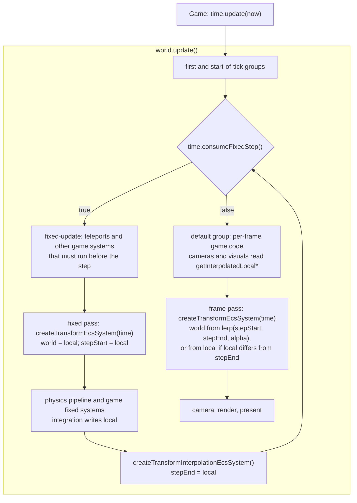

# Transform interpolation

Issue: [#824](https://github.com/Forge-Game-Engine/Forge/issues/824)
(Physics Fixed Timestep milestone. It builds on #795, which added
`time.fixedOverstepFraction`, #801, which added `registerFixedUpdate` (see
[`fixed-update-group.md`](./fixed-update-group.md)), and #815, which moved
the physics systems into the fixed-update group (see
[`fixed-step-physics.md`](./fixed-step-physics.md)).)

| Module or file                                                                                                                                 | Change   | Phase | Notes                                                                                                                                         |
| ---------------------------------------------------------------------------------------------------------------------------------------------- | -------- | ----- | --------------------------------------------------------------------------------------------------------------------------------------------- |
| `src/math/lerp-angle.ts`                                                                                                                       | New      | 1     | `lerpAngle(from, to, t)`, along the shortest arc                                                                                              |
| `src/common/components/transform-interpolation-component.ts`                                                                                   | New      | 1     | `TransformInterpolationEcsComponent`, `LocalTransformSnapshot`, `transformInterpolationId`, `addTransformInterpolationComponent`              |
| `src/common/systems/transform-interpolation-system.ts`                                                                                         | New      | 1     | `createTransformInterpolationEcsSystem()`: records each entity's `local` at the end of a fixed step                                           |
| `src/common/systems/transform-system.ts`                                                                                                       | Modified | 1     | `createTransformEcsSystem(time)`: records the step's start in a fixed step, interpolates outside one                                          |
| `src/common/transforms/get-interpolated-local-transform.ts`                                                                                    | New      | 1     | `getInterpolatedLocalPosition`, `getInterpolatedLocalRotation`: the pose an entity is drawn at this frame                                     |
| Every caller of `createTransformEcsSystem()` in `src` tests, `e2e`, `demo`, `documentation-site` (pages and docs) and `README.md`              | Modified | 1     | Pass `time` (about 135 files, mechanical)                                                                                                     |
| `e2e/fixtures/scenes/transform-interpolation.ts`, `e2e/specs/transform-interpolation.spec.ts`                                                  | New      | 1, 2  | Two bodies at constant velocity, one interpolated: even on-screen steps against one step in four                                              |
| `src/physics/raycast/raycast.ts`, `raycast.test.ts`                                                                                            | Modified | 1     | Tests a moving body at its simulated pose, with bounds from that same pose                                                                    |
| `AGENTS.md` "Component Pattern", `.claude/skills/create-component/SKILL.md`                                                                    | Modified | 2     | An `add<Name>Component` factory may attach a companion component the first one always needs                                                   |
| `src/physics/components/rigidbody-component.ts`                                                                                                | Modified | 2     | `addRigidBodyComponent` adds a `TransformInterpolationEcsComponent`                                                                           |
| `documentation-site/src/pages/demos/*` (the 18 demos with rigid bodies), `demo/src/game.ts`                                                    | Modified | 2     | Register `createTransformInterpolationEcsSystem()` last in the fixed-update group; cameras and visuals placed from bodies read the drawn pose |
| `src/physics/systems/fixed-step-pipeline.test.ts`, `e2e/specs/fixed-timestep-physics.spec.ts`, `e2e/fixtures/scenes/fixed-timestep-physics.ts` | Modified | 2     | The frame pass draws the interpolated pose, not `local`                                                                                       |
| `documentation-site/docs/docs/common/transforms.md`, `common/time.md`                                                                          | Modified | 1, 2  | New "Interpolation" section; the time page points at it                                                                                       |
| `documentation-site/docs/docs/physics/*.md`, `navigation/agents.md`, `tilemaps/*.md`                                                           | Modified | 2     | Registration snippets; bodies are interpolated; where per-frame code reads a body's pose                                                      |
| `AGENTS.md`                                                                                                                                    | Modified | 2     | "Transforms": the frame pass interpolates; game logic reads a body's `local`, drawing reads the interpolated pose                             |
| `CHANGELOG.md`                                                                                                                                 | Modified | 1, 2  | `#### Added`, `#### Changed`                                                                                                                  |
| **Engine version at time of design**                                                                                                           |          |       | `0.27.0`                                                                                                                                      |

## Summary

Since #815, rigid bodies move only in fixed steps. At 60 steps per second
a 144 Hz display draws a body moving on 60 of its 144 frames and standing
still on the rest; a 50 Hz step on a 60 Hz display shows no movement on
one frame in six. Both read as stutter. Glenn Fiedler's "Fix Your
Timestep!" draws `lerp(previous, current, alpha)` instead, where `alpha`
is the accumulator's leftover fraction, which `Time` already exposes as
`fixedOverstepFraction`.

Engines put that blend in different places. Unity's
`Rigidbody.interpolation` keeps the simulated pose in `Rigidbody.position`
and sets the `Transform` everything else reads to the blended pose. Godot
4.3+ keeps the simulated transform on the node and draws the blended
global transform. Bevy's `bevy_transform_interpolation` (used by Avian)
records the `Transform` at the start and end of each fixed step and writes
the blend into `Transform` in the variable-rate schedule.

Forge does it in the transform system, the only writer of `world`:

- **`local` stays the simulated pose.** Physics writes it in fixed steps,
  as today. Nothing about the simulation changes.
- **Each fixed step records where it started and where it ended.** The
  transform system's pass at the start of a step (the fixed pass) copies
  an interpolated entity's `local` into its
  `TransformInterpolationEcsComponent.stepStart`. A new system,
  `createTransformInterpolationEcsSystem()`, registered last in the
  fixed-update group, copies it into `stepEnd`.
- **The once-per-frame pass draws the blend.** Outside a fixed step,
  `createTransformEcsSystem(time)` composes `world` from
  `lerp(stepStart, stepEnd, alpha)` (rotation along the shortest arc) for
  every entity whose `local` still equals `stepEnd`. Rendering, cameras,
  culling, children of a body, trails, particles and world-space UI read
  `world`, so they get the smooth pose with no change. Inside a fixed step
  the transform system writes `world` from `local` exactly, so physics
  always reads the simulated pose.
- **A move made outside the steps shows at once.** When an entity's
  `local` no longer equals `stepEnd`, something other than the simulation
  moved it since the last step (a respawn, a reset, a per-frame mover),
  and the frame pass draws `local` as it is. This is how Bevy's crate
  treats a `Transform` changed outside the fixed schedules. It means a
  teleport needs no extra call, as long as it follows the rule the physics
  docs already give: write it in the default group, or in the fixed-update
  group before the fixed pass. The issue's `resetTransformInterpolation`
  isn't needed (TI2).
- **Moving bodies are interpolated by default.** `addRigidBodyComponent`
  adds the component, so a game following the docs doesn't stutter on any
  display. Unity, Godot and Avian leave interpolation off by default; the
  issue chose otherwise, because a fixed step without it always stutters
  when the display's rate isn't a multiple of the step's (TI5).
- **Code that places something from a body's drawn pose reads it through
  a helper.** A camera that follows a body, or an arm sprite drawn from a
  pivot to a ball, runs before the frame pass and would otherwise read the
  simulated `local`, which is up to a step ahead of where the body is
  drawn. `getInterpolatedLocalPosition` and `getInterpolatedLocalRotation`
  return the pose the frame pass will draw, like Godot's
  `get_global_transform_interpolated()`. Game logic keeps reading `local`.
- **Physics queries see the simulated pose.** `raycast` culls with the
  broad phase's bounds (from the step's start pose) but tests the exact
  shape at `position.world`, which outside a step becomes the drawn pose.
  It tests a moving body at its simulated pose (`local`, the end of the
  latest step) with bounds computed from that same pose, as Unity's,
  Godot's and Bevy's queries and [`3d/14-physics-3d.md`](./3d/14-physics-3d.md)
  (§6.14, "What they see") do (TI13).

The interpolated pose trails the simulation by up to one fixed step, the
cost of interpolation in every engine that does it.

Nothing here bends a core design of the engine. `world` keeps one writer
(the transform system), `stepStart` has one (the transform system's fixed
pass) and `stepEnd` has one (the new system). No system's query changes or
becomes configurable, and no new state lives outside `update`.

Two conventions do change, and `AGENTS.md` says so in the same change:

- **The transform system writes a second component.** Until now it wrote
  only `world`; its fixed pass now also writes
  `TransformInterpolationEcsComponent.stepStart` (TI3). Forge's
  fixed-update group has no built-in first and last phases (Bevy's
  `FixedFirst`/`FixedLast`), and the fixed pass is already the one place
  that runs after teleports and before physics in every step.
- **`addRigidBodyComponent` attaches a second component** (TI5), the first
  `add<Name>Component` factory to do so.

## Scope

### In scope

- `lerpAngle` in `src/math`.
- `TransformInterpolationEcsComponent`, its factory and key.
- `createTransformInterpolationEcsSystem()`.
- `createTransformEcsSystem(time)`: the step-start record in the fixed
  pass and the blend in the frame pass; every caller updated.
- `getInterpolatedLocalPosition` and `getInterpolatedLocalRotation`.
- `addRigidBodyComponent` adding the component to every body.
- `raycast` testing moving bodies at their simulated pose, with bounds
  from the same pose (see "Physics queries").
- Registering the new system in every physics setup (docs, the 18
  docs-site demos with rigid bodies, `demo/src/game.ts`, the e2e physics
  scene) and moving every camera and visual that's placed from a body onto
  the helpers.
- Unit tests, an e2e scene and spec, updates to #815's pipeline test and
  e2e spec, documentation, `AGENTS.md` and changelog bullets.

### Out of scope

- **Extrapolation** (Unity's `RigidbodyInterpolation.Extrapolate`, Bevy's
  `TransformExtrapolation`): predicting the pose a step ahead from the
  velocity removes the lag but overshoots on contact.
- **Hermite or velocity-aware easing** (Bevy's `TransformHermiteEasing`).
- **A body pose separate from `local`** with an interpolating write-back,
  which [`3d/14-physics-3d.md`](./3d/14-physics-3d.md) (§6.6.4) plans for
  the 3D program, where physics owns a body's `local` and bodies may have
  parents. 2D physics keeps its pose in `local` today; changing that is
  that program's rewrite, not this issue.
- **Parented dynamic or kinematic bodies.** They still throw in
  `createEulerIntegrationEcsSystem`.
- **Interpolating anything but transforms**: sprite animation frames,
  camera zoom, values a game changes in fixed steps.
- **Raycasts against drawn poses.** `raycast` tests the simulated pose
  (see "Physics queries"); a game that wants to hit what's on screen
  (picking a body with the mouse) tests against the helpers' pose itself.
- **Colliders without a moving body under an interpolated parent.** Such
  a collider (a static collider parented to a body) has a `world` that
  moves every frame; physics already treats it as static. `raycast` keeps
  testing it at `world` with the broad phase's bounds, so its bounds can
  lag what it's tested at, as they can today for a static collider moved
  since the last step. Forge has no compound bodies; supporting them is
  their own design.
- **The transform system's existing closure state** (`computed`, `frozen`
  in `transform-system.ts`), which #815 also left for its own change.
- **Replacing `Time`'s `1000 / 15` delta clamp** (#829).

## Concepts

- **Fixed pass.** The `createTransformEcsSystem(time)` instance first in
  the fixed-update group. It runs while `time.isInFixedStep` is `true`.
- **Frame pass.** The instance in the default group, before rendering. It
  runs with `time.isInFixedStep` `false`. A world without physics has only
  this one.
- **Interpolated entity.** An entity with a
  `TransformInterpolationEcsComponent`.
- **Step start, step end.** An interpolated entity's `local` position,
  rotation and scale at the start and end of the latest fixed step it
  took part in.
- **Alpha.** `clamp(time.fixedOverstepFraction, 0, 1)`: how far the frame
  is between the latest step's end and the next step's end. In the
  default group it's already in `[0, 1)`; the clamp only matters in
  worlds where nothing consumes fixed steps, where the fraction grows
  without bound.
- **Drawn pose.** What the frame pass composes `world` from: the blend of
  step start and step end at alpha when the entity's `local` equals its
  step end, and `local` otherwise.

## Frame data flow



What a system reads from an interpolated body, depending on where it runs:

| Where                                     | `local`                | `world`                                       | `getInterpolatedLocal*`           |
| ----------------------------------------- | ---------------------- | --------------------------------------------- | --------------------------------- |
| Fixed-update group, before the fixed pass | the simulated pose     | the pose the last frame drew                  | `local` (inside a step)           |
| Fixed-update group, after the fixed pass  | the simulated pose     | the step's start pose, exactly `local` then   | `local` (inside a step)           |
| Default group, before the frame pass      | the latest step's pose | the step's start, or the last frame's drawing | the pose this frame will draw     |
| Default group, after the frame pass       | the latest step's pose | the drawn pose                                | the drawn pose (equal to `world`) |
| Event handlers between frames             | the latest step's pose | the last drawn pose                           | the last drawn pose               |

The rule that follows, which replaces #815's "a once-per-frame system
that reads a dynamic or kinematic body's pose reads `local`":

- **Game logic reads `local`**: whether the player fell off the map, where
  a path starts, where to apply an impulse. It's the pose the simulation
  continues from.
- **Something drawn or a camera placed from a body reads the drawn
  pose**, through `getInterpolatedLocalPosition` and
  `getInterpolatedLocalRotation`, so it lines up with the body on screen.
  Godot gives the same advice for `get_global_transform_interpolated()`:
  use it for cameras and a few visuals, never for gameplay.

Engine code that reads `world` outside a fixed step, checked against the
change:

| Reader                                                                          | Reads                                          | Outside a fixed step, after this change                                                                                                                                                                                                                      |
| ------------------------------------------------------------------------------- | ---------------------------------------------- | ------------------------------------------------------------------------------------------------------------------------------------------------------------------------------------------------------------------------------------------------------------ |
| Rendering, cameras, culling, draw order, masks, text, trails, particle emitters | `world`                                        | The drawn pose, which is the point                                                                                                                                                                                                                           |
| UI layout and world-space canvases                                              | `world`                                        | The drawn pose, so UI anchored to a body stays on it                                                                                                                                                                                                         |
| `raycast` (`src/physics/raycast/raycast.ts`)                                    | `collider.aabb` to cull, `world` for the shape | Was inconsistent: bounds at the step's start pose, shape at the drawn pose. Fixed to the simulated pose for both (see "Physics queries")                                                                                                                     |
| `localToWorldPoint`, `worldToLocalPoint`                                        | `world`                                        | The drawn pose, like Unity's `Transform.TransformPoint` on an interpolated body. Inside a fixed step, after the fixed pass, the simulated pose. Their JSDoc and `transforms.md` say so; game logic that needs a body's simulated frame composes from `local` |
| Navigation agents (`plan-agent-paths.ts`, `navigation-agent-system.ts`)         | `position.world`                               | Agents that steer rigid bodies run in the fixed-update group after the fixed pass (#815), where `world` is the simulated pose; agents in the default group move entities by `local` and aren't interpolated. No change                                       |
| `markGridFromColliders`                                                         | `world` of static colliders                    | Skips non-static bodies; static colliders aren't interpolated. No change                                                                                                                                                                                     |
| Joints, springs, the narrow phase, the solver, CCD, the sleep system            | `world`                                        | Run in fixed steps after the fixed pass: the simulated pose. No change                                                                                                                                                                                       |
| `applyImpulse`, `applyExplosiveForce`                                           | `local` (since #815)                           | No change                                                                                                                                                                                                                                                    |

## Physics queries

`raycast` (`src/physics/raycast/raycast.ts`) culls each collider with
`collider.aabb` (line 122), which `createBroadPhaseEcsSystem` writes from
`position.world` right after the fixed pass (`broad-phase-system.ts`
lines 48-54): the pose at the start of the latest step. It then tests the
exact shape at `positions[i].world` (line 128). Today, called from the
default group, that `world` is the frame pass's copy of `local`, a step
ahead of the bounds. After this change it's the drawn pose, up to a step
behind `local`. Either way the cull and the test disagree, and the ray can
miss a body where it's tested, or hit it at a pose the simulation isn't
at.

Physics queries in Unity, Godot and Bevy (Avian) see the colliders as of
the end of the last simulation step, never the interpolated presentation,
and `3d/14-physics-3d.md` §6.14 makes the same rule for the 3D program.
Forge follows it (TI13):

- **A collider on an entity with a `'dynamic'` or `'kinematic'` rigid
  body** is tested at its `position.local` and `rotation.local`. Such a
  body is always a root entity, so that's its world pose at the end of
  the latest step, or wherever game code has since teleported it. Its
  cull box is `collider.collider.computeAabb(local, rotation)`, from the
  same pose. `computeAabb` is cheap for every shape: a circle is
  constant work, a polygon transforms its few vertices, and chain and
  terrain colliders transform cached local bounds (`transform-bounds.ts`).
- **Every other collider** (no rigid body, or a `'static'` one) keeps
  today's cull with `collider.aabb` and test at `world`. Physics never
  moves it, so its `world` and bounds come from the same pose, except
  when game code moved it since the last step, which is today's
  documented behavior ("a collider added since the broad phase last ran
  can't be hit yet").

```ts
const rigidBody = getRigidBody(entities[i]);
const isMoving = rigidBody !== null && rigidBody.type !== 'static';
const pose = isMoving
  ? { position: positions[i].local, rotation: localRotation(entities[i]) }
  : { position: positions[i].world, rotation: worldRotation(entities[i]) };
const bounds = isMoving
  ? collider.collider.computeAabb(pose.position, pose.rotation)
  : collider.aabb;
```

The rigid body is read through `world.getComponentAccessor(rigidBodyId)`,
as rotation already is. `raycast`'s JSDoc says which pose it tests and
that a hit on a moving body can be up to a step ahead of where the body
is drawn. Inside a fixed step after the fixed pass, `local` and `world`
of a body agree at the step's start pose until integration, so fixed-step
callers see no change before integration and the end-of-step pose after
it, which is what the next step starts from.

The fix lands in phase 1, since phase 1 already lets a game interpolate a
body. It also corrects the existing one-step disagreement for
default-group callers.

## Worked example

Fixed step `1000 / 32` ms (31.25 ms), frames of `1000 / 128` ms
(7.8125 ms), so four frames per step. A body moves right at 512 units per
second, 16 units per step. `time.update(0)` seeds the clock.

| Frame | Steps | `stepStart.x` | `stepEnd.x` / `local.x` | Alpha | Drawn `world.x` | Without interpolation |
| ----- | ----- | ------------- | ----------------------- | ----- | --------------- | --------------------- |
| 1     | 0     | 0             | 0                       | 0.25  | 0               | 0                     |
| 2     | 0     | 0             | 0                       | 0.5   | 0               | 0                     |
| 3     | 0     | 0             | 0                       | 0.75  | 0               | 0                     |
| 4     | 1     | 0             | 16                      | 0     | 0               | 16                    |
| 5     | 0     | 0             | 16                      | 0.25  | 4               | 16                    |
| 6     | 0     | 0             | 16                      | 0.5   | 8               | 16                    |
| 7     | 0     | 0             | 16                      | 0.75  | 12              | 16                    |
| 8     | 1     | 16            | 32                      | 0     | 16              | 32                    |
| 9     | 0     | 16            | 32                      | 0.25  | 20              | 32                    |

From frame 4 the drawn body moves 4 units every frame. Without
interpolation it moves 16 units on one frame in four. Every value is exact
in binary floating point, which is what the e2e spec relies on.

## Moves made outside the fixed steps

Each case, and what the frame pass draws:

| Move                                                                               | Example                                                                                  | What's drawn                                                                                                                                              |
| ---------------------------------------------------------------------------------- | ---------------------------------------------------------------------------------------- | --------------------------------------------------------------------------------------------------------------------------------------------------------- |
| Teleport in the default group                                                      | `car/_car-reset`, `rolling-ball/_jump`'s respawn                                         | `local` differs from `stepEnd`, so `local`, from that frame on. The next step starts at the new pose, and interpolation resumes from it                   |
| Teleport in the fixed-update group, before the fixed pass                          | `linear-spring-damper/_reset`, `brick-breaker/_ball-reset`, `tiled-maps/_player-respawn` | The fixed pass records the new pose as `stepStart`, so the frame blends from it: no slide                                                                 |
| Teleport in the fixed-update group, after the fixed pass and before the end record | none in the demos                                                                        | A slide from the old pose to the new one over one step. The same placement already breaks continuous collision detection, so the existing rule forbids it |
| Teleport in the fixed-update group, after the end record                           | a contact reaction registered after the physics block                                    | `local` differs from `stepEnd`: drawn at `local` until the next step, like a default-group teleport                                                       |
| Entity created between steps                                                       | `sensors/_ball-spawner`, `chain-collider/_spawn-bodies`                                  | `addTransformInterpolationComponent` starts `stepStart` and `stepEnd` as copies of `local`, so the blend is `local` until its first step                  |
| Entity created inside a step, after the fixed pass                                 | a bullet spawned by a fixed-step gun                                                     | The same: drawn at `local` until its first full step                                                                                                      |
| An interpolated entity moved every frame by `local`                                | a kinematic paddle driven by input in the default group                                  | `local` differs from `stepEnd` on every frame it moves, so it's drawn at `local`, as without the component. It's never drawn behind where the game put it |
| No end record registered                                                           | a world that registers physics without the new system, unit tests                        | `stepEnd` keeps its starting value, so as soon as `local` moves it differs, and the entity is drawn at `local`, as today                                  |
| Paused (`timeScale = 0`)                                                           | a pause menu                                                                             | No steps run and alpha stays where it was, so bodies hold still at their blended pose. A teleport while paused shows at once                              |

The comparison is exact: `stepEnd` is a copy of `local`, so they're equal
until something writes `local`. A write that sets the same value back
counts as no move, which draws the same pose either way.

## API design

### `lerpAngle`

```ts
/**
 * Interpolates between two angles along the shorter way around the circle,
 * like Godot's `lerp_angle`. Angles are in radians, in Forge's convention
 * (`0` along `+X`, positive turning `+X` towards `+Y`).
 * @param from - The start angle.
 * @param to - The end angle.
 * @param t - The interpolation factor: `0` returns `from`, `1` returns an
 * angle that points the same way as `to` (it can differ from `to` by a
 * whole turn). It isn't clamped.
 * @returns `from` plus `t` times the signed difference from `from` to
 * `to`, wrapped into `[-π, π)`.
 */
export function lerpAngle(from: number, to: number, t: number): number;
```

It continues from `from` rather than wrapping the result, so an entity
whose rotation has wound up past `2π` keeps a rotation near its own
values.

### `TransformInterpolationEcsComponent`

`src/common/components/transform-interpolation-component.ts`, built with
the `create-component` skill:

```ts
/** A copy of an entity's local position, rotation and scale. */
export interface LocalTransformSnapshot {
  /** `position.local`, or `(0, 0)` when the entity has no position. */
  readonly position: Vector2;
  /** `rotation.local`, or `0` when the entity has no rotation. */
  rotation: number;
  /** `scale.local`, or `(1, 1)` when the entity has no scale. */
  readonly scale: Vector2;
}

/**
 * Draws an entity that moves in fixed steps smoothly on every frame: the
 * transform system's once-per-frame pass composes its `world` transform
 * from a blend of its local transform at the start and end of the latest
 * fixed step, by `time.fixedOverstepFraction`, instead of from `local`.
 * The entity is drawn up to one fixed step behind where the simulation
 * has it. `addRigidBodyComponent` adds it to every rigid body.
 *
 * Only an entity whose `local` still equals `stepEnd` is blended. When
 * something other than the fixed steps moved it since the latest step (a
 * teleport, a per-frame mover), it's drawn at `local` until the next step.
 *
 * Both snapshots are output: `createTransformEcsSystem` writes `stepStart`
 * at the start of each fixed step, and `createTransformInterpolationEcsSystem`
 * writes `stepEnd` at the end of each. Remove the component to draw the
 * entity at `local`.
 */
export interface TransformInterpolationEcsComponent {
  /**
   * The entity's local transform at the start of the latest fixed step.
   * Output, written only by `createTransformEcsSystem` inside a fixed step.
   */
  readonly stepStart: LocalTransformSnapshot;

  /**
   * The entity's local transform at the end of the latest fixed step.
   * Output, written only by `createTransformInterpolationEcsSystem`.
   */
  readonly stepEnd: LocalTransformSnapshot;
}

export const transformInterpolationId =
  createComponentId<TransformInterpolationEcsComponent>(
    'transform-interpolation',
  );

/**
 * Attaches a {@link TransformInterpolationEcsComponent} to `entity`, with
 * both snapshots copied from its current local transform, so it's drawn at
 * `local` until its first fixed step.
 */
export function addTransformInterpolationComponent(
  world: EcsWorld,
  entity: number,
): TransformInterpolationEcsComponent;
```

The factory takes no options: every field is output. It doesn't throw
when the entity has no transform yet; the snapshots start at the identity
values, and the comparison draws `local` once a transform is added and
moved (see "Moves made outside the fixed steps").

### `createTransformInterpolationEcsSystem`

`src/common/systems/transform-interpolation-system.ts`, built with the
`create-system` skill:

```ts
/**
 * Creates the system that records each interpolated entity's local
 * transform at the end of a fixed step, in its
 * `TransformInterpolationEcsComponent.stepEnd`.
 *
 * Register it last in the fixed-update group (`registerFixedUpdate`), after
 * the physics systems and every game system that moves entities in fixed
 * steps. A move made after it is drawn as a teleport: at `local`, until the
 * next step. Without it, interpolated entities are drawn at `local`.
 * @returns The ECS system.
 */
export const createTransformInterpolationEcsSystem = (): EcsSystem<
  [TransformInterpolationEcsComponent, PositionEcsComponent]
> => ({
  query: [transformInterpolationId, positionId],
  update: (world, { entities, components: [interpolations, positions] }) => {
    for (let i = 0; i < entities.length; i++) {
      // stepEnd.position <- positions[i].local
      // stepEnd.rotation <- rotation.local (world.getComponent), or 0
      // stepEnd.scale    <- scale.local (world.getComponent), or (1, 1)
    }
  },
});
```

It copies into the existing snapshot objects, so a step allocates
nothing.

### `createTransformEcsSystem(time)`

```ts
/**
 * Creates a system that computes the world position, rotation and scale of
 * every entity from its local transform and, if it has a
 * `ParentEcsComponent`, its parent's world transform.
 *
 * Inside a fixed step (`time.isInFixedStep`), it composes `world` from
 * `local` exactly, so the physics systems after it read the simulated
 * pose, and records each interpolated entity's `local` as its
 * `TransformInterpolationEcsComponent.stepStart`. Outside a fixed step, an
 * interpolated entity whose `local` equals its `stepEnd` is composed from
 * the blend of `stepStart` and `stepEnd` by `time.fixedOverstepFraction`
 * (rotation along the shorter arc); every other entity from `local`.
 * Children compose on their parent's `world`, so they follow an
 * interpolated parent.
 *
 * Entities (and their entire parent chain) with
 * `PositionEcsComponent.isStatic` set to `true` have their world transform
 * computed once and then skipped on every subsequent pass.
 * @param time - The time whose fixed step and overstep fraction the system
 * reads.
 * @returns The transform ECS system.
 */
export const createTransformEcsSystem = (
  time: Time,
): EcsSystem<[PositionEcsComponent]>;
```

The query stays `[positionId]`. Every world takes a `time` argument, with
or without physics: a world without interpolated entities behaves exactly
as today in both passes.

#### Algorithm

`computeWorld` (`transform-system.ts`) keeps its recursion, `computed` set
and static cache. What changes is where the local values come from:
`setLocalAsWorldIfExists` and the three `compose*WithParent` functions take
the resolved local position, rotation and scale as arguments instead of
reading `component.local`. The resolution, per entity, after its parent's
`world` is computed:

```ts
function resolveLocal(entity, world, time): LocalValues {
  const interpolation = world.getComponent(entity, transformInterpolationId);
  const position = world.getComponent(entity, positionId);
  const rotation = world.getComponent(entity, rotationId);
  const scale = world.getComponent(entity, scaleId);

  if (time.isInFixedStep) {
    if (interpolation) {
      copyLocalInto(interpolation.stepStart, position, rotation, scale);
    }

    return localValues(position, rotation, scale);
  }

  if (
    !interpolation ||
    !matchesSnapshot(interpolation.stepEnd, position, rotation, scale)
  ) {
    return localValues(position, rotation, scale);
  }

  const alpha = clamp(time.fixedOverstepFraction, 0, 1);
  const { stepStart, stepEnd } = interpolation;

  return {
    x: lerp(stepStart.position.x, stepEnd.position.x, alpha),
    y: lerp(stepStart.position.y, stepEnd.position.y, alpha),
    rotation: lerpAngle(stepStart.rotation, stepEnd.rotation, alpha),
    scaleX: lerp(stepStart.scale.x, stepEnd.scale.x, alpha),
    scaleY: lerp(stepStart.scale.y, stepEnd.scale.y, alpha),
  };
}
```

`matchesSnapshot` compares only the components the entity has. The
resolved values are plain numbers held in locals of the call (or a small
object created inside `update`), never a vector declared outside
`update`, so the system stays stateless beyond its existing cache. The
same `resolveLocal` (minus the fixed-pass record) backs the two helpers
below, so there's one definition of the drawn pose.

A frozen static entity returns before `resolveLocal`, as today: it never
moves, so it needs neither record nor blend.

### `getInterpolatedLocalPosition` and `getInterpolatedLocalRotation`

`src/common/transforms/get-interpolated-local-transform.ts`, exported
from `@forge-game-engine/forge/common` beside `localToWorldPoint`:

```ts
/**
 * Gets an entity's local position as the transform system's once-per-frame
 * pass draws it: for an interpolated entity whose `local` equals its
 * `stepEnd`, the blend of its `stepStart` and `stepEnd` by
 * `time.fixedOverstepFraction`, and `position.local` otherwise. Inside a
 * fixed step, it's `position.local`. For an entity without a parent, it's
 * the world position the entity is drawn at this frame.
 *
 * Read it to place something on screen from a moving body, such as a
 * camera that follows the body or a sprite drawn between two bodies, in a
 * system that runs before the frame's transform system. Game logic reads
 * `position.local`, the pose the simulation continues from.
 * @param world - The ECS world `entity` belongs to.
 * @param entity - The entity to read.
 * @param time - The time whose overstep fraction the blend uses.
 * @returns A new `Vector2` holding the position.
 * @throws An error if the entity has no `PositionEcsComponent`.
 */
export function getInterpolatedLocalPosition(
  world: EcsWorld,
  entity: number,
  time: Time,
): Vector2;

/**
 * Gets an entity's local rotation as the transform system's once-per-frame
 * pass draws it, as `getInterpolatedLocalPosition` does for its position.
 * @returns The rotation in radians, or `0` if the entity has no
 * `RotationEcsComponent`.
 */
export function getInterpolatedLocalRotation(
  world: EcsWorld,
  entity: number,
  time: Time,
): number;
```

They return a new vector, like `localToWorldPoint`. Callers are a camera
or a few visuals per frame, so the allocation doesn't matter, and a
caller can't alias the entity's own `local`.

They read local values. A body is always a root entity, so for a body
the local value is its world value. A world-space version for parented
entities would need to compose the parent chain the way the transform
system does; no caller needs it (open question 5).

### `addRigidBodyComponent` (phase 2)

After attaching the rigid body, `addRigidBodyComponent` calls
`addTransformInterpolationComponent(world, entity)` unless the entity
already has one, for every body type. Its JSDoc says so, and that
removing the component (`world.removeComponent(entity,
transformInterpolationId)`) draws the body at its simulated pose. There's
no option on `addRigidBodyComponent`: removing a component is one line,
and only a game that wants to see the raw steps (debugging, a replay
viewer) does it.

Every body type gets it because `RigidBodyEcsComponent.type` can change
after creation: a static body made dynamic would otherwise stutter. A body
that doesn't move costs two snapshot copies per step and one comparison
and blend per frame, which give back `local` (TI5).

This is the first `add<Name>Component` factory that adds a second
component. The alternative, a separate call after every
`addRigidBodyComponent`, would leave interpolation off in every game that
didn't read the guide, which is the default the issue rejects.

Because it changes the component pattern, phase 2 updates `AGENTS.md`'s
"Component Pattern" and the `create-component` skill
(`.claude/skills/create-component/SKILL.md`, section 2): an
`add<Name>Component` factory still never creates an entity, and may
attach a companion component only when every entity with its own
component needs the companion to behave correctly by default (a rigid
body needs interpolation to be drawn without stutter). It adds the
companion only when the entity doesn't already have one, so a caller's
own companion is kept, and its JSDoc names the companion and how to
remove it. Anything a caller can reasonably go without stays a separate
call.

## Registration

The physics setup from `physics/index.md`, with the new system:

```ts
const fixedUpdate = registerFixedUpdate(world, time);
const physics = { group: fixedUpdate };

// Once per fixed step. Teleports go before the first transform system.
world.addSystem(createTransformEcsSystem(time), physics);
world.addSystem(createBroadPhaseEcsSystem(collisionPairs), physics);
// ... the rest of the pipeline, as today ...
world.addSystem(createEulerIntegrationEcsSystem(time), physics);
world.addSystem(createContinuousCollisionEcsSystem(), physics);
world.addSystem(createTransformInterpolationEcsSystem(), physics);

// Once per frame, after the fixed steps.
world.addSystem(createTransformEcsSystem(time));
world.addSystem(createCameraEcsSystem(time));
world.addSystem(createRenderEcsSystem(renderContext));
```

The numbered list under it gains a point for the last system ("records
where each body ended the step, so the frame's transform system can draw
it between its last two poses") and point 8 changes: the second transform
system draws each body between the start and end of the latest step, by
how far the frame is towards the next one.

A world without physics registers `createTransformEcsSystem(time)` once,
as today with the new argument.

## Demo migration (phase 2)

Every demo that creates rigid bodies registers
`createTransformInterpolationEcsSystem()` last in its fixed-update group:
`brick-breaker`, `car`, `chain-collider`, `isometric-path-finding`,
`isometric-tilemap`, `linear-spring-damper`, `moving-platform`,
`newtons-cradle`, `path-finding`, `physics`, `physics-stress-test`,
`prismatic-joint`, `revolute-joint`, `rolling-ball`, `sensors`,
`tiled-maps`, `torque`, `wrecking-ball`, and `demo/src/game.ts`.
`raycasting` and `space-shooter` have no rigid bodies and don't register
it.

Default-group demo systems that read a body's pose:

| System                                      | Reads today                               | After this change                                                                                                                         |
| ------------------------------------------- | ----------------------------------------- | ----------------------------------------------------------------------------------------------------------------------------------------- |
| `car/_camera-follow`                        | the chassis' `local`                      | `getInterpolatedLocalPosition(world, targetEntity, time)`; the factory takes `time`                                                       |
| `rolling-ball/_camera-follow`               | the ball's `local`, passed as a component | the ball's entity and `getInterpolatedLocalPosition`; the factory takes the entity instead of its `PositionEcsComponent`                  |
| `tiled-maps/_camera-follow`                 | the player's `local.x`                    | `getInterpolatedLocalPosition(...).x`; the factory takes `time`                                                                           |
| `newtons-cradle/_arm`, `wrecking-ball/_arm` | the ball's `local`                        | `getInterpolatedLocalPosition`, so the arm ends where the ball is drawn                                                                   |
| `linear-spring-damper/_spring-line`         | the body's `local`                        | `getInterpolatedLocalPosition`                                                                                                            |
| `path-finding/_path-lines`                  | the unit's `local`                        | `getInterpolatedLocalPosition` for the line's first point, so the line starts at the unit on screen; the waypoints after it are unchanged |
| `rolling-ball/_jump`                        | `local` (fall check, impulse point)       | unchanged: game logic. Its respawn is a default-group teleport, drawn at once                                                             |
| `car/_car-reset`                            | writes `local`                            | unchanged: a default-group teleport                                                                                                       |
| `isometric-path-finding/_find-path`         | the player's `local`                      | unchanged: it plans from the simulated pose                                                                                               |
| `demo/src/game.ts` despawn                  | `local.y`                                 | unchanged                                                                                                                                 |

Each changed system's JSDoc says it reads the drawn pose because it
places something on screen, replacing the "reads `local` ... where its
`world` would still be a step behind" paragraphs #815 added. The
fixed-update teleport systems (`linear-spring-damper/_reset`,
`brick-breaker/_ball-reset`, `tiled-maps/_player-respawn`) already run
before the fixed pass and need nothing. "How it works" text that says the
frame draws "the latest step's poses" (the `physics` demo and others that
#815 rewrote) says the frame draws bodies between their last two steps.

## Performance

- The fixed pass adds one snapshot copy per interpolated entity per step,
  and `createTransformInterpolationEcsSystem` another: five numbers each.
- The frame pass adds, per interpolated entity, a component lookup, up to
  five comparisons and five blends. Entities without the component pay
  one failed lookup, which the frame pass already does for rotation and
  scale.
- `physics-stress-test` is the case to measure. The work is linear in the
  number of bodies and small next to the solver; no benchmark is planned,
  but the stress test's FPS readout is checked before and after on the
  same machine and the numbers go in the pull request.
- The helpers allocate one vector per call, and are called a handful of
  times per frame.

## Testing

### Unit tests (phase 1)

`src/math/lerp-angle.test.ts`:

- `t` of `0` gives `from`; `1` gives an angle equal to `to` modulo `2π`;
- from `3` to `-3` at `0.5` passes through `π` (the short way), not `0`;
- from `-3` to `3` at `0.5` passes through `-π`;
- a `from` past `2π` (`7`) to `0.8` stays near `7`.

`src/common/components/transform-interpolation-component.test.ts`:

- both snapshots copy the entity's current `local` position, rotation and
  scale, and are copies (changing `local` afterwards doesn't change them);
- without a rotation or scale, they start at `0` and `(1, 1)`.

`src/common/systems/transform-interpolation-system.test.ts`:

- copies `local` into `stepEnd` for entities with the component, and only
  them; reuses the snapshot objects.

`src/common/systems/transform-system.test.ts`, with a real `Time` and
`registerFixedUpdate` where a step matters (fixed delta `1000 / 32`,
frames of `1000 / 128`, as in the worked example):

- an entity without the component gets `world` from `local` in both
  passes, as today (the existing tests, with `time` passed);
- the fixed pass writes `world` from `local` exactly and records
  `stepStart`, even when the frame pass last drew a blend;
- the frame pass at alpha `0`, `0.5` and `0.75` draws the blend; at alpha
  `1` (forced through a world without a fixed group, where the fraction
  grows past `1`) it draws `stepEnd`, the clamp;
- rotation across `±π` blends the short way;
- a child (no component) of an interpolated parent composes on the
  parent's blended `world`; an interpolated child of an interpolated
  parent blends its own `local` and composes on the parent's blend;
- a teleport in the default group, before the frame pass, draws `local`
  on that frame and on a following frame with no step, and blends again
  from the new pose after the next step;
- a teleport in the fixed-update group before the fixed pass blends from
  the new pose with no slide;
- an entity created between steps draws at `local` until its first step;
- without `createTransformInterpolationEcsSystem` registered, a moving
  interpolated entity draws at `local`;
- a static (`isStatic`) interpolated entity is frozen as before.

`src/common/transforms/get-interpolated-local-transform.test.ts`:

- returns what the frame pass would compose for a root entity, in each
  case above (blend, teleport, no component);
- inside a fixed step returns `local`;
- returns a new vector; throws for an entity without a position; the
  rotation helper returns `0` without a rotation.

`src/physics/raycast/raycast.test.ts`:

- a dynamic body whose `local` is a step ahead of its `world` and of its
  broad-phase `aabb` (set up by hand, as after a frame pass that drew a
  blend) is hit at `local` and missed at `world`, and the hit's point and
  distance come from `local`;
- the same for a kinematic body, and for a rotated polygon body (the cull
  box is computed from `rotation.local`);
- a static collider (no body, and a `'static'` body) is still culled with
  `collider.aabb` and tested at `world`, so one added since the broad phase
  ran still can't be hit;
- a terrain or chain collider on a kinematic body is culled with
  bounds from its cached local bounds at `local`.

### Unit tests (phase 2)

- `rigidbody-component.test.ts`: every body type gets the component, with
  snapshots of its current `local`; an existing component is kept, not
  replaced.
- `fixed-step-pipeline.test.ts`: registers the new system as the docs do.
  The three frame patterns still give the same steps and the same `local`
  poses (interpolation doesn't touch the simulation). `worldFollowedLocal`
  becomes `worldFollowedDrawnPose`: after every frame, `position.world`
  equals `getInterpolatedLocalPosition(world, ball, time)`.

### End to end

`e2e/fixtures/scenes/transform-interpolation.ts`, with the
`write-e2e-test` skill, against `/src`:

- `time.fixedDeltaTimeInMilliseconds = 1000 / 32`, seeded with
  `time.update(0)`; a camera with `verticalWorldUnits: canvas.height`
  (1 world unit is 1 CSS pixel).
- Fixed-update group: `createTransformEcsSystem(time)`,
  `createEulerIntegrationEcsSystem(time)`,
  `createTransformInterpolationEcsSystem()`. Default group:
  `createTransformEcsSystem(time)`, camera, render, present.
- Two white-texture square sprites with kinematic rigid bodies moving
  right at 512 units per second, one above the other, tinted two scene
  colors. The upper one is interpolated; the lower one isn't. In phase 1
  the scene adds the component to the upper one; in phase 2 both get it
  from `addRigidBodyComponent` and the scene removes the lower one's.
- The handle exposes `step(delta)`, both bodies' `local` and `world`
  x, and `measureBounds(color)` (the `scanPixelBounds` helper the other
  physics scenes use).

`e2e/specs/transform-interpolation.spec.ts`:

1. **Even steps on screen.** Step 4 frames of 7.8125 ms (the first fixed
   step runs on the fourth), then 8 more, measuring both squares'
   on-screen centers in the same `page.evaluate` as each `step()`.
   Assert the interpolated square moves 4 px (±1) on each of those 8
   frames (5 to 12), and the other one moves 16 px (±1) on frames 8 and 12
   and less than 1 px on the others. The second square is the same-run control:
   it proves the measurement can see the uneven steps the first one
   doesn't take.
2. **The canvas shows the frame pass's pose.** Over the same frames, the
   interpolated square's on-screen movement equals the change in its
   `world.x` within 2 px, and its `world.x` is 12 units behind its
   `local.x` on the frame with alpha `0.25` after a step (one step
   behind, plus a quarter of the next). That's the relative measurement
   the `write-e2e-test` skill asks for.

The step and frame lengths depart from the issue's 30 Hz and 120 Hz
(TI11), as #815's spec did.

Phase 2 also updates #815's `fixed-timestep-physics` scene (registering
the new system) and its "draws the ball where the latest fixed step left
it" test: renamed to "draws the ball where the frame's transform system
put it", it asserts the on-screen drop matches the drop of
`ball.worldY`, and drops `expect(after.ball.worldY).toBe(after.ball.localY)`.
With 31.25 ms frames and 15.625 ms steps, alpha is `0` on every frame, so
`worldY` is the pose at the start of the frame's last step, about 8 px
above `localY` mid-fall. Its frame-rate independence test compares
`local` and is unchanged.

## Documentation

Use the `document-feature` skill.

- `common/transforms.md` (phase 1): "Registering transform systems with
  physics" passes `time`. A new "Interpolation" section: what it does and
  why (stutter at display rates that aren't a multiple of the step); the
  component and `createTransformInterpolationEcsSystem` last in the
  fixed-update group; that `world` is the drawn pose outside fixed steps
  and the simulated pose inside them; the moves table in short (a teleport
  in the default group, or before the fixed pass, shows at once; a move
  in a step after the fixed pass and before the end record slides); that
  children follow an interpolated parent; reading the drawn pose with the
  helpers, and that game logic reads `local`. Phase 2 adds that rigid
  bodies get the component, and how to remove it. "Reading another
  entity's transform" follows the new rule: a camera following a body
  reads `getInterpolatedLocalPosition`. "Converting points between local
  and world space" says that `localToWorldPoint` and `worldToLocalPoint`
  read `world`, so from the default group or an event handler they convert
  through an interpolated entity's drawn pose (like Unity's
  `Transform.TransformPoint` on an interpolated rigid body), and inside a
  fixed step, after the fixed pass, through its simulated pose. The same
  sentence goes in both functions' JSDoc (`local-to-world-point.ts`,
  `world-to-local-point.ts`), phase 1.
- `physics/raycasting.md` (phase 1): raycasts test a moving body at its
  pose at the end of the latest fixed step (or where game code has since
  put it), not where it's drawn, so a hit can be up to a step ahead of the
  body on screen; static colliders as before. `raycast`'s JSDoc says the
  same.
- `common/time.md` (phase 1): "Interpolating between fixed steps" links to
  the new section as the engine's use of `fixedOverstepFraction`.
- `physics/index.md` (phase 2): the registration snippet and its numbered
  list as in "Registration"; "Where game systems go": "it positions or
  draws something from a body's pose, such as a camera that follows a
  body" reads the drawn pose, and the paragraph "A once-per-frame system
  that reads a dynamic or kinematic body's pose reads its
  `position.local`" becomes the two-part rule above.
- `physics/rigid-bodies.md` (phase 2): "Moving a body" says bodies are
  drawn between their last two steps, and that a teleport placed where
  the existing caution says shows at once with no extra call. A short
  "Interpolation" paragraph links to `transforms.md` and says how to
  remove it.
- Every other page with a physics registration snippet (`forces.md`,
  `joints.md`, `collisions.md`, `continuous-collision-detection.md`,
  `raycasting.md`, `terrain.md`, `sleeping.md`, `chain-colliders.md`,
  `navigation/agents.md`, `tilemaps/collision.md`, `tilemaps/index.md`)
  registers the new system last in the fixed-update group (phase 2), and
  passes `time` to the transform system (phase 1).
- Every other page that registers a transform system passes `time`
  (phase 1): `rendering/*.md`, `text/rendering-text.md`,
  `particles/index.md`, `tilemaps/rendering.md`, and `README.md`.
- `AGENTS.md` "Transforms" (phase 2): states the convention change
  plainly. The transform system was the owner of `world` only; it now also
  owns `TransformInterpolationEcsComponent.stepStart`, which its fixed
  pass writes, and `createTransformInterpolationEcsSystem` owns `stepEnd`.
  The section also says the frame pass draws an interpolated entity
  between its last two steps; a once-per-frame system reads a body's
  `local` for game logic and `getInterpolatedLocalPosition`/`Rotation` to
  place something on screen from it; physics queries test the simulated
  pose; teleports go in the default group or before the fixed pass
  (already the rule).
- `AGENTS.md` "Component Pattern" and the `create-component` skill
  (`.claude/skills/create-component/SKILL.md`, section 2) (phase 2): when
  an `add<Name>Component` factory may attach a companion component, as in
  "`addRigidBodyComponent` (phase 2)" above, with
  `addRigidBodyComponent` as the example.

### Changelog

Phase 1, `#### Added`:

> **common:** Transform interpolation, so entities that move in fixed
> steps are drawn smoothly at any display rate. An entity with a
> `TransformInterpolationEcsComponent` (`addTransformInterpolationComponent`)
> is drawn between its local transform at the start and end of the latest
> fixed step, by `time.fixedOverstepFraction`, up to one step behind the
> simulation. Register `createTransformInterpolationEcsSystem()` last in
> the fixed-update group. A move made outside the fixed steps (a teleport)
> is drawn at once. `getInterpolatedLocalPosition` and
> `getInterpolatedLocalRotation` return the pose an entity is drawn at
> this frame, for cameras and visuals placed from it.
>
> **math:** `lerpAngle(from, to, t)` interpolates between two angles the
> short way around.

Phase 1, `#### Changed`:

> **common:** `createTransformEcsSystem` takes the `Time` it reads:
> `createTransformEcsSystem(time)`. Pass the same `time` your other
> systems use. Inside a fixed step it composes `world` from `local` as
> before; outside one it draws interpolated entities between steps.
>
> **physics:** `raycast` tests a dynamic or kinematic body at its
> `position.local` and `rotation.local`, its pose at the end of the latest
> fixed step, and culls it with bounds computed from that pose. It used to
> cull with the broad phase's bounds from the step's start and test the
> shape at `world`, so a ray cast between steps could miss a body it
> crossed. Static colliders are tested as before.

Phase 2, `#### Changed`:

> **physics:** Rigid bodies are interpolated between fixed steps:
> `addRigidBodyComponent` adds a `TransformInterpolationEcsComponent`.
> Register `createTransformInterpolationEcsSystem()` last in the
> fixed-update group, after continuous collision detection, or bodies keep
> being drawn at their simulated pose. A body's `world` is now its drawn
> pose outside fixed steps, up to one step behind its `local`. A camera or
> visual placed from a body reads `getInterpolatedLocalPosition`; game
> logic keeps reading `local`. Remove the component to draw a body at its
> simulated pose.

## Phases

### Phase 1: interpolation for any entity

Adds the machinery: `lerpAngle`, the component, the end-of-step system,
the transform system's two passes, the helpers, and the `time` argument
for every caller. Released on its own, any game can interpolate an entity
it moves in fixed steps by adding the component and registering the
system; nothing is interpolated by default, so no demo changes behavior.

**Done when** the phase 1 unit tests and the e2e spec (with the explicit
component) pass; every caller passes `time`; `raycast` tests moving
bodies at their simulated pose; `transforms.md`, `time.md` and
`raycasting.md` describe interpolation and which pose each reader sees;
the new exports are in
`@forge-game-engine/forge/common` and `/math` (`npm run check-exports`);
the changelog bullets are in; and the verification checklist passes,
including `npm run build`, the docs site's `typecheck` and `build`, and a
browser check that a sample of demos (`physics`, `ecs`, `ui-anchors`,
`tiled-maps`) still render.

| Task             | Description                                                                                                                   | Size |
| ---------------- | ----------------------------------------------------------------------------------------------------------------------------- | ---- |
| `lerpAngle`      | `src/math/lerp-angle.ts`, its test, export                                                                                    | S    |
| Component        | `transform-interpolation-component.ts`: interface, snapshot type, key, factory, JSDoc, test, export                           | S    |
| End system       | `transform-interpolation-system.ts`, test, export                                                                             | S    |
| Transform system | `createTransformEcsSystem(time)`: `resolveLocal`, the compose functions taking resolved values, JSDoc, the tests listed above | M    |
| Helpers          | `get-interpolated-local-transform.ts`, sharing `resolveLocal`; test; export                                                   | S    |
| Raycast          | `raycast` tests moving bodies at `local` with bounds from `computeAabb`; JSDoc; the `raycast.test.ts` cases; `raycasting.md`  | S    |
| Point helpers    | `localToWorldPoint`/`worldToLocalPoint` JSDoc and `transforms.md`: which pose they convert through                            | S    |
| Callers          | Pass `time` in every `src` test and helper, e2e scene, `demo/src/game.ts`, docs-site demo, docs page and `README.md`          | L    |
| e2e              | `transform-interpolation` scene and spec                                                                                      | M    |
| Docs             | `transforms.md` "Interpolation" section and registration snippet; `time.md` link                                              | M    |
| Changelog        | `#### Added` and `#### Changed`                                                                                               | S    |

### Phase 2: bodies are interpolated by default

Turns interpolation on for every rigid body and migrates every physics
setup. Released on its own (after phase 1), every physics demo moves
smoothly on high refresh-rate displays, which is the issue's "Done when".
The new system, the demo changes and the default land together: a default
without the system registered draws nothing interpolated, and a default
without the camera and visual changes makes cameras that follow bodies
shake against them.

**Done when** `addRigidBodyComponent` adds the component; every demo with
rigid bodies registers the new system and its cameras and visuals read
the drawn pose; the phase 2 tests, the updated
`fixed-timestep-physics` spec and the e2e spec without the explicit
component pass; the physics docs, `AGENTS.md` and the changelog are
updated, including `AGENTS.md`'s "Transforms" and "Component Pattern"
and the `create-component` skill; and each demo with rigid bodies renders and behaves as before
after a full reload, on a 60 Hz display and, where one is available, a
120 or 144 Hz display, where bodies now move on every frame (the car
drives and resets without the camera shaking, the rolling ball respawns
without sliding back, the cradle's arms stay on the balls).

| Task                | Description                                                                                                                    | Size |
| ------------------- | ------------------------------------------------------------------------------------------------------------------------------ | ---- |
| Default             | `addRigidBodyComponent` adds the component; JSDoc; test                                                                        | S    |
| Registration        | The new system last in the fixed-update group of the 18 demos, `demo/src/game.ts` and the `fixed-timestep-physics` scene       | M    |
| Visuals from bodies | The seven systems in "Demo migration" read the drawn pose; their JSDoc; "How it works" text                                    | M    |
| #815 tests          | `fixed-step-pipeline.test.ts` and the `fixed-timestep-physics` spec, as in "Testing"; the new e2e scene drops its explicit add | S    |
| Docs                | `physics/index.md`, `rigid-bodies.md`, the other registration snippets, `transforms.md`'s default and opt-out                  | M    |
| `AGENTS.md`, skill  | "Transforms" (the transform system also owns `stepStart`), "Component Pattern", the `create-component` skill                   | S    |
| Changelog           | `#### Changed`                                                                                                                 | S    |
| Verification        | Builds, `npm run test:e2e`, and a browser check of every demo with rigid bodies; `physics-stress-test` FPS before and after    | M    |

## Decision log

| #    | Decision                                                                   | Options                                                                                                                                                                                                                                                                                                                                                                                 | Chosen | Rationale                                                                                                                                                                                                                                                                                                                                                                                                                                                                                                                                                                                                                                                                                                                                                                                                                                                                                                                                                                                                                                      | Tradeoff                                                                                                                                                                                                                                                                                                                    | Assumptions                                                                           |
| ---- | -------------------------------------------------------------------------- | --------------------------------------------------------------------------------------------------------------------------------------------------------------------------------------------------------------------------------------------------------------------------------------------------------------------------------------------------------------------------------------- | ------ | ---------------------------------------------------------------------------------------------------------------------------------------------------------------------------------------------------------------------------------------------------------------------------------------------------------------------------------------------------------------------------------------------------------------------------------------------------------------------------------------------------------------------------------------------------------------------------------------------------------------------------------------------------------------------------------------------------------------------------------------------------------------------------------------------------------------------------------------------------------------------------------------------------------------------------------------------------------------------------------------------------------------------------------------------- | --------------------------------------------------------------------------------------------------------------------------------------------------------------------------------------------------------------------------------------------------------------------------------------------------------------------------- | ------------------------------------------------------------------------------------- |
| TI1  | Where the blend happens                                                    | (a) The transform system composes `world` from the blended `local` outside fixed steps (the issue); (b) a system writes the blend into `local` and restores it at the start of the fixed steps (Bevy's crate); (c) a body pose separate from `local`, written back blended (`3d/14`); (d) the render system blends; (e) a separate system overwrites `world` after the transform system | (a)    | `world` already means "where to draw and measure", and the transform system is its one writer, so every reader (camera, culling, children, trails, particles, world-space UI) gets the blend at once. (b) makes `local` two things with two writers and breaks physics reading it between frames. (c) is the 3D program's rewrite. (d) misses everything else that reads `world`. (e) is two writers of `world`.                                                                                                                                                                                                                                                                                                                                                                                                                                                                                                                                                                                                                               | `world` differs from `local` for a body between steps, so every engine reader of `world` outside a fixed step had to be checked (the engine readers table under "Frame data flow"); `raycast` needed it and changes (TI13), and `localToWorldPoint`/`worldToLocalPoint` now convert through the drawn pose.                 |                                                                                       |
| TI2  | Moves made outside the fixed steps (departs from the issue)                | (a) Detect them: blend only while `local` equals `stepEnd` (Bevy's crate); (b) an explicit `resetTransformInterpolation(world, entity)` for teleports (Godot's `reset_physics_interpolation`, the issue); (c) both                                                                                                                                                                      | (a)    | The physics docs already say where a teleport goes (default group, or before the fixed pass) for continuous collision detection; with (a) that's also all interpolation needs, so there's no second rule and no call to forget. A forgotten reset in (b) shows as a body sliding across the screen for a step. (a) also draws a per-frame mover with the component at `local` instead of behind it. (b)'s reset writes a field the issue gives one owning system. (c) is two ways to do one thing. This differs from [`3d/14-physics-3d.md`](./3d/14-physics-3d.md) (§6.6.4), which plans an explicit `teleportBody2d`/`teleportBody3d` that sets `pose` and `previousPose`. That design can't detect teleports, because its write-back, not game code, writes a body's `local`, and its pose lives in a component only the physics functions write; here game code writes `local` directly, so a write the steps didn't make is visible. If the 3D program lands, its explicit teleport replaces this detection along with the separate pose. | A second snapshot and a comparison per entity per frame. A move inside a step after the fixed pass and before the end record still slides (and still breaks CCD). The 2D engine and the 3D program will teleport differently until the 3D program replaces 2D physics.                                                      | Open question 1.                                                                      |
| TI3  | Who records the step's start (departs from the issue)                      | (a) The transform system's fixed pass; (b) a separate system just before the fixed pass (the issue had it first in the group); (c) the end system copies the old `stepEnd` into `stepStart`                                                                                                                                                                                             | (a)    | The step's start has to be recorded after teleports and before physics, which is exactly where the fixed pass already runs, and the fixed pass is already the step's sync of `local` into `world`. Godot and Unity record the previous pose inside the engine, not through a user-registered system. (b) is one more system whose place games must get right, and first in the group (the issue's place) records the pose before a teleport and slides. (c) slides after every default-group teleport.                                                                                                                                                                                                                                                                                                                                                                                                                                                                                                                                         | The transform system takes a second job: it owns `stepStart` as well as `world`. That's a convention change, which `AGENTS.md`'s "Transforms" states in the same change. Justified because Forge's fixed-update group has no built-in first and last phases (Bevy's `FixedFirst`/`FixedLast`, `fixed-update-group.md` FU6). | Open question 3.                                                                      |
| TI4  | Who records the step's end                                                 | (a) A system registered last in the fixed-update group; (b) a group ordered after the fixed-update group (once per frame); (c) nobody, compare against the next fixed pass                                                                                                                                                                                                              | (a)    | The record must follow integration and continuous collision in every step. (b) runs once after all of a frame's steps, and on a frame with no step it would record a default-group teleport as the step's end and slide. (c) can't tell a teleport from a step. A misplaced or missing (a) degrades to drawing `local`, today's behavior, never to a wrong pose.                                                                                                                                                                                                                                                                                                                                                                                                                                                                                                                                                                                                                                                                               | One more system in every physics setup.                                                                                                                                                                                                                                                                                     | Forge's fixed-update group has no built-in last phase (`fixed-update-group.md`, FU6). |
| TI5  | Which entities are interpolated by default (departs from the issue's list) | (a) Every rigid body, added by `addRigidBodyComponent`; (b) dynamic and kinematic bodies only (the issue); (c) none, opt-in like Unity, Godot and Avian                                                                                                                                                                                                                                 | (a)    | The issue chose on by default: without it a fixed step always stutters at display rates that aren't a multiple of the step. `RigidBodyEcsComponent.type` is mutable, so (b) leaves a static body made dynamic without it; a body that never moves costs a few copies and gives back `local`. (c) leaves every game that skips the guide stuttering.                                                                                                                                                                                                                                                                                                                                                                                                                                                                                                                                                                                                                                                                                            | The first add factory that adds a second component. Removing it is a `removeComponent` call.                                                                                                                                                                                                                                | Open question 2.                                                                      |
| TI6  | How the transform system learns the step and alpha                         | (a) `createTransformEcsSystem(time)` for every world; (b) two factories, one per pass; (c) alpha in a singleton component written by another system                                                                                                                                                                                                                                     | (a)    | Systems take their dependencies as factory arguments, and `time` already tells a system whether it's in a step. (b) gives `world` two kinds of writer and makes a world without physics choose. (c) adds a system and a component to pass one number.                                                                                                                                                                                                                                                                                                                                                                                                                                                                                                                                                                                                                                                                                                                                                                                          | About 135 call sites change, mechanically.                                                                                                                                                                                                                                                                                  |                                                                                       |
| TI7  | How per-frame code reads where a body is drawn                             | (a) `getInterpolatedLocalPosition`/`Rotation`, sharing the transform system's resolution (Godot's `get_global_transform_interpolated`); (b) run cameras and visuals after the frame pass and read `world`; (c) move them into the fixed-update group and interpolate them too; (d) a third transform pass                                                                               | (a)    | A camera or arm writes its own `local`, which only the frame pass turns into `world`: (b) draws them a frame late, (d) adds a pass for a few systems. (c) blends the arm and the ball separately, so the arm's end leaves the ball while a joint swings. Godot gives exactly this accessor and the advice to use it only for cameras and visuals.                                                                                                                                                                                                                                                                                                                                                                                                                                                                                                                                                                                                                                                                                              | Two exported functions; per-frame code has two poses to choose from, and the docs say which is for what.                                                                                                                                                                                                                    | Open question 5.                                                                      |
| TI8  | How rotation blends                                                        | (a) The shorter arc (`lerpAngle`); (b) plain `lerp`                                                                                                                                                                                                                                                                                                                                     | (a)    | Unity, Godot and Bevy blend rotation the short way. Game code that sets rotation from `vectorToRadians` in fixed steps wraps it to `[-π, π]`, and (b) would spin such an entity a whole turn the long way when it crosses `±π`.                                                                                                                                                                                                                                                                                                                                                                                                                                                                                                                                                                                                                                                                                                                                                                                                                | A body spinning more than half a turn per step (30 turns per second at 60 Hz) is drawn turning backwards.                                                                                                                                                                                                                   | Open question 4.                                                                      |
| TI9  | Alpha outside `[0, 1)`                                                     | (a) Clamp to `[0, 1]`; (b) use it as is                                                                                                                                                                                                                                                                                                                                                 | (a)    | In a world where nothing consumes fixed steps the fraction grows without bound, and before the fixed steps it can be `1` or more. Clamping keeps the drawn pose between the step's two ends; going past them is extrapolation, which is out of scope.                                                                                                                                                                                                                                                                                                                                                                                                                                                                                                                                                                                                                                                                                                                                                                                          |                                                                                                                                                                                                                                                                                                                             |                                                                                       |
| TI10 | What's blended                                                             | (a) Position, rotation and scale (the issue); (b) position and rotation                                                                                                                                                                                                                                                                                                                 | (a)    | Physics only moves position and rotation, but a game can scale an entity in fixed steps, and the cost is two numbers. The helpers cover position and rotation only, the values a camera or visual reads from a body.                                                                                                                                                                                                                                                                                                                                                                                                                                                                                                                                                                                                                                                                                                                                                                                                                           | No `getInterpolatedLocalScale` until a caller needs one.                                                                                                                                                                                                                                                                    |                                                                                       |
| TI11 | e2e frame and step lengths (departs from the issue)                        | (a) `1000 / 32` ms steps and `1000 / 128` ms frames; (b) the issue's 30 Hz steps and 120 Hz frames                                                                                                                                                                                                                                                                                      | (a)    | Every value in (a) is exact in binary floating point, so alpha is exactly `0`, `0.25`, `0.5`, `0.75` and the spec can check per-frame steps tightly, as #815's spec does (`fixed-step-physics.md`, FP8). (b)'s thirds accumulate rounding, so a step can land a frame early.                                                                                                                                                                                                                                                                                                                                                                                                                                                                                                                                                                                                                                                                                                                                                                   | The scene sets a non-default fixed delta.                                                                                                                                                                                                                                                                                   |                                                                                       |
| TI12 | How the work lands                                                         | (a) Two releases: interpolation for any entity, then on by default for bodies with every demo; (b) one change                                                                                                                                                                                                                                                                           | (a)    | Phase 1 is complete on its own (an opt-in feature like Avian's) and carries the mechanical `time` change; phase 2 is the behavior change, small enough to review on its own, with every caller it affects.                                                                                                                                                                                                                                                                                                                                                                                                                                                                                                                                                                                                                                                                                                                                                                                                                                     | `transforms.md`'s section is written twice: opt-in, then on for bodies.                                                                                                                                                                                                                                                     |                                                                                       |
| TI13 | Which pose physics queries test, and how `raycast` culls                   | (a) The simulated pose: a moving body at `local` with bounds from `computeAabb` at that pose, other colliders at `world` with the broad phase's bounds; (b) the drawn pose: `world` for the shape, bounds recomputed from `world`; (c) the step's start pose for both, the pose the broad phase saw, kept in a new field; (d) leave `raycast` as it is and scope the fix out            | (a)    | Unity, Godot and Bevy queries, and `3d/14-physics-3d.md` §6.14, see the last simulation step, not the presentation, so a query agrees with what the next step simulates. (b) hits bodies where no contact would. (c) is a step older than the simulation and needs a new field on `ColliderEcsComponent`. (d) ships a raycast whose cull and shape test disagree by up to two steps of motion. `computeAabb` is cheap for every shape, so recomputing bounds for moving bodies costs little.                                                                                                                                                                                                                                                                                                                                                                                                                                                                                                                                                   | A ray can hit a fast body up to a step ahead of where it's drawn. One `computeAabb` per moving body per raycast, with an allocation for its box.                                                                                                                                                                            | Moving bodies are root entities, so `local` is their world pose.                      |

## Open questions

None is blocking: each has a default the implementation follows, and a
different answer changes details, not the approach.

1. **Moves outside the fixed steps** (non-blocking). Default: detected,
   with no API (TI2).
   - Keep the default: no call to forget, the same placement rule as
     continuous collision detection, and per-frame movers are drawn where
     the game put them. It's what Bevy's interpolation crate does.
   - The issue's `resetTransformInterpolation(world, entity)`, as Godot
     does: no second snapshot or per-frame comparison, but every teleport
     outside a fixed step (car reset, ball respawn, and any a game adds)
     needs the call, a forgotten one slides the body across the screen,
     and an interpolated per-frame mover is drawn behind where it is.

2. **Which bodies get the component** (non-blocking). Default: every rigid
   body (TI5).
   - Keep the default: a body's type can change, and interpolating a body
     that doesn't move gives back `local`.
   - Dynamic and kinematic only, as the issue lists: static bodies skip a
     few copies per step, but one made dynamic later stutters until the
     game adds the component.

3. **Who records the step's start** (non-blocking). Default: the
   transform system's fixed pass (TI3).
   - Keep the default: no system to place, and it runs exactly where the
     step's start pose is known.
   - A separate system registered just before the fixed pass: the
     transform system writes only `world`, at the cost of a second
     placement rule in every physics setup (and a slide when a game puts
     it before its teleports).

4. **Very fast spins** (non-blocking). Default: shortest arc (TI8).
   - Keep the default, as every reference engine does.
   - Plain `lerp`: correct for an unwrapped body rotation at any spin
     rate, but a whole turn the wrong way for wrapped rotations that cross
     `±π`, which game code produces more often than half-turn-per-step
     spins.

5. **A world-space drawn pose** (non-blocking). Default: only local
   helpers, which equal the world pose for bodies (TI7).
   - Keep the default: every caller in the demos reads a root body.
   - Add `getInterpolatedWorldPosition`, composing the parent chain like
     the transform system, for a camera that follows a child of a body
     (a turret on a tank). It needs the transform system's composition
     factored out so both use one definition.
