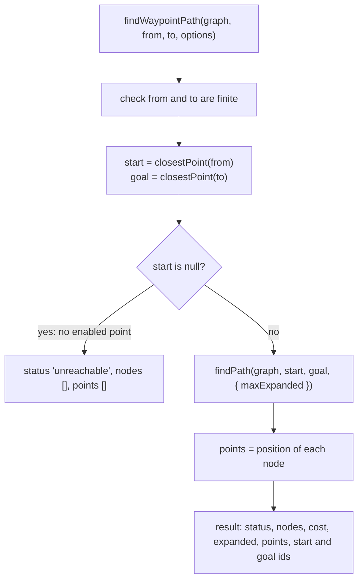
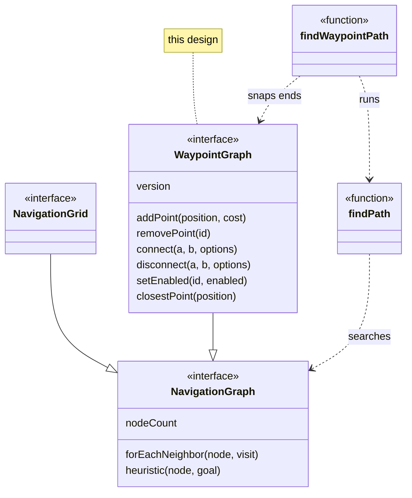

# Waypoint graphs

<!-- cspell:ignore pathfinding fround neighbours rescan -->

Issue: [#778](https://github.com/Forge-Game-Engine/Forge/issues/778)
(Path Finding milestone; builds on [#775's search](./navigation-path-search.md)
and follows the conventions of [#776's navigation grids](./navigation-grids.md);
#780's agents and #781's guide and demo build on it)

| Module or file                                               | Change   | Notes                                                                                          |
| ------------------------------------------------------------ | -------- | ---------------------------------------------------------------------------------------------- |
| `src/navigation/waypoints/waypoint-graph.ts`                 | New      | The `WaypointGraph` interface and `WaypointConnectionOptions`                                  |
| `src/navigation/waypoints/create-waypoint-graph.ts`          | New      | `createWaypointGraph()`                                                                        |
| `src/navigation/waypoints/adjacency-list-waypoint-graph.ts`  | New      | `AdjacencyListWaypointGraph`, the one implementation. Not exported                             |
| `src/navigation/waypoints/find-waypoint-path.ts`             | New      | `findWaypointPath`, `FindWaypointPathResult`                                                   |
| `src/navigation/waypoints/*.test.ts`                         | New      | See "Testing"                                                                                  |
| `src/navigation/waypoints/index.ts`                          | New      | The folder's public API                                                                        |
| `src/navigation/index.ts`                                    | Modified | `export * from './waypoints/index.js'`                                                         |
| `documentation-site/docs/docs/navigation/waypoint-graphs.md` | New      | The "Waypoint graphs" guide                                                                    |
| `documentation-site/docs/docs/navigation/index.md`           | Modified | A paragraph linking the new guide, next to the one linking grids                               |
| `AGENTS.md`                                                  | Modified | `/navigation`'s line in "Repository Structure" mentions waypoint graphs and `findWaypointPath` |
| `CHANGELOG.md`                                               | Modified | `#### Added` bullets (navigation)                                                              |
| **Engine version at time of design**                         |          | `0.26.2`                                                                                       |

## Summary

Not every level is a grid. Road networks, rooms joined by doors, space
lanes and a platformer's jump links are a handful of places and the ways
between them. This design adds a **waypoint graph** to the `navigation`
module: the game places points in the world and connects them, and the
graph implements `NavigationGraph` (`src/navigation/navigation-graph.ts`) so
`findPath` (`src/navigation/find-path.ts`) can search it. `findWaypointPath`
does that from two world positions and returns the route's points in world
space.

```ts
import {
  createWaypointGraph,
  findWaypointPath,
} from '@forge-game-engine/forge/navigation';

const roads = createWaypointGraph();
const depot = roads.addPoint({ x: 0, y: 0 });
const bridge = roads.addPoint({ x: 200, y: 0 });
const town = roads.addPoint({ x: 400, y: 0 });
const ford = roads.addPoint({ x: 200, y: 150 }, 3); // slow to cross

roads.connect(depot, bridge);
roads.connect(bridge, town);
roads.connect(depot, ford);
roads.connect(ford, town);

roads.setEnabled(bridge, false); // the bridge is out

const route = findWaypointPath(roads, truckPosition, townGate);
// route.nodes: depot, ford, town
// route.points: the positions of depot, ford and town
```

Godot's `AStar2D` is the reference, as the issue asks: points with a
position and a weight, connections that are two-way by default or one-way,
points that can be disabled without being removed, and a closest-point
query. The design keeps the issue's shape and differs from its text in
three places, each in the decision log and the open questions:

- **A route is the positions of its points only.** The issue says the
  route starts at `fromWorld` and ends at `toWorld`. The shipped
  `findGridPath` (`src/navigation/grid/find-grid-path.ts`) returns cell
  centres only, `points[i]` being the centre of `nodes[i]`, and #776's
  design left the legs from and to the exact positions to whatever follows
  the path (`design/navigation-grids.md`, open question 2). A waypoint
  route follows the same rule, so `points[i]` is the position of `nodes[i]`
  for both graph types, and #780 adds the two legs the same way for both
  (decision W9, open question 1).
- **Costs below `1` are allowed.** The issue asks for multipliers of at
  least `1`, so plain Euclidean distance stays admissible. Navigation grids
  already allow any positive cost (#776's decision NG12) and tile layers
  give roads `0.5` (`TileData.navigationCost`). The waypoint graph does what
  the grid does: it scales the Euclidean heuristic by the lowest point cost,
  tracked lazily, so the heuristic stays admissible and consistent and a
  road can be cheaper than the default (decision W4, open question 3).
- **The per-point value is called `cost`**, as on the grid (`getCost`,
  `setCost`) and tiles (`navigationCost`), rather than `costMultiplier`.
  It means the same thing in all three places: how much more entering it
  costs per unit of distance than the default of `1` (decision W5, open
  question 4).

The graph is plain data with methods, not a component, like
`NavigationGrid` and `GridLayout`. It adds no systems, changes nothing in
the ECS and bends no core design of the engine.

## Scope

### In scope

- `createWaypointGraph()` returning a `WaypointGraph` that implements
  `NavigationGraph`, with:
  - points: `addPoint(position, cost = 1)` returning the point's id,
    `removePoint(id)` (which removes its connections too), `hasPoint`,
    `getPosition`, `setPosition`, `getCost`, `setCost`, `pointCount` and
    `getPointIds()`;
  - connections: `connect(a, b, { bidirectional = true })`,
    `disconnect(a, b, { bidirectional = true })`, `isConnected(a, b)` and
    `getConnections(id)`;
  - `setEnabled(id, enabled)` and `isEnabled(id)`, so a door can close
    without rebuilding the graph;
  - `closestPoint(position)`, over enabled points only;
  - `version`, which increases after each call that changes the graph.
- Step costs (Euclidean distance times the entered point's cost) and the
  heuristic (Euclidean distance times the lowest point cost), with the
  lowest cost tracked lazily.
- Point id reuse after removal, so `nodeCount` stays at the most points the
  graph has held at once.
- `findWaypointPath(graph, fromWorld, toWorld, options?)`: snaps both ends
  to their closest enabled points, runs `findPath`, and returns the world
  position of each point on the route, `points[i]` for `nodes[i]`, with
  the status, as `findGridPath` does for cells.
- Unit tests, JSDoc, a "Waypoint graphs" guide, `AGENTS.md`'s module line
  and changelog bullets.

### Out of scope

- **A docs-site demo.** #781 adds "a road network where closing a road
  reroutes a vehicle" to the milestone's demo. The guide has code samples.
- **Navigation agents and re-planning** (#780). `version` is what an agent
  watches; whether `version` moves onto `NavigationGraph` so an agent can
  watch grids and waypoint graphs through one type is #780's decision, as
  #776's design already left it.
- **The legs from `fromWorld` and to `toWorld`.** `points` stops at the
  graph's points. Walking from where a unit stands to the first point, and
  from the last point to the exact target when the route was found, is the
  path follower's job (#780), done the same way for grid and waypoint
  routes (open question 1).
- **Per-connection costs.** A connection costs its length times the entered
  point's cost. A jump link that should cost more than its length raises
  the landing point's cost, or the game adds a point in the middle of the
  jump with its own cost (open question 7).
- **Data on connections.** A game that needs to know a connection is a
  jump, a ladder or a door keeps that in its own map keyed by the two point
  ids; walking or jumping a link is game code.
- **Snapping to the nearest connection** rather than the nearest point
  (open question 2).
- **Building a graph from entities or a level file.** A game creates the
  points from its own data (a Tiled object layer, an entity per waypoint).
  Godot's `AStar2D` and the A\* Pathfinding Project's point graph from
  objects are the two models; this design is the first (decision W1).
  Loading waypoints from Tiled objects is a later issue.
- **Linking a waypoint graph to a navigation grid** (grid regions joined
  by waypoint links). Each graph is searched on its own.
- **A spatial index for `closestPoint`.** It scans every point (open
  question 8).
- **Path smoothing.** #779 smooths grid paths by line of sight across
  cells; a waypoint graph has no cells, and its points are already the
  corners of the route.

## Concepts

- **Point**: a world position with a cost, enabled or disabled, known by
  an integer id. A point's id is its node id in the graph.
- **Connection**: a directed step from one point to another. A two-way
  connection is two steps, and `connect` makes two by default.
- **Enabled**: a disabled point keeps its position, cost and connections,
  but no step enters it and `closestPoint` skips it. Enabling it again
  restores every route through it.
- **Cost of a step**: the world distance between the two points times the
  cost of the point stepped into. A path's cost is its length weighted by
  the points it enters, the same unit as a navigation grid path's cost
  (#776's decision NG3).

## Coordinates

Positions are world positions, in the engine's Y-down world (AGENTS.md
"Angles and Directions"). The graph has no origin, rotation or scale: a
point is where `addPoint` or `setPosition` put it. A game whose roads move
with an entity converts positions itself, as with a navigation grid
(#776's decision NG6).

## API design

### `WaypointGraph`

```ts
/** Options for {@link WaypointGraph.connect} and {@link WaypointGraph.disconnect}. */
export interface WaypointConnectionOptions {
  /**
   * Whether the call covers both directions, `a` to `b` and `b` to `a`, or
   * only `a` to `b`. Defaults to `true`.
   */
  bidirectional?: boolean;
}

/**
 * Points in the world joined by connections, for levels that aren't grids:
 * road networks, rooms joined by doors, jump links. Build one with
 * {@link createWaypointGraph}.
 *
 * **Graph.** A waypoint graph is a {@link NavigationGraph} whose node ids
 * are its point ids, so {@link findPath} can search it;
 * {@link findWaypointPath} does that from world positions. A step follows a
 * connection into an enabled point and costs the world distance between the
 * two points times the cost of the point it enters. The heuristic is the
 * straight-line distance times the lowest cost of any point, so it never
 * overestimates.
 *
 * **Ids.** A point's id is a non-negative integer below `nodeCount`. A
 * removed point's id is handed out again by a later `addPoint`, least
 * recently freed first, so don't keep an id after removing its point.
 */
export interface WaypointGraph extends NavigationGraph {
  /**
   * One more than the largest point id in use or freed: the most points the
   * graph has held at once.
   */
  readonly nodeCount: number;

  /** The number of points in the graph, enabled or not. */
  readonly pointCount: number;

  /**
   * Starts at `0` and increases by one after each call that changes a
   * point or a connection, so something holding a path can tell the graph
   * has changed since it searched. A call that changes nothing, such as
   * enabling an enabled point, leaves it alone.
   */
  readonly version: number;

  /**
   * Adds an enabled point with no connections.
   * @param position - Its world position, copied.
   * @param cost - How much more entering it costs per unit of distance than
   * a point of cost `1`. Defaults to `1`.
   * @returns The point's id.
   * @throws An error if `position` isn't finite or `cost` isn't finite and
   * more than `0`.
   */
  addPoint(position: Vector2, cost?: number): number;

  /**
   * Removes a point and every connection into or out of it. Its id may be
   * returned by a later `addPoint`.
   * @throws An error if the point isn't in the graph.
   */
  removePoint(id: number): void;

  /** @returns `true` if `id` is the id of a point in the graph. */
  hasPoint(id: number): boolean;

  /** @returns A copy of the point's position. @throws If it isn't in the graph. */
  getPosition(id: number): Vector2;

  /** Moves a point. Its connections follow it. @throws If it isn't in the graph or `position` isn't finite. */
  setPosition(id: number, position: Vector2): void;

  /** @returns The point's cost. @throws If it isn't in the graph. */
  getCost(id: number): number;

  /** Sets the point's cost. @throws If it isn't in the graph, or `cost` isn't finite and more than `0`. */
  setCost(id: number, cost: number): void;

  /** @returns `true` if steps may enter the point. @throws If it isn't in the graph. */
  isEnabled(id: number): boolean;

  /**
   * Enables or disables a point. A disabled point keeps its position, cost
   * and connections, but no step enters it and `closestPoint` skips it.
   * @throws An error if the point isn't in the graph.
   */
  setEnabled(id: number, enabled: boolean): void;

  /** @returns A new array of the ids of every point, in increasing order. */
  getPointIds(): number[];

  /**
   * Connects two points. A connection that already exists is left alone,
   * so connecting one way never removes the other way.
   * @throws An error if either point isn't in the graph, or `a` is `b`.
   */
  connect(a: number, b: number, options?: WaypointConnectionOptions): void;

  /**
   * Removes the connection from `a` to `b`, and from `b` to `a` unless
   * `bidirectional` is `false`. A connection that doesn't exist is ignored.
   * @throws An error if either point isn't in the graph.
   */
  disconnect(a: number, b: number, options?: WaypointConnectionOptions): void;

  /** @returns `true` if a step goes from `a` to `b`. @throws If either point isn't in the graph. */
  isConnected(a: number, b: number): boolean;

  /**
   * @returns A new array of the points `id` has a connection to, in the
   * order they were connected, disabled ones included.
   * @throws An error if the point isn't in the graph.
   */
  getConnections(id: number): number[];

  /**
   * Finds the enabled point nearest a world position.
   * @returns Its id, the lowest when tied, or `null` if the graph has no
   * enabled point.
   * @throws An error if `position` isn't finite.
   */
  closestPoint(position: Vector2): number | null;
}

/**
 * Creates an empty waypoint graph.
 * @returns The waypoint graph.
 */
export function createWaypointGraph(): WaypointGraph;
```

Member contracts:

- **Ids.** Every method that takes a point id throws when it isn't the id
  of a point in the graph, naming the id, except `hasPoint`, which answers
  that question. A removed point's id is "not in the graph" until
  `addPoint` hands it out again (see "Point ids").
- **Positions** are copied in and out, and must be finite.
- **Costs** must be finite and more than `0`. They're kept as 64-bit
  numbers: a waypoint graph has few points, so the grid's 32-bit storage and
  its `Math.fround` rule would cost precision for no memory worth saving.
- **`connect` and `disconnect` only add or remove.** `connect(a, b,
{ bidirectional: false })` on a two-way connection changes nothing, and
  `disconnect(a, b, { bidirectional: false })` turns a two-way connection
  into a one-way one from `b` to `a`. That's Godot's rule for
  `connect_points` and `disconnect_points`.
- **`version`** increases once per call that changed something, like the
  grid's (#776's decision NG14): `addPoint` and `removePoint` always do;
  `connect`, `disconnect`, `setEnabled`, `setPosition` and `setCost` only
  when a value changed.
- `createWaypointGraph` takes no options. A graph's points and connections
  are its only settings.

The `WaypointGraph` interface is exported and its class is not, as with
`NavigationGrid` and `DenseNavigationGrid` (#776's decision NG7).

### `findWaypointPath`

```ts
/**
 * The result of {@link findWaypointPath}.
 *
 * When the graph has no enabled point there is nothing to search from:
 * `status` is `'unreachable'`, `nodes` and `points` are empty, `cost` and
 * `expanded` are `0`, and both point ids are `null`. That's the one result
 * whose `nodes` doesn't start at a start node.
 */
export interface FindWaypointPathResult extends FindPathResult {
  /**
   * The world position of each point in `nodes`, in the same order, from
   * `startPointId` to the route's last point: `points[i]` is the position
   * of `nodes[i]`. Every position is a new object. `fromWorld` and
   * `toWorld` aren't included.
   */
  readonly points: Vector2[];

  /** The point the search started from, or `null` when the graph has no enabled point. */
  readonly startPointId: number | null;

  /** The point the search looked for, or `null` when the graph has no enabled point. */
  readonly goalPointId: number | null;
}

/**
 * Finds the cheapest route through a waypoint graph between two world
 * positions, as the positions of the points it goes through. Each end goes
 * to its closest enabled point and the search runs between those points.
 * @throws An error if either position isn't finite, or for any reason
 * {@link findPath} throws.
 */
export function findWaypointPath(
  graph: WaypointGraph,
  fromWorld: Vector2,
  toWorld: Vector2,
  options?: FindPathOptions,
): FindWaypointPathResult;
```

`status`, `nodes`, `cost` and `expanded` mean what they mean for
`findPath`, except for the empty-graph result above. `points` follows
`findGridPath`'s rule (`FindGridPathResult.points` is "the world position
of the centre of each cell in `nodes`, in the same order"), so code that
walks a route reads both result types the same way. `cost` is the cost of
the steps between points, as `points` holds nothing else. The options are
`findPath`'s (`maxExpanded`); a waypoint graph has no snap radius, since
every position has a closest point.

## The graph

### Storage

`AdjacencyListWaypointGraph` keeps one slot per id, in plain arrays indexed
by id (a few hundred to a few thousand points; typed arrays would need
growing by hand for no measurable gain):

| Field          | Type         | Holds                                                    |
| -------------- | ------------ | -------------------------------------------------------- |
| `_x`, `_y`     | `number[]`   | The point's position                                     |
| `_cost`        | `number[]`   | The point's cost                                         |
| `_state`       | `Uint8Array` | `0` free, `1` enabled, `2` disabled (grown by doubling)  |
| `_outgoing`    | `number[][]` | The points it has a step to, in the order connected      |
| `_incoming`    | `number[][]` | The points that have a step to it, so removal finds them |
| `_freeIds`     | `number[]`   | Freed ids, in the order they were freed                  |
| `_freeIdsHead` | `number`     | The index in `_freeIds` of the next id to reuse          |
| `_minCost`     | `number`     | The lowest cost of any point, with a stale flag (below)  |
| `_version`     | `number`     | See `version`                                            |

`_freeIds` is a queue read from `_freeIdsHead`, as `EcsWorld` reads
`_freeHandles` from `_freeHandlesHead` (`src/ecs/ecs-world.ts`): `addPoint`
takes `_freeIds[_freeIdsHead]` and moves the head on, rather than calling
`shift()`, which moves every element down on each reuse. When the reused
ids make up half the array, the reused prefix is spliced off and the head
goes back to `0`, as `EcsWorld._compactFreeHandles` does, so the queue
doesn't grow forever in a game that adds and removes points every frame.

A freed slot keeps its old `_x`, `_y` and `_cost` values until `addPoint`
reuses it. Every loop over slots (the lowest-cost rescan, `closestPoint`,
`getPointIds`) checks `_state` and skips free slots.

`_incoming` is the reverse of `_outgoing`. Godot keeps the same pair
(`neighbors` and `unlinked_neighbours`) so removing a point with one-way
connections into it doesn't scan every point. Connection lists are short,
so adding and removing a connection is a linear scan of one list with
`indexOf` and `splice`, which also keeps the connection order, and so the
neighbor order, stable.

### Steps

```text
forEachNeighbor(node, visit):
  for neighbor in outgoing[node]:              # empty for a free id
    if state[neighbor] == enabled:
      visit(neighbor, hypot(x[neighbor] - x[node], y[neighbor] - y[node]) * cost[neighbor])
```

- Only the entered point's cost counts, as on the grid (#776's NG5) and in
  Godot's `AStar2D`, so the start point's cost never adds to a route.
- Steps are reported out of a disabled point, only never into one, as a
  grid reports steps out of a blocked cell (#776's NG11): a unit standing on
  a door that closes can still leave it. `findWaypointPath` never starts on
  a disabled point; `findPath` called directly can.
- Distances are computed per step rather than cached per connection, so
  `setPosition` touches one slot. A step is a subtraction pair, a `hypot`
  and a multiply.
- Two points at the same position give a step of cost `0`, which `findPath`
  allows.

### Heuristic

`heuristic(node, goal) = minCost * hypot(x[goal] - x[node], y[goal] - y[node])`.

- Admissible: every step costs at least `minCost` times its length, and a
  route's length is at least the straight line, so no route is cheaper
  than the heuristic.
- Consistent: for a step from `a` to `b`, `h(a) <= minCost * |ab| + h(b) <=
step(a, b) + h(b)` by the triangle inequality. `findPath` never reopens a
  point on a waypoint graph.
- `minCost` covers every point in the graph, disabled ones included (as the
  grid's covers blocked cells), so enabling and disabling never changes
  it.

`minCost` is kept the way the grid keeps its lowest cost (#776's NG12):
adding a point or lowering a cost below it updates it at once; raising or
removing the point that had it marks it stale; `heuristic` rescans the
points once when it's stale. The rescan reads `_cost` only for slots whose
`_state` isn't free: `removePoint` leaves the removed point's cost in
`_cost`, so a rescan that read every slot would keep the cost of the very
point whose removal made `minCost` stale, and the heuristic would stay
lower than it needs to be until the slot is reused. A new graph starts
with `minCost` stale, so the first heuristic after building a graph whose
points all cost more than `1` uses their real lowest cost. A rescan that
finds no points (every slot free) returns `1` and leaves `minCost` stale,
so the next point added sets it.

```text
rescanMinCost():
  minCost = Infinity
  for id in 0 until nodeCount:
    if state[id] != free: minCost = min(minCost, cost[id])
  if minCost == Infinity: return 1      # stays stale
  stale = false
```

### Point ids

`addPoint` returns the least recently freed id when there is one (the id
at `_freeIdsHead`), and `nodeCount` otherwise (growing `nodeCount` by one).
So:

- `nodeCount` is the most points the graph has held at once, and
  `findPath`'s scratch arrays (24 bytes per node, kept for the page's life)
  stay that size however many points a game adds and removes over time.
- A game that never removes points gets ids `0, 1, 2, ...` in the order it
  added them, which makes graphs built from level data predictable.
- An id that was freed comes back as late as possible, as `EcsWorld` reuses
  entity slots (`src/ecs/ecs-world.ts`, `_freeHandles`), so a stale id a
  game held on to is less likely to name a new point soon after. Unlike an
  entity, a point id can't carry a generation, since it's also a node id
  below `nodeCount` (decision W6, open question 5).

### Removing a point

```text
removePoint(id):
  require hasPoint(id)
  for n in outgoing[id]: remove id from incoming[n]
  for n in incoming[id]: remove id from outgoing[n]
  outgoing[id] = []; incoming[id] = []
  state[id] = free; push id onto freeIds   # x, y and cost[id] stay as they were
  if cost[id] == minCost: mark minCost stale
  version += 1
```

The removed point's position and cost stay in their arrays; `_state`
marking the slot free is what removes it, and the next `addPoint` that
reuses the id overwrites them.

### Closest point

`closestPoint(position)` scans every id below `nodeCount`, keeps enabled
points, and returns the one with the smallest squared distance, the lowest
id on a tie (Godot's rule). It's `O(nodeCount)` (see "Performance").

## Finding a path from world positions



```text
findWaypointPath(graph, fromWorld, toWorld, options):
  check fromWorld and toWorld are finite
  start = graph.closestPoint(fromWorld)
  goal = graph.closestPoint(toWorld)
  if start is null:                      # then goal is null too
    return { status 'unreachable', nodes [], cost 0, expanded 0,
             points [], startPointId null, goalPointId null }

  result = findPath(graph, start, goal, { maxExpanded })
  points = [graph.getPosition(n) for n in result.nodes]
  return { ...result, points, startPointId start, goalPointId goal }
```

This is `findGridPath`'s shape with `closestPoint` in place of
`snapToWalkableCell` and `getPosition` in place of `cellToWorld`.

- **Every route ends at a point.** For `'found'`, `points` ends at the goal
  point's position. For `'unreachable'` and `'limitReached'`, `nodes` ends
  at the reached point nearest the goal (#775's partial path), and `points`
  at its position: the route stops where the graph stops, and a unit heads
  as far towards the target as the roads go.
- **The legs to and from the exact positions aren't in `points`.** A unit
  standing beside the road walks to `points[0]` first, and a found route
  stops at the goal point rather than at `toWorld`. The path follower
  (#780) adds those two legs, the same way for a grid route (whose ends are
  cell centres) and a waypoint route, as #776's design already proposed
  for grids (`design/navigation-grids.md`, open question 2). Whether the
  legs go into `points` here instead is open question 1 (decision W9).
- **No enabled point** gives `'unreachable'` with empty `nodes` and
  `points` and both point ids `null`, so a unit has nothing to walk and
  stays where it is. A level whose every point is closed is a state of the
  game, not a bug, so it doesn't throw (decision W8). This breaks the
  promise `FindPathResult.nodes` makes, that the path starts at the start
  node, because there is no start node; `FindWaypointPathResult`'s JSDoc
  says so, and #780's path follower must treat an empty `nodes` as "no
  route" rather than reading `nodes[0]` or `points[0]`.
- **Both ends at the same point** give `'found'`, with `nodes` and `points`
  of that one point: the route goes through the graph even when the two
  positions are close, since the graph is where a unit may walk (open
  question 2).

## Data flow with the rest of the milestone



| Issue           | What it uses                                                                                                                                                                                                                 |
| --------------- | ---------------------------------------------------------------------------------------------------------------------------------------------------------------------------------------------------------------------------- |
| #780 agents     | `findWaypointPath` with the frame's remaining budget as `maxExpanded`; `version` to re-plan when a door closes; `points` to follow, plus the legs from the unit's position and to its target; an empty `nodes` as "no route" |
| #781 demo/guide | The road network example: `setEnabled` on a road's point reroutes a vehicle; `getPointIds`, `getPosition`, `getConnections` to draw                                                                                          |

## Performance

- `forEachNeighbor` costs one state read, a `hypot` and a multiply per
  connection, and allocates nothing.
- `heuristic` is a `hypot` and a multiply, plus a flag check; at most one
  rescan of the points after a cost change.
- `closestPoint` is `O(nodeCount)`, twice per `findWaypointPath`. A graph
  of 2,000 points scans 4,000 slots per route, well under a millisecond.
  A uniform-grid spatial index would make it near constant but has to be
  kept in step with `setPosition` and `removePoint`; it's left until a game
  needs it (open question 8).
- `removePoint` is `O(degree²)` at worst (each neighbor's list is scanned
  once); `connect` and `disconnect` are `O(degree)`.
- `addPoint` reusing an id is `O(1)`: it reads the free-id queue at its
  head index, and the occasional compaction is amortized over the reuses
  that came before it.
- `findWaypointPath` allocates the result and one `Vector2` per route
  point, plus `findPath`'s own allocations.
- Memory: about 40 bytes per id for positions, cost and state, plus the
  connection lists, plus `findPath`'s 24 bytes per node.

## Testing

All unit tests, in Vitest, next to the files they test. Nothing here
renders, reads input or runs the game loop, so there are no e2e tests.

### The graph (`adjacency-list-waypoint-graph.test.ts`)

- Points: ids count up from `0`; positions and costs round-trip and are
  copies; `pointCount`, `nodeCount`, `getPointIds` follow adds and removes;
  a new point is enabled with no connections.
- Removing a point: it's gone from `hasPoint` and every other point's
  `getConnections`, including a one-way connection into it from a point it
  had no connection to; its id is reused, least recently freed first, and
  the reused point starts with no connections; `nodeCount` doesn't grow
  while freed ids remain; removing and re-adding many points in a loop
  keeps reusing ids in freed order across a compaction of the free-id
  queue.
- Connections: two-way by default; `bidirectional: false` adds one step;
  connecting twice and connecting one way on a two-way connection change
  nothing; `disconnect` removes both ways by default and one way with
  `bidirectional: false`; disconnecting what isn't connected is ignored;
  `getConnections` keeps the order connected.
- `setEnabled` and `isEnabled`; a disabled point keeps its connections.
- `closestPoint`: the nearest enabled point, skipping a nearer disabled one;
  the lowest id on a tie; `null` for an empty graph and one with every
  point disabled.
- `version`: increases once for each changing call and not for a call that
  changes nothing (enabling an enabled point, re-connecting, setting the
  same cost or position).
- Steps: `forEachNeighbor` reports only enabled destinations, with cost
  distance times the destination's cost; it reports steps out of a
  disabled point; it reports nothing for a free id.
- Heuristic: Euclidean distance times the lowest cost; lowering a cost
  lowers it at once; raising or removing the only cheapest point raises it
  after one rescan, and a removed point's cost (still in its freed slot) no
  longer counts; removing every point and adding one back gives that
  point's cost.
- Validation: unknown, removed, negative and non-integer ids throw from
  every id method; connecting a point to itself throws; non-finite
  positions and costs that are `0`, negative, `NaN` or `Infinity` throw.

### Searching it (`find-waypoint-path.test.ts`)

The issue's cases, on a hand-built road network of about ten points:

- The shortest route: `findWaypointPath` returns the cheapest route and its
  `cost` matches the sum of its steps.
- One-way connections: a one-way street is used in its direction and
  routed around against it.
- Disabled points routed around: disabling a junction gives the detour;
  enabling it again gives the original route.
- Removing a point gives the detour, and adding a point with the freed id
  and no connections doesn't bring the old route back.
- Costs: a high-cost point is avoided when the detour is cheaper and used
  when it isn't; a low-cost (`0.5`) road is preferred over a shorter road at
  cost `1`, and the route is still the cheapest (checked against the
  reference below).
- Route shape: `points` has the same length as `nodes` and `points[i]` is
  the position of `nodes[i]` for every status, with neither `fromWorld`
  nor `toWorld` in it when they aren't on a point; each position is a new
  object; `startPointId` and `goalPointId` are the closest enabled points.
- An unreachable goal (an island of points) gives `'unreachable'` with the
  partial route ending at the reached point nearest it; `maxExpanded` is
  passed through and gives `'limitReached'`.
- No enabled point (an empty graph, and one with every point disabled):
  `'unreachable'`, `nodes` `[]`, `points` `[]`, `cost` and `expanded` `0`,
  both ids `null`.
- Both ends nearest one point: `'found'` with one node and one point.
- Optimality on seeded random graphs (`Random`, as #775's tests): random
  points, random connections, some one-way, random costs from `0.25` to
  `4`, some points disabled and some removed. `findPath` costs match
  Bellman-Ford over the same steps (`shortestCosts` in
  `src/navigation/test-helpers/test-graph.ts`), and the heuristic is
  consistent across every step.
- Validation: non-finite `fromWorld` or `toWorld` throws.

## Documentation

- `documentation-site/docs/docs/navigation/waypoint-graphs.md`, following
  the `document-feature` skill: when to use a waypoint graph rather than a
  grid; building one (points, two-way and one-way connections); costs and
  what a route's cost means; closing a door with `setEnabled` and why it's
  better than removing the point; `findWaypointPath`, how ends snap to the
  closest enabled point, what `points` holds for each status (the points'
  positions only, like a grid path's cell centres, so a game walks from its
  unit to `points[0]` and on from the last point to its target), and the
  empty result when no point is enabled; reading
  the graph back to draw it; point id reuse; `version`; and using the graph
  with `findPath` directly.
- `navigation/index.md`: a paragraph linking the guide, next to the one
  linking grids.
- `AGENTS.md`: `/navigation`'s line adds "waypoint graphs (points and
  connections placed by the game) and `findWaypointPath`".
- JSDoc on every export, including the cost rule and heuristic on
  `WaypointGraph`, id reuse on `addPoint` and `removePoint`, and the empty
  `nodes` and `points` case on `FindWaypointPathResult` (the one result
  whose `nodes` doesn't start at a start node).

## Phases

### Phase 1: the waypoint graph

`WaypointGraph` as a `NavigationGraph`. A game can already path-find with
it: `findPath(graph, graph.closestPoint(a), graph.closestPoint(b))` and
`getPosition` on the result's nodes.

**Done when** the graph passes every test under "The graph" and the
search tests that call `findPath` directly (optimality on random graphs,
disabled and removed points), it's exported from
`@forge-game-engine/forge/navigation`, the guide covers building and
changing a graph and searching it with `findPath`, and the CLAUDE.md
verification steps pass.

| Task                 | Description                                                                                                                                                               | Size |
| -------------------- | ------------------------------------------------------------------------------------------------------------------------------------------------------------------------- | ---- |
| Interface            | `waypoint-graph.ts`: `WaypointGraph` and `WaypointConnectionOptions` with full JSDoc                                                                                      | S    |
| Points               | `adjacency-list-waypoint-graph.ts`: slots, id reuse through a free-id queue with a head index and compaction, add, remove, position, cost, enabled, `version`, validation | M    |
| Connections          | `connect`, `disconnect`, `isConnected`, `getConnections`, the incoming lists and removal through them                                                                     | M    |
| Graph                | `nodeCount`, `forEachNeighbor`, `heuristic` with the lazy lowest cost, whose rescan skips free slots                                                                      | S    |
| Closest point        | `closestPoint` over enabled points, ties by id                                                                                                                            | S    |
| Factory              | `create-waypoint-graph.ts`                                                                                                                                                | S    |
| Tests                | "The graph" tests, and the random-graph optimality and consistency test against `shortestCosts`                                                                           | L    |
| Exports              | `waypoints/index.ts`, `navigation/index.ts`                                                                                                                               | S    |
| Docs                 | `navigation/waypoint-graphs.md` (building, costs, enabling, reading back, ids, `findPath`), `index.md` link                                                               | M    |
| AGENTS.md, changelog | Module line; `#### Added` bullet: **navigation:** `createWaypointGraph` and `WaypointGraph`                                                                               | S    |

### Phase 2: `findWaypointPath`

Routes from world positions.

**Done when** `findWaypointPath` passes every test under "Searching it",
the issue's "done when" holds (a game builds points and connections,
closes one with `setEnabled`, and gets a route that avoids it), the guide
covers it, and the CLAUDE.md verification steps pass.

| Task        | Description                                                                                    | Size |
| ----------- | ---------------------------------------------------------------------------------------------- | ---- |
| Path search | `find-waypoint-path.ts`: validation, snapping both ends, `findPath`, `points`, the result      | S    |
| Tests       | The `findWaypointPath` tests on the road network                                               | M    |
| Docs        | `waypoint-graphs.md`: `findWaypointPath`, snapping, `points` for each status, the empty result | S    |
| Changelog   | `#### Added` bullet: **navigation:** `findWaypointPath`                                        | S    |

The `claude` label run can ship both phases in one pull request.

## Decision log

| #   | Decision                               | Options considered                                                                                                                                                          | Chosen | Rationale                                                                                                                                                                                                                                                                                                                                                                                                                                                                                                                                                         | Tradeoff                                                                                                                                                                        | Assumptions                                                                  |
| --- | -------------------------------------- | --------------------------------------------------------------------------------------------------------------------------------------------------------------------------- | ------ | ----------------------------------------------------------------------------------------------------------------------------------------------------------------------------------------------------------------------------------------------------------------------------------------------------------------------------------------------------------------------------------------------------------------------------------------------------------------------------------------------------------------------------------------------------------------- | ------------------------------------------------------------------------------------------------------------------------------------------------------------------------------- | ---------------------------------------------------------------------------- |
| W1  | Graph as data or entities              | (a) A plain object the game fills, like Godot's `AStar2D`; (b) points as entities with a waypoint component, connections as components, and a system that builds the graph  | (a)    | Same reasoning as the grid (#776's NG6): a graph is shared data that searches read. (b) needs a system to own the graph (state outside components, or a graph component one system writes) for a structure that changes rarely, and a game can build (a) from its entities in a few lines.                                                                                                                                                                                                                                                                        | Points don't follow entities; a game moving a point calls `setPosition`.                                                                                                        | Waypoints sit still or move rarely.                                          |
| W2  | Step cost                              | (a) Distance times the entered point's cost; (b) distance times the average of both points' costs; (c) distance only                                                        | (a)    | The issue's rule, Godot's `weight_scale`, and the grid's NG5, so a grid path and a waypoint path cost the same for the same route.                                                                                                                                                                                                                                                                                                                                                                                                                                | Leaving a slow point is free.                                                                                                                                                   |                                                                              |
| W3  | Steps out of a disabled point          | (a) Reported, never into one; (b) none (Godot returns no path from a disabled start)                                                                                        | (a)    | Matches the grid's NG11: legality depends on the point entered. A unit on a door that closes can still leave.                                                                                                                                                                                                                                                                                                                                                                                                                                                     | `findPath` from a disabled point can succeed, unlike Godot.                                                                                                                     |                                                                              |
| W4  | Costs below `1`                        | (a) Any finite cost above `0`, heuristic scaled by the lowest cost (tracked lazily); (b) the issue's rule: at least `1`, plain Euclidean heuristic                          | (a)    | The grid allows any positive cost and tile layers give roads `0.5`; requiring `1` here would make the two graph types disagree about the same number. The lazy lowest cost is the grid's NG12 technique, so the heuristic stays admissible and consistent.                                                                                                                                                                                                                                                                                                        | A rescan after the cheapest point gets dearer; a single cheap point loosens the heuristic everywhere.                                                                           | Open question 3.                                                             |
| W5  | Name of the per-point value            | (a) `cost`, `getCost`, `setCost`; (b) the issue's `costMultiplier`                                                                                                          | (a)    | The grid's `getCost`/`setCost` and tiles' `navigationCost` mean the same thing (per-distance cost of entering), so one name across the module.                                                                                                                                                                                                                                                                                                                                                                                                                    | "Cost" alone could be read as a flat cost per point; the JSDoc says it multiplies distance.                                                                                     | Open question 4.                                                             |
| W6  | Id allocation                          | (a) Reuse freed ids, least recently freed first, from a queue read at a head index; (b) never reuse; (c) the caller picks ids (Godot); (d) generational handles             | (a)    | Keeps `nodeCount`, and so `findPath`'s scratch memory, at the peak number of points however many are added and removed; reusing late, from a head-indexed queue compacted at half, is `EcsWorld`'s rule and technique for entity slots. (c) adds `getAvailablePointId` bookkeeping to every caller. (d) can't be a node id below `nodeCount`.                                                                                                                                                                                                                     | A stale id can name a new point. Freed slots keep stale values, so every slot loop checks `_state`.                                                                             | Games rarely remove points during play (they disable them). Open question 5. |
| W7  | `connect` on an existing connection    | (a) Only ever adds steps; (b) replaces the connection's direction                                                                                                           | (a)    | Godot's rule. `connect(a, b, { bidirectional: false })` on a two-way road silently making it one-way would be surprising; `disconnect` with `bidirectional: false` does that explicitly.                                                                                                                                                                                                                                                                                                                                                                          | Making a road one-way is a `disconnect`, not a `connect`.                                                                                                                       |                                                                              |
| W8  | No enabled point in `findWaypointPath` | (a) `'unreachable'` with `nodes` and `points` `[]` and both ids `null`; (b) throw; (c) a new status                                                                         | (a)    | Closing every point is a game state, not a bug, and a unit should stay put rather than crash the frame. Reuses #775's statuses as the grid does (#776's NG9).                                                                                                                                                                                                                                                                                                                                                                                                     | Breaks `FindPathResult.nodes`' promise that a path includes its start: the result's JSDoc says so, and #780 must treat an empty `nodes` as no route.                            | No other result is empty.                                                    |
| W9  | Route ends (departs from the issue)    | (a) Point positions only, `points[i]` the position of `nodes[i]`, as `findGridPath`'s cell centres; (b) the issue's `fromWorld`, point positions, then `toWorld` when found | (a)    | `findGridPath` has shipped with (a), and #776's design left the legs to the exact positions to the path follower, for grids and waypoint graphs alike. (b) would give the module's two path functions different `points` shapes (an off-by-one between `points` and `nodes` that a follower handling both types must special-case). The leg logic belongs in one place, #780, applied to both. Changing both to (b) would mean changing `findGridPath`, `navigation/grids.md` and the `isometric-path-finding` demo in the same change, which is the user's call. | A unit beside the road walks to the first point before following the route, and a found route stops at the goal point, until #780 adds the legs. Departs from the issue's text. | #780 adds the two legs for both graph types. Open question 1.                |
| W10 | Route `cost`                           | (a) The steps between points only (`findPath`'s); (b) plus the two end legs                                                                                                 | (a)    | Keeps `cost` meaning what `FindPathResult` says, as the grid's does, and matches `points`, which has no end legs either.                                                                                                                                                                                                                                                                                                                                                                                                                                          | `cost` isn't the cost of the whole walk once #780 adds the legs.                                                                                                                |                                                                              |
| W11 | Adjacency storage                      | (a) Outgoing and incoming lists per point; (b) outgoing only, scanning every point on removal; (c) a `Set` per point                                                        | (a)    | Removal is `O(degree²)` instead of `O(points)`, as Godot's paired lists do; arrays keep the neighbor order stable (deterministic routes) and iterate without allocating.                                                                                                                                                                                                                                                                                                                                                                                          | Twice the connection memory; `indexOf` per connect.                                                                                                                             | Points have few connections.                                                 |
| W12 | Setters beyond the issue               | (a) Add `setPosition`, `setCost` and the readers; (b) only the issue's methods                                                                                              | (a)    | Without them, changing a road's speed or moving a point means removing it, which drops its connections and can change its id. Godot has the same setters. The readers are what a game and #781's demo need to draw a graph.                                                                                                                                                                                                                                                                                                                                       | A larger interface than the issue lists.                                                                                                                                        | Open question 6.                                                             |

## Open questions

1. **Whether a route includes `fromWorld` and `toWorld`** (non-blocking).
   The issue says the route starts at `fromWorld` and ends at `toWorld`;
   the shipped `findGridPath` returns cell centres only.
   - Point positions only (this design's default, W9): `points[i]` is the
     position of `nodes[i]` for both graph types, so one path follower
     reads both, and #780 adds the leg from the unit to the first point
     and from the last point to the target in one place, as #776's design
     proposed (`design/navigation-grids.md`, open question 2). Nothing
     shipped changes.
   - Both ends included, as the issue says, for both graph types: a unit
     stops exactly where it was sent without #780's help. Doing it for
     waypoint routes only would make the two functions' `points` disagree,
     so this answer also changes `findGridPath` (when an end wasn't
     snapped), its tests, `documentation-site/docs/docs/navigation/grids.md`
     and the `isometric-path-finding` demo's
     `_find-path.system.ts`, in the same change.

   Default: point positions only. The other answer changes how `points` is
   built in `findWaypointPath` (two lines), its tests and guide, and the
   grid changes listed above; the graph is the same either way.

2. **Snapping the ends to the nearest point or the nearest connection**
   (non-blocking). A truck half way along a road between `A` and `B`, bound
   for a town past `B`, is nearest `A` when it's just short of half way, so
   its route goes back to `A` first.
   - The nearest point (this design's default, the issue's text and
     Godot's `get_closest_point`): simple, every route follows the graph
     from a point, and the cost of the search is unchanged.
   - The nearest position on a connection (Godot's
     `get_closest_position_in_segment`, the A\* Pathfinding Project's
     "nearest connection" mode): the route starts with the connection the
     unit is on, so it never doubles back, and a target beside a road ends
     on the road. It needs a search that starts from both ends of that
     connection with their partial costs, which `findPath` can't do today
     (one start node), so it means either temporary nodes in the graph or a
     multi-start option on `findPath`.

   Default: the nearest point. The other answer changes how
   `findWaypointPath` resolves its ends and, for the multi-start route,
   #775's `findPath`; the graph is the same either way.

3. **Costs below `1`** (non-blocking). The issue asks to validate that
   multipliers are at least `1`.
   - Any positive cost, heuristic scaled by the lowest (this design, W4):
     the same rule as grids and tile costs, so a road can be cheaper than
     open ground.
   - At least `1`: a simpler heuristic (plain distance) and no lowest-cost
     tracking; a game wanting a cheap road gives everything else a higher
     cost.

   Default: any positive cost. The other answer changes the validation and
   the heuristic and removes the lowest-cost tracking.

4. **`cost` or `costMultiplier`** (non-blocking). `cost` matches the grid
   and tiles (W5); `costMultiplier` is the issue's name and says outright
   that it multiplies distance. Default: `cost`. The other answer renames
   `addPoint`'s parameter and `getCost`/`setCost`.

5. **Reusing point ids** (non-blocking).
   - Reuse, least recently freed first (default, W6): bounded memory.
   - Never reuse: a removed id never names another point, so a game's
     stale id fails loudly in every method; `nodeCount`, and `findPath`'s
     scratch arrays, grow with every point ever added.

6. **Setters and readers beyond the issue** (non-blocking). `setPosition`,
   `setCost`, `getPosition`, `getCost`, `isEnabled`, `isConnected`,
   `getConnections`, `getPointIds` and `pointCount` aren't in the issue's
   task list. Default: include them (W12). Leaving out the setters makes
   changing a point a remove and re-add.

7. **Per-connection costs** (non-blocking). Platformer jump links often
   cost more than their length.
   - No (default): a point's cost covers it, or a point in the middle of
     the jump with its own cost does. One cost rule for every graph.
   - Yes, `connect(a, b, { cost })` multiplying that connection's steps:
     closer to how a designer thinks about links. The heuristic stays
     admissible if the lowest-cost tracking covers connection costs too.

   Adding it later is a new option on `connect`; it doesn't change this
   design.

8. **A spatial index for `closestPoint`** (non-blocking). Default: a linear
   scan, which is fast for the few thousand points a waypoint graph has. A
   uniform grid of buckets would make it near constant for very large
   graphs (space lanes across a big map) at the cost of keeping it in step
   with every `setPosition`, `addPoint` and `removePoint`. It can be added
   inside the class later without changing the API.
