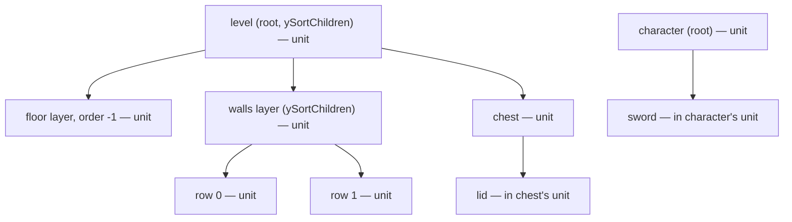

# Y-Sort Units and Sort Points

Issue: https://github.com/Forge-Game-Engine/Forge/issues/870 (the tile
maps milestone; the Tiled loader, #836, depends on it)

| Module or file                                                                               | Change        | Notes                                                                                                      |
| -------------------------------------------------------------------------------------------- | ------------- | ---------------------------------------------------------------------------------------------------------- |
| `src/rendering/components/draw-order-component.ts`                                           | Modified      | `ySortChildren` (Phase 1) and `ySortOrigin` (Phase 2), with defaults and validation                        |
| `src/rendering/draw-order.ts`                                                                | Modified      | The resolver assigns every entity a sort unit; `sortUnitY` replaces `rootY`. Not exported from the package |
| `src/rendering/draw-order.test.ts`                                                           | New           | Resolver tests: unit assignment, `sortUnitY`, hierarchy index unchanged                                    |
| `src/rendering/systems/render-system.ts`                                                     | Modified      | The y-sort key reads `sortUnitY` instead of `rootY`; JSDoc                                                 |
| `src/rendering/systems/render-system.test.ts`, `src/ui/utilities/sort-by-draw-order.test.ts` | Modified, new | Draw order with sort units; UI order under a y-sorting camera                                              |
| `src/rendering/components/camera-component.ts`                                               | Modified      | `ySort` JSDoc describes sort units                                                                         |
| `src/ui/utilities/sort-by-draw-order.ts`, `raycast-ui-canvas.ts`, `ui-navigation-system.ts`  | Modified      | UI hit and focus order follow the canvas camera's `ySort`, so they match what's drawn (open question 2)    |
| `e2e/fixtures/scenes/y-sort-units.ts`, `e2e/specs/y-sort-units.spec.ts`                      | New           | A character root walking past walls parented under a `ySortChildren` level                                 |
| `documentation-site/docs/docs/rendering/draw-order.md`, `meshes.md`                          | Modified      | Sort units, `ySortChildren`, `ySortOrigin`; the UI caveat goes                                             |
| `CHANGELOG.md`                                                                               | Modified      | `#### Added` bullets                                                                                       |
| **Engine version at time of design**                                                         |               | `0.26.2`                                                                                                   |

## Summary

A camera with `ySort` draws whatever is lower on screen in front. Today
every root entity's whole subtree sorts as one block, by the root's
`position.world.y` (`DrawOrderResolver.rootY`, `src/rendering/draw-order.ts`).
That keeps a character's sword with the character, but nothing parented
under a level entity can ever sort against a character: walls, trees and
the tile-row meshes the tile map renderer (#812) creates under a layer
entity all sort at the level's Y.

This design lets an entity hand its children their own place in the
y-sort, and lets an entity say where along its own Y axis it sorts:

- **`DrawOrderEcsComponent.ySortChildren`**. Every entity belongs to a
  **sort unit**. A root is a unit. When a unit sets `ySortChildren`, each
  of its children becomes a unit of its own, and the rule repeats for
  them. An entity belongs to the deepest unit on its path from its root.
  Under a y-sorting camera, units sort against each other by Y; the
  entities of one unit stay together in hierarchy order. This is the half
  of Godot's `CanvasItem.y_sort_enabled` that Forge doesn't have yet: the
  camera already decides _whether_ to y-sort, and the hierarchy now
  decides _what_ sorts.
- **`DrawOrderEcsComponent.ySortOrigin`**. A unit sorts by the world Y of
  the point `(0, ySortOrigin)` in its entity's local space, so a tree whose
  sprite pivot is its centre can sort at its trunk's base, and two
  entities sharing one transform can sort at different heights. This is
  Unity's Sprite Sort Point and Godot's `y_sort_origin`.

The sort keys don't change. Today's y-sort keys are layer, world order,
root Y, root sequence, hierarchy index; after this change they're layer,
world order, **sort unit Y**, root sequence, hierarchy index. Because every
unit is a contiguous run in hierarchy order (see "Why no new key"), units
at the same Y fall back to the exact order a camera without `ySort` draws
them in, and no unit sequence key is needed. Cameras without `ySort`, UI
hit testing under them, world order, visibility and masks are untouched.

Both fields are per-entity data that game code (or a spawner such as the
Tiled loader, #836) writes and the draw-order resolver reads. No system
gains an option, and no core design bends.

## Scope

### In scope

- `ySortChildren: boolean` and `ySortOrigin: number` on
  `DrawOrderEcsComponent`, defaults `false` and `0`, `ySortOrigin`
  validated finite.
- Sort-unit assignment in `createDrawOrderResolver`'s single, iterative,
  allocation-free walk, and a `sortUnitY` reader that replaces `rootY`.
- The render system's y-sort key reading `sortUnitY`.
- UI hit testing and first-focus order following the canvas camera's
  `ySort`, so "the element drawn on top is hit" stays true when a canvas's
  elements use `ySortChildren`.
- Unit tests, one e2e scene and spec, the draw-order guide, JSDoc and
  changelog bullets.

### Out of scope

- **Local y-sorting inside a plain unit** (Godot's `y_sort_enabled` on a
  node whose parent doesn't y-sort, which sorts that node's children among
  themselves while its subtree stays together). `ySortChildren` on an
  entity that isn't a unit does nothing (decision D2, open question 3).
- **A sort axis other than Y** (Unity's custom Transparency Sort Axis for
  some isometric setups). The camera sorts by world Y only.
- **Per-cell sorting inside one mesh.** A tile-row mesh is one unit; tiles
  within a row keep the order the tile map renderer writes them in (#812).
- **Choosing which tile map layers y-sort.** The Tiled loader (#836) and the
  tile map renderer (#812) decide where they set these fields; this design
  only provides them.
- **The 3D render pipeline** (`/design/3d/07-2d-on-the-render-pipeline.md`).
  Its "Root Y" key becomes "Sort unit Y" when it's built; see "Relation to
  other designs".

## Phases

### Phase 1: Sort units

Adds `ySortChildren`. The resolver assigns each entity its sort unit, and
the y-sort key reads the unit's `position.world.y`. UI ordering follows the
canvas camera. A character that is a root now sorts against walls parented
under a `ySortChildren` level root, which is the issue's "done when".

**Done when** a y-sorting camera draws a root character in front of a wall
parented under a `ySortChildren` level root when the character's Y is
greater, and behind it when it's smaller; every existing draw-order unit
and e2e test passes unchanged; the guide and changelog describe sort units.

| Task                  | Description                                                                                                                                                                                                                              | Size |
| --------------------- | ---------------------------------------------------------------------------------------------------------------------------------------------------------------------------------------------------------------------------------------- | ---- |
| `ySortChildren` field | Add the field and its `false` default to `DrawOrderEcsComponent` and `defaultDrawOrderOptions`, with JSDoc stating the unit rule and the level/layer/character example                                                                   | S    |
| Resolver sort units   | Two more walk stacks (parent unit, whether the parent's children are units); a `sortUnits` buffer replacing `roots`; `sortUnitY` replacing `rootY`; resolver JSDoc. Hierarchy index stays numbered across the whole root's subtree       | M    |
| Render system keys    | Rename `writeRootYSortKeys` and its key buffers to the sort-unit names and read `sortUnitY`; update the `createRenderEcsSystem` and `CameraEcsComponent.ySort` JSDoc                                                                     | S    |
| UI order              | `sortByDrawOrder(world, entities, ySort)` adds the sort unit Y key when `ySort` is `true`; `raycastUiCanvas` and `pickFirstDrawnCandidate` pass their canvas camera's `ySort`; the comment that assumes every element shares a root goes | S    |
| Unit tests            | `draw-order.test.ts` (new) for the resolver; `render-system.test.ts` and `sort-by-draw-order` tests for the order (see "Testing")                                                                                                        | M    |
| E2E scene and spec    | `y-sort-units.ts`/`.spec.ts`: the character steps from above one wall to below it, measured relative and same-run                                                                                                                        | M    |
| Docs and changelog    | `draw-order.md` "Sorting by height on screen" gains "Y-sorting an entity's children"; the "without Y-sorting" UI caveat goes; `meshes.md` wording; one `#### Added` bullet                                                               | S    |

### Phase 2: Sort points

Adds `ySortOrigin`. A unit's sort line moves along its own local Y axis,
through its world rotation and scale.

**Done when** two units at the same position with different `ySortOrigin`
draw in the order of their sort lines under a y-sorting camera, including
under rotation and scale; `ySortOrigin` on an entity that isn't a unit
changes nothing; the guide and changelog describe it.

| Task                | Description                                                                                                                                                                                                  | Size |
| ------------------- | ------------------------------------------------------------------------------------------------------------------------------------------------------------------------------------------------------------ | ---- |
| `ySortOrigin` field | Add the field, its `0` default and a finite check to `addDrawOrderComponent`, with JSDoc on what it's relative to and that it only matters on a unit's entity                                                | S    |
| Resolver sort point | The walk stores each unit's `ySortOrigin` in a `sortOrigins` buffer (it already reads the unit's draw order); `sortUnitY` adds `ySortOrigin * scale.world.y * cos(rotation.world)` when the origin isn't `0` | S    |
| Unit tests          | Origin moves the sort line; rotated and scaled units; two units sharing a position; origin on a non-unit ignored; validation                                                                                 | S    |
| E2E extension       | The Phase 1 scene gains a tall wall whose pivot is its centre and whose `ySortOrigin` is its base; the character passes it at a Y between its centre and base                                                | S    |
| Docs and changelog  | `draw-order.md` gains "Choosing where an entity sorts"; one `#### Added` bullet                                                                                                                              | S    |

## Design

### Sort units

```ts
export interface DrawOrderEcsComponent {
  order: number;
  behindParent: boolean;

  /**
   * Whether, under a camera with `ySort`, each of this entity's children
   * sorts by its own Y instead of by this entity's. Only takes effect on an
   * entity that is itself a sort unit: a root, or a child of a unit with
   * `ySortChildren`. ...
   */
  ySortChildren: boolean;

  /**
   * Where this entity sorts, under a camera with `ySort`, when it's a sort
   * unit: the world Y of the point `(0, ySortOrigin)` in its local space,
   * so it follows the entity's rotation and scale. ...
   */
  ySortOrigin: number;
}
```

The rule, as the JSDoc states it:

1. A root entity is a sort unit.
2. When a sort unit has `ySortChildren`, each of its children is a sort
   unit too, and rule 2 applies to them in turn.
3. Every other entity belongs to the unit of its nearest ancestor that is
   one.

So `ySortChildren` on an entity that isn't a unit does nothing, and a
layer's rows only sort against a character root when the level root above
the layer sets `ySortChildren` as well. Godot asks the same of nested
y-sorting.



Under a y-sorting camera, `level`, `floor`, `walls`, `row 0`, `row 1`,
`chest` and `character` each sort by their own Y. The floor's world order
of `-1` keeps it behind everything at world order `0`, whatever its Y. The
lid draws with the chest and the sword with the character. A
`ySortChildren` entity's own sprite (the level's or the walls layer's, if
they have one) is a unit containing only that entity, sorted by its own Y
among its children, as in Godot.

Cameras without `ySort` don't read sort units at all, so `ySortChildren`
and `ySortOrigin` change nothing for them.

`behindParent` still places a child just before its parent in hierarchy
order. When the child is a unit of its own (its parent has
`ySortChildren`), Y decides between it and its parent, and `behindParent`
only decides the order when their Y is equal. The guide says so.

### Sort keys

| Key           | Width   | Without `ySort` | With `ySort`     |
| ------------- | ------- | --------------- | ---------------- |
| Layer         | 32 bits | Yes             | Yes              |
| World order   | 32 bits | Yes             | Yes              |
| Sort unit Y   | 64 bits | No              | Yes (was root Y) |
| Root sequence | 64 bits | Yes             | Yes              |
| Hierarchy     | 32 bits | Yes             | Yes              |

Hierarchy is `hierarchyIndex * DRAW_ITEM_KIND_COUNT + kind`, as today.

#### Why no new key

Every sort unit is a contiguous run of its root's hierarchy order:

- A unit without `ySortChildren` has no child units, so its members are
  its whole subtree, which the walk numbers as one run (a `behindParent`
  child's run sits just before its parent, still inside the subtree's
  run).
- A unit with `ySortChildren` has only itself as a member.

Every member of a unit shares its sort unit Y and its root sequence. So
within equal (layer, world order, unit Y), items sort by root sequence,
then by root-wide hierarchy index, which:

- keeps each unit's members together and in hierarchy order, since no
  other unit's members fall inside its run; and
- orders units at the same Y as a camera without `ySort` would: roots by
  creation sequence (today's tie rule), and units under one root by
  hierarchy order, which is sibling order.

The issue proposed a unit creation sequence key and numbering the
hierarchy index within each unit. That doesn't work for cameras without
`ySort`: their order is root sequence then hierarchy index, and indices
restarted per unit would interleave a root's units. It would also cost a
64-bit key on every y-sorted frame. Decision D3 and D4 record the change,
and open question 1 asks whether creation sequence is still wanted for
ties.

### Resolver

`DrawOrderResolver` after the change:

```ts
export interface DrawOrderResolver {
  resolve(world: EcsWorld, ...entityLists: (readonly number[])[]): void;
  worldOrder(entity: number): number;
  rootSequence(entity: number): number;
  /** Numbered across the root's whole subtree, as today. */
  hierarchyIndex(entity: number): number;
  /**
   * The world Y of the entity's sort unit's sort point: the point
   * `(0, ySortOrigin)` in the unit entity's local space. A unit without a
   * position sorts at `ySortOrigin`, the way the transform system places a
   * child under a parent without a position at its local position.
   */
  sortUnitY(entity: number): number;
  isVisible(entity: number): boolean;
}
```

The walk in `resolveSubtree` gains two parallel stacks, pushed and popped
with the existing three. `pushChildren` already reads each child's draw
order for `behindParent`; the visit step already reads the entity's for
`order`.

```ts
// visit step, for `entity` popped with `parentUnit` and `childrenAreUnits`
// (the root is pushed with `childrenAreUnits = true`, so it's a unit)
const drawOrder = getDrawOrder(entity);
const unit = childrenAreUnits ? entity : parentUnit;

sortUnits[index] = unit;

if (unit === entity) {
  sortOrigins[index] = drawOrder?.ySortOrigin ?? 0; // Phase 2
}

const splits = unit === entity && (drawOrder?.ySortChildren ?? false);
// children pushed with parentUnit = unit, childrenAreUnits = splits
```

```ts
sortUnitY: (entity) => {
  const unit = sortUnits[entity & indexMask];
  const origin = sortOrigins[unit & indexMask]; // Phase 2
  const position = getPosition(unit);

  if (!position) {
    return origin;
  }

  if (origin === 0) {
    return position.world.y;
  }

  const rotation = getRotation(unit)?.world ?? 0;
  const scaleY = getScale(unit)?.world.y ?? 1;

  return position.world.y + origin * scaleY * Math.cos(rotation);
},
```

Both new stacks get an entry for every push, the numbering entries
included, so they stay in step with `stack`.

The formula is the transform system's own composition
(`composePositionWithParent`, `src/common/systems/transform-system.ts`):
a child at local `(0, o)` is scaled by the parent's `scale.world`, rotated
by its `rotation.world` (positive turns `+X` towards `+Y`), then offset by
its `position.world`. Its world Y is `position.y + o * scale.y * cos(θ)`.
So a unit sorts exactly where a child placed at `(0, ySortOrigin)` would
sit.

`sortUnitY` stays lazy, like `rootY`: a frame with no y-sorting camera
never reads a position for sorting. With the origin at `0` it costs what
`rootY` costs today.

`ySortChildren` and `ySortOrigin` are read in `resolve`, every frame, so
changing either at runtime takes effect on the next frame, like `order`.
A runtime write isn't validated, as with `order` today.

### Sort point

`ySortOrigin` is in the unit entity's local units, before its scale, and
Y-down like everything else: a positive value moves the sort line down the
screen. A tree sprite with a centred pivot and a height of `4` sorts at its
trunk's base with `ySortOrigin: 2`. It only matters on a unit's entity:
the members of a unit sort by the unit's point, and an entity that isn't a
unit has no point of its own. `addDrawOrderComponent` throws when it isn't
finite, naming the value, in the style of the existing `order` check.

Without `ySortOrigin`, a game can already move the sort line by making the
sprite a child offset from a root placed at the base. That restructures
the hierarchy for a sorting concern, and doesn't work for entities that
share one transform (and so one batch) but must sort at different
heights, such as row meshes that all sit at the layer's origin.

### UI order

`sortByDrawOrder` (`src/ui/utilities/sort-by-draw-order.ts`) leaves out
y-sorting on the grounds that every element of a canvas shares its root.
With sort units that's no longer true when a canvas's elements set
`ySortChildren`, so under a y-sorting canvas camera the element drawn on
top and the element hit would differ. The function takes the camera's
`ySort` and, when it's `true`, compares `sortUnitY` after world order:

```ts
export function sortByDrawOrder(
  world: EcsWorld,
  entities: number[],
  ySort: boolean,
): number[];
```

`raycastUiCanvas` already reads the canvas's camera; `ui-navigation-system`
reads `canvas.camera` the same way for `pickFirstDrawnCandidate`. A canvas
without a camera component passes `false`. The "without Y-sorting" caveat
in `draw-order.md` goes. Open question 2 asks whether this is wanted.

### Who writes what

| Value                                | Writer                                                               |
| ------------------------------------ | -------------------------------------------------------------------- |
| `ySortChildren`, `ySortOrigin`       | Game code, or a spawner acting for it (the Tiled loader, #836)       |
| Sort units, sort origins (per frame) | The draw-order resolver's own buffers; scratch, not component fields |
| Sort keys                            | The render system's module-level key buffers, as today               |

The tile map renderer (#812) owns its chunk and row entities but not their
y-sorting: the game sets `ySortChildren` on a layer entity, which the
renderer never writes.

### Performance

- No new sort key, so the radix sort does the same passes as today. Every
  existing game has `ySortChildren` off everywhere, so every unit is a
  root and the keys are bit-for-bit today's.
- The walk pushes and pops two more values per entity onto stacks that are
  reused across frames, and writes one or two more typed-array slots. No
  allocation once the buffers have grown.
- `sortUnitY` with a `0` origin reads one position, as `rootY` does. A
  non-zero origin adds two accessor reads and a `cos` per drawn item.
  Caching it per unit isn't worth a stamp array unless profiling says so.

### Relation to other designs

- `/design/meshes-in-the-draw-order.md` (shipped) put meshes into the same
  keys; meshes follow sort units with no extra work.
- `/design/3d/07-2d-on-the-render-pipeline.md` §6.3.1 lists a "Root Y" key
  and §6.3.2 adds `DrawOrderEcsComponent.depthGroup`. When that design is
  built, its "Root Y" key is this design's sort unit Y. `depthGroup`
  ("the subtree sorts at this entity's depth") is the depth-axis analogue
  of a unit without `ySortChildren`; the two don't interact, since depth
  sorts before Y. This design doesn't change design 07.

### Testing

Unit tests, `src/rendering/draw-order.test.ts` (new):

- Without `ySortChildren`, every entity's unit is its root, and
  `sortUnitY` equals the root's `position.world.y` (today's `rootY`).
- Children of a `ySortChildren` root are their own units; grandchildren
  belong to their parent's unit.
- `ySortChildren` under a plain root changes no entity's unit.
- Nested `ySortChildren` (level and layer both set) makes the rows units.
- `hierarchyIndex` is the same with and without `ySortChildren`.
- Phase 2: `sortUnitY` includes `ySortOrigin` through rotation and scale
  (for example `θ = π/3`, `scale.y = 2`, origin `3` adds `3`); a
  non-unit's `ySortOrigin` is ignored.

Unit tests, `render-system.test.ts` (with `addTaggedSprite` and
`drawnIds`, like the existing y-sort tests):

- Children of a `ySortChildren` root interleave with another root by Y.
- A unit's own subtree stays together.
- Units at equal Y draw in hierarchy order: siblings in sibling order even
  when it differs from creation order; roots in creation order.
- A camera without `ySort` draws the same order with and without
  `ySortChildren`.
- World order still beats Y.
- Phase 2: two units at one position with different origins sort apart;
  a rotated and scaled unit sorts by its transformed point.
- `addDrawOrderComponent` throws for a `NaN` or infinite `ySortOrigin`.

Unit tests for `sortByDrawOrder`: with `ySort` `true`, elements under a
`ySortChildren` element hit in y-sorted order; with `false`, today's order.

E2E, `e2e/fixtures/scenes/y-sort-units.ts` and
`e2e/specs/y-sort-units.spec.ts` (the `write-e2e-test` skill): a `ySort`
camera, a level root with `ySortChildren` holding two differently colored
wall sprites at different Y, and a character sprite that is a root and
overlaps the walls. Step the character from above the first wall to below
it, and assert in the same run that the overlap shows the wall's color
before and the character's after, sampling the overlap region rather than
an absolute pixel (the pattern in `hierarchical-draw-order.ts`). Phase 2
adds a tall wall sorted at its base.

### Documentation

- `draw-order.md`: key 3 becomes "**Y**, only for a camera with `ySort`:
  a lower sort unit Y draws first". "Sorting by height on screen" explains
  units, gains "Y-sorting an entity's children" (the level and character
  example, the nesting rule, ties in hierarchy order, `behindParent`
  inside a y-sorted parent) and, in Phase 2, "Choosing where an entity
  sorts". The UI caveat goes.
- `meshes.md`: "Y for a camera with `ySort`" links the section above.
- JSDoc on both fields, `CameraEcsComponent.ySort`, `createRenderEcsSystem`
  and `DrawOrderResolver`.
- `CHANGELOG.md`, `#### Added`: one bullet per phase. Nothing breaks the
  public API: `DrawOrderResolver` isn't exported, and
  `addDrawOrderComponent` callers get the new fields from the defaults.

## Decision log

| #   | Decision                                       | Options                                                                                                                                                                                                                                                                | Chosen | Rationale, trade-offs, assumptions                                                                                                                                                                                                                                                                                                                                                                                                                                            |
| --- | ---------------------------------------------- | ---------------------------------------------------------------------------------------------------------------------------------------------------------------------------------------------------------------------------------------------------------------------- | ------ | ----------------------------------------------------------------------------------------------------------------------------------------------------------------------------------------------------------------------------------------------------------------------------------------------------------------------------------------------------------------------------------------------------------------------------------------------------------------------------- |
| D1  | Where the opt-in lives                         | (a) `ySortChildren` on the parent's `DrawOrderEcsComponent`, like Godot's `y_sort_enabled`; (b) a flag on each child meaning "sort by my own Y"; (c) a separate component, like Unity's Sorting Group; (d) y-sort every entity by its own Y unless it's inside a group | (a)    | One flag on a layer entity covers every row the tile map renderer creates under it, and the game, not the renderer, decides which layers y-sort. (b) would make whoever creates the children decide. (c) splits draw-order data across two components for one boolean. (d) changes every existing y-sorted game (swords leave their characters) and puts the burden on the common case. Trade-off: a unit needs its ancestors to opt in too, which the JSDoc and guide state. |
| D2  | `ySortChildren` on an entity that isn't a unit | (a) No effect; (b) sort its children by Y among themselves, the subtree staying together (Godot's local y-sort); (c) make its children units regardless of ancestors                                                                                                   | (a)    | (c) pulls parts out of a character's block, breaking the guarantee that a root's subtree moves as one unless every ancestor opts in. (b) needs a nested key per level and is a different feature with no request behind it (open question 3). Assumes no game needs local y-sorting yet.                                                                                                                                                                                      |
| D3  | How units at the same Y are ordered            | (a) Hierarchy order: root sequence, then hierarchy index; (b) the unit entity's creation sequence (the issue's text); (c) unspecified                                                                                                                                  | (a)    | Godot's canvas renderer breaks equal-Y ties by tree order. (a) needs no new key (see "Why no new key"), equals today's rule for roots, and respects sibling order, which the tile map renderer maintains on purpose (#812, #868) and reparenting changes. (b) adds a 64-bit key and ignores sibling order. Open question 1 confirms it.                                                                                                                                       |
| D4  | How `hierarchyIndex` is numbered               | (a) Across the root's whole subtree, as today; (b) within each unit (the issue's task)                                                                                                                                                                                 | (a)    | Cameras without `ySort` sort by root sequence then hierarchy index; per-unit indices would interleave a root's units for them. Units are contiguous in the root-wide order, so (a) already orders a unit's members correctly. This corrects the issue's task rather than choosing between product directions.                                                                                                                                                                 |
| D5  | How a unit's sort point is set                 | (a) `ySortOrigin` on the unit's `DrawOrderEcsComponent`, a local Y through the world transform; (b) a world-space Y offset that ignores rotation and scale; (c) on the sprite, like Unity's Sprite Sort Point; (d) none, use a child                                   | (a)    | The unit entity may draw nothing itself (a character root with sprite children), so it can't live on a sprite. Following the transform matches the issue and means a scaled-up tree sorts at its scaled base. (b) is simpler but wrong for scaled entities. (d) restructures the hierarchy and can't separate entities sharing one transform. Trade-off: a rotated unit's line moves with `cos(θ)`, which is what a child at that point would do.                             |
| D6  | When unit Y is computed                        | (a) Lazily per drawn item, from the unit stored in the walk; (b) eagerly once per unit in the walk; (c) lazily with a per-unit cache                                                                                                                                   | (a)    | Matches `rootY` today: frames with no y-sorting camera pay nothing. With origin `0` the cost is today's. (c) can be added if profiling of origins shows it matters.                                                                                                                                                                                                                                                                                                           |
| D7  | UI hit and focus order                         | (a) Follow the canvas camera's `ySort`; (b) keep ignoring y-sorting                                                                                                                                                                                                    | (a)    | The hit-testing guide promises the element drawn on top is hit; sort units are the first way a canvas's elements can be y-sorted apart. Small cost: one parameter on an internal function. Open question 2.                                                                                                                                                                                                                                                                   |
| D8  | Phasing                                        | (a) Units, then sort points; (b) both at once                                                                                                                                                                                                                          | (a)    | Units alone meet the issue's "done when" and unblock the Tiled loader; sort points are independent and small. Both can still ship in one pull request.                                                                                                                                                                                                                                                                                                                        |

## Open questions

1. **Ties between units at the same Y** (non-blocking). The issue asks for
   creation sequence; this design uses hierarchy order (D3).
   - _Hierarchy order (default)_: no new key; consistent with cameras
     without `ySort`; follows `setParent` and sibling reordering, which the
     tile map renderer relies on for back-to-front order.
   - _Creation sequence_: what the issue wrote, and stable under
     reparenting. Costs a 64-bit unit sequence key on y-sorted frames and
     lets a later-created sibling draw over an earlier sibling at the same
     Y regardless of sibling order. Only the resolver and the key list
     change.
2. **UI hit and focus order under a y-sorting canvas camera**
   (non-blocking). Default: follow the camera (D7).
   - _Follow the camera_: hit order always matches draw order.
   - _Keep ignoring y-sort_: smaller change; a y-sorting UI canvas whose
     elements set `ySortChildren` is unusual, and the guide's caveat would
     stay (reworded).
3. **Local y-sorting inside a plain unit** (non-blocking). Default: no
   effect (D2).
   - _No effect_: one simple rule; a root's subtree always moves as one
     unless every ancestor opts in.
   - _Godot's local sort_: lets a composite entity y-sort its own parts
     while staying one block against the world. Needs a nested sort key
     and has no requester; it can be added later without changing this
     design's fields.
