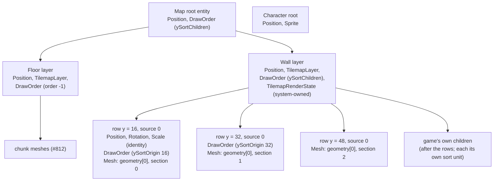
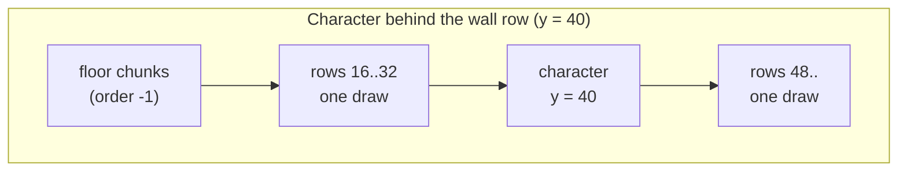
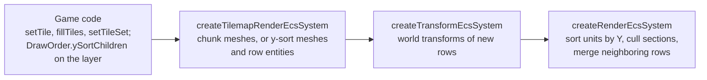

<!-- cspell:words tilemap tilemaps tileset tilesets quadrant quadrants subarray -->

# Y-sorted tile layers

Issue: [#872](https://github.com/Forge-Game-Engine/Forge/issues/872)
(milestone "Tilemaps"; builds on [tilemap chunk rendering](./tilemap-chunk-rendering.md)
(#812), [animated tiles](./animated-tiles.md) (#830),
[y-sort units](./y-sort-units.md) (#870),
[geometry sections and batched mesh draws](./mesh-sections-and-batching.md)
(#874), [tile sets and tilemap layers](./tilesets-and-tilemap-layers.md)
(#805) and `EcsWorld.setSiblingIndex` (#868))

| Module or file                                                                                                          | Change   | Notes                                                                                                                                                                              |
| ----------------------------------------------------------------------------------------------------------------------- | -------- | ---------------------------------------------------------------------------------------------------------------------------------------------------------------------------------- |
| `src/tilemaps/systems/tilemap-render-system.ts`                                                                         | Modified | Reads the layer entity's `DrawOrderEcsComponent.ySortChildren`; builds row-grouped (layer, source) geometries and row entities for y-sorted layers; rebuilds when the flag changes |
| `src/tilemaps/components/tilemap-render-state-component.ts`                                                             | Modified | `ySorted`, `ySortMeshes`, `TilemapYSortMesh`, `TilemapYSortRow`; `meshes` is renamed `chunkMeshes`; the remove hook releases both kinds                                            |
| `src/tilemaps/rendering/write-y-sort-vertices.ts`                                                                       | New      | Internal: collects one source's cells across the layer, groups them by sort Y and writes their quads, sections and animated bookkeeping. No WebGL. Not exported                    |
| `src/tilemaps/rendering/write-chunk-vertices.ts`                                                                        | Modified | `writeTile` and `getFrameTileIndex` are exported inside the module so both writers share them. Still internal                                                                      |
| `src/tilemaps/rendering/quad-indices.ts`                                                                                | Modified | `createQuadIndices(capacity)`: the same index pattern for any tile count, `Uint16Array` up to 16,384 tiles, `Uint32Array` beyond. Not exported                                     |
| `src/tilemaps/rendering/release-tilemap-chunk-mesh.ts`                                                                  | Modified | Gains `releaseTilemapYSortMesh`. Not exported                                                                                                                                      |
| `src/tilemaps/rendering/place-beside-neighbors.ts`                                                                      | New      | Internal: the sibling placement `getSiblingIndexBesideNeighbors` does today, moved out of the system and taking a list of entities, so chunk and row entities share it             |
| `src/tilemaps/**/*.test.ts`                                                                                             | Modified | Row grouping, sections, row entities, edits, toggling, animation in y-sorted layers, draw calls                                                                                    |
| `e2e/fixtures/scenes/tilemap-y-sorted-walls.ts`, `e2e/specs/tilemap-y-sorted-walls.spec.ts`                             | New      | An isometric floor and a y-sorted wall layer under a `ySort` camera, with a character walking past a tall wall                                                                     |
| `documentation-site/docs/docs/tilemaps/index.md`                                                                        | Modified | "Y-sorting tiles with characters"; the rendering sections name row meshes where they differ from chunk meshes                                                                      |
| `documentation-site/docs/docs/rendering/draw-order.md`                                                                  | Modified | "Y-sorting an entity's children" links the tilemap section as an example                                                                                                           |
| `documentation-site/src/pages/demos/tilemaps/` (`_isometric-map.ts`, `_create-game.ts`, `_walk.system.ts`, `index.tsx`) | Modified | Phase 3: the isometric map's walls become a y-sorted layer and the character walks among them                                                                                      |
| `AGENTS.md`                                                                                                             | Modified | The `/tilemaps` line in "Repository Structure" mentions y-sorted row meshes                                                                                                        |
| `CHANGELOG.md`                                                                                                          | Modified | `#### Added`: y-sorted tile layers. `#### Changed`: `TilemapRenderStateEcsComponent.meshes` is now `chunkMeshes`                                                                   |
| **Engine version at time of design**                                                                                    |          | `0.26.2`                                                                                                                                                                           |

## Summary

In isometric and top-down games, characters walk behind some tiles (walls,
trees, pillars) and in front of others. A tile layer today draws as chunk
meshes at the layer's origin (#812), so under a camera with `ySort` the
whole layer is one block in the sort, at the layer's Y. A character is
either in front of every wall or behind every wall.

This design makes a layer sort row by row, the way Godot's
`TileMapLayer.y_sort_enabled` does: the layer drops its chunks, groups its
tiles by Y across the whole layer, and gives each group a place in the
y-sort. It adds no tile-specific rendering code. Everything is existing
engine pieces:

- **The opt-in is the existing flag.** A layer whose entity has
  `DrawOrderEcsComponent.ySortChildren` set to `true` is y-sorted. That's
  the flag that makes any entity's children separate sort units (#870).
  There's no tilemap option. The tilemap render system reads the flag and
  never writes it.
- **A cell's sort Y** is the Y of its footprint's center
  (`layout.getCellCenter`) plus its placed tile's `ySortOrigin` (#805), in
  layer-local space. Cells with the same sort Y form a **sort row**. In an
  isometric layout, the cells with the same `column + row` share one.
- **One geometry per (layer, source).** For a y-sorted layer, the system
  builds one `Geometry` per tileset source for the whole layer. It writes
  the source's cells grouped by sort Y, rows in ascending order, each row's
  cells in row-major order, and gives the geometry one `GeometrySection`
  per row (#874). Section bounds come from the vertices, so they cover tall
  tiles' overhang.
- **One entity per (row, source).** Each row is a child entity of the layer
  at the layer's local origin, with a mesh drawing its section
  (`MeshEcsComponent.section`) and `DrawOrderEcsComponent.ySortOrigin` set
  to the row's sort Y. The layer has `ySortChildren`, so each row is its own
  sort unit and interleaves with characters by Y (#870). Every row has the
  same world transform, so rows that are neighbors in the draw order, and
  whose ranges follow on, merge back into one draw call (#874): one draw per
  visible run of contiguous rows of a source.
- **Row entities stay in ascending sort-Y sibling order** (by sort Y, then
  source), so a camera without `ySort` still draws the layer back to front.
- **Edits rebuild the (layer, source) geometry** whose tiles changed, in
  place with `Geometry.update`, and add or remove the row entities whose
  rows appeared or emptied.
- **Animated tiles** (#830) keep working: the animated-quad bookkeeping
  indexes the row-grouped vertices and names cells by column and row.
- **All bookkeeping is component data**, in the layer's
  `TilemapRenderStateEcsComponent`, as #812 set up. The system stays
  stateless.

Two of the issue's statements are corrected here:

- **Draw calls per source.** The issue says a y-sorted layer costs one draw
  per tileset source. A layer costs one draw per _visible run of contiguous
  rows_ of a source, plus one per sort unit between rows. That's one draw
  per source when the whole layer is in view, one source draws it (the
  usual wall layer) or sources don't share rows, and nothing sorts between
  rows. Culling can split a run: a row is culled by the bounds of its own
  tiles, so a sparse row whose tiles are all off to one side of the view is
  culled while the rows around it draw, and the gap in the index range
  splits the merge (decision Y12). Rows of two sources
  at the same sort Y sort next to each other, so walking the rows in sort
  order alternates between the two geometries, and neighboring rows of one
  source are no longer neighbors in the draw order. Such a layer costs a
  draw call every time the source changes along the sort order (decision
  Y7). Godot's canvas batching breaks on a texture change the same way. In
  return, a y-sorted layer draws overlapping tiles from different sources
  in the right order across rows, which a chunk layer can't (#812, R2).
- **Edit cost.** Rebuilding a (layer, source) geometry sorts that source's
  tiles by sort Y, so an edit is `O(n log n)` in them, not linear (decision
  Y5). For a wall layer of a few thousand tiles this is a fraction of a
  millisecond, and it only runs on ticks with edits.

Nothing here bends a core design of the engine. The render system, the
draw-order resolver and `Geometry` don't change. The tilemap render system
keeps its fixed query, `[tilemapLayerId, positionId]`, reads the layer
entity's `DrawOrderEcsComponent` the way it already reads its render state,
and is the only writer of the row entities and every component on them.

## Scope

### In scope

- Reading `ySortChildren` on the layer entity and building, for a y-sorted
  layer, one geometry per source with one section per sort row and one
  entity per (row, source) instead of #812's chunk meshes.
- Sort Y per cell from the footprint center and the placed tile's
  `ySortOrigin`, for orthogonal and isometric layouts.
- `Uint32Array` indices once a geometry's capacity passes 16,384 tiles
  (65,536 vertices).
- Rebuilding only the sources an edit touched; adding, removing and reusing
  row entities; keeping their sibling order.
- Switching a layer between chunk meshes and rows when `ySortChildren`
  changes, on the system's next tick.
- Animated tiles in y-sorted layers.
- Category, draw layer, tint and materials, as for chunk meshes.
- Releasing everything with the layer, its state, its layer component or
  its position, as for chunk meshes.
- Unit tests, an e2e scene and spec, the guide section, JSDoc, changelog
  bullets, and the tilemaps demo's isometric walls (Phase 3).

### Out of scope

- **Changes to the render system, the draw-order resolver, `Geometry` or
  `MeshMaterial`.** None are needed.
- **Setting `ySortChildren` on map roots.** The Tiled loader (#836) sets it
  on the map roots it spawns; a hand-built map sets it on its root. This
  design documents that, and doesn't write the flag anywhere.
- **Y-sorting floors.** Floors are ordinary layers at a lower
  `DrawOrderEcsComponent.order`, so they draw behind everything, whatever
  their Y. A floor in a y-sorted layer still draws, but pays for rows it
  doesn't need.
- **Per-tile sort units.** Tiles in one sort row are one unit and draw in
  row-major order among themselves. A character can't stand between two
  tiles of one row; it doesn't need to, since those tiles are side by side.
- **A sort axis other than Y** and **rotated y-sorted layers**. A row sorts
  at the world Y of the point `(0, sortY)` on the layer's local Y axis
  (#870's sort point rule). Under a rotated layer that's still a
  consistent order, but it isn't "lower on screen draws in front" for
  tiles away from the layer's origin. The guide says y-sorted layers are
  meant to be unrotated.
- **Uploading only the changed part of a geometry.** `Geometry.update`
  uploads whole attributes (open question 2).
- **Draw calls across sources.** Merging rows of different sources would
  need several textures per draw (decision Y7).
- **Staggered and hexagonal layouts** (#869 leaves them out).

## Concepts and entity composition

- **Y-sorted layer**: a layer whose entity's `DrawOrderEcsComponent` has
  `ySortChildren: true`. Any other layer (no draw order, or the flag
  `false`) draws as #812's chunk meshes.
- **Sort Y** of a cell: `layout.getCellCenter(column, row).y +
getTileData(tileSet, tile).ySortOrigin`, in layer-local units, Y-down.
  The placed tile's `ySortOrigin`, never an animation frame's (#830).
- **Sort row**: the cells of one source with one sort Y. Grouping uses the
  exact number (decision Y4).
- **Y-sort mesh** (`TilemapYSortMesh`): one source's geometry for the whole
  layer, with one section per sort row, in ascending sort Y.
- **Row entity** (`TilemapYSortRow.entity`): draws one section of one
  y-sort mesh.



- A row entity has identity `PositionEcsComponent`, `RotationEcsComponent`
  and `ScaleEcsComponent` locals, as a chunk entity does, so the transform
  system gives it exactly the layer's world transform; a
  `DrawOrderEcsComponent` with `order: 0`, `behindParent: false`,
  `ySortChildren: false` and `ySortOrigin` set to the row's sort Y; and a
  `MeshEcsComponent` with the source's geometry and material, the row's
  section index, and the layer's `category` and draw `layer`.
- **Sort units.** Because the layer sets `ySortChildren`, every child of it
  is a sort unit: each row, and each of the game's own children (a door or
  a chest parented to the wall layer sorts by its own Y among the rows).
  By #870's rule, the rows sort against a character root only when every
  ancestor of the layer also sets `ySortChildren`. With a plain map root
  above it, the layer is still one unit, drawn back to front by sibling
  order; rows still merge, so it costs what a chunk layer costs in draws.
- **Sibling order.** Row entities are kept in ascending (sort Y, source)
  order among themselves, placed with the same rule as chunk entities:
  just in front of the nearest later row entity that's still a child of
  the layer, else just behind the nearest earlier one, else first (#812,
  decision R10). The game's own children keep their places.
- **Ties.** Under a `ySort` camera, units with the same sort Y draw in
  hierarchy order (#870, decision D3): a character root and a row under the
  map root draw by their roots' creation sequence, so a character standing
  exactly on a row's sort Y draws in front when it was spawned after the
  map, and behind when before. Rows at the same Y draw in source order.

## The render state component

`TilemapRenderStateEcsComponent` keeps one of two kinds of meshes, and says
which:

```ts
export interface TilemapRenderStateEcsComponent {
  readonly builtFrom: TilemapLayerEcsComponent | null;
  readonly builtVersion: number;
  readonly appliedCategory: number;
  readonly appliedDrawLayer: number;

  /**
   * Whether the meshes are y-sorted rows: the layer entity's
   * `DrawOrderEcsComponent.ySortChildren` when they were built. When it
   * differs from the flag now, the system rebuilds the layer as the other
   * kind on its next tick.
   */
  readonly ySorted: boolean;

  /**
   * The layer's chunk meshes when it isn't y-sorted, in sibling order: by
   * chunk row, then chunk column, then source. Empty when `ySorted`.
   * (Renamed from `meshes`.)
   */
  readonly chunkMeshes: readonly TilemapChunkMesh[];

  /**
   * The layer's y-sort meshes when it's y-sorted: one per source that has
   * tiles in the layer, by ascending source index. Empty when not
   * `ySorted`.
   */
  readonly ySortMeshes: readonly TilemapYSortMesh[];

  readonly materials: ReadonlyMap<number, MeshMaterial>;
  readonly animationTime: number | null;
  readonly nextFrameChangeTime: number;
}

/**
 * One tileset source's tiles in a y-sorted layer: one geometry for the
 * whole layer, with one section per sort row, and one row entity per
 * section. Written only by `createTilemapRenderEcsSystem`.
 */
export interface TilemapYSortMesh {
  readonly source: number;

  /**
   * Two triangles per tile, grouped by sort row in ascending sort Y, each
   * row's cells in row-major order. Section `i` is `rows[i]`'s.
   */
  readonly geometry: Geometry;

  readonly tileCount: number;
  readonly positions: Float32Array;
  readonly texCoords: Float32Array;
  readonly texRects: Float32Array;

  /**
   * The index pattern the geometry draws a prefix of, owned by this mesh:
   * `Uint16Array` while its capacity is at most 16,384 tiles, else
   * `Uint32Array`.
   */
  readonly indices: Uint16Array | Uint32Array;

  /** The rows, in ascending sort Y. */
  readonly rows: readonly TilemapYSortRow[];

  /** The keys of the chunks holding at least one of the source's tiles. */
  readonly chunkKeys: ReadonlySet<number>;

  /** The quad index of each animated tile, in the order they're written. */
  readonly animatedQuads: Uint32Array;

  /** Each animated quad's cell, as column and row pairs. */
  readonly animatedCells: Int32Array;

  /** The distinct animation keys among the mesh's tiles (as on chunk meshes). */
  readonly animatedTiles: readonly number[];
}

/** One sort row of a y-sort mesh, drawn by one child entity of the layer. */
export interface TilemapYSortRow {
  /** The row's sort Y, in layer-local units; also its entity's `ySortOrigin`. */
  readonly sortY: number;

  /** The child entity of the layer that draws the row's section. */
  readonly entity: number;
}
```

- **Two fields, one always empty**, rather than a tagged union. The two
  kinds have different bookkeeping and are released and animated by
  functions of their own (`releaseTilemapChunkMesh` and
  `releaseTilemapYSortMesh`, `advanceAnimatedTiles` and
  `advanceYSortAnimatedTiles`). What the two fields buy is that the passes
  over a layer (the remove hook, category and draw layer, the next frame
  change) loop over both lists with no branching, the empty one costing
  nothing, and that the fields shared by both kinds (`builtFrom`,
  `materials`, `animationTime`, ...) stay where #812 and #830 put them. A
  union would move them into each variant or narrow at every reader. The
  JSDoc states the invariant, and a unit test checks it (decision Y8).
- **`meshes` becomes `chunkMeshes`.** With a second kind of mesh next to
  it, `meshes` no longer says which. Forge is pre-1.0, so the field is
  renamed, every caller in `/src`, `/e2e` and the docs is updated, and the
  changelog's `#### Changed` bullet tells consumers (open question 3).
- **The section index is the row's index.** Row `i` of a mesh draws
  `geometry.sections[i]`, so a row stores no range of its own and can't
  disagree with the geometry.
- **The remove hook** (`releaseTilemapRenderState`) releases both kinds:
  each chunk mesh as today, and each y-sort mesh with
  `releaseTilemapYSortMesh`, which removes every row entity that's still
  alive and then disposes the geometry once.
- Every array is owned by its mesh and never shared, since `Geometry` keeps
  references to them for context restore (#812).

## The system

`createTilemapRenderEcsSystem(renderContext, time)` keeps its signature and
query. Per tick, for each layer (new and changed steps in bold):

```text
updateLayer(entity, layer, now):
  state = getOrAddState(entity, layer)
  ySorted = world.getComponent(entity, drawOrderId)?.ySortChildren ?? false

  if state.builtFrom !== layer or **state.ySorted !== ySorted**:
    release every chunk mesh and y-sort mesh; clear materials
    state.builtFrom = layer; state.builtVersion = -1; state.animationTime = null
    **state.ySorted = ySorted**

  rebuild = layer.version !== state.builtVersion
  **changedSources = rebuild && ySorted ? findChangedSources(layer, state) : none**

  animate = state.animationTime !== null and
            (now >= state.nextFrameChangeTime or now < state.animationTime)
  if animate:
    ySorted ? **advanceYSortAnimatedTiles(layer, state, changedSources, now)**
            : advanceAnimatedTiles(layer, state, now)          // as today

  if rebuild:
    ySorted ? **rebuildYSortMeshes(entity, layer, state, changedSources, now)**
            : rebuildChangedChunks(entity, layer, state, now)   // as today

  if animate or rebuild:
    state.animationTime = now
    state.nextFrameChangeTime = min over both mesh lists' animatedTiles (as today)

  category, draw layer: written onto every chunk and row mesh when they change
  materials: u_texture, u_regionInset, u_tint every tick (as today)
```

- **Reading the flag.** `ySortChildren` is read with `world.getComponent`,
  as the system reads its render state. The query stays fixed: a layer
  without a `DrawOrderEcsComponent` is a chunk layer, not an entity the
  system skips. Setting the flag, removing the draw order, or adding one,
  takes effect on the next tick, as a changed `order` does.
- **Switching kinds** releases everything and builds the layer again, like
  a replaced layer component. Switching is rare (an editor toggle), so the
  cost of a full build is fine, and nothing has to translate one kind of
  bookkeeping into the other.

### Finding the sources an edit touched

```text
findChangedSources(layer, state):
  if state.builtVersion === -1: every source             // first build, switch, new layer
  changed = a boolean per source of the current tile set (local to the call)
  for each chunk in layer.chunks.values() with chunk.changedAt > state.builtVersion:
    mark every source the chunk holds now                 // countChunkTilesBySource
    mark every y-sort mesh whose chunkKeys has the chunk's key   // sources it held before
  for each y-sort mesh:
    if any key in mesh.chunkKeys isn't in layer.chunks: mark mesh.source   // an emptied chunk
  return changed
```

`setTileSet` stamps every chunk (#805), so it marks every source. A source
index past the new tile set's sources is released by the rebuild, as the
chunk path releases meshes of sources a smaller tile set doesn't have.

### Rebuilding a source

```text
rebuildYSortMeshes(entity, layer, state, changed, now):
  for each source s marked in changed:
    cells = collectYSortCells(layer, s)        // write-y-sort-vertices.ts
    if cells is empty:
      release s's mesh if it has one (row entities, geometry); continue
    sort cells by (sortY, row, column)
    mesh = s's mesh, or a new one: arrays and indices sized to the next power of two in tiles
    grow its arrays and indices when tileCount passes their capacity
    written = writeYSortVertices(layer.tileSet, cells, mesh, now)
              // quads in sorted order; one section per run of equal sortY;
              // animated quads, cells and keys; chunk keys
    first build: new Geometry({ attributes, indices: prefix, sections })
    otherwise:   geometry.update({ vertexCount, attributes, sections,
                                   indices: prefix when tileCount or the array changed })
    reconcileRows(entity, layer, state, mesh, written.sortYs)
  release y-sort meshes whose source the tile set no longer has
  drop the materials of sources no mesh draws
  placeNewRows(entity, state)                  // sibling order, see below
  state.builtVersion = layer.version
```

```text
collectYSortCells(layer, s):
  for each chunk in layer.chunks.values(), each non-empty cell of source s:
    column, row = the cell's coordinates
    sortY = layout.getCellCenter(column, row).y + getTileData(tileSet, tile).ySortOrigin
    append (column, row, tile, sortY); add the chunk's key to chunkKeys
  // columns: Int32Array, rows: Int32Array, tiles: Uint32Array, sortYs: Float64Array,
  // sized by a count pass first; local to the call
```

- **Sorting.** An index array sorted with a comparator on
  `(sortY, row, column)`. The arrays are local to the call, so the system
  keeps no state.
- **Writing.** `writeYSortVertices` calls the same `writeTile` as the chunk
  writer, with each cell's displayed frame (`getFrameTileIndex`), so
  placement, trimmed regions, transform bits and animation frames are
  identical in both paths. A section is `{ start: 6 * firstQuad, count: 6 *
quadCount }` for each run of equal sort Y.
- **Indices.** `createQuadIndices(capacity)` fills the pattern
  `4i + (0, 1, 2, 0, 2, 3)` into a `Uint16Array` when `4 * capacity` is at
  most 65,536 vertices, else a `Uint32Array`. The geometry draws a
  `subarray` prefix of it. `Geometry` reads the index type from the current
  data on every draw, so a mesh that grows past 16,384 tiles switches to
  32-bit indices with an ordinary `update` (#874).
- **Bounds.** Updating positions or sections clears every section's cached
  bounds; `Geometry` computes each from its vertices the next time the
  render system reads it. That's one more pass over the source's vertices
  after each edit, and nothing on static frames.

### Reconciling row entities

```text
reconcileRows(layerEntity, layer, state, mesh, newSortYs):
  walk the old mesh.rows and newSortYs together, both ascending:
    same sortY:  keep the entity; if game code removed it, create a new one (marked new)
    only old:    remove the entity
    only new:    create an entity (marked new): identity Position, Rotation, Scale;
                 DrawOrder { ySortOrigin: sortY }. Not parented yet: placeNewRows
                 parents it when it places it
  for each row i: set its MeshEcsComponent's geometry, material, section = i,
                  category and layer (adding the mesh to a new entity)
  mesh.rows = the new list
```

- A new row entity stays a root until `placeNewRows` parents it, later in
  the same tick and before the transform and render systems run, so
  nothing draws or transforms it in between.

- A row's sort Y never changes, since rows are keyed by it, so an
  existing row entity's `ySortOrigin` is written only when it's created.
- Section indices shift when a row appears or empties, so every row's
  `section` is rewritten on every rebuild of its source. The geometry's
  sections are updated first, so `addMeshComponent`'s section check sees
  the new list. Both happen before the render system runs, so it never
  sees one without the other.

### Sibling order

```text
placeNewRows(layerEntity, state):
  order = every row of every y-sort mesh, merged by (sortY, source)
  for each row i in order that was created this tick, in that order:
    world.setParent(row.entity, layerEntity)           // appended last
    setSiblingIndex(row.entity, siblingIndexBesideNeighbors(layerEntity, order, i))
```

This is the chunk path's sequence (`addChunkEntity`: parent, then place),
one new entity at a time. `siblingIndexBesideNeighbors` is today's
`getSiblingIndexBesideNeighbors`, moved to `place-beside-neighbors.ts` and
taking a list of entities. It looks for the nearest later entity in `order`
that's a child of the layer, else the nearest earlier one, and skips
entities that aren't children. A new row is only parented when it's placed,
so every child it finds is either an existing row or a new row already
placed this tick, and both are in ascending (sort Y, source) order. Placing
new rows in ascending order then puts each one in front of the next placed
row, or behind the previous one. Existing rows never change their relative
order (their keys are fixed), so only new ones are placed: one
`getSiblingIndex` and one `setSiblingIndex` each, linear in the layer's
children, on ticks that create rows.

Parenting every new row during reconciliation instead would break this: a
first build appends all of one source's rows, then all of the next's, so the
helper would find unplaced rows of the second source as children and place
rows of the first beside them, out of (sort Y, source) order. A unit test
covers that case.

### Animated tiles

```text
advanceYSortAnimatedTiles(layer, state, changedSources, now):
  frames = { changed, unchanged, shownAt: state.animationTime, now }   // local, as today
  for each y-sort mesh with animatedTiles, whose source isn't in changedSources:
    if holdsChangedFrame(layer, mesh, frames):            // as today
      for each animated quad whose key changed:
        tile = getTile(layer, column, row)                // from animatedCells
        writeTile(mesh, quad, tileSet, column, row, tile, frame tile index)
      geometry.update({ vertexCount, a_texCoord, a_texRect, and a_position if a corner moved })
```

- A mesh whose source an edit touched is skipped: its animated cells may
  have changed, and the rebuild writes the frames at `now` anyway. Every
  other mesh was built from the current cells and tile set, so its keys are
  valid, as #830 requires.
- `animatedQuads` is a `Uint32Array`, since a y-sort mesh can hold more
  than 65,535 tiles, and `animatedCells` names cells by column and row,
  since a row spans chunks (#830, "Notes for later issues").
- The upload is the mesh's whole `a_texCoord` and `a_texRect`, 96 bytes per
  tile of the source in the layer, on each frame change. For a wall layer
  with a few torches that's small; for a layer of thousands of tiles with
  fast animations it's megabytes per second. The guide recommends keeping
  animated floors (water, lava) in layers that aren't y-sorted (open
  question 2).

## Draw order and draw calls



- **Against sprites.** Under a `ySort` camera, the wall layer's rows and a
  character root sort by layer, world order, sort unit Y, then hierarchy
  order (#870). The floor's lower world order keeps it behind all of them.
- **Inside a row.** A row's tiles draw in row-major order. They don't
  overlap each other, given #805's placement limits.
- **Between rows.** Rows draw in ascending sort Y, so a tall tile in a lower
  row covers what's behind it, across sources too.
- **Draw calls.** After culling, neighboring row commands of one source
  have the same geometry, material, model matrix and mask, and ranges that
  follow on, so they merge (#874). A layer costs one draw call per visible
  run of contiguous rows of a source, plus one for each place a character
  or other sort unit sorts between its rows. With one source and the whole
  layer in view, that's one draw call. A layer whose sources share rows
  costs a draw call per change of source along the sort order (decision
  Y7).
- **Culling** is per section, by the bounds of the row's own tiles. Cells
  with one sort Y lie along a horizontal line on screen: in an isometric
  layer, a diagonal of the map. A row is culled when all of its tiles are
  outside the view, which happens to the rows above and below it, and also
  to a sparse row (a few pillars) whose tiles are all to the left or right
  of the view. Such a row leaves a gap in the visible index range, and the
  rows on either side of it draw in separate calls, since
  `canMergeMeshCommand` needs each range to start where the run ends
  (decision Y12, open question 6). A visible row submits all of its tiles,
  including those off screen; the GPU clips them. That's the cost of
  Godot's y-sorted layers too. The guide says so.
- **Without `ySort`.** Rows draw in sibling order, ascending sort Y, so the
  layer still draws back to front, and merges into one draw per source run.

## Data flow and system order



The order is #812's, unchanged: the tilemap render system after the systems
that edit tiles and before the transform system, so a new row entity has a
world transform in the frame it's created.

## Who writes what

| Value                                                                 | Writer                                                          |
| --------------------------------------------------------------------- | --------------------------------------------------------------- |
| The layer entity's `DrawOrderEcsComponent` (`ySortChildren` included) | Game code, or a spawner acting for it (#836)                    |
| Row entities, their transforms, `DrawOrderEcsComponent` and mesh      | `createTilemapRenderEcsSystem`                                  |
| Y-sort geometries, their data and sections                            | `createTilemapRenderEcsSystem`                                  |
| `TilemapRenderStateEcsComponent`                                      | `createTilemapRenderEcsSystem`                                  |
| Row entities' `world` transforms                                      | `createTransformEcsSystem`                                      |
| Sort units, merged draws                                              | The render system's resolver and key buffers, scratch, per tick |

## Performance

- **Static frames.** No uploads. One draw item per row entity in the render
  system's sort. An `N x N` isometric layer has `2N - 1` rows per source:
  399 for a 200 x 200 map.
- **Rows.** A row per distinct sort Y. Tiles whose `ySortOrigin` varies
  within a grid row make extra rows (and entities); the guide says so.
- **Edits.** A tick with edits rebuilds each touched source's geometry:
  collect (linear), sort (`n log n`), write and upload 128 bytes per tile,
  plus indices when the count changes, then recompute section bounds on the
  next draw. For 16,000 wall tiles, about 2 MiB uploaded. The guide says
  y-sorting is for wall and prop layers, not large floors, and that a map
  that changes many tiles every frame belongs in chunk layers.
- **First build** is the same work once.
- **Memory.** As chunk meshes, 128 bytes per tile, plus 12 bytes of indices
  per tile of capacity (24 past 16,384 tiles), and one entity per row.
- **Draw calls.** See above.

## Context loss

Nothing extra. A y-sort geometry keeps its latest arrays, indices and
sections and rebuilds itself on restore; edits while lost update the arrays
and record the change (`Geometry.update`); sections are CPU-side (#874). A
unit test edits a y-sorted layer while the mocked context is lost, restores
it, and checks the restored buffers.

## Testing

Unit tests (Vitest; a mocked WebGL context behind a real `RenderContext`
where geometries and materials are created, as `AGENTS.md` describes; the
vertex writer needs no WebGL):

- **`writeYSortVertices` and `collectYSortCells`.**
  - Orthogonal: cells group into grid rows; rows ascend; each row's cells
    are in row-major order; section ranges are `6 * quads` long and follow
    on.
  - Isometric: cells with the same `column + row` share a row, including
    across chunk boundaries and negative cells.
  - Tiles with different `ySortOrigin` in one grid row split it into rows
    at their sort Y, in order.
  - Quads equal the chunk writer's for the same cell (same `writeTile`),
    for all eight transform-bit combinations and a trimmed region.
  - Animated quads and cells point at the right quads; keys are distinct.
- **`createQuadIndices`.** `Uint16Array` at 16,384 tiles, `Uint32Array` at
  16,385, same pattern.
- **System, y-sorted layer.**
  - One geometry per source; one row entity per (row, source); every row
    entity is a child of the layer with identity local transforms and the
    same world transform after the transform system runs; each carries its
    row's `ySortOrigin` and `section`.
  - Section bounds include a two-cell-tall tile's overhang.
  - Sibling order is ascending (sort Y, source) after a first build with
    two sources whose tiles share rows (every row of both is new on that
    tick), and stays so after an edit adds a row between two others and
    after the game moves its own child to index `0`.
  - An edit adds a row entity when a row appears and removes it when a row
    empties; an edit that doesn't change the set of rows keeps every
    entity and rewrites the geometry with one `Geometry.update`.
  - An edit in one source doesn't update the other source's geometry.
  - Growing past 16,384 tiles switches to 32-bit indices.
  - A row entity removed by game code is recreated on the next rebuild of
    its source.
  - Toggling `ySortChildren` on, off and on again (and removing or adding
    the draw order) rebuilds the layer as the other kind on the next tick;
    `chunkMeshes` and `ySortMeshes` are never both non-empty.
  - Animated tiles in a y-sorted layer: a frame change updates only the
    meshes holding the tile, writes the new frame into the right quads, and
    isn't applied twice on a tick that also edits the source.
  - `setTileSet` to a tile set with fewer sources releases the extra
    meshes and materials.
  - Removing the layer entity, layer component, position or state removes
    the row entities and disposes the geometries.
  - Category, draw layer and tint reach row meshes.
  - Context loss, as above.
- **With the render system.**
  - Under a `ySort` camera with a `ySortChildren` map root, a root sprite
    whose Y is between two rows draws between them.
  - With the whole layer inside the camera's view, a y-sorted layer with no
    sort unit between its rows draws in one `drawElements` per source; a
    sprite between two rows makes it two.
  - A sparse row whose tiles are all outside the view, between two visible
    rows, is culled and splits the layer's draw in two (the documented
    cost).
  - Without `ySort`, the layer draws rows in ascending order.

E2E (`write-e2e-test` skill), a new scene rather than an extension of
`tilemap-isometric-overlap` (decision Y9):

- **`e2e/fixtures/scenes/tilemap-y-sorted-walls.ts`**: a `ySort` camera; a
  map root with `ySortChildren`; an isometric floor layer at order `-1`; a
  y-sorted wall layer with one two-cell-tall wall tile of one color; and a
  character sprite of another color that is a root. The handle steps the
  character between two positions: on the row behind the wall (sort Y
  smaller) and on the row in front of it (sort Y larger), both overlapping
  the wall's image. It wraps the context's `drawElements` to count
  non-instanced draws per step, as `mesh-sections.ts` does. The whole wall
  layer stays inside the camera's view, so culling never splits its draw
  and the counts depend only on where the character sorts.
- **`e2e/specs/tilemap-y-sorted-walls.spec.ts`**: in one `page.evaluate`
  per measurement, step and classify the pixels of the overlap region.
  Behind: the wall's color fills the part of the overlap the wall covers.
  In front: the character's color fills it. Both are compared with a frame
  where the character is hidden, in the same run, not with absolute pixels.
  The draw count with the character in front of every row is one fewer than
  with it between rows.

## Documentation and demo

- **Tilemaps guide, "Y-sorting tiles with characters"** (the
  `document-feature` skill), after "Drawing order inside a layer":
  - set `ySortChildren` on the wall layer and on every ancestor up to the
    map root, with a `ySort` camera; floors as ordinary layers at a lower
    `order`;
  - how a cell's sort Y is found, and moving it with a tile's
    `ySortOrigin` (a tree sorted at its trunk);
  - rows as child entities of the layer, not to be edited; the game's own
    children of a y-sorted layer sort by their own Y among the rows;
  - ties: a character exactly on a row's sort Y draws by spawn order;
  - draw calls: one per visible run of contiguous rows of a source, plus
    one per sort unit between rows, so one per source when the whole layer
    is in view and nothing sorts between its rows; keep a y-sorted layer's
    tiles in one source;
  - culling: a row is culled by its own tiles' bounds, so a visible row
    submits its whole width, and a sparse row entirely to one side of the
    view is culled and splits the draw around it;
  - edit cost, and that y-sorting is for walls and props, not big floors or
    layers of fast animated tiles;
  - y-sorted layers are meant to be unrotated.
- "Chunk meshes", "Chunk entities", "Drawing layers with sprites" (step 3),
  "Drawing order inside a layer" (sources), "Animated tiles" (upload cost)
  and "Removing a drawn layer" say how y-sorted layers differ, with a link.
- `rendering/draw-order.md`, "Y-sorting an entity's children": a sentence
  linking the tilemap section as an example.
- JSDoc: `createTilemapRenderEcsSystem` (the two kinds and the flag),
  `TilemapRenderStateEcsComponent`'s new fields, `TilemapYSortMesh`,
  `TilemapYSortRow`, `TileData.ySortOrigin` (link to the guide).
- `AGENTS.md`: the `/tilemaps` line mentions y-sorted row meshes.
- `CHANGELOG.md`: under `#### Added`, "Tile layers y-sort row by row with
  sprites: set `ySortChildren` on a layer entity's `DrawOrderEcsComponent`
  and `createTilemapRenderEcsSystem` draws it as one geometry per source,
  one row entity per sort Y, drawn in one call per visible run of
  contiguous rows of a source, plus one per sprite sorted between rows."
  Under `#### Changed`,
  "`TilemapRenderStateEcsComponent.meshes` is renamed `chunkMeshes`; read
  `ySortMeshes` for y-sorted layers."
- **Demo** (Phase 3, the `add-feature-demo` skill): the tilemaps demo's
  isometric map moves its walls, pillars and hedges into a y-sorted layer
  above a floor layer at order `-1`, its root sets `ySortChildren`, the
  camera y-sorts while the isometric map shows, and the walker walks the
  isometric map, passing behind and in front of the pillars. A "How it
  works" line names the flag.

## Phases

### Phase 1: Y-sorted rows

Draws a layer whose entity sets `ySortChildren` as row-grouped geometries
and row entities, keeps them up to date through edits, animation and
switching, and documents it.

**Definition of done:** under a `ySort` camera with a `ySortChildren` map
root, a root sprite draws between the rows of a y-sorted layer by Y; a
one-source y-sorted layer entirely in view with nothing between its rows
draws in one call;
edits add and remove row entities and update the geometry in place;
toggling the flag switches kinds on the next tick; animated tiles animate;
every unit test in "Testing" passes; the guide section, JSDoc, `AGENTS.md`
line and changelog bullets are written; every check in `CLAUDE.md`'s
verification list passes, including the tilemaps demo still building after
the rename.

| Task           | Description                                                                                                                                                          | Size |
| -------------- | -------------------------------------------------------------------------------------------------------------------------------------------------------------------- | ---- |
| State          | `ySorted`, `chunkMeshes` (rename, update every reader), `ySortMeshes`, `TilemapYSortMesh`, `TilemapYSortRow`; the remove hook and `releaseTilemapYSortMesh`; JSDoc   | S    |
| Indices        | `createQuadIndices(capacity)` with the 16/32-bit choice; tests                                                                                                       | S    |
| Vertex writer  | `write-y-sort-vertices.ts`: collect, sort, write through the shared `writeTile`, sections, animated bookkeeping, chunk keys; tests                                   | M    |
| Sibling helper | Move `getSiblingIndexBesideNeighbors` to `place-beside-neighbors.ts`, taking a list of entities; the chunk path uses it unchanged                                    | S    |
| System         | Read the flag; switch kinds; `findChangedSources`; `rebuildYSortMeshes`; `reconcileRows`; `placeNewRows`; `advanceYSortAnimatedTiles`; category, layer and materials | L    |
| System tests   | The "System, y-sorted layer" and "With the render system" tests                                                                                                      | M    |
| Docs           | The guide section and the touched sections, `draw-order.md` link, JSDoc, `AGENTS.md` line                                                                            | M    |
| Changelog      | `#### Added` and `#### Changed` bullets                                                                                                                              | S    |

### Phase 2: End-to-end proof

Proves on a real canvas that a character is covered by a wall in front of
it and covers a wall behind it, and that the wall layer merges its rows.

**Definition of done:** the `tilemap-y-sorted-walls` spec passes, with the
relative, same-run measurements and draw counts in "Testing";
`npm run test:e2e` passes.

| Task  | Description                                                    | Size |
| ----- | -------------------------------------------------------------- | ---- |
| Scene | `tilemap-y-sorted-walls.ts`, with the draw counter and measure | M    |
| Spec  | `tilemap-y-sorted-walls.spec.ts`                               | S    |

### Phase 3: Y-sorted walls in the tilemaps demo

**Definition of done:** in the tilemaps demo's isometric map, the walker
passes behind and in front of pillars; the orthogonal map draws as before;
the docs site builds (`npm run typecheck`, `npm run build`) and the page has
been loaded in a browser.

| Task   | Description                                                                                                                               | Size |
| ------ | ----------------------------------------------------------------------------------------------------------------------------------------- | ---- |
| Map    | `_isometric-map.ts`: a floor layer at order `-1` and a y-sorted wall layer; the root sets `ySortChildren`; the brushes paint either layer | S    |
| Walker | The walker walks the isometric map too; the camera's `ySort` follows the shown map (`_create-game.ts`, `_demo-map.ts`)                    | M    |
| Page   | A "How it works" line in `index.tsx`                                                                                                      | S    |

The `claude` label run can ship all three phases in one pull request.

## Decision log

| #   | Decision                              | Options considered                                                                                                                                                                                     | Chosen | Rationale                                                                                                                                                                                                                                                                                                                                                                                                                                                                                                  | Tradeoff                                                                              | Assumptions                                                                    |
| --- | ------------------------------------- | ------------------------------------------------------------------------------------------------------------------------------------------------------------------------------------------------------ | ------ | ---------------------------------------------------------------------------------------------------------------------------------------------------------------------------------------------------------------------------------------------------------------------------------------------------------------------------------------------------------------------------------------------------------------------------------------------------------------------------------------------------------- | ------------------------------------------------------------------------------------- | ------------------------------------------------------------------------------ |
| Y1  | The opt-in                            | (a) The layer entity's `DrawOrderEcsComponent.ySortChildren`; (b) a `ySort` field on `TilemapLayerEcsComponent`; (c) a system option                                                                   | (a)    | The issue's choice and Godot's (`y_sort_enabled` on the layer is the same flag as on any canvas item). It already means "my children are sort units", which is what rows are. (b) would be a second flag that has to agree with (a) to have any effect. (c) is a configurable system, which the rules forbid.                                                                                                                                                                                              | A draw-order flag changes how the tilemap system builds meshes.                       | Games y-sort a layer exactly when they want its tiles to sort with characters. |
| Y2  | Sort units                            | (a) One entity per (sort row, source); (b) one entity per tile; (c) sections as sort items inside one entity                                                                                           | (a)    | Forge sorts entities, as Unity and Bevy do (#874, S9). Rows are the smallest unit that's ever needed between tiles that don't overlap each other. (b) multiplies entities and draw items by the row length. (c) adds a second sort concept to the render system.                                                                                                                                                                                                                                           | One entity per row.                                                                   | Tiles in one row don't overlap each other.                                     |
| Y3  | Geometry granularity                  | (a) One geometry per (layer, source), grouped across the whole layer (Godot); (b) per (chunk, source) with rows per chunk; (c) one geometry per row                                                    | (a)    | (b) gives each chunk its own row entities with the same Y as its neighbors' rows; they interleave in the sort and never merge, so a layer costs a draw per visible (chunk, row). (c) can't merge at all. (a) lets every row of a source merge, at the cost of whole-source edits.                                                                                                                                                                                                                          | An edit rewrites and uploads the whole source.                                        | Y-sorted layers are walls and props, edited rarely.                            |
| Y4  | Grouping cells into rows              | (a) Exact equality of the sort Y; (b) a tolerance; (c) a key in cell space                                                                                                                             | (a)    | The sort uses the exact number, so two cells with different numbers sort apart anyway. With the usual pixel-sized cells every center is exact, so isometric diagonals share a row. Where rounding splits a row, the two rows are still neighbors in the sort and merge, so the only cost is an entity. (b) could merge rows that really differ. (c) doesn't exist once `ySortOrigin` is added.                                                                                                             | Non-dyadic cell sizes can make extra rows.                                            |                                                                                |
| Y5  | Ordering cells                        | (a) A comparator sort of an index array by (sort Y, row, column); (b) the render module's radix sort over float keys                                                                                   | (a)    | Simple, local to the call, and fast enough for edit ticks. (b) is linear but ties the tilemaps module to rendering internals for a cost nobody has measured.                                                                                                                                                                                                                                                                                                                                               | `O(n log n)` per edit, not linear as the issue says.                                  | A wall layer has thousands of tiles, not millions.                             |
| Y6  | Indices                               | (a) An index array per y-sort mesh, 16-bit up to 16,384 tiles, 32-bit beyond, grown with the vertex arrays; (b) one shared module-level pattern grown on demand; (c) always 32-bit                     | (a)    | Ownership follows the vertex arrays and context restore. (b) is module-level mutable state changed from a system. (c) doubles index memory for every small layer.                                                                                                                                                                                                                                                                                                                                          | Index memory per mesh instead of one shared array.                                    |                                                                                |
| Y7  | Several sources in one y-sorted layer | (a) One geometry per source; rows of different sources at the same Y sit next to each other and split merging; (b) order rows by source first; (c) one geometry and material sampling several textures | (a)    | (b) draws every tile of source `1` after every tile of source `0`, which breaks the sort. (c) needs a branch per texture unit or texture arrays in the tilemap shader. Godot's batching splits on texture changes the same way. This corrects the issue's "one draw per source" claim.                                                                                                                                                                                                                     | A layer whose sources share rows costs a draw per source change along the sort order. | Wall layers usually draw from one atlas.                                       |
| Y8  | State shape                           | (a) `chunkMeshes` and `ySortMeshes` side by side with a `ySorted` flag, one always empty; (b) a tagged union; (c) a second component for row state                                                     | (a)    | The two kinds keep different bookkeeping and have their own release and animation functions. Side by side, the passes over a layer (remove hook, category and draw layer, next frame change) loop over both lists without branching, and the shared fields (`builtFrom`, `materials`, `animationTime`) stay where #812 and #830 put them. (b) moves those into each variant or narrows at every reader. (c) splits one consumer's bookkeeping across two components with two remove hooks that must agree. | An invariant (one list empty) checked by tests, not types.                            |                                                                                |
| Y9  | E2E scene                             | (a) A new `tilemap-y-sorted-walls` scene; (b) extend `tilemap-isometric-overlap`, as the issue says                                                                                                    | (a)    | `AGENTS.md` gives each scenario its own minimal scene, and #830 (A9) made the same call. A y-sort camera and a character would change what the overlap spec measures.                                                                                                                                                                                                                                                                                                                                      | One more scene file.                                                                  |                                                                                |
| Y10 | Switching kinds                       | (a) Release everything and build again; (b) convert one kind's bookkeeping into the other                                                                                                              | (a)    | It's the path a replaced layer already takes; switching is rare.                                                                                                                                                                                                                                                                                                                                                                                                                                           | A full build on the tick after a switch.                                              |                                                                                |
| Y11 | Which sources an edit rebuilds        | (a) Sources held by changed chunks now, plus those whose `chunkKeys` include a changed or emptied chunk; (b) every source on every edit                                                                | (a)    | The issue asks for per-source rebuilds; the chunk keys are a by-product of the build.                                                                                                                                                                                                                                                                                                                                                                                                                      | One more set per mesh.                                                                |                                                                                |
| Y12 | Culled rows between visible ones      | (a) Accept that a culled row splits the merge, and document the cost as one draw per visible run of contiguous rows; (b) skip culling y-sort rows; (c) let the render system merge across culled gaps  | (a)    | (b) draws every row of a huge layer, off-screen ones included. (c) changes #874's batch key (ranges must follow on) for every mesh: drawing over a culled range would draw what culling removed, so it needs multi-draw or a rule about which gaps are safe. That's a rendering issue of its own (open question 6). Sparse rows wholly beside the view are uncommon in wall layers.                                                                                                                        | A sparse, culled row costs a draw call.                                               | Wall layers have few sparse rows wholly outside the view's width.              |
| Y13 | When a new row is parented            | (a) In `placeNewRows`, just before it's placed, one row at a time in (sort Y, source) order; (b) in `reconcileRows`, all at once                                                                       | (a)    | The placement helper only relies on children that are already in order. With (b), a first build with two sources appends every row of source `0`, then of source `1`, and a row is placed beside an unplaced row of the other source. (a) is the chunk path's sequence (`addChunkEntity`).                                                                                                                                                                                                                 | New rows are roots for part of a tick, before any system after this one runs.         |                                                                                |

## Open questions

Blocking: no. Every question has a default the implementation follows, and
a different answer changes details, not the approach.

1. **Non-blocking. Draw calls when a y-sorted layer uses several
   sources.** The issue promises one draw per source; rows of different
   sources at the same Y interleave in the sort (decision Y7).
   - Accept and document (the default): "keep a y-sorted layer's tiles in
     one source" in the guide, the same advice #812 gives for overlapping
     tiles, and the same limit Godot's batching has.
   - A multi-texture tilemap material, so one geometry covers every source:
     one draw per layer whatever the sources, but a shader branch per
     texture unit and a different material model. A separate issue if a
     game needs it.

2. **Non-blocking. Animation uploads in large y-sorted layers.** A frame
   change uploads the whole source's texture coordinates (96 bytes per
   tile).
   - Keep it and document "animated floors go in layers that aren't
     y-sorted" (the default).
   - Add a vertex range to `GeometryUpdate` (`bufferSubData` at an offset),
     a general rendering change #830's open question 3 already names;
     edits and animation would then upload only what changed. A separate
     issue, worth it once a profile shows the uploads.

3. **Non-blocking. Renaming `meshes` to `chunkMeshes`.**
   - Rename (the default): the name says which kind, and Forge doesn't
     keep old names.
   - Keep `meshes` for chunk meshes: no `#### Changed` bullet, but a field
     whose name doesn't say it's empty for y-sorted layers.

4. **Non-blocking. The demo in this issue.**
   - Phase 3 (the default): `CLAUDE.md` asks for a demo with a major
     feature, and the tilemaps demo already has isometric walls and a
     walker.
   - A separate issue, keeping this pull request to the renderer.

5. **Non-blocking. Ties between a character and a row.** A character
   exactly on a row's sort Y draws by root creation sequence (#870's
   rule), which the issue asks to document.
   - Document it (the default).
   - Nudge every row's sort point by a tiny amount so characters always win
     ties: hides the rule, and makes sort points differ from the documented
     formula.

6. **Non-blocking. Merging across culled rows.** A culled row between
   visible rows of a source leaves a gap in the index range, and the rows on
   either side draw in two calls (decision Y12).
   - Accept and document "one draw per visible run of contiguous rows" (the
     default).
   - Let the render system merge mesh ranges across culled gaps, with
     `WEBGL_multi_draw` or a rule for when drawing the gap is safe. A
     general change to #874's batch key, so a separate rendering issue.
