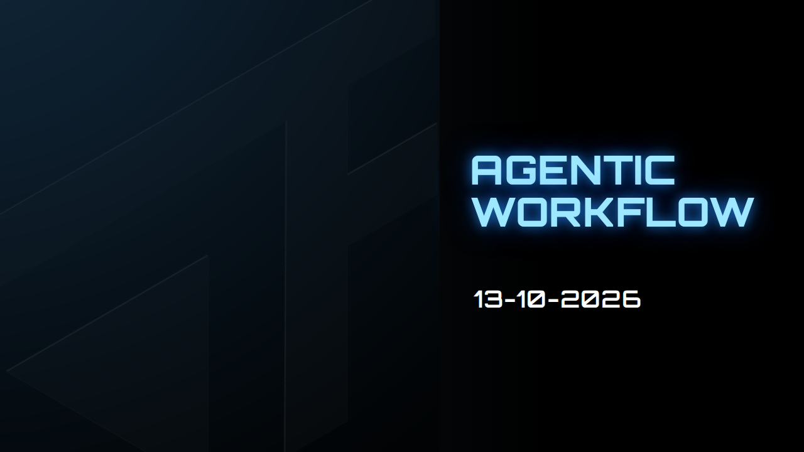
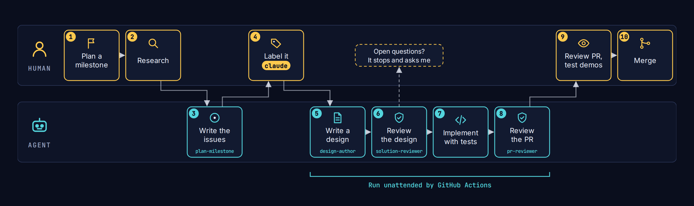

Most of the pull requests that went into Forge this year were written by
[Claude Code](https://claude.com/claude-code). Not as autocomplete, but as
one continuous workflow that takes a feature from a milestone to merged code.
I decide what gets built, answer the questions that need a person, test the
result and merge it. Agents do the work in between: writing the issues,
designing the change, reviewing the design, implementing it with tests, and
reviewing the pull request.

This post walks through that workflow, the agents and skills behind it, and
why it's shaped the way it is.

{/* truncate */}

## The workflow at a glance

| #   | Step                                          | Who                                    |
| --- | --------------------------------------------- | -------------------------------------- |
| 1   | Plan a milestone                              | Me                                     |
| 2   | Research it                                   | Me                                     |
| 3   | Turn the milestone into issues                | Agent, with the `plan-milestone` skill |
| 4   | Label the issues `claude`                     | Me                                     |
| 5   | Write a design document                       | `design-author` agent                  |
| 6   | Review the design                             | `solution-reviewer` agent              |
| 7   | Implement, with unit and e2e tests            | Agent                                  |
| 8   | Review the pull request against Forge's rules | `pr-reviewer` agent                    |
| 9   | Review the pull request, test the demos       | Me                                     |
| 10  | Merge                                         | Me                                     |

Steps 5 to 8 run unattended in GitHub Actions, through the
[Claude GitHub app](https://github.com/apps/claude). Everything the agents
follow is checked into the repository: the rules in
[`CLAUDE.md`](https://github.com/Forge-Game-Engine/Forge/blob/dev/CLAUDE.md)
and [`AGENTS.md`](https://github.com/Forge-Game-Engine/Forge/blob/dev/AGENTS.md),
the agents in
[`.claude/agents`](https://github.com/Forge-Game-Engine/Forge/tree/dev/.claude/agents)
and the skills in
[`.claude/skills`](https://github.com/Forge-Game-Engine/Forge/tree/dev/.claude/skills).

## Plan and research

Every feature starts as a GitHub milestone, such as text rendering, the UI
module or trail rendering. Before anything is written, I research it: I ask
Claude, and read other engines' documentation, technical write-ups and
tutorials until I know what to ask for. Game engines are full of
well-understood problems (transform hierarchies, broad and narrow phase
collision, multi-pass rendering), and the research is how I make sure Forge
solves them the established way rather than inventing its own.

## From milestone to issues

The `plan-milestone` skill turns the milestone into issues. Each issue is
sized for one pull request, grounded in the current code (it names the files
and symbols it touches), and has a "Done when" line so it's clear when it's
finished. Issues that must merge first are listed on `Depends on #N` lines.
The skill also writes the milestone's description: its goal, its approach,
and a checklist for when it's done.

The skill never labels an issue `claude`. That label starts an unattended
run, so deciding what's ready to build stays with me.

## Label it, and let the dependencies wait

Adding the `claude` label to an issue starts a run of
[`claude.yml`](https://github.com/Forge-Game-Engine/Forge/blob/dev/.github/workflows/claude.yml).
I can label every issue in a milestone at once. Before a run starts, a small
gate job reads the issue's `Depends on #N` lines. While any of those issues
is still open, it swaps `claude` for `claude-waiting`, comments which issues
it's waiting on, and stops. When an issue closes, a second workflow gives
`claude` back to every waiting issue whose dependencies have all closed,
which starts its run. So a milestone builds itself in dependency order, and
the only thing I wait on is review.

## Design before code

For a new feature, a large change or a refactor, the run doesn't start with
code. The `design-author` agent researches the engine and how Unity, Godot
and Bevy solve the same problem, then writes a design document in `/design`,
with a decision log that says why it chose its approach.

The `solution-reviewer` agent then reviews that design before any code
exists. It answers five questions, each with evidence from the code:

1. Does it fix the root cause, or a symptom?
2. Who writes each value it touches? (Forge allows one writer per component
   field.)
3. How do established engines solve this, and does the design match?
4. Does it fit ECS and Forge's rules: fixed system queries, stateless
   systems, no compatibility shims, no options that switch between old and
   new behavior?
5. What does the right change cost?

It ends with one verdict: approve, revise, reject or escalate. A design gets
one revision. If the design still isn't approved, or the design itself has
blocking open questions, the run commits the design, posts the questions on
the issue and stops without a pull request. **It stops rather than guess.**
I answer on the issue, mention `@claude`, and the next run picks up the
design where it left off.

A small, clearly scoped fix skips the design document, but its plan still
goes through `solution-reviewer` before any code is written.

## Implement, with tests

Once the design is approved, the run implements it, following `CLAUDE.md`'s
ground rules and the matching skill (`fix-defect`, `create-component`,
`create-system`, `add-feature-demo`, `document-feature` or
`write-e2e-test`). Testing is part of implementing, not a separate step:

- unit tests next to the code they test;
- real-browser Playwright tests for anything that touches rendering, input or
  the game loop. The run installs Chromium and runs the e2e suite against a
  real WebGL2 canvas;
- the full verification checklist: type checks, tests, lint, spelling,
  package exports, documentation, the docs-site demos building against the
  published package, and a changelog entry.

Then it opens a pull request with a Conventional Commits title, fills in the
pull request template, records the `solution-reviewer` verdict, and lists the
demo pages a person needs to check in a browser, since an agent can't judge
whether a demo looks right.

## Review, then merge

When the pull request opens, a second workflow runs the `pr-reviewer` agent.
It reviews the change against Forge's checklist (one writer per value, fixed
queries and stateless systems, no shims or option bloat, root cause rather
than symptom, the changelog, docs, demos, exports and tests) and posts a
table of results with inline comments. It never approves, pushes or blocks a
merge; it's there so my review starts from a list of what to look at.

Then it's my turn. I review the pull request, load the demo pages it lists,
and merge.

## A real example: meshes in the draw order

Trail rendering is one of the milestones on Forge's roadmap. A ship's exhaust
trail has to draw behind the ship and in front of the background, but
Forge's render system could only sort sprites and text. Issue
[#783](https://github.com/Forge-Game-Engine/Forge/issues/783) asked for the
render system to draw meshes in the same draw order as sprites.

I labelled it, and 47 minutes later the run had:

- written a design,
  [`meshes-in-the-draw-order.md`](https://github.com/Forge-Game-Engine/Forge/blob/dev/design/meshes-in-the-draw-order.md),
  that follows how Unity, Godot and Bevy share one 2D sort order;
- had it approved by `solution-reviewer`, with a few bookkeeping fixes folded
  in;
- implemented it, including moving terrain onto the same mesh path and
  deleting its separate draw system;
- added unit tests and an e2e test that draws a mesh between two sprites and
  checks the result on a real canvas;
- updated the documentation and added a new
  [meshes demo](/Forge/demos/meshes);
- opened pull request
  [#862](https://github.com/Forge-Game-Engine/Forge/pull/862).

`pr-reviewer` flagged two documentation pages that didn't mention meshes yet
(the run's own local review had already caught and fixed them), a comment
nit, and a design question for a follow-up. I loaded the demos it listed and
merged it the same day.

## Why it's shaped this way

The workflow grew out of the problems I hit working with agents, and each
fix is now part of the repository, so it applies to every run after it:

- **Agents keep things backwards compatible by default.** They added
  deprecated aliases and options that switch between old and new behavior,
  so tech debt piled up and the API got complicated. Forge is pre-1.0, so a
  rule in `CLAUDE.md` now says to change behavior outright and update every
  caller in the same change.
- **Agents build on a bad design rather than question it.** Whether the
  design was mine or another agent's, they'd keep building on it and never
  suggest a refactor. That's why `design-author` writes the design first and
  `solution-reviewer` challenges it before any code exists.
- **Agents drift from conventions.** For example, they'd keep state in
  systems. Stricter types, the `create-system` skill, the rules in
  `CLAUDE.md` and `pr-reviewer` keep changes in line.

The other lesson is about where people fit. Agents are good at the work
between decisions. The decisions themselves stay with me: what to build,
which questions block a design, whether a demo looks right, and what gets
merged.

If you want to set up something similar, everything above is in the
[Forge repository](https://github.com/Forge-Game-Engine/Forge): the workflows
in `.github/workflows`, and the agents and skills in `.claude`.
